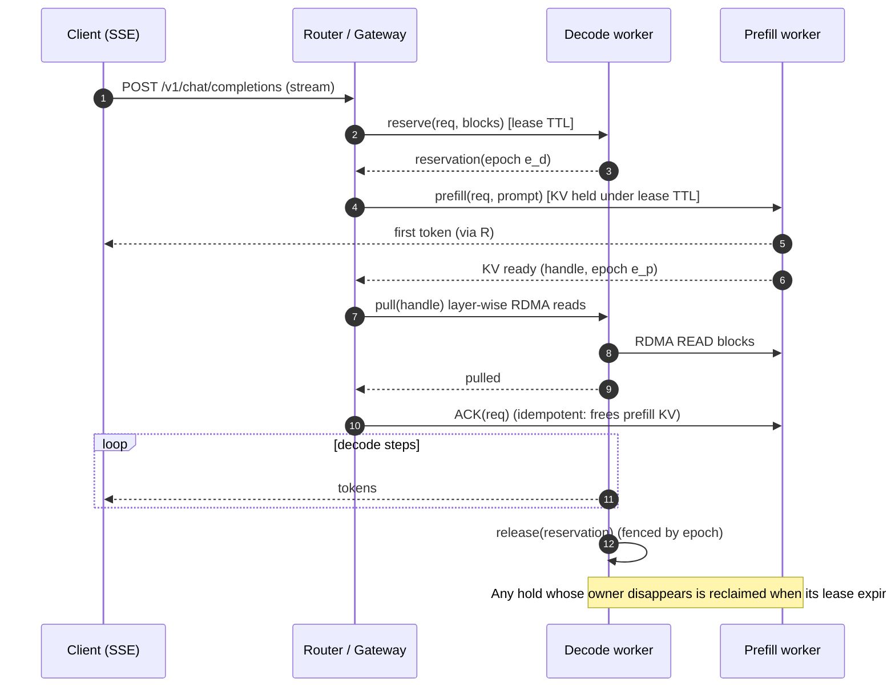

# 02 · Disaggregated Serving: The Prefill/Decode Split and KV-Cache Transfer over RDMA

> **Folder:** `02-High-Throughput-Serving-and-Distributed-Inference/` · **File 2 of 3**
> **Anchoring papers and systems:** Zhong et al., *DistServe* (OSDI 2024) · Patel et al., *Splitwise: Efficient
> Generative LLM Inference Using Phase Splitting* (ISCA 2024) · Qin et al., *Mooncake: A KVCache-centric Architecture
> for Serving LLM Chatbot* (FAST 2025) · Hu et al., *Inference without Interference (TetriInfer)* (2024) · Strati et
> al., *DéjàVu: KV-cache Streaming for Fast, Fault-tolerant Generative LLM Serving* (ICML 2024) · NVIDIA Dynamo and
> NIXL (2025) · vLLM KV-connector disaggregated prefill · SGLang PD disaggregation · llm-d · DeepSeek-AI, *DeepSeek-V3*
> and its inference-system overview (2025).
> **Code baseline:** Python 3.10+ (CPython 3.14.5) · Java 21 (JDK 25.0.4, `--release 21`). Listings import
> `roofline.py` / `kv_cache_math.py` (Folder 01) and `batching_sim.py` (File 01).
> **Previous:** [01 · Continuous batching and chunked prefill](01-continuous-batching-orca-chunked-prefill-and-sarathi.md) ·
> **Next:** [03 · Speculative decoding, quantization, tensor parallelism](03-speculative-decoding-quantization-fp8-awq-and-tensor-parallelism.md)

---

## 0. The thesis in one paragraph

Chunked prefill (File 01) makes prefill and decode *coexist* on one GPU. Disaggregation makes them **stop sharing a
GPU at all**. Prefill instances run compute-bound prompt processing at high MFU and emit the first token. Decode
instances run memory-bound token generation with clean, interference-free steps. Between them, the prompt's KV cache
moves over NVLink or GPUDirect RDMA. The physics makes the trade explicit:

- **The two phases want different things.** Prefill wants FLOPs and moderate TP. Decode wants HBM capacity and
  bandwidth, large batches, and often a different parallelism layout (DP attention + EP for MoE).
- **The transfer is cheap only if the network is right.** Over 400G RDMA it costs about 3% of the prefill compute it
  follows for Llama-3-70B, and layer-wise streaming hides almost all of it. Over host-staged TCP it can cost more than
  the prefill itself.
- **It wins only for tight SLOs, and only with the right ratio.** In this file's simulator, disaggregation gives
  **+33% goodput under a tight TPOT SLO and exactly zero under a loose one**. A wrong prefill:decode ratio is far
  worse than not disaggregating at all.

An L7 engineer can say when to split, at what ratio, and how to make the handoff survive crashes without leaking a
single KV block.

---

## 1. Why split the phases

| | Prefill | Decode |
|-|---------|--------|
| Roofline regime (Folder 01) | compute-bound (intensity ≫ ridge) | memory-bound (intensity ≈ batch; attention = $n_h/n_{kv}$) |
| SLO it sets | TTFT | ITL / TPOT |
| What it wants from hardware | FLOP/s (H100/B200, even L40S for small models) | HBM capacity + bandwidth (H200, B200) |
| Preferred parallelism | lower TP (less all-reduce share at large messages); context parallelism for very long prompts | TP for latency or DP-attention + wide EP for MoE (DeepSeek) |
| Batching behavior | one or a few prompts saturate the GPU | needs hundreds of sequences per step |
| Interference when colocated | stalls every decoder in its step (File 01: 1.66 s for one 32K prompt) | inflates TTFT when decodes crowd the budget |

**What the literature reports** (⚠ verify setups before quoting):

- DistServe: up to **7.4× more requests or 12.6× tighter SLOs** vs. colocated systems.
- Splitwise: **1.4× throughput at 20% lower cost**, or **2.35× throughput** at the same cost and power, using
  heterogeneous hardware per phase.
- Mooncake (Kimi): up to 525% more throughput in simulated scenarios and **75% more requests** under real workloads.
  It treats the KV cache as a first-class distributed object.

Production stacks now ship it: NVIDIA Dynamo with NIXL, vLLM's KV-connector API, SGLang's prefill/decode modes, llm-d
on Kubernetes, and DeepSeek's own deployment (prefill and decode on separate node groups with different expert
parallelism).

---

## 2. When it wins and when it does not

`disagg_sim.py` (§6.2) runs the same 8 H100s two ways, with one Llama-3-8B replica per GPU, Poisson arrivals, ~2.7K-
token prompts with a 16K tail, and ~180-token outputs:

- **Colocated:** 8 chunked-prefill replicas.
- **Disaggregated:** $P$ prefill + $D$ decode replicas, with KV streamed over 400G RDMA.

Goodput is DistServe's definition: the highest QPS with ≥ 90% of requests meeting both TTFT ≤ 1 s and the TPOT SLO.

| Configuration | Goodput, TPOT ≤ 40 ms | Goodput, TPOT ≤ 12 ms |
|---------------|----------------------:|----------------------:|
| colocated, budget 512 | **75 QPS** | 45 QPS |
| colocated, budget 2,048 | **75 QPS** | 30 QPS |
| disagg 3P + 5D | 45 QPS | 45 QPS |
| disagg 4P + 4D | 60 QPS | **60 QPS** |
| disagg 5P + 3D | 60 QPS | **60 QPS** |
| disagg 6P + 2D | **75 QPS** | 30 QPS |

Latency at 60 QPS explains the shape:

| Configuration | TTFT p50 | TTFT p99 | TPOT p50 | TPOT p99 | ITL p99 |
|---------------|---------:|---------:|---------:|---------:|--------:|
| colocated, budget 512 | 0.111 s | 0.561 s | 11.0 ms | 14.9 ms | 18.6 ms |
| colocated, budget 2,048 | 0.094 s | 0.437 s | 14.5 ms | 23.8 ms | 61.9 ms |
| disagg 3P + 5D | **3.791 s** | 7.855 s | 7.2 ms | 7.6 ms | 7.8 ms |
| disagg 4P + 4D | 0.602 s | 1.230 s | 8.6 ms | 9.4 ms | 9.6 ms |
| disagg 5P + 3D | 0.105 s | 0.525 s | 10.7 ms | 11.8 ms | 12.1 ms |
| disagg 6P + 2D | 0.065 s | 0.416 s | 17.2 ms | 20.5 ms | 20.7 ms |

The lessons, each one an interview follow-up:

1. **Disaggregated decode is beautifully clean.** ITL p99 equals TPOT p99 because no step ever carries a prefill.
   That is the whole point, and it is why disaggregation wins the tight-SLO column (+33%).
2. **The prefill pool sets TTFT, and it saturates first.** 60 QPS × ~2.7K tokens ≈ 162K prefill tokens/s. One H100
   prefills ~40K tokens/s at 60% MFU, so 3 prefill GPUs are overloaded (TTFT 3.8 s) while their 5 decode GPUs idle at
   7 ms TPOT.
3. **Under a loose SLO, chunked prefill is just as good.** Colocation statistically multiplexes prefill and decode
   demand on every GPU, while a static split strands capacity whenever the mix drifts. A strong colocated baseline
   (chunked prefill) is the right comparison. Many headline disaggregation gains are measured against unchunked
   baselines.
4. **The best ratio depends on the SLO:** 6P+2D under 40 ms, 4–5P + 3–4D under 12 ms. A fixed ratio is wrong
   whenever traffic or SLOs change, so production systems rebalance dynamically (§3.3).
5. **Granularity hurts small fleets.** With 8 GPUs only 7 split ratios exist, and none may match the workload. At
   hundreds of GPUs the ratio can be tuned finely.

---

## 3. The prefill:decode ratio, derived

### 3.1 Throughput per instance

For a request shape (prompt $L_{in}$, output $L_{out}$), one prefill instance serves

$$
\mu_p = \frac{1}{T_{\text{prefill}}(L_{in})}\ \text{requests/s},
$$

because prefill is compute-bound and a single prompt nearly saturates the GPU. One decode instance running batch $B$
at step time $t(B)$ serves

$$
\mu_d = \frac{B}{L_{out}\, t(B)}\ \text{requests/s},\qquad B = \max\{b : t(b) \le \text{TPOT SLO},\ b(L_{in} + L_{out}) \le \text{KV capacity}\}.
$$

Balance the pools: $N_p \mu_p = N_d \mu_d$, so

$$
\boxed{\;N_p : N_d = \mu_d : \mu_p\;}
$$

### 3.2 Numbers (Llama-3-8B, 1×H100 per instance, from `kv_transfer_math.py`)

| Request shape | TPOT SLO | Prefill | $\mu_p$ | Decode batch | $\mu_d$ | **P : D** |
|---------------|---------:|--------:|--------:|-------------:|--------:|----------:|
| 3,000 in / 150 out | 15 ms | 75.3 ms | 13.3 req/s | 65 @ 14.98 ms | 28.9 req/s | **2.18 : 1** |
| 3,000 in / 150 out | 40 ms | 75.3 ms | 13.3 req/s | 138 @ 25.43 ms (KV-bound) | 36.2 req/s | **2.72 : 1** |
| 500 in / 500 out | 15 ms | 12.7 ms | 78.7 req/s | 244 @ 14.99 ms | 32.5 req/s | **0.41 : 1** |

On 8 GPUs, 2.72 : 1 is about 6P + 2D, and 2.18 : 1 is about 5.5P + 2.5D. **These are exactly the simulator's winners
in §2** (6P+2D at 40 ms; 4–5P + 3–4D at 12 ms). The closed form predicts the experiment. A chat workload (500/500)
inverts the ratio and needs 2.4 decode instances per prefill instance. One fleet serving both shapes needs either
dynamic role assignment or two pools.

### 3.3 Dynamic rebalancing

Traffic mix changes by hour (RAG ingestion at night, chat by day), so production systems:

- re-derive $\mu_p, \mu_d$ from live metrics (prompt and output length histograms, measured TTFT/TPOT);
- **flip instance roles** (an instance drains, then restarts as the other role), or keep a "flex" pool that runs
  colocated chunked prefill and absorbs imbalance;
- treat the prefill queue (pending prompt tokens) and decode KV occupancy as the two autoscaling signals. NVIDIA
  Dynamo's planner automates this (⚠ verify current capabilities).

---

## 4. KV transfer physics

### 4.1 Transfer vs compute per token

A prefilled token's KV must cross the network once. Per GPU, compare the KV bytes/token over link bandwidth against
the prefill compute/token (GEMM-only, 60% MFU, H100):

| Model | KV B/token/GPU | Prefill compute | NVLink4 | 400G RDMA | 100G RoCE | 25G TCP (host-staged) |
|-------|---------------:|----------------:|--------:|----------:|----------:|----------------------:|
| Llama-2-7B (MHA) | 524,288 | 22.3 µs | 1.3 µs (6%) | 11.7 µs (52%) | 47.7 µs (214%) | 209.7 µs (**942%**) |
| Llama-3-8B (GQA-4) | 131,072 | 25.3 µs | 0.3 µs (1%) | 2.9 µs (12%) | 11.9 µs (47%) | 52.4 µs (207%) |
| Llama-3-70B TP=8 | 40,960 | 29.3 µs | 0.1 µs (0.3%) | **0.9 µs (3%)** | 3.7 µs (13%) | 16.4 µs (56%) |
| DeepSeek-V3 (MLA, DP attention, FP8) | 70,272 | 62.3 µs | 0.2 µs (0.3%) | 1.6 µs (2.5%) | 6.4 µs (10%) | 28.1 µs (45%) |

Two consequences:

- **The architecture decides whether disaggregation is cheap.** GQA and MLA make KV small relative to compute. An MHA
  model over commodity TCP spends 9× more time moving KV than computing it.
- **Large models are easier to disaggregate than small ones.** Compute per token grows with parameters faster than KV
  per token grows, so the ratio favors big models.

### 4.2 Hiding the transfer: layer-wise streaming

Prefill produces layer $\ell$'s KV before layer $\ell+1$ runs. Streaming each layer as soon as it is written overlaps
transfer with compute, and only the last layer's slice is exposed. After an 8K-token Llama-3-70B prefill (~361 ms at
TP=8):

| Link | Bulk transfer after prefill | Layer-wise streamed (exposed) |
|------|----------------------------:|------------------------------:|
| NVLink4 (same node) | 0.86 ms | 0.030 ms |
| 400G RDMA | 7.48 ms | 0.113 ms |
| 100G RoCE | 30.52 ms | 0.401 ms |
| 25G TCP host-staged | 134.24 ms | 1.698 ms |

The cluster simulator confirms the user-visible effect: the gap between the first token (from prefill) and the second
(from decode), at 5P+3D and 60 QPS:

| KV path | 1st→2nd token gap p50 | p99 | TPOT p99 | SLO attainment (TPOT ≤ 12 ms) |
|---------|----------------------:|----:|---------:|------------------------------:|
| 400G RDMA, layer-wise | 16.1 ms | 22.6 ms | 11.8 ms | **100%** |
| 400G RDMA, bulk after prefill | 22.2 ms | 54.5 ms | 11.9 ms | 99% |
| 25G TCP host-staged, bulk | 119.6 ms | **701.1 ms** | 18.3 ms | **69%** |

Layer-wise streaming needs a layout where each layer's blocks are separately addressable, which collides with §4.3's
preference for fewer, larger transfers. Production connectors stream per layer (or per group of layers) with large
descriptors.

### 4.3 Descriptor storms: why the KV layout matters to the NIC

RDMA moves memory regions described by work requests (descriptors). How many a transfer needs depends on how KV blocks
are laid out. For one rank's KV of an 8K-token Llama-3-70B prompt at TP=8 (1 KV head of dim 128, BF16):

| Layout | Block size | Descriptors | Bytes each | Posting/completion cost (assumed 0.25 µs each) | Wire time |
|--------|-----------:|------------:|-----------:|-----------------------------------------------:|----------:|
| layer-major (per-layer K and V tensors) | 16 | **81,920** | 4.0 KiB | **~20.5 ms** | 7.46 ms |
| layer-major | 64 | 20,480 | 16 KiB | ~5.1 ms | 7.46 ms |
| block-major (one region per block, all layers) | 16 | 512 | 640 KiB | ~0.13 ms | 7.46 ms |
| block-major | 64 | 128 | 2.5 MiB | ~0.03 ms | 7.46 ms |

With per-layer tensors and 16-token blocks, the software cost of posting and completing descriptors is **2.7× the wire
time**: you are message-rate-bound on tiny 4 KiB messages. The fixes:

- larger blocks;
- coalescing physically adjacent blocks into one descriptor;
- a block-major KV layout (one contiguous region per block across layers), traded against layer-wise streaming;
- a transfer library that batches descriptors and uses GPU-initiated or doorbell-batched posting (NIXL, Mooncake
  Transfer Engine, UCX).

The per-descriptor cost is an explicit modeling assumption in the listing; measure yours.

### 4.4 The data path: GPUDirect RDMA, topology, and pull vs push

```
  Prefill node                                              Decode node
  ┌─────────────────────────────┐                           ┌─────────────────────────────┐
  │ GPU0 HBM ── PCIe switch ── NIC0 ════ 400G (rail 0) ════ NIC0 ── PCIe switch ── GPU0 HBM │
  │ GPU1 HBM ── PCIe switch ── NIC1 ════ 400G (rail 1) ════ NIC1 ── PCIe switch ── GPU1 HBM │
  │   ...  (one NIC per GPU, same PCIe switch: peer-to-peer, no host DRAM bounce)  ...      │
  └─────────────────────────────┘                           └─────────────────────────────┘
```

- **GPUDirect RDMA.** The NIC DMAs directly to and from GPU HBM over PCIe peer-to-peer, without staging through host
  memory or involving the CPU on the data path. It needs NIC and GPU behind the same PCIe switch for full bandwidth,
  and memory registration (dma-buf / peer-memory).
- **Rail-optimized networks.** GPU $i$ on every node connects to rail $i$, so rank-$i$-to-rank-$i$ transfers between
  same-TP-layout pools never cross the spine.
- **Pull beats push.** In a pull design the decode side **reserves blocks first** (admission), then reads KV from the
  prefill side when it is ready, and the prefill side holds the KV under a lease until the reader ACKs. Pushing into
  a decode node that has no room drops the KV (or OOMs the receiver), and the sender has no one to tell. §5 makes this
  a protocol.
- **Intra-node** transfers use NVLink/NVSwitch (CUDA IPC). They are 10× faster than a 400G rail, which is why
  co-locating a prefill GPU and a decode GPU in one node (mixed-role nodes) is attractive at small scale.

### 4.5 Heterogeneous parallelism between pools

Prefill may run TP=4 while decode runs TP=8, or decode may use DP attention. Each decode rank must then fetch exactly
the KV heads it owns from whichever prefill rank holds them. `hetero_tp_plan()` computes the mapping (Llama-3-70B,
$n_{kv}$ = 8):

| Prefill TP → Decode TP | Transfers | Max fan-in per decode rank | Max fan-out per prefill rank | Note |
|------------------------|----------:|---------------------------:|-----------------------------:|------|
| 4 → 8 | 8 | 1 | 2 | each prefill rank splits its 2 heads to 2 decode ranks |
| 8 → 4 | 8 | 2 | 1 | each decode rank gathers 2 heads from 2 sources |
| 8 → 16 | 16 | 1 | 2 | $TP > n_{kv}$: each head is fetched **twice** (replication) |
| 2 → 8 | 8 | 1 | **4** | a prefill rank's NIC carries 4 streams, so watch rail balance |

For **MLA with DP attention** (DeepSeek), each sequence lives on one decode GPU, and its 70 KB/token latent moves as a
unit with no head mapping. For **MLA with TP**, every decode rank needs the full latent (×TP traffic), another reason
DeepSeek-style deployments use DP attention.

---

## 5. KV-centric architecture and the control plane

### 5.1 Mooncake: the KV cache as a distributed object

Mooncake (Moonshot AI's Kimi) generalizes disaggregation into a **KV-centric** design:

- a **distributed KV pool** across the cluster's otherwise idle CPU DRAM and SSDs, with a transfer engine over RDMA;
- **prefix reuse across instances**: a prefill instance can load another instance's cached prefix instead of
  recomputing it, trading cheap storage for expensive compute;
- **cache-aware prefill scheduling** (Folder 01 File 03's router at cluster scale): choose the prefill instance that
  minimizes estimated TTFT = queue + (prompt − reusable prefix) compute + KV load time;
- **overload-oriented early rejection**: under overload, reject at admission using a prediction of decode load
  *before* spending prefill compute on a request the decode pool can't take.

The general lesson: once KV moves over the network anyway, it can also move to and from a **cache tier**. Preemption
swap, prefix sharing across replicas, and session resumption all become reads from that tier (LMCache, Mooncake Store,
Dynamo's KV block manager).

### 5.2 The request flow and its failure points



Every arrow can fail:

- the prefill OOMs or errors;
- the pull times out, or partially completes;
- the decode node crashes before or after streaming begins;
- the router crashes between steps;
- a retried RPC delivers a **duplicate ACK**;
- a release arrives **after the worker restarted** and belongs to the dead incarnation.

### 5.3 The three rules that make it leak-free

1. **Every cross-node hold is a lease with a TTL.** That covers prefill KV awaiting a pull and decode reservations
   awaiting KV. If the owner (router) dies, the lease expires and a sweeper reclaims it.
2. **Every release is idempotent.** ACK, abort, and timeout-release can all race and all be retried, and only the
   first one frees.
3. **Every release is fenced by an epoch.** A restarted worker increments its pool epoch, and releases carrying an
   older epoch are ignored. Otherwise a pre-crash release would "free" blocks that now belong to someone else in the
   new incarnation.

`PdHandoffCoordinator.java` implements this protocol (decode-first reservation, leased prefill KV, re-pull on timeout,
abort on failure) next to a naive push protocol. It runs 20,000 concurrent requests on virtual threads under the same
failure script: 3% prefill failures, 3% pull timeouts, 1% decode crashes, 5% duplicate ACKs, 0.5% router crashes.
One measured run:

| | Hardened (lease + idempotent + fenced) | Naive (push, no leases) |
|-|--------------------------------------|-------------------------|
| Completed | **19,838** | 9,236 |
| Lost to router crash (leases reclaimed) | 99 | — |
| Lost mid-stream to decode crash (blast radius) | 63 | — |
| Retries exhausted | 0 | — |
| Rejected | 0 | **10,129** |
| Prefill blocks leaked at the end | **0** (113 leases reclaimed by TTL) | **15,983 of 16,000** |
| Accounting corruptions (double free / post-restart release) | **0** | 3,844 |

The naive protocol's leaks are not a slow drift. Within one run they consumed almost the entire prefill pool, and from
then on it **rejected half the traffic**. That is how disaggregated clusters actually fail.

---

## 6. Production code blueprints

### 6.1 Python: transfer math, layouts, heterogeneous TP plans, and the P:D ratio

```python
"""kv_transfer_math.py - the bytes and microseconds of moving KV from prefill to decode (stdlib only).

Uses roofline.py / kv_cache_math.py (Folder 01) and batching_sim.py (Folder 02, file 1) from the same
directory. Prints every number quoted in 02-disaggregated-serving-prefill-decode-split-and-kv-cache-rdma.md.
"""
from __future__ import annotations

import math

from batching_sim import Chunk, mixed_step_time
from kv_cache_math import MODELS, per_rank_bytes_per_token
from roofline import H100, LLAMA3_70B, LLAMA3_8B, DenseModel

MFU = 0.6
NETWORKS = {                       # effective one-way bandwidth available to ONE GPU's KV stream
    "NVLink4 (same node)": 400e9,
    "400G RDMA, 1 NIC/GPU": 45e9,
    "100G RoCE, 1 NIC/GPU": 11e9,
    "25G TCP, host-staged": 2.5e9,
}
LLAMA2_7B = DenseModel("Llama-2-7B", 4096, 32, 32, 32, 128, 11008, 32000)


def prefill_us_per_token(md: DenseModel, tp: int, peak: float = H100.bf16_flops) -> float:
    """GEMM-only prefill compute per token per GPU (attention adds more at long prompts)."""
    return 2.0 * md.streamed_params / (tp * peak * MFU) * 1e6


def transfer_s(tokens: int, kv_per_token_rank: float, bw: float, n_layers: int, layerwise: bool,
               latency_s: float = 20e-6) -> float:
    """Exposed (non-overlapped) transfer time after prefill finishes. Layer-wise streaming sends layer
    i while layer i+1 computes, so only the last layer's slice is exposed."""
    total = tokens * kv_per_token_rank / bw
    return latency_s + (total / n_layers if layerwise else total)


def rdma_work_requests(tokens: int, block_size: int, n_layers: int, layout: str) -> tuple[int, int]:
    """(descriptors, bytes-per-descriptor multiplier) for one rank's KV of `tokens`.
    'layer-major': each (layer, K|V, block) is its own contiguous region (per-layer KV tensors).
    'block-major': one region per block holding every layer's K and V (one descriptor per block)."""
    blocks = math.ceil(tokens / block_size)
    if layout == "layer-major":
        return n_layers * 2 * blocks, 1
    if layout == "block-major":
        return blocks, n_layers * 2
    raise ValueError(layout)


def head_owner(rank: int, tp: int, n_kv: int) -> list[int]:
    """KV heads held by `rank` under tensor parallelism `tp` (replicated when tp > n_kv)."""
    if tp <= n_kv:
        per = n_kv // tp
        return list(range(rank * per, (rank + 1) * per))
    return [rank * n_kv // tp]


def hetero_tp_plan(p_tp: int, d_tp: int, n_kv: int) -> list[tuple[int, int, tuple[int, ...]]]:
    """Transfer plan from a prefill group at TP=p_tp to a decode group at TP=d_tp:
    (src prefill rank, dst decode rank, heads). Each needed head is fetched from exactly one source."""
    plan = []
    for dst in range(d_tp):
        by_src: dict[int, list[int]] = {}
        for h in head_owner(dst, d_tp, n_kv):
            src = next(r for r in range(p_tp) if h in head_owner(r, p_tp, n_kv))
            by_src.setdefault(src, []).append(h)
        plan += [(s, dst, tuple(hs)) for s, hs in sorted(by_src.items())]
    return plan


def pd_ratio(md: DenseModel, tp: int, prompt: int, output: int, tpot_slo: float, kv_capacity: int):
    """Prefill:decode instance ratio that balances request throughput for a fixed request shape."""
    t_prefill = mixed_step_time(md, H100, tp, 0, 0, [Chunk(prompt, 0)])     # one prompt per step
    best_b, t_b = 0, 0.0
    for b in range(1, 1025):
        if b * (prompt + output) > kv_capacity:
            break
        t = mixed_step_time(md, H100, tp, b, b * (prompt + output // 2))
        if t > tpot_slo:
            break
        best_b, t_b = b, t
    mu_p = 1.0 / t_prefill                                                   # requests/s per prefill instance
    mu_d = best_b / (output * t_b)                                           # requests/s per decode instance
    return t_prefill, best_b, t_b, mu_p, mu_d


def main() -> None:
    print("== KV transfer vs prefill compute, per token per GPU ==")
    cases = [("Llama-2-7B (MHA)", LLAMA2_7B, 1, 2 * 32 * 32 * 128 * 2),
             ("Llama-3-8B (GQA-4)", LLAMA3_8B, 1, MODELS["Llama-3-8B"].bytes_per_token()),
             ("Llama-3-70B TP=8", LLAMA3_70B, 8, per_rank_bytes_per_token(MODELS["Llama-3-70B"], 8)[0])]
    print(f"{'model':20s} {'KV B/tok/GPU':>12s} {'compute us':>10s} " + " ".join(f"{n:>21s}" for n in NETWORKS))
    ratios = {}
    for name, md, tp, kv in cases:
        c = prefill_us_per_token(md, tp)
        cells = []
        for net, bw in NETWORKS.items():
            x = kv / bw * 1e6
            ratios[(name, net)] = x / c
            cells.append(f"{x:8.2f}us ({x / c:6.1%})")
        print(f"{name:20s} {kv:12,.0f} {c:10.2f} " + " ".join(f"{s:>21s}" for s in cells))
    ds = MODELS["DeepSeek-V3"]
    ds_c = 2.0 * 37e9 / (H100.fp8_flops * MFU) * 1e6                          # DP attention: 1 GPU per sequence
    print(f"{'DeepSeek-V3 (MLA,DP)':20s} {ds.bytes_per_token():12,.0f} {ds_c:10.2f} "
          + " ".join(f"{ds.bytes_per_token() / bw * 1e6:8.2f}us ({ds.bytes_per_token() / bw * 1e6 / ds_c:6.1%})"
                     .rjust(21) for bw in NETWORKS.values()))
    assert ratios[("Llama-3-70B TP=8", "400G RDMA, 1 NIC/GPU")] < 0.05
    assert ratios[("Llama-2-7B (MHA)", "25G TCP, host-staged")] > 1.0

    print("\n== Exposed transfer after an 8K-token prefill (Llama-3-70B TP=8 -> TP=8, 40,960 B/tok/rank) ==")
    for net, bw in NETWORKS.items():
        bulk = transfer_s(8192, 40_960, bw, 80, layerwise=False)
        lw = transfer_s(8192, 40_960, bw, 80, layerwise=True)
        print(f"  {net:22s} bulk {bulk * 1e3:8.2f} ms   layer-wise streamed {lw * 1e3:7.3f} ms")
    prefill_8k = mixed_step_time(LLAMA3_70B, H100, 8, 0, 0, [Chunk(8192, 0)])
    print(f"  (the prefill itself: {prefill_8k * 1e3:.0f} ms)")

    print("\n== RDMA descriptors for one rank's KV, 8K tokens, Llama-3-70B TP=8 (1 KV head, d=128, BF16) ==")
    per_block_layer_kv = 16 * 1 * 128 * 2                                   # bytes in one (layer, K|V, block)
    for layout in ("layer-major", "block-major"):
        for bs in (16, 64):
            n, mult = rdma_work_requests(8192, bs, 80, layout)
            size = per_block_layer_kv * bs // 16 * mult
            post = n * 0.25e-6                                              # assumed per-descriptor software cost
            wire = 8192 * 40_960 / 45e9
            print(f"  {layout:11s} block={bs:3d}: {n:7,d} descriptors x {size / 1024:7.1f} KiB "
                  f"-> post+complete ~{post * 1e3:6.2f} ms vs wire {wire * 1e3:5.2f} ms")
    assert rdma_work_requests(8192, 16, 80, "layer-major")[0] == 81_920

    print("\n== Heterogeneous TP transfer plans (n_kv = 8) ==")
    for p, d in ((4, 8), (8, 4), (8, 16), (2, 8)):
        plan = hetero_tp_plan(p, d, 8)
        fan_in = max(sum(1 for s, t, _ in plan if t == dst) for dst in range(d))
        fan_out = max(sum(1 for s, t, _ in plan if s == src) for src in range(p))
        print(f"  prefill TP={p} -> decode TP={d}: {len(plan):2d} transfers, max fan-in {fan_in}, "
              f"max fan-out {fan_out}; first: {plan[:3]}")
    assert hetero_tp_plan(4, 8, 8)[:2] == [(0, 0, (0,)), (0, 1, (1,))]
    assert hetero_tp_plan(8, 4, 8)[0:2] == [(0, 0, (0,)), (1, 0, (1,))]
    assert hetero_tp_plan(8, 16, 8)[1] == (0, 1, (0,))                       # replicated head fetched twice

    print("\n== Prefill:decode ratio for a fixed request shape (1xH100 instances, Llama-3-8B) ==")
    for prompt, output, slo in ((3000, 150, 0.015), (3000, 150, 0.040), (500, 500, 0.015)):
        tp_, b, tb, mu_p, mu_d = pd_ratio(LLAMA3_8B, 1, prompt, output, slo, 436_000)
        print(f"  prompt {prompt:5d} / output {output:4d}, TPOT<={slo * 1e3:2.0f}ms: prefill {tp_ * 1e3:6.1f} ms/req "
              f"-> {mu_p:5.1f} req/s/GPU; decode B={b:3d} @ {tb * 1e3:5.2f} ms -> {mu_d:5.1f} req/s/GPU; "
              f"P:D = {mu_d / mu_p:4.2f} : 1")
    print("\nall KV transfer self-checks passed")


if __name__ == "__main__":
    main()
```

Output (verified, deterministic):

```text
== KV transfer vs prefill compute, per token per GPU ==
model                KV B/tok/GPU compute us   NVLink4 (same node)  400G RDMA, 1 NIC/GPU  100G RoCE, 1 NIC/GPU  25G TCP, host-staged
Llama-2-7B (MHA)          524,288      22.26       1.31us (  5.9%)      11.65us ( 52.3%)      47.66us (214.1%)     209.72us (942.1%)
Llama-3-8B (GQA-4)        131,072      25.28       0.33us (  1.3%)       2.91us ( 11.5%)      11.92us ( 47.1%)      52.43us (207.4%)
Llama-3-70B TP=8           40,960      29.27       0.10us (  0.3%)       0.91us (  3.1%)       3.72us ( 12.7%)      16.38us ( 56.0%)
DeepSeek-V3 (MLA,DP)       70,272      62.32       0.18us (  0.3%)       1.56us (  2.5%)       6.39us ( 10.3%)      28.11us ( 45.1%)

== Exposed transfer after an 8K-token prefill (Llama-3-70B TP=8 -> TP=8, 40,960 B/tok/rank) ==
  NVLink4 (same node)    bulk     0.86 ms   layer-wise streamed   0.030 ms
  400G RDMA, 1 NIC/GPU   bulk     7.48 ms   layer-wise streamed   0.113 ms
  100G RoCE, 1 NIC/GPU   bulk    30.52 ms   layer-wise streamed   0.401 ms
  25G TCP, host-staged   bulk   134.24 ms   layer-wise streamed   1.698 ms
  (the prefill itself: 361 ms)

== RDMA descriptors for one rank's KV, 8K tokens, Llama-3-70B TP=8 (1 KV head, d=128, BF16) ==
  layer-major block= 16:  81,920 descriptors x     4.0 KiB -> post+complete ~ 20.48 ms vs wire  7.46 ms
  layer-major block= 64:  20,480 descriptors x    16.0 KiB -> post+complete ~  5.12 ms vs wire  7.46 ms
  block-major block= 16:     512 descriptors x   640.0 KiB -> post+complete ~  0.13 ms vs wire  7.46 ms
  block-major block= 64:     128 descriptors x  2560.0 KiB -> post+complete ~  0.03 ms vs wire  7.46 ms

== Heterogeneous TP transfer plans (n_kv = 8) ==
  prefill TP=4 -> decode TP=8:  8 transfers, max fan-in 1, max fan-out 2; first: [(0, 0, (0,)), (0, 1, (1,)), (1, 2, (2,))]
  prefill TP=8 -> decode TP=4:  8 transfers, max fan-in 2, max fan-out 1; first: [(0, 0, (0,)), (1, 0, (1,)), (2, 1, (2,))]
  prefill TP=8 -> decode TP=16: 16 transfers, max fan-in 1, max fan-out 2; first: [(0, 0, (0,)), (0, 1, (0,)), (1, 2, (1,))]
  prefill TP=2 -> decode TP=8:  8 transfers, max fan-in 1, max fan-out 4; first: [(0, 0, (0,)), (0, 1, (1,)), (0, 2, (2,))]

== Prefill:decode ratio for a fixed request shape (1xH100 instances, Llama-3-8B) ==
  prompt  3000 / output  150, TPOT<=15ms: prefill   75.3 ms/req ->  13.3 req/s/GPU; decode B= 65 @ 14.98 ms ->  28.9 req/s/GPU; P:D = 2.18 : 1
  prompt  3000 / output  150, TPOT<=40ms: prefill   75.3 ms/req ->  13.3 req/s/GPU; decode B=138 @ 25.43 ms ->  36.2 req/s/GPU; P:D = 2.72 : 1
  prompt   500 / output  500, TPOT<=15ms: prefill   12.7 ms/req ->  78.7 req/s/GPU; decode B=244 @ 14.99 ms ->  32.5 req/s/GPU; P:D = 0.41 : 1

all KV transfer self-checks passed
```

### 6.2 Python: colocated vs disaggregated, as a discrete-event simulation

The simulator reuses File 01's `Engine` in three roles. `run_cluster` is a single event heap of arrivals, step
completions, and KV-ready events. Prefill engines emit the first token and hand off. The KV-ready event fires after the
modeled transfer, and decode engines admit by KV reservation.

```python
"""disagg_sim.py - colocated (chunked prefill) vs disaggregated (prefill pool + decode pool) serving on
the same 8 GPUs, as a discrete-event simulation (stdlib only; uses batching_sim.py + roofline.py).

Each engine is one Llama-3-8B replica on one H100. Requests in the disaggregated cluster prefill on a
prefill engine (which also emits the first token), stream their KV to the least-loaded decode engine
over the network, and decode there. The goodput metric is DistServe's: the highest request rate at
which >= 90% of requests meet BOTH the TTFT and the TPOT SLO.
"""
from __future__ import annotations

import heapq
import itertools

from batching_sim import Engine, Report, Request, workload
from roofline import H100, LLAMA3_8B

KV_BYTES_PER_TOKEN = 131_072          # Llama-3-8B, BF16
N_LAYERS = 32


def kv_transfer_s(prompt: int, bw: float, layerwise: bool) -> float:
    total = prompt * KV_BYTES_PER_TOKEN / bw
    return 20e-6 + (total / N_LAYERS if layerwise else total)


def run_cluster(reqs: list[Request], colocated: int = 0, prefill: int = 0, decode: int = 0,
                budget: int = 512, prefill_budget: int = 8192, net_bw: float = 45e9,
                layerwise: bool = True) -> list[Request]:
    mk = lambda role, b: Engine(LLAMA3_8B, H100, 1, "chunked", b, kv_capacity=436_000, role=role)  # noqa: E731
    colo = [mk("colocated", budget) for _ in range(colocated)]
    pre = [mk("prefill", prefill_budget) for _ in range(prefill)]
    dec = [mk("decode", 4096) for _ in range(decode)]
    busy: dict[int, bool] = {id(e): False for e in colo + pre + dec}
    heap: list = []
    seq = itertools.count()
    for r in reqs:
        heapq.heappush(heap, (r.arrival, next(seq), "arrive", r))
    done: list[Request] = []

    def start(e: Engine, now: float) -> None:
        decodes, chunks = e.plan()
        if not decodes and not chunks:
            busy[id(e)] = False
            return
        busy[id(e)] = True
        heapq.heappush(heap, (now + e.step_cost(decodes, chunks), next(seq), "step", (e, decodes, chunks)))

    while heap:
        now, _, kind, data = heapq.heappop(heap)
        if kind == "arrive":
            e = min(colo, key=Engine.load_tokens) if colo else min(pre, key=Engine.queued_tokens)
            e.waiting.append(data)
            if not busy[id(e)]:
                start(e, now)
        elif kind == "kv_ready":
            e = min(dec, key=Engine.load_tokens)
            e.waiting.append(data)
            if not busy[id(e)]:
                start(e, now)
        else:
            e, decodes, chunks = data
            done += e.commit(decodes, chunks, now)
            for r in e.handoff:                      # prefill finished: first token already emitted
                if r.done:
                    done.append(r)
                else:
                    heapq.heappush(heap, (now + kv_transfer_s(r.prompt, net_bw, layerwise), next(seq), "kv_ready", r))
            e.handoff.clear()
            start(e, now)
    assert len(done) == len(reqs), (len(done), len(reqs))
    return done


CONFIGS = {
    "colocated 8x, budget 512": dict(colocated=8, budget=512),
    "colocated 8x, budget 2048": dict(colocated=8, budget=2048),
    "disagg 3P + 5D": dict(prefill=3, decode=5),
    "disagg 4P + 4D": dict(prefill=4, decode=4),
    "disagg 5P + 3D": dict(prefill=5, decode=3),
    "disagg 6P + 2D": dict(prefill=6, decode=2),
}


def main() -> None:
    qps_grid = (30, 45, 60, 75, 90)
    slos = {"TTFT<=1s, TPOT<=40ms": (1.0, 0.040), "TTFT<=1s, TPOT<=12ms": (1.0, 0.012)}
    print("8 x H100, one Llama-3-8B replica per GPU. Workload: Poisson, prompts ~2.7K tokens (lognormal, tail 16K),")
    print("outputs ~180 tokens, 20 s per point. KV over 400G RDMA with layer-wise streaming.\n")
    table: dict[str, dict[float, list[Request]]] = {}
    for name, cfg in CONFIGS.items():
        table[name] = {}
        for qps in qps_grid:
            reqs = workload(qps, 20.0, 11, prompt_mu=7.6)
            table[name][qps] = run_cluster(reqs, **cfg)

    goodputs: dict[tuple[str, str], float] = {}
    for slo_name, (ttft_slo, tpot_slo) in slos.items():
        print(f"== Goodput under {slo_name} (attainment per QPS) ==")
        for name in CONFIGS:
            att = {q: Report.of(d).attainment(ttft_slo, tpot_slo, d) for q, d in table[name].items()}
            g = max([q for q, a in att.items() if a >= 0.9], default=0)
            goodputs[(slo_name, name)] = g
            cells = " ".join(f"{q}:{a:4.0%}" for q, a in att.items())
            print(f"  {name:27s} goodput {g:3d} QPS ({g / 8:5.2f}/GPU)   [{cells}]")
        print()

    q = 60
    print(f"== Latency detail at {q} QPS ==")
    print(f"  {'config':27s} {'TTFT p50':>9s} {'TTFT p99':>9s} {'TPOT p50':>9s} {'TPOT p99':>9s} {'ITL p99':>8s}")
    for name in CONFIGS:
        r = Report.of(table[name][q])
        print(f"  {name:27s} {Report.pct(r.ttft, .5):8.3f}s {Report.pct(r.ttft, .99):8.3f}s "
              f"{Report.pct(r.tpot, .5) * 1e3:7.1f}ms {Report.pct(r.tpot, .99) * 1e3:7.1f}ms "
              f"{Report.pct(r.itl, .99) * 1e3:6.1f}ms")

    print("\n== Same 5P+3D cluster at 60 QPS, different KV paths ==")
    reqs_fn = lambda: workload(60, 20.0, 11, prompt_mu=7.6)  # noqa: E731
    for label, bw, lw in (("400G RDMA, layer-wise", 45e9, True), ("400G RDMA, bulk after prefill", 45e9, False),
                          ("25G TCP host-staged, bulk", 2.5e9, False)):
        d = run_cluster(reqs_fn(), prefill=5, decode=3, net_bw=bw, layerwise=lw)
        r = Report.of(d)
        gaps = [rq.token_times[1] - rq.token_times[0] for rq in d if len(rq.token_times) > 1]
        print(f"  {label:31s} 1st->2nd token gap p50 {Report.pct(gaps, .5) * 1e3:6.1f} ms, p99 "
              f"{Report.pct(gaps, .99) * 1e3:6.1f} ms; TPOT p99 {Report.pct(r.tpot, .99) * 1e3:5.1f} ms; "
              f"attain(12ms) {r.attainment(1.0, 0.012, d):4.0%}")

    tight, loose = "TTFT<=1s, TPOT<=12ms", "TTFT<=1s, TPOT<=40ms"
    best_disagg_tight = max(goodputs[(tight, n)] for n in CONFIGS if n.startswith("disagg"))
    best_colo_tight = max(goodputs[(tight, n)] for n in CONFIGS if n.startswith("colocated"))
    assert best_disagg_tight > best_colo_tight, "under a tight TPOT SLO the decode pool's isolation wins"
    print(f"\ntight SLO: best disaggregated {best_disagg_tight} QPS vs best colocated {best_colo_tight} QPS; "
          f"loose SLO: {max(goodputs[(loose, n)] for n in CONFIGS if n.startswith('disagg'))} vs "
          f"{max(goodputs[(loose, n)] for n in CONFIGS if n.startswith('colocated'))}")
    print("all disaggregation simulator self-checks passed")


if __name__ == "__main__":
    main()
```

Output (verified, deterministic):

```text
8 x H100, one Llama-3-8B replica per GPU. Workload: Poisson, prompts ~2.7K tokens (lognormal, tail 16K),
outputs ~180 tokens, 20 s per point. KV over 400G RDMA with layer-wise streaming.

== Goodput under TTFT<=1s, TPOT<=40ms (attainment per QPS) ==
  colocated 8x, budget 512    goodput  75 QPS ( 9.38/GPU)   [30:100% 45:100% 60:100% 75: 98% 90: 50%]
  colocated 8x, budget 2048   goodput  75 QPS ( 9.38/GPU)   [30:100% 45:100% 60:100% 75: 99% 90: 40%]
  disagg 3P + 5D              goodput  45 QPS ( 5.62/GPU)   [30:100% 45: 93% 60:  6% 75:  5% 90:  3%]
  disagg 4P + 4D              goodput  60 QPS ( 7.50/GPU)   [30:100% 45:100% 60: 93% 75:  8% 90:  5%]
  disagg 5P + 3D              goodput  60 QPS ( 7.50/GPU)   [30:100% 45:100% 60:100% 75: 78% 90: 12%]
  disagg 6P + 2D              goodput  75 QPS ( 9.38/GPU)   [30:100% 45:100% 60:100% 75: 94% 90: 54%]

== Goodput under TTFT<=1s, TPOT<=12ms (attainment per QPS) ==
  colocated 8x, budget 512    goodput  45 QPS ( 5.62/GPU)   [30:100% 45: 99% 60: 79% 75: 12% 90:  0%]
  colocated 8x, budget 2048   goodput  30 QPS ( 3.75/GPU)   [30: 99% 45: 87% 60: 14% 75:  4% 90:  0%]
  disagg 3P + 5D              goodput  45 QPS ( 5.62/GPU)   [30:100% 45: 93% 60:  6% 75:  5% 90:  3%]
  disagg 4P + 4D              goodput  60 QPS ( 7.50/GPU)   [30:100% 45:100% 60: 93% 75:  8% 90:  5%]
  disagg 5P + 3D              goodput  60 QPS ( 7.50/GPU)   [30:100% 45:100% 60:100% 75: 21% 90: 12%]
  disagg 6P + 2D              goodput  30 QPS ( 3.75/GPU)   [30:100% 45: 58% 60:  7% 75:  4% 90:  3%]

== Latency detail at 60 QPS ==
  config                       TTFT p50  TTFT p99  TPOT p50  TPOT p99  ITL p99
  colocated 8x, budget 512       0.111s    0.561s    11.0ms    14.9ms   18.6ms
  colocated 8x, budget 2048      0.094s    0.437s    14.5ms    23.8ms   61.9ms
  disagg 3P + 5D                 3.791s    7.855s     7.2ms     7.6ms    7.8ms
  disagg 4P + 4D                 0.602s    1.230s     8.6ms     9.4ms    9.6ms
  disagg 5P + 3D                 0.105s    0.525s    10.7ms    11.8ms   12.1ms
  disagg 6P + 2D                 0.065s    0.416s    17.2ms    20.5ms   20.7ms

== Same 5P+3D cluster at 60 QPS, different KV paths ==
  400G RDMA, layer-wise           1st->2nd token gap p50   16.1 ms, p99   22.6 ms; TPOT p99  11.8 ms; attain(12ms) 100%
  400G RDMA, bulk after prefill   1st->2nd token gap p50   22.2 ms, p99   54.5 ms; TPOT p99  11.9 ms; attain(12ms)  99%
  25G TCP host-staged, bulk       1st->2nd token gap p50  119.6 ms, p99  701.1 ms; TPOT p99  18.3 ms; attain(12ms)  69%

tight SLO: best disaggregated 60 QPS vs best colocated 45 QPS; loose SLO: 75 vs 75
all disaggregation simulator self-checks passed
```

### 6.3 Java 21: the leak-free handoff protocol

```java
// PdHandoffCoordinator.java - Java 21 control plane for prefill->decode KV handoff in disaggregated serving.
// Decode-first reservation, pull-based transfer (the decode side reads KV from the prefill side), and three
// rules that make failures leak-free: every cross-node hold is a LEASE with a TTL, every release is
// IDEMPOTENT, and every release is FENCED by the pool's epoch so nothing from before a crash/restart can
// corrupt the new incarnation's accounting. A naive push-model coordinator runs the same failure mix.
// Build & self-test:  javac --release 21 -Xlint:all -Werror -d out PdHandoffCoordinator.java
//                     java -ea -cp out dev.l7.ai.inference.PdHandoffCoordinator
package dev.l7.ai.inference;

import java.util.ArrayList;
import java.util.Comparator;
import java.util.List;
import java.util.Optional;
import java.util.Random;
import java.util.concurrent.ConcurrentHashMap;
import java.util.concurrent.ExecutorService;
import java.util.concurrent.Executors;
import java.util.concurrent.atomic.AtomicInteger;
import java.util.concurrent.atomic.AtomicLong;
import java.util.concurrent.locks.ReentrantLock;

public final class PdHandoffCoordinator {

    /** A worker's KV block pool. The epoch increments when the process restarts (HBM contents gone). */
    static final class BlockPool {
        private final int capacity;
        private final ReentrantLock lock = new ReentrantLock();
        private int used;
        private long epoch;
        final AtomicInteger violations = new AtomicInteger();

        BlockPool(int capacity) { this.capacity = capacity; }

        /** Returns the epoch the blocks belong to, or -1 if the pool is full. */
        long tryAcquire(int n) {
            lock.lock();
            try {
                if (used + n > capacity) return -1;
                used += n;
                return epoch;
            } finally {
                lock.unlock();
            }
        }

        /** Fenced release: a release from an older epoch is ignored (its blocks died with the crash). */
        boolean release(int n, long ep) {
            lock.lock();
            try {
                if (ep != epoch) return false;
                used -= n;
                if (used < 0) throw new IllegalStateException("negative block count");
                return true;
            } finally {
                lock.unlock();
            }
        }

        /** What the naive coordinator does: no epoch, no idempotency. Counts corruptions. */
        void releaseUnfenced(int n) {
            lock.lock();
            try {
                used -= n;
                if (used < 0) violations.incrementAndGet();
            } finally {
                lock.unlock();
            }
        }

        void crashReset() {
            lock.lock();
            try {
                used = 0;
                epoch++;
            } finally {
                lock.unlock();
            }
        }

        long epoch() {
            lock.lock();
            try {
                return epoch;
            } finally {
                lock.unlock();
            }
        }

        int used() {
            lock.lock();
            try {
                return used;
            } finally {
                lock.unlock();
            }
        }

        int free() { return capacity - used(); }
    }

    record Lease(int blocks, long epoch, long expiresAt) {}

    /** Holds KV for a request until the decode side ACKs the pull, an abort arrives, or the lease expires. */
    static final class PrefillWorker {
        final int id;
        final BlockPool pool;
        private final ConcurrentHashMap<String, Lease> leases = new ConcurrentHashMap<>();

        PrefillWorker(int id, int blocks) {
            this.id = id;
            this.pool = new BlockPool(blocks);
        }

        Optional<KvHandle> prefill(String req, int blocks, long now, long ttl, boolean fails) {
            long ep = pool.tryAcquire(blocks);
            if (ep < 0) return Optional.empty();
            if (fails) {                                       // OOM/NaN/kernel error after allocation
                pool.release(blocks, ep);                      // hardened error path frees what it took
                return Optional.empty();
            }
            leases.put(req, new Lease(blocks, ep, now + ttl));
            return Optional.of(new KvHandle(id, req, blocks, ep));
        }

        /** ACK or abort; idempotent: only the first call frees the lease. */
        boolean release(String req) {
            Lease l = leases.remove(req);
            return l != null && pool.release(l.blocks(), l.epoch());
        }

        int sweep(long now) {
            int n = 0;
            for (var e : leases.entrySet()) {
                Lease l = e.getValue();
                if (l.expiresAt() <= now && leases.remove(e.getKey(), l)) {
                    pool.release(l.blocks(), l.epoch());
                    n++;
                }
            }
            return n;
        }
    }

    record KvHandle(int prefillWorker, String requestId, int blocks, long epoch) {}

    record Reservation(int worker, String requestId, int blocks, long epoch) {}

    enum Pull { OK, TIMEOUT, CRASHED }

    /** STREAM_LOST: the decode node died after tokens were streamed (blast radius = its whole batch). */
    enum Outcome { DONE, ROUTER_CRASH, STREAM_LOST, RETRIES_EXHAUSTED, FAILED, REJECTED }

    static final class DecodeWorker {
        final int id;
        final BlockPool pool;
        private final ConcurrentHashMap<String, Lease> reservations = new ConcurrentHashMap<>();

        DecodeWorker(int id, int blocks) {
            this.id = id;
            this.pool = new BlockPool(blocks);
        }

        Optional<Reservation> reserve(String req, int blocks, long now, long ttl) {
            long ep = pool.tryAcquire(blocks);
            if (ep < 0) return Optional.empty();
            reservations.put(req, new Lease(blocks, ep, now + ttl));
            return Optional.of(new Reservation(id, req, blocks, ep));
        }

        Pull pull(Reservation r, KvHandle h, boolean timesOut) {
            if (r.epoch() != pool.epoch()) return Pull.CRASHED;    // reservation died with the process
            return timesOut ? Pull.TIMEOUT : Pull.OK;
        }

        boolean alive(Reservation r) { return r.epoch() == pool.epoch(); }

        void release(Reservation r) {
            Lease l = reservations.remove(r.requestId());
            if (l != null) pool.release(l.blocks(), l.epoch());
        }

        void crashAndRestart() {
            reservations.clear();                              // in-memory state is gone
            pool.crashReset();
        }

        int sweep(long now) {
            int n = 0;
            for (var e : reservations.entrySet()) {
                Lease l = e.getValue();
                if (l.expiresAt() <= now && reservations.remove(e.getKey(), l)) {
                    pool.release(l.blocks(), l.epoch());
                    n++;
                }
            }
            return n;
        }
    }

    /** Failure mix applied identically to both coordinators. */
    record Chaos(double prefillFail, double pullTimeout, double decodeCrash, double dupAck, double routerCrash) {}

    private final List<PrefillWorker> prefills = new ArrayList<>();
    private final List<DecodeWorker> decodes = new ArrayList<>();
    private final AtomicLong clock = new AtomicLong();
    private final long ttl;
    private final int maxAttempts;
    private final Chaos chaos;

    PdHandoffCoordinator(int nPrefill, int nDecode, int blocksPerWorker, long ttl, int maxAttempts, Chaos chaos) {
        for (int i = 0; i < nPrefill; i++) prefills.add(new PrefillWorker(i, blocksPerWorker));
        for (int i = 0; i < nDecode; i++) decodes.add(new DecodeWorker(i, blocksPerWorker));
        this.ttl = ttl;
        this.maxAttempts = maxAttempts;
        this.chaos = chaos;
    }

    /** Hardened protocol. Order: reserve decode -> prefill (leased) -> pull -> ACK -> decode -> release. */
    Outcome serve(String req, int blocks, Random rnd) {
        for (int attempt = 0; attempt < maxAttempts; attempt++) {
            DecodeWorker d = decodes.stream().max(Comparator.comparingInt(w -> w.pool.free())).orElseThrow();
            if (d.pool.free() < blocks) return Outcome.REJECTED;               // fleet full: 429 at the gateway
            Optional<Reservation> res = d.reserve(req, blocks, clock.incrementAndGet(), ttl);
            if (res.isEmpty()) continue;                                          // lost a race; re-pick
            PrefillWorker p = prefills.get(Math.floorMod(req.hashCode() + attempt, prefills.size()));
            Optional<KvHandle> kv = p.prefill(req, blocks, clock.incrementAndGet(), ttl,
                    rnd.nextDouble() < chaos.prefillFail());
            if (kv.isEmpty()) {
                d.release(res.get());
                continue;
            }
            if (rnd.nextDouble() < chaos.routerCrash()) return Outcome.ROUTER_CRASH; // router dies: leases expire
            if (rnd.nextDouble() < chaos.decodeCrash()) d.crashAndRestart();
            Pull r = d.pull(res.get(), kv.get(), rnd.nextDouble() < chaos.pullTimeout());
            if (r == Pull.TIMEOUT) {                                              // KV is leased: re-pull is safe
                r = d.pull(res.get(), kv.get(), rnd.nextDouble() < chaos.pullTimeout());
            }
            if (r != Pull.OK) {
                p.release(req);                                                   // abort: free prefill KV now
                d.release(res.get());                                             // fenced: no-op after a crash
                continue;
            }
            p.release(req);                                                       // ACK
            if (rnd.nextDouble() < chaos.dupAck()) p.release(req);                // retried RPC: idempotent
            boolean survived = d.alive(res.get());
            d.release(res.get());
            return survived ? Outcome.DONE : Outcome.STREAM_LOST;                 // tokens already streamed
        }
        return Outcome.RETRIES_EXHAUSTED;
    }

    /** Naive push protocol: prefill first, push to a random decode worker, no leases, no fencing. */
    Outcome serveNaive(String req, int blocks, Random rnd) {
        PrefillWorker p = prefills.get(Math.floorMod(req.hashCode(), prefills.size()));
        if (p.pool.tryAcquire(blocks) < 0) return Outcome.REJECTED;
        if (rnd.nextDouble() < chaos.prefillFail()) return Outcome.FAILED;        // error path forgets the KV
        if (rnd.nextDouble() < chaos.routerCrash()) return Outcome.FAILED;
        DecodeWorker d = decodes.get(rnd.nextInt(decodes.size()));
        if (d.pool.tryAcquire(blocks) < 0) return Outcome.FAILED;                  // pushed into a full node
        if (rnd.nextDouble() < chaos.decodeCrash()) d.crashAndRestart();
        if (rnd.nextDouble() < chaos.pullTimeout()) return Outcome.FAILED;        // gives up; both sides leak
        p.pool.releaseUnfenced(blocks);
        if (rnd.nextDouble() < chaos.dupAck()) p.pool.releaseUnfenced(blocks);    // double free
        d.pool.releaseUnfenced(blocks);                                           // after a restart: corrupts
        return Outcome.DONE;
    }

    record Tally(int[] counts) {
        int get(Outcome o) { return counts[o.ordinal()]; }

        int total() { return java.util.Arrays.stream(counts).sum(); }

        int failed() { return total() - get(Outcome.DONE) - get(Outcome.REJECTED); }

        @Override
        public String toString() {
            StringBuilder sb = new StringBuilder();
            for (Outcome o : Outcome.values()) if (get(o) > 0) sb.append(o.name().toLowerCase()).append('=').append(get(o)).append(' ');
            return sb.toString().trim();
        }
    }

    Tally run(int n, boolean hardened, long seed) throws Exception {
        java.util.concurrent.atomic.AtomicIntegerArray counts = new java.util.concurrent.atomic.AtomicIntegerArray(Outcome.values().length);
        try (ExecutorService vt = Executors.newVirtualThreadPerTaskExecutor()) {
            for (int i = 0; i < n; i++) {
                final String req = "req-" + i;
                final Random rnd = new Random(seed * 1_000_003L + i);              // per-request failure script
                final int blocks = 20 + rnd.nextInt(181);
                vt.submit(() -> {
                    Outcome o = hardened ? serve(req, blocks, rnd) : serveNaive(req, blocks, rnd);
                    counts.incrementAndGet(o.ordinal());
                });
            }
        }
        int[] out = new int[counts.length()];
        for (int i = 0; i < out.length; i++) out[i] = counts.get(i);
        return new Tally(out);
    }

    int sweepAll(long now) {
        return prefills.stream().mapToInt(p -> p.sweep(now)).sum() + decodes.stream().mapToInt(d -> d.sweep(now)).sum();
    }

    int prefillUsed() { return prefills.stream().mapToInt(p -> p.pool.used()).sum(); }

    int decodeUsed() { return decodes.stream().mapToInt(d -> d.pool.used()).sum(); }

    int violations() {
        return prefills.stream().mapToInt(p -> p.pool.violations.get()).sum()
                + decodes.stream().mapToInt(d -> d.pool.violations.get()).sum();
    }

    private static void check(boolean ok, String what) {
        if (!ok) throw new AssertionError(what);
    }

    public static void main(String[] args) throws Exception {
        Chaos chaos = new Chaos(0.03, 0.03, 0.01, 0.05, 0.005);
        int n = 20_000;

        PdHandoffCoordinator hard = new PdHandoffCoordinator(4, 4, 4_000, 1_000, 3, chaos);
        Tally h = hard.run(n, true, 7);
        int beforeSweep = hard.prefillUsed() + hard.decodeUsed();
        int reclaimed = hard.sweepAll(hard.clock.get() + 1_000 + 1);
        System.out.printf("hardened: %s%n  blocks held after run=%d, leases reclaimed by TTL sweep=%d, held after "
                + "sweep: prefill=%d decode=%d, accounting violations=%d%n",
                h, beforeSweep, reclaimed, hard.prefillUsed(), hard.decodeUsed(), hard.violations());
        check(h.total() == n, "every request terminates exactly once");
        check(hard.prefillUsed() == 0 && hard.decodeUsed() == 0 && hard.violations() == 0, "leak-free");
        check(h.get(Outcome.RETRIES_EXHAUSTED) < n * 0.005, "retries absorb transient pre-stream failures");
        check(reclaimed >= h.get(Outcome.ROUTER_CRASH), "every orphaned hold is reclaimed by its lease");

        PdHandoffCoordinator naive = new PdHandoffCoordinator(4, 4, 4_000, 1_000, 3, chaos);
        Tally nv = naive.run(n, false, 7);
        System.out.printf("naive:    %s%n  prefill blocks leaked=%d (no lease to expire), decode accounting=%d, "
                + "double-free/after-restart corruptions=%d%n",
                nv, naive.prefillUsed(), naive.decodeUsed(), naive.violations());
        check(naive.prefillUsed() > 0 || naive.violations() > 0, "the naive protocol leaks or corrupts");
        check(nv.get(Outcome.DONE) < h.get(Outcome.DONE), "and completes fewer requests");
        System.out.println("all PdHandoffCoordinator self-checks passed");
    }
}
```

Output (one measured run; the split between `stream_lost` and `done` depends on how many requests were in flight on a
node when it crashed, while the leak-free invariants hold on every run):

```text
hardened: done=19838 router_crash=99 stream_lost=63
  blocks held after run=12659, leases reclaimed by TTL sweep=113, held after sweep: prefill=0 decode=0, accounting violations=0
naive:    done=9236 failed=635 rejected=10129
  prefill blocks leaked=15983 (no lease to expire), decode accounting=411, double-free/after-restart corruptions=3844
all PdHandoffCoordinator self-checks passed
```

---

## 7. Production failure modes and P99 debugging

### F1 · Undersized prefill pool: TTFT in seconds while decode GPUs idle

- **Symptom:** TTFT p99 of several seconds, decode TPOT excellent, decode GPU utilization low.
- **Signature:** the prefill queue (pending prompt tokens) grows without bound and decode KV occupancy stays low (3P+5D
  at 60 QPS in §2: TTFT 3.8 s, TPOT 7 ms).
- **Root cause:** static P:D ratio below $\mu_d : \mu_p$ for the current prompt-length mix.
- **Fix:** rebalance (role flip, flex pool), and autoscale prefill on pending prompt tokens.
- **Prevention:** recompute the ratio from live length histograms. Alert when the prefill queue × per-token cost
  exceeds the TTFT budget.

### F2 · KV over the wrong network

- **Symptom:** a large first→second-token gap and TPOT p99 regression after moving pools to different racks or
  clouds.
- **Signature:** p99 gap ~700 ms on host-staged 25G TCP vs 23 ms on 400G RDMA (§4.2). Host CPU busy copying, NIC
  queues full.
- **Root cause:** no GPUDirect path (NIC on a different PCIe root, missing peer-memory support, or a cloud network
  without RDMA), or cross-spine traffic.
- **Fix:** GPUDirect RDMA on rail-aligned NICs. Keep P and D in the same rail group or the same node (NVLink).
  Layer-wise streaming.
- **Prevention:** a startup bandwidth self-test between each P/D pair. Refuse to enter disaggregated mode below a
  threshold.

### F3 · Descriptor storm: RDMA links underutilized, transfer CPU-bound

- **Symptom:** KV transfers take 3× longer than bytes/bandwidth predicts, and the sending CPU core is pegged.
- **Root cause:** per-layer, per-block descriptors of a few KiB (81,920 for one 8K prompt in §4.3).
- **Fix:** larger blocks, descriptor coalescing, block-major layouts or transfer libraries that batch posting.

### F4 · Silent garbage after a rolling deploy of only one pool

- **Symptom:** sporadic incoherent outputs with no errors, beginning mid-rollout.
- **Root cause:** prefill and decode pools on different model revisions, KV dtypes (FP8 vs BF16), block sizes, RoPE
  scaling, or attention-head layouts. The decode side happily attends to KV computed by a different model.
- **Fix:** put a **KV compatibility fingerprint** (model hash, tokenizer hash, dtype, block size, layout, TP plan) in
  every KV handle. Decode refuses mismatches and falls back to local prefill. Roll P and D as one versioned unit
  (blue/green per pair).

### F5 · KV leak on aborted handoffs

- **Symptom:** prefill pool free blocks trend downward across hours, and rejections rise without traffic growth.
- **Signature:** leases or holds far exceed in-flight requests, correlated with client cancellations, timeouts, and
  router restarts.
- **Root cause:** holds without TTLs and non-idempotent, unfenced releases. The naive protocol leaked 15,983 of 16,000
  blocks in one run.
- **Fix:** leases with TTL plus a sweeper, idempotent ACK/abort, epoch fencing (§5.3). Export
  `leases_outstanding` and `leases_reclaimed_total`.

### F6 · Decode node crash takes out a whole batch of streams

- **Symptom:** bursts of mid-stream failures, all on one node.
- **Root cause:** a decode instance holds hundreds of live streams. A crash's blast radius is its batch.
- **Fix:** if prompt KV is still in a cache tier (Mooncake/LMCache), resume by re-pulling KV plus re-feeding the
  already-streamed tokens as a prefill extension. Otherwise fail fast with a resumable error. DéjàVu proposes KV
  replication for fault tolerance; its cost has to be weighed against restart frequency.

### F7 · Incast at a decode node

- **Symptom:** tail transfer latency spikes when many prefills finish at once, and switch buffers drop.
- **Root cause:** the router picks the same "emptiest" decode node for a burst of requests, so many senders target one
  receiver.
- **Fix:** power-of-two-choices placement, per-receiver concurrent-pull limits (pull lets the receiver pace itself),
  and ECN/DCQCN tuning on RoCE.

### F8 · The ratio drifts with the traffic mix

- **Symptom:** a cluster tuned for daytime chat has TTFT violations during nightly document jobs.
- **Root cause:** P:D flips from 0.41:1 (chat) to 2.7:1 (long prompts) in §3.2.
- **Fix:** dynamic role assignment, separate pools per traffic class, or a colocated flex tier.

---

## 8. FAANG L7 bar-raiser Q&A chains

### Q1 · "Should we disaggregate prefill and decode?"

- **L5 answer:** "Yes. DistServe showed 7× gains. Prefill and decode interfere."
- **Why L5 fails at scale:** it quotes a paper against an unstated baseline. It doesn't know that chunked prefill
  closes much of the gap at loose SLOs, and it can't size the split.
- **L7 principal defense:**
  1. Start from SLOs and the traffic shape. Run (or model) goodput for colocated chunked prefill vs P:D splits. In
     this file's experiment: equal at TPOT ≤ 40 ms, +33% for disaggregation at ≤ 12 ms.
  2. Check the network. KV bytes per token over link bandwidth must be well below prefill compute per token (3% for
     Llama-3-70B over 400G RDMA; 9× over TCP for an MHA model).
  3. Size the ratio $\mu_d : \mu_p$, and plan for rebalancing.
  4. Budget the operational cost: two pools, versioned compatibility, transfer libraries, leases.
  5. Disaggregate when ITL SLOs are tight, prompts are long, the fleet is large enough for fine-grained ratios, and
     RDMA exists. Otherwise run chunked prefill with a long-context pool.

### Q2 · "How much does moving the KV cache cost? Quantify for Llama-3-70B."

- **L5 answer:** "The KV cache is large, so it's expensive. Use compression."
- **Why L5 fails:** it doesn't quantify. Per GPU at TP=8 it is 40,960 B/token: 0.9 µs over 400G vs 29 µs of compute.
- **L7 defense:**
  1. Bulk after an 8K prefill: 7.5 ms over 400G, 2% of the 361 ms prefill.
  2. Layer-wise streaming exposes only ~0.11 ms.
  3. The real risks are elsewhere: descriptor counts (81,920 tiny transfers with naive layouts), rail and topology
     alignment, incast, and version compatibility.
  4. For MLA with DP attention it is even cheaper per FLOP. For MHA over TCP it is prohibitive.

### Q3 · "Push or pull for KV handoff? Defend it."

- **L5 answer:** "Push: the prefill node sends when ready, so it's lower latency."
- **Why L5 fails:** push into a node without reserved capacity drops data or OOMs the receiver. The sender then holds
  orphaned KV with no protocol to free it (the naive run leaked almost the whole pool).
- **L7 defense:**
  1. Pull with **decode-first reservation**: admission happens where the scarce resource (decode KV) lives.
  2. The prefill side holds KV under a **lease**, and the receiver paces its own reads (no incast).
  3. Pulls are retryable because the KV is still leased.
  4. ACK and abort are idempotent, and releases are epoch-fenced.
  5. Latency cost ≈ one control round trip, hidden behind layer-wise streaming.

### Q4 · "Prefill runs TP=4, decode runs TP=8. What changes?"

- **L5 answer:** "Nothing. The KV is the same."
- **Why L5 fails:** KV heads are sharded differently, so every decode rank needs a specific subset from a specific
  source.
- **L7 defense:**
  1. Compute a transfer plan that maps heads to (source, destination). For 4→8, each prefill rank fans out to 2
     decode ranks.
  2. When $TP > n_{kv}$, heads replicate and are fetched twice. For MLA, prefer DP attention on decode.
  3. Balance fan-out across NIC rails.
  4. Version the plan in the KV fingerprint.
  5. Test the mapping exhaustively. It is a pure function, so unit-test it the way §6.1's assertions do.

### Q5 · "Design a disaggregated cluster for 70% long-document summarization and 30% chat."

- **L5 answer:** "Split GPUs 50/50 between prefill and decode."
- **Why L5 fails:** the ratio should come from $\mu_d : \mu_p$ per traffic class. Summarization needs ~2.7:1 P:D,
  chat ~0.4:1.
- **L7 defense:**
  1. Two traffic classes, routed at the gateway by prompt length.
  2. Summarization runs disaggregated with a large prefill pool (P:D ≈ 2.7:1), FP8 KV, layer-wise RDMA, and a prefix
     cache tier for shared documents (Mooncake-style).
  3. Chat runs on a colocated chunked-prefill pool with small budgets for tight ITL, plus prefix-aware routing.
  4. Autoscale prefill on pending prompt tokens and decode on KV occupancy and TPOT.
  5. A flex tier absorbs mix drift.
  6. Use goodput per class as the KPI.

### Q6 · "A decode node crashed mid-stream. What did the user see, and what should they see?"

- **L5 answer:** "An error. They retry."
- **Why L5 fails:** a naive retry re-prefills, double-bills, and may duplicate the already-streamed text. And without
  leases, the crash leaks prefill KV and decode reservations.
- **L7 defense:**
  1. Blast radius = that node's batch (63 streams in the measured run).
  2. Leases reclaim every orphaned hold, and epoch fencing stops pre-crash releases from corrupting the restarted pool.
  3. Recovery: if the prompt KV is still in the cache tier, a new decode node pulls it, prefills only the tokens
     already streamed, and continues from the client's last received token index. This needs the client protocol to
     carry an offset.
  4. Otherwise return a resumable error with the offset, and emit metrics per crash.

### Q7 · "Why does DeepSeek run attention data-parallel on decode nodes instead of tensor-parallel?"

- **L5 answer:** "For more throughput."
- **Why L5 fails:** the reason is KV replication (Folder 01 File 02): MLA's latent can't be sharded by head.
- **L7 defense:** under TP=8 each rank stores the full 70 KB/token latent, so 8× replication. Pulls would also deliver
  the same latent to all 8 ranks. DP attention puts whole sequences on single GPUs: no replication, 8× KV capacity
  (4.21M vs 527K tokens on 8×H200 in Folder 01), and per-sequence transfer as a unit. MoE layers then need EP with
  all-to-all dispatch/combine, a network cost paid in exchange, and large decode batches give expert GEMMs enough
  tokens (Folder 01's 9.5K-tokens-per-step bound).

---

## 9. Invariants checklist

- [ ] Disaggregation is justified by a goodput comparison against **colocated chunked prefill** at the product SLOs,
      not against an unchunked baseline.
- [ ] P:D ratio = $\mu_d : \mu_p$ per traffic class, recomputed from live length histograms, with dynamic rebalancing.
- [ ] KV transfer uses GPUDirect RDMA on rail-aligned NICs (or NVLink in-node) with layer-wise streaming. A startup
      bandwidth test gates disaggregated mode.
- [ ] KV layout and block size keep descriptor counts low. One block size, dtype and layout per model across pools.
- [ ] Every KV handle carries a compatibility fingerprint. Mismatch triggers a local-prefill fallback, never silent
      reuse.
- [ ] Decode-first reservation, pull-based transfer, leases with TTL on both sides, idempotent ACK/abort,
      epoch-fenced releases.
- [ ] Heterogeneous TP transfer plans are computed, unit-tested, and balanced across rails.
- [ ] Autoscaling signals: pending prefill tokens (TTFT) and decode KV occupancy / TPOT.

## 10. References

1. Y. Zhong et al. *DistServe: Disaggregating Prefill and Decoding for Goodput-optimized Large Language Model Serving.*
   OSDI 2024.
2. P. Patel et al. *Splitwise: Efficient Generative LLM Inference Using Phase Splitting.* ISCA 2024.
3. R. Qin et al. *Mooncake: Trading More Storage for Less Computation — A KVCache-centric Architecture for Serving LLM
   Chatbot.* FAST 2025.
4. C. Hu et al. *Inference without Interference: Disaggregate LLM Inference for Mixed Downstream Workloads
   (TetriInfer).* arXiv:2401.11181, 2024.
5. F. Strati et al. *DéjàVu: KV-cache Streaming for Fast, Fault-tolerant Generative LLM Serving.* ICML 2024.
6. NVIDIA. *Dynamo* and *NIXL (NVIDIA Inference Xfer Library)* documentation, 2025 (⚠ verify current APIs).
7. vLLM documentation: *Disaggregated Prefilling* and the KV-connector interface; SGLang PD disaggregation; llm-d
   architecture (⚠ pin versions).
8. DeepSeek-AI. *DeepSeek-V3 Technical Report* (2024) and *DeepSeek-V3/R1 Inference System Overview* (2025).
9. NVIDIA. *GPUDirect RDMA* documentation (peer-to-peer DMA requirements and topology).
