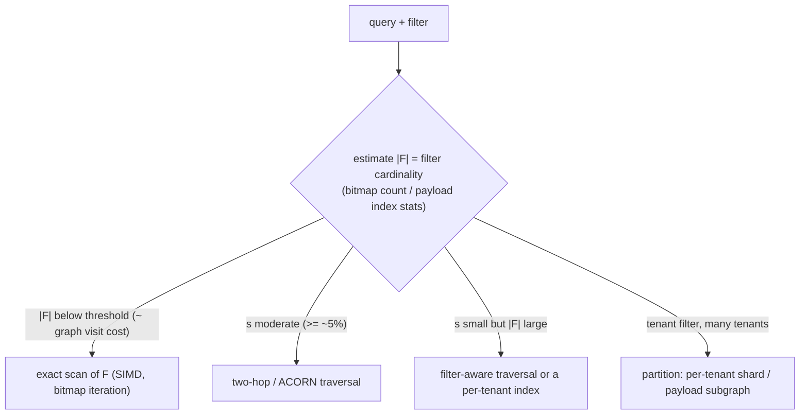

# 01 · HNSW: Skip-List Graphs, Memory Math, and the Filtered-Search Traps

> **Folder:** `03-Vector-DB-Internals-HNSW-DiskANN-and-Hybrid-Index/` · **File 1 of 3**
> **Anchoring papers:** Malkov & Yashunin, *Efficient and robust approximate nearest neighbor search using Hierarchical
> Navigable Small World graphs* (TPAMI 2018) · Malkov et al., *Approximate nearest neighbor algorithm based on
> navigable small world graphs* (Inf. Syst. 2014) · Pugh, *Skip Lists* (CACM 1990) · Patel et al., *ACORN: Performant
> and Predicate-Agnostic Search Over Vector Embeddings and Structured Data* (SIGMOD 2024) · Gollapudi et al.,
> *Filtered-DiskANN* (WWW 2023) · pgvector 0.8 iterative index scans · Qdrant, Weaviate, Milvus and Lucene filtering
> documentation.
> **Code baseline:** Python 3.10+ (CPython 3.14.5 + NumPy 2.5.4) · Java 21 (JDK 25.0.4, `--release 21`).
> **Previous folder:** [02 · Speculative decoding, quantization, TP](../02-High-Throughput-Serving-and-Distributed-Inference/03-speculative-decoding-quantization-fp8-awq-and-tensor-parallelism.md) ·
> **Next:** [02 · DiskANN / Vamana](02-diskann-vamana-robust-prune-pq-ram-and-nvme-beam-search.md)

---

## 0. The thesis in one paragraph

Exact nearest-neighbor search costs $N$ distance computations per query: 100M vectors × 768 dims is ~77 GFLOP per
query. HNSW replaces the scan with **greedy routing on a proximity graph**. A multi-layer, skip-list-like hierarchy
gives long-range hops at the top and fine local hops at the bottom, so a query touches a few hundred vectors instead
of millions, at 95–99% recall. The price is **RAM**: every vector plus ~2M neighbor ids per node, resident in memory
(301 GiB for 100M × 768-d at M=16). There is also a structural fragility that sinks real deployments. The graph's
connectivity is tuned for the *whole* dataset, and a metadata filter (tenant, ACL, date) selecting 1% of nodes induces
a subgraph that is **disconnected**. Naive filtering then returns near-zero recall, or quietly degrades to brute force.
The L7 answer is a **planner** that picks exact bitmap scans, filter-aware traversal, two-hop (ACORN-style) expansion,
or per-tenant partitioning from the filter's cardinality, as Qdrant, Lucene, Milvus, Weaviate and pgvector 0.8 each
do in their own way.

---

## 1. First principles: navigable small worlds and the skip-list hierarchy

### 1.1 Greedy routing on a proximity graph

Start at an entry node. Repeatedly move to whichever neighbor is closest to the query, and stop when no neighbor is
closer. On a **navigable** graph, where edges connect near neighbors *and* a few long-range "bridges", greedy routing
reaches the query's neighborhood in a number of hops polylogarithmic in $N$. A beam (best-first search with a bounded
candidate list of size $ef$) makes it robust to local minima.

### 1.2 The hierarchy: a probabilistic skip list over graphs

HNSW assigns each inserted node a top layer

$$
\ell = \lfloor -\ln(U)\cdot m_L \rfloor,\qquad U \sim \mathrm{Uniform}(0,1),\qquad m_L = \frac{1}{\ln M}
\;\Rightarrow\; P(\ell \ge l) = M^{-l}.
$$

Layer 0 holds all nodes. Layer 1 holds ~1/M of them, layer 2 ~1/M², and so on, exactly the population law of a skip
list with branching $M$. The measured build (4,000 nodes, M=16) has per-level counts `[3743, 239, 17, 1]` against the
expected 4000·(15/16, 15/256, …) ≈ [3750, 234, 15, 1]. A search descends greedily ($ef = 1$) through the sparse upper
layers to find a good entry point, then runs the full beam ($ef_{\text{search}}$) on layer 0.

```
layer 3   o--------------------------------------------------o            (1 node: global hops)
layer 2   o-------------o----------------o------------------o--o          (~N/M^2)
layer 1   o---o----o----o-----o---o------o----o-----o-------o--o--o       (~N/M)
layer 0   oooooooooooooooooooooooooooooooooooooooooooooooooooooooooo      (all N, up to M0 = 2M links each)
          entry -> greedy (ef=1) down the layers -> beam search (ef_search) on layer 0
```

### 1.3 Construction and the neighbor-selection heuristic

Each insertion:

1. Draws its level.
2. Descends to that level greedily.
3. On each layer from there down to 0, runs a beam search with $ef_{\text{construction}}$, selects up to $M$ neighbors,
   links them **bidirectionally**, and prunes any neighbor whose list overflows its cap (M on upper layers,
   $M_0 = 2M$ on layer 0).

The selection is **not** "the M closest". The paper's heuristic (Algorithm 4) keeps a candidate only if it is closer
to the new node than to every neighbor already kept. Candidates "behind" an existing neighbor are redundant. One
candidate in a different direction, often toward another cluster, survives, and that is the bridge that keeps
clustered data navigable. Simple "closest M" selection builds tight cliques inside clusters and loses inter-cluster
connectivity.

### 1.4 The three knobs

| Parameter | Controls | Raise it when | Cost |
|-----------|----------|---------------|------|
| `M` (layer-0 cap $2M$) | graph degree | recall plateaus; high-dimensional or hard data | RAM (8 bytes/link at layer 0) and build time; also distance evals per hop |
| `efConstruction` | candidate list during build | graph quality is poor (recall can't reach target at any `ef_search`) | build time roughly linear |
| `ef_search` | beam width at query time | recall below target | latency roughly linear; **per query, tunable live** |

The reference build (4,000 × 32, 20 clusters) reaches recall@10 = 1.000 at ef=20 with ~221 distance evaluations per
query vs 4,000 for brute force. The Java build (20,000 × 64, 50 clusters, M=16, efC=100) makes ~2,400 distance
evaluations per insert. Insertion cost is the hidden budget in streaming-ingestion systems (Folder 04).

---

## 2. Memory math, exactly

### 2.1 Bytes per vector

The brief gives a rule of thumb, $\text{RAM} \approx d\cdot 4 + M\cdot 2\cdot 4 \cdot 1.33$. From first principles
(hnswlib-style layout, int32 ids):

$$
\underbrace{4d}_{\text{float32 vector}}
+ \underbrace{4\cdot 2M + 4}_{\text{layer-0 links + count}}
+ \underbrace{8}_{\text{external label}}
+ \underbrace{12}_{\text{upper-list pointer + level}}
+ \underbrace{\frac{4M + 4}{M-1}}_{\text{expected upper-layer links}}
$$

The last term follows from $\mathbb{E}[\#\text{upper layers}] = \sum_{l \ge 1} M^{-l} = \frac{1}{M-1}$, each with $M$
links plus a count.

| d | M | Exact (bytes/vector) | Brief's formula | Graph share of RAM |
|--:|--:|---------------------:|----------------:|-------------------:|
| 768 | 16 | **3,228.5** | 3,242.2 (+0.4%) | 4.8% |
| 768 | 32 | 3,356.3 | 3,412.5 (+1.7%) | 8.5% |
| 1,536 | 16 | 6,300.5 | 6,314.2 (+0.2%) | 2.5% |
| 128 | 16 | 668.5 | 682.2 (+2.0%) | 23.4% |
| 128 | 48 | 924.2 | **1,022.7 (+10.7%)** | 44.6% |

**Verdict on the brief's formula:** the 1.33 factor stands in for count, label, pointer and upper-layer overhead (≈
0.33 × 8M bytes). It is within 1% for typical embedding widths at M=16 and overestimates by ~11% for low-dimensional
data with high M. Use the exact form when sizing clusters. Then add 10–20% for allocator fragmentation, visited-list
pools, and the delete/tombstone slack of the engine you run.

### 2.2 What it means at scale

- **100M × 768-d, M=16: ~301 GiB of RAM** before allocator overhead. That is a multi-node, RAM-heavy cluster for one
  index, and the motivation for DiskANN (File 02) and quantization (File 03).
- **Vectors dominate at high d, links at low d.** Quantizing vectors to int8 (4× smaller) or PQ-64 bytes leaves the
  links untouched. At PQ-32 bytes per vector, the graph is **~83%** of the ~189 bytes per node (the 132-byte layer-0
  list alone is 70%), so M becomes the main memory lever.
- **Rebuilds need 2× headroom** if the engine builds a new segment beside the old one (Lucene merges, Qdrant
  optimizer segments).

---

## 3. The filtered-search traps

Every production query carries a predicate: `tenant_id = X`, an ACL group (Folder 04 File 03), a date range, a
language. Let $s$ be the fraction of nodes that pass the filter (its **selectivity**).

### 3.1 Why strict in-graph filtering disconnects

Restricting traversal to passing nodes searches the **induced subgraph**. A node's expected number of passing
neighbors on layer 0 is $s \cdot M_0$. With $M_0 = 32$:

| $s$ | expected passing neighbors per node | regime |
|----:|------------------------------------:|--------|
| 50% | 16 | well connected |
| 10% | 3.2 | fragile |
| 1% | **0.32** | **shattered**: most passing nodes have no passing neighbor |

Like percolation on a random graph, once the expected degree drops below ~1 the subgraph breaks into tiny islands.
The greedy search starts in one island, possibly not even a passing node, and cannot reach the query's true filtered
neighbors. Measured recall@10 (Python reference, 4,000 nodes): **1.000 at 50%, 0.723 at 10%, 0.031 at 1%.**

### 3.2 Why post-filtering returns too few results

Search unfiltered with beam $ef$, then drop failures. You get about $s\cdot ef$ passing results. For $k = 10$ at 1%
selectivity that needs $ef \approx 1000$, and at 0.1% about 10,000. With a fixed $ef = 40$, recall is 0.037 at 1%
(Python) and 0.006 at 0.1% (Java): the query returns one or zero rows, and the user sees "no results" for documents
they own.

**Iterative scans** (pgvector 0.8's `hnsw.iterative_scan`) keep expanding until $k$ rows pass. They fix recall, but at
0.1% selectivity the Java run spends **43,680 distance evaluations per query on a 20,000-vector index**: 2.2× the cost
of brute force. That is why pgvector bounds the scan (`hnsw.max_scan_tuples`) and why iterative scanning alone is not a
strategy for rare filters.

### 3.3 Filter-aware traversal: correct but expensive

Traverse every node, but let only passing nodes enter the result set. Connectivity is the full graph's, so recall is
perfect. The cost is $\approx$ (visits to collect $ef$ passing nodes) $\propto ef/s$: 676 evaluations at 10%, 7,294 at
1%, and **20,061 at 0.1%**, which is brute force with extra steps. Weaviate's original "sweeping" and many engines'
default filtered HNSW behave like this.

### 3.4 ACORN: restore connectivity inside the filtered subgraph

ACORN (Patel et al.) observes that you can **look through** failing neighbors. When a neighbor fails the predicate,
expand its neighbors instead (two hops), so the expected passing out-degree becomes $\approx s \cdot M_0^2$:

| $s$ | $s \cdot M_0$ (one hop) | $s \cdot M_0^2$ (two hops, $M_0 = 32$) |
|----:|------------------------:|---------------------------------------:|
| 10% | 3.2 | **102** |
| 1% | 0.32 | 10 |
| 0.1% | 0.03 | 1.0 |

ACORN-1 (two-hop at search time on an ordinary HNSW) gives recall **0.995–1.000 at 10% with only 126–138 evaluations**,
5× cheaper than filter-aware traversal. At 1% and below it fails (0.40 in Java, 0.23 in Python) because two hops of a
degree-32 graph still reach too few passing nodes. The full ACORN index builds a **denser** graph (degree $\gamma M$,
with $\gamma$ sized to the smallest selectivity you must serve), trading build time and memory to extend the working
range.

### 3.5 Exact scan over the filter bitmap: the right answer for small filters

If the filter passes only $|F|$ nodes, an exact scan costs exactly $|F|$ distance computations with SIMD (File 03),
and its recall is 1.0 by definition: 205 evaluations at 1% and 16 at 0.1% of a 20,000-node index. Below a cardinality
threshold, the "slow" brute force is the fastest and the only fully correct plan.

### 3.6 The planner, and what engines actually do



The Java planner picks per query from cardinality, and keeps recall ≥ 0.976 at every selectivity in the table
(§4.2). Production engines encode the same decision:

| Engine | Mechanism (⚠ verify for your version) |
|--------|---------------------------------------|
| **Qdrant** | payload indexes give cardinality estimates. Below `full_scan_threshold` the planner uses the payload index plus exact scoring; filterable HNSW adds payload-value-specific links (`payload_m`) and per-tenant subgraphs for fields marked as tenant keys |
| **Lucene / Elasticsearch / OpenSearch** | approximate kNN explores with an accept-docs bitset and **switches to exact search** when the graph would visit more nodes than the filter contains |
| **Milvus** | bitset pre-filtering inside the index search, with a brute-force path when the filter is very selective |
| **Weaviate** | ACORN-style filter strategy (multi-hop expansion over filtered nodes) as an alternative to sweeping |
| **pgvector ≥ 0.8** | `hnsw.iterative_scan = strict_order | relaxed_order`, bounded by `hnsw.max_scan_tuples` and memory multipliers; otherwise the planner may choose a B-tree/sequential plan for the filter and compute distances exactly |

**Multi-tenancy is a filter problem.** A few large tenants: **partition**, with one index or shard per tenant (no
filter at all, clean isolation, simple deletes). Thousands of small tenants: a shared index with tenant-aware
structure (Qdrant tenant subgraphs, or a tenant prefix in the routing key) and exact scans for the long tail. Never a
naive shared index with post-filtering.

---

## 4. Production code blueprints

### 4.1 Python: HNSW from the paper, the memory math, and all filtered strategies

```python
"""hnsw_ref.py - HNSW from the paper (Malkov & Yashunin), its exact memory math, and filtered-search traps (NumPy).

* insert: level ~ floor(-ln(U) * mL), mL = 1/ln(M); greedy descent on upper layers; ef_construction beam;
  neighbor selection by the paper's heuristic (Algorithm 4); bidirectional links pruned back to M (2M on layer 0);
* search: greedy descent + ef_search beam on layer 0;
* filtered search: post-filter, strict in-graph filter, filter-aware traversal, ACORN-1-style two-hop expansion,
  exact pre-filter scan, and a selectivity-based planner - measured by recall@10 and distance computations.
"""
from __future__ import annotations

import heapq
import math

import numpy as np


class HNSW:
    def __init__(self, dim: int, capacity: int, M: int = 16, ef_construction: int = 100, seed: int = 0):
        self.M, self.M0, self.efc = M, 2 * M, ef_construction
        self.mL = 1.0 / math.log(M)
        self.vecs = np.zeros((capacity, dim), dtype=np.float32)
        self.links: list[list[list[int]]] = []      # links[node][level] -> neighbor ids
        self.entry, self.max_level, self.n = -1, -1, 0
        self.rng = np.random.default_rng(seed)
        self.dist_evals = 0

    def _d(self, q: np.ndarray, ids) -> np.ndarray:
        self.dist_evals += len(ids)
        diff = self.vecs[ids] - q
        return np.einsum("ij,ij->i", diff, diff)

    def search_layer(self, q, entries: list[int], ef: int, level: int, can_visit=None, counts=None,
                     two_hop=False) -> list[tuple[float, int]]:
        """Beam search on one layer. can_visit: predicate restricting which nodes may be expanded (strict filter).
        counts: predicate deciding which nodes may enter the result set (filter-aware traversal).
        two_hop: ACORN-1 - when a neighbor fails can_visit, look through it to its neighbors."""
        visited = set(entries)
        d0 = self._d(q, entries)
        cand = [(float(d), e) for d, e in zip(d0, entries)]
        heapq.heapify(cand)
        res = [(-float(d), e) for d, e in zip(d0, entries) if counts is None or counts(e)]
        heapq.heapify(res)
        while len(res) > ef:
            heapq.heappop(res)
        while cand:
            dc, c = heapq.heappop(cand)
            if len(res) >= ef and dc > -res[0][0]:
                break
            nbrs = []
            for n in self.links[c][level]:
                if n in visited:
                    continue
                visited.add(n)
                if can_visit is None or can_visit(n):
                    nbrs.append(n)
                elif two_hop:
                    for m in self.links[n][level]:
                        if m not in visited and can_visit(m):
                            visited.add(m)
                            nbrs.append(m)
            if not nbrs:
                continue
            for dn, n in zip(self._d(q, nbrs), nbrs):
                dn = float(dn)
                if len(res) < ef or dn < -res[0][0]:
                    heapq.heappush(cand, (dn, n))
                    if counts is None or counts(n):
                        heapq.heappush(res, (-dn, n))
                        if len(res) > ef:
                            heapq.heappop(res)
        return sorted((-d, i) for d, i in res)

    def _select(self, base: np.ndarray, cands: list[tuple[float, int]], m: int) -> list[int]:
        """Heuristic (Alg. 4): keep e only if it is closer to the base than to every already-kept neighbor.
        Preserves 'bridge' edges toward other clusters; fills with the closest leftovers if short."""
        kept: list[int] = []
        rest: list[int] = []
        for d, e in sorted(cands):
            if len(kept) >= m:
                break
            if not kept or np.all(self._d(self.vecs[e], kept) > d):
                kept.append(e)
            else:
                rest.append(e)
        for e in rest:
            if len(kept) >= m:
                break
            kept.append(e)
        return kept

    def insert(self, v: np.ndarray) -> int:
        i = self.n
        self.vecs[i] = v
        self.n += 1
        level = int(-math.log(1.0 - self.rng.random()) * self.mL)
        self.links.append([[] for _ in range(level + 1)])
        if self.entry < 0:
            self.entry, self.max_level = i, level
            return i
        ep = [self.entry]
        for lev in range(self.max_level, level, -1):
            ep = [self.search_layer(v, ep, 1, lev)[0][1]]
        for lev in range(min(level, self.max_level), -1, -1):
            w = self.search_layer(v, ep, self.efc, lev)
            cap = self.M0 if lev == 0 else self.M
            nbrs = self._select(v, w, self.M)
            self.links[i][lev] = nbrs
            for n in nbrs:
                ln = self.links[n][lev]
                ln.append(i)
                if len(ln) > cap:                                   # shrink back with the same heuristic
                    ds = self._d(self.vecs[n], ln)
                    self.links[n][lev] = self._select(self.vecs[n], list(zip(ds.tolist(), ln)), cap)
            ep = [e for _, e in w]
        if level > self.max_level:
            self.entry, self.max_level = i, level
        return i

    def search(self, q, k: int, ef: int, **kw) -> list[int]:
        ep = [self.entry]
        for lev in range(self.max_level, 0, -1):
            ep = [self.search_layer(q, ep, 1, lev)[0][1]]
        if kw.get("can_visit") is not None and not kw["can_visit"](ep[0]):
            pass                                                    # strict filtering may start outside the subgraph
        return [i for _, i in self.search_layer(q, ep, max(ef, k), 0, **kw)[:k]]


# ---------------------------------------------------------------------- memory math
def hnswlib_bytes_per_vector(d: int, M: int, bytes_per_dim: int = 4) -> dict[str, float]:
    """hnswlib-style layout: level-0 block = M0 int32 links + int32 count, vector, 8-byte label; per element an
    8-byte pointer to upper-level lists and an int32 level; upper levels hold M links + count, on average
    1/(M-1) levels per element (P(level >= l) = M^-l)."""
    level0 = 2 * M * 4 + 4
    upper = (M * 4 + 4) / (M - 1)
    parts = {"vector": d * bytes_per_dim, "level0 links": level0, "label": 8, "upper ptr + level": 12,
             "upper links (expected)": upper}
    parts["total"] = sum(parts.values())
    return parts


def brief_formula(d: int, M: int) -> float:
    return d * 4 + M * 2 * 4 * 1.33


# ---------------------------------------------------------------------- experiment
def clustered(n: int, d: int, k: int, seed: int) -> tuple[np.ndarray, np.ndarray]:
    rng = np.random.default_rng(seed)
    centers = rng.standard_normal((k, d)).astype(np.float32) * 4
    lab = rng.integers(0, k, n)
    return (centers[lab] + rng.standard_normal((n, d)).astype(np.float32)), lab


def exact_topk(x: np.ndarray, q: np.ndarray, k: int, mask: np.ndarray | None = None) -> list[int]:
    d = ((x - q) ** 2).sum(1)
    if mask is not None:
        d = np.where(mask, d, np.inf)
    idx = np.argsort(d)[:k]
    return [int(i) for i in idx if np.isfinite(d[i])]


def main() -> None:
    print("== Memory per vector (bytes), exact hnswlib-style layout vs the brief's formula ==")
    print(f"{'d':>5} {'M':>3} {'exact':>9} {'brief d*4+M*2*4*1.33':>21} {'graph overhead':>15}")
    for d, M in ((768, 16), (768, 32), (1536, 16), (128, 16), (128, 48)):
        p = hnswlib_bytes_per_vector(d, M)
        print(f"{d:5d} {M:3d} {p['total']:9.1f} {brief_formula(d, M):21.1f} {(p['total'] - d * 4) / p['total']:14.1%}")
    p = hnswlib_bytes_per_vector(768, 16)
    assert abs(p["total"] - brief_formula(768, 16)) / p["total"] < 0.01
    print(f"  100M x 768-d, M=16: {p['total'] * 100e6 / 2**30:,.0f} GiB of RAM before allocator overhead")
    print(f"  expected upper layers per node at M=16: {1 / 15:.4f}; P(level>=1)=1/M={1 / 16:.4f}")

    n, d = 4000, 32
    x, lab = clustered(n, d, 20, seed=1)
    idx = HNSW(d, n, M=16, ef_construction=100, seed=2)
    for v in x:
        idx.insert(v)
    build_evals = idx.dist_evals
    levels = np.array([len(l) - 1 for l in idx.links])
    print(f"\nbuilt HNSW on {n} x {d} (20 clusters), M=16, efC=100: max level {idx.max_level}, "
          f"nodes per level {np.bincount(levels).tolist()}, {build_evals / n:,.0f} distance evals per insert")

    rng = np.random.default_rng(3)
    queries = x[rng.choice(n, 100, replace=False)] + rng.standard_normal((100, d)).astype(np.float32) * 0.5
    print("\n== Unfiltered recall@10 vs ef_search ==")
    for ef in (10, 20, 40, 80, 160):
        idx.dist_evals = 0
        rec = np.mean([len(set(idx.search(q, 10, ef)) & set(exact_topk(x, q, 10))) / 10 for q in queries])
        print(f"  ef={ef:3d}: recall@10 {rec:.3f}, {idx.dist_evals / len(queries):6.0f} distance evals/query "
              f"(brute force: {n})")
        if ef == 80:
            assert rec > 0.95

    print("\n== Filtered search: tenant filter selecting a fraction of rows (recall@10 | dist evals/query) ==")
    strategies = ("post-filter ef=40", "strict in-graph", "filter-aware traversal", "ACORN-1 two-hop", "exact pre-filter")
    print(f"{'selectivity':>18} " + " ".join(f"{s:>24}" for s in strategies))
    results = {}
    for label, sel, correlated in (("50% random", 0.5, False), ("10% random", 0.1, False), ("1% random", 0.01, False),
                                   ("2% one cluster", None, True)):
        if correlated:                                       # the filtered rows all live in ONE cluster
            mask = lab == 7
        else:
            mask = np.random.default_rng(int(sel * 1000)).random(n) < sel
        ok = lambda i, m=mask: bool(m[i])  # noqa: E731
        row = []
        for s in strategies:
            idx.dist_evals = 0
            recs = []
            for q in queries:
                truth = exact_topk(x, q, 10, mask)
                if s.startswith("post"):
                    got = [i for i in idx.search(q, 40, 40) if mask[i]][:10]
                elif s.startswith("strict"):
                    got = idx.search(q, 10, 40, can_visit=ok, counts=ok)
                elif s.startswith("filter-aware"):
                    got = idx.search(q, 10, 40, counts=ok)
                elif s.startswith("ACORN"):
                    got = idx.search(q, 10, 40, can_visit=ok, counts=ok, two_hop=True)
                else:
                    ids = np.flatnonzero(mask)
                    idx.dist_evals += len(ids)
                    got = exact_topk(x, q, 10, mask)
                recs.append(len(set(got) & set(truth)) / max(1, len(truth)))
            row.append((float(np.mean(recs)), idx.dist_evals / len(queries)))
        results[label] = dict(zip(strategies, row))
        print(f"{label:>18} " + " ".join(f"{r:>12.3f} | {e:>8,.0f}" for r, e in row))
    r1 = results["1% random"]
    assert r1["post-filter ef=40"][0] < 0.3, "post-filtering a 1% filter returns almost nothing"
    assert r1["strict in-graph"][0] < 0.5, "a 1% subgraph is disconnected"
    r10 = results["10% random"]
    assert r10["ACORN-1 two-hop"][0] > r10["strict in-graph"][0] + 0.2 and r1["ACORN-1 two-hop"][0] > r1["strict in-graph"][0]
    assert r10["ACORN-1 two-hop"][1] < r10["filter-aware traversal"][1] / 3, "two-hop keeps traversal cheap at 10%"
    assert r1["exact pre-filter"][0] == 1.0 and r1["exact pre-filter"][1] < 100
    assert results["1% random"]["filter-aware traversal"][1] > results["50% random"]["filter-aware traversal"][1] * 3

    print("\n== Planner: exact scan below a cardinality threshold (~ the graph's own visit cost), ACORN above ==")
    for label, (sel_card) in (("1% random", int(0.01 * n)), ("10% random", int(0.1 * n)), ("50% random", int(0.5 * n))):
        choice = "exact pre-filter" if sel_card <= 200 else "ACORN-1 two-hop"
        rec, ev = results[label][choice]
        print(f"  {label:>10}: |filter|={sel_card:5d} -> {choice:18s} recall {rec:.3f}, {ev:6,.0f} evals")
    print("\nall HNSW self-checks passed")


if __name__ == "__main__":
    main()
```

Output (verified, deterministic):

```text
== Memory per vector (bytes), exact hnswlib-style layout vs the brief's formula ==
    d   M     exact  brief d*4+M*2*4*1.33  graph overhead
  768  16    3228.5                3242.2           4.8%
  768  32    3356.3                3412.5           8.5%
 1536  16    6300.5                6314.2           2.5%
  128  16     668.5                 682.2          23.4%
  128  48     924.2                1022.7          44.6%
  100M x 768-d, M=16: 301 GiB of RAM before allocator overhead
  expected upper layers per node at M=16: 0.0667; P(level>=1)=1/M=0.0625

built HNSW on 4000 x 32 (20 clusters), M=16, efC=100: max level 3, nodes per level [3743, 239, 17, 1], 2,529 distance evals per insert

== Unfiltered recall@10 vs ef_search ==
  ef= 10: recall@10 0.999,    182 distance evals/query (brute force: 4000)
  ef= 20: recall@10 1.000,    221 distance evals/query (brute force: 4000)
  ef= 40: recall@10 1.000,    247 distance evals/query (brute force: 4000)
  ef= 80: recall@10 1.000,    260 distance evals/query (brute force: 4000)
  ef=160: recall@10 1.000,    275 distance evals/query (brute force: 4000)

== Filtered search: tenant filter selecting a fraction of rows (recall@10 | dist evals/query) ==
       selectivity        post-filter ef=40          strict in-graph   filter-aware traversal          ACORN-1 two-hop         exact pre-filter
        50% random        1.000 |      247        1.000 |      147        1.000 |      260        1.000 |      213        1.000 |    1,993
        10% random        0.377 |      247        0.723 |       69        1.000 |      800        1.000 |      126        1.000 |      405
         1% random        0.037 |      247        0.031 |       48        1.000 |    3,840        0.231 |       51        1.000 |       47
    2% one cluster        0.040 |      247        0.040 |       56        1.000 |    2,273        0.290 |      104        1.000 |      201

== Planner: exact scan below a cardinality threshold (~ the graph's own visit cost), ACORN above ==
   1% random: |filter|=   40 -> exact pre-filter   recall 1.000,     47 evals
  10% random: |filter|=  400 -> ACORN-1 two-hop    recall 1.000,    126 evals
  50% random: |filter|= 2000 -> ACORN-1 two-hop    recall 1.000,    213 evals

all HNSW self-checks passed
```

### 4.2 Java 21: a flat-array HNSW with a filtered-search planner

The listing follows Lucene's style, with flat arrays and no per-node objects:

- vectors live in one `float[]`, and neighbor lists are `int[]`s;
- a stamp-array "visited" set is reset by bumping a generation counter, with no per-search allocation of a hash set;
- binary heaps of primitive (float, int) pairs replace boxed priority queues;
- filters are `java.util.BitSet`s (tenant and ACL bitmaps), and the exact strategy iterates them with `nextSetBit`;
- the built graph is read-only, so concurrent searches on virtual threads each own a `Ctx` (visited stamps,
  counters).

Strategies: `POST_FILTER` (naive), `ITERATIVE_POST_FILTER` (pgvector-style doubling of `ef`), `FILTER_AWARE`, `ACORN1`,
`EXACT`, and a cost-based `PLANNER`.

```java
// HnswFilteredSearch.java - Java 21 HNSW (Lucene-style flat arrays) with production filtered-search strategies:
// post-filter, iterative post-filter (pgvector 0.8 "iterative scan"), filter-aware traversal, ACORN-1 two-hop,
// exact scan over the filter bitmap, and a cost-based planner. Filters are BitSets (tenant / ACL bitmaps).
// Build & self-test:  javac --release 21 -Xlint:all -Werror -d out HnswFilteredSearch.java
//                     java -ea -cp out dev.l7.ai.inference.HnswFilteredSearch
package dev.l7.ai.inference;

import java.util.ArrayList;
import java.util.Arrays;
import java.util.BitSet;
import java.util.HashSet;
import java.util.List;
import java.util.Random;
import java.util.Set;
import java.util.concurrent.ExecutorService;
import java.util.concurrent.Executors;
import java.util.concurrent.Future;

public final class HnswFilteredSearch {

    /** Binary heap of (distance, id) pairs; max-heap when {@code max} is true. */
    static final class Heap {
        float[] k = new float[64];
        int[] v = new int[64];
        int size;
        final boolean max;

        Heap(boolean max) { this.max = max; }

        private boolean before(int a, int b) { return max ? k[a] > k[b] : k[a] < k[b]; }

        void push(float key, int val) {
            if (size == k.length) {
                k = Arrays.copyOf(k, size * 2);
                v = Arrays.copyOf(v, size * 2);
            }
            k[size] = key;
            v[size] = val;
            int i = size++;
            while (i > 0) {
                int p = (i - 1) >>> 1;
                if (!before(i, p)) break;
                swap(i, p);
                i = p;
            }
        }

        int pop() {
            int top = v[0];
            swap(0, --size);
            int i = 0;
            while (true) {
                int l = 2 * i + 1, r = l + 1, b = i;
                if (l < size && before(l, b)) b = l;
                if (r < size && before(r, b)) b = r;
                if (b == i) break;
                swap(i, b);
                i = b;
            }
            return top;
        }

        float peekKey() { return k[0]; }

        private void swap(int a, int b) {
            float tk = k[a]; k[a] = k[b]; k[b] = tk;
            int tv = v[a]; v[a] = v[b]; v[b] = tv;
        }
    }

    /** Per-search mutable state; never shared between threads. */
    static final class Ctx {
        final int[] stamp;
        int gen;
        long evals;

        Ctx(int n) { stamp = new int[n]; }

        void reset() { gen++; }

        boolean visit(int i) {
            if (stamp[i] == gen) return false;
            stamp[i] = gen;
            return true;
        }
    }

    final int dim, m, m0, efc;
    final double mL;
    final float[] vecs;
    final int[][][] links;          // links[node][level] -> neighbor ids
    int n, entry = -1, maxLevel = -1;
    private final Random rnd;

    HnswFilteredSearch(int dim, int capacity, int m, int efc, long seed) {
        this.dim = dim;
        this.m = m;
        this.m0 = 2 * m;
        this.efc = efc;
        this.mL = 1.0 / Math.log(m);
        this.vecs = new float[capacity * dim];
        this.links = new int[capacity][][];
        this.rnd = new Random(seed);
    }

    float dist(float[] q, int qOff, int id, Ctx c) {
        c.evals++;
        float s = 0;
        int o = id * dim;
        for (int i = 0; i < dim; i++) {
            float d = q[qOff + i] - vecs[o + i];
            s += d * d;
        }
        return s;
    }

    interface Pred { boolean test(int id); }

    /** Beam search on one layer; returns ids sorted by ascending distance (at most ef). */
    int[] searchLayer(float[] q, int qOff, int[] entries, int ef, int level, Pred canVisit, Pred counts,
                      boolean twoHop, Ctx c) {
        c.reset();
        Heap cand = new Heap(false), res = new Heap(true);
        for (int e : entries) {
            if (!c.visit(e)) continue;
            float d = dist(q, qOff, e, c);
            cand.push(d, e);
            if (counts == null || counts.test(e)) res.push(d, e);
        }
        while (res.size > ef) res.pop();
        int[] buf = new int[64];
        while (cand.size > 0) {
            float dc = cand.peekKey();
            int cNode = cand.pop();
            if (res.size >= ef && dc > res.peekKey()) break;
            int nb = 0;
            int[] ns = links[cNode].length > level ? links[cNode][level] : new int[0];
            for (int x : ns) {
                if (!c.visit(x)) continue;
                if (canVisit == null || canVisit.test(x)) {
                    if (nb == buf.length) buf = Arrays.copyOf(buf, nb * 2);
                    buf[nb++] = x;
                } else if (twoHop) {
                    int[] ns2 = links[x].length > level ? links[x][level] : new int[0];
                    for (int y : ns2) {
                        if (canVisit.test(y) && c.visit(y)) {
                            if (nb == buf.length) buf = Arrays.copyOf(buf, nb * 2);
                            buf[nb++] = y;
                        }
                    }
                }
            }
            for (int j = 0; j < nb; j++) {
                int x = buf[j];
                float d = dist(q, qOff, x, c);
                if (res.size < ef || d < res.peekKey()) {
                    cand.push(d, x);
                    if (counts == null || counts.test(x)) {
                        res.push(d, x);
                        if (res.size > ef) res.pop();
                    }
                }
            }
        }
        int[] out = new int[res.size];
        for (int i = out.length - 1; i >= 0; i--) out[i] = res.pop();
        return out;
    }

    /** Paper heuristic (Alg. 4): keep a candidate only if it is closer to the base than to any kept neighbor. */
    int[] select(float[] base, int bOff, int[] sortedCands, int cap, Ctx c) {
        int[] kept = new int[cap];
        int nk = 0;
        List<Integer> rest = new ArrayList<>();
        for (int e : sortedCands) {
            if (nk == cap) break;
            float de = dist(base, bOff, e, c);
            boolean good = true;
            for (int j = 0; j < nk && good; j++) good = dist(vecs, e * dim, kept[j], c) > de;
            if (good) kept[nk++] = e; else rest.add(e);
        }
        for (int e : rest) {
            if (nk == cap) break;
            kept[nk++] = e;
        }
        return Arrays.copyOf(kept, nk);
    }

    int[] sortByDist(float[] base, int bOff, int[] ids, Ctx c) {
        float[] ds = new float[ids.length];
        Integer[] order = new Integer[ids.length];
        for (int i = 0; i < ids.length; i++) {
            ds[i] = dist(base, bOff, ids[i], c);
            order[i] = i;
        }
        Arrays.sort(order, (a, b) -> Float.compare(ds[a], ds[b]));
        int[] out = new int[ids.length];
        for (int i = 0; i < ids.length; i++) out[i] = ids[order[i]];
        return out;
    }

    void insert(float[] v, Ctx c) {
        int id = n++;
        System.arraycopy(v, 0, vecs, id * dim, dim);
        int level = (int) (-Math.log(1.0 - rnd.nextDouble()) * mL);
        links[id] = new int[level + 1][0];
        if (entry < 0) {
            entry = id;
            maxLevel = level;
            return;
        }
        int[] ep = {entry};
        for (int l = maxLevel; l > level; l--) ep = new int[] {searchLayer(vecs, id * dim, ep, 1, l, null, null, false, c)[0]};
        for (int l = Math.min(level, maxLevel); l >= 0; l--) {
            int[] w = searchLayer(vecs, id * dim, ep, efc, l, null, null, false, c);
            int cap = l == 0 ? m0 : m;
            int[] nbrs = select(vecs, id * dim, w, m, c);
            links[id][l] = nbrs;
            for (int x : nbrs) {
                int[] old = links[x][l];
                int[] grown = Arrays.copyOf(old, old.length + 1);
                grown[old.length] = id;
                links[x][l] = grown.length > cap ? select(vecs, x * dim, sortByDist(vecs, x * dim, grown, c), cap, c) : grown;
            }
            ep = w;
        }
        if (level > maxLevel) {
            entry = id;
            maxLevel = level;
        }
    }

    int[] descend(float[] q, Ctx c) {
        int[] ep = {entry};
        for (int l = maxLevel; l > 0; l--) ep = new int[] {searchLayer(q, 0, ep, 1, l, null, null, false, c)[0]};
        return ep;
    }

    // ------------------------------------------------------------------ filtered strategies

    enum Strategy { POST_FILTER, ITERATIVE_POST_FILTER, FILTER_AWARE, ACORN1, EXACT, PLANNER }

    record Result(int[] ids, long distanceEvals, Strategy used) {}

    Result search(float[] q, int k, int ef, BitSet filter, Strategy s, Ctx c) {
        c.evals = 0;
        Pred ok = filter::get;
        int card = filter.cardinality();
        if (s == Strategy.PLANNER) {
            // Exact scan costs |filter| distances; graph traversal costs ~ ef*M0 visits scaled by 1/selectivity
            // when the subgraph thins out. Pick the cheaper one (Qdrant / Lucene make the same call).
            double sel = (double) card / n;
            double graphCost = sel >= 0.05 ? 4.0 * ef * Math.sqrt(m0) : ef * m0 / Math.max(sel, 1e-6) / 8;
            s = card <= graphCost ? Strategy.EXACT : (sel >= 0.05 ? Strategy.ACORN1 : Strategy.FILTER_AWARE);
        }
        int[] ids = switch (s) {
            case POST_FILTER -> postFilter(q, k, ef, filter, c);
            case ITERATIVE_POST_FILTER -> {
                int[] got = new int[0];
                for (int e = ef; e <= 8 * ef * 64 && got.length < k; e *= 2) got = postFilter(q, k, e, filter, c);
                yield got;
            }
            case FILTER_AWARE -> head(searchLayer(q, 0, descend(q, c), Math.max(ef, k), 0, null, ok, false, c), k);
            case ACORN1 -> head(searchLayer(q, 0, descend(q, c), Math.max(ef, k), 0, ok, ok, true, c), k);
            case EXACT -> exact(q, k, filter, c);
            case PLANNER -> throw new IllegalStateException();
        };
        return new Result(ids, c.evals, s);
    }

    private int[] postFilter(float[] q, int k, int ef, BitSet filter, Ctx c) {
        int[] all = searchLayer(q, 0, descend(q, c), ef, 0, null, null, false, c);
        return head(Arrays.stream(all).filter(filter::get).toArray(), k);
    }

    int[] exact(float[] q, int k, BitSet filter, Ctx c) {
        Heap h = new Heap(true);
        for (int i = filter.nextSetBit(0); i >= 0 && i < n; i = filter.nextSetBit(i + 1)) {
            float d = dist(q, 0, i, c);
            if (h.size < k || d < h.peekKey()) {
                h.push(d, i);
                if (h.size > k) h.pop();
            }
        }
        int[] out = new int[h.size];
        for (int i = out.length - 1; i >= 0; i--) out[i] = h.pop();
        return out;
    }

    private static int[] head(int[] a, int k) { return a.length <= k ? a : Arrays.copyOf(a, k); }

    // ------------------------------------------------------------------ self-test

    private static void check(boolean ok, String what) {
        if (!ok) throw new AssertionError(what);
    }

    static double recall(int[] got, int[] truth) {
        if (truth.length == 0) return 1.0;
        Set<Integer> t = new HashSet<>();
        for (int x : truth) t.add(x);
        int hit = 0;
        for (int x : got) if (t.contains(x)) hit++;
        return (double) hit / truth.length;
    }

    public static void main(String[] args) throws Exception {
        int n = 20_000, d = 64, clusters = 50;
        Random r = new Random(1);
        float[][] centers = new float[clusters][d];
        for (float[] cen : centers) for (int i = 0; i < d; i++) cen[i] = (float) (r.nextGaussian() * 4);
        int[] lab = new int[n];
        HnswFilteredSearch idx = new HnswFilteredSearch(d, n, 16, 100, 2);
        Ctx build = new Ctx(n);
        long t0 = System.nanoTime();
        for (int i = 0; i < n; i++) {
            lab[i] = r.nextInt(clusters);
            float[] v = new float[d];
            for (int j = 0; j < d; j++) v[j] = centers[lab[i]][j] + (float) r.nextGaussian();
            idx.insert(v, build);
        }
        System.out.printf("built %,d x %d HNSW (M=16, efC=100) in %.2f s, %,d distance evals per insert%n",
                n, d, (System.nanoTime() - t0) / 1e9, build.evals / n);

        float[][] queries = new float[200][d];
        for (float[] q : queries) {
            int base = r.nextInt(n);
            for (int j = 0; j < d; j++) q[j] = idx.vecs[base * d + j] + (float) (r.nextGaussian() * 0.5);
        }
        Ctx c = new Ctx(n);
        String[] labels = {"50% random", "10% random", "1% random", "0.1% random", "2% one cluster"};
        double[] sels = {0.5, 0.1, 0.01, 0.001, -1};
        Strategy[] strategies = {Strategy.POST_FILTER, Strategy.ITERATIVE_POST_FILTER, Strategy.FILTER_AWARE,
                Strategy.ACORN1, Strategy.EXACT, Strategy.PLANNER};
        System.out.printf("%n%-15s", "filter");
        for (Strategy s : strategies) System.out.printf(" %25s", s);
        System.out.println("   (recall@10 | distance evals/query)");
        double[][] rec = new double[labels.length][strategies.length];
        long[][] ev = new long[labels.length][strategies.length];
        BitSet[] filters = new BitSet[labels.length];
        for (int f = 0; f < labels.length; f++) {
            BitSet bits = new BitSet(n);
            Random fr = new Random(100 + f);
            for (int i = 0; i < n; i++) if (sels[f] < 0 ? lab[i] == 7 : fr.nextDouble() < sels[f]) bits.set(i);
            filters[f] = bits;
            System.out.printf("%-15s", labels[f]);
            for (int s = 0; s < strategies.length; s++) {
                double sum = 0;
                long evals = 0;
                for (float[] q : queries) {
                    int[] truth = idx.exact(q, 10, bits, new Ctx(n));
                    Result res = idx.search(q, 10, 40, bits, strategies[s], c);
                    sum += recall(res.ids(), truth);
                    evals += res.distanceEvals();
                }
                rec[f][s] = sum / queries.length;
                ev[f][s] = evals / queries.length;
                System.out.printf(" %12.3f | %10d", rec[f][s], ev[f][s]);
            }
            System.out.println();
        }
        check(rec[2][0] < 0.3, "plain post-filter fails at 1%");
        check(rec[1][1] > rec[1][0] + 0.3, "iterative scan rescues post-filtering at 10%");
        for (int f = 0; f < labels.length; f++) check(rec[f][5] >= 0.97, "planner keeps recall for " + labels[f]);
        check(ev[3][5] < ev[3][2] / 5, "planner avoids the near-brute-force traversal at 0.1%");

        // Concurrency: the built graph is read-only; each virtual thread owns its Ctx.
        BitSet tenant = filters[1];
        try (ExecutorService vt = Executors.newVirtualThreadPerTaskExecutor()) {
            long t1 = System.nanoTime();
            List<Future<Double>> fs = new ArrayList<>();
            for (int rep = 0; rep < 10; rep++) {
                for (float[] q : queries) {
                    fs.add(vt.submit(() -> {
                        Ctx own = new Ctx(n);
                        int[] truth = idx.exact(q, 10, tenant, own);
                        return recall(idx.search(q, 10, 40, tenant, Strategy.PLANNER, own).ids(), truth);
                    }));
                }
            }
            double sum = 0;
            for (Future<Double> f : fs) sum += f.get();
            System.out.printf("%n%,d concurrent planner searches on virtual threads (10%% filter): recall %.3f, %.0f q/s "
                    + "(incl. exact ground truth)%n", fs.size(), sum / fs.size(), fs.size() / ((System.nanoTime() - t1) / 1e9));
            check(sum / fs.size() >= 0.97, "concurrent recall");
        }
        System.out.println("all HnswFilteredSearch self-checks passed");
    }
}
```

Output (one measured run; recall and distance-evaluation counts are deterministic, build time and queries/s are not):

```text
built 20,000 x 64 HNSW (M=16, efC=100) in 3.37 s, 2,382 distance evals per insert

filter                        POST_FILTER     ITERATIVE_POST_FILTER              FILTER_AWARE                    ACORN1                     EXACT                   PLANNER   (recall@10 | distance evals/query)
50% random             0.992 |        413        0.992 |        413        1.000 |        458        1.000 |        290        1.000 |      10065        1.000 |        290
10% random             0.414 |        413        1.000 |       1221        1.000 |        676        0.995 |        138        1.000 |       2041        0.995 |        138
1% random              0.039 |        413        0.995 |       7160        1.000 |       7294        0.404 |         67        1.000 |        205        1.000 |        205
0.1% random            0.006 |        413        1.000 |      43680        1.000 |      20061        0.028 |         62        1.000 |         16        1.000 |         16
2% one cluster         0.010 |        413        0.976 |      14556        0.984 |       5485        0.114 |         99        1.000 |        385        1.000 |        385

2,000 concurrent planner searches on virtual threads (10% filter): recall 0.995, 17485 q/s (incl. exact ground truth)
all HnswFilteredSearch self-checks passed
```

---

## 5. Production failure modes and P99 debugging

### F1 · "Search returns nothing for some customers"

- **Symptom:** tenants with small corpora get empty or one-result answers. Large tenants are fine.
- **Signature:** results/query correlates with tenant size. The vector query uses a fixed `k`/`ef` followed by a
  metadata `WHERE`.
- **Root cause:** post-filtering. The expected passing results are $s \cdot ef$ (0.006 recall at 0.1%).
- **Fix:** a cardinality-based planner with exact scans for small filters, iterative scans with caps, or per-tenant
  partitions.
- **Prevention:** a recall test suite stratified by filter selectivity, not just unfiltered recall.

### F2 · Latency spikes for rare filters, with perfect recall

- **Symptom:** p99 latency 10–100× p50, concentrated on niche filters (rare languages, old date ranges, small tenants).
- **Signature:** distance evaluations per query approach $N$ (filter-aware traversal: 20,061 on a 20,000-node index at
  0.1%).
- **Root cause:** filter-aware traversal costs $\propto 1/s$.
- **Fix:** switch to exact scans below a cardinality threshold. Pre-compute filter bitmaps.
- **Prevention:** export distance evaluations (or nodes visited) per query as a metric, and alert on its tail.

### F3 · pgvector iterative scan melts the database

- **Symptom:** CPU saturation and long query times after enabling `hnsw.iterative_scan` to fix empty results.
- **Root cause:** for very selective filters the scan keeps expanding (2.2× brute-force cost at 0.1% in §3.2) until
  `max_scan_tuples`.
- **Fix:** keep the cap. Add a B-tree or partial index on the filter column so the planner can choose an exact plan.
  Partition hot tenants into separate tables or partial HNSW indexes (`CREATE INDEX ... WHERE tenant_id = ...`).

### F4 · Recall decays over months of updates

- **Symptom:** recall at a fixed `ef` drifts down, and latency drifts up.
- **Root cause:** deletes and updates. Most HNSW implementations **mark** deleted nodes (tombstones) that still
  participate in routing, and replacement inserts link into an increasingly irregular graph.
- **Fix:** periodic compaction or rebuild (Lucene segment merges, Qdrant optimizers, explicit reindex jobs). Track the
  tombstone ratio.
- **Prevention:** a recall canary over a fixed query set with exact ground truth, run daily.

### F5 · OOM after changing the embedding model

- **Symptom:** an index that fit before no longer fits after moving from 768-d to 1,536-d or 3,072-d embeddings.
- **Root cause:** RAM ≈ 4d + 8M + overhead per vector. Doubling $d$ nearly doubles memory (3,229 → 6,301 bytes at
  M=16).
- **Fix:** Matryoshka truncation, int8 or binary quantization with re-scoring (File 03), or DiskANN (File 02). Re-run
  the sizing formula on every embedding change.

### F6 · Correlated filters are worse than random ones

- **Symptom:** a 2% filter performs far worse than a random 2% sample would.
- **Root cause:** the passing nodes cluster in one region of the space ("2% one cluster" row). Queries far from that
  region must traverse long distances through failing nodes. ACORN-1 gets 0.11 recall there.
- **Fix:** exact scans (385 evaluations), or index-time partitioning by the correlated attribute.

### F7 · Cosine vs dot product vs L2 mismatch

- **Symptom:** mediocre relevance despite high measured recall.
- **Root cause:** the index metric doesn't match the embedding model's training objective. Typical cases: unnormalized
  vectors used with an inner-product index, or a model trained for cosine indexed with L2 without normalization.
- **Fix:** normalize at ingestion and query time, or choose the model's native metric. On normalized vectors L2,
  cosine and inner product rank identically ($\|a-b\|^2 = 2 - 2a\cdot b$).

---

## 6. FAANG L7 bar-raiser Q&A chains

### Q1 · "How does HNSW achieve sub-linear search? What are its knobs?"

- **L5 answer:** "It's a graph with layers. You search from the top layer down. M and ef control accuracy."
- **Why L5 fails at scale:** no mechanism, no costs, no failure modes. That candidate can't size a cluster or explain
  a recall regression.
- **L7 principal defense:**
  1. A navigable small-world graph plus greedy best-first search; a level distribution $P(\ell \ge l) = M^{-l}$ with
     $m_L = 1/\ln M$, i.e. a skip list over graphs.
  2. Upper layers give long hops, and layer 0 runs an $ef$ beam.
  3. The diversity heuristic preserves bridges between clusters.
  4. Knobs: $M$ (degree: memory and recall ceiling), `efConstruction` (graph quality, build time), `ef_search` (live
     recall/latency dial).
  5. Cost per query is hundreds of distance evaluations vs $N$ (221 vs 4,000 at recall 1.0 in the reference).
  6. RAM is $4d + 8M + \sim 32$ bytes per vector, and the failure modes are filters, deletes, and metric mismatch.

### Q2 · "Size an HNSW cluster for 500M 1,024-d vectors at M=24."

- **L5 answer:** "500M × 1,024 × 4 bytes = 2 TB."
- **Why L5 fails:** it forgets the graph, replicas, build headroom and allocator overhead, and doesn't ask about
  quantization.
- **L7 defense:**
  1. Per vector: $4096 + (8\cdot 24 + 4) + 8 + 12 + (4\cdot 24+4)/23 \approx 4{,}316$ bytes. Times 500M ≈ **2.0 TiB**.
  2. +15% allocator/pools ≈ 2.3 TiB, ×2 replicas ≈ 4.6 TiB, plus rebuild headroom.
  3. At ~512 GiB per memory-optimized node, that is 10+ nodes.
  4. Then propose int8 vectors with full-precision re-scoring from disk (~4× on the vector part), or DiskANN with PQ in
     RAM (~32–64 bytes per vector) and full vectors on NVMe (File 02). Quantify recall at the same latency before
     committing.

### Q3 · "Our multi-tenant RAG returns empty results for small customers. Why, and what's the fix?"

- **L5 answer:** "Increase `k` or `ef`."
- **Why L5 fails:** post-filter yield is $s \cdot ef$. At 0.1% selectivity you'd need $ef \approx 10^4$, which turns
  every query into brute force, and big tenants pay too.
- **L7 defense:**
  1. Diagnose with the selectivity distribution per tenant.
  2. Apply a planner: an exact bitmap scan when $|F| \lesssim$ the graph's visit cost (205 evaluations at 1% of 20K),
     two-hop traversal for moderate selectivity, and per-tenant partitions or tenant subgraphs for large tenants.
  3. Add a recall test stratified by tenant size.
  4. Engine choices: Qdrant tenant-keyed payload indexes, pgvector partial indexes per large tenant plus iterative
     scan caps, Lucene's automatic exact fallback.

### Q4 · "Explain why filtered HNSW breaks, mathematically."

- **L5 answer:** "Filtering removes nodes so the graph has holes."
- **Why L5 fails:** it is qualitative and can't predict where it breaks.
- **L7 defense:**
  1. The induced subgraph's expected degree is $s\cdot M_0$, and below ~1 it shatters (percolation): at $M_0 = 32$
     that is $s \approx 3\%$.
  2. Measured: 0.723 recall at 10%, 0.031 at 1%.
  3. Two-hop expansion raises the effective degree to $s M_0^2$ (102 at 10%, 1.0 at 0.1%), which explains why ACORN-1
     works at 10% and fails at 1%.
  4. Full ACORN densifies the graph to $\gamma M$ for a target minimum selectivity.
  5. Correlated filters are worse than random ones (one-cluster case).

### Q5 · "pgvector or a dedicated vector database for 50M vectors with heavy tenant filtering?"

- **L5 answer:** "A dedicated vector DB is always faster."
- **Why L5 fails:** it ignores transactional consistency, operational cost, and the planner capabilities that matter
  here.
- **L7 defense:**
  - **pgvector strengths:** transactional joins with ACL tables, one system of record, partial indexes per large
    tenant, iterative scans (≥ 0.8) with caps, B-tree pre-filters for small tenants.
  - **pgvector limits:** HNSW must fit in `shared_buffers`/RAM for speed, single-node write scaling, and no automatic
    tenant subgraphs.
  - **Dedicated engines** (Qdrant, Milvus) give tenant-aware filtered indexing, horizontal sharding, quantization with
    re-scoring, and payload-index cardinality planning.
  - **Decide on** data size per node, filter selectivity distribution, consistency needs, and team skills. At 50M with
    heavy filtering, prototype both with stratified recall and p99 tests. Folder 03 File 03 has the comparison matrix.

### Q6 · "After a year in production, recall dropped from 0.97 to 0.90. Diagnose."

- **L5 answer:** "The embedding model drifted."
- **Why L5 fails:** that is possible, but the common cause is index structure.
- **L7 defense:**
  1. Check the tombstone ratio and update volume, since deleted nodes still route.
  2. Check segment counts (many small segments search worse than one merged segment).
  3. Check whether `ef` or `M` changed, whether the data distribution shifted (new clusters inserted late have weaker
     links), and the metric/normalization.
  4. Fix by compacting/rebuilding, raising `ef` temporarily, and scheduling periodic rebuilds.
  5. Prove it with a fixed canary query set and exact ground truth, measured daily, separating index recall from
     embedding quality.

---

## 7. Invariants checklist

- [ ] Memory is sized with $4d + 8M + 4 + 20 + (4M+4)/(M-1)$ bytes per vector, plus overhead, replicas and rebuild
      headroom. It is re-run on every embedding-dimension change.
- [ ] Recall is measured against exact ground truth, **stratified by filter selectivity and correlation**, and
      monitored with a canary.
- [ ] Filtered queries go through a planner: exact bitmap scan below a cardinality threshold, two-hop/filter-aware
      traversal above, partitions for large tenants. Post-filtering with fixed `ef` is never the only strategy.
- [ ] Iterative scans are bounded (`max_scan_tuples` or equivalent).
- [ ] Distance evaluations (or visited nodes) per query are exported and alerted on.
- [ ] Deletes are compacted. The tombstone ratio and segment count are tracked.
- [ ] Vectors are normalized consistently with the model's metric.

## 8. References

1. Yu. A. Malkov, D. A. Yashunin. *Efficient and robust approximate nearest neighbor search using Hierarchical
   Navigable Small World graphs.* IEEE TPAMI 42(4), 2018 (arXiv:1603.09320).
2. Yu. Malkov et al. *Approximate nearest neighbor algorithm based on navigable small world graphs.* Information
   Systems 45, 2014.
3. W. Pugh. *Skip Lists: A Probabilistic Alternative to Balanced Trees.* CACM 33(6), 1990.
4. L. Patel, P. Kraft, C. Guestrin, M. Zaharia. *ACORN: Performant and Predicate-Agnostic Search Over Vector
   Embeddings and Structured Data.* SIGMOD 2024.
5. S. Gollapudi et al. *Filtered-DiskANN: Graph Algorithms for Approximate Nearest Neighbor Search with Filters.*
   WWW 2023.
6. hnswlib (nmslib/hnswlib), the reference C++ implementation and the memory layout used in §2.
7. pgvector README: HNSW options, iterative index scans (≥ 0.8.0), `max_scan_tuples` (⚠ pin version).
8. Qdrant documentation (filtering, payload indexing, multitenancy); Lucene `HnswGraphSearcher` / kNN query exact
   fallback; Milvus and Weaviate filtering docs (⚠ verify for your version).
