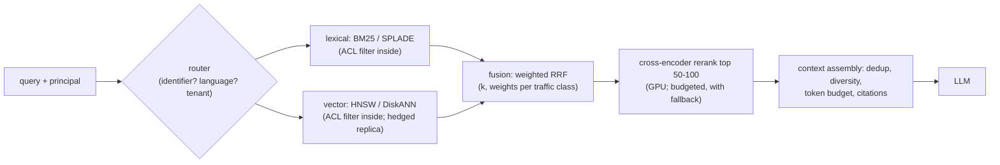

# 02 · Hybrid Search: BM25, SPLADE, Dense, RRF, and Cross-Encoder Reranking

> **Folder:** `04-Enterprise-RAG-Pipelines-and-Retrieval-Mechanics/` · **File 2 of 3**
> **Anchoring papers:** Robertson & Zaragoza, *The Probabilistic Relevance Framework: BM25 and Beyond* (2009) ·
> Cormack, Clarke & Büttcher, *Reciprocal Rank Fusion outperforms Condorcet and individual Rank Learning Methods*
> (SIGIR 2009) · Karpukhin et al., *Dense Passage Retrieval* (EMNLP 2020) · Formal et al., *SPLADE* (SIGIR 2021) and
> *SPLADE v2* (2021) · Nogueira & Cho, *Passage Re-ranking with BERT* (2019) · Thakur et al., *BEIR* (NeurIPS 2021) ·
> Bruch et al., *An Analysis of Fusion Functions for Hybrid Retrieval* (TOIS 2023).
> **Code baseline:** Python 3.10+ (CPython 3.14.5 + NumPy 2.5.4) · Java 21 (JDK 25.0.4, `--release 21`).
> **Previous:** [01 · Chunking](01-semantic-chunking-late-chunking-contextual-retrieval-and-colbert.md) ·
> **Next:** [03 · GraphRAG, streaming ingestion, ACL trimming](03-graphrag-streaming-ingestion-kafka-cdc-and-acl-security-trimming.md)

---

## 0. The thesis in one paragraph

Lexical and dense retrieval fail in **complementary** ways:

- **BM25** matches exact strings, so it nails error codes, SKUs, names and acronyms. It misses paraphrases: "notebook
  won't start" doesn't share words with "laptop fails to boot".
- **Dense bi-encoders** capture paraphrase and miss rare identifiers, because a unique code has no learned meaning and
  smears into a generic direction.

On a corpus built with both blind spots, BM25 scores **MRR 1.000 on exact-code queries and 0.245 on paraphrases**. A
dense retriever scores **0.002 and 0.958**. Hybrid search fuses them, and the fusion rule matters more than most
teams expect:

- **Raw score sums are dominated by whichever scorer has larger numbers.**
- **Reciprocal Rank Fusion (RRF) is scale-free,** but it **discards score magnitude**. When one retriever is pure
  noise for a query, RRF's "agreement bonus" can bury the other's confident hit: exact-code MRR collapses to
  **0.075** at the canonical k = 60.

The robust pipeline is therefore a funnel:

1. parallel lexical + dense (+ learned-sparse) retrieval;
2. fusion with query-aware routing;
3. a **cross-encoder reranker** over the top 50–100, the only stage that reads query and passage *together*, which
   lifts every query class to ≥ 0.89 MRR here;
4. context assembly with citations.

The rest is systems engineering: one end-to-end deadline, hedged requests, degraded results instead of errors, and
ACL filters pushed into every backend.

---

## 1. First principles

### 1.1 BM25

For query terms $t$ and document $d$:

$$
\mathrm{BM25}(q, d) = \sum_{t \in q} \mathrm{IDF}(t)\cdot
\frac{f(t,d)\,(k_1 + 1)}{f(t,d) + k_1\left(1 - b + b\,\frac{|d|}{\mathrm{avgdl}}\right)},
\qquad
\mathrm{IDF}(t) = \ln\!\left(1 + \frac{N - n_t + 0.5}{n_t + 0.5}\right).
$$

- **IDF** rewards rare terms. A unique error code has near-maximal IDF, and "error", present in every document, has
  near-zero IDF.
- **$k_1$ (≈ 1.2)** saturates repeated terms.
- **$b$ (≈ 0.75)** normalizes for document length.

BM25 is the probabilistic relevance framework's practical answer. It is unbeatable at exact matches and blind to
vocabulary mismatch.

**PostgreSQL's `ts_rank`/`ts_rank_cd` is not BM25.** It lacks corpus-level IDF saturation and length normalization of
this form. BM25 in Postgres comes from extensions such as ParadeDB's `pg_search` (⚠ verify), or from a search engine
(Elasticsearch, OpenSearch, Vespa, or engines with built-in sparse/BM25 functions).

### 1.2 Dense bi-encoders and where they break

A bi-encoder embeds query and passage independently, and relevance is $\cos(e(q), e(d))$. It generalizes across
vocabulary ("notebook" ≈ "laptop") because training placed paraphrases nearby. **Rare identifiers have no such
training signal.** Subword tokenization splits "E4721" into pieces shared with thousands of other codes, so the
identifier's specific identity is lost. The lab models this by mapping every code to one shared direction: dense
exact-code MRR is 0.002. Dense models also struggle with negation, numbers, and out-of-domain jargon. The BEIR
benchmark showed BM25 is a strong zero-shot baseline that many dense models fail to beat out of domain.

### 1.3 Learned sparse (SPLADE)

SPLADE uses a masked-language-model head to produce a **sparse, vocabulary-sized** vector per text, with learned
weights and learned **expansion** terms. A passage about "laptop boot failure" also gets weight on "notebook" and
"startup". The output is still an inverted index (exact-match friendly, interpretable, cheap with WAND/MaxScore
pruning), but vocabulary mismatch shrinks. The lab's stand-in (original terms weight 1, synonym expansions weight 0.5)
keeps exact-code MRR at **1.000** and lifts paraphrase MRR from 0.245 to **0.526**. Real SPLADE models do better.
Their cost is index size (expansions) and an encoder pass at ingest and query time.

### 1.4 Fusion: three rules, three failure modes

| Rule | Formula | Strength | Failure mode (measured) |
|------|---------|----------|------------------------|
| Raw sum | $s_{\text{BM25}} + s_{\cos}$ | trivial | scales differ (BM25 ≈ 5–20, cosine ≈ 0–1), so **BM25 dominates**: paraphrase MRR 0.302 |
| Min–max normalized, weighted | $\alpha\,\hat s_{\text{BM25}} + (1-\alpha)\,\hat s_{\cos}$ | keeps score magnitude (confidence) | normalization is per query and sensitive to outliers; α needs tuning; paraphrase 0.500 here |
| **RRF** | $\displaystyle \mathrm{RRF}(d) = \sum_{r \in R} \frac{w_r}{k + \mathrm{rank}_r(d)}$, $k = 60$ | scale-free, no training, robust when **both** inputs are informative | **ignores the score gap**: an uninformative retriever's random top-100 overlaps the other's tail and outvotes a confident rank-1 hit, so **exact-code MRR 0.075** |

**Why RRF collapses here, step by step.** For "error E1234", BM25 ranks the right document first by a huge margin.
Every other document matches only "error" (IDF ≈ 0) and fills ranks 2–100 with near-ties. The dense list is
effectively random. The right document scores $1/(60+1) = 0.0164$ (it is absent from the dense top-100). A document at
BM25 rank 5 that also appears at dense rank 10 scores $1/65 + 1/70 = 0.0297$. **Agreement among noise beats
confidence.** Cormack et al. derived $k = 60$ for fusing *good* runs, where agreement is evidence.

The k sweep confirms the mechanism. Small k restores the confident retriever's rank-1 advantage, and large k flattens
it:

| RRF k | rank-1 / rank-10 weight | Exact MRR | Paraphrase MRR | Mixed MRR |
|------:|------------------------:|----------:|---------------:|----------:|
| 1 | 5.50× | 0.510 | **0.678** | 0.995 |
| 10 | 1.82× | 0.510 | 0.520 | 0.995 |
| **60** (canonical) | 1.15× | **0.075** | 0.451 | 0.995 |
| 200 | 1.04× | 0.064 | 0.438 | 0.995 |

The fixes, in order of robustness:

1. **Query-aware routing.** An identifier in the query sends it to lexical only (dense weight 0): exact MRR → 1.000
   (§1.6 table).
2. **Tune k and per-retriever weights** on a labeled query set *per traffic class*.
3. **Rerank.** The cross-encoder doesn't care how the candidate got there.

### 1.5 Cross-encoder reranking

A cross-encoder runs one transformer over `[query ; passage]` and outputs a relevance score. Every query token attends
to every passage token, which no bi-encoder can do. It is the most accurate stage and the most expensive, because
cost scales with candidates × (query + passage tokens). FLOPs ≈ 2 × non-embedding parameters × tokens (Folder 01's
"2N" rule):

| Reranker (100 pairs × 256 tokens per query) | FLOPs | 1×H100 at 40% MFU | ~1 TFLOP/s multi-core CPU |
|---------------------------------------------|------:|------------------:|--------------------------:|
| MiniLM-L6-H384 (10.6M non-embedding) | 0.54 TFLOP | **1.4 ms** | ~0.5 s |
| BERT-base (85M) | 4.35 TFLOP | 11 ms | ~4.4 s |
| XLM-R-large-based reranker (303M) | 15.5 TFLOP | 39 ms | ~15.5 s |

That table is why rerankers run on GPUs, why the candidate count (top 50–100, not 1,000) and passage truncation are
the cost knobs, and why "LLM as reranker" (a 7B+ model) is reserved for small candidate sets or offline evaluation. In
the lab, an interaction scorer (exact and synonym matches, IDF-weighted, codes up-weighted) over the RRF top 50 lifts
MRR to **1.000 / 0.894 / 1.000**, the best row on every query class.

### 1.6 The measured scoreboard

From `hybrid_search_lab.py`: 600 support articles, 300 queries (100 each of exact-code, paraphrase and mixed). Toy
encoders: the mechanisms are real, the numbers illustrative.

| System | Exact MRR | Paraphrase MRR | Paraphrase R@10 | Mixed MRR |
|--------|----------:|---------------:|----------------:|----------:|
| BM25 | 1.000 | 0.245 | 0.380 | 0.985 |
| dense | 0.002 | **0.958** | 1.000 | 0.927 |
| learned sparse (expansion) | 1.000 | 0.526 | 0.830 | 1.000 |
| raw score sum | 1.000 | 0.302 | 0.470 | 0.985 |
| min–max 0.5/0.5 | 1.000 | 0.500 | 0.780 | 1.000 |
| RRF k = 60 | **0.075** | 0.451 | 0.750 | 0.995 |
| routed RRF (identifier → lexical) | 1.000 | 0.451 | 0.750 | 0.985 |
| **RRF + rerank top 50** | **1.000** | **0.894** | **1.000** | **1.000** |

Note that fusion alone never reaches dense's 0.958 on paraphrases. BM25's paraphrase ranking is weak, and fusion
averages it in. The reranker recovers it because it re-scores rather than re-weights.

---

## 2. The serving architecture



Engineering rules the Java listing (§3.2) implements:

- **One end-to-end deadline,** not one per call. Each stage gets the time left.
- **Hedging** for the tail. If the primary vector replica hasn't answered by ~its p95, ask a replica and take the
  first answer: 43 ms instead of 400 ms in the run.
- **Degrade, flag, answer.** If a backend misses the deadline, fuse what arrived and set `degraded=true`, so the LLM
  answer can carry a lower-confidence signal and the metric is countable.
- **The reranker has its own budget** and falls back to the fused order.
- **ACL filters go into every backend query** (File 03). A post-filter after fusion would both leak (into logs and
  caches) and destroy recall (Folder 03 File 01).
- **Deterministic tie-breaks** (best single rank, then doc ID), so identical requests produce identical contexts.
  That makes prompt caching work (Folder 01 File 03) and makes A/B diffs explainable.

---

## 3. Production code blueprints

### 3.1 Python: BM25, dense, learned sparse, four fusion rules, reranking, the k sweep and reranker cost

```python
"""hybrid_search_lab.py - BM25 vs dense vs learned-sparse, three fusion rules, and cross-encoder-style reranking
(NumPy). The corpus is built so each retriever has a blind spot: exact error codes (dense models smear unique
identifiers) and paraphrased symptoms (BM25 needs the same words). Toy encoders; transferable mechanisms.
"""
from __future__ import annotations

import hashlib
import math
import re
from collections import Counter

import numpy as np

SYN = [["laptop", "notebook"], ["fails", "cannot", "wont"], ["boot", "start", "power"], ["screen", "display", "monitor"],
       ["slow", "sluggish", "laggy"], ["connect", "pair", "link"], ["printer", "printing"], ["battery", "charge"],
       ["crash", "freeze", "hang"], ["update", "upgrade", "patch"], ["wifi", "wireless"], ["noise", "rattle", "buzz"],
       ["overheat", "hot", "thermal"], ["router", "gateway"], ["phone", "handset"], ["black", "dark", "blank"]]
GROUP = {w: g for g, ws in enumerate(SYN) for w in ws}
D = 192


def _vec(key: str) -> np.ndarray:
    seed = int.from_bytes(hashlib.blake2b(key.encode(), digest_size=8).digest(), "little")
    v = np.random.default_rng(seed).standard_normal(D)
    return v / np.linalg.norm(v)


def toks(s: str) -> list[str]:
    return re.findall(r"[a-z0-9]+", s.lower())


def dense_word(w: str) -> np.ndarray:
    if re.fullmatch(r"e\d+", w) or w.isdigit():
        return _vec("<code>")                       # unique identifiers collapse to one generic direction
    base = _vec(f"group{GROUP[w]}") if w in GROUP else _vec(w)
    return base + 0.15 * _vec("w:" + w)


def dense(s: str) -> np.ndarray:
    v = np.sum([dense_word(w) for w in toks(s)], axis=0)
    return v / np.linalg.norm(v)


class BM25:
    def __init__(self, docs: list[list[str]], k1: float = 1.2, b: float = 0.75):
        self.docs, self.k1, self.b = docs, k1, b
        self.n = len(docs)
        self.avgdl = sum(map(len, docs)) / self.n
        self.df = Counter(t for d in docs for t in set(d))
        self.tf = [Counter(d) for d in docs]

    def idf(self, t: str) -> float:
        df = self.df.get(t, 0)
        return math.log(1 + (self.n - df + 0.5) / (df + 0.5))

    def score(self, q: dict[str, float]) -> np.ndarray:
        out = np.zeros(self.n)
        for i, (tf, d) in enumerate(zip(self.tf, self.docs)):
            norm = self.k1 * (1 - self.b + self.b * len(d) / self.avgdl)
            out[i] = sum(w * self.idf(t) * tf[t] * (self.k1 + 1) / (tf[t] + norm) for t, w in q.items() if t in tf)
        return out


def expand(q: list[str]) -> dict[str, float]:
    """SPLADE-like learned sparse query: original terms weight 1, vocabulary-level expansions weight 0.5."""
    out: dict[str, float] = {}
    for t in q:
        out[t] = max(out.get(t, 0), 1.0)
        for s in SYN[GROUP[t]] if t in GROUP else []:
            out[s] = max(out.get(s, 0), 0.5)
    return out


def rrf(rankings: list[list[int]], k: int = 60, weights: list[float] | None = None) -> list[int]:
    """Reciprocal Rank Fusion: score(d) = sum_r w_r / (k + rank_r(d)). Rank-based, so score scales never mix."""
    weights = weights or [1.0] * len(rankings)
    score: dict[int, float] = {}
    for w, r in zip(weights, rankings):
        for rank, doc in enumerate(r, start=1):
            score[doc] = score.get(doc, 0.0) + w / (k + rank)
    return sorted(score, key=lambda d: (-score[d], d))


def has_identifier(q: list[str]) -> bool:
    return any(re.fullmatch(r"e\d+", t) for t in q)


def minmax(x: np.ndarray) -> np.ndarray:
    return (x - x.min()) / (x.max() - x.min() + 1e-12)


def cross_encoder(q: list[str], d: list[str], bm: BM25) -> float:
    """Interaction scoring with access to BOTH texts: exact matches (incl. codes) and synonym matches, idf-weighted."""
    ds = set(d)
    s = 0.0
    for t in q:
        if t in ds:
            s += bm.idf(t) * (2.0 if re.fullmatch(r"e\d+", t) else 1.0)
        elif t in GROUP and any(x in ds for x in SYN[GROUP[t]]):
            s += 0.8 * bm.idf(t)
    return s


def build(seed: int = 4, n: int = 600):
    rng = np.random.default_rng(seed)
    products = ["laptop", "router", "printer", "phone"]
    docs, meta = [], []
    for i in range(n):
        p = products[i % 4]
        code = f"e{1000 + i}"
        g = rng.choice(len(SYN), 3, replace=False)
        words = [SYN[j][rng.integers(len(SYN[j]))] for j in g]
        docs.append(f"{p} error {code} {' '.join(words)} troubleshooting steps reset firmware check cable")
        meta.append((p, code, g))
    return docs, meta, rng


def queries(meta, rng, n_each: int = 100):
    qs = []
    for kind in ("exact", "paraphrase", "mixed"):
        for _ in range(n_each):
            i = int(rng.integers(len(meta)))
            p, code, g = meta[i]
            para = " ".join(SYN[j][(SYN[j].index(SYN[j][0]) + 1) % len(SYN[j])] for j in g)  # different synonyms
            q = {"exact": f"error {code}", "paraphrase": f"{p} {para}", "mixed": f"{p} {code} {para}"}[kind]
            qs.append((kind, q, i))
    return qs


def mrr_recall(ranked: list[int], rel: int, k: int = 10) -> tuple[float, float]:
    top = ranked[:k]
    return (1.0 / (top.index(rel) + 1) if rel in top else 0.0), float(rel in top)


def main() -> None:
    docs, meta, rng = build()
    dt = [toks(d) for d in docs]
    bm = BM25(dt)
    dmat = np.array([dense(d) for d in docs])
    qs = queries(meta, rng)
    systems = ["BM25", "dense", "learned sparse", "raw score sum", "min-max 0.5/0.5", "RRF k=60",
               "routed RRF (ID->lexical)", "RRF + rerank top-50"]
    agg = {(s, k): [] for s in systems for k in ("exact", "paraphrase", "mixed")}
    for kind, q, rel in qs:
        qt = toks(q)
        s_bm = bm.score({t: 1.0 for t in qt})
        s_dn = dmat @ dense(q)
        s_sp = bm.score(expand(qt))
        r_bm = list(np.argsort(-s_bm)[:100])
        r_dn = list(np.argsort(-s_dn)[:100])
        fused = rrf([r_bm, r_dn])
        routed = rrf([r_bm, r_dn], weights=[1.0, 0.0] if has_identifier(qt) else [1.0, 1.0])
        rer = sorted(fused[:50], key=lambda d: -cross_encoder(qt, dt[d], bm)) + fused[50:]
        ranked = {
            "BM25": r_bm, "dense": r_dn, "learned sparse": list(np.argsort(-s_sp)[:100]),
            "raw score sum": list(np.argsort(-(s_bm + s_dn))[:100]),
            "min-max 0.5/0.5": list(np.argsort(-(0.5 * minmax(s_bm) + 0.5 * minmax(s_dn)))[:100]),
            "RRF k=60": fused, "routed RRF (ID->lexical)": routed, "RRF + rerank top-50": rer,
        }
        for s in systems:
            agg[(s, kind)].append(mrr_recall([int(x) for x in ranked[s]], rel))
    print(f"{len(docs)} support articles, {len(qs)} queries (100 exact-code, 100 paraphrase, 100 mixed)")
    print(f"{'system':22s} " + " ".join(f"{k + ' MRR':>15s} {k[:4] + ' R@10':>9s}" for k in ("exact", "paraphrase", "mixed")))
    table = {}
    for s in systems:
        cells = []
        for k in ("exact", "paraphrase", "mixed"):
            m = np.mean([a for a, _ in agg[(s, k)]])
            r = np.mean([b for _, b in agg[(s, k)]])
            table[(s, k)] = (m, r)
            cells.append(f"{m:15.3f} {r:9.3f}")
        print(f"{s:22s} " + " ".join(cells))
    t = table
    assert t[("BM25", "exact")][0] > 0.9 and t[("dense", "exact")][0] < 0.2, "dense models smear exact identifiers"
    assert t[("dense", "paraphrase")][0] > t[("BM25", "paraphrase")][0] + 0.2, "BM25 needs shared words"
    assert t[("raw score sum", "paraphrase")][0] < t[("min-max 0.5/0.5", "paraphrase")][0], "raw scores: BM25 scale dominates"
    # RRF's failure mode: an UNINFORMATIVE retriever (dense on exact codes) adds a random top-100 whose chance
    # overlap with BM25's tail outvotes BM25's confident rank-1 hit.
    assert t[("RRF k=60", "exact")][0] < 0.2 and t[("routed RRF (ID->lexical)", "exact")][0] > 0.9
    assert t[("learned sparse", "paraphrase")][0] > t[("BM25", "paraphrase")][0] + 0.2
    assert all(t[("RRF + rerank top-50", k)][0] >= max(t[("RRF k=60", k)][0], 0.85) for k in ("exact", "paraphrase", "mixed"))

    print("\n== RRF constant k (rank-1 weight relative to rank-10, and MRR per query type) ==")
    lists = []
    for kind, q, rel in qs:
        qt = toks(q)
        lists.append((kind, rel, list(np.argsort(-bm.score({x: 1.0 for x in qt}))[:100]),
                      list(np.argsort(-(dmat @ dense(q)))[:100])))
    for k in (1, 10, 60, 200):
        ms = {kind: np.mean([mrr_recall(rrf([a, b], k), rel)[0] for kd, rel, a, b in lists if kd == kind])
              for kind in ("exact", "paraphrase", "mixed")}
        print(f"  k={k:3d}: rank1/rank10 = {(k + 10) / (k + 1):5.2f}x   MRR exact {ms['exact']:.3f}  "
              f"paraphrase {ms['paraphrase']:.3f}  mixed {ms['mixed']:.3f}")

    print("\n== Cross-encoder cost per query: rerank 100 (query, passage) pairs of 256 tokens ==")
    print("   (FLOPs = 2 x NON-embedding params x tokens; embedding tables are lookups, not matmuls)")
    for name, params in (("MiniLM-L6-H384 (10.6M non-emb)", 10.6e6), ("BERT-base (85M non-emb)", 85e6),
                         ("XLM-R-large reranker (303M)", 303e6)):
        flops = 2 * params * 100 * 256
        print(f"  {name:31s} {flops / 1e12:6.2f} TFLOP -> {flops / (989.4e12 * 0.4) * 1e3:6.2f} ms on one H100 @40% MFU, "
              f"{flops / 1e12 * 1e3:7.0f} ms on a ~1 TFLOP/s multi-core CPU")
    print("\nall hybrid search self-checks passed")


if __name__ == "__main__":
    main()
```

Output (verified, deterministic):

```text
600 support articles, 300 queries (100 exact-code, 100 paraphrase, 100 mixed)
system                       exact MRR exac R@10  paraphrase MRR para R@10       mixed MRR mixe R@10
BM25                             1.000     1.000           0.245     0.380           0.985     1.000
dense                            0.002     0.010           0.958     1.000           0.927     1.000
learned sparse                   1.000     1.000           0.526     0.830           1.000     1.000
raw score sum                    1.000     1.000           0.302     0.470           0.985     1.000
min-max 0.5/0.5                  1.000     1.000           0.500     0.780           1.000     1.000
RRF k=60                         0.075     0.130           0.451     0.750           0.995     1.000
routed RRF (ID->lexical)           1.000     1.000           0.451     0.750           0.985     1.000
RRF + rerank top-50              1.000     1.000           0.894     1.000           1.000     1.000

== RRF constant k (rank-1 weight relative to rank-10, and MRR per query type) ==
  k=  1: rank1/rank10 =  5.50x   MRR exact 0.510  paraphrase 0.678  mixed 0.995
  k= 10: rank1/rank10 =  1.82x   MRR exact 0.510  paraphrase 0.520  mixed 0.995
  k= 60: rank1/rank10 =  1.15x   MRR exact 0.075  paraphrase 0.451  mixed 0.995
  k=200: rank1/rank10 =  1.04x   MRR exact 0.064  paraphrase 0.438  mixed 0.995

== Cross-encoder cost per query: rerank 100 (query, passage) pairs of 256 tokens ==
   (FLOPs = 2 x NON-embedding params x tokens; embedding tables are lookups, not matmuls)
  MiniLM-L6-H384 (10.6M non-emb)    0.54 TFLOP ->   1.37 ms on one H100 @40% MFU,     543 ms on a ~1 TFLOP/s multi-core CPU
  BERT-base (85M non-emb)           4.35 TFLOP ->  11.00 ms on one H100 @40% MFU,    4352 ms on a ~1 TFLOP/s multi-core CPU
  XLM-R-large reranker (303M)      15.51 TFLOP ->  39.20 ms on one H100 @40% MFU,   15514 ms on a ~1 TFLOP/s multi-core CPU

all hybrid search self-checks passed
```

### 3.2 Java 21: deadline-bounded hybrid fan-out with hedging, routing, RRF, and reranker fallback

```java
// HybridRetriever.java - Java 21 hybrid retrieval orchestrator for a RAG gateway: parallel fan-out to lexical and
// vector backends on virtual threads under ONE end-to-end deadline, a hedged request to a vector replica, degraded
// (flagged) partial results instead of errors, weighted Reciprocal Rank Fusion with deterministic tie-breaks,
// query routing, and a reranker stage that falls back to the fused order on timeout. The ACL filter is passed to
// every backend (pre-filtering, Folder 04 File 03), never applied after the fact.
// Build & self-test:  javac --release 21 -Xlint:all -Werror -d out HybridRetriever.java
//                     java -ea -cp out dev.l7.ai.inference.HybridRetriever
package dev.l7.ai.inference;

import java.time.Duration;
import java.util.ArrayList;
import java.util.Comparator;
import java.util.HashMap;
import java.util.LinkedHashMap;
import java.util.List;
import java.util.Map;
import java.util.Set;
import java.util.concurrent.CompletableFuture;
import java.util.concurrent.ExecutorService;
import java.util.concurrent.Executors;
import java.util.concurrent.TimeUnit;
import java.util.regex.Pattern;

public final class HybridRetriever implements AutoCloseable {

    public record Query(String text, Set<String> aclGroups, int k) {}

    public record Hit(String docId, double score) {}

    @FunctionalInterface
    public interface Backend {
        List<Hit> search(Query q, int topN) throws Exception;
    }

    @FunctionalInterface
    public interface Reranker {
        List<String> rerank(Query q, List<String> docIds) throws Exception;
    }

    public record Result(List<String> docIds, boolean degraded, List<String> notes) {}

    private final ExecutorService vt = Executors.newVirtualThreadPerTaskExecutor();
    private final Backend lexical, vectorPrimary, vectorReplica;
    private final Reranker reranker;
    private final Duration deadline, hedgeAfter, rerankBudget;
    private static final Pattern IDENTIFIER = Pattern.compile("\\b[A-Za-z]\\d{3,}\\b|\\b[A-Z]{2,}-\\d+\\b");

    public HybridRetriever(Backend lexical, Backend vectorPrimary, Backend vectorReplica, Reranker reranker,
                           Duration deadline, Duration hedgeAfter, Duration rerankBudget) {
        this.lexical = lexical;
        this.vectorPrimary = vectorPrimary;
        this.vectorReplica = vectorReplica;
        this.reranker = reranker;
        this.deadline = deadline;
        this.hedgeAfter = hedgeAfter;
        this.rerankBudget = rerankBudget;
    }

    private CompletableFuture<List<Hit>> call(Backend b, Query q, int topN) {
        return CompletableFuture.supplyAsync(() -> {
            try {
                return b.search(q, topN);
            } catch (Exception e) {
                throw new RuntimeException(e);
            }
        }, vt);
    }

    /** Hedging: if the primary hasn't answered within hedgeAfter (~its p95), ask the replica; first answer wins. */
    private CompletableFuture<List<Hit>> hedged(Query q, int topN) {
        CompletableFuture<List<Hit>> primary = call(vectorPrimary, q, topN);
        CompletableFuture<List<Hit>> backup = new CompletableFuture<>();
        CompletableFuture.delayedExecutor(hedgeAfter.toMillis(), TimeUnit.MILLISECONDS, vt).execute(() -> {
            if (!primary.isDone()) call(vectorReplica, q, topN).whenComplete((v, e) -> {
                if (e == null) backup.complete(v); else backup.completeExceptionally(e);
            });
        });
        CompletableFuture<List<Hit>> first = new CompletableFuture<>();
        primary.whenComplete((v, e) -> { if (e == null) first.complete(v); });
        backup.whenComplete((v, e) -> { if (e == null) first.complete(v); });
        CompletableFuture.allOf(primary.exceptionally(x -> null), backup.exceptionally(x -> null))
                .whenComplete((v, e) -> first.completeExceptionally(new IllegalStateException("both vector replicas failed")));
        return first;
    }

    /** Weighted RRF: score(d) = sum_r w_r / (k + rank_r(d)); ties broken by best single rank, then doc id. */
    static List<String> rrf(List<List<Hit>> rankings, double[] weights, int k) {
        Map<String, Double> score = new HashMap<>();
        Map<String, Integer> best = new HashMap<>();
        for (int r = 0; r < rankings.size(); r++) {
            List<Hit> list = rankings.get(r);
            for (int i = 0; i < list.size(); i++) {
                String d = list.get(i).docId();
                score.merge(d, weights[r] / (k + i + 1), Double::sum);
                best.merge(d, i + 1, Math::min);
            }
        }
        return score.keySet().stream().sorted(Comparator.<String>comparingDouble(d -> -score.get(d))
                .thenComparingInt(best::get).thenComparing(Comparator.naturalOrder())).toList();
    }

    public Result retrieve(Query q) {
        long t0 = System.nanoTime();
        List<String> notes = new ArrayList<>();
        boolean routedLexical = IDENTIFIER.matcher(q.text()).find();     // identifier queries: lexical carries them
        CompletableFuture<List<Hit>> lex = call(lexical, q, 100);
        CompletableFuture<List<Hit>> vec = hedged(q, 100);
        long budgetMs = deadline.toMillis();
        List<Hit> lexHits = await(lex, budgetMs, "lexical", notes);
        long left = budgetMs - (System.nanoTime() - t0) / 1_000_000;
        List<Hit> vecHits = await(vec, Math.max(0, left), "vector", notes);
        boolean degraded = lexHits == null || vecHits == null;
        List<List<Hit>> lists = new ArrayList<>();
        List<Double> w = new ArrayList<>();
        if (lexHits != null) { lists.add(lexHits); w.add(1.0); }
        if (vecHits != null) { lists.add(vecHits); w.add(routedLexical ? 0.0 : 1.0); }
        if (routedLexical) notes.add("routed: identifier query -> lexical only");
        List<String> fused = rrf(lists, w.stream().mapToDouble(Double::doubleValue).toArray(), 60);
        List<String> head = fused.subList(0, Math.min(50, fused.size()));
        List<String> ranked;
        try {
            ranked = CompletableFuture.supplyAsync(() -> {
                try {
                    return reranker.rerank(q, head);
                } catch (Exception e) {
                    throw new RuntimeException(e);
                }
            }, vt).get(rerankBudget.toMillis(), TimeUnit.MILLISECONDS);
        } catch (Exception e) {
            notes.add("reranker skipped (" + e.getClass().getSimpleName() + "): fused order");
            ranked = head;
            degraded = true;
        }
        return new Result(ranked.subList(0, Math.min(q.k(), ranked.size())), degraded, notes);
    }

    private static List<Hit> await(CompletableFuture<List<Hit>> f, long ms, String name, List<String> notes) {
        try {
            return f.get(ms, TimeUnit.MILLISECONDS);
        } catch (Exception e) {
            notes.add(name + " missed the deadline/failed (" + e.getClass().getSimpleName() + ")");
            f.cancel(true);
            return null;
        }
    }

    @Override
    public void close() { vt.close(); }

    // ------------------------------------------------------------------ self-test

    static Backend fake(Map<String, Double> scores, long delayMs, String requiredGroup) {
        return (q, topN) -> {
            Thread.sleep(delayMs);
            if (!q.aclGroups().contains(requiredGroup)) return List.of();             // backend applies the ACL filter
            return scores.entrySet().stream().sorted(Map.Entry.<String, Double>comparingByValue().reversed())
                    .limit(topN).map(e -> new Hit(e.getKey(), e.getValue())).toList();
        };
    }

    private static void check(boolean ok, String what) {
        if (!ok) throw new AssertionError(what);
    }

    public static void main(String[] args) {
        // RRF arithmetic, cross-checked by hand: d1 = 1/61 + 1/63, d2 = 1/62 + 1/61, d3 = 1/63 + 1/62
        List<String> f = rrf(List.of(List.of(new Hit("d1", 9), new Hit("d2", 8), new Hit("d3", 7)),
                List.of(new Hit("d2", .9), new Hit("d3", .8), new Hit("d1", .7))), new double[] {1, 1}, 60);
        System.out.println("RRF(k=60) of [d1,d2,d3] and [d2,d3,d1] = " + f + "  (d2: 1/62+1/61 is largest)");
        check(f.equals(List.of("d2", "d1", "d3")), "rrf order");

        Map<String, Double> lexScores = new LinkedHashMap<>(), vecScores = new LinkedHashMap<>();
        for (int i = 0; i < 20; i++) {
            lexScores.put("doc" + i, 20.0 - i);
            vecScores.put("doc" + (19 - i), 1.0 - i * 0.01);
        }
        Reranker fastRerank = (q, ids) -> { Thread.sleep(5); return ids.stream().sorted().toList(); };
        Reranker slowRerank = (q, ids) -> { Thread.sleep(500); return ids; };
        Set<String> eng = Set.of("eng");
        Duration deadline = Duration.ofMillis(120), hedge = Duration.ofMillis(25), rr = Duration.ofMillis(60);
        try (HybridRetriever warm = new HybridRetriever(fake(lexScores, 1, "eng"), fake(vecScores, 1, "eng"),
                fake(vecScores, 1, "eng"), fastRerank, deadline, hedge, rr)) {
            for (int i = 0; i < 20; i++) warm.retrieve(new Query("warm up the JIT and carrier threads", eng, 5));
        }
        String[][] scenarios = {
                {"healthy", "10", "10", "10", "fast"},
                {"vector primary slow, replica fast (hedge)", "10", "400", "10", "fast"},
                {"both vector replicas slow (degrade)", "10", "400", "400", "fast"},
                {"reranker timeout (fall back to fused)", "10", "10", "10", "slow"},
        };
        for (String[] s : scenarios) {
            try (HybridRetriever h = new HybridRetriever(fake(lexScores, Long.parseLong(s[1]), "eng"),
                    fake(vecScores, Long.parseLong(s[2]), "eng"), fake(vecScores, Long.parseLong(s[3]), "eng"),
                    s[4].equals("fast") ? fastRerank : slowRerank, deadline, hedge, rr)) {
                long t0 = System.nanoTime();
                Result r = h.retrieve(new Query("laptop wont boot after update", eng, 5));
                long ms = (System.nanoTime() - t0) / 1_000_000;
                System.out.printf("%-44s %4d ms  degraded=%-5s top=%s %s%n", s[0], ms, r.degraded(), r.docIds(), r.notes());
                check(ms < deadline.toMillis() + rr.toMillis() + 60, "latency is bounded by deadline + rerank budget");
                switch (s[0].substring(0, 7)) {
                    case "healthy", "vector " -> check(!r.degraded() && r.docIds().size() == 5, "full result");
                    case "both ve" -> check(r.degraded() && !r.docIds().isEmpty(), "degraded but answered");
                    default -> check(r.degraded() && r.notes().stream().anyMatch(n -> n.startsWith("reranker")), "fallback");
                }
            }
        }
        try (HybridRetriever h = new HybridRetriever(fake(lexScores, 5, "eng"), fake(vecScores, 5, "eng"),
                fake(vecScores, 5, "eng"), fastRerank, deadline, hedge, rr)) {
            Result routed = h.retrieve(new Query("error E4721 on startup", eng, 3));
            Result denied = h.retrieve(new Query("laptop wont boot", Set.of("sales"), 3));
            System.out.println("identifier query notes: " + routed.notes() + "; principal without access gets: " + denied.docIds());
            check(routed.notes().contains("routed: identifier query -> lexical only"), "routing");
            check(denied.docIds().isEmpty(), "ACL is enforced inside the backends");
        }
        System.out.println("all HybridRetriever self-checks passed");
    }
}
```

Output (one measured run; latencies vary, rankings and degradation flags are deterministic):

```text
RRF(k=60) of [d1,d2,d3] and [d2,d3,d1] = [d2, d1, d3]  (d2: 1/62+1/61 is largest)
healthy                                        16 ms  degraded=false top=[doc0, doc1, doc10, doc11, doc12] []
vector primary slow, replica fast (hedge)      43 ms  degraded=false top=[doc0, doc1, doc10, doc11, doc12] []
both vector replicas slow (degrade)           128 ms  degraded=true  top=[doc0, doc1, doc10, doc11, doc12] [vector missed the deadline/failed (TimeoutException)]
reranker timeout (fall back to fused)          72 ms  degraded=true  top=[doc0, doc19, doc1, doc18, doc17] [reranker skipped (TimeoutException): fused order]
identifier query notes: [routed: identifier query -> lexical only]; principal without access gets: []
all HybridRetriever self-checks passed
```

---

## 4. Production failure modes and P99 debugging

### F1 · Part numbers and error codes return irrelevant answers

- **Symptom:** users searching an exact code get "similar-sounding" articles.
- **Signature:** dense-only retrieval, or hybrid where RRF buries the lexical hit (exact MRR 0.075).
- **Root cause:** dense models smear identifiers, and RRF rewards noisy agreement.
- **Fix:** an identifier-aware router (regex, or a classifier for code/SKU/name patterns) that sends queries to
  lexical or upweights it, plus a reranker. Monitor MRR per query class, not overall.

### F2 · Hybrid made paraphrase queries worse than dense alone

- **Symptom:** after adding BM25 "for robustness", conversational queries regress.
- **Root cause:** fusion averages in a weak ranking (paraphrase MRR: dense 0.958 → RRF 0.451).
- **Fix:** per-class weights, routing, reranking (0.894). Never ship fusion without a labeled evaluation set split by
  query class.

### F3 · Raw score fusion silently became BM25-only

- **Symptom:** the dense index changes nothing in rankings.
- **Root cause:** unnormalized sums; BM25's scale dominates.
- **Fix:** RRF or normalized fusion, and assert in tests that each retriever can change the top 10.

### F4 · Reranker p99 dominates end-to-end latency

- **Symptom:** retrieval p99 doubles at peak, with GPU queueing on the reranker.
- **Root cause:** too many candidates, long passages, or a large reranker (39 ms per query for a 300M model at 100 ×
  256 tokens, before queueing).
- **Fix:** rerank 50 not 200, truncate passages to the window that matters, distill to a smaller model, batch across
  queries (continuous batching applies here too, Folder 02), and a reranker budget with fused-order fallback.

### F5 · Tail latency from one slow vector shard

- **Symptom:** p99 tracks the slowest shard (GC pause, compaction, cold cache).
- **Fix:** hedged requests after ~p95 (bounded extra load), per-shard deadlines inside the global one, and degraded
  results with a flag.

### F6 · Non-deterministic results break caching and debugging

- **Symptom:** the same question yields different contexts, prompt-cache hit rates drop, and A/B diffs are
  unexplainable.
- **Root cause:** fusion ties broken by hash-map iteration order, concurrent result arrival order, or float
  nondeterminism.
- **Fix:** total ordering in fusion (score, best rank, doc ID) and stable context assembly.

### F7 · "We filter ACLs after reranking"

- **Symptom:** small-tenant recall collapse, and unauthorized snippets in logs, traces or caches.
- **Root cause:** post-filtering (Folder 03 File 01 math) plus data exposure before the filter runs.
- **Fix:** pass ACL filters into every backend query (File 03), with a defensive re-check before prompt assembly.

---

## 5. FAANG L7 bar-raiser Q&A chains

### Q1 · "Why hybrid search? Isn't dense retrieval strictly better?"

- **L5 answer:** "Dense is semantic, BM25 is keyword, so combining them is better."
- **Why L5 fails at scale:** it doesn't name the failure modes, and assumes fusion is free.
- **L7 principal defense:**
  - The two retrievers have complementary blind spots. Identifiers have no learned semantics (dense exact MRR 0.002).
    Vocabulary mismatch defeats BM25 (paraphrase 0.245).
  - Out of domain, BEIR showed BM25 is hard to beat.
  - Hybrid needs a fusion rule with known failure modes (raw sums, RRF's discarded confidence), query-class routing,
    and a reranker to reach ≥ 0.89 on every class.
  - Measure per class on a labeled set, and ship only with per-class regression gates.

### Q2 · "Explain RRF and when it fails."

- **L5 answer:** "Sum 1/(60 + rank) across lists. It's robust and needs no tuning."
- **Why L5 fails:** "needs no tuning" is exactly what breaks.
- **L7 defense:**
  - RRF is rank-based, so it is immune to score scales and robust when both runs are informative (Cormack et al.).
  - It discards the score gap. When one retriever is noise for a query, chance overlap in its top-100 outvotes the
    other's confident rank 1 (0.0297 vs 0.0164 in the worked example, exact MRR 0.075).
  - Small k (rank-1 weight 5.5× rank-10 at k=1) recovers some of it. Routing and weights fix it per class. A reranker
    makes fusion order matter less.
  - k and weights are hyperparameters: tune them on labeled queries per traffic class.

### Q3 · "Design reranking for 2,000 QPS with a 300 ms p99 budget."

- **L5 answer:** "Use the best cross-encoder on the top 100."
- **Why L5 fails:** 2,000 QPS × 100 pairs × 256 tokens with a 300M model is ~31 PFLOP/s of demand: ~80 H100s at 40%
  MFU for reranking alone.
- **L7 defense:**
  1. Budget FLOPs = 2 × non-embedding params × pairs × tokens.
  2. Choose a distilled reranker (MiniLM-class: ~1.4 ms per query on one H100) with candidates 30–50, truncated
     passages, and cross-query batching.
  3. Cache reranks for hot queries.
  4. Put a timeout with fused-order fallback.
  5. Run an LLM reranker only for low-confidence or high-value queries.
  6. Validate that the distilled model's MRR is within tolerance of the large one on our labeled set.

### Q4 · "BM25 in Postgres: `ts_rank` is fine, right?"

- **L5 answer:** "Yes, Postgres has full-text search."
- **Why L5 fails:** `ts_rank`/`ts_rank_cd` aren't BM25 (no BM25 IDF saturation or length normalization), and plain
  FTS has no learned expansion.
- **L7 defense:** FTS works for filtering and a rough lexical signal. For BM25 quality use an extension (`pg_search`)
  or an external engine, or keep `ts_rank` and let RRF plus a reranker absorb the difference. Measure. Folder 07 File
  03 builds the RRF SQL.

### Q5 · "Your hybrid endpoint's p99 is 2 s while p50 is 120 ms. Find it."

- **L5 answer:** "Scale up the vector DB."
- **Why L5 fails:** it doesn't look at which stage owns the tail.
- **L7 defense:**
  1. Trace per stage (lexical, vector per shard, rerank, assembly). Look for serialized calls, which sum their tails.
  2. Fix serialization with one deadline and parallel fan-out.
  3. Hedge the slow shard after p95.
  4. Cap reranker candidates and add a budget.
  5. Return degraded results when a stage misses (16/43/128/72 ms in the scenario run, all bounded by deadline +
     rerank budget).
  6. Then capacity-plan the stage that still owns p99.

---

## 6. Invariants checklist

- [ ] Lexical (BM25/SPLADE) and dense retrieval run in parallel under one end-to-end deadline. Each stage gets the
      remaining budget.
- [ ] Fusion is rank-based or normalized, with k and weights tuned per traffic class. Identifier queries are routed.
- [ ] A cross-encoder reranks a bounded candidate set within a budget, with fused-order fallback.
- [ ] Evaluation is per query class (exact, paraphrase, mixed, by tenant) on a labeled set, with regression gates.
- [ ] Tail latency is controlled with hedging and degraded-but-flagged results. `degraded` is a monitored rate.
- [ ] Fusion and context assembly are deterministic (total ordering).
- [ ] ACL filters are applied inside every retrieval backend, never after fusion.

## 7. References

1. S. Robertson, H. Zaragoza. *The Probabilistic Relevance Framework: BM25 and Beyond.* Foundations and Trends in IR,
   2009.
2. G. Cormack, C. Clarke, S. Büttcher. *Reciprocal Rank Fusion outperforms Condorcet and individual Rank Learning
   Methods.* SIGIR 2009.
3. V. Karpukhin et al. *Dense Passage Retrieval for Open-Domain Question Answering.* EMNLP 2020.
4. T. Formal, B. Piwowarski, S. Clinchant. *SPLADE: Sparse Lexical and Expansion Model for First Stage Ranking.*
   SIGIR 2021.
5. R. Nogueira, K. Cho. *Passage Re-ranking with BERT.* arXiv:1901.04085, 2019.
6. N. Thakur et al. *BEIR: A Heterogeneous Benchmark for Zero-shot Evaluation of Information Retrieval Models.*
   NeurIPS 2021 Datasets and Benchmarks.
7. S. Bruch, S. Gai, A. Ingber. *An Analysis of Fusion Functions for Hybrid Retrieval.* ACM TOIS, 2023.
