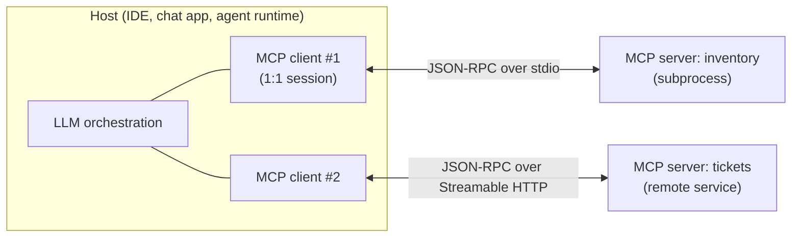
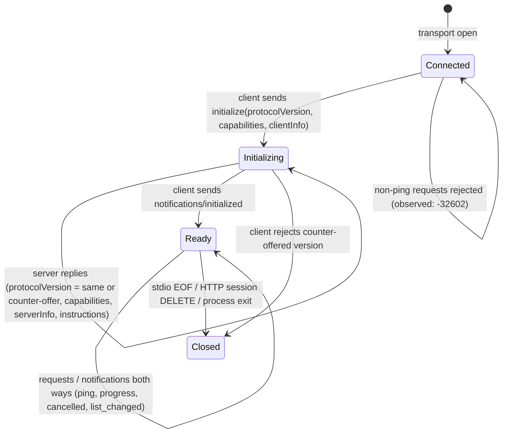

# 01 · MCP on the Wire: JSON-RPC, the Lifecycle State Machine, Host/Client/Server, and Transports

> **Folder:** `05-Model-Context-Protocol-MCP-Architecture/` · **File 1 of 3**
> **Anchoring specifications and code:** Model Context Protocol specification (revisions 2024-11-05, 2025-03-26,
> 2025-06-18, 2025-11-25, 2026-07-28; modelcontextprotocol.io) · JSON-RPC 2.0 specification · the official Python SDK
> `mcp` **2.3.0** (installed and exercised below; FastMCP is renamed `MCPServer` in 2.x) · WHATWG HTML Living
> Standard, *Server-sent events*.
> **Code baseline:** Python 3.10+ (CPython 3.14.5, `mcp` 2.3.0) · Java 21 (JDK 25.0.4, `--release 21`, no
> dependencies).
> **Previous folder:** [04 · GraphRAG, CDC, ACL trimming](../04-Enterprise-RAG-Pipelines-and-Retrieval-Mechanics/03-graphrag-streaming-ingestion-kafka-cdc-and-acl-security-trimming.md) ·
> **Next:** [02 · Enterprise MCP security](02-enterprise-mcp-security-oauth2-confused-deputy-and-sandboxing.md)

---

## 0. The thesis in one paragraph

MCP is a **contract**, not a framework. It gives LLM hosts a uniform JSON-RPC 2.0 protocol to discover and invoke
capabilities (tools, resources, prompts) exposed by servers, and lets servers ask the host for things in return
(sampling, roots, elicitation). Its engineering content is four things:

- **The topology:** a host runs one client per server connection, and isolation follows from that.
- **The lifecycle:** a negotiated handshake in revisions up to 2025-11-25. In the **2026-07-28** revision, as
  implemented by the SDK used here, a **stateless per-request envelope** in which every request carries its own
  protocol version and capabilities.
- **The error model:** tool failures are *results* with `isError: true`; protocol failures are JSON-RPC errors.
- **The transports:** stdio for local subprocesses, Streamable HTTP for remote servers.

Everything in this file was **observed on the wire** against the official Python SDK (`mcp` 2.3.0): a from-scratch
Python client and a zero-dependency Java host both drove the same SDK server over real stdio pipes.

---

## 1. Topology and primitives



- The **host** owns the user, the LLM, consent and policy. It creates **one client per server**. Clients don't share
  sessions, so a compromised or buggy server sees only its own connection.
- **Servers** expose three primitives, distinguished by **who controls them**:

| Primitive | Controlled by | Typical use | Security implication |
|-----------|--------------|-------------|----------------------|
| **Tools** (`tools/list`, `tools/call`) | the **model** decides to call (with host consent policy) | actions, lookups | side effects; needs authorization and approval policy (File 02) |
| **Resources** (`resources/list`, `resources/read`, templates, subscribe) | the **application** decides what to attach | files, records, documents as context | untrusted content entering the context (indirect prompt injection) |
| **Prompts** (`prompts/list`, `prompts/get`) | the **user** selects | templated workflows ("/restock-plan SKU-9") | low risk; still a content channel |

- Clients expose capabilities **to servers**: **sampling** (the server asks the host's LLM to generate), **roots**
  (which filesystem or URI scopes the server may operate on), and **elicitation** (the server asks the user for
  structured input). These invert the call direction. File 03 covers them.

---

## 2. JSON-RPC 2.0 framing and the error model

Every message is a JSON-RPC 2.0 object:

- **request** `{"jsonrpc":"2.0","id":7,"method":"tools/call","params":{...}}`, answered by exactly one **response**
  with the same `id`, carrying `result` *or* `error: {code, message, data?}`;
- **notification**: no `id`, no response (`notifications/initialized`, `notifications/progress`,
  `notifications/cancelled`, `notifications/resources/updated`, …).

**Two error channels, deliberately separate.** This is the most-missed rule in MCP client implementations:

| Failure | Channel | Observed against `mcp` 2.3.0 |
|---------|---------|------------------------------|
| Tool raised an exception | **result** with `isError: true` | `reserve` → `isError=True`, `"Error executing tool reserve"` |
| Unknown tool name | **result** with `isError: true` | `"Unknown tool: no_such_tool"` |
| Arguments fail schema validation | **result** with `isError: true` | pydantic validation message for `sku: 123` |
| Unknown method | JSON-RPC **error** −32601 | `Method not found` |
| Request before the handshake (and without an envelope) | JSON-RPC **error** −32602 | `Invalid request parameters` |
| Malformed JSON line on stdio | **no response** (line dropped) | the JSON-RPC spec suggests a −32700 reply; this transport drops it, so clients must time out |

Tool-level errors are *results* so the **model** can see and react to them ("the backend is down, try another
warehouse"). Protocol errors are for the **client**. A host that converts `isError` into an exception the model
never sees wastes the self-correction loop. One that treats it as a transport failure and retries creates retry
storms against a broken backend. The Java listing surfaces `isError` as a typed `ToolError` that the agent loop
can feed back to the model.

Standard codes are −32700 parse, −32600 invalid request, −32601 method not found, −32602 invalid params and −32603
internal. The 2026-07-28 revision (as implemented by the SDK) adds **−32020 `HEADER_MISMATCH`**, **−32021
`MISSING_REQUIRED_CLIENT_CAPABILITY`** and **−32022 `UNSUPPORTED_PROTOCOL_VERSION`**.

---

## 3. The lifecycle: handshake era (2024-11-05 → 2025-11-25)



Observed:

1. **Before `initialize`,** `tools/list` is rejected with −32602.
2. **`initialize` with 2025-11-25** returns the same version, capabilities `prompts`, `resources` and `tools` (each
   with `listChanged`), `serverInfo`, and the server's `instructions` string, which hosts should place in the
   system context.
3. **`initialize` with an unknown version ("1999-01-01")** gets a **counter-offer** of the server's latest handshake
   version (`2025-11-25`). The client must accept it or disconnect.
4. **Capabilities are negotiated, not assumed.** A client must not call `resources/subscribe` unless the server
   advertised `resources.subscribe`. A server must not send `sampling/createMessage` unless the client advertised
   `sampling`.

**Progress and cancellation.** A request can carry `_meta.progressToken`, and the server then emits
`notifications/progress {progressToken, progress, total, message}`. The lab received progress 1, 2, 3 for
`slow_count(3)`. A client that gives up sends `notifications/cancelled {requestId, reason}`. The Java client does this
on timeout, drops the late response if one arrives, and the session stays healthy (`ping` → `{}`).

---

## 4. The 2026-07-28 revision: a stateless per-request envelope

The SDK used here (`mcp` 2.3.0) implements a revision, **2026-07-28**, that is **not** reachable through
`initialize`. Its version registry lists `HANDSHAKE_PROTOCOL_VERSIONS = 2024-11-05 … 2025-11-25` and
`MODERN_PROTOCOL_VERSIONS = 2026-07-28`, "revisions that use the stateless per-request envelope". **⚠ Read the
published specification for the authoritative text. What follows is what the SDK implements and what was observed.**

| Concept | Handshake era | 2026-07-28 envelope (observed in the SDK) |
|---------|--------------|-------------------------------------------|
| Version and capability negotiation | once, in `initialize` | **every request** carries `_meta["io.modelcontextprotocol/protocolVersion"]`, `…/clientCapabilities`, `…/clientInfo` |
| Discovery | `initialize` result | **`server/discover`** returns `capabilities`, `supportedVersions`, `instructions`, `ttlMs`, `cacheScope`, `resultType` (cacheable) |
| Missing pieces | −32602 before init | −32602 naming the missing envelope key (`…/clientCapabilities`); −32021 / −32022 for capability/version |
| Server → client asks (sampling, elicitation, roots) | server-initiated JSON-RPC requests on the session | an **`InputRequiredResult`**: the client fulfills the embedded requests and **retries** the call with `input_responses` (optionally `request_state`) |
| Change detection | `notifications/tools/list_changed` | `subscriptions/listen`; HTTP routing headers (`mcp-protocol-version`, `mcp-method`, `mcp-name`); **−32020 `HEADER_MISMATCH`** when the client's view of a tool is stale, so the client refetches the listing and resends once |

Observed: `server/discover` with an incomplete envelope is rejected with −32602 naming the missing key. With the full
envelope it returns the capability advertisement. Then **`tools/call` carrying only the envelope, with no
`initialize` at all, succeeds** (`{"sku": "SKU-1", "warehouse": "eu-1", "on_hand": 42}`).

**Why it matters architecturally:**

1. **Horizontal scale without sticky sessions.** Handshake-era Streamable HTTP binds state to `Mcp-Session-Id`,
   which needs session affinity or a shared session store behind a load balancer. A self-describing request can hit
   any replica, including serverless functions.
2. **Cacheable discovery.** `ttlMs`/`cacheScope` let gateways and hosts cache capability advertisements.
3. **Routing at the edge.** `mcp-method`/`mcp-name` headers let API gateways authorize, rate-limit and route per tool
   *without parsing the JSON body* (File 02).
4. **Multi-round-trip input without server-held state.** `InputRequiredResult` plus optional `request_state` lets a
   server ask for sampling or elicitation mid-call without pinning a connection.

The SDK still negotiates all four handshake revisions, so production fleets will run mixed eras for a long time.
Gateways must speak both.

---

## 5. Transports

### 5.1 stdio

The host launches the server as a **subprocess**. Messages are **newline-delimited JSON** on stdin and stdout, and
must not contain raw newlines (the Java encoder escapes `\n`). **stderr is for logs.**

| Rule | Why |
|------|-----|
| Never write to stdout except protocol messages | one `print()` in server code corrupts the stream |
| Close stdin to shut down | EOF is the graceful-exit signal; then wait, then kill |
| One writer at a time on stdin | interleaved partial lines corrupt framing (`ReentrantLock` in the Java client) |
| Inherit only the environment you mean to | stdio servers run with the host user's privileges (File 02: sandboxing) |

### 5.2 Streamable HTTP

A **single endpoint** (e.g. `/mcp`):

- **POST** carries client→server JSON-RPC. The server answers with `application/json` or with `text/event-stream`
  (SSE), streaming progress notifications and finally the response.
- **GET** opens an SSE stream for server-initiated messages.
- **Sessions (handshake era):** the server assigns `Mcp-Session-Id` at `initialize`, and the client echoes it.
  **Resumability** uses SSE event IDs and `Last-Event-ID`.
- **Security for local servers:** validate `Origin` (DNS-rebinding defense) and bind to `127.0.0.1`, not `0.0.0.0`.

The SDK's `run("streamable-http", ...)` exposes `stateless_http`, `json_response`, `event_store`, `max_sessions` and
`session_idle_timeout`, which are the production knobs this paragraph describes. The original **HTTP+SSE**
transport (2024-11-05, two endpoints) is deprecated, and the SDK keeps it for compatibility.

### 5.3 Choosing

| | stdio | Streamable HTTP |
|-|-------|-----------------|
| Deployment | local subprocess per host | shared remote service |
| Auth | process/user boundary (+ env secrets) | OAuth 2.1 resource server (File 02) |
| Scale | one per host | horizontal (stateless envelope or sticky sessions) |
| Failure blast radius | one host | every host using it |
| Typical | IDE/desktop tools, local files | SaaS integrations, enterprise data |

---

## 6. Production code blueprints

### 6.1 Python: an SDK server, and a from-scratch client that observes it

`--serve` runs an `MCPServer` (the SDK 2.x name for FastMCP) with typed and untyped tools, a failing tool, a
progress-reporting tool, a sleeping tool, a resource and a prompt. The default mode launches it as a subprocess and
speaks raw JSON-RPC to it. Two SDK gotchas surfaced while writing it, and both are now documented in the code:

- **`from __future__ import annotations` breaks the SDK's schema generation** when a tool uses a locally imported
  type (`ctx: Context`). The SDK calls `inspect.signature(eval_str=True)`, and the stringified annotation can't
  resolve, so the server dies at startup and the client sees silence.
- **A bare `-> dict` return produces no `outputSchema`** and no `structuredContent`. A `TypedDict` (or pydantic
  model / dataclass) return does.

```python
"""mcp_wire_lab.py - MCP on the wire, observed against the official Python SDK (mcp 2.x, `MCPServer`).

`python mcp_wire_lab.py --serve` runs an SDK server over stdio. Without arguments, this file launches that server as
a subprocess and drives it with a FROM-SCRATCH client: newline-delimited JSON-RPC 2.0 on stdin/stdout, the
initialize handshake, tools/resources/prompts, error semantics, and the 2026-07-28 per-request envelope probe.
Every claim the KB makes about the wire is printed from this conversation, not recalled.
NOTE: no `from __future__ import annotations` here - the SDK builds tool schemas with
inspect.signature(eval_str=True), and stringified annotations of locally imported types (Context) fail to resolve.
"""
import json
from typing import TypedDict
import subprocess
import sys
import threading
import queue


class Stock(TypedDict):
    sku: str
    warehouse: str
    on_hand: int


def serve() -> None:
    from mcp.server.mcpserver import Context, MCPServer

    server = MCPServer("inventory", instructions="Read-only inventory lookups for the ops assistant.")

    @server.tool()
    def get_stock(sku: str, warehouse: str = "eu-1") -> Stock:
        """Current on-hand units for a SKU in one warehouse."""
        return {"sku": sku, "warehouse": warehouse, "on_hand": 42 if sku == "SKU-1" else 0}

    @server.tool()
    def get_stock_untyped(sku: str) -> dict:
        """Same data, untyped return: the SDK cannot derive an output schema from a bare dict."""
        return {"sku": sku, "on_hand": 42}

    @server.tool()
    def reserve(sku: str, qty: int) -> str:
        """Reserve units (fails when the backend is down)."""
        raise RuntimeError("inventory backend unavailable")

    @server.tool()
    async def slow_count(n: int, ctx: Context) -> int:
        """Counts to n, reporting progress."""
        for i in range(n):
            await ctx.report_progress(i + 1, n, f"step {i + 1}")
        return n

    @server.tool()
    async def sleep_ms(ms: int) -> str:
        """Sleeps, to exercise client timeouts and notifications/cancelled."""
        import anyio
        await anyio.sleep(ms / 1000)
        return "done"

    @server.resource("inventory://warehouses", mime_type="application/json")
    def warehouses() -> str:
        return json.dumps(["eu-1", "us-2"])

    @server.prompt()
    def restock_plan(sku: str) -> str:
        """Draft a restock plan."""
        return f"Write a restock plan for {sku} using get_stock for each warehouse."

    server.run("stdio")


class RawClient:
    """JSON-RPC 2.0 over a child's stdio: one JSON object per line, ids correlate responses."""

    def __init__(self):
        self.p = subprocess.Popen([sys.executable, __file__, "--serve"], stdin=subprocess.PIPE, stdout=subprocess.PIPE,
                                  stderr=subprocess.DEVNULL, text=True, encoding="utf-8", bufsize=1)
        self.inbox: queue.Queue = queue.Queue()
        threading.Thread(target=self._read, daemon=True).start()
        self.next_id = 1

    def _read(self):
        for line in self.p.stdout:
            line = line.strip()
            if line:
                self.inbox.put(json.loads(line))

    def send_raw(self, text: str) -> None:
        self.p.stdin.write(text + "\n")
        self.p.stdin.flush()

    def notify(self, method: str, params: dict | None = None) -> None:
        self.send_raw(json.dumps({"jsonrpc": "2.0", "method": method, **({"params": params} if params else {})}))

    def request(self, method: str, params: dict | None = None, timeout: float = 15) -> tuple[dict, list[dict]]:
        rid = self.next_id
        self.next_id += 1
        self.send_raw(json.dumps({"jsonrpc": "2.0", "id": rid, "method": method, **({"params": params} if params else {})}))
        return self.wait(rid, timeout)

    def wait(self, rid, timeout: float = 15) -> tuple[dict, list[dict]]:
        notes = []
        while True:
            msg = self.inbox.get(timeout=timeout)
            if msg.get("id") == rid and ("result" in msg or "error" in msg):
                return msg, notes
            notes.append(msg)                                   # notifications (progress, logs) arrive interleaved

    def close(self):
        self.p.stdin.close()
        self.p.wait(timeout=15)


def main() -> None:
    import importlib.metadata as md
    from mcp_types.version import HANDSHAKE_PROTOCOL_VERSIONS, MODERN_PROTOCOL_VERSIONS

    print(f"mcp SDK {md.version('mcp')}; handshake versions {HANDSHAKE_PROTOCOL_VERSIONS}; "
          f"per-request-envelope versions {MODERN_PROTOCOL_VERSIONS}")
    c = RawClient()
    obs = {}

    early, _ = c.request("tools/list", timeout=10)
    obs["before_initialize"] = early
    print(f"\n1) tools/list BEFORE initialize -> {json.dumps(early)[:160]}")

    init, _ = c.request("initialize", {"protocolVersion": "2025-11-25", "capabilities": {},
                                       "clientInfo": {"name": "raw-client", "version": "0.1"}})
    r = init["result"]
    print(f"2) initialize(2025-11-25) -> protocolVersion={r['protocolVersion']} serverInfo={r['serverInfo']['name']} "
          f"capabilities={sorted(r['capabilities'])} instructions={r.get('instructions')!r}")
    assert r["protocolVersion"] == "2025-11-25" and "tools" in r["capabilities"]
    c.notify("notifications/initialized")

    tools, _ = c.request("tools/list")
    names = [t["name"] for t in tools["result"]["tools"]]
    gs = next(t for t in tools["result"]["tools"] if t["name"] == "get_stock")
    print(f"3) tools/list -> {names}")
    print(f"   get_stock.inputSchema = {json.dumps(gs['inputSchema'])}")
    ut = next(t for t in tools["result"]["tools"] if t["name"] == "get_stock_untyped")
    print(f"   outputSchema: get_stock (-> TypedDict) {'outputSchema' in gs}; get_stock_untyped (-> dict) {'outputSchema' in ut}")
    assert set(names) >= {"get_stock", "reserve", "slow_count"} and gs["inputSchema"]["required"] == ["sku"]

    ok, _ = c.request("tools/call", {"name": "get_stock", "arguments": {"sku": "SKU-1"}})
    print(f"4) tools/call get_stock -> isError={ok['result'].get('isError')} "
          f"structuredContent={ok['result'].get('structuredContent')} text={ok['result']['content'][0]['text'][:60]!r}")
    assert ok["result"].get("isError") is False and ok["result"]["structuredContent"]["on_hand"] == 42

    bad, _ = c.request("tools/call", {"name": "reserve", "arguments": {"sku": "SKU-1", "qty": 3}})
    print(f"5) tools/call reserve (tool raises) -> JSON-RPC result, isError={bad['result'].get('isError')}, "
          f"text={bad['result']['content'][0]['text'][:70]!r}")
    assert "result" in bad and bad["result"]["isError"] is True

    wrong, _ = c.request("tools/call", {"name": "get_stock", "arguments": {"sku": 123}})
    print(f"6) tools/call with a wrong argument type -> {json.dumps(wrong)[:170]}")
    missing, _ = c.request("tools/call", {"name": "no_such_tool", "arguments": {}})
    print(f"7) tools/call unknown tool -> {json.dumps(missing)[:170]}")
    unknown, _ = c.request("does/not/exist")
    print(f"8) unknown method -> error {unknown.get('error', {}).get('code')} {unknown.get('error', {}).get('message')!r}")
    assert unknown["error"]["code"] == -32601

    prog, notes = c.request("tools/call", {"name": "slow_count", "arguments": {"n": 3}, "_meta": {"progressToken": "p1"}})
    progress = [n["params"]["progress"] for n in notes if n.get("method") == "notifications/progress"]
    print(f"9) tools/call slow_count with progressToken -> result {prog['result'].get('structuredContent') or prog['result']['content'][0]['text']}, "
          f"progress notifications {progress}")
    assert progress == [1, 2, 3]

    res, _ = c.request("resources/read", {"uri": "inventory://warehouses"})
    pr, _ = c.request("prompts/get", {"name": "restock_plan", "arguments": {"sku": "SKU-9"}})
    ping, _ = c.request("ping")
    print(f"10) resources/read -> {res['result']['contents'][0]['text']} ({res['result']['contents'][0].get('mimeType')}); "
          f"prompts/get -> role={pr['result']['messages'][0]['role']}; ping -> {ping['result']}")

    c.send_raw("{this is not json")
    try:
        parse_err = c.inbox.get(timeout=5)
    except queue.Empty:
        parse_err = None
    print(f"11) malformed line -> {json.dumps(parse_err)[:160] if parse_err else 'no response (line dropped)'}")
    c.close()

    c2 = RawClient()
    neg, _ = c2.request("initialize", {"protocolVersion": "1999-01-01", "capabilities": {},
                                       "clientInfo": {"name": "old", "version": "0"}})
    print(f"\n12) initialize with an unknown version -> server counter-offers "
          f"{neg.get('result', {}).get('protocolVersion') or neg.get('error')}")
    c2.close()

    c3 = RawClient()
    partial, _ = c3.request("server/discover", {"_meta": {"io.modelcontextprotocol/protocolVersion": "2026-07-28"}})
    print(f"13) server/discover with an incomplete envelope -> error {partial['error']['code']}: "
          f"{partial['error']['message']}")
    env = {"io.modelcontextprotocol/protocolVersion": "2026-07-28",
           "io.modelcontextprotocol/clientCapabilities": {},
           "io.modelcontextprotocol/clientInfo": {"name": "raw-client", "version": "0.1"}}
    disc, _ = c3.request("server/discover", {"_meta": env})
    dres = disc.get("result", {})
    print(f"14) server/discover with the full envelope -> keys {sorted(dres)}; capabilities {dres.get('capabilities')}; "
          f"cacheScope={dres.get('cacheScope')!r}")
    stateless, _ = c3.request("tools/call", {"name": "get_stock", "arguments": {"sku": "SKU-1"}, "_meta": env})
    print(f"15) tools/call carrying the envelope, NO initialize -> "
          f"{json.dumps(stateless.get('result', {}).get('structuredContent') or stateless)[:160]}")
    c3.close()

    assert early["error"]["code"] == -32602, "no handshake and no envelope: rejected"
    assert wrong["result"]["isError"] is True and missing["result"]["isError"] is True, "tool-level errors are results"
    assert parse_err is None, "the SDK's stdio transport drops unparsable lines"
    assert neg["result"]["protocolVersion"] == "2025-11-25", "unknown version -> server's latest handshake version"
    assert partial["error"]["code"] == -32602 and "clientCapabilities" in partial["error"]["message"]
    assert "result" in disc and stateless["result"]["structuredContent"]["on_hand"] == 42, "stateless envelope works"
    print("\nall MCP wire self-checks passed")


if __name__ == "__main__":
    serve() if "--serve" in sys.argv else main()
```

Output (verified against `mcp` 2.3.0; deterministic):

```text
mcp SDK 2.3.0; handshake versions ('2024-11-05', '2025-03-26', '2025-06-18', '2025-11-25'); per-request-envelope versions ('2026-07-28',)

1) tools/list BEFORE initialize -> {"jsonrpc": "2.0", "id": 1, "error": {"code": -32602, "message": "Invalid request parameters", "data": ""}}
2) initialize(2025-11-25) -> protocolVersion=2025-11-25 serverInfo=inventory capabilities=['prompts', 'resources', 'tools'] instructions='Read-only inventory lookups for the ops assistant.'
3) tools/list -> ['get_stock', 'get_stock_untyped', 'reserve', 'slow_count', 'sleep_ms']
   get_stock.inputSchema = {"properties": {"sku": {"title": "Sku", "type": "string"}, "warehouse": {"default": "eu-1", "title": "Warehouse", "type": "string"}}, "required": ["sku"], "type": "object", "title": "get_stockArguments"}
   outputSchema: get_stock (-> TypedDict) True; get_stock_untyped (-> dict) False
4) tools/call get_stock -> isError=False structuredContent={'sku': 'SKU-1', 'warehouse': 'eu-1', 'on_hand': 42} text='{\n  "sku": "SKU-1",\n  "warehouse": "eu-1",\n  "on_hand": 42\n}'
5) tools/call reserve (tool raises) -> JSON-RPC result, isError=True, text='Error executing tool reserve'
6) tools/call with a wrong argument type -> {"jsonrpc": "2.0", "id": 6, "result": {"content": [{"text": "Error executing tool get_stock: 1 validation error for get_stockArguments\nsku\n  Input should be a valid str
7) tools/call unknown tool -> {"jsonrpc": "2.0", "id": 7, "result": {"content": [{"text": "Unknown tool: no_such_tool", "type": "text"}], "isError": true}}
8) unknown method -> error -32601 'Method not found'
9) tools/call slow_count with progressToken -> result {'result': 3}, progress notifications [1, 2, 3]
10) resources/read -> ["eu-1", "us-2"] (application/json); prompts/get -> role=user; ping -> {}
11) malformed line -> no response (line dropped)

12) initialize with an unknown version -> server counter-offers 2025-11-25
13) server/discover with an incomplete envelope -> error -32602: params._meta is missing the required envelope key(s): io.modelcontextprotocol/clientCapabilities
14) server/discover with the full envelope -> keys ['_meta', 'cacheScope', 'capabilities', 'instructions', 'resultType', 'supportedVersions', 'ttlMs']; capabilities {'prompts': {'listChanged': True}, 'resources': {'listChanged': True, 'subscribe': True}, 'tools': {'listChanged': True}}; cacheScope='private'
15) tools/call carrying the envelope, NO initialize -> {"sku": "SKU-1", "warehouse": "eu-1", "on_hand": 42}

all MCP wire self-checks passed
```

### 6.2 Java 21: a zero-dependency MCP host client over stdio

The client includes:

- a minimal JSON codec (objects, arrays, strings with escapes, numbers, literals);
- a reader **virtual thread** that dispatches responses by `id` to `CompletableFuture`s and answers server-initiated
  `ping` and `roots/list`;
- a client-side **lifecycle state machine** (requests refused before READY);
- typed `ToolError` for `isError` results;
- **timeouts that send `notifications/cancelled`** and drop late responses.

Writing it surfaced a Java trap now commented in the code. `cond ? Double.parseDouble(t) : Long.parseLong(t)` applies
binary numeric promotion and returns **1.0 for every integer**, including JSON-RPC ids. The round-trip self-test
caught it.

```java
// McpStdioClient.java - Java 21 MCP host-side client over stdio with zero dependencies: newline-delimited JSON-RPC 2.0,
// the initialize/initialized lifecycle as a state machine, id-correlated responses on a reader virtual thread,
// answers to server-initiated requests (roots/list, ping), progress notifications, and request timeouts that send
// notifications/cancelled. The self-test drives the official Python SDK server from mcp_wire_lab.py (Java <-> Python).
// Build & self-test:  javac --release 21 -Xlint:all -Werror -d out McpStdioClient.java
//                     java -ea -cp out dev.l7.ai.inference.McpStdioClient   (needs python + mcp on PYTHONPATH)
package dev.l7.ai.inference;

import java.io.BufferedReader;
import java.io.IOException;
import java.io.InputStreamReader;
import java.io.OutputStreamWriter;
import java.io.Writer;
import java.nio.charset.StandardCharsets;
import java.time.Duration;
import java.util.ArrayList;
import java.util.LinkedHashMap;
import java.util.List;
import java.util.Map;
import java.util.concurrent.CompletableFuture;
import java.util.concurrent.ConcurrentHashMap;
import java.util.concurrent.CopyOnWriteArrayList;
import java.util.concurrent.TimeUnit;
import java.util.concurrent.TimeoutException;
import java.util.concurrent.atomic.AtomicLong;
import java.util.concurrent.locks.ReentrantLock;

public final class McpStdioClient implements AutoCloseable {

    // ------------------------------------------------------------------ minimal JSON (objects, arrays, strings, numbers)
    static final class Json {
        private final String s;
        private int i;

        private Json(String s) { this.s = s; }

        static Object parse(String s) {
            Json p = new Json(s);
            Object v = p.value();
            p.ws();
            if (p.i != s.length()) throw new IllegalArgumentException("trailing data at " + p.i);
            return v;
        }

        private void ws() { while (i < s.length() && Character.isWhitespace(s.charAt(i))) i++; }

        private Object value() {
            ws();
            char c = s.charAt(i);
            return switch (c) {
                case '{' -> object();
                case '[' -> array();
                case '"' -> string();
                case 't' -> lit("true", Boolean.TRUE);
                case 'f' -> lit("false", Boolean.FALSE);
                case 'n' -> lit("null", null);
                default -> number();
            };
        }

        private Object lit(String w, Object v) {
            if (!s.startsWith(w, i)) throw new IllegalArgumentException("bad literal at " + i);
            i += w.length();
            return v;
        }

        private Map<String, Object> object() {
            Map<String, Object> m = new LinkedHashMap<>();
            i++;
            ws();
            if (s.charAt(i) == '}') { i++; return m; }
            while (true) {
                ws();
                String k = string();
                ws();
                i++;                                                    // ':'
                m.put(k, value());
                ws();
                if (s.charAt(i++) == '}') return m;                     // else ','
            }
        }

        private List<Object> array() {
            List<Object> a = new ArrayList<>();
            i++;
            ws();
            if (s.charAt(i) == ']') { i++; return a; }
            while (true) {
                a.add(value());
                ws();
                if (s.charAt(i++) == ']') return a;
            }
        }

        private String string() {
            StringBuilder b = new StringBuilder();
            i++;
            while (true) {
                char c = s.charAt(i++);
                if (c == '"') return b.toString();
                if (c != '\\') { b.append(c); continue; }
                char e = s.charAt(i++);
                switch (e) {
                    case 'n' -> b.append('\n');
                    case 't' -> b.append('\t');
                    case 'r' -> b.append('\r');
                    case 'b' -> b.append('\b');
                    case 'f' -> b.append('\f');
                    case 'u' -> { b.append((char) Integer.parseInt(s.substring(i, i + 4), 16)); i += 4; }
                    default -> b.append(e);                              // \" \\ \/
                }
            }
        }

        private Number number() {
            int st = i;
            while (i < s.length() && "+-0123456789.eE".indexOf(s.charAt(i)) >= 0) i++;
            String t = s.substring(st, i);
            // NOT a ternary: `c ? Double.parseDouble(t) : Long.parseLong(t)` promotes both arms to double, so every
            // integer (including JSON-RPC ids) would come back as 1.0.
            if (t.contains(".") || t.contains("e") || t.contains("E")) return Double.parseDouble(t);
            return Long.parseLong(t);
        }

        static String write(Object v) {
            StringBuilder b = new StringBuilder();
            write(v, b);
            return b.toString();
        }

        private static void write(Object v, StringBuilder b) {
            switch (v) {
                case null -> b.append("null");
                case String str -> {
                    b.append('"');
                    for (char c : str.toCharArray()) {
                        switch (c) {
                            case '"' -> b.append("\\\"");
                            case '\\' -> b.append("\\\\");
                            case '\n' -> b.append("\\n");               // a raw newline would break stdio framing
                            case '\r' -> b.append("\\r");
                            case '\t' -> b.append("\\t");
                            default -> { if (c < 0x20) b.append(String.format("\\u%04x", (int) c)); else b.append(c); }
                        }
                    }
                    b.append('"');
                }
                case Map<?, ?> m -> {
                    b.append('{');
                    boolean first = true;
                    for (var e : m.entrySet()) {
                        if (!first) b.append(',');
                        first = false;
                        write(String.valueOf(e.getKey()), b);
                        b.append(':');
                        write(e.getValue(), b);
                    }
                    b.append('}');
                }
                case List<?> l -> {
                    b.append('[');
                    for (int k = 0; k < l.size(); k++) {
                        if (k > 0) b.append(',');
                        write(l.get(k), b);
                    }
                    b.append(']');
                }
                default -> b.append(v);                                  // numbers, booleans
            }
        }
    }

    // ------------------------------------------------------------------ client
    public enum State { NEW, INITIALIZING, READY, CLOSED }

    public static final class ToolError extends RuntimeException {
        private static final long serialVersionUID = 1L;

        ToolError(String msg) { super(msg); }
    }

    public record RpcError(long code, String message) {}

    private final Process proc;
    private final Writer out;
    private final ReentrantLock writeLock = new ReentrantLock();          // one JSON line at a time on stdin
    private final Map<Long, CompletableFuture<Map<String, Object>>> pending = new ConcurrentHashMap<>();
    private final AtomicLong ids = new AtomicLong();
    private final List<String> roots;
    final List<Map<String, Object>> notifications = new CopyOnWriteArrayList<>();
    final List<String> serverRequestsSeen = new CopyOnWriteArrayList<>();
    private volatile State state = State.NEW;
    private volatile String protocolVersion;

    public McpStdioClient(List<String> command, List<String> roots) throws IOException {
        this.roots = roots;
        this.proc = new ProcessBuilder(command).redirectError(ProcessBuilder.Redirect.DISCARD).start();
        this.out = new OutputStreamWriter(proc.getOutputStream(), StandardCharsets.UTF_8);
        Thread.ofVirtual().name("mcp-reader").start(this::readLoop);
    }

    @SuppressWarnings("unchecked")
    private void readLoop() {
        try (BufferedReader in = new BufferedReader(new InputStreamReader(proc.getInputStream(), StandardCharsets.UTF_8))) {
            String line;
            while ((line = in.readLine()) != null) {
                if (line.isBlank()) continue;
                Map<String, Object> msg = (Map<String, Object>) Json.parse(line);
                Object id = msg.get("id");
                if (id != null && (msg.containsKey("result") || msg.containsKey("error"))) {
                    CompletableFuture<Map<String, Object>> f = pending.remove(((Number) id).longValue());
                    if (f != null) f.complete(msg);                      // late responses to cancelled ids are dropped
                } else if (id != null && msg.containsKey("method")) {
                    onServerRequest(id, (String) msg.get("method"));
                } else {
                    notifications.add(msg);
                }
            }
        } catch (IOException | RuntimeException e) {
            pending.values().forEach(f -> f.completeExceptionally(e));
        } finally {
            state = State.CLOSED;
            pending.values().forEach(f -> f.completeExceptionally(new IOException("server closed the stream")));
        }
    }

    /** Server -> client requests: answer roots/list and ping; reject what this host doesn't support. */
    private void onServerRequest(Object id, String method) {
        serverRequestsSeen.add(method);
        Map<String, Object> resp = new LinkedHashMap<>();
        resp.put("jsonrpc", "2.0");
        resp.put("id", id);
        switch (method) {
            case "ping" -> resp.put("result", Map.of());
            case "roots/list" -> resp.put("result", Map.of("roots",
                    roots.stream().map(r -> Map.of("uri", r, "name", r.substring(r.lastIndexOf('/') + 1))).toList()));
            default -> resp.put("error", Map.of("code", -32601, "message", "Method not found: " + method));
        }
        send(resp);
    }

    private void send(Map<String, Object> msg) {
        writeLock.lock();
        try {
            out.write(Json.write(msg));
            out.write('\n');
            out.flush();
        } catch (IOException e) {
            throw new java.io.UncheckedIOException(e);
        } finally {
            writeLock.unlock();
        }
    }

    private Map<String, Object> envelope(String method, Map<String, Object> params) {
        Map<String, Object> m = new LinkedHashMap<>();
        m.put("jsonrpc", "2.0");
        m.put("method", method);
        if (params != null) m.put("params", params);
        return m;
    }

    @SuppressWarnings("unchecked")
    public Map<String, Object> request(String method, Map<String, Object> params, Duration timeout) throws Exception {
        if (state != State.READY && !method.equals("initialize")) throw new IllegalStateException("not initialized: " + state);
        long id = ids.incrementAndGet();
        CompletableFuture<Map<String, Object>> f = new CompletableFuture<>();
        pending.put(id, f);
        Map<String, Object> msg = envelope(method, params);
        msg.put("id", id);
        send(msg);
        try {
            Map<String, Object> resp = f.get(timeout.toMillis(), TimeUnit.MILLISECONDS);
            if (resp.containsKey("error")) {
                Map<String, Object> e = (Map<String, Object>) resp.get("error");
                throw new IllegalStateException("rpc error " + new RpcError(((Number) e.get("code")).longValue(), (String) e.get("message")));
            }
            return (Map<String, Object>) resp.get("result");
        } catch (TimeoutException te) {
            pending.remove(id);
            send(envelope("notifications/cancelled", Map.of("requestId", id, "reason", "client timeout after " + timeout)));
            throw te;
        }
    }

    public Map<String, Object> initialize(String version) throws Exception {
        state = State.INITIALIZING;
        Map<String, Object> r = request("initialize", Map.of("protocolVersion", version,
                "capabilities", Map.of("roots", Map.of("listChanged", true)),
                "clientInfo", Map.of("name", "java-host", "version", "1.0")), Duration.ofSeconds(20));
        protocolVersion = (String) r.get("protocolVersion");
        send(envelope("notifications/initialized", null));
        state = State.READY;
        return r;
    }

    /** tools/call: tool failures arrive as RESULTS with isError=true; surface them as typed exceptions. */
    @SuppressWarnings("unchecked")
    public Map<String, Object> callTool(String name, Map<String, Object> args, Duration timeout, String progressToken) throws Exception {
        Map<String, Object> p = new LinkedHashMap<>();
        p.put("name", name);
        p.put("arguments", args);
        if (progressToken != null) p.put("_meta", Map.of("progressToken", progressToken));
        Map<String, Object> r = request("tools/call", p, timeout);
        if (Boolean.TRUE.equals(r.get("isError"))) {
            List<Map<String, Object>> content = (List<Map<String, Object>>) r.get("content");
            throw new ToolError(name + ": " + content.get(0).get("text"));
        }
        return r;
    }

    public String protocolVersion() { return protocolVersion; }

    public State state() { return state; }

    @Override
    public void close() {
        try {
            out.close();                                                 // EOF on stdin = graceful shutdown
        } catch (IOException ignored) {
            // already gone
        }
        try {
            if (!proc.waitFor(10, TimeUnit.SECONDS)) proc.destroyForcibly();
        } catch (InterruptedException e) {
            proc.destroyForcibly();
            Thread.currentThread().interrupt();
        }
        state = State.CLOSED;
    }

    // ------------------------------------------------------------------ self-test against the Python SDK server
    private static void check(boolean ok, String what) {
        if (!ok) throw new AssertionError(what);
    }

    @SuppressWarnings("unchecked")
    public static void main(String[] args) throws Exception {
        String python = System.getProperty("python", "python");
        String script = System.getProperty("server", "mcp_wire_lab.py");
        check(Json.write(Json.parse("{\"a\":[1,2.5,\"x\\ny\",true,null],\"b\":{}}")).equals("{\"a\":[1,2.5,\"x\\ny\",true,null],\"b\":{}}"),
                "json round trip");
        try (McpStdioClient c = new McpStdioClient(List.of(python, script, "--serve"), List.of("file:///srv/inventory"))) {
            try {
                c.request("tools/list", null, Duration.ofSeconds(1));
                check(false, "client must refuse before initialize");
            } catch (IllegalStateException expected) {
                System.out.println("before initialize: " + expected.getMessage());
            }
            Map<String, Object> init = c.initialize("2025-11-25");
            System.out.printf("initialize -> protocolVersion %s, server %s, capabilities %s%n", c.protocolVersion(),
                    ((Map<String, Object>) init.get("serverInfo")).get("name"), ((Map<String, Object>) init.get("capabilities")).keySet());
            List<Map<String, Object>> tools = (List<Map<String, Object>>) c.request("tools/list", null, Duration.ofSeconds(10)).get("tools");
            System.out.println("tools: " + tools.stream().map(t -> t.get("name")).toList());

            Map<String, Object> stock = c.callTool("get_stock", Map.of("sku", "SKU-1"), Duration.ofSeconds(10), null);
            System.out.println("get_stock structuredContent: " + stock.get("structuredContent"));
            check(((Number) ((Map<String, Object>) stock.get("structuredContent")).get("on_hand")).intValue() == 42, "structured");

            try {
                c.callTool("reserve", Map.of("sku", "SKU-1", "qty", 2), Duration.ofSeconds(10), null);
                check(false, "isError must surface");
            } catch (ToolError e) {
                System.out.println("reserve -> ToolError: " + e.getMessage());
            }

            c.callTool("slow_count", Map.of("n", 4), Duration.ofSeconds(10), "tok-1");
            long progress = c.notifications.stream().filter(n -> "notifications/progress".equals(n.get("method"))).count();
            System.out.println("progress notifications received: " + progress);
            check(progress == 4, "progress");

            long t0 = System.nanoTime();
            try {
                c.callTool("sleep_ms", Map.of("ms", 3000), Duration.ofMillis(300), null);
                check(false, "must time out");
            } catch (TimeoutException e) {
                System.out.printf("sleep_ms(3000) with a 300 ms budget -> timed out after %d ms, sent notifications/cancelled%n",
                        (System.nanoTime() - t0) / 1_000_000);
            }
            Map<String, Object> pong = c.request("ping", null, Duration.ofSeconds(5));
            System.out.println("session still healthy after cancellation: ping -> " + pong);
            Map<String, Object> wh = c.request("resources/read", Map.of("uri", "inventory://warehouses"), Duration.ofSeconds(5));
            System.out.println("resources/read -> " + ((List<Map<String, Object>>) wh.get("contents")).get(0).get("text"));
        }
        System.out.println("all McpStdioClient self-checks passed");
    }
}
```

Output (one measured run against the Python SDK server; the timeout latency varies):

```text
before initialize: not initialized: NEW
initialize -> protocolVersion 2025-11-25, server inventory, capabilities [prompts, resources, tools]
tools: [get_stock, get_stock_untyped, reserve, slow_count, sleep_ms]
get_stock structuredContent: {sku=SKU-1, warehouse=eu-1, on_hand=42}
reserve -> ToolError: reserve: Error executing tool reserve
progress notifications received: 4
sleep_ms(3000) with a 300 ms budget -> timed out after 300 ms, sent notifications/cancelled
session still healthy after cancellation: ping -> {}
resources/read -> ["eu-1", "us-2"]
all McpStdioClient self-checks passed
```

---

## 7. Production failure modes and P99 debugging

### F1 · The server "hangs" on startup, and the client sees nothing

- **Symptom:** the host times out on `initialize`. No error is shown.
- **Root cause:** the stdio server crashed before speaking, typically an import error, a schema-generation failure
  (the `__future__` annotations trap above) or a missing dependency. stderr was discarded or unread.
- **Fix:** capture and surface the child's stderr in the host. Run a startup health probe (`initialize` within N
  seconds) with the stderr tail attached to the error.

### F2 · Corrupted stdio stream

- **Symptom:** sporadic JSON parse failures and lost responses.
- **Root cause:** server code (or a library) printing to stdout, or concurrent unsynchronized writes.
- **Fix:** route all logging to stderr, serialize writes per line, and lint for `print(` in server code.

### F3 · Agents can't recover from tool failures

- **Symptom:** the agent stops at the first failed call or loops on it.
- **Root cause:** the host turns `isError` results into exceptions the model never sees, or into transport retries.
- **Fix:** return `isError` content to the model as a tool result. Retry only transport errors, with budgets.

### F4 · Orphaned server work after client timeouts

- **Symptom:** server CPU and backend load keep climbing while clients have already given up.
- **Root cause:** clients time out silently without `notifications/cancelled`, or servers ignore cancellation.
- **Fix:** always send `notifications/cancelled` on timeout (Java listing). Servers propagate cancellation into
  backend calls (anyio cancel scopes or task cancellation).

### F5 · Remote MCP server doesn't scale past one replica

- **Symptom:** errors whenever the load balancer moves a session to another pod.
- **Root cause:** handshake-era Streamable HTTP sessions (`Mcp-Session-Id`) held in pod memory.
- **Fix:** sticky routing or a shared session store, or adopt the stateless per-request envelope (2026-07-28) /
  `stateless_http` mode where clients support it.

### F6 · Version skew across a fleet

- **Symptom:** some hosts fail against an upgraded server, or a gateway rejects new-revision traffic.
- **Root cause:** clients that don't handle counter-offers, gateways that only parse the handshake era, or the
  modern envelope's new error codes treated as fatal.
- **Fix:** test the matrix (oldest supported revision → latest) and make gateways envelope-aware. Treat
  `HEADER_MISMATCH` as "refetch and retry once", which is what the SDK client does.

### F7 · No output schema, so the host can't validate tool results

- **Symptom:** downstream parsing of tool results breaks on schema drift.
- **Root cause:** tools return untyped dicts (no `outputSchema`, no `structuredContent`).
- **Fix:** typed returns (TypedDict, pydantic, records). Validate `structuredContent` against `outputSchema` in the
  host.

---

## 8. FAANG L7 bar-raiser Q&A chains

### Q1 · "What is MCP, architecturally, and why not just call REST APIs as tools?"

- **L5 answer:** "MCP is a standard way to give tools to LLMs."
- **Why L5 fails at scale:** it misses the control model, the bidirectionality, and what standardization buys
  operationally.
- **L7 principal defense:**
  - MCP is a JSON-RPC 2.0 contract between a host's per-server clients and servers. It has three server primitives
    with distinct controllers (model-controlled tools, application-controlled resources, user-controlled prompts)
    and client primitives that invert the direction (sampling, roots, elicitation).
  - It negotiates versions and capabilities, and has a progress, cancellation and change-notification model plus
    two standard transports.
  - The value is M+N integrations instead of M×N, uniform discovery (schemas the model can read), and a uniform
    place to enforce security (File 02).
  - Raw REST-as-tools works for one app, and fragments into bespoke adapters at fleet scale.

### Q2 · "A tool call fails. What should the client do?"

- **L5 answer:** "Catch the exception and retry."
- **Why L5 fails:** in MCP, tool failures are **results** (`isError: true`) meant for the model, and only protocol
  failures are JSON-RPC errors.
- **L7 defense:**
  1. Return `isError` content to the model so it can adapt (observed: exceptions, unknown tools and schema
     violations all arrive as `isError` results).
  2. Retry only transport or protocol errors, with a budget and idempotency awareness (does the tool declare itself
     idempotent via annotations?).
  3. Send `notifications/cancelled` on timeout.
  4. Never let an `isError` loop run unbounded (Folder 06's loop guards).

### Q3 · "Walk me through the MCP lifecycle, and what changed in 2026-07-28."

- **L5 answer:** "You call initialize, then you can use tools."
- **Why L5 fails:** no negotiation details, no failure behavior, and no awareness of the stateless revision.
- **L7 defense:**
  - **Handshake era:** `initialize` (version + capabilities + clientInfo) → result (same version or counter-offer,
    capabilities, instructions) → `notifications/initialized`. Pre-init requests are rejected (−32602 observed).
    Capability-gated features follow, and shutdown is a transport close.
  - **2026-07-28** (as implemented by SDK 2.3.0, ⚠ verify the spec text): no `initialize`. Each request carries
    version, capabilities and client info in `_meta`. `server/discover` is a cacheable advertisement (`ttlMs`,
    `cacheScope`). Server→client asks become `InputRequiredResult` round trips. `HEADER_MISMATCH` means "refetch the
    tool listing". New codes −32020/−32021/−32022.
  - The point is stateless horizontal scaling and edge routing.

### Q4 · "stdio or Streamable HTTP for an enterprise Jira MCP server?"

- **L5 answer:** "HTTP because it's remote."
- **Why L5 fails:** it doesn't weigh auth, blast radius, scale or operations.
- **L7 defense:**
  - **Streamable HTTP** as a shared, centrally operated service: an OAuth 2.1 resource server propagating user
    identity (File 02), horizontally scaled (stateless envelope or session store), with SSE for progress,
    resumability, origin checks and rate limits at a gateway.
  - **stdio** fits per-user local tools (IDE, files), where the process boundary is the trust boundary and secrets
    live in the user's environment.
  - Never ship shared enterprise credentials inside a stdio server distributed to every laptop.

### Q5 · "Your MCP-enabled agent intermittently gets no response from a local server. Debug it."

- **L5 answer:** "Increase the timeout."
- **Why L5 fails:** silence usually means a dead or corrupted stream, not slowness.
- **L7 defense:**
  1. Check whether the child is alive (exit code, stderr tail).
  2. Check the framing: stray stdout prints, unescaped newlines, concurrent writers.
  3. Check startup failures (import errors, schema generation) and capability mismatch (calling a method the server
     never advertised).
  4. Reproduce with a raw JSON-RPC client (§6.1) to separate host bugs from server bugs.
  5. Fix by surfacing stderr in host errors, health-probing on start, and timeouts with `notifications/cancelled`.

---

## 9. Invariants checklist

- [ ] One client per server connection; capabilities are negotiated (or carried per request), never assumed.
- [ ] Tool failures are returned to the model as `isError` results. Only transport/protocol errors are retried, with
      budgets.
- [ ] Every client timeout sends `notifications/cancelled`; late responses are dropped by id.
- [ ] stdio servers never write non-protocol bytes to stdout. Hosts capture and surface the child's stderr.
- [ ] Tools have typed inputs **and outputs** (`outputSchema`, `structuredContent`).
- [ ] Remote servers bind and validate origins correctly and scale statelessly (envelope or a shared session store).
- [ ] Gateways and clients handle every revision the fleet runs (counter-offers, envelope keys, `HEADER_MISMATCH`).
- [ ] Custom JSON codecs preserve integer ids exactly.

## 10. References

1. Model Context Protocol specification and changelogs, revisions 2024-11-05 through 2026-07-28
   (modelcontextprotocol.io/specification) (⚠ read the revision you deploy).
2. JSON-RPC 2.0 Specification (jsonrpc.org/specification).
3. `modelcontextprotocol/python-sdk`, v2.3.0 (PyPI `mcp`): `mcp.server.mcpserver.MCPServer`, `mcp.Client`,
   `mcp_types.version`; migration guide "FastMCP renamed to MCPServer".
4. WHATWG HTML Living Standard, *Server-sent events* (`Last-Event-ID`, event streams).
5. `modelcontextprotocol/java-sdk` and Spring AI MCP integration (Folder 07 File 01).
