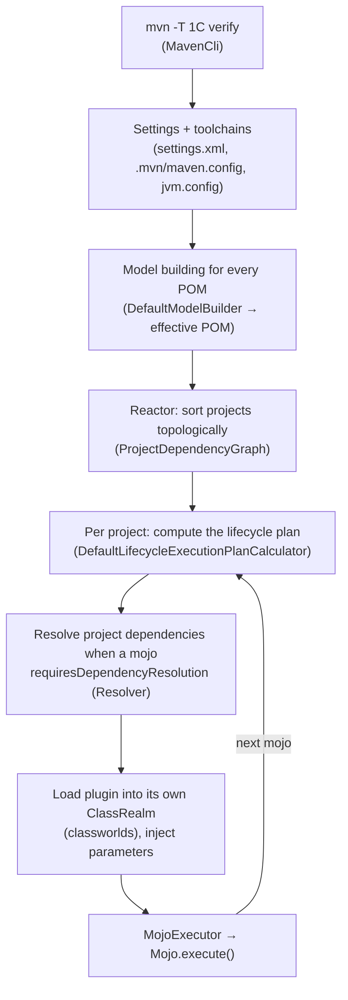

# 1.1 Maven Internals: Lifecycle, Mojos, POM Model Building, the Reactor, and Maven 4

> **Verified stack:** Apache Maven **3.10.0** (Resolver 2.0.24) and **4.0.0-rc-7**, Temurin **25.0.4.1**, Windows 11. Every console block labelled *Output (verified)* was produced by a real run. Long Windows paths are shortened with `…`.
>
> **You should already know:** what a `pom.xml` is and how to run `mvn package`.
>
> **Go deeper:** [1.3 Dependency resolution & jar hell](03-Dependency-Resolution-Jar-Hell-BOMs-Catalogs-Shading.md) · [1.4 Enterprise builds & blueprints](04-Enterprise-Builds-OCI-Images-Annotation-Processors-Enforcer.md)

---

## 0. First principles: what problem a build tool solves 🔥

Strip away the XML and a build tool must answer four questions:

| # | Question | If you get it wrong |
|---|---|---|
| 1 | **What** must be produced, and in **what order**? (a DAG of steps) | Compiling `service` before `api` exists; flaky builds that pass only with a warm cache |
| 2 | **Which exact bytes** of each dependency? (resolution) | `NoSuchMethodError` in production, CVE-laden transitive jars |
| 3 | Will the same inputs give the **same outputs**? (reproducibility) | "Works on my machine", unverifiable releases, broken caches |
| 4 | Can we **skip work** whose inputs didn't change? (incrementality) | 40-minute CI, developers who stop running tests |

Maven and Gradle answer these differently:

* **Maven** answers (1) with a **fixed, declarative lifecycle**: an ordered list of *phases* to which *plugin goals* (mojos) are bound. You don't draw the graph. You pick a phase and Maven runs everything before it. Convention over configuration.
* **Gradle** answers (1) with a **programmable task graph**: tasks declare inputs and outputs, Gradle infers a DAG, and it skips or reuses work by fingerprinting inputs (see [1.2](02-Gradle-Internals-Phases-Task-Graph-Caches-Daemon.md)).

Interviewers probe whether you know *where the rigidity of Maven comes from* (the lifecycle is a list, not a graph) and *what it buys you* (every Maven project builds the same way, so a new hire can build any repo with `mvn verify`).

---

## 1. The execution pipeline from `mvn verify` to `Mojo.execute()` ⚡



The key classes (all in `maven-core`):

| Step | Class | What it does |
|---|---|---|
| Model building | `org.apache.maven.model.building.DefaultModelBuilder` (Maven 3) | Merges super POM + parents + active profiles, interpolates `${...}`, injects `dependencyManagement`/`pluginManagement`, validates |
| Reactor ordering | `org.apache.maven.graph.DefaultProjectDependencyGraph` | Topological sort over *project → project* edges (dependencies, parent, plugins and extensions built in the same reactor) |
| Lifecycle plan | `org.apache.maven.lifecycle.internal.DefaultLifecycleExecutionPlanCalculator` | Turns "`verify`" into the ordered list of `MojoExecution`s for this project |
| Execution | `org.apache.maven.lifecycle.internal.MojoExecutor` | Ensures dependency resolution, then calls the mojo |
| Parallelism | `org.apache.maven.lifecycle.internal.builder.multithreaded.MultiThreadedBuilder` | `-T`: builds *independent modules* concurrently |
| Lifecycle definitions | `org.apache.maven.lifecycle.DefaultLifecycles` | The `clean`, `default` and `site` lifecycles |

---

## 2. Lifecycles, phases and goals 🔥

### 2.1 Three lifecycles, each an *ordered list* of phases

| Lifecycle | Phases (in order) |
|---|---|
| `clean` | `pre-clean` → `clean` → `post-clean` |
| `default` (23 phases) | `validate` → `initialize` → `generate-sources` → `process-sources` → `generate-resources` → `process-resources` → **`compile`** → `process-classes` → `generate-test-sources` → `process-test-sources` → `generate-test-resources` → `process-test-resources` → `test-compile` → `process-test-classes` → **`test`** → `prepare-package` → **`package`** → `pre-integration-test` → `integration-test` → `post-integration-test` → **`verify`** → **`install`** → **`deploy`** |
| `site` | `pre-site` → `site` → `post-site` → `site-deploy` |

Two rules explain almost every "why did that run?" question:

1. **Invoking a phase runs every earlier phase of the same lifecycle.** `mvn verify` runs `validate` … `verify`. `mvn clean verify` runs *two* lifecycles in sequence.
2. **Invoking a goal directly (`mvn dependency:tree`) runs only that mojo** (plus anything it forks with `@Execute`), with execution id `default-cli`.

A phase does nothing by itself. Work happens only in the **mojo executions bound to it**, and the packaging (`jar`, `war`, `pom`, `maven-plugin`) decides the default bindings.

### 2.2 See the real plan instead of guessing

The `buildplan-maven-plugin` prints the exact phase → mojo bindings, including your custom ones:

```bash
mvn fr.jcgay.maven.plugins:buildplan-maven-plugin:1.5:list-phase -Dbuildplan.tasks=deploy
```

**Output (verified, Maven 3.10.0, a `jar` project with the Enforcer plugin added):**

```text
validate ------------------------------------------------------------
    + maven-enforcer-plugin  | enforce               | enforce
process-resources ---------------------------------------------------
    + maven-resources-plugin | default-resources     | resources
compile -------------------------------------------------------------
    + maven-compiler-plugin  | default-compile       | compile
process-test-resources ----------------------------------------------
    + maven-resources-plugin | default-testResources | testResources
test-compile --------------------------------------------------------
    + maven-compiler-plugin  | default-testCompile   | testCompile
test ----------------------------------------------------------------
    + maven-surefire-plugin  | default-test          | test
package -------------------------------------------------------------
    + maven-jar-plugin       | default-jar           | jar
install -------------------------------------------------------------
    + maven-install-plugin   | default-install       | install
deploy --------------------------------------------------------------
    + maven-deploy-plugin    | default-deploy        | deploy
```

Read it like an interviewer:

* Only **9 of the 23** default phases have work bound for a plain `jar`. The rest are hooks for plugins (`generate-sources` for OpenAPI/protobuf generators, `pre-integration-test` to start a container…).
* **Execution ids** matter: `default-compile` is the id Maven gives the packaging's binding. To reconfigure *that* execution, use the same id in your POM. To disable an inherited execution, bind it to the phase `none`:

```xml
<plugin>
  <artifactId>maven-jar-plugin</artifactId>
  <executions>
    <execution>
      <id>default-jar</id>   <!-- same id = you are editing the packaging's binding -->
      <phase>none</phase>    <!-- ...and switching it off (e.g. Boot repackage-only modules) -->
    </execution>
  </executions>
</plugin>
```

### 2.3 Ordering *inside* a phase

When several executions are bound to the same phase, Maven 3 runs them **in POM order**: first the packaging's default bindings, then executions in the order the plugins appear in the effective POM. Inherited plugins come before the child's. This is fragile, and it's the reason Maven 4 adds explicit ordering (§7).

### 2.4 `mvn install` vs `mvn verify` in CI 🔥

| Command | What it does | Use in CI? |
|---|---|---|
| `mvn clean install` | Builds **and copies every artifact into `~/.m2/repository`** | ❌ Pollutes a shared local repo. Parallel jobs on one agent read each other's half-built SNAPSHOTs. |
| `mvn verify` | Runs unit + integration tests and all checks, writes only to `target/` | ✅ The correct "is this commit good?" command. The reactor resolves sibling modules from `target/` |
| `mvn deploy` | Everything + uploads | Release pipelines only. In Maven 4 `deployAtEnd` defaults to `true`, so nothing uploads unless every module succeeded |

---

## 3. Mojos: what a plugin goal really is ⚡

A **mojo** ("Maven plain Old Java Object") is a class that implements `org.apache.maven.plugin.Mojo` (usually by extending `AbstractMojo`). A **plugin** is a jar of mojos plus a generated descriptor, `META-INF/maven/plugin.xml`.

### 3.1 A real mojo, built and run

The following plugin fails the build when the runtime classpath grows past a budget, a cheap guard against dependency creep. It was compiled with `maven-plugin-plugin` 3.15.2, installed, then run against the [1.4 blueprint](04-Enterprise-Builds-OCI-Images-Annotation-Processors-Enforcer.md).

```java
package com.acme.build;

import java.util.Comparator;
import java.util.Set;
import org.apache.maven.artifact.Artifact;
import org.apache.maven.plugin.AbstractMojo;
import org.apache.maven.plugin.MojoFailureException;
import org.apache.maven.plugins.annotations.LifecyclePhase;
import org.apache.maven.plugins.annotations.Mojo;
import org.apache.maven.plugins.annotations.Parameter;
import org.apache.maven.plugins.annotations.ResolutionScope;
import org.apache.maven.project.MavenProject;

/** Fails the build when the runtime classpath grows beyond a budget. */
@Mojo(name = "check",
      defaultPhase = LifecyclePhase.VERIFY,                       // bound here unless the POM says otherwise
      requiresDependencyResolution = ResolutionScope.RUNTIME,     // Maven resolves the graph BEFORE execute()
      threadSafe = true)                                          // safe under mvn -T
public class DependencyBudgetMojo extends AbstractMojo {

    @Parameter(defaultValue = "${project}", readonly = true, required = true)
    private MavenProject project;                                 // injected by Maven

    @Parameter(property = "budget.maxArtifacts", defaultValue = "150")
    private int maxArtifacts;                                     // -Dbudget.maxArtifacts=... or <configuration>

    @Override
    public void execute() throws MojoFailureException {
        Set<Artifact> artifacts = project.getArtifacts();         // the RESOLVED (post-conflict) set
        getLog().info("runtime artifacts: " + artifacts.size() + " (budget " + maxArtifacts + ")");
        if (artifacts.size() > maxArtifacts) {
            artifacts.stream()
                     .sorted(Comparator.comparing(Artifact::getDependencyTrail, Comparator.comparingInt(java.util.List::size)))
                     .limit(5)
                     .forEach(a -> getLog().error("  e.g. " + a + " via " + a.getDependencyTrail()));
            throw new MojoFailureException("Dependency budget exceeded: " + artifacts.size() + " > " + maxArtifacts);
        }
    }
}
```

The plugin's own POM uses `<packaging>maven-plugin</packaging>` and `provided`-scoped `maven-plugin-api`, `maven-core` and `maven-plugin-annotations`. Its generated descriptor, extracted from the jar:

**Output (verified, `unzip -p … META-INF/maven/plugin.xml`, filtered):**

```text
  <goalPrefix>dependency-budget</goalPrefix>
      <goal>check</goal>
      <requiresDependencyResolution>runtime</requiresDependencyResolution>
      <phase>verify</phase>
      <implementation>com.acme.build.DependencyBudgetMojo</implementation>
      <threadSafe>true</threadSafe>
          <name>maxArtifacts</name>
```

Running it against the Spring Boot service module:

```bash
mvn com.acme.build:dependency-budget-maven-plugin:1.0.0:check -Dbudget.maxArtifacts=40
```

**Output (verified, trimmed):**

```text
[INFO] --- dependency-budget:1.0.0:check (default-cli) @ order-service ---
[INFO] runtime artifacts: 57 (budget 40)
[ERROR]   e.g. com.acme.order:order-api:jar:1.4.0-SNAPSHOT:compile via [com.acme.order:order-service:jar:1.4.0-SNAPSHOT, com.acme.order:order-api:jar:1.4.0-SNAPSHOT]
[ERROR]   e.g. org.springframework.boot:spring-boot-starter-web:jar:4.1.2:compile via [com.acme.order:order-service:jar:1.4.0-SNAPSHOT, org.springframework.boot:spring-boot-starter-web:jar:4.1.2]
...
[ERROR] Failed to execute goal com.acme.build:dependency-budget-maven-plugin:1.0.0:check (default-cli) on project order-service: Dependency budget exceeded: 57 > 40 -> [Help 1]
```

What this shows about the internals:

| Annotation element | Effect inside Maven |
|---|---|
| `requiresDependencyResolution = RUNTIME` | `MojoExecutor` asks the resolver for the compile+runtime graph *before* calling `execute()`. A mojo without it sees an empty `getArtifacts()` |
| `defaultPhase = VERIFY` | Adding the plugin to `<build><plugins>` with an `<execution>` that only names the goal binds it to `verify` |
| `threadSafe = true` | Without it, `mvn -T` prints a warning that the build may be unsafe |
| `@Parameter(property = …)` | Values come from `<configuration>`, then from `-D` user properties, then from `defaultValue` (expressions like `${project}` are evaluated against the session) |
| `goalPrefix` | Derived from `xxx-maven-plugin`, so `mvn dependency-budget:check` works once the group is in `<pluginGroups>` |

### 3.2 Plugin class loading: why `<plugin><dependencies>` exists

Every plugin runs in its own **ClassRealm** (plexus-classworlds). The plugin sees the Maven API and **its own dependencies**, never your project's classpath. That's why:

* You extend a plugin by adding jars to `<plugin><dependencies>`. The Enforcer `extra-enforcer-rules` and JDBC drivers for Flyway's Maven plugin are added this way.
* Two plugins can use conflicting versions of the same library without interfering.
* **Build extensions** (`<extensions>true</extensions>` or `.mvn/extensions.xml`) are different. They load into Maven's core realm and can change the lifecycle itself. The Maven Build Cache Extension, Develocity and Tycho work this way. Treat extensions as privileged code.

> **Maven 4:** Plexus-style injection is removed. Plugins use JSR-330 (`@Inject`, `@Named`). A new immutable plugin API (`org.apache.maven.api`) exists but is still marked experimental in 4.0.

---

## 4. The POM model: inheritance vs aggregation vs import 🔥

### 4.1 Three orthogonal mechanisms that juniors conflate

| Mechanism | XML | Direction | What flows | Typical use |
|---|---|---|---|---|
| **Inheritance** | `<parent>` in the child | child → parent | Almost everything: properties, `dependencyManagement`, `pluginManagement`, plugins, repositories, (dependencies!) | Corporate parent POM, shared build config |
| **Aggregation** | `<modules>` (`<subprojects>` in Maven 4) in the aggregator | aggregator → modules | Nothing is inherited; it only says *build these together* (the reactor) | Multi-module repo |
| **BOM import** | `<scope>import</scope>` inside `<dependencyManagement>` | importer → BOM | **Only** the BOM's `dependencyManagement` entries | Version alignment (Spring Boot, Jackson, Netty, cloud SDKs) |

The common pattern makes the root POM both the parent and the aggregator, but they are independent. A module can inherit from a parent that doesn't list it, and an aggregator can build modules that don't inherit from it.

### 4.2 How the effective POM is computed

```text
Super POM (built into maven-model-builder)
  ⊕ parent POMs (top-down; child wins on conflicts)
  ⊕ active profiles (activation: -P, property, JDK, OS, file; Maven 4 adds <condition>)
  → interpolation of ${...} (project.*, settings.*, env.*, user/system properties)
  → dependencyManagement import (BOMs, in declaration order; FIRST declaration of a GA wins)
  → management injection (versions/scopes from dependencyManagement into dependencies;
                          pluginManagement into plugins)
  → plugin configuration merge (child config merged into parent's, element by element)
  → validation (Maven 3.10: many former warnings are now errors)
```

Inspect it with `mvn help:effective-pom -Dverbose` (the verbose flag annotates where each line came from).

**Plugin configuration merge rules** are a classic trap:

```xml
<!-- parent -->
<configuration>
  <compilerArgs><arg>-Xlint:all</arg></compilerArgs>
</configuration>

<!-- child: WITHOUT combine.children, this REPLACES the parent's list -->
<configuration>
  <compilerArgs combine.children="append">   <!-- keep -Xlint:all, add -parameters -->
    <arg>-parameters</arg>
  </compilerArgs>
</configuration>
```

`combine.self="override"` does the opposite: it ignores the parent's element completely.

### 4.3 `dependencies` in a parent is usually a smell

Anything in a parent's `<dependencies>` lands in *every* child, including your `pom`-packaged aggregators and modules that don't need it. Put versions in `<dependencyManagement>` (a menu) and let each module order from the menu.

---

## 5. The reactor: multi-module builds ⚡

The **reactor** builds every project in the session in an order that respects inter-project edges:

```text
[INFO] Reactor Build Order:
[INFO] parent                                                             [pom]
[INFO] api                                                                [jar]
[INFO] service                                                            [jar]
```

*(verified output from the Maven 4 sample in §7)*

| Flag | Meaning | When |
|---|---|---|
| `-pl order-service` | Build only these projects | Fast inner loop |
| `-am` (`--also-make`) | …plus everything they depend on | `-pl order-service -am` builds `order-api` first |
| `-amd` (`--also-make-dependents`) | …plus everything that depends on them | Impact check after changing a shared library |
| `-rf :order-service` | Resume from this module | After a failure. Maven 4 adds `-r` to resume automatically from the last failure |
| `-T 1C` | One thread per CPU core, module-level parallelism | Wide reactors. Gains are capped by the longest dependency chain (the critical path) |
| `-o` | Offline | Air-gapped builds and reproducing a failure without remote metadata updates |

**First-principles view of `-T`:** Maven parallelizes *modules*, not *phases*. If module B depends on A, B waits until A's **whole lifecycle** (up to the requested phase) finishes, even though B needs only A's jar. Maven 4's **concurrent builder** (`-b concurrent`) relaxes this by letting dependents start once a dependency reaches a `ready` phase.

---

## 6. Local repository, metadata and update policies 🧊

* The **local repository** (`~/.m2/repository`) is a *cache and a staging area at the same time*. That's the root of the `install`-pollution problem.
* `_remote.repositories` files record which remote each artifact came from. Maven refuses to use an artifact cached from repository X when the current build only declares repository Y ("enhanced local repository manager").
* **SNAPSHOT** versions resolve through `maven-metadata.xml` (timestamped builds). The update policy (default `daily`) controls how often Maven re-checks. `-U` forces a check. Maven 3.10 adds `-UA` (artifacts only) and `-UM` (metadata only).
* **Mirrors** in `settings.xml` (`<mirrorOf>*</mirrorOf>`) route all traffic through an internal Nexus or Artifactory. That's how you get auditability, caching and dependency-confusion protection.

**Supply-chain changes in Maven 3.10.0** (from the release notes):

* `settings.xml` credentials are **scoped to the origin** of the repositories that use that server id, so a malicious POM can't redirect your credentials to its own host.
* Repositories declared by *dependency* POMs get less influence than those in your build or settings.
* Resolver 2.x validates artifact coordinates and rejects ones that can't be mapped safely to a repository path.

---

## 7. Maven 3.10 and Maven 4: what changed and why 🔥

### 7.1 Maven 3.10.0 (current stable line)

| Change | Why it matters |
|---|---|
| Uses **Maven Resolver 2.x** (2.0.24), the same as Maven 4 | New resolver features (version range filtering, repository filtering), shared code with Maven 4 |
| **Reproducible builds by default**: the super POM sets `project.build.outputTimestamp` | Jar entries get a fixed timestamp. We observed `1980-02-01 00:00` entry dates in a shaded jar built without configuring anything |
| Super POM **drops `pluginManagement`** and the `release-profile` | Plugin versions you never pinned are no longer pinned for you. Pin them all (see the Enforcer's `requirePluginVersions` in [1.4](04-Enterprise-Builds-OCI-Images-Annotation-Processors-Enforcer.md)) |
| **Stricter validation**: duplicate dependency or plugin declarations, bad version characters and malformed repository ids now **fail** | An old warning becomes a broken build on upgrade. Escape hatch: `-Dmaven.resolver.validation=off` (temporary!) |
| Release notes: classpath ordering moves from depth-first to **level-order** (breadth-first) | See the caution below |
| Toolchain misconfiguration now fails instead of silently using Maven's JDK | Builds stop "passing" on the wrong JDK |

> ⚠️ **Verify, don't trust release notes.** On our build, the *project* classpath handed to `maven-compiler-plugin` was still depth-first (`lib-a, common, lib-b, lib-c, fat-util`) on Maven 3.10.0, **with and without** `-Daether.system.dependencyVisitor=levelOrder|preOrder`, and also on 4.0.0-rc-7. The engineering rule doesn't change: **classpath order is not a contract.** Make duplicate classes impossible with `banDuplicateClasses` ([1.3 §5](03-Dependency-Resolution-Jar-Hell-BOMs-Catalogs-Shading.md)) instead of depending on order.

### 7.1.1 Verified: Resolver 2 asks each remote repository only for groupIds it can have 🧊

Running any build on Maven 3.10.0 against Central printed two lines most people scroll past:

```text
[INFO] Loaded 24231 auto-discovered prefixes for remote repository central (prefixes-central.txt)
[INFO] Loaded 74 auto-discovered prefixes for remote repository apache.snapshots (prefixes-apache.snapshots.txt)
```

That's Resolver 2's **remote repository filtering** with the **prefixes** filter, auto-configured: a repository can publish the list of path prefixes (roughly, groupId roots) it serves, and the resolver downloads and caches it. Before asking `central` for `com/acme/acme-core`, it checks the list; if `com/acme` isn't a prefix there, the request **never leaves your machine**.

Why a staff engineer cares:

| Effect | Why |
|---|---|
| Faster resolution with several repositories | No more probing every repository for every artifact, and fewer 404s to cache |
| Fewer accidental leaks of internal coordinates | Internal groupIds aren't sent as requests to public repositories that don't serve them |
| Part of a dependency-confusion defense | Combined with a repository manager that is the only source for your groupIds. Gradle's equivalent is per-repository `content { includeGroup(...) }` filtering, verified in [1.6 §2.2](06-Build-Script-Blueprints-Platform-Publishing-Quality-Gates-CI.md#22-a-gradle-service-using-the-published-catalog) |

There's also a **groupId** filter (`aether.remoteRepositoryFilter.groupId`) where you declare allowed groupIds per repository yourself. Both are in the Maven Resolver configuration reference; if a build suddenly reports "artifact not found" for an artifact that is in a repository, check whether a prefix file is stale before anything else.

### 7.2 Maven 4.0 (release candidate 7 as of October 2026)

| Feature | Detail |
|---|---|
| Runtime | Needs **Java 17** to *run* Maven (you can still compile for older targets with `release`) |
| **Build POM vs consumer POM** | Your `pom.xml` (model **4.1.0**) is the *build* POM. Maven installs and deploys a separate **consumer POM** (model 4.0.0) that consumers read. Flattening (no parent, resolved versions) is opt-in with `-Dmaven.consumer.pom.flatten=true` |
| `<subprojects>` | Replaces the deprecated `<modules>` |
| **Parent inference** | `<parent/>` with no coordinates when the parent is at `..` |
| Root detection | `root="true"` on `<project>` or a `.mvn` directory; `${project.rootDirectory}`, `${session.rootDirectory}` |
| `bom` packaging | First-class BOM modules, exported as Maven 3-compatible POMs |
| Lifecycle as a tree | `before:`/`after:` hooks for every phase, ordering with `[priority]`, plus `all`/`each` phases. `pre-*`/`post-*` are deprecated aliases |
| Concurrent builder | `-b concurrent`: dependents start when a dependency reaches `ready` |
| `-r` / `--resume` | Resume from the last failed subproject |
| Fail on warnings | `-fos WARN` (`--fail-on-severity`) |
| Optional profiles | `-P?name` doesn't fail when the profile is missing |
| Removed | Plexus DI for plugins (JSR-330 only), `${pom.*}` expressions |

**Verified Maven 4 multi-project** (model 4.1.0, parent inference, sibling version inference):

```xml
<!-- service/pom.xml -->
<project xmlns="http://maven.apache.org/POM/4.1.0">
  <modelVersion>4.1.0</modelVersion>
  <parent/>                       <!-- Maven 4: groupId/artifactId/version inferred from ../pom.xml -->
  <artifactId>service</artifactId>
  <dependencies>
    <dependency><groupId>demo.m4</groupId><artifactId>api</artifactId></dependency>   <!-- reactor sibling: version inferred -->
    <dependency><groupId>org.slf4j</groupId><artifactId>slf4j-api</artifactId></dependency>
  </dependencies>
</project>
```

```bash
mvn install -Dmaven.consumer.pom.flatten=true      # Maven 4.0.0-rc-7
```

Maven 4 installs **two** files per module: `service-1.0.0-build.pom` (your file) and `service-1.0.0.pom` (the consumer POM). **Output (verified)**, the installed consumer POM:

```xml
<?xml version="1.0" encoding="UTF-8"?>
<project xmlns="http://maven.apache.org/POM/4.0.0" ...>
  <modelVersion>4.0.0</modelVersion>
  <groupId>demo.m4</groupId>
  <artifactId>service</artifactId>
  <version>1.0.0</version>
  <dependencies>
    <dependency>
      <groupId>demo.m4</groupId>
      <artifactId>api</artifactId>
      <version>1.0.0</version>
      <scope>compile</scope>
    </dependency>
    <dependency>
      <groupId>org.slf4j</groupId>
      <artifactId>slf4j-api</artifactId>
      <version>2.0.17</version>
      <scope>compile</scope>
    </dependency>
  </dependencies>
</project>
```

**Why the consumer POM exists (first principles):** a POM had two jobs: *instructions for building* (plugins, profiles, test deps, parent) and *a contract for consumers* (what I need at runtime). Mixing them meant every consumer downloaded your parent chain, evaluated your profiles and inherited your build quirks. Splitting the two lets the build POM evolve (new model versions, new syntax) without breaking Maven 3 consumers.

The same run also warned that `-gs/--global-settings` is deprecated in Maven 4.

---

## 8. ❌ Naïve vs ✅ production-hardened Maven

| ❌ Naïve | Why it hurts | ✅ Hardened |
|---|---|---|
| Plugin versions left to the super POM | Maven 3.10 no longer pins them. Builds change when Maven is upgraded | Pin every plugin in the root `pluginManagement` and enforce it with `requirePluginVersions` |
| `mvn clean install` in CI | Shared `~/.m2` pollution, slower (extra copy), hides reactor bugs | `mvn -B -ntp verify`, plus `deploy` only in release jobs |
| `<dependencies>` in the corporate parent | Every module gets them | `<dependencyManagement>` in the parent; modules declare what they use |
| Inheriting `spring-boot-starter-parent` in a big org | Your parent *must* be Boot's parent. You can't have your own corporate parent | Import `spring-boot-dependencies` as a BOM (but see the property-override caveat in [1.3 §3](03-Dependency-Resolution-Jar-Hell-BOMs-Catalogs-Shading.md)) |
| Profiles that change the artifact (`-Pprod` bakes in config) | Same version, different bytes. Unreproducible | One artifact for every environment; config at runtime (env, ConfigMaps) |
| `${project.version}` = `1.0-SNAPSHOT` with manual bumps | Merge conflicts on every release | CI-friendly `${revision}` + `flatten-maven-plugin` (Maven 3) or native support (Maven 4) |
| Version ranges `[1.0,)` | Non-deterministic resolution, cache busting | Exact versions + Renovate/Dependabot PRs |
| Running integration tests with Surefire | Containers or ports leak into the unit-test phase | Failsafe (`*IT.java`) bound to `integration-test`/`verify`, which runs `post-integration-test` cleanup even on failure |

### Build speed checklist (Maven)

1. **Profile first** to find the slow mojo: the Develocity Maven extension (build scans) breaks time down per mojo; without it, `-Dorg.slf4j.simpleLogger.showDateTime=true` timestamps every log line.
2. `-T 1C` for wide reactors. Make sure your plugins are `threadSafe`.
3. **mvnd** (Maven Daemon) keeps a warm JVM, so the JIT and plugin class loading are amortized. It's the Maven equivalent of the Gradle daemon.
4. **Maven Build Cache Extension** (`org.apache.maven.extensions:maven-build-cache-extension`, 1.3.0) adds Gradle-style input hashing and cached module outputs, locally or remotely. It is opt-in via `.mvn/extensions.xml`.
5. Surefire: `forkCount=1C`, `reuseForks=true`. Split slow integration tests into Failsafe.
6. Don't run `javadoc`, `source` or `gpg` outside release profiles.

---

## 9. GitHub source to read

| Repo | Path | What to look for |
|---|---|---|
| [apache/maven](https://github.com/apache/maven) | `impl/maven-core/src/main/java/org/apache/maven/lifecycle/internal/MojoExecutor.java` (on `master`, Maven 4; on the `maven-3.10.x` / `maven-3.9.x` branches the same file lives under maven-core/src/main/java/…) | `ensureDependenciesAreResolved` and how forked executions run |
| apache/maven | `maven-core/src/main/java/org/apache/maven/lifecycle/internal/DefaultLifecycleExecutionPlanCalculator.java` | Phase → mojo execution list, how `default-cli` executions are built |
| apache/maven | `maven-core/src/main/java/org/apache/maven/graph/DefaultProjectDependencyGraph.java` | Reactor ordering |
| apache/maven | `maven-core/src/main/java/org/apache/maven/lifecycle/internal/builder/multithreaded/MultiThreadedBuilder.java` | Module-level parallelism and its limits |
| apache/maven | `maven-model-builder/src/main/java/org/apache/maven/model/building/DefaultModelBuilder.java` | The effective-POM algorithm (§4.2) |
| [apache/maven-plugin-tools](https://github.com/apache/maven-plugin-tools) | `maven-plugin-annotations` module | `@Mojo`, `@Parameter`, `ResolutionScope` semantics |
| [apache/maven-enforcer](https://github.com/apache/maven-enforcer) | `enforcer-rules/src/main/java/org/apache/maven/enforcer/rules/dependency/RequireUpperBoundDeps.java` | How "upper bound" is computed from the verbose graph |

---

## 10. Interview soundbites

* "A Maven phase is a *position in a list*. Goals bound to phases do the work, and the packaging decides the default bindings. Running a phase runs everything before it in that lifecycle."
* "Plugins run in isolated class realms. That's why you extend a plugin through `<plugin><dependencies>` and why extensions, which load into the core realm, are privileged."
* "Inheritance, aggregation and BOM import are three different mechanisms. I use a corporate parent for build policy, an aggregator for the reactor, and BOM imports for version alignment."
* "In CI I run `mvn verify`, not `install`. `install` writes into a shared cache and hides reactor bugs."
* "Maven 3.10 removed the super-POM plugin versions and made reproducible timestamps the default. Maven 4 splits the build POM from the consumer POM so the build model can evolve without breaking consumers."
* "Resolver 2 loads each repository's prefix list (24,231 prefixes for Central) and doesn't even ask a repository for groupIds it can't serve."

---

## Summary

| Concept | One line | Where it's shown |
|---|---|---|
| Execution pipeline | CLI → project model → lifecycle plan → mojo executions in plugin realms | §1 |
| Lifecycles and phases | Three ordered lists; running a phase runs all earlier phases; packaging decides bindings | §2, verified plan output |
| Ordering inside a phase | Declaration order (inherited first) | §2.3 |
| `verify` vs `install` in CI | `install` writes a shared cache and hides reactor bugs | §2.4 |
| Mojos | A goal is a Java class with injected parameters | §3.1, a mojo built and run |
| Plugin class realms | Plugins are isolated; extend them via `<plugin><dependencies>` | §3.2 |
| Inheritance vs aggregation vs import | Parent for policy, aggregator for the reactor, BOM import for versions | §4 |
| Reactor | Builds modules in dependency order; `-pl`/`-am`/`-rf`, `-T` | §5 |
| Local repository and update policies | `_remote.repositories`, snapshot update policies | §6 |
| Maven 3.10 | Resolver 2, reproducible timestamps by default, stricter validation, no super-POM plugin pins | §7.1 |
| Resolver 2 prefix filtering | Repositories are asked only for groupIds they can serve | 24,231 prefixes loaded for Central (§7.1.1) |
| Maven 4 | Build POM vs consumer POM, `<subprojects>`, CI-friendly versions natively | §7.2 |

**Next:** [1.2 Gradle internals →](02-Gradle-Internals-Phases-Task-Graph-Caches-Daemon.md)
