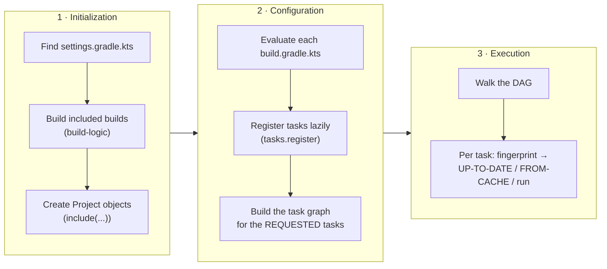

# 1.2 Gradle Internals: Three Phases, the Task DAG, Incremental Builds, Build Cache, Configuration Cache, Daemon

> **Verified stack:** Gradle **9.8.2** (Kotlin DSL), Temurin **25.0.4.1**, Windows 11. Every block labelled *Output (verified)* is from a real run.
>
> **You should already know:** [1.1 Maven internals](01-Maven-Internals-Lifecycle-Mojos-Reactor.md) §0 (the four questions every build tool answers).
>
> **Go deeper:** [1.3 Dependency resolution](03-Dependency-Resolution-Jar-Hell-BOMs-Catalogs-Shading.md) (Gradle's conflict resolution and platforms) · [1.4 Blueprints](04-Enterprise-Builds-OCI-Images-Annotation-Processors-Enforcer.md) (a complete multi-module Kotlin DSL build)

---

## 0. First principles: a build is a pure function you want to memoize 🔥

Think of each build step as a function:

```text
outputs = task(implementation, inputs)
```

If you can **fingerprint** the implementation and the inputs (hash the files, the classpath, the parameters), three optimizations fall out naturally:

| If the fingerprint… | Then | Gradle calls it |
|---|---|---|
| matches the **last run in this workspace** and outputs are untouched | Do nothing | **UP-TO-DATE** (incremental build) |
| matches a run **anywhere** (another branch, another machine, CI) | Copy the stored outputs | **FROM-CACHE** (build cache) |
| of the *build scripts and their inputs* matches | Skip running the scripts at all | **Configuration cache** reuse |

Everything else in Gradle (lazy configuration, the Provider API, `@InputFiles` annotations, the "no `project` at execution time" rule) exists so that **fingerprints are complete and correct**. A task with undeclared inputs is a memoized function with a hidden global variable: it returns stale results.

Maven's lifecycle answers "what runs" with a fixed list. Gradle answers it with a **DAG computed from the declared inputs and outputs**, and that is why Gradle can skip and reuse work at task granularity.

---

## 1. The three-phase lifecycle 🔥



### 1.1 Seeing the phases

```kotlin
// settings.gradle.kts
println("[init phase]   settings.gradle.kts evaluated")
rootProject.name = "gradle-app"
```

```kotlin
// build.gradle.kts
plugins { application }

println("[config phase] build.gradle.kts evaluated")

tasks.register("hello") {
    doLast { println("[exec phase]   task :hello runs") }
}
```

**Output (verified, `gradle hello`):**

```text
[init phase]   settings.gradle.kts evaluated
> Configure project :
[config phase] build.gradle.kts evaluated
> Task :hello
[exec phase]   task :hello runs
Consider enabling configuration cache to speed up this build: https://docs.gradle.org/9.8.2/userguide/configuration_cache_enabling.html
```

The classic bug this explains: code at the top level of a build script (or inside `tasks.register { ... }` but **outside** `doLast`) runs during **configuration**, *for every build*, even `gradle help`. Anything expensive there (an HTTP call, `git describe`, reading a big file) taxes every invocation.

### 1.2 Lazy configuration: `register` vs `create`

| | `tasks.create("x") { … }` ❌ | `tasks.register("x") { … }` ✅ |
|---|---|---|
| When is the configuration block run? | Immediately, on every build | Only if the task ends up in the task graph |
| Cost on `gradle help` in a 200-module build | All tasks configured | Nearly zero |
| Return type | `Task` (eager) | `TaskProvider<T>` (lazy handle) |

The same idea runs through the whole **Provider API**: `Property<T>`, `Provider<T>`, `RegularFileProperty`, `.map {}`, `.flatMap {}`. Values are computed when they're needed, and **wiring one task's output provider into another's input creates the task dependency automatically**. No `dependsOn` is needed.

```kotlin
val gen = tasks.register<GenerateSources>("generateSources") {
    outputDir = layout.buildDirectory.dir("generated/src")
}
sourceSets.main { java.srcDir(gen.flatMap { it.outputDir }) }   // compileJava now depends on generateSources
```

---

## 2. The task graph is a DAG 🔥

`gradle build --dry-run` prints the execution order Gradle computed, without running anything.

**Output (verified, `application` plugin project):**

```text
:compileJava SKIPPED
:processResources SKIPPED
:classes SKIPPED
:jar SKIPPED
:startScripts SKIPPED
:distTar SKIPPED
:distZip SKIPPED
:assemble SKIPPED
:compileTestJava SKIPPED
:processTestResources SKIPPED
:testClasses SKIPPED
:test SKIPPED
:check SKIPPED
:build SKIPPED
```

How the graph is built (`org.gradle.execution.plan.DefaultExecutionPlan`):

1. Start from the **requested** tasks (`build`).
2. Add their dependencies, transitively. Edges come from `dependsOn`, **inferred edges from wired providers** (outputs → inputs), and `finalizedBy`.
3. Apply **ordering constraints** that are *not* dependencies: `mustRunAfter` and `shouldRunAfter` only order tasks that are already in the graph.
4. Detect cycles (a cycle fails the build with the cycle printed).
5. Execute with up to `org.gradle.workers.max` workers (default: number of CPUs). With the configuration cache on, **tasks of the same project can run in parallel** too.

| Relationship | Adds the other task to the graph? | Use for |
|---|---|---|
| `dependsOn` | Yes | Real data dependencies you can't express through providers |
| Wired providers (`input = other.flatMap { it.output }`) | Yes (inferred) | **Preferred.** The dependency follows the data |
| `finalizedBy` | Yes, runs after even on failure | Cleanup (stop a test database, publish reports) |
| `mustRunAfter` | No | "If both run, this order" (e.g. `integrationTest` after `test`) |
| `shouldRunAfter` | No, and may be ignored to allow parallelism | Soft preference |

---

## 3. Incremental builds: UP-TO-DATE ⚡

Before running a task, Gradle compares:

* the **implementation** (task class + its classloader hash, plus every action's class),
* **input properties** (values) and **input files** (content hashes, normalized per annotation),
* **output files** (has anyone touched them since?).

If nothing changed, the task is UP-TO-DATE. The annotations decide how inputs are fingerprinted:

| Annotation | Fingerprint | Example |
|---|---|---|
| `@Input` | Value (must be serializable/comparable) | A version string, a flag |
| `@InputFile` / `@InputFiles` / `@InputDirectory` + `@PathSensitive(...)` | Content hash + path normalized to `ABSOLUTE`/`RELATIVE`/`NAME_ONLY`/`NONE` | Templates, resources |
| `@Classpath` | Jar contents, order-sensitive, timestamps ignored | Runtime classpath of a test task |
| `@CompileClasspath` | **ABI only** (public signatures; method bodies and private members ignored) | `JavaCompile.classpath`, which gives you *compile avoidance* |
| `@OutputFile` / `@OutputDirectory` | Snapshot after execution | Generated sources |
| `@Internal` | Not fingerprinted | Logging levels, transient state |

**Compile avoidance (ABI fingerprinting) is a big reason Gradle beats Maven on large builds:** changing a method *body* in `order-api` doesn't recompile `order-service`, because `order-service`'s `compileJava` sees an identical ABI. Combined with `java-library`'s `api` vs `implementation` split, a change to an `implementation` dependency doesn't even reach consumers' compile classpaths.

### 3.1 ❌ Naïve vs ✅ correct custom task (verified)

```kotlin
import java.security.MessageDigest

// ❌ Naïve: no declared inputs/outputs, reads `project` while executing.
tasks.register("naiveChecksum") {
    doLast {
        val src = project.file("src/main/resources/app.properties")          // Task.project at execution time
        val digest = MessageDigest.getInstance("SHA-256").digest(src.readBytes())
        project.layout.buildDirectory.file("naive.sha256").get().asFile
            .apply { parentFile.mkdirs() }
            .writeText(digest.joinToString("") { "%02x".format(it) })
    }
}

// ✅ Hardened: typed task, declared inputs/outputs, cacheable, no Project access at execution time.
@CacheableTask
abstract class ChecksumTask : DefaultTask() {
    @get:InputFile
    @get:PathSensitive(PathSensitivity.RELATIVE)      // cache key uses the relative path -> relocatable across machines
    abstract val source: RegularFileProperty

    @get:OutputFile
    abstract val checksum: RegularFileProperty

    @TaskAction
    fun run() {
        val digest = MessageDigest.getInstance("SHA-256").digest(source.get().asFile.readBytes())
        checksum.get().asFile.writeText(digest.joinToString("") { "%02x".format(it) })
    }
}

tasks.register<ChecksumTask>("checksum") {
    source = layout.projectDirectory.file("src/main/resources/app.properties")
    checksum = layout.buildDirectory.file("app.sha256")
}
```

**Output (verified):** the naïve task runs every time, because Gradle can't prove it is up to date:

```text
> Task :naiveChecksum
1 actionable task: 1 executed
> Task :naiveChecksum
1 actionable task: 1 executed
```

…and it **fails** as soon as the configuration cache is on:

```text
> Task :naiveChecksum FAILED
1 problem was found storing the configuration cache.
- Task `:naiveChecksum` of type `org.gradle.api.DefaultTask`: invocation of 'Task.project' at execution time is unsupported with the configuration cache.
...
> Invocation of 'Task.project' by task ':naiveChecksum' at execution time is unsupported with the configuration cache.
BUILD FAILED in 1s
Configuration cache entry discarded with 1 problem.
```

The hardened task: first run, second run, then delete the output and run again with the build cache.

```text
> Task :checksum
1 actionable task: 1 executed
> Task :checksum UP-TO-DATE
1 actionable task: 1 up-to-date
> Task :checksum FROM-CACHE
1 actionable task: 1 from cache
```

**Why `Task.project` is banned at execution time (first principles):** with the configuration cache, the execution phase runs from a *serialized* task graph and no `Project` model exists. Anything the task needs has to be captured as a declared, serializable input during configuration. The rule that looks bureaucratic is what makes the cache possible.

---

## 4. The build cache: FROM-CACHE ⚡

* **Cache key** = hash(task implementation, action implementations, input property names and values, normalized input file fingerprints, output property names).
* **Local cache:** `$GRADLE_USER_HOME/caches/build-cache-1`. **Remote cache:** an HTTP backend or Develocity. The usual topology is *CI pushes, developers pull*.
* **Relocatability:** a cache hit on another machine needs keys that don't contain absolute paths. Use `@PathSensitive(RELATIVE)` and avoid baking `System.getenv()`, hostnames or timestamps into inputs.
* Opt-in per task with `@CacheableTask`. Some built-in tasks are **deliberately not cacheable**, such as `Jar`, `Copy` and `Zip`, because re-zipping is as cheap as downloading the zip.

### 4.1 Verified: incremental vs cache

**Output (verified):** first `build --build-cache`, then `build` again, then `clean build --build-cache`:

```text
=== 2nd: build again (no changes)
> Task :compileJava UP-TO-DATE
> Task :jar UP-TO-DATE
...
5 actionable tasks: 5 up-to-date
=== 3rd: clean build --build-cache
> Task :clean
> Task :compileJava FROM-CACHE
> Task :jar
> Task :startScripts
> Task :distTar
> Task :distZip
...
6 actionable tasks: 5 executed, 1 from cache
```

`compileJava` came from the cache after `clean`. `jar`, `startScripts`, `distTar` and `distZip` re-ran because they're archive/copy tasks that aren't cacheable.

### 4.2 Verified gotcha: one timestamp poisons the cache for everything downstream 🧊

In the multi-module blueprint ([1.4](04-Enterprise-Builds-OCI-Images-Annotation-Processors-Enforcer.md)), `springBoot { buildInfo() }` generates `META-INF/build-info.properties`, **including `build.time`**. That file is on the test runtime classpath, so the `test` task's fingerprint changes on every build.

**Output (verified, `clean build`, default `buildInfo()`):** `test` re-runs every time:

```text
> Task :order-service:compileTestJava FROM-CACHE
> Task :order-service:bootJar
> Task :order-service:test
11 actionable tasks: 8 executed, 3 from cache
```

The fix:

```kotlin
springBoot {
    buildInfo {
        excludes = setOf("time")       // a timestamp changes every build -> cache miss for every task downstream
    }
}
```

**Output (verified, same command after the fix):**

```text
> Task :order-service:compileTestJava FROM-CACHE
> Task :order-service:test FROM-CACHE
20 actionable tasks: 7 executed, 4 from cache, 9 up-to-date
```

**Staff-level generalization:** any *non-hermetic* input (timestamps, git SHAs, hostnames, random ports written to files) that flows into a classpath turns your whole downstream graph into cache misses. Diagnose it with `--scan`, or with `-Dorg.gradle.caching.debug=true`, which prints the cache-key inputs.

---

## 5. The configuration cache 🔥

| Without | With the configuration cache |
|---|---|
| Every build runs init + configuration (all scripts, all plugins) | On a hit, Gradle **loads the serialized task graph** and jumps straight to execution |
| Tasks in one project run sequentially unless you pass `--parallel` | All tasks may run in parallel, constrained only by their dependencies |
| Dependency resolution may re-run | Resolved dependency graphs are cached as well |

Status: **the preferred mode since Gradle 9.0**, and the docs say it will be **on by default in Gradle 10**. Enable it in `gradle.properties` with `org.gradle.configuration-cache=true`.

**Output (verified, `--configuration-cache hello`, twice):**

```text
=== CC 1
[init phase]   settings.gradle.kts evaluated
[config phase] build.gradle.kts evaluated
> Task :hello
[exec phase]   task :hello runs
1 actionable task: 1 executed
Configuration cache entry stored.
=== CC 2
Reusing configuration cache.
> Task :hello
[exec phase]   task :hello runs
1 actionable task: 1 executed
Configuration cache entry reused.
```

The `println`s from `settings.gradle.kts` and `build.gradle.kts` **disappear** on the second run. Configuration didn't run at all. On a large build, that's often several seconds saved on every invocation, including IDE syncs.

**What invalidates an entry:** changes to build scripts, `gradle.properties`, environment variables or system properties *read during configuration*, files read during configuration, and the requested task names. That's why `gradle build` and `gradle clean build` get **different** entries.

**Rules your build logic must follow:**

1. No `Task.project`, `Task.dependsOn(project.tasks…)` lookups, or `Project` access inside task actions.
2. No `gradle.buildFinished {}` or `BuildListener`. Use **build services** (`BuildService<P>`) and flow actions.
3. Read environment and system properties through `providers.environmentVariable(...)` and `providers.systemProperty(...)`, so Gradle tracks them as inputs.
4. Task state must be serializable. Use `Property<T>` types, not arbitrary objects.

### 5.1 Verified: what invalidates the configuration cache: eager vs lazy environment reads 🧊

```kotlin
// build.gradle.kts (gradle.properties: org.gradle.configuration-cache=true)

// ❌ eager: read while the build script is being evaluated (configuration time)
val eagerRegion: String = System.getenv("DEPLOY_REGION") ?: "none"

// ✅ lazy: a Provider, read only when the task executes
val lazyTier = providers.environmentVariable("DEPLOY_TIER").orElse("none")

tasks.register("showEager") { val r = eagerRegion; doLast { println("eager region = $r") } }
tasks.register("showLazy")  { val t = lazyTier;    doLast { println("lazy tier = ${t.get()}") } }
```

**Output (verified, Gradle 9.8.2, four runs of `gradle showEager showLazy`):**

```text
$ DEPLOY_REGION=eu DEPLOY_TIER=gold gradle showEager showLazy
  Calculating task graph as no cached configuration is available for tasks: showEager showLazy
  lazy tier = gold
  eager region = eu
  Configuration cache entry stored.
$ DEPLOY_REGION=eu DEPLOY_TIER=gold gradle showEager showLazy
  Reusing configuration cache.
  eager region = eu
  lazy tier = gold
  Configuration cache entry reused.
$ DEPLOY_REGION=eu DEPLOY_TIER=silver gradle showEager showLazy          ← only the LAZY variable changed
  Reusing configuration cache.
  lazy tier = silver
  eager region = eu
  Configuration cache entry reused.
$ DEPLOY_REGION=us DEPLOY_TIER=silver gradle showEager showLazy          ← the EAGER variable changed
  Calculating task graph as configuration cache cannot be reused because environment variable 'DEPLOY_REGION' has changed.
  lazy tier = silver
  eager region = us
  Configuration cache entry stored.
```

* `System.getenv` at configuration time made `DEPLOY_REGION` a **configuration input**: changing it threw the cache entry away and re-ran configuration, and the message names the culprit exactly.
* `providers.environmentVariable` read at execution time is an **execution-time** value: the cached task graph was reused and the task still printed the new value (`silver`).
* In CI, where variables like build numbers, commit SHAs and timestamps change on every run, one eager read is the difference between "configuration cache reused" and "never reused". Search build logic for `System.getenv`, `System.getProperty` and `File(...).readText()` at configuration time, and look for the "cannot be reused because" line in build logs.

---

## 6. Kotlin DSL, convention plugins and `build-logic` ⚡

### 6.1 Why `allprojects {}` and `subprojects {}` are anti-patterns

```kotlin
// ❌ root build.gradle.kts
subprojects {
    apply(plugin = "java")
    dependencies { "implementation"("org.slf4j:slf4j-api:2.0.17") }
}
```

This is **cross-project configuration**. The root reaches into every child, which means:

* configuration order becomes significant, and a child can't opt out cleanly;
* projects can't be configured in isolation, which blocks Gradle's *isolated projects* mode and parallel configuration;
* every build pays for configuring every project.

### 6.2 ✅ Convention plugins in an included build

```text
order-platform/
├── settings.gradle.kts           // pluginManagement { includeBuild("build-logic") }
├── gradle/libs.versions.toml     // one version catalog
├── build-logic/
│   ├── settings.gradle.kts       // reuses ../gradle/libs.versions.toml
│   ├── build.gradle.kts          // plugins { `kotlin-dsl` }
│   └── src/main/kotlin/
│       ├── acme.java-conventions.gradle.kts          // toolchain, BOM, processors, tests
│       └── acme.spring-boot-service.gradle.kts       // + org.springframework.boot
├── order-api/build.gradle.kts    // plugins { id("acme.java-conventions"); `java-library` }
└── order-service/build.gradle.kts // plugins { id("acme.spring-boot-service") }
```

Each `*.gradle.kts` file in `build-logic/src/main/kotlin` is compiled into a **real binary plugin** (a *precompiled script plugin*). Projects *opt in* by id. The full verified source is in [1.4 §5](04-Enterprise-Builds-OCI-Images-Annotation-Processors-Enforcer.md).

**Output (verified, first build of the blueprint):** `build-logic` is compiled before any project configures:

```text
> Task :build-logic:generateExternalPluginSpecBuilders
> Task :build-logic:extractPrecompiledScriptPluginPlugins
> Task :build-logic:generateScriptPluginAdapters
> Task :build-logic:pluginDescriptors
> Task :build-logic:compilePluginsBlocks
> Task :build-logic:generatePrecompiledScriptPluginAccessors
> Task :build-logic:compileKotlin
> Task :build-logic:jar
> Task :order-api:compileJava
...
BUILD SUCCESSFUL in 2m 5s
18 actionable tasks: 18 executed
Configuration cache entry stored.
```

### 6.3 `buildSrc` vs an included `build-logic`

| | `buildSrc` | `includeBuild("build-logic")` |
|---|---|---|
| Discovery | Automatic | Explicit in `pluginManagement` |
| Change invalidates | Historically **the whole build's** script classpath | Only builds that use the changed plugin |
| Can be a normal build with tests | Partly | Yes, a full Gradle build |
| Recommendation | Legacy | ✅ Preferred for new builds |

### 6.4 Accessing the version catalog from a convention plugin

Type-safe `libs.xxx` accessors are generated for build scripts, not for precompiled plugins. Inside a convention plugin, use the catalog extension:

```kotlin
val libs = extensions.getByType<VersionCatalogsExtension>().named("libs")
fun lib(alias: String) = libs.findLibrary(alias).get()

dependencies {
    implementation(platform(lib("spring-boot-bom")))
}
```

---

## 7. The Gradle daemon and memory ⚡

**Why a daemon (first principles):** a fresh JVM is slow twice over. It has to load and JIT-compile Gradle's code, and it has no cached build model. The daemon is a long-lived JVM that keeps a warm JIT, loaded plugin classes, an in-memory file-system snapshot (file watching) and cached models between builds.

| Topic | What to know |
|---|---|
| Heap | Set with `org.gradle.jvmargs` (the default is small: 512 MB heap). Big multi-module builds need 2–4 GB. Watch GC with `-Xlog:gc` in `jvmargs` |
| Compatibility | A daemon is reused only if its JVM, `jvmargs` and some properties match. Otherwise a new one starts. **Verified:** `Starting a Gradle Daemon, 1 incompatible Daemon could not be reused, use --status for details` after switching projects with different `jvmargs` |
| Kotlin | `compileKotlin` tasks (including `build-logic`'s precompiled script plugins) run in a separate **Kotlin daemon** by default: a second long-lived JVM to budget memory for |
| Daemon JVM vs toolchain | The daemon may run on one JDK and compile with another (`java.toolchain`). Gradle 9 requires **Java 17+ to run** and can pin the daemon's JVM with `gradle/gradle-daemon-jvm.properties` (`./gradlew updateDaemonJvm`) |
| Idle and leaks | Daemons expire after 3 hours idle by default. Leaky plugins (static caches, ThreadLocals) grow the heap across builds. Use `gradle --stop` and look for growing GC times |
| CI | Ephemeral agents gain little from a daemon. Persistent agents gain a lot. Never share one Gradle user home between concurrent jobs without care |

---

## 8. ❌ Naïve vs ✅ production-hardened Gradle

| ❌ Naïve | ✅ Hardened |
|---|---|
| `repositories {}` in every project | `dependencyResolutionManagement { repositoriesMode = FAIL_ON_PROJECT_REPOS }` in settings |
| `subprojects { … }` | Convention plugins in `build-logic` |
| `tasks.create`, `tasks.getByName` | `tasks.register`, `tasks.named` (lazy) |
| `doLast { project.file(...) }` | Declared `@InputFile`/`@OutputFile` properties, no `Project` at execution |
| Versions typed in each build file | `gradle/libs.versions.toml` + `platform()` for BOMs ([1.3](03-Dependency-Resolution-Jar-Hell-BOMs-Catalogs-Shading.md)) |
| `implementation("x:y:1.+")` | Exact versions, `failOnDynamicVersions()`, dependency locking for apps |
| `springBoot { buildInfo() }` with time | `buildInfo { excludes = setOf("time") }` (§4.2) |
| `compile` everything with `implementation` in libraries | `java-library`: `api` only for types in your public signatures |
| Ignoring `--scan` | Build scans or `--profile` to find slow configuration and cache misses |

### Gradle 9 changes worth naming in an interview

| Change | Consequence |
|---|---|
| Configuration cache is the preferred mode (default in Gradle 10) | Plugins that touch `Project` at execution time are on borrowed time |
| Gradle needs Java 17+ to run | Old CI images break. Use toolchains for the compile JDK |
| Kotlin 2 / K2-based Kotlin DSL | Faster script compilation, some deprecated APIs removed |
| **Reproducible archives by default** | Verified: entries in our `order-api.jar` and the Boot `order-service.jar` have the timestamp `1980-02-01 00:00` without any configuration |

---

## 9. GitHub source to read

| Repo | Class (package path) | What to look for |
|---|---|---|
| [gradle/gradle](https://github.com/gradle/gradle) | `org.gradle.execution.plan.DefaultExecutionPlan` | How requested tasks expand into a DAG, ordering constraints, cycle detection |
| gradle/gradle | `org.gradle.execution.taskgraph.DefaultTaskExecutionGraph` | The public face of the plan (`whenReady`, `hasTask`) |
| gradle/gradle | `org.gradle.caching.internal.controller.DefaultBuildCacheController` | Load and store against local and remote caches |
| gradle/gradle | `org.gradle.internal.cc.impl.DefaultConfigurationCacheHost` | The configuration cache's integration point |
| gradle/gradle | `org.gradle.api.internal.artifacts.ivyservice.resolveengine.graph.builder.DependencyGraphBuilder` | Dependency graph construction (see [1.3](03-Dependency-Resolution-Jar-Hell-BOMs-Catalogs-Shading.md)) |
| gradle/gradle | `org.gradle.launcher.daemon.bootstrap.DaemonMain` | Daemon startup |

Tip: in the `gradle/gradle` repository, sources live under `platforms/<area>/<module>/src/main/java/<package>`. Search by class name in GitHub's code search, because module paths move between releases.

---

## 10. Interview soundbites

* "Gradle models a build as memoized functions. Declared inputs and outputs give it UP-TO-DATE locally, FROM-CACHE across machines, and with the configuration cache it skips the configuration phase entirely."
* "Configuration runs on every build, so I keep expensive work out of it and register tasks lazily."
* "I wire task outputs into inputs with providers so dependencies follow the data. `dependsOn` is a last resort."
* "I put build logic in convention plugins in an included `build-logic` build, not `subprojects {}`. That keeps projects isolated and configuration-cache-friendly."
* "Cache misses usually come from non-hermetic inputs. I found a Boot `buildInfo` timestamp making every test task miss the cache."
* "An eager `System.getenv` in a build script is a configuration-cache input: changing it printed 'cannot be reused because environment variable DEPLOY_REGION has changed'. Read through `providers.environmentVariable` and the cache survives."

---

## Summary

| Concept | One line | Where it's shown |
|---|---|---|
| Three phases | Initialization (settings), configuration (all scripts), execution (selected tasks) | §1, verified phase markers |
| Lazy configuration | `register` instead of `create`: tasks configured only if needed | §1.2 |
| Task graph | A DAG wired by inputs/outputs; `dependsOn` as a last resort | §2 |
| Incremental builds | Declared inputs/outputs give UP-TO-DATE | §3, naïve vs correct custom task |
| Build cache | Same input hashes → FROM-CACHE across machines; one timestamp poisons downstream tasks | §4 |
| Configuration cache | Serialized task graph; configuration skipped on reuse; preferred in Gradle 9 | §5 |
| What invalidates it | Configuration-time reads of env vars, system properties, files; build-script changes | Eager vs lazy env var, verified (§5.1) |
| Build logic structure | Convention plugins in an included `build-logic`; no `allprojects`/`subprojects` | §6 |
| Daemon | Long-lived JVM; size and recycle it | §7 |

**Next:** [1.3 Dependency resolution & jar hell →](03-Dependency-Resolution-Jar-Hell-BOMs-Catalogs-Shading.md)
