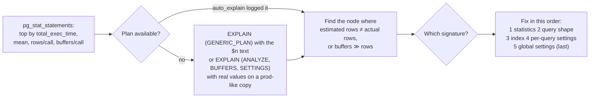

# 2.11 Plan Pathologies: A Diagnosis Playbook with Before/After `EXPLAIN` for Each

> **Verified stack:** PostgreSQL **18.6**, the `atlas` database from [2.9 §0.2](09-EXPLAIN-Atlas-Part-1-Scans-Sorts-Aggregates-Parallelism.md#02-the-dataset-run-it-yourself), `max_parallel_workers_per_gather = 0` so each pathology shows its pure form. Each case builds its own scratch table where it needs a specific data shape; every "before" and "after" plan is a complete output from one sequential capture.
>
> **The idea of this file:** most slow queries in production are one of about a dozen *recognizable shapes*. Each section gives the **signature** (what you see in the plan), the **mechanism** (why the planner chose it), the **fix** (ordered from least to most invasive), and the measured before/after.

---

## 0. The workflow: from "the endpoint is slow" to the node that's wrong 🔥



| Signature in the plan | Most likely pathology | Section |
|---|---|---|
| `Limit` → `Index Scan` with a huge `Rows Removed by Filter` | Row-goal (LIMIT) trap | [P1](#p1-the-row-goal-trap-order-by--limit-walks-the-wrong-index-) |
| `Filter: ((col)::numeric = …)` or `(col)::text`, Seq Scan on an indexed column | Parameter type mismatch | [P2](#p2-a-parameter-type-that-disables-the-index-jdbc-bigdecimal-vs-bigint-) |
| Estimate `rows=1`, actual hundreds+, then `Nested Loop` with a high-`loops` inner | Correlated predicates | [P3](#p3-correlated-predicates-estimated-1-row-nested-loop-explosion-) |
| Estimate tiny on a value that's actually common; `n_mod_since_analyze` high | Stale statistics | [P4](#p4-stale-statistics-after-a-data-shift-) |
| `SubPlan` (not `hashed SubPlan`) under `NOT IN`, `Materialize … Storage: Disk` | Non-hashed NOT IN | [P5](#p5-not-in-quadratic-time-and-a-null-that-returns-nothing-) |
| `Index Scan` (not Only) whose buffers ≈ rows, under GroupAggregate/Merge | Ordered access through an uncorrelated index | [P6](#p6-a-full-table-aggregate-that-walks-an-uncorrelated-index-) |
| `Index Only Scan` with high `Heap Fetches` | Visibility map not set (VACUUM bypass) | [P7](#p7-index-only-scans-that-arent-visibility-map-and-vacuum-bypass-) |
| Fast plan tree, slow total; `Trigger for constraint … time=` | Missing index on a foreign key | [P8](#p8-the-delete-thats-slow-outside-the-plan-tree-unindexed-foreign-keys-) |
| `Append` over every partition with a cast in `Filter` | Pruning defeated | [P9](#p9-partition-pruning-defeated-) |
| `Heap Blocks: lossy`, `Batches > 1`, `external merge Disk:` | `work_mem` too small for this query | [P10](#p10-memory-starvation-lossy-bitmaps-batches-and-external-sorts-) |
| `$1` in `Filter`/`Index Cond`, wrong plan only for some values | Generic plan + skew | [P11](#p11-generic-plan-on-skewed-data-) |

---

## P1. The row-goal trap: `ORDER BY … LIMIT` walks the wrong index 🔥

**Data shape:** 1 M tickets; 10,000 are `OPEN` (1 %), but **all of them are the oldest rows** (a backlog). Indexes on `created_at` and on `status`.

```sql
create table ticket (id bigint primary key, status text not null, created_at timestamptz not null, title text);
insert into ticket select g, case when g <= 10000 then 'OPEN' else 'CLOSED' end,
       timestamptz '2020-01-01' + g * interval '1 minute', 'ticket ' || g from generate_series(1, 1000000) g;
create index ticket_created on ticket (created_at);
create index ticket_status  on ticket (status);
vacuum analyze ticket;
explain (analyze, buffers) select id, created_at from ticket where status = 'OPEN' order by created_at desc limit 10;
```

**Before (PostgreSQL 18.6, one measured run):**

```text
 Limit  (cost=0.42..36.06 rows=10 width=16) (actual time=110.772..110.775 rows=10.00 loops=1)
   Buffers: shared hit=8251 read=2708
   ->  Index Scan Backward using ticket_created on ticket  (cost=0.42..36817.43 rows=10333 width=16) (actual time=110.770..110.772 rows=10.00 loops=1)
         Filter: (status = 'OPEN'::text)
         Rows Removed by Filter: 990000
         Index Searches: 1
         Buffers: shared hit=8251 read=2708
```

**Mechanism:** with `LIMIT 10`, the planner costs plans by the fraction needed to produce 10 rows (a **row goal**). It estimates 1 % of rows are `OPEN`, assumes they're spread **uniformly** in `created_at` order, and expects to find 10 of them in the first ~1,000 index entries: total cost 36 out of 36,817. In reality all `OPEN` rows are at the far end, and the backward scan threw away **990,000 rows**. The estimate (`rows=10333`) is correct; the **independence assumption between `status` and `created_at` order** is what's wrong, and no statistic captures it.

**Signature:** `Limit` above an `Index Scan` that provides the order, with a `Filter` and `Rows Removed by Filter` in the hundreds of thousands. Startup cost tiny, actual time huge.

**Fix (least invasive first):**
1. An index that serves **both** the filter and the order: `(status, created_at)`.
2. If you can't add an index: break the row goal (`ORDER BY created_at + interval '0'`, or a `MATERIALIZED` CTE that filters first), so the planner filters then sorts. Hacky, comment it.
3. Partial index for the hot predicate: `create index on ticket (created_at) where status = 'OPEN'`.

```sql
create index ticket_status_created on ticket (status, created_at);
```

**After (one measured run):**

```text
 Limit  (cost=0.42..13.25 rows=10 width=16) (actual time=0.044..0.046 rows=10.00 loops=1)
   Buffers: shared hit=1 read=3
   ->  Index Scan Backward using ticket_status_created on ticket  (cost=0.42..13256.42 rows=10333 width=16) (actual time=0.043..0.045 rows=10.00 loops=1)
         Index Cond: (status = 'OPEN'::text)
         Index Searches: 1
         Buffers: shared hit=1 read=3
```

**110.8 ms → 0.058 ms, 10,959 → 4 buffers.** The `Filter` became an `Index Cond`. This exact shape ("newest N items with status X") is the most common way LIMIT queries regress when the data distribution drifts.

---

## P2. A parameter type that disables the index (JDBC `BigDecimal` vs `bigint`) 🔥

```sql
explain (analyze, buffers) select id from orders where customer_id = 4242::numeric;   -- what setBigDecimal()/setObject(BigDecimal) sends
explain (analyze, buffers) select id from orders where customer_id = 4242;            -- what setLong() sends
```

**Before (PostgreSQL 18.6, one measured run):**

```text
 Seq Scan on orders  (cost=0.00..24412.00 rows=5000 width=8) (actual time=14.899..84.689 rows=5.00 loops=1)
   Filter: ((customer_id)::numeric = '4242'::numeric)
   Rows Removed by Filter: 999995
   Buffers: shared hit=2155 read=7257
```

**After (one measured run):**

```text
 Bitmap Heap Scan on orders  (cost=4.46..24.18 rows=5 width=8) (actual time=0.159..0.254 rows=5.00 loops=1)
   Recheck Cond: (customer_id = 4242)
   Heap Blocks: exact=5
   Buffers: shared hit=8 read=3
   ->  Bitmap Index Scan on orders_customer_id  (cost=0.00..4.46 rows=5 width=0) (actual time=0.026..0.026 rows=5.00 loops=1)
         Index Cond: (customer_id = 4242)
```

**Mechanism:** there's no `bigint = numeric` operator in the B-tree operator family, so PostgreSQL resolves the comparison as `numeric = numeric` and **casts the column**: `(customer_id)::numeric`. An index on `customer_id` can't answer a predicate on `customer_id::numeric`. The estimate also collapses to a default (`rows=5000` = 0.5 %), which then misleads every join above it.

**Signature:** a cast **on the column side** (`(col)::type`) in `Filter`, with a Seq Scan on a column you know is indexed. Variants: `varchar` column vs `text`… (fine: same family); `timestamp` column vs `timestamptz` parameter (casts the column; also time-zone dependent); `int` column vs `bigint` parameter (fine: cross-type operators exist in the integer family); UUID stored as `text` compared to a `uuid`.

**Fix:** send the column's type. In Java: `setLong` for `bigint`, never `BigDecimal` for an integer key; in JPA, map the id as `Long`; with Spring Data `@Query` on native SQL, check the parameter type of the method. Verify with `pg_stat_statements`: the normalized text shows `$1::numeric` casts if the driver sends typed parameters. **84.7 ms → 0.27 ms (300×)**, and the plan stays correct as the table grows.

---

## P3. Correlated predicates: estimated 1 row, nested-loop explosion 🧊

**Data shape:** `addr` (1 M rows) where `zip` determines `city` (1,000 cities, 7 zips each); `visit` (200,000 rows) with no index on `zip`.

```sql
create table addr (id int primary key, city text, zip text);
insert into addr select g, 'city' || (g % 1000), 'zip' || (g % 1000) || '-' || (g % 7) from generate_series(1, 1000000) g;
create table visit (id int, zip text, seen_at timestamptz);
insert into visit select g, 'zip' || (g % 1000) || '-' || (g % 7), timestamptz '2026-01-01' from generate_series(1, 200000) g;
analyze addr, visit;
explain (analyze, buffers) select count(*) from addr a join visit v on v.zip = a.zip where a.city = 'city42' and a.zip = 'zip42-0';
```

**Before (PostgreSQL 18.6, one measured run):**

```text
 Aggregate  (cost=25144.36..25144.37 rows=1 width=8) (actual time=1392.140..1392.141 rows=1.00 loops=1)
   Buffers: shared hit=188552
   ->  Nested Loop  (cost=0.00..25144.29 rows=29 width=0) (actual time=0.024..1391.752 rows=4147.00 loops=1)
         Buffers: shared hit=188552
         ->  Seq Scan on addr a  (cost=0.00..21370.00 rows=1 width=8) (actual time=0.015..49.809 rows=143.00 loops=1)
               Filter: ((zip = 'zip42-0'::text) AND (city = 'city42'::text))
               Rows Removed by Filter: 999857
               Buffers: shared hit=6370
         ->  Seq Scan on visit v  (cost=0.00..3774.00 rows=29 width=8) (actual time=0.005..9.368 rows=29.00 loops=143)
               Filter: (zip = 'zip42-0'::text)
               Rows Removed by Filter: 199971
               Buffers: shared hit=182182
```

**Mechanism:** `P(city = 'city42') × P(zip = 'zip42-0') = 1/1000 × 1/7000` → **1 row** estimated, 143 actual. With one outer row, a nested loop with a seq-scanned inner side is "cheapest" (one scan of `visit`). In reality the inner seq scan ran **143 times**: 182,182 buffers, 1.4 s. Notice the **inner** side's estimate (`rows=29`) is perfect: the error is entirely on the outer side and it multiplies.

**Signature:** `rows=1` estimate with actual ≫ 1 on the outer side of a nested loop, inner side with `loops` = actual outer rows and a non-indexed scan.

```sql
create statistics addr_city_zip (dependencies, mcv, ndistinct) on city, zip from addr;
analyze addr;
```

**After (one measured run):**

```text
 Aggregate  (cost=25206.28..25206.29 rows=1 width=8) (actual time=60.044..60.046 rows=1.00 loops=1)
   Buffers: shared hit=7644
   ->  Nested Loop  (cost=0.00..25195.91 rows=4147 width=0) (actual time=0.120..59.895 rows=4147.00 loops=1)
         Buffers: shared hit=7644
         ->  Seq Scan on addr a  (cost=0.00..21370.00 rows=143 width=8) (actual time=0.056..46.742 rows=143.00 loops=1)
               Filter: ((zip = 'zip42-0'::text) AND (city = 'city42'::text))
               Rows Removed by Filter: 999857
         ->  Materialize  (cost=0.00..3774.14 rows=29 width=8) (actual time=0.000..0.090 rows=29.00 loops=143)
               Storage: Memory  Maximum Storage: 17kB
               ->  Seq Scan on visit v  (cost=0.00..3774.00 rows=29 width=8) (actual time=0.040..12.791 rows=29.00 loops=1)
                     Filter: (zip = 'zip42-0'::text)
```

**1,392 ms → 60 ms (23×), 188,552 → 7,644 buffers.** With the right outer estimate (143, exact), the planner kept the nested loop but put a `Materialize` on the inner side: `visit` is scanned **once** (`loops=1` under Materialize) and replayed 143 times from memory. Even the join estimate is now exact (4,147). Extended statistics are the only fix that addresses the cause; an index on `visit(zip)` would hide it in this query and leave every other query on `(city, zip)` misestimated.

---

## P4. Stale statistics after a data shift ⚡

**Data shape:** a copy of `orders` with autovacuum disabled (so the shift isn't noticed); after `ANALYZE`, 10 % of rows get a **new** status value `REFUNDED` (a new feature launched).

```sql
create table refund_probe as select * from orders;
create index refund_probe_status on refund_probe (status);
create index refund_probe_customer on refund_probe (customer_id);
alter table refund_probe set (autovacuum_enabled = off);
analyze refund_probe;
update refund_probe set status = 'REFUNDED' where id % 10 = 1;      -- 100,000 rows
explain (analyze, buffers) select count(*) from refund_probe r join customers c on c.id = r.customer_id
where r.status = 'REFUNDED' and c.tier = 'enterprise';
```

**Before (PostgreSQL 18.6, one measured run):**

```text
 Aggregate  (cost=14.27..14.28 rows=1 width=8) (actual time=202.111..202.112 rows=1.00 loops=1)
   Buffers: shared hit=398602 read=2415 written=2388
   ->  Nested Loop  (cost=0.85..14.27 rows=1 width=0) (actual time=0.348..201.554 rows=10000.00 loops=1)
         ->  Index Scan using refund_probe_status on refund_probe r  (cost=0.43..5.82 rows=1 width=8) (actual time=0.009..10.624 rows=100000.00 loops=1)
               Index Cond: (status = 'REFUNDED'::text)
               Index Searches: 1
         ->  Index Scan using customers_pkey on customers c  (cost=0.42..8.44 rows=1 width=8) (actual time=0.002..0.002 rows=0.10 loops=100000)
               Index Cond: (id = r.customer_id)
               Filter: (tier = 'enterprise'::text)
               Rows Removed by Filter: 1
               Index Searches: 100000
```

```text
 n_mod_since_analyze
---------------------
              100000
```

**Mechanism:** `REFUNDED` isn't in the most-common-values list and the histogram has never seen it, so the estimate for `status = 'REFUNDED'` is ~1 row. Reality: 100,000. One estimated outer row → nested loop with 100,000 primary-key probes (400,000 buffers). Autovacuum would normally re-analyze after `autovacuum_analyze_threshold (50) + autovacuum_analyze_scale_factor (0.1) × reltuples` = **100,050** modified rows: this shift sat 50 rows **below** the trigger. On a 100 M-row table the default trigger is 10 M changes: **big tables re-analyze rarely**.

**Signature:** a tiny estimate on a value that's actually common; `pg_stat_user_tables.n_mod_since_analyze` large relative to the table; `last_autoanalyze` old.

```sql
analyze refund_probe;
```

**After (one measured run):**

```text
 Aggregate  (cost=17383.57..17383.58 rows=1 width=8) (actual time=35.890..35.893 rows=1.00 loops=1)
   Buffers: shared hit=2887
   ->  Hash Join  (cost=5536.40..17381.26 rows=923 width=0) (actual time=20.354..35.458 rows=10000.00 loops=1)
         Hash Cond: (r.customer_id = c.id)
         ->  Bitmap Heap Scan on refund_probe r  (cost=1142.90..12728.15 rows=98900 width=8) (actual time=2.663..9.276 rows=100000.00 loops=1)
               Recheck Cond: (status = 'REFUNDED'::text)
               ->  Bitmap Index Scan on refund_probe_status  (cost=0.00..1118.17 rows=98900 width=0) (actual time=2.529..2.530 rows=100000.00 loops=1)
                     Index Cond: (status = 'REFUNDED'::text)
         ->  Hash  (cost=4370.00..4370.00 rows=1880 width=8) (actual time=17.668..17.669 rows=2000.00 loops=1)
               Buckets: 2048  Batches: 1  Memory Usage: 95kB
               ->  Seq Scan on customers c  (cost=0.00..4370.00 rows=1880 width=8) (actual time=0.025..17.261 rows=2000.00 loops=1)
                     Filter: (tier = 'enterprise'::text)
```

**202 ms → 36 ms, 401,017 → 2,887 buffers.** Note the join estimate is still 10× low (923 vs 10,000) because `tier` and `customer_id` assignment are correlated in this dataset, but the shape is now right.

**Fix policy:** `ANALYZE` after every bulk load or backfill (make it part of the migration); per-table `autovacuum_analyze_scale_factor = 0.01` (or a fixed `autovacuum_analyze_threshold`) for big tables whose distributions shift; alert on `n_mod_since_analyze / n_live_tup`.

---

## P5. `NOT IN`: quadratic time, and a NULL that returns nothing 🔥

**The plan shape at default `work_mem` (4 MB):**

```sql
explain select count(*) from customers c where c.id not in (select o.customer_id from orders o where o.id <= 300000);
```

```text
 Aggregate  (cost=1495118623.50..1495118623.51 rows=1 width=8)
   ->  Seq Scan on customers c  (cost=0.42..1495118373.50 rows=100000 width=0)
         Filter: (NOT (ANY (id = (SubPlan 1).col1)))
         SubPlan 1
           ->  Materialize  (cost=0.42..14194.79 rows=302709 width=8)
                 ->  Index Scan using orders_pkey on orders o  (cost=0.42..11498.25 rows=302709 width=8)
                       Index Cond: (id <= 300000)
```

A cost of **1.5 billion** is the planner telling you this is hopeless: the 300,000-value subquery doesn't fit in `work_mem` for a hash table, so `SubPlan 1` (not `hashed SubPlan 1`) will be **re-scanned for every customer**. The full query didn't finish within a 20-second timeout. Running it on just 1,000 customers:

```sql
explain (analyze, buffers) select count(*) from customers c where c.id <= 1000 and c.id not in (select o.customer_id from orders o where o.id <= 300000);
```

**Before (PostgreSQL 18.6, one measured run):**

```text
 Aggregate  (cost=6922410.36..6922410.37 rows=1 width=8) (actual time=8998.668..8998.669 rows=1.00 loops=1)
   Buffers: shared hit=475 read=2432 written=2394, temp read=219932 written=440
   ->  Index Only Scan using customers_pkey on customers c  (cost=0.84..6922409.20 rows=463 width=0) (actual time=8998.666..8998.666 rows=0.00 loops=1)
         Index Cond: (id <= 1000)
         Filter: (NOT (ANY (id = (SubPlan 1).col1)))
         Rows Removed by Filter: 1000
         SubPlan 1
           ->  Materialize  (cost=0.42..14194.79 rows=302709 width=8) (actual time=0.003..4.806 rows=100060.50 loops=1000)
                 Storage: Disk  Maximum Storage: 4096kB
                 Buffers: shared hit=469 read=2432 written=2394, temp read=219932 written=440
                 ->  Index Scan using orders_pkey on orders o  (cost=0.42..11498.25 rows=302709 width=8) (actual time=0.096..56.200 rows=200000.00 loops=1)
                       Index Cond: (id <= 300000)
```

**9.0 seconds for 1,000 rows**: `Materialize … loops=1000`, scanning on average 100,060 materialized values per customer, and the tuplestore itself spilled (`Storage: Disk`, `temp read=219932` blocks = 1.7 GB re-read). For all 200,000 customers, extrapolate to ~30 minutes.

**The rewrite:**

```sql
explain (analyze, buffers) select count(*) from customers c where not exists (select 1 from orders o where o.customer_id = c.id and o.id <= 300000);
```

**After (one measured run):**

```text
 Aggregate  (cost=24602.91..24602.92 rows=1 width=8) (actual time=159.888..159.891 rows=1.00 loops=1)
   ->  Hash Anti Join  (cost=16465.11..24596.09 rows=2728 width=0) (actual time=159.884..159.887 rows=0.00 loops=1)
         Hash Cond: (c.id = o.customer_id)
         ->  Seq Scan on customers c  (cost=0.00..3870.00 rows=200000 width=8) (actual time=0.009..10.637 rows=200000.00 loops=1)
         ->  Hash  (cost=11498.25..11498.25 rows=302709 width=8) (actual time=78.892..78.893 rows=300000.00 loops=1)
               Buckets: 262144  Batches: 2  Memory Usage: 7930kB
               ->  Index Scan using orders_pkey on orders o  (cost=0.42..11498.25 rows=302709 width=8) (actual time=0.013..40.596 rows=300000.00 loops=1)
                     Index Cond: (id <= 300000)
```

**All 200,000 customers in 160 ms**: a hash anti join can spill in batches (`Batches: 2`) and stays linear. (With `work_mem = 64MB`, the `NOT IN` becomes a `hashed SubPlan` and also finishes in ~130 ms. Raising memory hides the problem until the subquery grows.)

**And the correctness bug:**

```sql
select (select count(*) from products where id not in (select null::bigint union all select 1)) as not_in_with_a_null,
       (select count(*) from products p where not exists (select 1 from (select null::bigint union all select 1) s(x) where s.x = p.id)) as not_exists;
```

```text
 not_in_with_a_null | not_exists
--------------------+------------
                  0 |      19999
```

`x NOT IN (…, NULL)` is `x <> … AND x <> NULL`, which is never true: **one NULL in the subquery makes `NOT IN` return no rows at all.** That's also why the planner can't convert `NOT IN` into an anti join automatically. Rule: **never `NOT IN (subquery)`; always `NOT EXISTS`.** (`NOT IN` with a literal list of non-null constants is fine.)

---

## P6. A full-table aggregate that walks an uncorrelated index ⚡

```sql
explain (analyze, buffers) select customer_id, count(*), sum(total) from orders group by customer_id;
```

**Before (PostgreSQL 18.6, default `work_mem = 4MB`, one measured run):**

```text
 GroupAggregate  (cost=0.42..68318.32 rows=197272 width=48) (actual time=0.051..818.093 rows=200000.00 loops=1)
   Group Key: customer_id
   Buffers: shared hit=993414 read=8006 written=5602
   ->  Index Scan using orders_customer_id on orders  (cost=0.42..58352.42 rows=1000000 width=14) (actual time=0.006..592.948 rows=1000000.00 loops=1)
         Index Searches: 1
         Buffers: shared hit=993414 read=8006 written=5602
```

**Mechanism:** a hash aggregate over 200,000 groups needs more than 4 MB × 2, so the planner prices it with spill costs and prefers a plan that needs no memory: read `orders` **in `customer_id` order** through the index and aggregate on the fly. The cost model believes this is cheaper because it assumes much of the heap is cached (`effective_cache_size`). But `customer_id` has correlation 0.0005, so the scan jumps to a different heap page for almost every row: **1,001,420 page touches** to read a 9,412-page table, 105 times over.

**Signature:** an `Index Scan` (not Index *Only*) that feeds a `GroupAggregate`, `Merge Join` or `Unique`, with **buffers ≈ rows**.

**Fix A: give this query enough memory for a hash aggregate**

```sql
set work_mem = '64MB';         -- in production: SET LOCAL inside the reporting transaction, or ALTER ROLE reporting SET work_mem
explain (analyze, buffers, settings) select customer_id, count(*), sum(total) from orders group by customer_id;
```

```text
 HashAggregate  (cost=26912.00..29377.90 rows=197272 width=48) (actual time=262.705..343.535 rows=200000.00 loops=1)
   Group Key: customer_id
   Batches: 1  Memory Usage: 81937kB
   Buffers: shared hit=9412
   ->  Seq Scan on orders  (cost=0.00..19412.00 rows=1000000 width=14) (actual time=0.015..34.618 rows=1000000.00 loops=1)
         Buffers: shared hit=9412
 Settings: work_mem = '64MB', jit = 'off', max_parallel_workers_per_gather = '0'
```

**823 ms → 352 ms, 1 M → 9,412 buffers.** Note `Memory Usage: 81937kB` is **above** the 64 MB `work_mem`: hash nodes may use `work_mem × hash_mem_multiplier` (2.0) = 128 MB. Budget for that when you size memory per connection.

**Fix B: a covering index makes the ordered path cheap**

```sql
create index orders_customer_total on orders (customer_id) include (total);
vacuum (analyze) orders;
```

```text
 GroupAggregate  (cost=0.42..40308.80 rows=192030 width=48) (actual time=0.182..237.997 rows=200000.00 loops=1)
   Group Key: customer_id
   Buffers: shared hit=1 read=3834 written=1797
   ->  Index Only Scan using orders_customer_total on orders  (cost=0.42..30408.42 rows=1000000 width=14) (actual time=0.160..100.150 rows=1000000.00 loops=1)
         Heap Fetches: 0
         Index Searches: 1
```

**242 ms, 3,835 buffers, no extra memory.** The index is read sequentially in key order and never touches the heap. The trade-off: one more index to maintain on every insert, and `total` updates are no longer HOT-eligible ([2.10 §7.1](10-EXPLAIN-Atlas-Part-2-Joins-Subqueries-Partitions-DML.md#7-dml-modifytable-wal-hot-foreign-key-triggers-on-conflict-)). Choose A for an occasional report, B for an API endpoint that runs this all day.

---

## P7. Index-only scans that aren't: visibility map and VACUUM bypass 🧊

Full walkthrough with outputs in [2.9 §5](09-EXPLAIN-Atlas-Part-1-Scans-Sorts-Aggregates-Parallelism.md#5-index-only-scan-the-visibility-map-and-the-vacuum-that-didnt-help-). The diagnosis in production:

| Step | Command | What you're looking for |
|---|---|---|
| 1 | `EXPLAIN (ANALYZE, BUFFERS)` | `Heap Fetches` close to `rows` on an `Index Only Scan` |
| 2 | `select relallvisible, relpages from pg_class where relname = …` | Low all-visible ratio |
| 3 | `select count(*) filter (where not all_visible) from pg_visibility_map('t')` | Pages not all-visible (needs `pg_visibility`) |
| 4 | `VACUUM (VERBOSE) t` | `index scan bypassed: N pages … have M dead item identifiers` |
| 5 | `VACUUM (INDEX_CLEANUP ON) t` | Heap Fetches → 0 (verified: 19,300 → 6,500 after a plain VACUUM → 0) |

Long-term fixes: more frequent vacuum on that table (`autovacuum_vacuum_scale_factor`), periodic `INDEX_CLEANUP ON`, and fewer updates of rows that the covering index serves.

---

## P8. The delete that's slow outside the plan tree: unindexed foreign keys 🔥

Full outputs in [2.10 §7.2](10-EXPLAIN-Atlas-Part-2-Joins-Subqueries-Partitions-DML.md#72-the-foreign-key-without-an-index-trigger-for-constraint). The signature is unmistakable once you know it: the plan tree takes 0.15 ms, and the line below it says

```text
 Trigger for constraint parcel_shipment_id_fkey: time=4184.941 calls=200
```

**4,185 ms vs 5.2 ms** with an index on the referencing column. Find every unindexed FK in a schema:

```sql
select c.conrelid::regclass as child_table, a.attname as fk_column, c.conname
from pg_constraint c
join pg_attribute a on a.attrelid = c.conrelid and a.attnum = c.conkey[1]
where c.contype = 'f'
  and not exists (select 1 from pg_index i where i.indrelid = c.conrelid and i.indkey[0] = c.conkey[1]);
```

(First-column check; for multi-column FKs compare the whole `conkey` with the index's leading columns.)

---

## P9. Partition pruning defeated ⚡

Full outputs in [2.10 §6](10-EXPLAIN-Atlas-Part-2-Joins-Subqueries-Partitions-DML.md#6-partitioned-tables-append-pruning-merge-append-). Causes, in order of frequency:

| Cause | Plan signature | Fix |
|---|---|---|
| Function/cast on the key: `occurred_at::date = …`, `date_trunc('day', occurred_at) = …` | `Append` over **all** partitions, cast in `Filter` | Half-open range on the raw key |
| Parameter type differs from the key type (`timestamp` vs `timestamptz`) | Same | Bind the key's exact type |
| Predicate only on a non-key column | All partitions | Include the key in the query, or rethink the key |
| Generic plan (`$1`) | All partitions listed in `EXPLAIN` without `ANALYZE`; `Subplans Removed: N` with it | Nothing: run-time pruning works; check `Subplans Removed` |
| Partition bounds computed in the wrong time zone | Right partition count, wrong partition for edge rows | Explicit `+00` literals in bounds ([2.10 §6.4](10-EXPLAIN-Atlas-Part-2-Joins-Subqueries-Partitions-DML.md#64-merge-append-and-never-executed-children)) |

---

## P10. Memory starvation: lossy bitmaps, batches and external sorts ⚡

All three are **per-query memory** problems; all three were reproduced on the atlas:

| Signature | Example in this kit | Measured effect |
|---|---|---|
| `Heap Blocks: exact=349 lossy=7778`, `Rows Removed by Index Recheck: 297807` | [2.9 §6.2](09-EXPLAIN-Atlas-Part-1-Scans-Sorts-Aggregates-Parallelism.md#62-lossy-when-the-bitmap-doesnt-fit-in-work_mem) at `work_mem = 64kB` | 2.4× slower than the exact bitmap |
| `Hash … Batches: 32` | [2.10 §2.2](10-EXPLAIN-Atlas-Part-2-Joins-Subqueries-Partitions-DML.md#22-spilled-to-disk) at 256 kB | 107 ms → 737 ms |
| `HashAggregate … Planned Partitions: 32  Batches: 161  Disk Usage: 62536kB` | [2.9 §9.2](09-EXPLAIN-Atlas-Part-1-Scans-Sorts-Aggregates-Parallelism.md#92-hashaggregate-that-spills) at 1 MB | 561 ms with 61 MB of temp files |
| `Sort Method: external merge  Disk: 24544kB` | [2.9 §8](09-EXPLAIN-Atlas-Part-1-Scans-Sorts-Aggregates-Parallelism.md#8-sort-nodes-top-n-quicksort-external-merge-incremental-) at 4 MB | Can't stream the first row before the whole sort ends |

Global diagnosis: `select datname, temp_files, pg_size_pretty(temp_bytes) from pg_stat_database;` and `log_temp_files = 0` to log every temp file with its query. Fix per query (`SET LOCAL work_mem`) or per role; remember the real ceiling is `work_mem × hash_mem_multiplier × nodes × (workers + 1) × connections`.

---

## P11. Generic plan on skewed data ⚡

Reproduced with outputs in [2.3 §5](03-Query-Planning-EXPLAIN-Statistics-Join-Algorithms.md#5-prepared-statements-custom-vs-generic-plans-the-jdbc-trap-): after five executions dominated by a common value, PostgreSQL switched a prepared statement to a generic plan, and the rare value ran **95 ms instead of 8 ms**. Diagnosis tools added in this batch:

* `EXPLAIN (GENERIC_PLAN)` on the `pg_stat_statements` text shows the plan every connection will converge to ([2.10 §8.1](10-EXPLAIN-Atlas-Part-2-Joins-Subqueries-Partitions-DML.md#81-generic_plan-pg-16-see-what-the-prepared-statement-runs)).
* `select name, generic_plans, custom_plans from pg_prepared_statements` shows the switch, but **only for the current session**: run it on an application connection (a debug endpoint or a pool-aware admin query). Verified on PG 18.6: `pg_stat_statements` 1.12 has planning-time columns (`plans`, `total_plan_time`, …) but **no generic/custom plan counters**, so there's no server-wide view of which statements went generic. A sudden drop in `plans` per `calls` for a statement is the indirect hint.
* `auto_explain` with `log_min_duration` catches the slow executions with their `$1` filters.

Fixes: `plan_cache_mode = force_custom_plan` for the role or transaction, split the query for the rare values, or a partial index that makes both values cheap.

---

## 12. ❌ Naïve vs ✅ production-hardened diagnosis

| ❌ Naïve | ✅ Hardened |
|---|---|
| Starts from the slow query a user reported | Starts from `pg_stat_statements` ranked by total time, then mean, then buffers per call |
| Reproduces with literal values in psql | `EXPLAIN (GENERIC_PLAN)` first; then real values; `SETTINGS` to match the app's session |
| "Add an index" as the first fix | Statistics → query shape → index → per-query setting → global setting |
| Turns `enable_nestloop = off` globally | Uses `enable_*` only in a session to *prove* an alternative, then fixes the estimate that caused the choice |
| Raises global `work_mem` after one spill | `SET LOCAL` per query/role; tracks `temp_bytes` |
| Trusts `NOT IN` | `NOT EXISTS` everywhere; lints for `NOT IN (SELECT` in code review |
| Ignores `Trigger for constraint` lines | Indexes every FK on the referencing side (query above) |
| Tunes once | Keeps `auto_explain` (sampled, `log_timing = off`) on in production to catch regressions with real plans |

---

## 13. Interview soundbites

* "The LIMIT trap: the planner assumed the 1 % `OPEN` rows were spread through `created_at` order; they were all at the end. 990,000 rows filtered, 111 ms; a `(status, created_at)` index made it 0.06 ms."
* "`Filter: ((customer_id)::numeric = …)` means the driver sent a `numeric`. The column got cast and the index was dead: 85 ms vs 0.27 ms. Bind the column's type."
* "Estimated 1, actual 143 on the outer side: the inner seq scan ran 143 times. `CREATE STATISTICS` on the correlated columns made the estimate exact and the query 23× faster."
* "A new enum value after the last ANALYZE was estimated at 1 row; 100,000 nested-loop probes. Autovacuum's default analyze trigger is 10 % of the table: on big tables that's rarely."
* "`NOT IN (subquery)` with a big subquery is a SubPlan re-scanned per row: 9 seconds for 1,000 rows; `NOT EXISTS` did 200,000 in 160 ms. And one NULL makes `NOT IN` return nothing."
* "An Index Scan whose buffers equal its rows is random I/O per row. A full aggregate through an uncorrelated index touched a million pages; a per-query `work_mem` or a covering index fixed it."

---

## Summary

| # | Pathology | Signature | Fix | Measured before → after |
|---|---|---|---|---|
| P1 | Row-goal LIMIT trap | `Limit` → ordered Index Scan + huge `Rows Removed by Filter` | Composite index (filter, order) | 110.8 ms → 0.058 ms |
| P2 | Parameter type mismatch | `(col)::numeric` in `Filter`, Seq Scan | Bind the column's type | 84.7 ms → 0.27 ms |
| P3 | Correlated predicates | outer `rows=1` vs 143, inner `loops=143` | `CREATE STATISTICS (dependencies, mcv, ndistinct)` | 1,392 ms → 60 ms |
| P4 | Stale statistics | estimate 1 vs 100,000; high `n_mod_since_analyze` | `ANALYZE`; per-table analyze thresholds | 202 ms → 36 ms |
| P5 | NOT IN | `SubPlan` (not hashed), `Materialize … Disk` | `NOT EXISTS` | 9,000 ms for 1k rows → 160 ms for 200k |
| P6 | Ordered scan of an uncorrelated index | Index Scan with buffers ≈ rows | `SET LOCAL work_mem` / covering index | 823 ms → 352 ms / 242 ms |
| P7 | VM not set | `Heap Fetches` on Index Only Scan | `VACUUM (INDEX_CLEANUP ON)`, vacuum tuning | 19,300 → 0 heap fetches |
| P8 | Unindexed FK | `Trigger for constraint … time=` | Index the referencing column | 4,185 ms → 5.2 ms |
| P9 | Pruning defeated | `Append` over all partitions | Range on the raw key, right types, right bounds | 12 partitions → 1 |
| P10 | Memory starvation | `lossy`, `Batches > 1`, `Disk:` | Per-query `work_mem` | 737 ms → 107 ms (hash join) |
| P11 | Generic plan + skew | `$1` in a plan that's wrong for some values | `force_custom_plan` for the role, split query | 95 ms → 8 ms |

**Next:** [2.8 Bar-raiser drill-downs (Round 2 is EXPLAIN-driven) →](08-Bar-Raiser-Drill-Downs.md)
