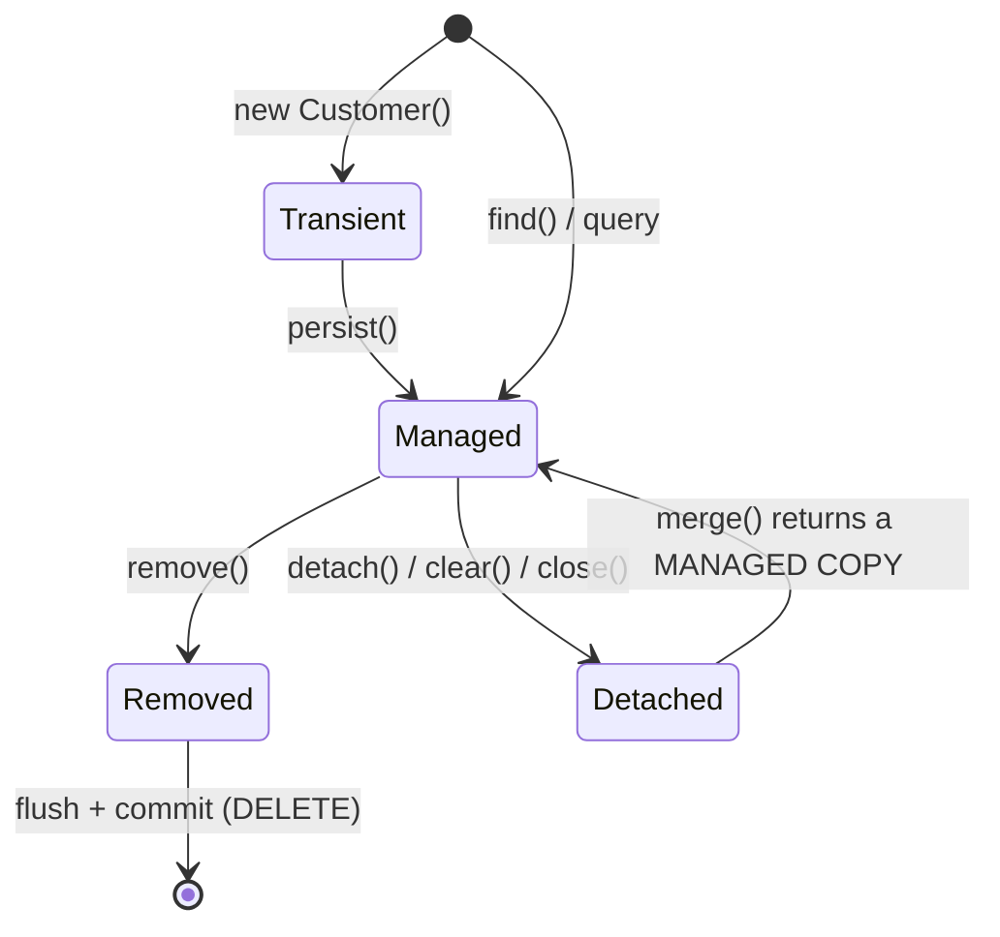

# 3.1 The Persistence Context: Entity States, First-Level Cache, Proxies, Dirty Checking, Flush

> **Verified stack:** Hibernate ORM **7.4.13.Final** (JPA 3.2), Spring Framework **7.0.10** / Spring Data JPA **4.1.2**, PostgreSQL **18.6**, Temurin **25**. SQL lines prefixed `SQL>` were captured with datasource-proxy wrapping HikariCP, so they're exactly what reached the JDBC driver.
>
> **Go deeper:** the sibling kit's [5.2 persistence-context internals](../../Java-Backend-Master-Reference/05-Persistence-JPA-Hibernate/02-JPA-Hibernate-Persistence-Context-Internals.md).

---

## 0. First principles: what an ORM really is 🔥

An ORM is a **unit of work** plus an **identity map** plus a **change tracker** sitting between your objects and SQL:

* **Identity map** (the first-level cache): within one persistence context, one database row ⇒ **one** Java object. Two `find(Customer, 1)` calls return the same instance.
* **Unit of work** (the `ActionQueue`, [3.2](02-ActionQueue-Flush-Ordering.md)): `persist`, `remove` and field changes are *recorded*, not executed. SQL is generated at **flush** time, in an order Hibernate chooses.
* **Change tracking** (dirty checking): you never call `update()`. At flush, Hibernate compares each managed entity with a **snapshot** taken when it was loaded and writes the differences.

Each of these buys convenience and costs something: memory for snapshots, CPU at flush, SQL you didn't write at times you didn't choose. Senior engineers can predict the SQL from the Java. That's the skill this pillar trains.

---

## 1. Entity states (verified) 🔥



```java
Customer t = new Customer("bob@x.io", "Bob", "Paris");
System.out.println("  new          -> contains=" + s.contains(t) + " id=" + t.id + "   (TRANSIENT)");
s.persist(t);
System.out.println("  after persist-> contains=" + s.contains(t) + " id=" + t.id + "   (MANAGED, no INSERT yet)");
s.flush();
s.detach(t);
System.out.println("  after detach -> contains=" + s.contains(t) + "               (DETACHED)");
t.city = "Lyon";
Customer merged = s.merge(t);
System.out.println("  merge returned the same object? " + (merged == t) + "; merged managed? " + s.contains(merged));
```

**Output (verified):**

```text
  new          -> contains=false id=null   (TRANSIENT)
  SQL> select nextval('pc_customer_SEQ')
  after persist-> contains=true id=2   (MANAGED, no INSERT yet)
  SQL> insert into pc_customer (city,email,name,id) values (?,?,?,?)
  after detach -> contains=false               (DETACHED)
  SQL> select c1_0.id,c1_0.city,c1_0.email,c1_0.name from pc_customer c1_0 where c1_0.id=?
  merge returned the same object? false; merged managed? true
  SQL> update pc_customer set city=?,email=?,name=? where id=?
```

Five things this proves:

1. `persist()` with a `SEQUENCE` id **fetched the id immediately** (`nextval`) but **didn't insert**. The `INSERT` waited for `flush()`.
2. After `detach()`, the object is just a POJO. Changing `city` does nothing by itself.
3. `merge()` **SELECTs the current row**, copies your detached state onto a **managed instance**, and returns *that*. The object you passed stays detached (`merged == t` is `false`). Code that keeps using `t` after `merge` is a classic bug.
4. The `UPDATE` came at commit (flush), not at `merge()`.
5. `merge` costs a `SELECT` (unless the entity is already in the context).

---

## 2. The first-level cache (identity map) ⚡

```java
Customer a = s.find(Customer.class, adaId);
Customer b = s.find(Customer.class, adaId);
System.out.println("  a == b ? " + (a == b));
```

**Output (verified):**

```text
  SQL> select c1_0.id,c1_0.city,c1_0.email,c1_0.name from pc_customer c1_0 where c1_0.id=?
  a == b ? true
```

One `SELECT`, one instance. What it is and isn't:

| It is | It isn't |
|---|---|
| Scoped to **one** persistence context (in Spring: usually one transaction) | Shared between requests or users (that's the second-level cache, rarely worth it) |
| Keyed by **(entity type, id)** | A query cache: `createQuery(...)` always hits the database, though returned rows resolve to the cached instances |
| What guarantees `a == b`, so changes through either reference are the same change | A memory-bounded cache: load 1 M entities in one transaction and you hold 1 M objects **plus snapshots** |

---

## 3. Lazy proxies: a verified field-access trap 🧊

A lazy `@ManyToOne` is represented by a **proxy**: a ByteBuddy-generated subclass whose *methods* trigger loading.

```java
PurchaseOrder o = s.find(PurchaseOrder.class, 1L);
System.out.println("  proxy class      : " + o.customer.getClass().getSimpleName());
System.out.println("  o.customer.name  : " + o.customer.name + "   <- field read on the proxy itself");
System.out.println("  o.customer.getName(): " + o.customer.getName() + "   <- method call initializes it");
```

**Output (verified):**

```text
  SQL> select po1_0.id,po1_0.customer_id from f_order po1_0 where po1_0.id=?
  proxy class      : FetchLab$Customer$HibernateProxy
  o.customer.name  : null   <- field read on the proxy itself
  SQL> select c1_0.id,c1_0.name from f_customer c1_0 where c1_0.id=?
  o.customer.getName(): customer-1   <- method call initializes it
```

The proxy object has its *own* copy of the fields, which are never populated. Only method calls are intercepted and delegated to the real, loaded entity. Consequences:

* **Never access another entity's fields directly** (`other.name`), including in `equals()`. Use getters. Lombok-generated `equals` that reads fields of a proxied argument returns wrong results.
* `getClass()` on a proxy isn't your entity class. Use `Hibernate.getClass(obj)` or `instanceof` in `equals`.
* Calling `getId()` on a proxy usually **doesn't** initialize it (the id is known), so `order.getCustomer().getId()` is free.

---

## 4. Dirty checking (verified) 🔥

### 4.1 How it works

At load time Hibernate stores a **snapshot**: an `Object[]` with the hydrated value of every persistent attribute (the "loaded state" in the `EntityEntry`). At flush, `DefaultFlushEntityEventListener` compares each managed entity's current values with its snapshot, **property by property**, using each attribute's Java type's `areEqual`.

```java
Customer c = s.find(Customer.class, adaId);
c.name = "Ada";                         // same value as loaded
c.city = "Paris"; c.city = "London";    // changed and changed back
System.out.println("  -- flush #1 (no net change):");
s.flush();
c.city = "Cambridge";
System.out.println("  -- flush #2 (one field changed): note ALL columns are updated");
s.flush();
```

**Output (verified):**

```text
  SQL> select c1_0.id,c1_0.city,c1_0.email,c1_0.name from pc_customer c1_0 where c1_0.id=?
  -- flush #1 (no net change):
  -- flush #2 (one field changed): note ALL columns are updated
  SQL> update pc_customer set city=?,email=?,name=? where id=?
```

* No net change → **no SQL**. Dirty checking compares **values at flush time**, not the history of setter calls.
* One field changed → **every column is updated**. Hibernate pre-generates one `UPDATE` statement per entity at startup and reuses it. That's good for statement caching and JDBC batching, bad when columns are large (TOASTed text, [2.1 §3](../02-SQL-RDBMS-Internals/01-Storage-Pages-Tuples-TOAST-WAL.md)) or indexed (it can defeat HOT updates only if the value actually changes, but it still ships the bytes).

### 4.2 `@DynamicUpdate` (verified)

```java
@Entity @DynamicUpdate
public class Note { @Id Long id; String title; String body; String tag; }
// n.tag = "y"; flush
```

```text
  SQL> update pc_note set tag=? where id=?
```

Only the changed column, at the cost of building the SQL at runtime and getting fewer identical statements to batch. Use it for wide tables with large columns, or when column-level triggers or auditing care about which columns were written.

### 4.3 The cost of dirty checking

Dirty checking is O(managed entities × attributes) **at every flush**, and flushes happen at commit *and* before queries (auto-flush, [3.2](02-ActionQueue-Flush-Ordering.md)). Snapshots also roughly **double the memory** per loaded entity.

**One measured run** (20,004 managed `Customer` entities, flush with nothing changed):

```text
  readOnly=false entities=20004 flush took 15246 us
  readOnly=true entities=20004 flush took 12571 us
  readOnly=false entities=20004 flush took 5052 us
  readOnly=true entities=20004 flush took 4003 us
```

The first pair includes JIT warm-up. Warm, the check costs **~5 ms per flush for 20k entities**; a read-only session (`setDefaultReadOnly(true)`, or Spring's `@Transactional(readOnly = true)`, which does this for you) shaves ~20% of CPU here. The **bigger** wins of read-only are that Hibernate can **discard the snapshots** (memory) and that accidental writes are ignored ([3.5 §6](05-Transactional-Propagation-Isolation-Pitfalls.md)). The real lesson: **don't load 20,000 entities into a persistence context to read them**. Use a DTO projection ([3.3 §6](03-NPlus1-Lazy-Loading-Fetch-Plans-Pagination-Projections.md)).

### 4.4 Bytecode enhancement: the alternative to snapshot comparison 🧊

With the Hibernate build plugin (`hibernate-enhance-maven-plugin` / the `org.hibernate.orm` Gradle plugin, `enableDirtyTracking`), entity classes are rewritten at build time so setters record which attributes changed (`$$_hibernate_trackChange`). Flush then reads the dirty set instead of comparing every attribute. It also enables **true lazy loading of basic attributes** (`@Basic(fetch = LAZY)` on a big `bytea`/`text`) and association management.

Trade-offs: a build-time step, a different class at runtime (debugging), and a few behavior differences. It's worth it for very large persistence contexts or lazy large columns. For typical request-scoped units of work, snapshot comparison is fine. *(Enhancement needs the build plugin, so it wasn't part of the runtime experiments in this file.)*

---

## 5. Flush: when SQL actually happens ⚡

| Flush trigger (`FlushModeType.AUTO`, the default) | Notes |
|---|---|
| Transaction commit | Always |
| Before executing a JPQL/HQL query whose tables have pending changes | So the query sees your own writes |
| Before a **native** SQL query | Verified below: Hibernate 7 flushed pending inserts before `select count(*) from pc_customer` |
| Explicit `em.flush()` | Use it to control ordering ([3.2](02-ActionQueue-Flush-Ordering.md)) or to surface constraint violations early |

**Output (verified):**

```text
  -- JPQL count on Customer:
  SQL> insert into pc_customer (city,email,name,id) values (?,?,?,?)
  SQL> select count(c1_0.id) from pc_customer c1_0
  JPQL count = 3
  -- native SQL count on pc_customer:
  SQL> insert into pc_customer (city,email,name,id) values (?,?,?,?)
  SQL> select count(*) from pc_customer
  native count = 4
```

`FlushModeType.COMMIT` (or Hibernate's `MANUAL`, which `readOnly` transactions use) skips query-triggered flushes. It's faster for read-heavy units of work, but queries no longer see your unflushed writes.

---

### 5.1 Verified: what a read-only session saves at scale (less than you'd think) 🧊

200,000 `Item` entities (id, name, price, note) loaded with one query into a normal session and into a `setDefaultReadOnly(true)` session, then `flush()` timed (the flush is the dirty check):

```java
sf.inTransaction(s -> {
    s.setDefaultReadOnly(ro);                                   // what Spring's readOnly = true does for Hibernate (3.5 §4)
    List<Item> items = s.createSelectionQuery("from Item", Item.class).getResultList();
    s.flush();
});
```

**Output (verified, Hibernate 7.4.13; heap is measured after GC, flush time is one measured run):**

```text
  default session            entities=200,000  heap retained=91 MB  flush (dirty check) = 140 ms
  session.setDefaultReadOnly(true) entities=200,000  heap retained=84 MB  flush (dirty check) = 69 ms
```

* **Memory: only 7 MB less (~35 bytes per entity).** A snapshot is an `Object[]` of the loaded values, but for **immutable** values (`String`, `BigDecimal`, `Long`) it stores the **same references**, not copies. Read-only saves the array, not the data. Most of the 91 MB is the entities themselves plus each one's `EntityEntry` and identity-map slot, which read-only mode still keeps.
* **Flush: half the time.** Read-only entities skip the property-by-property comparison, but the flush still walks every managed entity.
* So `readOnly` is a correctness and CPU win; for **memory** at scale the answers are projections, `StatelessSession`, or `clear()` in chunks ([3.7 §1](07-High-Scale-Persistence-Streaming-L2-Cache-Batch-Fetch-Multitenancy-EXPLAIN.md#1-streaming-1000000-rows-in-a-256-mb-heap-verified-): a fetch-sized stream retaining entities ran out of 256 MB at 393,216 rows).
* Mutable value types (`byte[]`, `Date`, JSON mapped to mutable objects) are deep-copied into snapshots, and that's where read-only mode saves real memory.

## 6. Spring Data's `save()`: `persist` or `merge`? (verified) ⚡

`SimpleJpaRepository.save()` does `entityInformation.isNew(entity) ? em.persist(entity) : em.merge(entity)`. For an entity with an **assigned** id (natural key, UUID created in Java), `isNew()` sees a non-null id and assumes the entity exists, so it calls **`merge()`**, which first `SELECT`s the row.

```text
=== save() with an ASSIGNED id -> isNew() is false -> em.merge() -> SELECT first
  SQL> select p1_0.sku,p1_0.name from sd_product p1_0 where p1_0.sku=?
  SQL> insert into sd_product (name,sku) values (?,?)
=== save() on a Persistable whose isNew() is true -> em.persist() -> INSERT only
  SQL> insert into sd_product2 (name,sku) values (?,?)
```

The `Persistable` version:

```java
@Entity
public class Product2 implements Persistable<String> {
    @Id String sku;
    String name;
    @Transient boolean isNew = true;
    @Override public String getId() { return sku; }
    @Override public boolean isNew() { return isNew; }
    @PostLoad @PostPersist void markNotNew() { isNew = false; }
}
```

Alternatives: a `@Version` field (a null version means new), or calling `EntityManager.persist` directly for inserts. In bulk imports with assigned ids, the hidden `SELECT` per row **doubles the round trips**.

---

## 7. ❌ Naïve vs ✅ production-hardened

| ❌ Naïve | ✅ Hardened |
|---|---|
| Keep using the object passed to `merge()` | Use the returned managed instance, or avoid `merge` (load, modify, let dirty checking work) |
| `equals()` reading fields of the other object | Getters, `instanceof`, and an id- or business-key-based `equals` that works with proxies |
| Load 20k entities to compute a report | DTO projection or SQL ([3.3](03-NPlus1-Lazy-Loading-Fetch-Plans-Pagination-Projections.md)) |
| Long-lived persistence context (OSIV, batch job without `clear()`) | Short units of work; `flush()` + `clear()` every N rows in batch code |
| Every entity `@DynamicUpdate` "to send less data" | Only wide tables or large columns; static `UPDATE`s batch better |
| Spring Data `save()` for inserts with assigned ids | `Persistable`/`@Version`, or `persist` directly |
| `@Transactional` reads without `readOnly = true` | `readOnly = true`: no snapshots needed, no accidental writes, can route to replicas ([2.7 §1.5](../02-SQL-RDBMS-Internals/07-Scaling-Replicas-Partitioning-Pooling-Sharding.md)) |

---

## 8. Source to read

| Repo | Path | What to look for |
|---|---|---|
| [hibernate/hibernate-orm](https://github.com/hibernate/hibernate-orm) | `hibernate-core/src/main/java/org/hibernate/engine/internal/StatefulPersistenceContext.java` | The identity map (`entitiesByKey`) and entity entries |
| hibernate/hibernate-orm | `hibernate-core/src/main/java/org/hibernate/event/internal/DefaultFlushEntityEventListener.java` | `dirtyCheck`: snapshot vs current values, or the enhanced dirty-tracker path |
| hibernate/hibernate-orm | `hibernate-core/src/main/java/org/hibernate/event/internal/DefaultMergeEventListener.java` | Why `merge` loads, then copies state onto the managed instance |
| hibernate/hibernate-orm | `hibernate-core/src/main/java/org/hibernate/proxy/pojo/bytebuddy/ByteBuddyInterceptor.java` | Method interception for lazy proxies (and why fields aren't) |
| [spring-projects/spring-data-jpa](https://github.com/spring-projects/spring-data-jpa) | `spring-data-jpa/src/main/java/org/springframework/data/jpa/repository/support/SimpleJpaRepository.java` | `save()`: `isNew` ? `persist` : `merge` |
| spring-projects/spring-data-jpa | `spring-data-jpa/src/main/java/org/springframework/data/jpa/repository/support/JpaMetamodelEntityInformation.java` | How `isNew()` is decided (id null? version null? primitive id?) |

---

## 9. Interview soundbites

* "The persistence context is an identity map plus a unit of work plus a change tracker. I can predict the SQL from the Java because nothing runs until flush."
* "`merge` returns a different, managed instance and costs a SELECT. The argument stays detached."
* "Dirty checking compares the flush-time values with the load-time snapshot. A no-op change produces no SQL, and by default one changed field updates every column."
* "A lazy proxy intercepts methods, not fields. Reading `other.name` on a proxy gave me `null`."
* "Spring Data `save()` with an assigned id calls `merge`, so every insert does a SELECT first. `Persistable` fixes it."
* "Read-only sessions halve dirty checking but barely save memory: 91 → 84 MB for 200,000 entities, because snapshots of immutable values share references. For memory I use projections or a StatelessSession."

---

## Summary

| Concept | One line | Verified evidence |
|---|---|---|
| Persistence context | Identity map + unit of work + change tracker | SQL predictable from the Java (§1) |
| Entity states | Transient → managed → detached → removed; `merge` returns a new managed copy | `merge` costs a SELECT; the argument stays detached |
| First-level cache | One instance per id per session | Repeated `find` = 0 SQL |
| Lazy proxies | Intercept methods, not fields | `other.name` on a proxy → `null` (reproduced again in 3.7) |
| Dirty checking | Flush-time values vs load-time snapshot; all columns by default | `@DynamicUpdate` sends only changed columns |
| Read-only sessions | Skip comparison; snapshots of immutables are shallow | 140 → 69 ms flush; 91 → 84 MB for 200k entities |
| Flush triggers | Commit, overlapping JPQL, native SQL, explicit | Native query flushed pending inserts |
| Spring Data `save()` | `merge` for assigned ids unless `Persistable` | SELECT before every insert |

**Next:** [3.2 The ActionQueue and flush ordering →](02-ActionQueue-Flush-Ordering.md)
