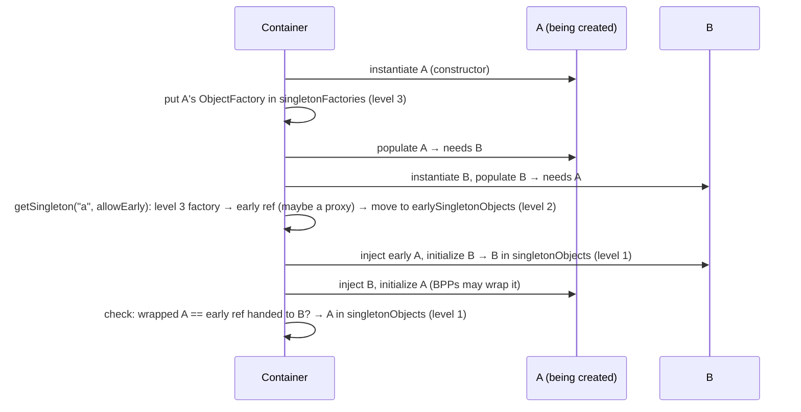

# 4.2 Circular References & the Three Singleton Caches, Early Proxies, and Startup Optimization (Spring AOT, JDK AOT Cache, Lazy Init)

> **Verified stack:** Spring Framework **7.0.10**, Spring Boot **4.1.2**, Temurin **25.0.4.1** (JEP 483/514/515 AOT cache). The singleton-cache contents were read from the running `DefaultSingletonBeanRegistry` via reflection. Startup timings are one measured run (5 samples each, median) on a laptop.

---

## 0. First principles: object construction needs a DAG 🔥

To construct `A` you need its dependencies first. If `A → B → A`, a pure constructor-based world has no valid order. The only way out is to **hand someone a reference to an object that isn't finished yet**: construct `A`, publish a reference to the half-initialized `A`, build `B` with it, then finish `A`. Spring can do that only when at least one side of the cycle is injected **after construction** (field or setter injection). That "early reference" is what the three-level cache exists for, and it's also why cycles are dangerous: someone holds an object before its `@PostConstruct` ran and before its proxy existed.

---

## 1. The three singleton caches (verified) 🧊

`DefaultSingletonBeanRegistry` keeps three maps:

| Level | Map | Contents |
|---|---|---|
| 1 | `singletonObjects` | Fully initialized singletons (possibly proxies) |
| 2 | `earlySingletonObjects` | Early references already **handed out** to someone in a cycle |
| 3 | `singletonFactories` | `ObjectFactory` lambdas registered right after instantiation: "if anyone needs me early, call this" (it calls `getEarlyBeanReference`, which lets AOP return an early proxy) |



The lab peeks at the caches **at the moment A is injected into B**:

```java
public static class B {
    A a;
    @Autowired void setA(A a) {
        this.a = a;
        System.out.println("  while injecting A into B, A is in: " + caches("a"));
    }
}
```

**Output (verified, with `spring.main.allow-circular-references=true`):**

```text
== Field-injection cycle, spring.main.allow-circular-references=true
  while injecting A into B, A is in: singletonObjects=false, earlySingletonObjects=true, singletonFactories=false
  started OK
```

Exactly the diagram: A isn't finished (not in level 1). Its factory was consumed, and the early reference now sits in level 2.

---

## 2. What Boot does with cycles (verified) 🔥

Spring Boot (since 2.6) sets `allow-circular-references=false`, so cycles fail fast:

**Output (verified):**

```text
== Field-injection cycle, Boot defaults
  FAILED: UnsatisfiedDependencyException -> root BeanCurrentlyInCreationException: Error creating bean with name 'a': Requested bean is currently in creation: Is there an unresolvable circular reference or an asynchronous initialization dependency?
== Field-injection cycle, spring.main.allow-circular-references=true
  ...
  started OK
== Constructor cycle, allow-circular-references=true
  FAILED: UnsatisfiedDependencyException -> root BeanCurrentlyInCreationException: Error creating bean with name 'c': Requested bean is currently in creation: Is there an unresolvable circular reference or an asynchronous initialization dependency?
```

* **Constructor cycles can never work**, with or without the flag: there's no point at which a reference to `C` exists before `D` is needed.
* The error message now also mentions **"asynchronous initialization dependency"**: Spring 6.2+ can initialize beans in the background (`@Bean(bootstrap = Bootstrap.BACKGROUND)`), and a bean waiting on one still being built in the background fails the same way.
* With logging on, Boot's failure analyzer prints the cycle (verified):

```text
APPLICATION FAILED TO START
***************************

Description:

The dependencies of some of the beans in the application context form a cycle:

┌─────┐
|  a (field p4.CircularLab$B p4.CircularLab$A.b)
↑     ↓
|  b
└─────┘
```

---

## 3. Early references and proxies: the subtle part 🧊

If `A` will be **proxied** (`@Transactional`, `@Async`, `@Cacheable`…), the early reference handed to `B` must be **the proxy**, or `B` ends up calling the raw object and silently bypasses transactions and async. Post-processors that implement `SmartInstantiationAwareBeanPostProcessor.getEarlyBeanReference` (the AOP auto-proxy creator does) can produce the proxy early.

Older Spring versions famously failed when one of them couldn't:

```text
Bean with name 'a' has been injected into other beans [b] in its raw version as part of a circular reference,
but has eventually been wrapped. This means that said other beans do not use the final version of the bean.
```

The classic trigger was `@Async` on a bean in a cycle. On **Spring Framework 7.0.10** I verified that `@Async` now cooperates with early references:

```java
public static class AsyncA {
    @Autowired AsyncB b;
    @Async public void work() { System.out.println("  AsyncA.work() ran on thread: " + Thread.currentThread().getName()); }
}
public static class AsyncB { @Autowired AsyncA a; public AsyncA getA() { return a; } }
```

**Output (verified):**

```text
== Field cycle where A has @Async, allow-circular-references=true
  started OK
  AsyncB.a is an AOP proxy? true; context's AsyncA is an AOP proxy? true
  AsyncA.work() ran on thread: SimpleAsyncTaskExecutor-1
```

`B` received the **proxy**, and the call ran asynchronously. Two side lessons from the same output:

* Without Boot's auto-configured executor (this config used plain `@EnableAsync`), `@Async` falls back to `SimpleAsyncTaskExecutor`, which creates a **new thread per call** with no bound. With Boot, `@Async` uses the auto-configured `ThreadPoolTaskExecutor` (`task-N` threads), or virtual threads when `spring.threads.virtual.enabled=true` ([4.4](04-Web-Concurrency-Tomcat-Virtual-Threads-WebFlux.md)).
* Don't conclude "cycles are safe now". Each proxying post-processor must support early references, and custom `BeanPostProcessor`s that wrap beans usually don't.

### The `@Lazy` fix, and the proxy-field trap again (verified)

```java
public static class LazyA { @Autowired @Lazy LazyB b; public LazyB getB() { return b; } @Async public void work() { } }
public static class LazyB { @Autowired LazyA a; }
```

```text
== Same, with @Lazy on the injection point
  started OK
  ctx.getBean(LazyA) is an AOP proxy? true; its field b = null
  bean.getB() -> CircularLab$LazyB$$SpringCGLIB$$0 (lazy-resolution proxy)
```

`@Lazy` injects a **lazy-resolution proxy** for `LazyB`, so no early reference is needed: the cycle is broken at creation time and resolved on first use. Note `its field b = null`: `ctx.getBean(LazyA)` returned the `@Async` **proxy** (a CGLIB subclass), and **fields read directly on a proxy are never populated**. Only method calls reach the target. This is the same trap as Hibernate's lazy proxies ([3.1 §3](../03-JPA-Hibernate-Spring-Data/01-Persistence-Context-Entity-States-Dirty-Checking.md)).

---

## 4. Breaking cycles properly ⚡

A cycle almost always means **two responsibilities tangled in two classes**:

| Technique | When |
|---|---|
| **Extract the shared logic** into a third bean both depend on | Most cycles (`OrderService ↔ CustomerService` → both use `PricingService`) |
| **Domain events** (`ApplicationEventPublisher`, `@TransactionalEventListener`) | One side only needs to *notify* the other |
| `ObjectProvider<T>` / `@Lazy` at the injection point | Pragmatic, local fix; documents the deferred dependency |
| Pass the collaborator as a **method parameter** | The dependency is per call, not structural |
| Spring Modulith / ArchUnit cycle rules | Prevent cycles between *modules* ([5.1](../05-Microservices-Patterns/01-Decomposition-Modular-Monolith-Strangler-Branch-by-Abstraction.md)) |

Prefer **constructor injection** everywhere: it makes cycles fail immediately and loudly, makes dependencies explicit, and allows `final` fields.

---

## 5. Startup optimization: what each technique attacks (verified) 🔥

Startup time is spent on: JVM boot and class loading/linking, **configuration processing** (parsing configuration classes, evaluating conditions, creating bean definitions: 700 ms each in [4.1 §4](01-IoC-Container-Startup-BeanDefinition-PostProcessors.md)'s startup trace), bean instantiation, and cold (interpreted) code.

| Technique | What it removes | Trade-off |
|---|---|---|
| **Spring AOT** (`process-aot` at build time, `-Dspring.aot.enabled=true` at runtime) | Configuration-class parsing and condition evaluation: replaced by **generated code** that registers bean definitions directly | The bean graph is fixed at build time: `@Profile`/`@ConditionalOnProperty` decisions are frozen; runtime changes need a rebuild |
| **JDK AOT cache** (JDK 24+ JEP 483; JDK 25 JEPs 514/515) | Class loading, verification, linking and early profiling, from a **training run** | Same JDK build and same classpath required; a cache file of ~60 MB |
| **GraalVM native image** | Almost everything (closed-world compilation) | Long builds, reflection configuration, no JIT peak performance by default, different debugging/profiling |
| `spring.main.lazy-initialization=true` | Instantiating beans until first use | Moves latency and **failures** to the first request; hides misconfiguration until production traffic |
| CRaC (Coordinated Restore at Checkpoint, Linux) | Everything: restores a warmed-up process image | Linux-only, needs checkpoint-safe resources (connections reopened) |

### 5.1 Verified: Spring AOT on the JVM, alone and combined with the AOT cache

The [1.4 blueprint](../01-Build-Systems/04-Enterprise-Builds-OCI-Images-Annotation-Processors-Enforcer.md) service with the Boot plugin's `process-aot` goal added:

```xml
<plugin>
  <groupId>org.springframework.boot</groupId>
  <artifactId>spring-boot-maven-plugin</artifactId>
  <executions>
    <execution>
      <id>process-aot</id>
      <goals><goal>process-aot</goal></goals>     <!-- generates __BeanDefinitions classes at build time -->
    </execution>
    <execution>
      <goals><goal>repackage</goal></goals>
    </execution>
  </executions>
</plugin>
```

The jar now contains **117** generated classes such as:

```text
BOOT-INF/classes/com/acme/order/service/OrderServiceApplication__BeanDefinitions.class
BOOT-INF/classes/org/springframework/aop/framework/ProxyConfig__BeanDefinitions.class
BOOT-INF/classes/org/springframework/aop/framework/autoproxy/InfrastructureAdvisorAutoProxyCreator__BeanDefinitions.class
```

Separate AOT-cache training runs were made for the non-AOT and AOT modes (the cache must match the classes actually loaded). Process start → context refreshed → exit:

**One measured run (5 samples each):**

```text
plain JVM                           median=1.85s runs=[1.85, 1.88, 1.84, 1.87, 1.85]
Spring AOT (spring.aot.enabled)     median=1.52s runs=[1.51, 1.5, 1.58, 1.52, 1.54]
JDK AOT cache                       median=1.03s runs=[1.0, 1.0, 1.04, 1.03, 1.03]
Spring AOT + JDK AOT cache          median=0.77s runs=[0.77, 0.76, 0.8, 0.77, 0.79]
```

| Mode | Startup | vs plain |
|---|---|---|
| Plain | 1.85 s | — |
| Spring AOT | 1.52 s | −18% |
| JDK AOT cache | 1.03 s | −44% |
| **Both** | **0.77 s** | **−58%** |

They attack **different** costs (Spring's configuration processing vs the JVM's class loading and linking), so they compose. For a service that autoscales or does frequent rolling deploys, that's the difference between a 30 s and a 13 s `startupProbe` budget at production size. The Dockerfile that builds the cache in the image is in [7.5](../07-Docker-JVM-Kubernetes/05-Production-Blueprints-application-yml-Dockerfile-Deployment.md).

---

## 6. ❌ Naïve vs ✅ production-hardened

| ❌ Naïve | ✅ Hardened |
|---|---|
| `spring.main.allow-circular-references=true` to make startup work | Break the cycle (extract, events, `ObjectProvider`/`@Lazy`) |
| Field injection everywhere | Constructor injection: cycles fail loudly, dependencies are visible |
| Assume `@Async`/`@Transactional` work on beans in a cycle | Verify the injected reference is a proxy (`AopUtils.isAopProxy`), or avoid the cycle |
| `@EnableAsync` without an executor | Boot's auto-configured executor (bounded) or virtual threads |
| `spring.main.lazy-initialization=true` in production for startup speed | Spring AOT + JDK AOT cache (−58% here) without deferring failures to the first request |
| Native image as the default answer to startup | Measure the JVM options first. Choose native for scale-to-zero/CLI, accepting its trade-offs |

---

## 7. Source to read

| Repo | Path | What to look for |
|---|---|---|
| [spring-projects/spring-framework](https://github.com/spring-projects/spring-framework) | `spring-beans/src/main/java/org/springframework/beans/factory/support/DefaultSingletonBeanRegistry.java` | The three maps, `getSingleton(beanName, allowEarlyReference)` |
| spring-projects/spring-framework | `spring-beans/src/main/java/org/springframework/beans/factory/support/AbstractAutowireCapableBeanFactory.java` | `doCreateBean`: `addSingletonFactory`, the "raw version … eventually been wrapped" check |
| spring-projects/spring-framework | `spring-aop/src/main/java/org/springframework/aop/framework/autoproxy/AbstractAutoProxyCreator.java` | `getEarlyBeanReference` and `earlyBeanReferences` |
| spring-projects/spring-framework | `spring-context/src/main/java/org/springframework/context/aot/` | AOT processing of the application context |
| [openjdk/jdk](https://github.com/openjdk/jdk) | JEP 483 / 514 / 515 pages on openjdk.org | How the AOT cache records and replays class loading, linking and profiles |

---

## 8. Interview soundbites

* "Spring resolves field-injection cycles by handing out an early reference from the third-level cache. I caught A sitting in `earlySingletonObjects` while it was being injected into B."
* "Constructor cycles can't work, and Boot rejects all cycles by default since 2.6."
* "The early reference must be the proxy, or the other bean silently bypasses `@Transactional`/`@Async`. Spring 7 handled `@Async` correctly in my test, but I'd still break the cycle."
* "Spring AOT removes configuration processing; the JDK AOT cache removes class loading and linking. Together: 1.85 s to 0.77 s."

---

## 9. Deep dive: Spring AOT freezes conditions, and the proxy-field trap in production (verified) 🔥

### 9.1 What "the bean graph is fixed at build time" means in practice (verified)

§5 states that AOT freezes `@Profile` and `@ConditionalOnProperty` decisions. Here it is proven with a minimal Boot 4.1.2 app built with the `process-aot` goal:

```java
@Bean
@ConditionalOnBooleanProperty("feature.audit.enabled")             // absent (false) when the build ran
AuditTrail auditTrail() { return new AuditTrail(); }

@Bean
@Profile("eu")                                                      // no profile active when the build ran
EuDataResidency euDataResidency() { return new EuDataResidency(); }
```

**Output (verified, the same jar three times):**

```text
== java  -jar app.jar --feature.audit.enabled=true --spring.profiles.active=eu
RESULT aot=false feature.audit.enabled=true activeProfiles=eu | auditTrail bean=true euDataResidency bean=true
== java -Dspring.aot.enabled=true -jar app.jar --feature.audit.enabled=true --spring.profiles.active=eu
RESULT aot=true feature.audit.enabled=true activeProfiles=eu | auditTrail bean=false euDataResidency bean=false
== java -Dspring.aot.enabled=true -jar app.jar
RESULT aot=true feature.audit.enabled=null activeProfiles= | auditTrail bean=false euDataResidency bean=false
```

In AOT mode the **environment says** the flag is `true` and the `eu` profile is active, yet **neither bean exists**, and nothing warns. The generated `AotApp__BeanFactoryRegistrations.registerBeanDefinitions` hard-codes 46 `registerBeanDefinition(...)` calls and mentions neither bean: phase one of [4.1 §1](01-IoC-Container-Startup-BeanDefinition-PostProcessors.md#1-the-full-lifecycle-verified-) happened during the build, with the build's environment.

**What to do instead:**

* **Feature flags** become runtime decisions *inside* an always-present bean (`if (props.auditEnabled())`), or a flag service, not `@Conditional…` on the bean.
* **Per-environment bean graphs** mean building the AOT artifacts with that profile active (`process-aot` with the profile and properties set), producing one image per graph.
* **Every `@Conditional` that reads the environment** gets the same scrutiny in a code review before enabling AOT or native images, along with a startup test that runs in AOT mode.

### 9.2 The proxy-field trap, met again in a production-shaped system (verified)

§3 showed that a field read through a CGLIB proxy returns the proxy's own uninitialized field. The [5.10](../05-Microservices-Patterns/10-Reference-Implementation-Saga-Orchestrator-Kafka-Outbox-Inbox-CQRS.md) saga lab hit it unintentionally, on its second run:

```text
Exception in thread "main" java.lang.NullPointerException: Cannot invoke "java.util.concurrent.atomic.AtomicInteger.get()" because "this.saga.duplicatesIgnored" is null
```

`SagaOrchestrator` is `@Transactional`, so the injected `saga` is a CGLIB subclass instance created via Objenesis, **without running the constructor**. `public final AtomicInteger duplicatesIgnored = new AtomicInteger()` exists only on the *target* object. Methods are intercepted and delegated to the target; fields are not. The fix was an accessor method. Never expose state as public fields on a Spring bean: any later `@Transactional`, `@Async` or `@Retryable` turns it into a proxy and the field silently reads `null`.

---

## Summary

| Topic | Key point | Evidence |
|---|---|---|
| Three singleton caches | Field-injection cycles resolve through an early reference (third-level cache) | §1: A caught in `earlySingletonObjects` |
| Boot and cycles | Rejected by default since Boot 2.6; constructor cycles can never work | §2 |
| Early references and proxies | The early reference must be the proxy, or callers bypass `@Transactional`/`@Async` | §3 |
| Breaking cycles | Redesign (events, extracted service); `@Lazy` as a last resort | §4 |
| Startup | Spring AOT + JDK AOT cache: 1.85 s → 0.77 s | §5.1 |
| AOT trade-off | Conditions and profiles frozen at build; the runtime environment is ignored silently | §9.1: flag `true`, profile `eu`, beans absent |
| Proxy fields | Fields read through a proxy are `null`; use methods | §3, §9.2 (saga lab NPE) |

**Next:** [4.3 AOP proxies: JDK vs CGLIB, self-invocation, ordering →](03-AOP-Proxies-JDK-vs-CGLIB-Self-Invocation-Ordering.md)
