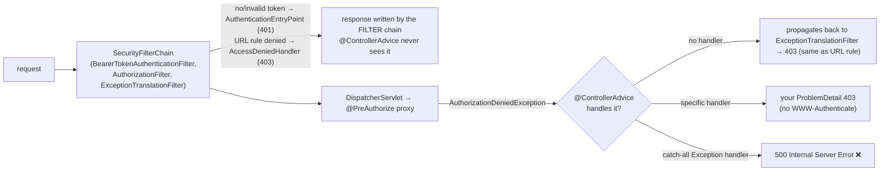

# 4.5 Spring Security Internals: `DelegatingFilterProxy` → `FilterChainProxy` → `SecurityFilterChain`, Stateless JWT, Method Security, and a Rate-Limiting Filter

> **Verified stack:** Spring Security **7.1.2**, Spring Boot **4.1.2**, Nimbus JOSE + JWT (via `spring-security-oauth2-jose`), Temurin **25**. An RSA key pair is generated at startup; tokens are minted in the same JVM and sent over real HTTP to the running server.
>
> **Go deeper:** the sibling kit's [8.3 security](../../Java-Backend-Master-Reference/08-Observability-Security-Testing/03-Security-Spring-Security-OAuth2-JWT-mTLS-OWASP.md) (mTLS, OWASP Top 10:2025, password storage).

---

## 0. First principles: security as a filter pipeline 🔥

Every HTTP request passes through the **servlet filter chain** before reaching `DispatcherServlet`. Spring Security plugs into it at one point and runs its own ordered list of filters, each with one job:

```text
Servlet container filters
  └─ DelegatingFilterProxy("springSecurityFilterChain")        ← registered with Tomcat; looks up a Spring bean lazily
       └─ FilterChainProxy                                     ← the Spring bean; picks the FIRST matching chain
            ├─ SecurityFilterChain #1  (securityMatcher "/api/**")   → its filters, in order
            ├─ SecurityFilterChain #2  (securityMatcher "/actuator/**")
            └─ SecurityFilterChain #N  (any request)
  └─ DispatcherServlet → controller
```

* `DelegatingFilterProxy` exists because the servlet container creates filters **before** the Spring context is ready. It's a tiny bridge that delegates to a bean.
* `FilterChainProxy` evaluates each `SecurityFilterChain`'s matcher **in order** and runs only the **first** match. Chain order is a security decision: a broad chain placed first shadows the specific ones after it.
* Authentication writes an `Authentication` into the `SecurityContextHolder` (a `ThreadLocal` by default, which works with virtual threads too because each request has its own). Authorization (`AuthorizationFilter`, method security) reads it.

---

## 1. The real filter list (verified) 🔥

```java
@Bean
SecurityFilterChain api(HttpSecurity http, RateLimitFilter rateLimit) throws Exception {
    http.securityMatcher("/api/**")
        .authorizeHttpRequests(a -> a.anyRequest().authenticated())
        .oauth2ResourceServer(o -> o.jwt(j -> { }))
        .sessionManagement(s -> s.sessionCreationPolicy(SessionCreationPolicy.STATELESS))
        .csrf(c -> c.disable())                                    // stateless bearer-token API: no cookies, no CSRF
        .addFilterAfter(rateLimit, BearerTokenAuthenticationFilter.class);
    return http.build();
}
```

Printing `FilterChainProxy.getFilterChains()`:

**Output (verified, Spring Security 7.1.2):**

```text
== SecurityFilterChain for /api/** (Spring Security 7.1.2)
  DisableEncodeUrlFilter
  WebAsyncManagerIntegrationFilter
  SecurityContextHolderFilter
  HeaderWriterFilter
  LogoutFilter
  OAuth2ProtectedResourceMetadataFilter
  BearerTokenAuthenticationFilter
  RateLimitFilter
  RequestCacheAwareFilter
  SecurityContextHolderAwareRequestFilter
  AnonymousAuthenticationFilter
  SessionManagementFilter
  ExceptionTranslationFilter
  AuthorizationFilter
```

| Filter | Job |
|---|---|
| `DisableEncodeUrlFilter` | Stops session ids leaking into URLs |
| `WebAsyncManagerIntegrationFilter` | Propagates the security context into async (`Callable`/`DeferredResult`) processing |
| `SecurityContextHolderFilter` | Loads the context at the start (from the session for stateful apps) and clears it at the end |
| `HeaderWriterFilter` | Security headers: `X-Content-Type-Options`, `Cache-Control`, `X-Frame-Options`, HSTS on HTTPS… |
| `LogoutFilter` | Handles the logout URL |
| `OAuth2ProtectedResourceMetadataFilter` | **New in Spring Security 7**: serves `/.well-known/oauth-protected-resource` (RFC 9728 protected-resource metadata) |
| `BearerTokenAuthenticationFilter` | Extracts `Authorization: Bearer …`, authenticates it via the `AuthenticationManager` → `JwtAuthenticationProvider` |
| `RateLimitFilter` | **Ours**, placed right after authentication so it can key on the user (§4) |
| `AnonymousAuthenticationFilter` | Puts an anonymous token in the context if nobody authenticated |
| `ExceptionTranslationFilter` | Turns `AuthenticationException` into 401 (entry point) and `AccessDeniedException` into 403 |
| `AuthorizationFilter` | Evaluates `authorizeHttpRequests` rules (last, so everything above has run) |

---

## 2. Stateless JWT validation (verified) 🔥

```java
@Bean RSAKey rsaKey() throws Exception { return new RSAKeyGenerator(2048).keyID("k1").generate(); }

@Bean JwtDecoder jwtDecoder(RSAKey key) throws Exception { return NimbusJwtDecoder.withPublicKey(key.toRSAPublicKey()).build(); }

static String token(RSAKey key, String subject, String scope, boolean tamper) throws Exception {
    var claims = new JWTClaimsSet.Builder().subject(subject).issuer("https://idp.example")
            .issueTime(Date.from(Instant.now())).expirationTime(Date.from(Instant.now().plusSeconds(300)))
            .claim("scope", scope).build();
    var jwt = new SignedJWT(new JWSHeader.Builder(JWSAlgorithm.RS256).keyID(key.getKeyID()).build(), claims);
    jwt.sign(new RSASSASigner(key));
    String s = jwt.serialize();
    return tamper ? s.substring(0, s.length() - 4) + "AAAA" : s;
}
```

```java
@RestController
public static class Api {
    @GetMapping("/api/orders") String orders() { return "orders for " + SecurityContextHolder.getContext().getAuthentication().getName(); }
    @PreAuthorize("hasAuthority('SCOPE_orders:admin')")
    @DeleteMapping("/api/orders/{id}") String cancel(@PathVariable long id) { return "cancelled " + id; }
}
```

**Output (verified):**

```text
== Requests
  no token                      -> 401 WWW-Authenticate: Bearer resource_metadata="http://localhost:18081/.well-known/oauth-protected-resource"
  tampered signature            -> 401 WWW-Authenticate: Bearer error="invalid_token", error_description="An error occurred while attempting to decode the Jwt: Signed JWT rejected: Invalid signature", error_uri="https://tools.ietf.org/html/rfc6750#section-3.1", resource_metadata="http://localhost:18081/.well-known/oauth-protected-resource"
  valid, scope orders:read      -> 200 orders for alice
  DELETE with orders:read       -> 403 WWW-Authenticate: Bearer error="insufficient_scope", error_description="The request requires higher privileges than provided by the access token.", error_uri="https://tools.ietf.org/html/rfc6750#section-3.1"
  DELETE with orders:admin      -> 200 cancelled 7
```

What happened inside, step by step:

1. `BearerTokenAuthenticationFilter` extracted the token. No token → the request continued anonymously, and `AuthorizationFilter` → `ExceptionTranslationFilter` → the bearer entry point returned **401** with `WWW-Authenticate: Bearer` (RFC 6750) plus Spring Security 7's `resource_metadata` pointer.
2. `JwtAuthenticationProvider` → `JwtDecoder` verified the **RS256 signature** with the public key (tampered → `invalid_token`), then ran the validators (`exp`/`nbf` with 60 s clock skew by default).
3. `JwtAuthenticationConverter` turned the `scope` claim (`"orders:read orders:admin"`) into authorities `SCOPE_orders:read`, `SCOPE_orders:admin`.
4. `@PreAuthorize` checked `SCOPE_orders:admin` and denied → **403 `insufficient_scope`**.

**The server never called the identity provider.** That's the point of JWTs (self-contained, signature-verifiable) and their main weakness (no revocation before `exp`).

### Production JWT checklist

| Concern | Do |
|---|---|
| Key distribution and rotation | `spring.security.oauth2.resourceserver.jwt.issuer-uri` (or `jwk-set-uri`): the decoder fetches and caches the **JWKS** and selects the key by `kid`, so rotation needs no redeploy |
| Issuer | Validate `iss` (`JwtValidators.createDefaultWithIssuer(...)`, automatic with `issuer-uri`) |
| Audience | Validate `aud` (`spring.security.oauth2.resourceserver.jwt.audiences`): stops a token minted for service A being replayed at service B |
| Algorithm | Asymmetric (RS256/ES256). **Never** accept `alg=none`; avoid HS256 secrets shared across services |
| Lifetime and revocation | Short-lived access tokens (5–15 min) + refresh tokens; for instant revocation use opaque tokens with introspection (a network call per request, cached) or a deny-list |
| Statelessness | `STATELESS` session policy; CSRF protection can be disabled **only** because no cookies carry credentials |
| Logging | Never log the `Authorization` header or the token |

---

## 3. Method security ⚡

`@EnableMethodSecurity` (Spring Security 6+, replacing `@EnableGlobalMethodSecurity`) registers `AuthorizationManagerBeforeMethodInterceptor`/`AfterMethodInterceptor`s. **It's AOP**, so every proxy rule from [4.3](03-AOP-Proxies-JDK-vs-CGLIB-Self-Invocation-Ordering.md) applies: `@PreAuthorize` on a method called via `this` isn't checked, nor on `private` or `final` methods. Security that silently doesn't apply is worse than a transaction that silently doesn't apply. Enforce coarse rules at the URL level (`authorizeHttpRequests`) and fine-grained rules with method security on **public methods of separate beans**, and test both with `@WithMockUser`/`jwt()` request post-processors.

---

## 4. A rate-limiting filter (verified) ⚡

A token bucket per authenticated subject, placed **after** `BearerTokenAuthenticationFilter` so the key is the user, not the IP:

```java
/** Token bucket per authenticated subject: capacity 5, refill 5 tokens/second. */
public static class RateLimitFilter extends OncePerRequestFilter {
    static final AtomicInteger invocations = new AtomicInteger();
    record Bucket(double tokens, long lastNanos) {}
    final Map<String, Bucket> buckets = new ConcurrentHashMap<>();
    final double capacity = 5, refillPerSec = 5;

    @Override
    protected void doFilterInternal(HttpServletRequest req, HttpServletResponse res, FilterChain chain) throws ServletException, IOException {
        invocations.incrementAndGet();
        var auth = SecurityContextHolder.getContext().getAuthentication();
        String key = auth != null && auth.isAuthenticated() ? auth.getName() : req.getRemoteAddr();
        long now = System.nanoTime();
        boolean[] allowed = new boolean[1];
        buckets.compute(key, (k, b) -> {                      // atomic per key
            double tokens = b == null ? capacity : Math.min(capacity, b.tokens() + (now - b.lastNanos()) / 1e9 * refillPerSec);
            allowed[0] = tokens >= 1;
            return new Bucket(allowed[0] ? tokens - 1 : tokens, now);
        });
        if (!allowed[0]) {
            res.setStatus(429);
            res.setHeader("Retry-After", "1");
            res.getWriter().write("rate limit exceeded for " + key);
            return;
        }
        chain.doFilter(req, res);
    }
}
```

**Output (verified, 8 back-to-back requests as `carol`):**

```text
== 8 rapid requests as 'carol' (bucket: 5, refill 5/s)
  status codes: [200, 200, 200, 200, 200, 429, 429, 429]   filter invocations: 8
  9th response: 429 rate limit exceeded for carol
```

Five tokens of burst, then **429 + `Retry-After`**. The token-bucket algorithm itself (and Resilience4j's `RateLimiter`, which works differently) is covered in [6.2](../06-Resilience-Caching-Kafka/02-Bulkheads-Rate-Limiters-Retries-Jitter-Decorator-Order.md).

### The "filter is also a `@Bean`" trap (verified, and why it didn't bite here)

Spring Boot **automatically registers every `Filter` bean with the servlet container**, in addition to wherever you put it in the security chain. The lab disables that with a `FilterRegistrationBean`:

```java
@Bean
FilterRegistrationBean<RateLimitFilter> doNotAlsoRegisterInServletContainer(RateLimitFilter f) {
    var reg = new FilterRegistrationBean<>(f);
    reg.setEnabled(Boolean.getBoolean("registerTwice"));     // a Filter @Bean is auto-registered by Boot unless disabled
    return reg;
}
```

With the double registration **enabled**, the result was identical (`filter invocations: 8`, keyed by `carol`) for two reasons: `OncePerRequestFilter` marks the request with an attribute and skips its second invocation, and a default `FilterRegistrationBean` runs **after** Spring Security's chain (order −100), so the authenticated invocation came first. Change either fact (a plain `Filter`, or an explicit high-precedence order) and the filter runs twice per request, consuming two tokens, or runs first with no `Authentication` and keys every user by IP. Keep security filters out of the servlet chain explicitly.

### Single instance vs a fleet

This bucket lives in **one JVM's memory**. With 10 pods behind a load balancer, each user effectively gets 10× the limit, and limits reset on deploy. For real quotas, enforce at the **gateway** or use a shared store (Redis with an atomic Lua script, or Bucket4j's distributed backends), keyed by tenant/user/API key. Keep an in-process limiter as a cheap per-instance **load-shedding** guard.

---

## 5. Multiple chains: order is policy 🔥

```java
@Bean @Order(1) SecurityFilterChain actuator(HttpSecurity http) throws Exception {
    http.securityMatcher(EndpointRequest.toAnyEndpoint())
        .authorizeHttpRequests(a -> a.requestMatchers(EndpointRequest.to("health")).permitAll()
                                     .anyRequest().hasRole("OPS"))
        .httpBasic(Customizer.withDefaults());
    return http.build();
}

@Bean @Order(2) SecurityFilterChain api(HttpSecurity http) throws Exception { /* /api/** JWT, as above */ }

@Bean @Order(3) SecurityFilterChain everythingElse(HttpSecurity http) throws Exception {
    http.authorizeHttpRequests(a -> a.anyRequest().denyAll());              // default deny
    return http.build();
}
```

*(Illustrative composition of the documented APIs; the verified lab used a single chain.)* Rules: specific matchers first, a **default-deny** chain last, and `/actuator/health` open for probes while everything else under `/actuator` stays protected.

---

## 6. ❌ Naïve vs ✅ production-hardened

| ❌ Naïve | ✅ Hardened |
|---|---|
| `csrf().disable()` on a cookie-session web app "because it broke a form" | CSRF disabled **only** for stateless bearer-token APIs |
| HS256 with one shared secret across services | RS256/ES256 + JWKS via `issuer-uri`; validate `iss` and `aud` |
| 24-hour access tokens | 5–15 min access tokens + refresh tokens; introspection or a deny-list where revocation matters |
| `@PreAuthorize` on a private method or a self-invoked call | Public methods on separate beans; tests that assert 403s |
| `anyRequest().permitAll()` as the last rule | Default deny |
| Rate limiting only in each pod's memory | Gateway or shared-store limits for quotas; local limiter for load shedding |
| A rate-limit `Filter` declared as a plain `@Bean` | Disable its servlet-container registration (`FilterRegistrationBean.setEnabled(false)`) |

---

## 7. Source to read

| Repo | Path | What to look for |
|---|---|---|
| [spring-projects/spring-security](https://github.com/spring-projects/spring-security) | `web/src/main/java/org/springframework/security/web/FilterChainProxy.java` | Chain selection, firewall, `VirtualFilterChain` |
| spring-projects/spring-security | `config/src/main/java/org/springframework/security/config/annotation/web/builders/FilterOrderRegistration.java` | The canonical filter order |
| spring-projects/spring-security | `oauth2/oauth2-resource-server/src/main/java/org/springframework/security/oauth2/server/resource/web/authentication/BearerTokenAuthenticationFilter.java` | Bearer extraction and authentication |
| spring-projects/spring-security | `oauth2/oauth2-jose/src/main/java/org/springframework/security/oauth2/jwt/NimbusJwtDecoder.java` | Signature verification, JWKS, validators |
| [spring-projects/spring-framework](https://github.com/spring-projects/spring-framework) | `spring-web/src/main/java/org/springframework/web/filter/DelegatingFilterProxy.java` | The servlet-to-bean bridge |
| spring-projects/spring-framework | `spring-web/src/main/java/org/springframework/web/filter/OncePerRequestFilter.java` | The "already filtered" request attribute |

---

## 8. Interview soundbites

* "Tomcat sees one filter, `DelegatingFilterProxy`. It delegates to `FilterChainProxy`, which runs the first `SecurityFilterChain` whose matcher matches. I printed all 14 filters of a JWT chain on Spring Security 7.1."
* "A JWT resource server verifies the signature and claims locally. No token gave 401, a tampered one `invalid_token`, a missing scope 403 `insufficient_scope`."
* "Method security is AOP, so it has the same proxy blind spots as `@Transactional`."
* "My rate limiter sits after bearer authentication so it keys on the user. In-memory limits multiply with pod count; quotas belong in the gateway or Redis."

---

## 9. Deep dive: who writes your 401 and 403, and why a catch-all handler turns 403 into 500 (verified) 🔥

The question behind many inconsistent APIs: **does a security denial go through my `@ControllerAdvice`?** The lab: a JWT resource server with two kinds of rules (Spring Security 7.1.2), run three times with different advice beans:

```java
.authorizeHttpRequests(a -> a.requestMatchers("/api/admin/**").hasAuthority("SCOPE_orders:admin")   // FILTER-level rule
                             .anyRequest().authenticated())

@PreAuthorize("hasAuthority('SCOPE_orders:admin')")                                                 // METHOD-level rule
@DeleteMapping("/api/orders/{id}") String cancel(@PathVariable long id) { ... }

// variant "specific":  @ExceptionHandler(AccessDeniedException.class) -> ProblemDetail 403
// variant "catchall":  @ExceptionHandler(Exception.class)             -> ProblemDetail 500
```

**Output (verified; challenge headers abbreviated as `...` after the first variant, where they were identical):**

```text
== @ControllerAdvice variant: none
  1 no token        GET    /api/orders       -> 401 - WWW-Authenticate: Bearer resource_metadata="http://localhost:18082/.well-known/oauth-protected-resource" (empty body)
  2 reader          GET    /api/admin/report -> 403 - WWW-Authenticate: Bearer error="insufficient_scope", error_description="The request requires higher privileges than provided by the access token.", error_uri="https://tools.ietf.org/html/rfc6750#section-3.1" (empty body)
  3 reader          DELETE /api/orders/7     -> 403 - WWW-Authenticate: Bearer error="insufficient_scope", error_description="The request requires higher privileges than provided by the access token.", error_uri="https://tools.ietf.org/html/rfc6750#section-3.1" (empty body)
== @ControllerAdvice variant: specific
  1 no token        GET    /api/orders       -> 401 - WWW-Authenticate: Bearer resource_metadata="..." (empty body)
  2 reader          GET    /api/admin/report -> 403 - WWW-Authenticate: Bearer error="insufficient_scope", ... (empty body)
  3 reader          DELETE /api/orders/7     -> 403 application/problem+json {"detail":"from @ControllerAdvice: AuthorizationDeniedException","instance":"/api/orders/7","status":403,"title":"Forbidden"}
== @ControllerAdvice variant: catchall
  1 no token        GET    /api/orders       -> 401 - WWW-Authenticate: Bearer resource_metadata="..." (empty body)
  2 reader          GET    /api/admin/report -> 403 - WWW-Authenticate: Bearer error="insufficient_scope", ... (empty body)
  3 reader          DELETE /api/orders/7     -> 500 application/problem+json {"detail":"catch-all handled AuthorizationDeniedException","instance":"/api/orders/7","status":500,"title":"Internal Server Error"}
```



**Reading it:**

* **Filter-level outcomes (rows 1–2) never reach Spring MVC.** They're written by `AuthenticationEntryPoint`/`AccessDeniedHandler`: empty body, RFC 6750 `WWW-Authenticate`. Spring Security 7 adds `resource_metadata` (the RFC 9728 OAuth protected-resource metadata URL) to the 401, so clients can discover the authorization server.
* **Method-security denials (row 3) are exceptions inside the dispatcher** (`AuthorizationDeniedException`, a subclass of `AccessDeniedException`).
  * With no advice, they propagate back out to `ExceptionTranslationFilter` and look identical to a URL-rule 403.
  * With a specific `@ExceptionHandler`, *your* body is used, but the `WWW-Authenticate` challenge disappears.
  * With a **catch-all `@ExceptionHandler(Exception.class)`, an authorization failure becomes a 500.** Error-rate alerts fire, clients retry a request that can never succeed, and the response lies about whose fault it is.

**Production rules:**

1. **One error contract for both paths.** Implement `AuthenticationEntryPoint` and `AccessDeniedHandler` that write `application/problem+json`. Delegate the challenge header to `BearerTokenAuthenticationEntryPoint`/`BearerTokenAccessDeniedHandler` so `WWW-Authenticate` survives.
2. **A catch-all handler must not swallow security exceptions.** Add a specific `AccessDeniedException` handler (most specific wins) that rethrows, or that maps to 403 *and* sets the challenge header. Test both rule types.
3. **Decide where each rule lives.** Coarse rules (authenticated, scopes per path) go in the filter chain: cheap and outside MVC. Domain rules ("owner of this order") go in method security or the service, where the data is.

---

## Summary

| Topic | Key point | Evidence |
|---|---|---|
| Filter pipeline | Tomcat sees `DelegatingFilterProxy` → `FilterChainProxy` → first matching `SecurityFilterChain` | §1: 14 filters on Security 7.1 |
| JWT validation | Local signature + claims check: 401, `invalid_token`, 403 `insufficient_scope` | §2 |
| Method security | AOP: same proxy blind spots as `@Transactional` | §3 |
| Rate limiting | After authentication (keys on the user); per-pod limits multiply | §4 |
| Chain order | First matching chain wins: order is policy | §5 |
| Error paths | Filter-level denials bypass `@ControllerAdvice`; method-level ones go through it | §9: three variants |
| Catch-all trap | `@ExceptionHandler(Exception.class)` turned a 403 into a 500 | §9 row 3 |
| Security 7 | 401 challenge carries `resource_metadata` (RFC 9728) | §9 row 1 |

**Next:** [4.6 Bar-raiser drill-downs →](06-Bar-Raiser-Drill-Downs.md)
