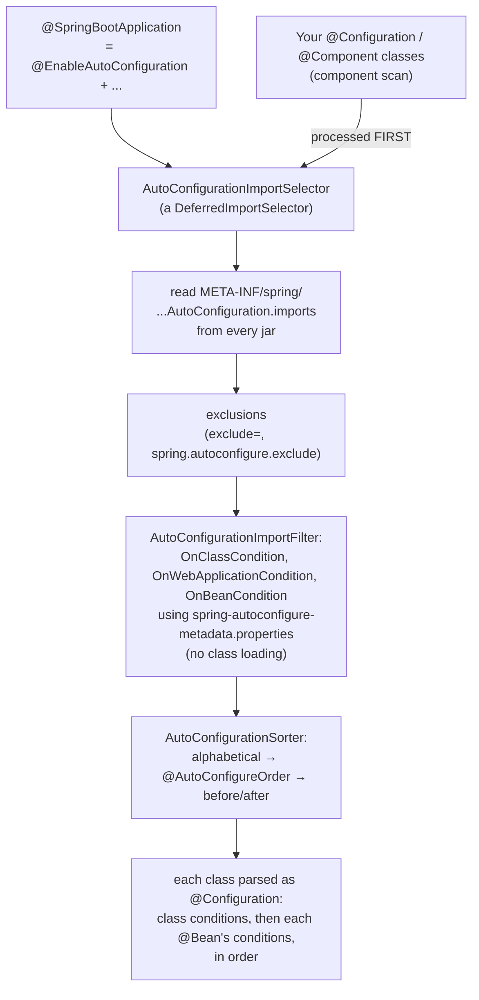

# 4.7 Auto-Configuration Internals and a Production Starter Blueprint: Conditions, Ordering, Metadata, Lifecycle, `ApplicationContextRunner`

> **Verified stack:** Spring Boot **4.1.2**, Spring Framework **7.0.10**, spring-kafka **4.1.2** (embedded KRaft), PostgreSQL **18.6**, JDK **25**, Maven 3.10 + maven-compiler-plugin 3.15. The lab builds a real two-module starter, `acme-outbox-spring-boot-starter`, which packages the outbox kernel from [5.10](../05-Microservices-Patterns/10-Reference-Implementation-Saga-Orchestrator-Kafka-Outbox-Inbox-CQRS.md) as a platform library. `mvn verify`: **8 tests, 0 failures**. Every output block is copied from that build.
>
> **Builds on:** [4.1 §4](01-IoC-Container-Startup-BeanDefinition-PostProcessors.md#4-what-boot-auto-configuration-actually-did-verified-) (what auto-configuration did in a real app: 314 evaluated, 162 matched) and [4.6 Drill 10](06-Bar-Raiser-Drill-Downs.md#drill-10-boot-keeps-using-its-own-bean-instead-of-ours-). **This file** is the producer side: how to *write* auto-configuration that behaves, and how to prove it does.

---

## 0. First principles: auto-configuration is deferred, filtered, sorted, conditional configuration 🔥



Four consequences explain almost every auto-configuration bug:

1. **Deferred:** your configuration is registered first, so `@ConditionalOnMissingBean` sees your beans and Boot's back off. The application always wins.
2. **The same fact, inverted:** an `@ConditionalOnBean` in *your* `@Configuration` runs before any auto-configured bean exists, so it never matches (verified, §5.3).
3. **Sorted by name first:** an auto-configuration without `after` can run before the one that creates the bean it checks for (verified, §5.2).
4. **Pre-filtered from metadata:** `OnClassCondition` is applied from a generated properties file before any class is loaded, which is why the annotation processor matters (verified, §3.2).

---

## 1. The starter blueprint 🔥

```text
acme-outbox-parent/
├── acme-outbox-spring-boot-autoconfigure/        ← ALL code lives here
│   ├── pom.xml                                   spring-boot-autoconfigure (required); spring-jdbc, spring-kafka (OPTIONAL);
│   │                                             configuration-processor + autoconfigure-processor (annotationProcessorPaths)
│   └── src/main/
│       ├── java/com/acme/outbox/
│       │   ├── OutboxWriter.java                 the API services use
│       │   ├── JdbcOutboxWriter.java
│       │   ├── OutboxRelay.java                  SmartLifecycle (phase DEFAULT_PHASE - 4096)
│       │   └── autoconfigure/
│       │       ├── OutboxAutoConfiguration.java
│       │       └── OutboxProperties.java         @ConfigurationProperties("acme.outbox") record
│       └── resources/META-INF/spring/
│           └── org.springframework.boot.autoconfigure.AutoConfiguration.imports   ← one line: the FQCN
└── acme-outbox-spring-boot-starter/              ← NO code: pom.xml only
    └── pom.xml                                   autoconfigure + spring-boot-starter-jdbc + spring-boot-starter-kafka
```

**Why two modules?**

* **The autoconfigure module** declares its integrations `optional`, so it can be used à la carte; conditions handle whatever is absent.
* **The starter** is the opinionated "one dependency and it works" bundle a service adds.

Naming convention: `acme-xyz-spring-boot-starter`. The `spring-boot-*` prefix is reserved for Spring's own starters.

```xml
<!-- acme-outbox-spring-boot-autoconfigure/pom.xml (excerpt) -->
<dependency><groupId>org.springframework.boot</groupId><artifactId>spring-boot-autoconfigure</artifactId></dependency>
<dependency><groupId>org.springframework</groupId><artifactId>spring-jdbc</artifactId><optional>true</optional></dependency>
<dependency><groupId>org.springframework.kafka</groupId><artifactId>spring-kafka</artifactId><optional>true</optional></dependency>
...
<plugin>
  <artifactId>maven-compiler-plugin</artifactId>
  <configuration>
    <!-- JDK 23+ no longer runs processors just because they are on the class path: declare them (verified §3.2) -->
    <annotationProcessorPaths>
      <path><groupId>org.springframework.boot</groupId><artifactId>spring-boot-configuration-processor</artifactId></path>
      <path><groupId>org.springframework.boot</groupId><artifactId>spring-boot-autoconfigure-processor</artifactId></path>
    </annotationProcessorPaths>
  </configuration>
</plugin>
```

---

## 2. The auto-configuration class, annotation by annotation 🔥

```java
@AutoConfiguration(afterName = {
        "org.springframework.boot.jdbc.autoconfigure.JdbcClientAutoConfiguration",
        "org.springframework.boot.jdbc.autoconfigure.DataSourceTransactionManagerAutoConfiguration",
        "org.springframework.boot.kafka.autoconfigure.KafkaAutoConfiguration"})
@ConditionalOnClass({JdbcClient.class, KafkaTemplate.class})
@ConditionalOnBooleanProperty(name = "acme.outbox.enabled", matchIfMissing = true)
@EnableConfigurationProperties(OutboxProperties.class)
public final class OutboxAutoConfiguration {

    @Bean
    @ConditionalOnMissingBean                                   // the application can replace it: it always wins
    @ConditionalOnBean(JdbcClient.class)
    OutboxWriter outboxWriter(JdbcClient jdbc, OutboxProperties props) {
        return new JdbcOutboxWriter(jdbc, props.table());
    }

    @Bean
    @ConditionalOnMissingBean
    @ConditionalOnBean({JdbcClient.class, KafkaTemplate.class, PlatformTransactionManager.class})
    @ConditionalOnBooleanProperty(name = "acme.outbox.relay.enabled", matchIfMissing = true)
    OutboxRelay outboxRelay(JdbcClient jdbc, KafkaTemplate<String, String> kafka, PlatformTransactionManager txManager, OutboxProperties props) {
        return new OutboxRelay(jdbc, kafka, new TransactionTemplate(txManager), props.table(), props.batchSize(), props.relay().pollInterval());
    }
}
```

| Element | Why |
|---|---|
| `@AutoConfiguration` | `@Configuration(proxyBeanMethods = false)` + ordering attributes; picked up **only** via the `.imports` file, never by component scan |
| `afterName = {...}` (strings) | Our `@ConditionalOnBean` checks need those beans to exist first. Names, not classes, mean no compile dependency on `spring-boot-jdbc`/`spring-boot-kafka` (Boot 4 moved them to per-technology modules: `org.springframework.boot.jdbc.autoconfigure`, `org.springframework.boot.kafka.autoconfigure`) |
| Class-level `@ConditionalOnClass` | Skip the whole class when a library is absent; evaluated from metadata **without loading** our class, so bean method signatures mentioning `KafkaTemplate` can't cause `NoClassDefFoundError` |
| `@ConditionalOnBooleanProperty(matchIfMissing = true)` | On by default, one switch to turn it off. Newer and clearer than `@ConditionalOnProperty(havingValue = "true")` |
| `@ConditionalOnMissingBean` on **every** bean | The back-off contract: a user bean of that type replaces ours |
| `@ConditionalOnBean` on beans that need others | A service without Kafka gets the writer but no relay |
| `final class`, package-private `@Bean` methods | Not an API; can't be subclassed or called |

---

## 3. Type-safe properties and generated metadata (verified) 🔥

### 3.1 The properties record: defaults, documentation, validation

```java
/**
 * Transactional outbox settings.
 *
 * @param enabled whether to auto-configure the outbox at all
 * @param table outbox table name, optionally schema-qualified; interpolated into SQL, so it is validated
 * @param batchSize rows claimed per relay transaction (1 to 1000)
 * @param relay background relay settings
 */
@ConfigurationProperties("acme.outbox")
public record OutboxProperties(
        @DefaultValue("true") boolean enabled,
        @DefaultValue("outbox") String table,
        @DefaultValue("100") int batchSize,
        @DefaultValue Relay relay) {

    public OutboxProperties {
        if (batchSize < 1 || batchSize > 1000)
            throw new IllegalArgumentException("acme.outbox.batch-size must be between 1 and 1000 but was " + batchSize);
        if (!table.matches("[a-z_][a-z0-9_]*(\\.[a-z_][a-z0-9_]*)?"))
            throw new IllegalArgumentException("acme.outbox.table must be a plain (schema.)identifier but was '" + table + "'");
    }

    /**
     * Relay settings.
     *
     * @param enabled whether this instance runs the background relay (turn off in write-only services)
     * @param pollInterval delay between polls when the outbox is empty
     */
    public record Relay(@DefaultValue("true") boolean enabled, @DefaultValue("100ms") Duration pollInterval) {}
}
```

The table name is **concatenated into SQL** (identifiers can't be bind parameters), so a configuration property becomes an injection vector. The compact constructor rejects anything that isn't a plain identifier, and **binding fails at startup**, not at the first query. Verified in §5.1 (5, 5b).

**Generated `META-INF/spring-configuration-metadata.json` (verified, excerpt):**

```json
{
  "name": "acme.outbox.batch-size",
  "type": "java.lang.Integer",
  "description": "rows claimed per relay transaction (1 to 1000)",
  "sourceType": "com.acme.outbox.autoconfigure.OutboxProperties",
  "defaultValue": 100
},
{
  "name": "acme.outbox.relay.poll-interval",
  "type": "java.time.Duration",
  "description": "delay between polls when the outbox is empty",
  "sourceType": "com.acme.outbox.autoconfigure.OutboxProperties$Relay",
  "defaultValue": "100ms"
}
```

The processor turned the **record's `@param` javadoc into descriptions** and **`@DefaultValue` into defaults**. This file is what IDE completion and validation of `application.yml` read. Add `META-INF/additional-spring-configuration-metadata.json` for value hints and **deprecations with a replacement key**, which is how you rename a property without breaking teams.

### 3.2 Two processors, and a JDK 23+ trap (verified) 🧊

**Generated `META-INF/spring-autoconfigure-metadata.properties` (verified):**

```properties
com.acme.outbox.autoconfigure.OutboxAutoConfiguration=
com.acme.outbox.autoconfigure.OutboxAutoConfiguration.AutoConfigureAfter=org.springframework.boot.jdbc.autoconfigure.JdbcClientAutoConfiguration,org.springframework.boot.jdbc.autoconfigure.DataSourceTransactionManagerAutoConfiguration,org.springframework.boot.kafka.autoconfigure.KafkaAutoConfiguration
com.acme.outbox.autoconfigure.OutboxAutoConfiguration.ConditionalOnClass=org.springframework.jdbc.core.simple.JdbcClient,org.springframework.kafka.core.KafkaTemplate
```

This is what lets `AutoConfigurationImportSelector` drop candidates **before loading their classes**. Boot's own jars ship the same file; for example, `spring-boot-jdbc-4.1.2.jar` contains `JdbcClientAutoConfiguration.ConditionalOnSingleCandidate=org.springframework.jdbc.core.namedparam.NamedParameterJdbcTemplate`. Without the file everything still works, just slower: each candidate class is loaded to read its annotations.

**The trap.** The same sources compiled with `javac` 25.0.4.1, processor jars on the class path:

```text
A (processors only on class path, no -proc):
B (-proc:full):
META-INF/spring-autoconfigure-metadata.properties
META-INF/spring-configuration-metadata.json
```

Build **A** generated **nothing**, silently. This is the same JDK change that broke Lombok + MapStruct in [1.4 §3](../01-Build-Systems/04-Enterprise-Builds-OCI-Images-Annotation-Processors-Enforcer.md#3-annotation-processors-the-jdk-23-trap-); for a starter, the symptom is quieter, because the code still compiles. Since JDK 23, `javac` doesn't run annotation processors discovered on the class path unless asked (`-proc:full`) or given an explicit processor path. A starter built that way ships without IDE metadata and without the pre-filter, and nothing fails. Declare the processors in `annotationProcessorPaths` (Maven) or the `annotationProcessor` configuration (Gradle), and **assert the files exist** in CI.

---

## 4. Lifecycle: the relay as a `SmartLifecycle` ⚡

```java
public class OutboxRelay implements SmartLifecycle {
    public static final int PHASE = SmartLifecycle.DEFAULT_PHASE - 4096;
    ...
    @Override public void start() { running = true; worker = Thread.ofVirtual().name("outbox-relay").start(this::loop); }

    @Override public void stop() {
        running = false;                                       // the loop finishes the batch in flight, then exits
        try { if (worker != null) worker.join(Duration.ofSeconds(30)); } catch (InterruptedException e) { Thread.currentThread().interrupt(); }
    }
    @Override public boolean isRunning() { return running; }
    @Override public int getPhase() { return PHASE; }
}
```

Why a `SmartLifecycle` and not `@PostConstruct` + `@Scheduled`:

* **It starts after the context is fully refreshed:** every bean exists, including proxies.
* **It stops in phase order on shutdown:** a lower phase starts earlier and **stops later**. The relay sits below the web server's graceful-shutdown phase, so in-flight requests (which write outbox rows) drain first, and the relay gets a last pass. [4.8](08-Request-Lifecycle-Events-Async-Graceful-Shutdown.md) measures the actual phase order.

Verified in §5.4: `relay running=true phase=2147479551` while the context is up, `relay running=false` after `close()`.

---

## 5. Testing auto-configuration with `ApplicationContextRunner` (verified) 🔥

`ApplicationContextRunner` builds a small, real `ApplicationContext` per test in milliseconds, with exactly the auto-configurations, beans, properties and class loader you specify. `AutoConfigurations.of(...)` **sorts like Boot does**, so ordering bugs reproduce.

```java
class OutboxAutoConfigurationTests {
    private final ApplicationContextRunner runner = new ApplicationContextRunner()
            .withConfiguration(AutoConfigurations.of(DataSourceAutoConfiguration.class, DataSourceTransactionManagerAutoConfiguration.class,
                    JdbcTemplateAutoConfiguration.class, JdbcClientAutoConfiguration.class, KafkaAutoConfiguration.class,
                    OutboxAutoConfiguration.class))
            .withPropertyValues("spring.datasource.url=jdbc:postgresql://localhost:55432/lab", "spring.datasource.username=postgres",
                    "acme.outbox.table=starter_outbox", "spring.kafka.bootstrap-servers=localhost:1");

    @Test void defaults() {
        runner.run(ctx -> assertThat(ctx).hasSingleBean(OutboxWriter.class).hasSingleBean(OutboxRelay.class));
    }
    @Test void applicationBeanWins() {
        runner.withBean("myWriter", OutboxWriter.class, () -> (topic, key, type, json) -> {})
              .run(ctx -> assertThat(ctx).hasSingleBean(OutboxWriter.class).hasBean("myWriter"));
    }
    @Test void switchedOff() {
        runner.withPropertyValues("acme.outbox.enabled=false").run(ctx -> assertThat(ctx).doesNotHaveBean(OutboxWriter.class));
    }
    @Test void kafkaNotOnClassPath() {
        runner.withClassLoader(new FilteredClassLoader(KafkaTemplate.class))
              .run(ctx -> assertThat(ctx).hasNotFailed().doesNotHaveBean(OutboxWriter.class));
    }
    @Test void invalidConfigurationFailsFast() {
        runner.withPropertyValues("acme.outbox.batch-size=0").run(ctx -> assertThat(ctx).hasFailed());
    }
}
```

The tests print the **condition evaluation report** entries for our classes (`ConditionEvaluationReport.get(ctx.getBeanFactory())`), the same data as `--debug` and `/actuator/conditions`.

### 5.1 Output: every condition, with Boot's own explanation (verified)

```text
== 1. Defaults: writer + relay, properties bound with defaults
    OutboxProperties[enabled=true, table=starter_outbox, batchSize=100, relay=Relay[enabled=true, pollInterval=PT0.1S]]
    relay running=true phase=2147479551
    OutboxAutoConfiguration -> MATCH    @ConditionalOnClass found required classes 'org.springframework.jdbc.core.simple.JdbcClient', 'org.springframework.kafka.core.KafkaTemplate'
    OutboxAutoConfiguration -> MATCH    @ConditionalOnBooleanProperty (acme.outbox.enabled=true) matched
    OutboxAutoConfiguration#outboxRelay -> MATCH    @ConditionalOnBooleanProperty (acme.outbox.relay.enabled=true) matched
    OutboxAutoConfiguration#outboxRelay -> MATCH    @ConditionalOnBean (types: org.springframework.jdbc.core.simple.JdbcClient,org.springframework.kafka.core.KafkaTemplate,org.springframework.transaction.PlatformTransactionManager; SearchStrategy: all) found beans 'kafkaTemplate', 'transactionManager', 'jdbcClient'; ...
    OutboxAutoConfiguration#outboxWriter -> MATCH    @ConditionalOnBean (types: org.springframework.jdbc.core.simple.JdbcClient; SearchStrategy: all) found bean 'jdbcClient'; @ConditionalOnMissingBean (types: com.acme.outbox.OutboxWriter; SearchStrategy: all) did not find any beans
== 2. The application defines its own OutboxWriter
    OutboxWriter beans: myWriter
    OutboxAutoConfiguration#outboxWriter -> NO MATCH @ConditionalOnMissingBean (types: com.acme.outbox.OutboxWriter; SearchStrategy: all) found beans of type 'com.acme.outbox.OutboxWriter' myWriter
== 3. acme.outbox.enabled=false
    OutboxAutoConfiguration -> MATCH    @ConditionalOnClass found required classes 'org.springframework.jdbc.core.simple.JdbcClient', 'org.springframework.kafka.core.KafkaTemplate'
    OutboxAutoConfiguration -> NO MATCH @ConditionalOnBooleanProperty (acme.outbox.enabled=true) found different value in property 'acme.outbox.enabled'
== 3b. acme.outbox.relay.enabled=false (write-only service)
    OutboxAutoConfiguration#outboxRelay -> NO MATCH @ConditionalOnBooleanProperty (acme.outbox.relay.enabled=true) found different value in property 'acme.outbox.relay.enabled'
== 4. spring-kafka missing from the class path
    OutboxAutoConfiguration -> NO MATCH @ConditionalOnClass did not find required class 'org.springframework.kafka.core.KafkaTemplate'
== 5. acme.outbox.batch-size=0
    startup failed: UnsatisfiedDependencyException
    root cause: IllegalArgumentException: acme.outbox.batch-size must be between 1 and 1000 but was 0
== 5b. acme.outbox.table=outbox; drop table users
    startup failed: UnsatisfiedDependencyException
    root cause: IllegalArgumentException: acme.outbox.table must be a plain (schema.)identifier but was 'outbox; drop table users'
```

**Reading it:**

* **(2) is the back-off contract in one line:** "found beans of type … myWriter".
* **(3) evaluation stops at the first failing class-level condition:** no bean-level entries appear.
* **(4) is the class-path guard:** the context starts fine without Kafka.
* **(5) fails at startup with the root cause intact.** The outer exception type depends on what triggered binding first. In an earlier build, before the `JdbcClient` fix below, it was `ConfigurationPropertiesBindException`. So assert on the **root cause**, not the wrapper.

### 5.2 Ordering trap 1: an auto-configuration without `after` (verified) 🧊

```java
@AutoConfiguration                                    // no after: sorted by NAME, and "com.acme..." < "org.springframework..."
static class NaiveOutboxAutoConfiguration {
    @Bean @ConditionalOnBean(JdbcClient.class)
    OutboxWriter naiveWriter(JdbcClient jdbc) { return new JdbcOutboxWriter(jdbc, "starter_outbox"); }
}
@AutoConfiguration(after = JdbcClientAutoConfiguration.class)
static class OrderedOutboxAutoConfiguration { /* same bean */ }
```

```text
== 6. @ConditionalOnBean in an auto-configuration WITHOUT 'after'
    evaluation order: NaiveOutboxAutoConfiguration -> DataSourceAutoConfiguration -> JdbcTemplateAutoConfiguration -> JdbcClientAutoConfiguration
    JdbcClient beans=1  OutboxWriter beans=0
    OrderingTrapTests$NaiveOutboxAutoConfiguration#naiveWriter -> NO MATCH @ConditionalOnBean (types: org.springframework.jdbc.core.simple.JdbcClient; SearchStrategy: all) did not find any beans of type org.springframework.jdbc.core.simple.JdbcClient
== 6b. The same with @AutoConfiguration(after = JdbcClientAutoConfiguration.class)
    evaluation order: DataSourceAutoConfiguration -> JdbcTemplateAutoConfiguration -> JdbcClientAutoConfiguration -> OrderedOutboxAutoConfiguration
    JdbcClient beans=1  OutboxWriter beans=1
    OrderingTrapTests$OrderedOutboxAutoConfiguration#orderedWriter -> MATCH    @ConditionalOnBean (types: org.springframework.jdbc.core.simple.JdbcClient; SearchStrategy: all) found bean 'jdbcClient'
```

A `JdbcClient` **exists** in the finished context (`JdbcClient beans=1`), yet the condition said "did not find any beans". `@ConditionalOnBean` only sees bean **definitions registered so far**, and the naive class was sorted first. This bug is invisible in an app that happens to define its own `JdbcClient`, and it appears in the next service that doesn't.

### 5.3 Ordering trap 2: `@ConditionalOnBean` in application configuration (verified) 🧊

```java
@Configuration(proxyBeanMethods = false)              // an APPLICATION configuration, not an auto-configuration
static class UserConfig {
    @Bean @ConditionalOnBean(JdbcClient.class)
    OutboxWriter userWriter(JdbcClient jdbc) { ... }
}
```

```text
== 7. @ConditionalOnBean(JdbcClient) in an APPLICATION @Configuration
    JdbcClient beans=1  OutboxWriter beans=0
    OrderingTrapTests$UserConfig#userWriter -> NO MATCH @ConditionalOnBean (types: org.springframework.jdbc.core.simple.JdbcClient; SearchStrategy: all) did not find any beans of type org.springframework.jdbc.core.simple.JdbcClient
```

This is the same mechanism from the other side. User configuration is processed **before** the deferred auto-configurations, so no auto-configured bean exists yet. Boot's documentation says it plainly: `@ConditionalOnBean`/`@ConditionalOnMissingBean` are for auto-configuration classes. In application code, inject an `ObjectProvider<JdbcClient>`, or make the bean unconditional.

### 5.4 End to end: the starter with a real database and broker (verified)

```text
== 8. End to end: the starter in a context with a real database and broker
    write outside a transaction: OutboxWriter.write must run inside the business transaction
    rolled back: business rule failed
    outbox rows: 3, unpublished: 0, relay published: 3
    topic orders.events: key=order-1 value={"orderId": 1} type=OrderPlaced
    topic orders.events: key=order-2 value={"orderId": 2} type=OrderPlaced
    topic orders.events: key=order-3 value={"orderId": 3} type=OrderPlaced
    before close: relay running=true
    after close:  relay running=false
```

**Reading it:**

* **The writer refuses to run outside a transaction**, because an outbox write without one is a dual write again. The guard is `TransactionSynchronizationManager.isActualTransactionActive()`.
* **The rolled-back business transaction left no row** (3 rows, not 4), so nothing phantom was published.
* **`ctx.close()` stopped the relay** through the lifecycle.

A detail worth knowing: the payload was written as `{"orderId":1}` and published as `{"orderId": 1}`. **`jsonb` doesn't preserve the original text**: it normalizes whitespace and key order. If consumers verify a signature or hash over the payload, store it as `json` or `text`.

### 5.5 The test-setup trap that cost a build (verified)

The first build failed in a confusing way: `JdbcClient beans=0` everywhere, even though `DataSourceAutoConfiguration` and `JdbcClientAutoConfiguration` were both listed. Boot's own metadata gives the reason: `JdbcClientAutoConfiguration` is `@ConditionalOnSingleCandidate(NamedParameterJdbcTemplate)` and runs after `JdbcTemplateAutoConfiguration`, which wasn't in the runner. **An `ApplicationContextRunner` contains only what you list**, so include the full chain, and read the condition report when a bean is unexpectedly absent.

---

## 6. ❌ Naïve vs ✅ production-hardened starters

| ❌ Naïve | ✅ Hardened |
|---|---|
| Auto-configuration found by component scan (`@Configuration` in a scanned package) | `@AutoConfiguration` + the `.imports` file; never in a scanned package |
| `@ConditionalOnBean` without `after` | `after`/`afterName` on everything you check for (verified §5.2) |
| Integrations as hard dependencies | `optional` + class-level `@ConditionalOnClass`; the starter POM brings the defaults |
| Beans without `@ConditionalOnMissingBean` | Every bean can be replaced; offer a `Customizer` interface for tweaks instead of 40 properties |
| `@Value` strings scattered around | One `@ConfigurationProperties` record, validated in its constructor, with generated metadata |
| Processors "on the class path" | `annotationProcessorPaths`; CI asserts the metadata files exist (verified JDK 23+ trap §3.2) |
| `@PostConstruct` starts background threads | `SmartLifecycle` with a deliberate phase; stop finishes in-flight work |
| Config values concatenated into SQL unchecked | Validate identifiers at bind time (verified §5.1, 5b) |
| Testing by booting the whole app | `ApplicationContextRunner` per condition + `FilteredClassLoader` + one end-to-end test |
| Renaming properties freely | `additional-spring-configuration-metadata.json` deprecation with `replacement` |
| `@ConditionalOnBean` in application config | `ObjectProvider<T>` (verified §5.3) |

---

## 7. Source to read

| Repo | Path | What to look for |
|---|---|---|
| [spring-projects/spring-boot](https://github.com/spring-projects/spring-boot) | `core/spring-boot-autoconfigure/src/main/java/org/springframework/boot/autoconfigure/AutoConfigurationImportSelector.java` | Candidates → exclusions → filters → events |
| same | `core/spring-boot-autoconfigure/src/main/java/org/springframework/boot/autoconfigure/AutoConfigurationSorter.java` | Alphabetical, then `@AutoConfigureOrder`, then `before`/`after` (topological) |
| same | `core/spring-boot-autoconfigure/src/main/java/org/springframework/boot/autoconfigure/condition/OnBeanCondition.java` | Why it only sees definitions registered so far |
| same | `core/spring-boot-autoconfigure/src/main/java/org/springframework/boot/autoconfigure/condition/OnClassCondition.java` | The metadata-based pre-filter (`AutoConfigurationImportFilter`) |
| same | `core/spring-boot-autoconfigure/src/main/java/org/springframework/boot/autoconfigure/condition/ConditionEvaluationReport.java` | What `--debug` and `/actuator/conditions` print |
| same | `core/spring-boot-test/src/main/java/org/springframework/boot/test/context/runner/AbstractApplicationContextRunner.java` | How the runner builds a context per test |
| same | `configuration-metadata/spring-boot-configuration-processor/src/main/java/org/springframework/boot/configurationprocessor/ConfigurationMetadataAnnotationProcessor.java` | Records, javadoc → descriptions, defaults |
| same | `core/spring-boot-autoconfigure-processor/src/main/java/org/springframework/boot/autoconfigureprocessor/AutoConfigureAnnotationProcessor.java` | What goes into `spring-autoconfigure-metadata.properties` |
| same | `module/spring-boot-jdbc/src/main/java/org/springframework/boot/jdbc/autoconfigure/JdbcClientAutoConfiguration.java` | A minimal, well-ordered Boot auto-configuration to copy |

---

## 8. Bar-raiser Q&A 🔥

🎤 *"Our platform team ships starters for outbox, tracing and error handling."*

🔍 **A team says your starter ignores their custom `OutboxWriter`. How do you debug it?**

<details><summary>🛡️ Defense</summary>

Open `/actuator/conditions` (or `--debug`) and read the `outboxWriter` entry. The verified back-off line is `@ConditionalOnMissingBean … found beans of type 'com.acme.outbox.OutboxWriter' myWriter`. If ours matched instead, their bean has a different type than the one `@ConditionalOnMissingBean` checks (for example, it implements another interface), or it's defined somewhere that is processed *after* us: in another auto-configuration, or registered late by a post-processor. Fix the type, or order their configuration with `before`.
</details>

🔍 **Your `@ConditionalOnBean(JdbcClient.class)` bean is missing in one service but present in another. Why?**

<details><summary>🛡️ Defense</summary>

**Ordering.** `@ConditionalOnBean` sees only bean definitions registered so far, and auto-configurations are sorted by name before `after`/`before` apply. Verified: without `after`, `com.acme…` sorted before `org.springframework…`, and the condition reported "did not find any beans" while the finished context had a `JdbcClient`. The service where it "works" defines its own `JdbcClient` in user config, which is registered first. The fix is `afterName = "…JdbcClientAutoConfiguration"`, with a runner test that lists Boot's auto-configurations so it reproduces.
</details>

🔍 **Why `afterName` strings instead of class literals?**

<details><summary>🛡️ Defense</summary>

Class literals force a compile dependency on the module that contains them. In Boot 4 that's `spring-boot-jdbc` and `spring-boot-kafka`, which we want `optional`. Strings keep the starter loosely coupled, and the auto-configure processor still writes them into `spring-autoconfigure-metadata.properties` (verified). The risk is a typo, or a class that moves between Boot versions, so the runner test with Boot's real classes is the guard.
</details>

🔍 **How do you make sure a misconfiguration fails at deploy time, not at 3 a.m.?**

<details><summary>🛡️ Defense</summary>

Validate in the `@ConfigurationProperties` constructor (or with `@Validated` + Bean Validation), so binding fails during startup and the readiness probe never goes green. Verified: `batch-size=0` and an injection-shaped table name both failed the context with a clear root cause. Then the rollout halts on the first pod. Pair it with generated metadata, so the IDE flags unknown or deprecated keys before commit.
</details>

🔍 **Your starter starts a background thread. What can go wrong at shutdown?**

<details><summary>🛡️ Defense</summary>

* **Started from `@PostConstruct`:** it runs before proxies and other beans are ready, and nothing stops it, so it keeps polling while the `DataSource` closes.
* **As a `SmartLifecycle`:** it starts after refresh and stops by **phase**. I put the relay below the web server's graceful-shutdown phase, so requests that write outbox rows drain first and the relay publishes them on the way down. Verified: running → stopped on `close()`.
</details>

---

## Summary

| Topic | Key point | Evidence |
|---|---|---|
| Mechanism | Deferred import → `.imports` → metadata pre-filter → sort (name, order, after/before) → conditions | §0 |
| Blueprint | `-autoconfigure` (code, optional deps) + `-starter` (POM only) | §1 |
| Back-off | `@ConditionalOnMissingBean` on every bean; the user wins | §5.1 (2) |
| Ordering | `after`/`afterName` for every bean you check; never `@ConditionalOnBean` in user config | §5.2, §5.3 |
| Properties | Record + `@DefaultValue` + constructor validation → fail at startup | §5.1 (5, 5b) |
| Metadata | Two processors; JDK 23+ skips class-path processors silently | §3.2: build A produced nothing |
| Lifecycle | `SmartLifecycle` with a phase below graceful shutdown | §4, §5.4 |
| Testing | `ApplicationContextRunner` lists the *whole* chain; `FilteredClassLoader`; condition report | §5, §5.5 |
| Correctness | Writer refuses non-transactional use; rollback = no message | §5.4 |

**Next:** [4.8 Request lifecycle, events, `@Async` and graceful shutdown →](08-Request-Lifecycle-Events-Async-Graceful-Shutdown.md)
