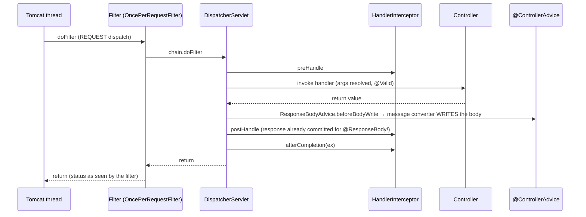
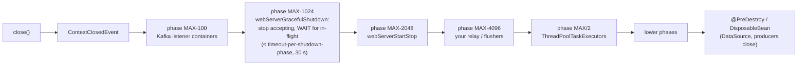

# 4.8 The Request Lifecycle, Application Events, `@Async` and Graceful Shutdown: What Runs When, on Which Thread, and What Survives

> **Verified stack:** Spring Boot **4.1.2** (embedded Tomcat 11.0.27), Spring Framework **7.0.10**, PostgreSQL **18.6** via HikariCP, JDK **25**. One lab app instruments every extension point and writes `component · event · [thread]` lines into a shared trace. It then runs 12 scenarios in one JVM (two sequential contexts), plus two variant runs that test a hypothesis each. All output below is copied from those runs; timings are *one run*.
>
> **Builds on:** [4.3](03-AOP-Proxies-JDK-vs-CGLIB-Self-Invocation-Ordering.md) (`@Async` and `@Transactional` are proxies), [4.4](04-Web-Concurrency-Tomcat-Virtual-Threads-WebFlux.md) (Tomcat threads), [3.5](../03-JPA-Hibernate-Spring-Data/05-Transactional-Propagation-Isolation-Pitfalls.md) (propagation), [7.3](../07-Docker-JVM-Kubernetes/03-Kubernetes-Probes-and-Graceful-Shutdown.md) (Kubernetes' side of shutdown).

---

## 0. First principles: three timelines that interviewers merge on purpose 🔥

| Timeline | Starts | Ends | The question it answers |
|---|---|---|---|
| **Request** | Tomcat accepts a connection | Response bytes flushed | Who sees the request, and who sees the *error*? |
| **Transaction** | `@Transactional` proxy begins | Commit or rollback, then *cleanup* | When do listeners run, and do their writes count? |
| **Application** | `refresh()` | `close()`: lifecycle phases → destroy | What stops first, and what is still alive when it does? |

Most production incidents in this area are a component that assumed it was on one timeline while running on another. Examples: a metrics filter that thinks the response is final, a listener that thinks it is still inside the transaction, a background thread still running after the `DataSource` closed.

---

## 1. The request lifecycle (verified) 🔥

The lab registers a `OncePerRequestFilter`, a `HandlerInterceptor`, a `@RestController`, a `@RestControllerAdvice` with an `@ExceptionHandler` that returns `ProblemDetail`, and a `ResponseBodyAdvice`. Each writes to the trace.



**Output (verified):**

```text
== 1. GET /orders/7 (success)
    filter     before  GET /orders/7 (REQUEST)                 [http-nio-18480-exec-1]
    intercept  preHandle   OrderController#get (REQUEST)       [http-nio-18480-exec-1]
    controller get(7)                                          [http-nio-18480-exec-1]
    advice     beforeBodyWrite OrderView as application/json   [http-nio-18480-exec-1]
    intercept  postHandle  OrderController#get                 [http-nio-18480-exec-1]
    intercept  afterCompletion ex=null                         [http-nio-18480-exec-1]
    filter     after   status=200                              [http-nio-18480-exec-1]
  response: 200 application/json {"id":7,"item":"book"}
== 2. GET /orders/404 (exception handled by @ExceptionHandler -> ProblemDetail)
    filter     before  GET /orders/404 (REQUEST)               [http-nio-18480-exec-3]
    intercept  preHandle   OrderController#get (REQUEST)       [http-nio-18480-exec-3]
    controller get(404)                                        [http-nio-18480-exec-3]
    advice     @ExceptionHandler(OrderNotFoundException)       [http-nio-18480-exec-3]
    advice     beforeBodyWrite ProblemDetail as application/problem+json [http-nio-18480-exec-3]
    intercept  afterCompletion ex=null                         [http-nio-18480-exec-3]
    filter     after   status=404                              [http-nio-18480-exec-3]
  response: 404 application/problem+json {"detail":"order 404 does not exist","instance":"/orders/404","status":404,"title":"Order not found","orderId":404}
== 3. GET /orders/500 (exception NOT handled -> container error page -> ERROR dispatch to /error)
    filter     before  GET /orders/500 (REQUEST)               [http-nio-18480-exec-2]
    intercept  preHandle   OrderController#get (REQUEST)       [http-nio-18480-exec-2]
    controller get(500)                                        [http-nio-18480-exec-2]
    intercept  afterCompletion ex=IllegalStateException        [http-nio-18480-exec-2]
    filter     after   status=200                              [http-nio-18480-exec-2]
    intercept  preHandle   BasicErrorController#error (ERROR)  [http-nio-18480-exec-2]
    advice     beforeBodyWrite LinkedHashMap as application/json [http-nio-18480-exec-2]
    intercept  postHandle  BasicErrorController#error          [http-nio-18480-exec-2]
    intercept  afterCompletion ex=null                         [http-nio-18480-exec-2]
  response: 500 application/json {"timestamp":"2026-10-25T15:01:02.898Z","status":500,"error":"Internal Server Error","path":"/orders/500"}
== 4. GET /nope (no handler; spring.mvc.problemdetails.enabled=true)
    filter     before  GET /nope (REQUEST)                     [http-nio-18480-exec-8]
    intercept  preHandle   ResourceHttpRequestHandler (REQUEST) [http-nio-18480-exec-8]
    advice     beforeBodyWrite ProblemDetail as application/problem+json [http-nio-18480-exec-8]
    intercept  afterCompletion ex=null                         [http-nio-18480-exec-8]
    filter     after   status=404                              [http-nio-18480-exec-8]
  response: 404 application/problem+json {"detail":"No static resource nope.","instance":"/nope","status":404,"title":"Not Found"}
```

**Five facts in that output that break real code:**

1. **`postHandle` runs after the body was written** (`beforeBodyWrite` precedes it). For `@ResponseBody`/`@RestController`, the response is already committed, so headers set in `postHandle` are silently ignored. Use a `ResponseBodyAdvice` or a filter that wraps the response.
2. **A *handled* exception is invisible to interceptors:** scenario 2 has no `postHandle`, and `afterCompletion` got `ex=null`. An interceptor that logs or measures errors from `afterCompletion(ex)` misses every exception your `@ControllerAdvice` turns into a 4xx/5xx. Read the response status instead.
3. **The filter recorded `status=200` for a request that returned 500** (scenario 3). The exception propagated *out of* the filter chain before Tomcat wrote anything. Tomcat then made a separate **ERROR dispatch** to `/error` (`BasicErrorController`), which a `OncePerRequestFilter` skips by default (`shouldNotFilterErrorDispatch()`). The interceptor, by contrast, ran **twice**. A filter-based metrics or audit component therefore needs `catch` + rethrow, or must handle error dispatches. Spring's own `ServerHttpObservationFilter` (behind `http.server.requests`) does exactly that: its bytecode catches the exception, calls `observation.error(...)`, sets `INTERNAL_SERVER_ERROR`, and also reads exceptions that handlers recorded on the request.
4. **Unhandled exceptions bypass your `ProblemDetail` contract** and come back in Boot's default `/error` JSON shape (`timestamp/status/error/path`). They are also logged at ERROR by Tomcat's `StandardWrapperValve` (`Servlet.service() for servlet [dispatcherServlet] … threw exception`). A catch-all `@ExceptionHandler(Exception.class)` that returns a `ProblemDetail` (and logs once) keeps a single error contract.
5. **`spring.mvc.problemdetails.enabled=true`** makes Spring MVC's own exceptions (here `NoResourceFoundException` for an unmapped path) render as RFC 9457 `application/problem+json`. The interceptor shows the "handler" was `ResourceHttpRequestHandler`, the static-resource fallback.

---

## 2. Application events and transactions (verified) 🔥

```java
@Transactional
public long place(String item, boolean failAfterPublish) {
    long id = jdbc.sql("insert into l48_order (item) values (?) returning id").param(item).query(Long.class).single();
    events.publishEvent(new OrderPlaced(id, item));
    if (failAfterPublish) throw new IllegalStateException("business rule failed after publishing");
    return id;
}

@EventListener                                                   void sync(OrderPlaced e)            { ... }
@TransactionalEventListener(phase = AFTER_COMMIT)                void afterCommit(OrderPlaced e)     { /* insert audit row A */ }
@TransactionalEventListener(phase = AFTER_COMMIT)
@Transactional(propagation = Propagation.REQUIRES_NEW)           void afterCommitNewTx(OrderPlaced e){ /* insert audit row B */ }
@TransactionalEventListener(phase = AFTER_ROLLBACK)              void afterRollback(OrderPlaced e)   { ... }
@TransactionalEventListener(fallbackExecution = true)            void fallback(OrderPlaced e)        { ... }
```

**Output (verified):**

```text
== 5. Event published inside a transaction that COMMITS
    service    inserted order 1, publishing OrderPlaced        [main]
    listener   @EventListener (sync) txActive=true             [main]
    service    publishEvent returned                           [main]
    listener   AFTER_COMMIT(fallbackExecution=true) txActive=true [main]
    listener   AFTER_COMMIT txActive=true, writes audit row A  [main]
    listener   AFTER_COMMIT + REQUIRES_NEW txActive=true, writes audit row B [main]
  audit rows for order 1: A: order 1, B: order 1
== 6. Event published, then the transaction ROLLS BACK
    service    inserted order 2, publishing OrderPlaced        [main]
    listener   @EventListener (sync) txActive=true             [main]
    service    publishEvent returned                           [main]
    listener   AFTER_ROLLBACK                                  [main]
    caller     caught: business rule failed after publishing   [main]
  orders named 'pen': 0
== 7. Event published with NO transaction
    listener   AFTER_COMMIT(fallbackExecution=true) txActive=false [main]
    listener   @EventListener (sync) txActive=false            [main]
    service    publishEvent (no transaction) returned          [main]
== 8. A synchronous @EventListener throws
    service    inserted order 3, publishing OrderPlaced        [main]
    listener   @EventListener (sync) txActive=true             [main]
    caller     caught: sync listener failed                    [main]
  orders named 'lamp': 0
```

| Scenario | What happened | Production consequence |
|---|---|---|
| 5 | `@EventListener` ran **inside** the publisher's transaction, on the same thread, before `publishEvent` returned | Its writes commit or roll back with the publisher's; its latency is your latency |
| 5 | `AFTER_COMMIT` listeners ran after commit, **same thread** (`main`), and reported `txActive=true` | The resources are still bound; see the write trap below |
| 6 | Rollback: `AFTER_ROLLBACK` ran, `AFTER_COMMIT` didn't, and the sync listener's work rolled back too | Never send emails or call other services from a sync listener |
| 7 | No transaction: plain `@TransactionalEventListener`s were **silently skipped**; only `fallbackExecution = true` ran | A refactor that removes `@Transactional` turns your notifications off without an error |
| 8 | A throwing sync listener **rolled back the publisher** (`lamp: 0`) | A "side" concern can veto the core business transaction |

### 2.1 The AFTER_COMMIT write trap, proven both ways 🧊

Spring's documentation warns that data access in an `AFTER_COMMIT` callback "will still participate in the original transaction, but changes will not be committed". In scenario 5, **row A was committed**. A hypothesis-driven variant run explains why:

```text
== variant --spring.datasource.hikari.auto-commit=false
    service    inserted order 1, publishing OrderPlaced        [main]
    listener   @EventListener (sync) txActive=true             [main]
    service    publishEvent returned                           [main]
    listener   AFTER_COMMIT(fallbackExecution=true) txActive=true [main]
    listener   AFTER_COMMIT + REQUIRES_NEW txActive=true, writes audit row B [main]
    listener   AFTER_COMMIT txActive=false, writes audit row A [main]
  audit rows for order 1: B: order 1
```

**Row A was lost** with a different pool setting. The mechanism:

* **The default pool connection is auto-commit.** With Hikari's default `auto-commit=true`, `DataSourceTransactionManager` switches the connection to manual commit for the transaction. It **restores auto-commit after completion**, after the `AFTER_COMMIT` callbacks ran.
* **The restore commits the stray write.** Per the JDBC spec, turning auto-commit back on with work pending commits it, so row A rides along.
* **Pool auto-commit off means nothing restores it.** The stray write is rolled back when the connection returns to the pool.

Listener order also differed between the runs: A ran before B in one and after in the other, which is unspecified without `@Order`. **The outcome of a plain `AFTER_COMMIT` write depends on pool configuration and listener order. Row B (`REQUIRES_NEW`) survived both times.** And Spring 6.1+ enforces part of this at startup:

```text
== 12. @TransactionalEventListener + plain @Transactional (Spring 6.1+ rule)
  startup failed: IllegalStateException: @TransactionalEventListener method must not be annotated with @Transactional unless when declared as REQUIRES_NEW or NOT_SUPPORTED: public void lab48x.BadListenerConfig$BadListener.on(lab48.Events$OrderPlaced)
```

**Rule:** an `AFTER_COMMIT` listener that writes uses `REQUIRES_NEW`. A listener that must not be lost (it notifies another system) needs a durable mechanism, an outbox or a Modulith registry ([5.11](../05-Microservices-Patterns/11-Modular-Monolith-Blueprint-Spring-Modulith-Externalized-Events-Extraction.md)), because a crash between commit and callback loses an in-memory listener's work.

---

## 3. `@Async`: which executor, what context, where exceptions go (verified) 🔥

The lab defines a `TaskDecorator` that copies the caller's MDC (the request id), plus **one extra `ThreadPoolTaskExecutor` bean** (`reportExecutor`) for report jobs, a common real-world addition.

```java
@Bean TaskDecorator mdcPropagation() {                   // Boot applies a TaskDecorator bean to the executor IT auto-configures
    return task -> { Map<String, String> mdc = MDC.getCopyOfContextMap();
                     return () -> { if (mdc != null) MDC.setContextMap(mdc); try { task.run(); } finally { MDC.clear(); } }; };
}
@Bean ThreadPoolTaskExecutor reportExecutor() { ... setThreadNamePrefix("report-") ... }
```

**Output (verified, default configuration):**

```text
== 9. @Async: executors, MDC propagation, exceptions
  Executor beans: reportExecutor
  @Async (default executor): report-1 requestId=null
  @Async("reportExecutor"): report-2 requestId=null
  void @Async that throws: returned immediately to the caller (exception goes to AsyncUncaughtExceptionHandler, see log)
  CompletableFuture @Async that throws: get() -> IllegalStateException: this one travels in the future
```

**Output (verified, `--spring.task.execution.mode=force`):**

```text
  Executor beans: reportExecutor, applicationTaskExecutor
  @Async (default executor): task-1 requestId=req-42
  @Async("reportExecutor"): report-1 requestId=null
```

**Reading it:**

1. **Adding one `Executor` bean made Boot's `applicationTaskExecutor` disappear.** The default (`spring.task.execution.mode=auto`) backs off when any `Executor` bean exists. Every un-qualified `@Async` in the app then silently moved to the report pool (`report-1`), and the MDC `TaskDecorator`, which Boot applies only to the executor it builds, stopped applying (`requestId=null`). Nothing failed; logs just lost their correlation ids and report jobs started competing with request-path async work.
2. **`mode=force`** keeps `applicationTaskExecutor` (threads `task-N`, MDC propagated) next to yours. Alternatively, build extra executors from Boot's `ThreadPoolTaskExecutorBuilder` so they get the same properties and decorator.
3. **`void` `@Async` exceptions go nowhere near the caller.** They are logged by `SimpleAsyncUncaughtExceptionHandler` (`Unexpected exception occurred invoking async method: public void lab48.AsyncWork$Worker.fireAndForgetThatFails()`). Return `CompletableFuture` when anyone needs to know, or register an `AsyncConfigurer` with a handler that counts and alerts.
4. **Know the defaults** (from Boot 4.1.2 metadata): `pool.core-size=8`, `max-size` and `queue-capacity` unbounded, `thread-name-prefix=task-`. An unbounded queue means **no back-pressure**: under overload, tasks pile up in memory instead of being rejected. Set a queue capacity and a rejection policy for anything user-triggered.

`@Async` is a proxy ([4.3](03-AOP-Proxies-JDK-vs-CGLIB-Self-Invocation-Ordering.md)): self-invocation runs synchronously, and the caller's transaction doesn't follow the task to the other thread.

---

## 4. Graceful shutdown, phase by phase (verified) 🔥

The lab registers three `SmartLifecycle` beans at chosen phases (one like a Kafka listener container, one like the outbox relay from [4.7](07-Auto-Configuration-Internals-Production-Starter-Blueprint.md), one at phase 0), a `ContextClosedEvent` listener and a `@PreDestroy`. It starts a 1.5 s request, calls `ctx.close()` 300 ms in, and sends a new request 300 ms later. `server.shutdown` is **not set**, so Boot's default applies (`graceful`, per the 4.1.2 metadata).

**Output (verified):**

```text
== 10. Shutdown with a request in flight (server.shutdown not set: Boot's default)
  lifecycle (stop order): shutdown.EarlyStopper              phase 2147483547
  lifecycle (stop order): webServerGracefulShutdown          phase 2147482623
  lifecycle (stop order): webServerStartStop                 phase 2147481599
  lifecycle (stop order): shutdown.RelayLike                 phase 2147479551
  lifecycle (stop order): reportExecutor                     phase 1073741823
  lifecycle (stop order): shutdown.PhaseZero                 phase 0
  lifecycle (stop order): springBootLoggingLifecycle         phase -2147483647
    +   12 ms  client     in-flight /slow sent
    +   17 ms  request    /slow started (1500 ms of work)         [http-nio-18480-exec-5]
    +  307 ms  main       ctx.close() called                      [main]
    +  309 ms  event      ContextClosedEvent                      [main]
    +  312 ms  lifecycle  stop consumers (like Kafka listener containers) (phase 2147483547) [main]
    +  614 ms  client     new request during shutdown sent
    +  617 ms  client     new request during shutdown -> ConnectException
    + 1518 ms  request    /slow finished                          [http-nio-18480-exec-5]
    + 1524 ms  client     in-flight /slow -> 200 done after 1500 ms
    + 1541 ms  lifecycle  stop outbox relay (DEFAULT_PHASE - 4096) (phase 2147479551) [main]
    + 1541 ms  lifecycle  stop a phase-0 lifecycle (phase 0)      [main]
    + 1543 ms  destroy    @PreDestroy (after ALL lifecycles stopped) [main]
    + 1565 ms  main       ctx.close() returned                    [main]
== 11. The same with --server.shutdown=immediate
    +    7 ms  request    /slow started (1500 ms of work)         [http-nio-18480-exec-1]
    +  301 ms  main       ctx.close() called                      [main]
    +  302 ms  event      ContextClosedEvent                      [main]
    +  303 ms  lifecycle  stop consumers (like Kafka listener containers) (phase 2147483547) [main]
    intercept  afterCompletion ex=InterruptedException         [http-nio-18480-exec-1]
    filter     after   status=200                              [http-nio-18480-exec-1]
    intercept  preHandle   BasicErrorController#error (ERROR)  [http-nio-18480-exec-1]
    +  313 ms  lifecycle  stop outbox relay (DEFAULT_PHASE - 4096) (phase 2147479551) [main]
    +  313 ms  client     in-flight /slow -> IOException: HTTP/1.1 header parser received no bytes
    +  314 ms  destroy    @PreDestroy (after ALL lifecycles stopped) [main]
    +  326 ms  main       ctx.close() returned                    [main]
```



**Reading it:**

* **Phases stop from highest to lowest**, and every phase completes before the next starts.
* **Graceful shutdown worked** with no property set (Boot's default since 3.4). The connector stopped accepting immediately: the new request got `ConnectException` at +617 ms. The phase then **waited** for the in-flight request, which completed with 200 at +1524 ms, and only then let the lower phases run (+1541 ms).
* **Each phase waits at most `spring.lifecycle.timeout-per-shutdown-phase`** (default 30 s). Kubernetes' `terminationGracePeriodSeconds` must cover the sum: preStop sleep + the slowest request + the other phases ([7.3 §3](../07-Docker-JVM-Kubernetes/03-Kubernetes-Probes-and-Graceful-Shutdown.md#3-graceful-shutdown-the-whole-sequence-)).
* **`immediate` interrupted the request mid-work.** The controller got `InterruptedException`, the client got a dropped connection, and the filter *still* recorded `status=200` (fact 3 from §1).
* **`ThreadPoolTaskExecutor` is a `SmartLifecycle`** (phase `MAX/2`). Executors stop after the web server and the relay, so request-triggered async work can still finish. `spring.task.execution.shutdown.await-termination` (default `false`) controls whether Boot's executor *waits* for queued tasks.
* **`@PreDestroy` runs after every lifecycle has stopped.** That's the right place to close resources, and the wrong place to "flush the last messages" (by then the web server is gone, but the relay already had its turn).

**Placement rules that follow:**

| Component | Phase | Why |
|---|---|---|
| Message consumers (Kafka containers, default `MAX-100`) | Highest: stop first | Stop taking new work while the app can still process the in-flight work |
| Web server graceful shutdown (`MAX-1024`) | Boot's | Drain HTTP requests |
| Outbox relay, buffered metric/event flushers | Below `MAX-2048` | Requests that wrote rows have finished; one last publish |
| Executors (`MAX/2`) | Spring's | Async work spawned by requests can complete (with `await-termination`) |
| Connection pools, producers | Destroy callbacks | Last; everything above still needed them |

---

## 5. ❌ Naïve vs ✅ production-hardened

| ❌ Naïve | ✅ Hardened |
|---|---|
| Set headers in `postHandle` | `ResponseBodyAdvice` or a response-wrapping filter (verified: the body is written before `postHandle`) |
| Log/measure errors in `afterCompletion(ex)` | Read the response status; handled exceptions arrive as `ex=null` (verified) |
| Metrics filter trusts `response.getStatus()` in `finally` | Catch, record and rethrow, or observe the ERROR dispatch (verified `status=200` for a 500) |
| Some errors as `ProblemDetail`, others as `/error` JSON | Catch-all `@ExceptionHandler` returning `ProblemDetail` + `spring.mvc.problemdetails.enabled=true` |
| Side effects in a sync `@EventListener` | `@TransactionalEventListener(AFTER_COMMIT)` (or a durable registry if it must not be lost) |
| Writes in a plain `AFTER_COMMIT` listener | `REQUIRES_NEW` (verified: the plain write survived or vanished depending on pool auto-commit) |
| Relying on `@TransactionalEventListener` when the publisher may not be transactional | Know it's skipped silently; `fallbackExecution = true` if that's intended |
| Adding an `Executor` bean | `spring.task.execution.mode=force` or `ThreadPoolTaskExecutorBuilder` (verified: `@Async` and MDC silently moved) |
| `void` `@Async` for important work | `CompletableFuture` or an `AsyncUncaughtExceptionHandler` that alerts |
| Unbounded async queue | `queue-capacity` + a rejection policy |
| `server.shutdown=immediate`, or a grace period shorter than the slowest request | Graceful (the default) + `timeout-per-shutdown-phase` + a long enough pod grace period |
| Background work started in `@PostConstruct`, stopped in `@PreDestroy` | `SmartLifecycle` with a deliberate phase ([4.7 §4](07-Auto-Configuration-Internals-Production-Starter-Blueprint.md#4-lifecycle-the-relay-as-a-smartlifecycle-)) |

---

## 6. Source to read

| Repo | Path | What to look for |
|---|---|---|
| [spring-projects/spring-framework](https://github.com/spring-projects/spring-framework) | `spring-webmvc/src/main/java/org/springframework/web/servlet/DispatcherServlet.java` | `doDispatch` → `processDispatchResult` → `triggerAfterCompletion(…, null)` for resolved exceptions |
| same | `spring-web/src/main/java/org/springframework/web/filter/OncePerRequestFilter.java` | `shouldNotFilterErrorDispatch()` |
| same | `spring-tx/src/main/java/org/springframework/transaction/event/TransactionalApplicationListenerMethodAdapter.java` | Phase handling, `fallbackExecution` |
| same | `spring-jdbc/src/main/java/org/springframework/jdbc/datasource/DataSourceTransactionManager.java` | `doCleanupAfterCompletion`: restoring auto-commit (the §2.1 mechanism) |
| same | `spring-context/src/main/java/org/springframework/context/support/DefaultLifecycleProcessor.java` | Stopping phases in descending order with a per-phase timeout |
| [spring-projects/spring-boot](https://github.com/spring-projects/spring-boot) | `module/spring-boot-web-server/src/main/java/org/springframework/boot/web/server/context/WebServerGracefulShutdownLifecycle.java` | The `MAX-1024` phase that drains requests |

---

## 7. Bar-raiser Q&A 🔥

🎤 *"Our API logs every request's status in a servlet filter, and errors go through a global `@ControllerAdvice`."*

🔍 **Your dashboards show almost no 500s, but customers report errors. How is that possible?**

<details><summary>🛡️ Defense</summary>

Verified: for an exception that escapes the controller and isn't handled by an advice, the filter's `finally` saw **`status=200`**. The exception left the filter chain before Tomcat produced the 500 via an ERROR dispatch to `/error`, which `OncePerRequestFilter` skips by default. The fixes:

* catch, record and rethrow in the filter;
* or rely on Spring's `ServerHttpObservationFilter` (it records the error and sets 500, as its bytecode shows);
* and add a catch-all `@ExceptionHandler` so unexpected errors become a `ProblemDetail` (and a correct status) *inside* the dispatch.
</details>

🔍 **We publish `OrderPlaced` and an `AFTER_COMMIT` listener writes an audit row. QA says it works. Ship it?**

<details><summary>🛡️ Defense</summary>

Not as is. Verified both ways: with Hikari's default auto-commit the row was committed (as a side effect of the transaction manager restoring auto-commit), and with `auto-commit=false` it was silently lost. The listener ran "inside" a transaction that had already committed. The listener needs `REQUIRES_NEW`; Spring 6.1+ rejects a plain `@Transactional` there at startup (verified message). And if the audit row is a compliance requirement, an in-memory listener isn't enough: a crash between commit and callback loses it. I'd write it in the same transaction, or use an outbox or registry.
</details>

🔍 **Someone added a `ThreadPoolTaskExecutor` bean for reports. What else changed?**

<details><summary>🛡️ Defense</summary>

With the default `spring.task.execution.mode=auto`, Boot's `applicationTaskExecutor` backs off. Every un-qualified `@Async` moved to the report pool, and the `TaskDecorator` that propagated the MDC stopped applying. Verified: `report-1 requestId=null`, then `task-1 requestId=req-42` with `mode=force`. Nothing failed: correlation ids vanished from async logs, and request-path work started queueing behind reports. Fix: `mode=force`, or build extra executors with `ThreadPoolTaskExecutorBuilder` and always qualify `@Async("…")`.
</details>

🔍 **Walk me through a pod termination for this service, with numbers.**

<details><summary>🛡️ Defense</summary>

1. **SIGTERM** → `close()` → `ContextClosedEvent`.
2. **Phases stop from highest:** Kafka containers stop consuming; then **graceful shutdown** stops accepting (verified: a new connection 300 ms into shutdown was refused at once) and waits for in-flight requests, up to `timeout-per-shutdown-phase` (30 s default). Verified: a 1.5 s request completed with 200 during shutdown.
3. **Then the web server stops**, then my relay publishes what those requests wrote, then executors drain, then `@PreDestroy` closes pools.
4. **On the Kubernetes side:** a preStop sleep so the endpoint is removed from load balancers before the connector closes, and `terminationGracePeriodSeconds` ≥ preStop + the slowest request + the remaining phases.

With `immediate`, the same request was interrupted mid-work and the client saw a dropped connection.
</details>

---

## Summary

| Topic | Key point | Evidence |
|---|---|---|
| Request order | filter → preHandle → controller → body written → postHandle → afterCompletion → filter | §1 scenario 1 |
| Handled errors | `postHandle` skipped, `afterCompletion(ex=null)` | §1 scenario 2 |
| Unhandled errors | ERROR dispatch to `/error`; the filter saw **200** | §1 scenario 3 |
| ProblemDetail | `@ExceptionHandler` → `ProblemDetail`; `problemdetails.enabled` for MVC exceptions | §1 scenarios 2, 4 |
| Sync listeners | Inside the publisher's transaction; a throw rolls the publisher back | §2 scenarios 5, 8 |
| Transactional listeners | After commit, same thread; skipped without a transaction unless `fallbackExecution` | §2 scenarios 5–7 |
| AFTER_COMMIT writes | Survive or vanish depending on pool auto-commit: use `REQUIRES_NEW` | §2.1 variant; Spring 6.1+ startup rule |
| `@Async` | Any `Executor` bean displaces Boot's executor and its `TaskDecorator`; `mode=force` | §3 both runs |
| Shutdown | Graceful by default; phases high → low; requests drain before the relay and executors; `@PreDestroy` last | §4 timeline |

**Next:** [4.6 Bar-raiser drill-downs (Round 2 covers 4.7–4.8) →](06-Bar-Raiser-Drill-Downs.md)
