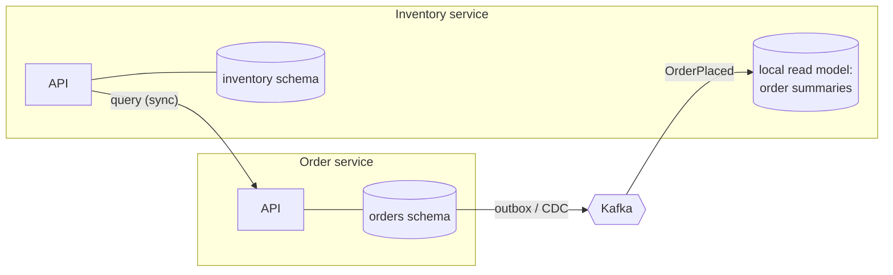

# 5.2 Data Ownership: Database per Service, the Shared-Database Anti-Pattern, and How Services Share Data Safely

> **Verified stack:** PostgreSQL **18.6** (roles and schema ownership). The rest of this file is architecture; the patterns it points to (outbox, CDC, CQRS, API composition) are verified in [5.4](04-Transactional-Outbox-and-Idempotent-Consumer-Complete-Implementation.md), [5.5](05-CQRS-and-Event-Sourcing.md) and [5.6](06-Edge-Patterns-Gateway-BFF-Aggregator-Service-Mesh.md).

---

## 0. First principles: a schema is an API 🔥

The moment two services read the same table, that table's **columns, types and semantics become a contract** between them. Now neither team can rename a column, split a table, change an index strategy or move to another database without coordinating. You've rebuilt the coupling microservices were supposed to remove, and it's worse than code coupling because it's invisible to the compiler.

**Database per service** means each service's data is **private**: other services get at it only through the owner's **API** or **events**. "Per service" is about *ownership*, not necessarily separate servers:

| Isolation level | Cost | Typical use |
|---|---|---|
| Private tables in a shared database | Lowest | Early stage; enforced only by convention (weak) |
| **Schema per service** with separate roles and no cross-grants | Low | Good default on a shared cluster (verified below) |
| Database per service on a shared server | Medium | Stronger isolation of connections and settings |
| Server/cluster per service | Highest | Noisy-neighbor isolation, different engines, regulatory separation |

---

## 1. Enforce ownership in the database (verified) ⚡

```sql
create role order_svc login;
create role inventory_svc login;
create schema orders authorization order_svc;
create schema inventory authorization inventory_svc;
revoke all on schema public from order_svc, inventory_svc;
set role order_svc;
create table orders.purchase (id bigint generated always as identity primary key, sku text, qty int);
insert into orders.purchase (sku, qty) values ('book', 2);
reset role;
set role inventory_svc;
select current_user;
select * from orders.purchase;
```

**Output (verified):**

```text
 current_user
---------------
 inventory_svc

psql:d1_ownership.sql:15: ERROR:  permission denied for schema orders
LINE 1: select * from orders.purchase;
```

Each service connects with its own role that owns only its schema. The "quick join across services" that starts every shared-database mess is now impossible, not just discouraged.

---

## 2. The shared-database anti-pattern, and why teams fall into it 🔥

| Symptom | Consequence |
|---|---|
| Service B reads service A's tables directly | A can't change its schema without breaking B, so deployments become coordinated |
| Both services write the same table | No owner for invariants; race conditions between two codebases' assumptions |
| Reporting queries join across "service" tables | A slow report on the shared primary hurts every service |
| One giant connection pool budget | One service's connection storm starves the others |

Why it happens: it's the fastest way to get data you need **today**. The alternatives below are slower to build and pay off over years.

---

## 3. How services get each other's data ⚡



| Need | Pattern | Consistency | Trade-off |
|---|---|---|---|
| "Give me order 42 right now" | **Synchronous API call** (or API composition, [5.6](06-Edge-Patterns-Gateway-BFF-Aggregator-Service-Mesh.md)) | Strong (owner's current state) | Runtime coupling: the owner must be up; latency adds up |
| "React when an order is placed" | **Domain events** via outbox ([5.4](04-Transactional-Outbox-and-Idempotent-Consumer-Complete-Implementation.md)) | Eventual | Needs idempotent consumers; ordering per key |
| "I need a local copy to query/join" | **Event-carried state transfer** into a local read model, or **CDC** from the owner's tables | Eventual | Duplication; replaying to rebuild; the owner's events are now a contract |
| "Cross-service reporting" | Stream to a **warehouse/lake** (CDC → Kafka → warehouse) | Eventual (minutes) | Separate infrastructure; never run analytics on OLTP primaries |
| "Update data in two services atomically" | **Saga** ([5.3](03-Sagas-Choreography-vs-Orchestration-Compensation-Semantic-Locks.md)), or redraw the boundary | Eventual, with compensations | Complexity. Often the right answer is "these belong in one service" |

### Why not distributed transactions (2PC/XA)?

Two-phase commit gives atomicity across resources, but: participants **hold locks** through the prepare phase; a coordinator failure leaves participants **in doubt** (prepared transactions holding locks and the xmin horizon, [2.5 §2.1](../02-SQL-RDBMS-Internals/05-MVCC-Visibility-Vacuum-Wraparound-vs-InnoDB-Undo.md)); every participant must support XA; and availability becomes the *product* of all participants' availability. Most message brokers and cloud services don't participate at all. Modern designs accept eventual consistency between services and keep strong consistency inside one.

---

## 4. Events as a contract 🧊

Once other services build read models from your events, **events are a public API** with the same evolution rules as REST:

| Rule | Why |
|---|---|
| Publish **domain events** (`OrderPlaced`, `OrderCancelled`), not table-row changes | Row-level CDC leaks your schema. The outbox (or Debezium's outbox router) lets you publish a designed event instead |
| Add fields; never remove or repurpose them without a new version | Old consumers keep working |
| Version the event type (`OrderPlaced.v2`) or use a schema registry with compatibility rules (Avro/Protobuf, `BACKWARD` compatibility) | Breaking changes become explicit |
| Include the aggregate id (and use it as the Kafka key) and an event id | Ordering per aggregate; idempotency |
| Fat vs thin events: include what consumers commonly need, but not the whole aggregate | Thin events force consumers to call back (coupling); fat events leak internals |

---

## 5. ❌ Naïve vs ✅ production-hardened

| ❌ Naïve | ✅ Hardened |
|---|---|
| "Each service has its own tables" by convention | Separate roles and schemas with no cross-grants (verified `permission denied`) |
| Cross-service joins in SQL | API composition, local read models from events, or a warehouse |
| 2PC across services and brokers | Local transactions + outbox + sagas; or merge the services |
| Row-level CDC topics consumed by other teams as the integration contract | Outbox events (designed, versioned) |
| Reporting on the OLTP primary | CDC → stream → warehouse |

---

## 6. Interview soundbites

* "A shared table is an invisible API. Database-per-service is about ownership; I enforce it with separate roles and schemas so a cross-service query fails with `permission denied`."
* "Other services get data through the owner's API, its events, or a local read model built from those events."
* "I avoid 2PC: locks held across the network, in-doubt transactions, and availability multiplied across participants. Strong consistency inside a service, eventual consistency between services."
* "Once others consume my events, they're a contract: domain events, additive changes, versions, aggregate id as the key."

---

## 7. Deep dive: ownership in a running system, and reconciliation as the proof 🔥

The [5.10](10-Reference-Implementation-Saga-Orchestrator-Kafka-Outbox-Inbox-CQRS.md) reference implementation applies this file's rules to four services in one PostgreSQL cluster:

| Rule from this file | How 5.10 implements it | What the lab shortcut was |
|---|---|---|
| Each service owns its data (§1) | One schema per service: `ord`, `inv`, `pay`, `qry`. No SQL crosses schemas; the query side is built **only from events** | One database user for all four; production uses a role per service with `REVOKE`, exactly as §1 verified (`permission denied for schema orders`) |
| Others get data through APIs/events (§3) | Commands and replies over Kafka; the read model (`qry.order_view`) is an event-carried replica | — |
| No 2PC (§3) | Each step is one local transaction with outbox/inbox; the saga provides eventual atomicity | — |
| Events are a contract (§4) | Every message keyed by order id, with `messageId` and `type` headers; order events carry a monotonically increasing `version` | JSON without a schema registry (production: schemas + compatibility rules) |

**Reconciliation is how you prove ownership plus messaging is lossless.** 5.10 §7 derives every counter from the scenarios:

* 698 order-service outbox rows + 4 re-sends = **702** published;
* 216 + 60 replies = **276** order inbox rows;
* events replayed = 210 × 2 + 2 = **422**.

When data lives in four places, "is anything missing?" stops being a query and becomes an accounting exercise. Teams that own data across a boundary should be able to produce those numbers.

**One contract leak worth knowing.** [5.11](11-Modular-Monolith-Blueprint-Spring-Modulith-Externalized-Events-Extraction.md#8-the-extraction-path-module--service-step-by-step-) found that externalized events carried `__TypeId__=com.acme.shop.order.OrderPlaced`, the producer's Java class name, in a header. A class name in a header is as much a hidden schema dependency as a shared table: §4's "events as a contract" applies to headers too.

---

## Summary

| Topic | Key point | Evidence |
|---|---|---|
| Schema as API | A table someone else reads is an API you can't change | §0 |
| Enforcement | Role + schema per service; cross-service reads fail | §1: `permission denied` |
| Shared DB | Hidden coupling, lock contention, no independent scaling; transitional only | §2 |
| Getting data | Sync API, events, local replica, warehouse for reporting; saga for multi-service updates | §3 |
| No 2PC | Locks across the network, in-doubt transactions, multiplied unavailability | §3 |
| Events as contracts | Additive changes, versions, aggregate id as key; headers count too | §4, §7 |
| Reconciliation | Every send and inbox row accounted for | §7 (5.10: 702 / 276 / 422) |

**Next:** [5.3 Sagas: choreography vs orchestration →](03-Sagas-Choreography-vs-Orchestration-Compensation-Semantic-Locks.md)
