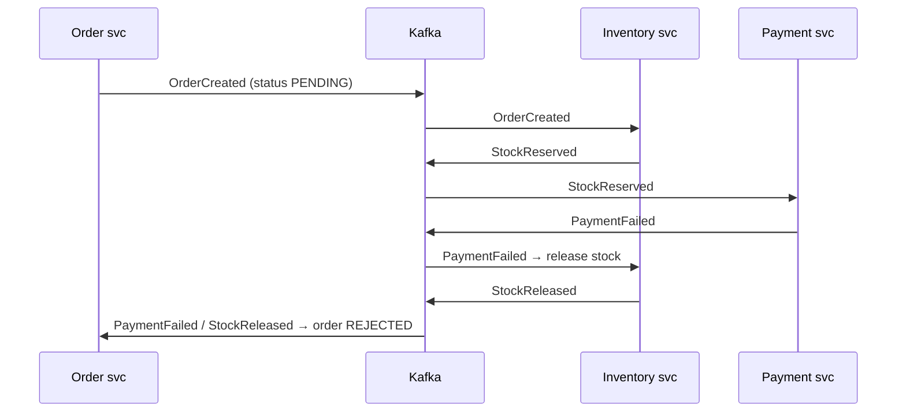

# 5.3 Sagas: Choreography vs Orchestration, Compensation Order, Pivot Transactions, Semantic Locks, Durable Execution

> **Verified stack:** an orchestrated saga with a durable saga log on PostgreSQL **18.6**, Temurin **25** (plain JDBC so every transaction boundary is visible). The three scenarios (success, failure with compensation, crash + recovery) are real output.

---

## 0. First principles: what we lose without a distributed transaction 🔥

Placing an order touches three services: **Order** (create), **Inventory** (reserve), **Payment** (charge). Each has its own database ([5.2](02-Data-Ownership-Database-per-Service.md)), so there's no single ACID transaction. A **saga** replaces it with a **sequence of local transactions**, each publishing progress, where every step that can be undone has a **compensating transaction** that semantically reverses it.

What survives from ACID:

| Property | In a saga |
|---|---|
| **A**tomicity | *Eventually*: either all steps complete, or compensations undo the completed ones |
| **C**onsistency | Each local transaction keeps its own service consistent |
| **I**solation | ❌ **Lost.** Other requests see intermediate states (stock reserved, payment not yet taken) |
| **D**urability | Each local transaction is durable |

Isolation is the hard part: you must design **countermeasures** (§5) for the anomalies other transactions can observe.

### The three kinds of steps

```text
 compensatable ──► compensatable ──► PIVOT ──► retriable ──► retriable
 (can be undone)                    (go/no-go)  (must eventually succeed; retried until they do)
```

* **Compensatable**: can be semantically undone (reserve stock → release stock).
* **Pivot**: the point of no return. If it succeeds, the saga will complete. Typically the step that's hardest or impossible to undo (charging a card, sending a shipment).
* **Retriable**: after the pivot; they can't fail for business reasons, only transiently, so they're retried until they succeed.

**Design rule:** order steps so that the ones most likely to fail for business reasons come early, and irreversible ones come at the pivot.

---

## 1. Orchestration, implemented and verified 🔥

An **orchestrator** (here: a class in the Order service) owns the saga's state machine and tells each participant what to do. Its state lives in a **saga log** table, updated **in the same local transaction** as each step, so a crash can never leave "step done but not recorded".

```java
static final List<Step> STEPS = List.of(
    new Step() {   // compensatable
        public String name() { return "CreateOrder"; }
        public void act(long id, Map<String, Object> d) throws SQLException { tx("insert into s_order (saga_id, status) values (?, 'PENDING')", id); }   // semantic lock
        public void compensate(long id, Map<String, Object> d) throws SQLException { tx("update s_order set status = 'REJECTED' where saga_id = ?", id); }
        ...
    },
    new Step() {   // compensatable
        public String name() { return "ReserveStock"; }
        public void act(long id, Map<String, Object> d) throws Exception {
            int n = db.prepareStatement("update s_stock set available = available - 1 where sku = 'book' and available >= 1").executeUpdate();
            if (n == 0) throw new IllegalStateException("out of stock");
            tx("insert into s_reservation (saga_id, sku) values (?, 'book')", id);
        }
        public void compensate(long id, Map<String, Object> d) throws SQLException {
            tx("update s_stock set available = available + 1 where sku = 'book'");
            tx("delete from s_reservation where saga_id = ?", id);
        }
        ...
    },
    new Step() {   // PIVOT: after this, only forward recovery
        public String name() { return "ChargePayment"; }
        public boolean compensatable() { return false; }
        public void act(long id, Map<String, Object> d) throws Exception {
            int amount = (int) d.get("amount");
            if (amount > 500) throw new IllegalStateException("card declined for " + amount);
            tx("insert into s_payment (saga_id, amount) values (?, ?)", id, amount);
        }
        ...
    },
    new Step() {   // retriable: must eventually succeed
        public String name() { return "ApproveOrder"; }
        public void act(long id, Map<String, Object> d) throws SQLException { tx("update s_order set status = 'APPROVED' where saga_id = ?", id); }
        ...
    });

/** Runs (or resumes) a saga from the step recorded in the saga log. */
static void run(long sagaId, Map<String, Object> data, String crashAfter) throws Exception {
    int next = (int) queryLong("select next_step from saga_log where id = ?", sagaId);
    for (int i = next; i < STEPS.size(); i++) {
        Step s = STEPS.get(i);
        try {
            db.setAutoCommit(false);
            s.act(sagaId, data);
            tx("update saga_log set next_step = ?, state = 'RUNNING' where id = ?", i + 1, sagaId);   // step + progress in ONE local tx
            db.commit();
        } catch (Exception e) {
            db.rollback();
            compensate(sagaId, data, i - 1);                                  // undo completed steps, newest first
            return;
        } finally { db.setAutoCommit(true); }
        ...
    }
    tx("update saga_log set state = 'COMPLETED' where id = ?", sagaId);
}
```

*(In this lab the "services" are tables in one database so every step's transaction is visible. In a real system each `act` is a command message or API call to another service, and the participant replies; the orchestrator logic and the saga log are the same.)*

**Output (verified):**

```text
== 1. Happy path (amount 120)
  saga 1: CreateOrder done
  saga 1: ReserveStock done
  saga 1: ChargePayment done
  saga 1: ApproveOrder done
  saga 1: COMPLETED
== 2. Payment declined (amount 900): compensate in reverse order
  saga 2: CreateOrder done
  saga 2: ReserveStock done
  saga 2: ChargePayment FAILED (card declined for 900)
  saga 2: compensated ReserveStock
  saga 2: compensated CreateOrder
== 3. Crash after ReserveStock, then a recovery worker resumes from the saga log
  saga 3: CreateOrder done
  saga 3: ReserveStock done
  saga 3: *** process crashed after ReserveStock ***
  saga | state       | next_step | order    | reservations | payments
  1    | COMPLETED   | 4         | APPROVED | 1            | 1
  2    | COMPENSATED | 0         | REJECTED | 0            | 0
  3    | RUNNING     | 2         | PENDING  | 1            | 0
  stock available = 8
  -- recovery worker: resume sagas in state RUNNING
  saga 3: ChargePayment done
  saga 3: ApproveOrder done
  saga 3: COMPLETED
  saga | state       | next_step | order    | reservations | payments
  1    | COMPLETED   | 4         | APPROVED | 1            | 1
  2    | COMPENSATED | 0         | REJECTED | 0            | 0
  3    | COMPLETED   | 4         | APPROVED | 1            | 1
  stock available = 8
```

What the output proves:

1. **Compensation runs in reverse order** of completion: `ReserveStock` first (release the stock), then `CreateOrder` (mark `REJECTED`). Reverse order matters because later steps may depend on earlier ones (you release what you reserved *for this order* before the order disappears).
2. The failed pivot needed **no** compensation (its local transaction rolled back). Stock started at 10: saga 1 took one (9), saga 2 reserved and released one (still 9), saga 3 took one (8).
3. After the crash, the saga log said `RUNNING, next_step = 2`, and the recovery worker **resumed exactly there**. Nothing was redone, nothing skipped. Order 3 was visibly `PENDING` in the meantime: the **semantic lock** (§5).
4. A rejected order stays as a `REJECTED` row (not deleted): compensations are **business operations** with an audit trail, not database rollbacks.

### Rules every saga implementation needs

| Rule | Why |
|---|---|
| Steps and compensations are **idempotent** | Recovery and retries re-send commands; participants must tolerate duplicates (idempotency keys, [5.4](04-Transactional-Outbox-and-Idempotent-Consumer-Complete-Implementation.md)) |
| Compensations **can't fail for business reasons** | "Can't release stock" must not happen; they're retried until they succeed |
| Saga state changes are **durable and atomic with each step** | Otherwise a crash leaves an unknowable state |
| Commands and replies go through an **outbox** | Otherwise "state saved but command never sent" |
| Timeouts per step + a reaper for stuck sagas | Participants can be down for hours |

---

## 2. Choreography: no conductor ⚡



Each service reacts to events and emits its own. There's no central state machine. The process is **implicit** in the subscriptions.

*(Illustrative listener shape; the outbox and idempotent consumer it relies on are verified in [5.4](04-Transactional-Outbox-and-Idempotent-Consumer-Complete-Implementation.md).)*

```java
@KafkaListener(topics = "payments.events", groupId = "inventory")
@Transactional
public void on(PaymentFailed e) {
    if (!dedup.firstTime("inventory", e.eventId())) return;          // idempotent consumer
    reservations.release(e.orderId());                                // local compensation
    outbox.add(new StockReleased(e.orderId()));                       // continue the choreography
}
```

---

## 3. Choreography vs orchestration 🔥

| | Choreography | Orchestration |
|---|---|---|
| Control flow | Implicit, spread across services | Explicit, in one place (code or BPMN) |
| Coupling | Services know event types, not each other | Orchestrator knows every participant's commands |
| Visibility ("where is order 42?") | Reconstruct from events/traces | Query the saga state |
| Adding a step | Touch several services' subscriptions | Change the orchestrator |
| Risk | Cyclic event chains, "event spaghetti", hard-to-reason compensation | The orchestrator becomes a god service if it holds business logic |
| Failure handling | Each service compensates on the failure events it hears | Centralized compensation in reverse order (§1) |
| Testing | End-to-end flows across services | Orchestrator unit-testable with stubbed participants |
| Good fit | 2–4 steps, simple linear flows, high autonomy | 4+ steps, branching, timeouts, human tasks, regulated processes |

A common hybrid: choreography *between* bounded contexts, orchestration *within* one complex business process.

---

## 4. Durable execution engines 🧊

Writing sagas by hand means writing a state machine, a log, timers, retries and recovery. Engines do that for you:

| Engine | Model | Notes |
|---|---|---|
| **Temporal** (Java SDK 1.40) | Workflows as ordinary code; the engine **replays** the event history to rebuild state after a crash | Workflow code must be deterministic (no `System.currentTimeMillis()`, random, direct I/O); activities do the side effects |
| **Camunda** (7.24 / 8) | BPMN diagrams executed by an engine | Business-visible processes, human tasks |
| Spring Statemachine (4.0) | State machines in-process | You still own persistence and recovery |
| Eventuate Tram Sagas | Orchestration DSL on the transactional outbox | See [8.3](../08-GitHub-Codebases-Study-Guide/03-Saga-Outbox-Event-Driven-Repos.md) |

```java
// Temporal-style workflow (illustrative; not run here). Compensation via a Saga helper.
public class PlaceOrderWorkflowImpl implements PlaceOrderWorkflow {
    private final OrderActivities orders = Workflow.newActivityStub(OrderActivities.class, opts);
    private final InventoryActivities inventory = Workflow.newActivityStub(InventoryActivities.class, opts);
    private final PaymentActivities payments = Workflow.newActivityStub(PaymentActivities.class, opts);

    @Override public void placeOrder(OrderRequest req) {
        Saga saga = new Saga(new Saga.Options.Builder().setParallelCompensation(false).build());
        try {
            orders.create(req);            saga.addCompensation(orders::reject, req.orderId());
            inventory.reserve(req);        saga.addCompensation(inventory::release, req.orderId());
            payments.charge(req);          // pivot
            orders.approve(req.orderId()); // retriable (activity retry policy)
        } catch (ActivityFailure e) {
            saga.compensate();             // reverse order
            throw e;
        }
    }
}
```

The same structure as §1, but the engine persists every step, handles timers (wait 3 days for a manual review), retries activities with backoff, and resumes after crashes.

---

## 5. Isolation countermeasures (the part most designs skip) 🧊

Because sagas lack isolation, other transactions can see and act on intermediate state. Classic anomalies and countermeasures:

| Anomaly | Example | Countermeasure |
|---|---|---|
| **Dirty read** | A report counts stock as sold while the saga that reserved it will be compensated | **Semantic lock**: a `PENDING`/`*_PENDING` status that tells everyone "in flux" (verified: order 3 sat in `PENDING` during the crash). Readers and other sagas treat it accordingly (wait, reject, or show "processing") |
| **Lost update** | Saga A's compensation overwrites a change saga B made in between | **Commutative updates** (`available = available + 1` instead of setting an absolute value: the lab's compensation is commutative); **version file** (record operations and apply them in a commutable order) |
| **Non-repeatable read** | A step re-reads data another saga changed | **Reread value**: verify the data is unchanged before updating (optimistic check), restart the saga otherwise |
| Risky intermediate states | Showing a loan as approved before the credit check | **Pessimistic view**: reorder steps so risky updates happen in retriable steps after the pivot |
| High-value operations | Large transfers | **By value**: route risky requests through a 2PC-style or manual path, cheap ones through sagas |

---

## 6. ❌ Naïve vs ✅ production-hardened sagas

| ❌ Naïve | ✅ Hardened |
|---|---|
| Call three services in a `try` block and "undo" in `catch` | A saga with durable state; compensations retried until they succeed |
| Compensation = delete the row | Compensation = a business operation (`REJECTED`, refund), auditable |
| Compensate in any order | Reverse order of completion (verified) |
| Saga state in memory | Saga log updated atomically with each step; recovery worker (verified resume from `next_step = 2`) |
| Hide intermediate states | Semantic locks (`PENDING`) visible to readers and other sagas |
| Non-idempotent participants | Idempotency keys / dedup tables everywhere |
| 15-step choreography across 8 services | Orchestration (or an engine) for long, branching processes |

---

## 7. Source to read

| Repo | Path | What to look for |
|---|---|---|
| [eventuate-tram/eventuate-tram-sagas](https://github.com/eventuate-tram/eventuate-tram-sagas) | `eventuate-tram-sagas-orchestration` module | `SagaManagerImpl`: saga instance persistence, command/reply handling |
| [temporalio/sdk-java](https://github.com/temporalio/sdk-java) | `temporal-sdk/src/main/java/io/temporal/workflow/Saga.java` | The compensation helper used above |
| [temporalio/samples-java](https://github.com/temporalio/samples-java) | `core/src/main/java/io/temporal/samples/bookingsaga/` | A complete booking saga |
| Reading notes | [8.3](../08-GitHub-Codebases-Study-Guide/03-Saga-Outbox-Event-Driven-Repos.md) | Curated saga, outbox and event-driven repositories, with what to read in each |

---

## 8. Interview soundbites

* "A saga is a sequence of local transactions with compensations. It gives eventual atomicity but no isolation, so I design countermeasures like semantic locks."
* "Steps are compensatable, then a pivot, then retriable. I put likely business failures early and the irreversible step at the pivot."
* "My orchestrator writes each step and its progress in one local transaction. After a crash the recovery worker resumed exactly at step 2, and failures compensated in reverse order."
* "Choreography for short flows between autonomous teams; orchestration or a durable-execution engine like Temporal for long, branching processes."

---

## 9. Deep dive: the same saga on Spring + Kafka, broken eleven ways (verified) 🔥

§1's orchestrator was plain JDBC: one process, a saga log, a recovery worker. [5.10](10-Reference-Implementation-Saga-Orchestrator-Kafka-Outbox-Inbox-CQRS.md) rebuilds it as four services (Spring Boot 4.1.2, Kafka 4.2.2, 3 consumers per group) and adds the failure modes that only appear once messages cross a network:

| Failure mode | §1 (plain JDBC) | 5.10 (Spring + Kafka) |
|---|---|---|
| Declined payment | Compensate in reverse order ✅ | ✅ `PAYING → COMPENSATING → REJECTED`, stock restored |
| Crash mid-saga | Recovery worker resumes at `next_step` ✅ | ✅ Crash after writing `PAYING` + command, before commit: all rolled back, redelivered, **exactly one** `AuthorizePayment` |
| Duplicate messages | n/a (no messaging) | ✅ All 6 messages of a saga re-sent: inbox + version guard → 0 new effects |
| Participant slower than the step timeout | n/a | ✅ Sweeper compensates; the late `StockReserved` is recorded as stale; per-key FIFO makes the release follow the reservation |
| **Pivot timeout, then a late "yes"** | n/a | ✅ `REJECTED/PaymentAuthorized → RefundPayment`; final payment `REFUNDED 40.00` |
| Compensation slower than its deadline | n/a | ✅ Sweeper re-sends `ReleaseStock`; the second release is a no-op (stock released once) |
| Poison reply | n/a | ✅ Classified (1 vs 4 attempts), dead-lettered, partition keeps flowing |
| Contention | n/a | ✅ 200 orders vs 50 units: 50 approved, 150 rejected, stock 0 |

The pivot case, as the audit trail recorded it:

```text
    (start)       -> RESERVING     order placed
    RESERVING     -> PAYING        StockReserved
    PAYING        -> COMPENSATING  timeout in PAYING
    COMPENSATING  -> REJECTED      StockReleased
    REJECTED      -> REJECTED      late PaymentAuthorized after timeout -> RefundPayment
    REJECTED      -> REJECTED      PaymentRefunded
```

**What changes once the saga crosses a network:**

1. **The state machine must be *total*.** Every (state, reply) pair gets a deliberate outcome, including "record as stale". Otherwise duplicates and late replies become poison messages.
2. **Timeouts create the hardest case.** A timeout is indeterminate, so a pivot that completes after you gave up must be *undone forward* (refund). Prefer querying by idempotency key before compensating.
3. **§5's isolation countermeasures become code:**
   * the semantic lock (`PENDING` until terminal);
   * commutative stock updates;
   * a **tombstone** so a release that runs before its reservation can't be "resurrected";
   * a version guard on the read side.
4. **Concurrency is decided by row locks.** The reply handler takes `FOR UPDATE` and the sweeper `FOR UPDATE SKIP LOCKED`. Whoever locks first wins, and the other sees the committed result.

---

## Summary

| Topic | Key point | Evidence |
|---|---|---|
| What sagas give up | Atomicity becomes eventual; isolation is gone | §0 |
| Step types | Compensatable → pivot → retriable; risky checks early | §0 |
| Orchestration | One local transaction per step; resume after crash; reverse-order compensation | §1 (plain JDBC), §9 (Kafka) |
| Choreography | Short flows, autonomous teams; no single "where is it?" | §2–§3 |
| Durable execution | Temporal-style engines for long, branching processes | §4 |
| Isolation countermeasures | Semantic lock, commutative updates, reread, tombstones | §5, §9 |
| Pivot timeout | Indeterminate: late success → refund; query before compensating | §9: `REFUNDED 40.00` |
| Total state machine | Stale replies recorded, never thrown | §9 |

**Next:** [5.4 Transactional outbox & idempotent consumer (complete implementation) →](04-Transactional-Outbox-and-Idempotent-Consumer-Complete-Implementation.md)
