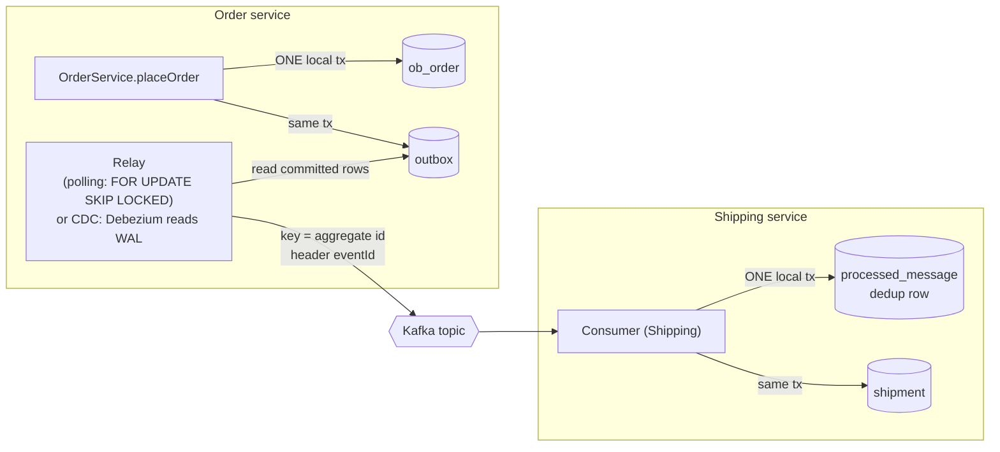

# 5.4 Transactional Outbox + Idempotent Consumer: A Complete, Verified Implementation (Polling Publisher with `SKIP LOCKED`, and Debezium CDC)

> **Verified stack:** Spring Boot **4.1.2** (`spring-boot-starter-jdbc`, `spring-boot-starter-kafka`), spring-kafka **4.1.2**, Apache Kafka **4.2.2** (embedded KRaft broker from `spring-kafka-test`, 3 partitions), PostgreSQL **18.6** (`wal_level=logical` for CDC), **Debezium 3.7.0.Final** embedded engine with the Outbox Event Router (Kafka Connect 4.3.1 APIs). Every scenario below was run; the counters are real.
>
> **Builds on:** [2.6 §4](../02-SQL-RDBMS-Internals/06-Isolation-Anomalies-Row-Locks-SKIP-LOCKED-Gap-Locks-Deadlocks.md) (`SKIP LOCKED`), [2.4 §4](../02-SQL-RDBMS-Internals/04-Advanced-SQL-CTEs-Window-Functions-Keyset-Pagination.md) (`ON CONFLICT`), [3.5 §7](../03-JPA-Hibernate-Spring-Data/05-Transactional-Propagation-Isolation-Pitfalls.md) (why not publish inside `@Transactional`). **Go deeper:** the sibling kit's [6.3](../../Java-Backend-Master-Reference/06-Spring-Microservices/03-Outbox-Saga-Idempotency.md).

---

## 0. First principles: the dual-write problem 🔥

A service must **change its database** and **tell the world** (publish an event). These are two different systems with no shared transaction:

```text
❌ save(order); kafka.send(event);          crash between them → DB has the order, nobody hears about it
❌ kafka.send(event); save(order);          DB fails → consumers act on an order that doesn't exist
❌ @Transactional { save(order); kafka.send(event); }
                                            the send happens BEFORE commit; a rollback leaves a phantom event
```

The **transactional outbox** turns two writes into one: write the business change **and** the event as rows in the **same local transaction**. A separate process (the relay) moves committed outbox rows to the broker. That gives **at-least-once** delivery (an event can be sent twice, never lost), so consumers must be **idempotent**. Exactly-once *effects* = at-least-once delivery + idempotent processing.



---

## 1. Schema 🔥

```sql
drop table if exists ob_order, outbox, processed_message, shipment;

create table ob_order (
  id         uuid primary key,
  customer   text not null,
  amount     numeric(10,2) not null,
  status     text not null,
  created_at timestamptz not null default now()
);

create table outbox (
  id             uuid primary key,              -- uuidv7(): time-ordered, doubles as the event id
  aggregate_type text not null,
  aggregate_id   text not null,                 -- Kafka key: preserves per-aggregate ordering
  event_type     text not null,
  payload        jsonb not null,
  created_at     timestamptz not null default now(),
  published_at   timestamptz,
  attempts       int not null default 0
);
create index outbox_unpublished on outbox (id) where published_at is null;   -- tiny, hot partial index

create table processed_message (
  consumer     text not null,
  message_id   uuid not null,
  processed_at timestamptz not null default now(),
  primary key (consumer, message_id)
);

create table shipment (
  order_id   uuid primary key,
  created_at timestamptz not null default now()
);
```

* `uuidv7()` (built into PostgreSQL 18) gives **time-ordered** ids: the relay's `order by id` is roughly creation order, and the B-tree stays compact ([2.2 §1.2](../02-SQL-RDBMS-Internals/02-Indexes-BTree-Hash-GIN-GiST-BRIN-Covering-Composite.md)).
* The **partial index** covers only unpublished rows, so it stays tiny no matter how much history accumulates.
* `processed_message` is the consumer's **idempotency ledger**, keyed per consumer (two consumer groups may both process the same event).

---

## 2. The write side: business row + outbox row, one transaction (verified) 🔥

```java
@Service
public static class OrderService {
    private final JdbcClient jdbc;
    OrderService(JdbcClient jdbc) { this.jdbc = jdbc; }

    @Transactional
    public UUID placeOrder(String customer, BigDecimal amount) {
        UUID orderId = jdbc.sql("insert into ob_order (id, customer, amount, status) values (uuidv7(), ?, ?, 'PLACED') returning id")
                .params(customer, amount).query(UUID.class).single();
        String payload = """
                {"orderId":"%s","customer":"%s","amount":%s}""".formatted(orderId, customer, amount);
        jdbc.sql("""
                insert into outbox (id, aggregate_type, aggregate_id, event_type, payload)
                values (uuidv7(), 'Order', ?, 'OrderPlaced', ?::jsonb)""")
                .params(orderId.toString(), payload).update();
        return orderId;                                   // both rows commit together, or neither does
    }
}
```

With JPA the same idea is `orderRepository.save(order); outboxRepository.save(OutboxEvent.of(order));` in one `@Transactional` method. Spring Modulith's event publication registry is this pattern built in ([5.1 §2.4](01-Decomposition-Modular-Monolith-Strangler-Branch-by-Abstraction.md)).

---

## 3. The relay: polling publisher with `FOR UPDATE SKIP LOCKED` (verified) 🔥

```java
@Component
public static class OutboxRelay {
    record Row(UUID id, String aggregateId, String eventType, String payload) {}

    private final JdbcClient jdbc;
    private final KafkaTemplate<String, String> kafka;
    private final TransactionTemplate tx;

    /** Claims up to 50 unpublished rows (skipping rows another relay holds), publishes them, marks them published. */
    public int publishBatch(String relay) {
        return tx.execute(status -> {
            List<Row> rows = jdbc.sql("""
                    select id, aggregate_id, event_type, payload::text from outbox
                    where published_at is null
                    order by id
                    limit 50
                    for update skip locked""")
                    .query((rs, i) -> new Row(rs.getObject(1, UUID.class), rs.getString(2), rs.getString(3), rs.getString(4)))
                    .list();
            for (Row r : rows) {
                var rec = new ProducerRecord<String, String>("orders.events", r.aggregateId(), r.payload());   // key = aggregate id -> per-order ordering
                rec.headers().add("eventId", r.id().toString().getBytes(StandardCharsets.UTF_8));
                rec.headers().add("eventType", r.eventType().getBytes(StandardCharsets.UTF_8));
                try { kafka.send(rec).get(10, TimeUnit.SECONDS); }                                       // wait for the broker ack (acks=all)
                catch (Exception e) { throw new IllegalStateException("publish failed", e); }
            }
            for (Row r : rows) jdbc.sql("update outbox set published_at = now(), attempts = attempts + 1 where id = ?").param(r.id()).update();
            return rows.size();
        });
    }
}
```

In production the relay runs on a schedule (`@Scheduled(fixedDelay = 200)`), or wakes on `LISTEN/NOTIFY`. The lab calls it directly to control the scenarios. Producer settings:

```properties
spring.kafka.producer.acks=all
spring.kafka.producer.properties.enable.idempotence=true
```

**Publish, then mark.** The relay waits for the broker's acknowledgment *before* marking the row. If it crashes in between, the row is re-sent later: a duplicate, never a loss. That ordering is what makes the guarantee at-least-once.

---

## 4. The idempotent consumer (verified) 🔥

```java
@Component
public static class ShippingConsumer {
    private final JdbcClient jdbc;

    @KafkaListener(topics = "orders.events", groupId = "shipping")
    @Transactional
    public void on(ConsumerRecord<String, String> rec) {
        UUID eventId = UUID.fromString(new String(rec.headers().lastHeader("eventId").value(), StandardCharsets.UTF_8));
        int fresh = jdbc.sql("insert into processed_message (consumer, message_id) values ('shipping', ?) on conflict do nothing")
                .param(eventId).update();
        if (fresh == 0) {
            System.out.println("    [shipping] duplicate " + eventId + " ignored");
            return;
        }
        jdbc.sql("insert into shipment (order_id) values (?)").param(UUID.fromString(rec.key())).update();
    }
}
```

The dedup row and the side effect commit **together**. If the side effect fails, the dedup row rolls back with it, so the redelivery is processed. If the transaction commits but the Kafka offset commit is lost (crash), the redelivered message hits the dedup row and is ignored.

---

## 5. Four failure scenarios, verified 🔥

**Output (verified):**

```text
== A. Happy path: 3 orders
  after placing (nothing published yet)                      orders=3 outbox_unpublished=3 shipments=0 processed=0 duplicates_ignored=0
  relay published 3
  after relay + consumer                                     orders=3 outbox_unpublished=0 shipments=3 processed=3 duplicates_ignored=0
== B. Relay crashes after Kafka ack, before marking the row published
  relay-1 crashed AFTER sending, BEFORE marking rows published
  after crash (event delivered, outbox row still pending)    orders=4 outbox_unpublished=1 shipments=4 processed=4 duplicates_ignored=0
  relay restarted, published 1 (re-send of the same event)
    [shipping] duplicate 01a1719b-8fe4-757b-b143-258f6178b0a5 ignored
  after re-publish                                           orders=4 outbox_unpublished=0 shipments=4 processed=4 duplicates_ignored=1
== C. Consumer crashes after its side effect (before commit)
    [shipping] crashing after side effect for 01a1719b-977b-7876-ae38-13be7d120ea7 (transaction will roll back)
  after redelivery by the error handler                      orders=5 outbox_unpublished=0 shipments=5 processed=5 duplicates_ignored=1
== D. Two relays racing over 200 pending events
  relay-A published 100, relay-B published 100, distinct events sent 200, events sent more than once: 0
  after both relays                                          orders=205 outbox_unpublished=0 shipments=205 processed=205 duplicates_ignored=1
```

| Scenario | What it proves |
|---|---|
| **A** | Nothing is published until the relay runs: the event's existence is tied to the commit |
| **B** | The worst relay crash yields a **duplicate**, never a loss, and the idempotent consumer absorbs it (`duplicates_ignored=1`, still 4 shipments) |
| **C** | The consumer's side effect and dedup row roll back together; spring-kafka's default error handler redelivers; exactly one shipment |
| **D** | Two relays split the work (100/100) with **zero** double sends: `SKIP LOCKED` lets each claim rows the other hasn't locked |

---

## 6. Variant: transaction-log tailing with Debezium (verified) 🧊

Instead of polling the table, read the **write-ahead log**: every committed `INSERT` into the outbox appears in PostgreSQL's logical replication stream (`pgoutput`). Debezium decodes it, and its **Outbox Event Router** SMT turns the row into a clean event: topic chosen by `aggregate_type`, key = `aggregate_id`, value = `payload`.

```java
Properties p = new Properties();
p.setProperty("connector.class", "io.debezium.connector.postgresql.PostgresConnector");
p.setProperty("plugin.name", "pgoutput");                       // built-in logical decoding plugin
p.setProperty("slot.name", "outbox_slot");
p.setProperty("publication.name", "outbox_pub");
p.setProperty("publication.autocreate.mode", "filtered");
p.setProperty("table.include.list", "public.cdc_outbox");
p.setProperty("snapshot.mode", "no_data");
// Outbox Event Router SMT: turn an outbox INSERT into a clean event
p.setProperty("transforms", "outbox");
p.setProperty("transforms.outbox.type", "io.debezium.transforms.outbox.EventRouter");
p.setProperty("transforms.outbox.table.field.event.id", "id");
p.setProperty("transforms.outbox.table.field.event.key", "aggregate_id");
p.setProperty("transforms.outbox.table.field.event.payload", "payload");
p.setProperty("transforms.outbox.route.by.field", "aggregate_type");
p.setProperty("transforms.outbox.route.topic.replacement", "outbox.event.${routedByValue}");
p.setProperty("transforms.outbox.table.fields.additional.placement", "event_type:header:eventType");
// (+ database.*, offset storage, converter.schemas.enable=false)

DebeziumEngine<ChangeEvent<String, String>> engine = DebeziumEngine.create(KeyValueHeaderChangeEventFormat.of(Json.class, Json.class, Json.class))
        .using(p)
        .notifying(events::add)
        .build();
```

Two transactions: the second inserts **and deletes** its outbox row in the same transaction (a common trick to keep the outbox table empty):

**Output (verified):**

```text
== Tx 1: order row + outbox row (kept)
== Tx 2: order row + outbox row inserted AND deleted in the same transaction
== Events emitted by Debezium + EventRouter
  topic=outbox.event.Order  key="01a1719e-04d2-7baf-93d3-8502fdd5fbcf"
    value="{\"orderId\": \"01a1719e-04d2-7baf-93d3-8502fdd5fbcf\", \"customer\": \"ada\"}"
    headers: __debezium.context.connectorLogicalName="lab" ... id="01a1719e-04d6-7ecd-bffe-08ef800eb3ce" eventType="OrderPlaced"
  topic=outbox.event.Order  key="01a1719e-04d9-7ee7-86d9-08a2dc1fd346"
    value="{\"orderId\": \"01a1719e-04d9-7ee7-86d9-08a2dc1fd346\", \"customer\": \"bob\"}"
    headers: __debezium.context.connectorLogicalName="lab" ... id="01a1719e-04da-74de-b281-932bad155c7f" eventType="OrderPlaced"
  further events (e.g. for the DELETE): none
  rows left in cdc_outbox:
    rows=1
  replication slot while the engine runs:
    slot_name=outbox_slot  plugin=pgoutput  active=t
  slot after the consumer stopped (WAL is retained for it):
    slot_name=outbox_slot  active=f  retained_wal=3056 kB
```

1. Both events were emitted, **including bob's**, whose row no longer exists: CDC sees the committed `INSERT` in the WAL; the router ignores the `DELETE`. Insert-then-delete keeps the outbox at zero rows without any cleanup job.
2. Topic `outbox.event.Order` came from `aggregate_type`; the key is the aggregate id; the event id travels as the `id` header (use it for idempotency).
3. The value is the `jsonb` column as a **JSON string** (escaped). Set `transforms.outbox.table.expand.json.payload=true` to emit it as structured JSON.
4. **The operational risk:** a logical replication slot makes PostgreSQL **retain WAL until the consumer confirms it**. With the engine stopped and 20,000 more rows inserted, the inactive slot was already holding **3,056 kB** of WAL. A connector that's down for a weekend can fill the disk and also holds back the `catalog_xmin` horizon. Alert on slot lag, and set `max_slot_wal_keep_size` as a safety valve.

---

## 7. Polling publisher vs log tailing 🔥

| | Polling publisher (§3) | Transaction-log tailing (Debezium, §6) |
|---|---|---|
| Infrastructure | Your app + the database | Kafka Connect / Debezium Server / embedded engine, replication slot |
| Latency | Poll interval (100 ms – 1 s), or LISTEN/NOTIFY | Sub-second, push-based |
| Load on the database | Polling queries + updates of `published_at` (bloat → vacuum) | Reads WAL; no extra writes (insert-then-delete keeps the table empty) |
| Ordering | By `order by id` within a relay; **multiple relays can reorder events of the same aggregate** (below) | Commit order of the WAL, per table |
| Failure modes | Relay down → events wait (safe); outbox table bloat | Connector down → **WAL retention grows**; slot management; schema changes |
| Operational knowledge | SQL | Logical replication, connector ops |
| Good fit | Most services; simplest to own | High volume, low latency, many services on a platform team's CDC infrastructure |

### The ordering caveat with multiple relays 🧊

Scenario D had no double sends, but `SKIP LOCKED` doesn't preserve **per-aggregate order** across relays: relay A can lock `OrderPlaced(42)` while relay B locks and publishes `OrderCancelled(42)` first. If consumers need per-aggregate order, choose one:

* a **single active relay** (leader election, or `pg_try_advisory_lock` held by one instance);
* **partition the outbox** by `hash(aggregate_id) % N` and give each relay instance its own partitions (the Kafka partitioning model, applied to the relay);
* make consumers **version-aware**: the event carries the aggregate version, and consumers ignore or park out-of-order versions.

### Two more polling pitfalls

* **Checkpoint-by-position relays skip events.** A relay that remembers "last published id/position" instead of a per-row `published_at` flag can **miss** rows whose transactions commit out of order. Verified in [5.5 §4](05-CQRS-and-Event-Sourcing.md): event 1 committed after event 2 and was skipped forever. The flag-based design here doesn't have that problem.
* **Holding the claiming transaction open during sends** (as this relay does) holds row locks and a snapshot for the batch's duration. Keep batches small and sends fast, or switch to *claim with a lease* (`status = 'SENDING', lease_until = now() + 30 s`, commit, send, mark).

---

## 8. Production checklist

| Concern | Do |
|---|---|
| Outbox growth | Delete or archive published rows (daily partition + `DROP`), or insert-then-delete with CDC |
| Monitoring | Age of the oldest unpublished row (`now() - min(created_at) where published_at is null`); relay error rate; slot lag (CDC) |
| Poison events | Attempts counter; move rows past N attempts to a dead-letter table and alert |
| Consumer dedup table growth | TTL cleanup beyond the maximum redelivery window (days), partitioned by date |
| Event schema | Versioned domain events; never publish entities ([5.2 §4](02-Data-Ownership-Database-per-Service.md)) |
| Trace context | Put `traceparent` in the outbox row and copy it into the Kafka headers, so traces span the async hop ([5.7](07-Observability-Tracing-Correlation-IDs-Contract-Testing.md)) |
| Kafka transactions (EOS) | Not needed for the outbox→consumer path: dedup gives exactly-once effects. Kafka EOS is for consume-transform-produce within Kafka ([10.2](../10-Kafka-Production/02-Kafka-Consumers-Rebalancing-EOS-Retries-DLQ.md)) |

---

## 9. ❌ Naïve vs ✅ production-hardened

| ❌ Naïve | ✅ Hardened |
|---|---|
| `kafkaTemplate.send()` inside `@Transactional` | Outbox row in the same transaction; relay or CDC publishes |
| `@TransactionalEventListener(AFTER_COMMIT)` → send | Still a dual write (crash after commit = lost event); fine only for best-effort notifications |
| Mark published, then send | Send, wait for the ack, then mark (verified: crash → duplicate, not loss) |
| Consumer assumes exactly-once delivery | Dedup ledger in the same transaction as the side effect (verified) |
| Two relays without `SKIP LOCKED` | `SKIP LOCKED` (verified no double sends) + an ordering strategy if order matters |
| Relay checkpoint = "last id published" | Per-row status, or an xmin-horizon guard for position-based readers ([5.5 §4](05-CQRS-and-Event-Sourcing.md)) |
| CDC connector stopped "temporarily" | Slot lag alerts + `max_slot_wal_keep_size` (verified WAL retention) |

---

## 10. Source to read

| Repo | Path | What to look for |
|---|---|---|
| [debezium/debezium](https://github.com/debezium/debezium) | `debezium-connect-plugins/src/main/java/io/debezium/transforms/outbox/EventRouter.java` and `debezium-connect-plugins/src/main/java/io/debezium/transforms/outbox/EventRouterDelegate.java` (in 3.7 the SMTs live in the `debezium-connect-plugins` module) | How an outbox row becomes a routed event |
| [debezium/debezium-examples](https://github.com/debezium/debezium-examples) | `outbox/` | A full multi-service outbox example with Kafka Connect |
| [spring-projects/spring-modulith](https://github.com/spring-projects/spring-modulith) | `spring-modulith-events/` | The registry + externalization (an outbox inside the monolith) |
| [eventuate-tram/eventuate-tram-core](https://github.com/eventuate-tram/eventuate-tram-core) | Message producer/consumer with outbox and dedup | Another production implementation of both halves |

---

## 11. Interview soundbites

* "Writing to the database and the broker is a dual write. The outbox makes it one local transaction, and a relay publishes committed rows."
* "That gives at-least-once delivery, so consumers are idempotent: the dedup row and the side effect commit together."
* "I tested four crashes: relay crash after the ack produced one duplicate that the consumer ignored; a consumer crash rolled back and redelivered; two relays with `SKIP LOCKED` published 100 each with zero double sends."
* "Debezium reads the outbox from the WAL, even rows inserted and deleted in the same transaction, but an inactive replication slot retains WAL, so slot lag needs alerts."
* "`SKIP LOCKED` doesn't preserve per-aggregate order across relays: single relay, partitioned relays, or version-aware consumers."

---

## 12. Deep dive: three ways to package an outbox, all verified 🔥

This file built the outbox by hand. Batch 2 verified two more packagings of the same idea, plus refinements to the hand-rolled one:

| Packaging | What you write | Verified behaviour | Where |
|---|---|---|---|
| **Hand-rolled per service** (this file, refined in 5.10) | Outbox + inbox tables, a relay, dedup in consumers | 5.10's relay **pipelines** the batch (send all, then wait for every ack, then mark) under `acks=all` + idempotence; 6 re-sends → 0 duplicate effects; send counts reconcile exactly (702/217/61) | [5.10 §3.3, §7](10-Reference-Implementation-Saga-Orchestrator-Kafka-Outbox-Inbox-CQRS.md#7-message-accounting-every-send-explained-) |
| **Platform starter** | `outboxWriter.write(...)` inside your transaction; add one dependency | Writing **outside** a transaction is rejected; a rolled-back transaction leaves no row and publishes nothing; a `SmartLifecycle` relay stops on `close()`; every bean replaceable, every condition tested | [4.7 §5](../04-Spring-Boot-Internals/07-Auto-Configuration-Internals-Production-Starter-Blueprint.md#5-testing-auto-configuration-with-applicationcontextrunner-verified-) |
| **Spring Modulith registry + `@Externalized`** | `publishEvent(...)` + one annotation | Kafka down: the commit returned in 14 ms, the externalization `FAILED`, then `COMPLETED (attempts=2)` after a restart. Each (event, listener) pair retried independently | [5.11 §4](11-Modular-Monolith-Blueprint-Spring-Modulith-Externalized-Events-Extraction.md#4-outage-and-restart-drill-verified-) |

**How to choose:**

* **Hand-rolled** when you need strict per-aggregate ordering, CDC, or non-JVM producers.
* **A starter** when ten services need the same outbox and you want one implementation, one set of metrics and one runbook.
* **The Modulith registry** inside a modular monolith, accepting that re-driven publications can overtake newer ones and that `republish-on-restart` runs on every instance.

**Three details found along the way:**

1. **`jsonb` doesn't preserve the payload text.** `{"orderId":1}` was published as `{"orderId": 1}` (4.7 §5.4). If consumers verify a hash or signature over the payload, store it as `json` or `text`.
2. **An outbox write needs an active transaction.** Without one it's a dual write again. The starter's `JdbcOutboxWriter` checks `TransactionSynchronizationManager.isActualTransactionActive()` and refuses.
3. **Money in JSON needs `BigDecimal` parsing.** A default Jackson tree read turned `25.00` into `25.0` ([5.9 §8.4](09-Microservices-Patterns-Catalog-Flows-Failure-Modes-Spring-Code.md)). The 5.10 messaging kernel enables `USE_BIG_DECIMAL_FOR_FLOATS`.

---

## Summary

| Topic | Key point | Evidence |
|---|---|---|
| Dual write | DB + broker without a shared transaction loses or invents events | §0 |
| Outbox | Business row + outbox row in one local transaction | §2 |
| Relay | `FOR UPDATE SKIP LOCKED`; send, wait for the ack, then mark → at-least-once | §3, §5: relay crash → 1 duplicate, ignored |
| Idempotent consumer | Dedup row + side effect in one transaction | §4, §5: consumer crash → redelivered, 1 shipment |
| Multiple relays | `SKIP LOCKED`: 100 each, 0 double sends; no per-aggregate order across relays | §5, §7 |
| CDC | Debezium reads the WAL; a stopped slot retains WAL (3,056 kB growth) | §6 |
| Packagings | Hand-rolled, platform starter, Modulith registry: same guarantees, different trade-offs | §12 |
| Payload fidelity | `jsonb` normalizes text; money needs `BigDecimal` | §12 |

**Next:** [5.5 CQRS & event sourcing →](05-CQRS-and-Event-Sourcing.md)
