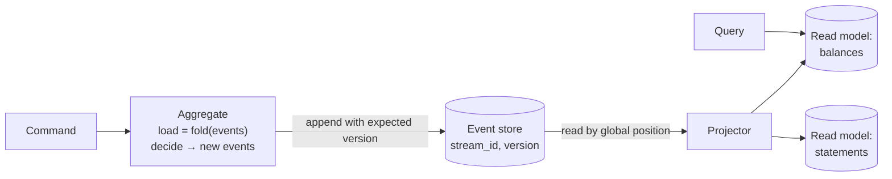

# 5.5 CQRS & Event Sourcing: Event Store Design, Optimistic Concurrency, Projections, Replay, Snapshots, and the Out-of-Order Commit Trap

> **Verified stack:** an event store on PostgreSQL **18.6** written in plain Java 25 (sealed event types, record patterns), plus a two-session interleaving that reproduces the projection gap bug. Output is real; the snapshot timing is one measured run.

---

## 0. First principles: two separate decisions 🔥

People say "CQRS/ES" as one word. They're **independent** choices:

| Pattern | Core idea | Use when |
|---|---|---|
| **CQRS** (Command Query Responsibility Segregation) | Separate the **write model** (commands, invariants) from one or more **read models** (queries, shaped per screen) | Reads and writes have very different shapes or scale; many query views over the same data; read models built from other services' events |
| **Event Sourcing** | The **source of truth is the sequence of events**; current state is a **left fold** over them | You need a complete audit history, temporal queries ("balance as of last Tuesday"), or event-driven integration where events are first-class |

CQRS without event sourcing is common and cheap (a denormalized read table updated from the outbox). Event sourcing almost always implies CQRS, because querying an event log directly is impractical.



---

## 1. The event-sourced aggregate (verified) ⚡

```java
sealed interface Event permits Opened, Deposited, Withdrawn {}
record Opened(String owner) implements Event {}
record Deposited(BigDecimal amount) implements Event {}
record Withdrawn(BigDecimal amount) implements Event {}

static final class Account {
    BigDecimal balance = BigDecimal.ZERO;
    int version = 0;
    void apply(Event e) {                                   // state is a left fold over events
        switch (e) {
            case Opened o -> { }
            case Deposited d -> balance = balance.add(d.amount());
            case Withdrawn w -> balance = balance.subtract(w.amount());
        }
        version++;
    }
    Event withdraw(BigDecimal amount) {                     // decide: validate against current state, emit an event
        if (balance.compareTo(amount) < 0) throw new IllegalStateException("insufficient funds: balance " + balance + ", requested " + amount);
        return new Withdrawn(amount);
    }
}
```

Two methods, two rules: **`decide`** validates a command against current state and returns events (it can reject); **`apply`** changes state and must **never** fail (an event is a fact that already happened). The sealed hierarchy lets the compiler check the `switch` is exhaustive when someone adds an event type.

---

## 2. The event store: the primary key is the optimistic lock (verified) 🔥

```sql
create table es_event (
  position    bigint generated always as identity,       -- global order for projections (see §4)
  stream_id   text not null,
  version     int  not null,
  type        text not null,
  data        jsonb not null,
  recorded_at timestamptz not null default now(),
  primary key (stream_id, version));
create unique index es_event_position on es_event (position);
```

```java
/** Appends with an expected version: the (stream_id, version) primary key IS the optimistic lock. */
static void append(Connection c, String stream, int expectedVersion, Event e) throws SQLException {
    try (PreparedStatement ps = c.prepareStatement("insert into es_event (stream_id, version, type, data) values (?, ?, ?, ?::jsonb)")) {
        ps.setString(1, stream); ps.setInt(2, expectedVersion + 1); ps.setString(3, e.getClass().getSimpleName()); ps.setString(4, json(e));
        ps.executeUpdate();
    }
}
```

**Output (verified):**

```text
== 1. Commands -> events
  rejected: insufficient funds: balance 70, requested 500
  acc-1 balance=70 version=3
== 2. Two writers decide on the same version (optimistic concurrency)
  writer 2: 23505 ERROR: duplicate key value violates unique constraint "es_event_pkey"  -> reload and retry
  writer 2 retry: insufficient funds: balance 20, requested 50
```

Both writers loaded version 3 (balance 70) and each decided "withdraw 50 is fine". Writer 1 appended version 4. Writer 2's append of version 4 hit the **primary key**, so it reloaded (balance 20) and the retried command was correctly **rejected**. Without the expected-version check both withdrawals would have succeeded and the balance would be −30. No locks, no isolation level games: the unique constraint is the concurrency control.

---

## 3. Projections, replay, and snapshots (verified) ⚡

### 3.1 A projection with a checkpoint

```java
static int project(Connection c) throws SQLException {
    long checkpoint = /* select position from es_checkpoint where projection = 'balances' */;
    // read events after the checkpoint in global order, update the read model, advance the checkpoint
    ... "select position, stream_id, type, (data->>'amount')::numeric from es_event where position > ? order by position" ...
    ... "update es_balance set balance = balance +/- ? where stream_id = ?" ...
    ... "update es_checkpoint set position = ? where projection = 'balances'" ...
}
```

**Output (verified):**

```text
== 3. Projection with a checkpoint, then a full rebuild by replay
  projected 6 events -> acc-1=20 acc-2=40
  read model dropped; replayed 6 events -> acc-1=20 acc-2=40
```

The read model is **disposable**: drop it, reset the checkpoint to 0, replay, and you get the same state. That's how you **add a new read model** (a new screen, a new analytics table) to an existing system, or fix a projection bug: rebuild from history. Two practical requirements: projections must be **idempotent** (or checkpointed in the same transaction as the read-model update, as here), and replaying years of events must be fast enough (parallelize by stream, or rebuild into a new table and switch).

### 3.2 Snapshots

**One measured run** (one stream with 10,000 events):

```text
== 4. Snapshots: loading a stream with 10,000 events
  snapshot=false balance=9999 version=10000 events read=10000 (21.7 ms)
  snapshot=true  balance=9999 version=10000 events read=10 (1.7 ms)
```

A snapshot stores state at a version (here 9,990), so loading reads only the tail. Snapshots are a **cache**: derived, rebuildable, versioned with the aggregate code (a snapshot from old code may not match new code's state shape; keep a schema version in it and fall back to full replay). Most aggregates should be **short-lived streams** (an order lives for days, not years); if a stream grows to millions of events, revisit the model ("closing the books": start a new stream per period, carrying over a summary).

---

## 4. The out-of-order commit trap (verified) 🧊

Projectors and outbox relays often read "everything **after position N**". But an identity/sequence value is assigned at `INSERT` time and becomes visible at **commit** time. A slow transaction can take position 1 and commit **after** a fast transaction's position 2:

```text
A> begin
A> insert into feed (event) values ('from slow transaction A') returning position
   1
B> insert into feed (event) values ('from fast transaction B') returning position
   2
# the projector polls "position > checkpoint" while A is still open
P> select position, event from feed where position > 0 order by position
   position | event
   2        | from fast transaction B
# it advances its checkpoint to 2 ... then A commits position 1
A> commit
P> select position, event from feed where position > 2 order by position
   (0 rows)
# event 1 is never projected: the read model silently misses it
```

No error, no exception: the read model is just **silently wrong forever**. Under load this happens routinely.

**A fix with PostgreSQL's transaction horizon (verified):** record the writing transaction's id (`xid8`) and only consume events from transactions **older than the oldest still-running transaction**:

```sql
create table feed (position bigint generated always as identity primary key,
                   tx xid8 not null default pg_current_xact_id(), event text);

select position, event from feed
where position > :checkpoint and tx < pg_snapshot_xmin(pg_current_snapshot())
order by position;
```

```text
A> begin
A> insert ... returning position          → 1
B> insert ... returning position          → 2
P> select ... and tx < pg_snapshot_xmin(pg_current_snapshot())
   (0 rows)                                ← B's event is held back while A might still commit an earlier position
A> commit
P> select ... and tx < pg_snapshot_xmin(pg_current_snapshot())
   1 | from slow transaction A
   2 | from fast transaction B
```

The cost is latency: a long-running transaction holds back the feed (another reason to keep transactions short). Alternatives: a **single writer** that assigns positions in commit order; Debezium/CDC (the WAL is in commit order); or per-row flags instead of a position checkpoint, as the outbox relay in [5.4](04-Transactional-Outbox-and-Idempotent-Consumer-Complete-Implementation.md) does. Purpose-built event stores (EventStoreDB/Kurrent, Axon Server) and Kafka avoid the problem because their append order *is* their read order.

---

## 5. Evolving events (where ES projects get stuck) 🧊

Events are immutable and stored forever, so their schema evolution matters more than your table schemas:

| Change | Approach |
|---|---|
| Add an optional field | Just add it; old events lack it and get a default when read |
| Rename/restructure | **Upcasting**: transform old event versions into the current shape when reading (`OrderPlacedV1 → OrderPlacedV2`) |
| Event was wrong (bug, GDPR deletion) | **Compensating events** for business corrections; for personal data, **crypto-shredding** (encrypt personal fields with a per-subject key, delete the key) |
| Split one event into two | New event types going forward + upcaster for history |

Rule: event types are **business facts in the past tense** (`OrderPlaced`, not `UpdateOrder`), owned and versioned like a public API ([5.2 §4](02-Data-Ownership-Database-per-Service.md)).

---

## 6. When *not* to use event sourcing ⚡

| Use ES | Avoid ES |
|---|---|
| Auditability is a requirement (finance, compliance, healthcare) | CRUD with simple forms; "audit" satisfied by a history table |
| Temporal queries ("state as of …") matter | The team is new to the pattern and the deadline is fixed |
| The domain is naturally a sequence of events (ledgers, workflows, logistics) | Most queries need ad-hoc joins across aggregates (you'll build many projections) |
| You need to build new read models from history later | Reporting requirements are well known and stable |

A frequent middle ground: **CQRS + outbox events** without event sourcing. The write model is a normal relational model, events are published via the outbox, and read models are built from those events.

---

## 7. ❌ Naïve vs ✅ production-hardened

| ❌ Naïve | ✅ Hardened |
|---|---|
| Append events without an expected version | `(stream_id, version)` key = optimistic concurrency (verified 23505 + correct rejection on retry) |
| `apply()` that validates and throws | Validate in `decide`, `apply` never fails |
| Projector reads `position > checkpoint` from a sequence | Commit-order source (WAL/CDC, single writer) or an xmin-horizon guard (verified) |
| Read models treated as precious | Disposable: rebuild by replay (verified identical results) |
| Unbounded streams | Short-lived aggregates; snapshots as a cache (10,000 → 10 events read) |
| Event classes refactored like DTOs | Versioned events, upcasters, crypto-shredding for personal data |

---

## 8. Source to read

| Repo | What to look for |
|---|---|
| [AxonFramework/AxonFramework](https://github.com/AxonFramework/AxonFramework) | Aggregates, event store abstractions, tracking processors (how Axon handles gaps in global sequences) |
| [oskardudycz/EventSourcing.NetCore](https://github.com/oskardudycz/EventSourcing.NetCore) | Not Java, but the best set of event-sourcing samples and explanations, including projections and versioning |
| [eventuate-local / eventuate-tram](https://github.com/eventuate-tram) | Event sourcing + outbox on relational databases in Java |
| [ddd-by-examples/library](https://github.com/ddd-by-examples/library) | Domain events in a DDD modular monolith (see [8.1](../08-GitHub-Codebases-Study-Guide/01-Modular-Monolith-and-DDD-Repos.md)) |

---

## 9. Interview soundbites

* "CQRS and event sourcing are separate decisions. CQRS with an outbox and read models is cheap; event sourcing is for audit, temporal queries and events as first-class facts."
* "In an event store the `(stream_id, version)` key is the optimistic lock. Two writers decided on version 3; one got a duplicate key, reloaded and the retry was correctly rejected."
* "Read models are disposable: drop, replay, same result. That's how you add a new view to an old system."
* "Projectors reading 'position > checkpoint' from a sequence silently skip events committed out of order. I reproduced it and fixed it with a `pg_snapshot_xmin` guard."

---

## 10. Deep dive: a CQRS read model under load, rebuilt and versioned (verified) 🔥

§3 built a projection with a checkpoint over an event store. [5.10](10-Reference-Implementation-Saga-Orchestrator-Kafka-Outbox-Inbox-CQRS.md#scenario-11-cqrs-guarantees) built one the way most CQRS systems without event sourcing do: from integration events on Kafka, with **the aggregate version as the idempotency and ordering guard** instead of a global position.

```sql
insert into qry.order_view as v (order_id, customer, sku, qty, amount, status, version, event_created_at)
values (?, ?, ?, ?, ?, ?, ?, ?::timestamptz)
on conflict (order_id) do update
   set status = excluded.status, version = excluded.version, event_created_at = excluded.event_created_at, updated_at = now()
 where v.version < excluded.version                 -- duplicates and older events change nothing
```

**Output (verified):**

```text
== 11. CQRS: read model == write model, rebuild from offset 0, read-your-writes
  orders in write model: 210
  (id, status, version) differences write vs read: 0
  events replayed into order_view_rebuild: 422
  rows differing rebuild vs live view: 0
  projector applied / skipped (duplicate or stale): 420 / 2
  read model right after place() returned: row absent (stale read)
  client waited for version 1 (one run): 43 ms
```

Under a burst of 200 concurrent orders, event → read-model lag was **p50 125 ms, p99 224 ms** *(one run)*.

| Concern | §3–§4 (event store, global position) | 5.10 (Kafka, per-aggregate version) |
|---|---|---|
| Idempotence | Checkpoint per projector | `where v.version < excluded.version`: no checkpoint table needed |
| Ordering | Global position, and the out-of-order commit trap (§4) | Per-key partition order; the version guard covers replays and overlaps |
| Rebuild | Replay the store | Replay the topic from offset 0 into a new table; compare; swap (rebuild = live, 0 diffs) |
| Cross-aggregate views | Natural (one global log) | Harder: no global order across keys; join in the view with care |
| Read-your-writes | Wait for position | Command returns the version; the client waits for it (43 ms here) |

**Event evolution, one step further than §5.** An upcaster that renamed `amount` → `total` passed its logic test but changed `25.00` to `25.0` on the way through, because the default Jackson parser reads decimals as `double` ([5.9 §8.4](09-Microservices-Patterns-Catalog-Flows-Failure-Modes-Spring-Code.md)). Every upcaster, projector and replay path that parses money needs `USE_BIG_DECIMAL_FOR_FLOATS`, or amounts in minor units.

---

## Summary

| Topic | Key point | Evidence |
|---|---|---|
| Two decisions | CQRS (separate read models) ≠ event sourcing (events as the source of truth) | §0 |
| Event-sourced aggregate | State = fold(events); commands validated against it | §1 |
| Optimistic lock | Unique `(stream_id, version)`; the loser reloads and retries | §2 |
| Projections | Disposable: drop, replay, same result; snapshots for long streams | §3 |
| Out-of-order commits | Position-based readers skip late commits; `pg_snapshot_xmin` guard | §4 |
| Event evolution | Additive, versioned, upcast on read; money as `BigDecimal` | §5, §10 |
| When not to use ES | CRUD domains; "for audit" alone | §6 |
| Kafka-fed read model | Version guard = idempotent + order-safe; rebuild = live; read-your-writes by version | §10 (5.10 scenario 11) |

**Next:** [5.6 Edge patterns: gateway, BFF, aggregator, service mesh →](06-Edge-Patterns-Gateway-BFF-Aggregator-Service-Mesh.md)
