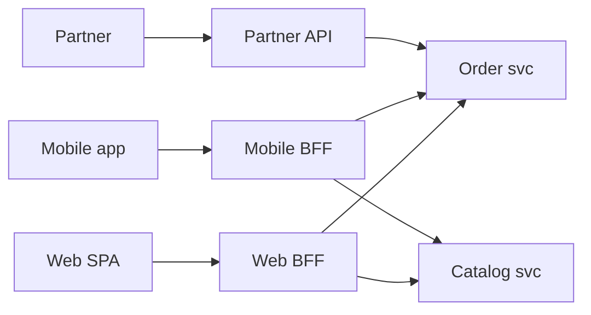

# 5.6 Communication & Edge Patterns: API Gateway, Backend for Frontend, API Composition (Aggregator), Service Mesh (Sidecar vs Sidecarless)

> **Verified:** the aggregator experiment (three downstream stubs on a JDK `HttpServer`, one slow and one failing; JDK 25 `HttpClient` + virtual threads). Gateway, Gateway API and mesh configurations are illustrative (they need a cluster), checked against the current versions: Kubernetes **1.37**, Istio **1.31**, Cilium **1.20** (latest releases on GitHub as of 2026-10-25).

---

## 0. First principles: every hop adds latency, failure modes and an owner 🔥

A client request in a microservice system crosses: client → load balancer → **gateway** → (BFF) → service → other services. Each hop adds **latency** (and tail latency compounds: the slowest of N parallel calls sets the response time), a **failure mode** (timeouts, partial failure), and an **owner** who must operate it. The edge patterns exist to put *cross-cutting* concerns in the right hop:

| Concern | Best placed at |
|---|---|
| TLS termination, WAF, DDoS protection | Edge load balancer / gateway |
| Authentication (validate tokens), coarse authorization, quotas | **Gateway** (plus defense in depth in services) |
| Client-specific payload shaping | **BFF** |
| Combining data from several services for one view | **Aggregator** (often the BFF) |
| Service-to-service mTLS, retries/timeouts policy, traffic shifting, telemetry | **Service mesh**, or libraries in each service |
| Business rules | **Services only**. Never the gateway |

---

## 1. API Gateway ⚡

Routing plus *offloading*: the gateway takes over cross-cutting work so services don't each reimplement it.

| Responsibility | Notes |
|---|---|
| Routing | By path, host, header, weight (canary, strangler fig in [5.1 §3](01-Decomposition-Modular-Monolith-Strangler-Branch-by-Abstraction.md)) |
| AuthN offload | Validate JWTs at the edge and forward the token (or verified claims) inside. Services still validate: never trust the network alone |
| Rate limiting and quotas | Per API key/tenant, shared state (Redis) across gateway replicas ([4.5 §4](../04-Spring-Boot-Internals/05-Security-Filter-Chain-JWT-Method-Security-Rate-Limiting.md)) |
| Request limits, CORS, header hygiene | Strip internal headers from inbound requests (`X-Internal-User`!) |
| Observability | Start the trace (`traceparent`), access logs, edge metrics |
| Protocol translation | REST ↔ gRPC, WebSocket upgrades |

Anti-patterns: business logic or orchestration in the gateway (it becomes a distributed monolith's god service); one gateway team as a bottleneck for every route change (use declarative, self-service routes).

### Kubernetes Gateway API (illustrative)

In Kubernetes the portable way to express edge routing is the **Gateway API** (`Gateway` + `HTTPRoute`), implemented by Envoy Gateway, Istio, Cilium, NGINX Gateway Fabric and cloud controllers:

```yaml
apiVersion: gateway.networking.k8s.io/v1
kind: HTTPRoute
metadata:
  name: orders
  namespace: shop
spec:
  parentRefs:
    - name: public-gateway          # a Gateway owned by the platform team
      namespace: infra
  hostnames: ["api.example.com"]
  rules:
    - matches:
        - path: { type: PathPrefix, value: /api/orders }
      backendRefs:
        - name: order-service       # new service: 20% (strangler / canary)
          port: 8080
          weight: 20
        - name: legacy-monolith
          port: 8080
          weight: 80
      timeouts:
        request: 5s                 # overall budget at the edge
```

Spring Cloud Gateway (WebFlux or the newer MVC flavor) fits when routing needs Java logic, custom filters or Spring Security integration.

---

## 2. Backend for Frontend (BFF) ⚡

One backend **per client experience** (web, iOS/Android, partner API), owned by the team that owns that frontend:



| Why | Mobile wants small payloads and few round trips (battery, latency); web wants richer pages; partners want stable, versioned contracts |
|---|---|
| Owner | The frontend team, so UI changes don't wait for a central API team |
| Risk | Duplicated logic across BFFs (keep business logic in services, not BFFs); BFF sprawl |
| Security | A web BFF can hold the OAuth tokens server-side and give the browser an HttpOnly session cookie ("token handler" pattern) |

---

## 3. API composition: the aggregator (verified) 🔥

The order-details page needs the order, its shipping status and its reviews, from three services. The order is **critical**; shipping and reviews are **optional**.

```java
/** ❌ Naive: sequential, no timeouts, one failure fails the whole page. */
static String naive() throws Exception {
    return "{order:" + call("/orders/42", Duration.ofSeconds(30)) + ", shipping:" + call("/shipping/42", Duration.ofSeconds(30))
            + ", reviews:" + call("/reviews/42", Duration.ofSeconds(30)) + "}";
}

/** ✅ Parallel on virtual threads, per-call timeouts, fallbacks for optional parts, the critical part must succeed. */
static String hardened(ExecutorService vt) throws Exception {
    CompletableFuture<String> order = CompletableFuture.supplyAsync(() -> unchecked(() -> call("/orders/42", Duration.ofMillis(300))), vt);
    CompletableFuture<String> shipping = CompletableFuture.supplyAsync(() -> unchecked(() -> call("/shipping/42", Duration.ofMillis(300))), vt)
            .exceptionally(e -> "{\"status\":\"unknown\",\"degraded\":true}");
    CompletableFuture<String> reviews = CompletableFuture.supplyAsync(() -> unchecked(() -> call("/reviews/42", Duration.ofMillis(300))), vt)
            .exceptionally(e -> "[]");
    return "{order:" + order.get(1, TimeUnit.SECONDS) + ", shipping:" + shipping.get() + ", reviews:" + reviews.get() + "}";
}
```

Stubs: `/orders/42` answers in 80 ms, `/shipping/42` takes **2 s**, `/reviews/42` returns **503**.

**Output (verified):**

```text
naive    -> FAILED: /reviews/42 -> HTTP 503
           took 2230 ms
hardened -> {order:{"id":42,"total":99.5}, shipping:{"status":"unknown","degraded":true}, reviews:[]}
           took 308 ms
```

| | Naïve | Hardened |
|---|---|---|
| Latency | Sum of calls (2,230 ms), and the user still got an error | Max of the calls, capped by timeouts (308 ms) |
| Failure of an optional dependency | Whole page fails | **Graceful degradation**: page renders with a marker (`degraded: true`) |
| Slow dependency | Holds the request thread for 2 s | Abandoned at 300 ms |

Rules for aggregators:

1. **Classify each dependency**: critical (fail the request) vs optional (degrade).
2. **Per-call timeouts** that fit inside an **overall deadline** (and propagate the remaining budget downstream, e.g. a `deadline` header or gRPC deadlines).
3. Parallelize independent calls (virtual threads or `CompletableFuture`; JDK structured concurrency is still a preview API in JDK 25).
4. Add circuit breakers and bulkheads per dependency so a sick service fails fast ([6.1](../06-Resilience-Caching-Kafka/01-Resilience4j-Circuit-Breaker-Internals-Sliding-Windows.md), [6.2](../06-Resilience-Caching-Kafka/02-Bulkheads-Rate-Limiters-Retries-Jitter-Decorator-Order.md)).
5. If every request needs the same composed data, consider a **CQRS read model** instead ([5.5](05-CQRS-and-Event-Sourcing.md)): one local query beats three remote calls.

---

## 4. Service mesh: sidecar vs sidecarless 🧊

A mesh moves service-to-service networking concerns out of application code into infrastructure:

| Capability | Without a mesh | With a mesh |
|---|---|---|
| mTLS between services | Certificates in every app | Automatic identity (SPIFFE) and mTLS |
| Retries, timeouts, circuit breaking | Libraries (Resilience4j) in each service | Policy objects (e.g. Istio `VirtualService`/`DestinationRule`, Gateway API routes) |
| Traffic shifting (canary, mirroring) | Gateway or app logic | Declarative, per route |
| Telemetry | App instrumentation | Uniform L4/L7 metrics and traces from proxies |
| Authorization between services | App code | Policies by service identity |

### Data-plane architectures

```text
Sidecar (classic Istio, Linkerd):           Sidecarless / ambient (Istio ambient), eBPF (Cilium):
┌────────── pod ──────────┐                 ┌──── pod ────┐  ┌──── pod ────┐
│ app ⇄ Envoy sidecar     │                 │     app     │  │     app     │
└─────────────────────────┘                 └──────┬──────┘  └──────┬──────┘
  one proxy per pod                                │ L4 (mTLS) via per-NODE agent:
  (CPU/memory per pod, injection,                  │ ztunnel (Istio) or eBPF + node proxy (Cilium)
   restart to upgrade proxy)                       ▼
                                             L7 features only where needed, via shared
                                             "waypoint" proxies (Istio) / per-node Envoy (Cilium)
```

| | Sidecar | Sidecarless (ambient / eBPF) |
|---|---|---|
| Resource cost | A proxy per pod (memory × pod count) | Per node, plus L7 proxies only where needed |
| Upgrades | Restart every workload to update proxies | Upgrade node agents |
| Isolation | Strong (per-pod proxy) | Shared node component: a different blast-radius model |
| L7 features | Everywhere by default | Opt-in (waypoints) |
| Maturity | Longest track record | Istio ambient is GA (since 1.24); Cilium's eBPF datapath is widely used |

### Mesh pitfalls a staff engineer names

* **Double retries.** App retries 3× and the mesh retries 3× → up to 9 attempts per call, multiplying load during an outage ([6.2](../06-Resilience-Caching-Kafka/02-Bulkheads-Rate-Limiters-Retries-Jitter-Decorator-Order.md)). Decide *one* layer owns retries per hop.
* **Timeouts in two places** that disagree: the shorter one wins and the other's metrics lie.
* **Startup ordering**: the app starts before the sidecar is ready (Kubernetes native sidecars, `initContainers` with `restartPolicy: Always`, fix this; see [7.3](../07-Docker-JVM-Kubernetes/03-Kubernetes-Probes-and-Graceful-Shutdown.md)).
* **Debugging moves into infrastructure**: you need people who can read Envoy stats.
* Adopt for **mTLS + uniform telemetry + traffic management across many services and languages**. For a handful of Java services, Spring/Resilience4j libraries plus a gateway are often enough.

---

## 5. ❌ Naïve vs ✅ production-hardened

| ❌ Naïve | ✅ Hardened |
|---|---|
| Business logic in gateway filters | Gateway = routing + cross-cutting offload; logic in services |
| Trust the network after the gateway | Validate tokens in services too; mTLS between services |
| One API for web, mobile and partners | BFF per experience; versioned partner API |
| Sequential aggregator, no timeouts (2,230 ms + error) | Parallel, per-call timeouts, fallbacks for optional data (308 ms, degraded but useful) |
| Retries in app + mesh + gateway | One owner for retries per hop; budgets |
| Mesh adopted for a few services "because Kubernetes" | Adopt for mTLS, uniform telemetry and traffic control at scale |

---

## 6. Source to read

| Repo | What to look for |
|---|---|
| [spring-cloud/spring-cloud-gateway](https://github.com/spring-cloud/spring-cloud-gateway) | Route predicates and filters; `RequestRateLimiter` with Redis |
| [kubernetes-sigs/gateway-api](https://github.com/kubernetes-sigs/gateway-api) | The `HTTPRoute` spec, including timeouts and weights |
| [istio/istio](https://github.com/istio/istio) | Ambient mode (`ztunnel`, waypoints) |
| [cilium/cilium](https://github.com/cilium/cilium) | eBPF datapath, service mesh, Gateway API implementation |
| [spring-petclinic/spring-petclinic-microservices](https://github.com/spring-petclinic/spring-petclinic-microservices) | A Spring Cloud Gateway in a reference system ([8.2](../08-GitHub-Codebases-Study-Guide/02-Microservices-and-Cloud-Native-Repos.md)) |

---

## 7. Interview soundbites

* "The gateway does routing and cross-cutting offload: TLS, token validation, quotas, header hygiene. Business logic stays in services."
* "A BFF per client experience, owned by the frontend team, shapes payloads for that client."
* "My aggregator classifies dependencies as critical or optional. Sequential with no timeouts took 2.2 s and failed; parallel with 300 ms timeouts and fallbacks answered in 308 ms with a degraded section."
* "Sidecars cost a proxy per pod; ambient and eBPF meshes move L4 to the node and add L7 only where needed. Either way, decide one owner for retries per hop."

---

## 8. Deep dive: deadlines, idempotency keys and one error contract at the edge (verified) 🔥

§3's aggregator proved that per-call timeouts inside a deadline turn a 2.2 s failure into a 308 ms degraded answer. Batch 2 verified three more pieces that every edge-facing service needs:

**1. Deadline propagation, not per-hop timeouts.** [5.9 §8.2](09-Microservices-Patterns-Catalog-Flows-Failure-Modes-Spring-Code.md) (compiled against Spring Framework 7.0.10) gives the downstream `RestClient`:

* a connect timeout and a read ceiling (`JdkClientHttpRequestFactory`);
* an interceptor that refuses to call once the caller's deadline has passed;
* an `X-Request-Deadline` header, so the next hop knows how much time is *left*.

Three hops with independent 1 s timeouts can take 3 s after the user has given up. With a propagated deadline, every hop stops at the same instant.

**2. Idempotency keys for client retries.** An edge that retries, and every mobile client does, needs the server to accept `Idempotency-Key`. Verified ([5.9 §8.3](09-Microservices-Patterns-Catalog-Flows-Failure-Modes-Spring-Code.md)): **5 concurrent retries of one POST → 1 effect, 5 identical responses**, and the same key with a different body was rejected. The unique index on the key arbitrates; a "check, then insert" version races.

**3. One error contract, end to end.** Three verified ways a service ends up with inconsistent error bodies at the edge:

| Path | What the client got | Evidence |
|---|---|---|
| Exception handled by `@ExceptionHandler` | `application/problem+json` (RFC 9457) with your fields | [4.8 §1](../04-Spring-Boot-Internals/08-Request-Lifecycle-Events-Async-Graceful-Shutdown.md#1-the-request-lifecycle-verified-) scenario 2 |
| Exception *not* handled | Boot's `/error` JSON (`timestamp/status/error/path`), and the servlet filter recorded **200** | 4.8 §1 scenario 3 |
| Security denial in the filter chain | Empty body + `WWW-Authenticate`, never seen by `@ControllerAdvice` | [4.5 §9](../04-Spring-Boot-Internals/05-Security-Filter-Chain-JWT-Method-Security-Rate-Limiting.md#9-deep-dive-who-writes-your-401-and-403-and-why-a-catch-all-handler-turns-403-into-500-verified-) |

A gateway or BFF that normalizes errors hides these differences from clients, but only if it can recognize all three shapes. Fixing them at the source is a catch-all `ProblemDetail` handler that does **not** swallow security exceptions, plus security handlers that write `ProblemDetail`.

---

## Summary

| Topic | Key point | Evidence |
|---|---|---|
| Every hop costs | Latency, failure modes and an owner | §0 |
| Gateway | Routing + cross-cutting offload; no business logic | §1 |
| BFF | One per client experience, owned by that client's team | §2 |
| Aggregator | Parallel, per-call timeouts within a deadline, optional sections degrade | §3: 2.2 s failure → 308 ms degraded |
| Service mesh | Sidecar vs ambient/eBPF; one retry owner per hop | §4 |
| Deadlines | Propagate the remaining budget; refuse when it's gone | §8 (5.9 §8.2) |
| Idempotency keys | Unique-index arbitration: 5 retries → 1 effect | §8 (5.9 §8.3) |
| Error contract | Handled, unhandled and security errors produce three different shapes unless unified | §8 (4.8, 4.5) |

**Next:** [5.7 Observability & contract testing →](07-Observability-Tracing-Correlation-IDs-Contract-Testing.md)
