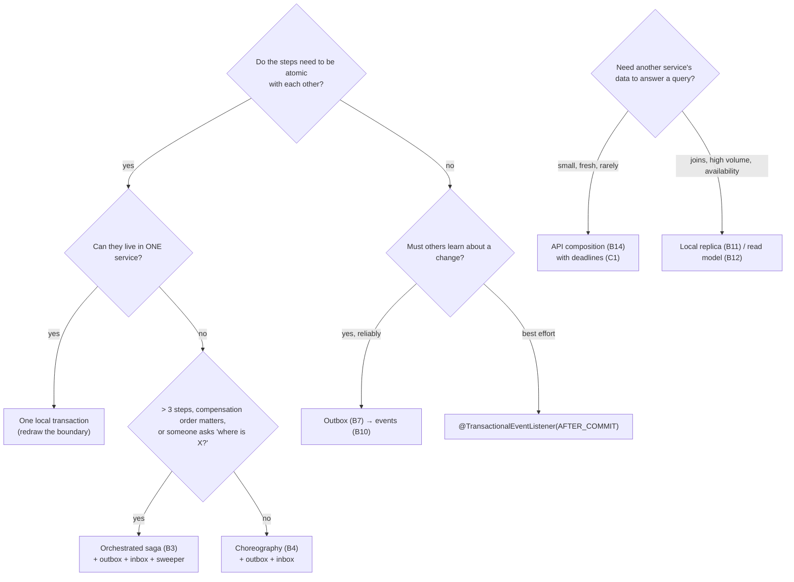

# 5.9 The Microservices Patterns Catalog: Flows, Failure Modes, Spring Code, and Where Each One Was Proven

> **How to read this file:** 42 patterns in 7 families. Each card gives the **problem**, the **flow**, the **failure modes** (what breaks in production), the **Spring implementation**, the **evidence** (a link to a run in this kit, marked ✅, or 📝 when the claim is design reasoning), and **when not to use it**. Two cross-cutting tables follow the cards: failure mode → patterns, and a decision guide.
>
> **Verified in this file (§8):** the anti-corruption layer, deadline-propagating `RestClient`, HTTP idempotency key, event upcaster and strangler router were **compiled** against Spring Boot 4.1.2 / Spring Framework 7.0.10 / Jackson 3.1.7. The idempotency key (5 concurrent retries → 1 effect), the upcaster and the router split were also **run** against PostgreSQL 18.6. Everything else links to the module where it ran.

---

## 0. The catalog at a glance

| # | Pattern | Family | One-line problem | Evidence |
|---|---|---|---|---|
| A1 | Decompose by capability / bounded context | Decomposition | Where to cut | [5.1 §0](01-Decomposition-Modular-Monolith-Strangler-Branch-by-Abstraction.md#0-first-principles-youre-drawing-consistency-and-change-boundaries-) 📝 |
| A2 | Modular monolith | Decomposition | Boundaries without distribution | [5.1 §2](01-Decomposition-Modular-Monolith-Strangler-Branch-by-Abstraction.md#2-spring-modulith-verified-boundaries-), [5.11](11-Modular-Monolith-Blueprint-Spring-Modulith-Externalized-Events-Extraction.md) ✅ |
| A3 | Strangler fig | Migration | Replace a legacy system incrementally | [5.1 §3](01-Decomposition-Modular-Monolith-Strangler-Branch-by-Abstraction.md#3-strangler-fig-migrating-a-legacy-system-incrementally-), §8.5 ✅ |
| A4 | Branch by abstraction | Migration | Replace a component inside a codebase | [5.1 §4](01-Decomposition-Modular-Monolith-Strangler-Branch-by-Abstraction.md#4-branch-by-abstraction-replacing-a-component-inside-a-codebase-) |
| A5 | Anti-corruption layer | Migration | Keep a foreign model out | §8.1 (compiled) |
| A6 | Parallel run / shadow traffic | Migration | Prove the new path before trusting it | §8.5 ✅, [5.11 §8](11-Modular-Monolith-Blueprint-Spring-Modulith-Externalized-Events-Extraction.md#8-the-extraction-path-module--service-step-by-step-) |
| B1 | Database per service | Data | Independent change and scaling | [5.2 §1](02-Data-Ownership-Database-per-Service.md#1-enforce-ownership-in-the-database-verified-) ✅ |
| B2 | Shared database (anti-pattern) | Data | Transitional only | [5.2 §2](02-Data-Ownership-Database-per-Service.md#2-the-shared-database-anti-pattern-and-why-teams-fall-into-it-) |
| B3 | Saga: orchestration | Consistency | Multi-service business transaction | [5.3 §1](03-Sagas-Choreography-vs-Orchestration-Compensation-Semantic-Locks.md#1-orchestration-implemented-and-verified-), [5.10](10-Reference-Implementation-Saga-Orchestrator-Kafka-Outbox-Inbox-CQRS.md) ✅ |
| B4 | Saga: choreography | Consistency | Short flows across autonomous domains | [5.3 §2](03-Sagas-Choreography-vs-Orchestration-Compensation-Semantic-Locks.md#2-choreography-no-conductor-) |
| B5 | Semantic lock + isolation countermeasures | Consistency | Sagas have no isolation | [5.3 §5](03-Sagas-Choreography-vs-Orchestration-Compensation-Semantic-Locks.md#5-isolation-countermeasures-the-part-most-designs-skip-), [5.10 §5](10-Reference-Implementation-Saga-Orchestrator-Kafka-Outbox-Inbox-CQRS.md#5-reading-each-failure-mode-) ✅ |
| B6 | Process manager timeouts (sweeper) | Consistency | Replies that never come | [5.10 §3.6](10-Reference-Implementation-Saga-Orchestrator-Kafka-Outbox-Inbox-CQRS.md#36-the-timeout-sweeper) ✅ |
| B7 | Transactional outbox | Messaging | Dual write | [5.4](04-Transactional-Outbox-and-Idempotent-Consumer-Complete-Implementation.md), [5.10](10-Reference-Implementation-Saga-Orchestrator-Kafka-Outbox-Inbox-CQRS.md), [5.11 §4](11-Modular-Monolith-Blueprint-Spring-Modulith-Externalized-Events-Extraction.md#4-outage-and-restart-drill-verified-) ✅ |
| B8 | Polling publisher vs log tailing (CDC) | Messaging | How the outbox leaves the DB | [5.4 §3, §6](04-Transactional-Outbox-and-Idempotent-Consumer-Complete-Implementation.md#6-variant-transaction-log-tailing-with-debezium-verified-) ✅ |
| B9 | Idempotent consumer / inbox | Messaging | At-least-once delivery | [5.4 §4](04-Transactional-Outbox-and-Idempotent-Consumer-Complete-Implementation.md#4-the-idempotent-consumer-verified-), [5.10 sc. 2, 5](10-Reference-Implementation-Saga-Orchestrator-Kafka-Outbox-Inbox-CQRS.md#4-the-failure-mode-lab-complete-output-) ✅ |
| B10 | Domain vs integration events | Messaging | What to publish | [5.2 §4](02-Data-Ownership-Database-per-Service.md#4-events-as-a-contract-), [5.11 §8](11-Modular-Monolith-Blueprint-Spring-Modulith-Externalized-Events-Extraction.md#8-the-extraction-path-module--service-step-by-step-) ✅ |
| B11 | Event-carried state transfer / local replica | Data | Query another service's data without calling it | [5.2 §3](02-Data-Ownership-Database-per-Service.md#3-how-services-get-each-others-data-), [5.10 §3.8](10-Reference-Implementation-Saga-Orchestrator-Kafka-Outbox-Inbox-CQRS.md#38-the-query-side-version-guarded-projector-and-rebuild) ✅ |
| B12 | CQRS | Data | Different read and write shapes | [5.5 §0](05-CQRS-and-Event-Sourcing.md#0-first-principles-two-separate-decisions-), [5.10 sc. 11](10-Reference-Implementation-Saga-Orchestrator-Kafka-Outbox-Inbox-CQRS.md#scenario-11-cqrs-guarantees) ✅ |
| B13 | Event sourcing | Data | State = fold(events) | [5.5 §1–4](05-CQRS-and-Event-Sourcing.md#1-the-event-sourced-aggregate-verified-) ✅ |
| B14 | API composition | Query | Join across services at read time | [5.6 §3](06-Edge-Patterns-Gateway-BFF-Aggregator-Service-Mesh.md#3-api-composition-the-aggregator-verified-) ✅ |
| C1 | Synchronous RPC with deadlines | Communication | Request/response across services | §8.2 (compiled), [5.6 §3](06-Edge-Patterns-Gateway-BFF-Aggregator-Service-Mesh.md#3-api-composition-the-aggregator-verified-) ✅ |
| C2 | Asynchronous messaging: commands vs events | Communication | Decouple in time | [5.10 §1.2](10-Reference-Implementation-Saga-Orchestrator-Kafka-Outbox-Inbox-CQRS.md#12-the-contract-topics-keys-headers) ✅ |
| C3 | Request / asynchronous reply | Communication | Long-running remote work | [5.10](10-Reference-Implementation-Saga-Orchestrator-Kafka-Outbox-Inbox-CQRS.md) ✅ |
| C4 | Competing consumers + partition-key ordering | Communication | Scale out without reordering | [5.10 sc. 6, 10](10-Reference-Implementation-Saga-Orchestrator-Kafka-Outbox-Inbox-CQRS.md#5-reading-each-failure-mode-), [10.2](../10-Kafka-Production/02-Kafka-Consumers-Rebalancing-EOS-Retries-DLQ.md) ✅ |
| C5 | Dead-letter channel + retry classification | Communication | Poison messages | [5.10 sc. 9](10-Reference-Implementation-Saga-Orchestrator-Kafka-Outbox-Inbox-CQRS.md#scenario-9-poison-messages), [10.2 §4](../10-Kafka-Production/02-Kafka-Consumers-Rebalancing-EOS-Retries-DLQ.md#4-retries-and-dead-letter-topics-) ✅ |
| C6 | Idempotency key for synchronous commands | Communication | Client retries of a POST | §8.3 ✅ |
| C7 | Consumer-driven contracts | Communication | Independent deploys without breaking callers | [5.7 §4](07-Observability-Tracing-Correlation-IDs-Contract-Testing.md#4-consumer-driven-contract-testing-verified-with-pact-) ✅ |
| C8 | Schema evolution: tolerant reader + upcaster | Communication | Changing an event others depend on | [5.5 §5](05-CQRS-and-Event-Sourcing.md#5-evolving-events-where-es-projects-get-stuck-), §8.4 ✅ |
| D1 | API gateway | Edge | One front door | [5.6 §1](06-Edge-Patterns-Gateway-BFF-Aggregator-Service-Mesh.md#1-api-gateway-) |
| D2 | Backend for frontend | Edge | Client-specific APIs | [5.6 §2](06-Edge-Patterns-Gateway-BFF-Aggregator-Service-Mesh.md#2-backend-for-frontend-bff-) |
| D3 | Service mesh / sidecar | Edge | Uniform L4/L7 policy | [5.6 §4](06-Edge-Patterns-Gateway-BFF-Aggregator-Service-Mesh.md#4-service-mesh-sidecar-vs-sidecarless-) |
| E1 | Timeouts + deadline propagation | Reliability | Bounded waiting end-to-end | §8.2, [6.2 §4](../06-Resilience-Caching/02-Bulkheads-Rate-Limiters-Retries-Jitter-Decorator-Order.md#4-timeouts-and-the-timelimiter-) |
| E2 | Retry with backoff + jitter | Reliability | Transient failures | [6.2 §3](../06-Resilience-Caching/02-Bulkheads-Rate-Limiters-Retries-Jitter-Decorator-Order.md#3-retries-) ✅ |
| E3 | Circuit breaker | Reliability | Stop calling a failing dependency | [6.1](../06-Resilience-Caching/01-Resilience4j-Circuit-Breaker-Internals-Sliding-Windows.md) ✅ |
| E4 | Bulkhead / concurrency limit | Reliability | Contain a slow dependency | [6.2 §1](../06-Resilience-Caching/02-Bulkheads-Rate-Limiters-Retries-Jitter-Decorator-Order.md#1-bulkheads-) ✅ |
| E5 | Rate limiting / load shedding | Reliability | Protect capacity | [6.2 §2](../06-Resilience-Caching/02-Bulkheads-Rate-Limiters-Retries-Jitter-Decorator-Order.md#2-rate-limiters-), [4.5 §4](../04-Spring-Boot-Internals/05-Security-Filter-Chain-JWT-Method-Security-Rate-Limiting.md#4-a-rate-limiting-filter-verified-) ✅ |
| E6 | Fallback / graceful degradation | Reliability | Partial answers beat errors | [5.6 §3](06-Edge-Patterns-Gateway-BFF-Aggregator-Service-Mesh.md#3-api-composition-the-aggregator-verified-) ✅ |
| E7 | Health probes + graceful shutdown | Reliability | Deploys without dropped requests | [7.3](../07-Docker-JVM-Kubernetes/03-Kubernetes-Probes-and-Graceful-Shutdown.md), [4.8](../04-Spring-Boot-Internals/08-Request-Lifecycle-Events-Async-Graceful-Shutdown.md) ✅ |
| F1 | Distributed tracing + correlation IDs | Observability | Follow one request | [5.7 §1–2](07-Observability-Tracing-Correlation-IDs-Contract-Testing.md#1-verified-propagation-across-two-spring-boot-services-) ✅ |
| F2 | Process audit log + business metrics | Observability | "Where is order 42?" | [5.10 §8](10-Reference-Implementation-Saga-Orchestrator-Kafka-Outbox-Inbox-CQRS.md#8-production-hardening-checklist-) ✅ |
| G1 | Microservice chassis (platform starter) | Platform | Cross-cutting concerns once | [4.7](../04-Spring-Boot-Internals/07-Auto-Configuration-Internals-Production-Starter-Blueprint.md) ✅ |
| G2 | Access-token propagation | Platform | Identity across hops | [4.5 §2](../04-Spring-Boot-Internals/05-Security-Filter-Chain-JWT-Method-Security-Rate-Limiting.md#2-stateless-jwt-validation-verified-) ✅ |

---

## 1. Decomposition and migration (A) 🔥

### A1. Decompose by business capability / bounded context

* **Problem:** where to draw service lines.
* **Flow:** capability map → bounded contexts (one model, one language) → aggregates (consistency units) → modules → maybe services.
* **Failure modes:**
  * **Entity services** (`CustomerService`, `OrderService` as CRUD wrappers): every use case calls five services, producing a *distributed monolith*.
  * **An invariant split across services:** "order total ≤ credit limit" spanning Order and Customer forces a saga for what used to be a `CHECK`.
  * **Boundaries that don't match team ownership** (Conway's law): services owned by nobody, or shared by everyone.
* **Spring:** one top-level package per context, enforced by `ApplicationModules.verify()` ([5.11 §2](11-Modular-Monolith-Blueprint-Spring-Modulith-Externalized-Events-Extraction.md#2-named-interfaces-and-allowed-dependencies-verified-)).
* **Don't:** split before you know the boundaries. Start modular (A2).

### A2. Modular monolith

* **Problem:** you want enforced boundaries and independent evolution without paying for distribution yet.
* **Flow:** modules talk via named interfaces (sync) and events (async, durable registry); one deployable, one DB with a schema per module.
* **Failure modes:**
  * **Boundaries enforced by convention only:** they rot.
  * **Cross-module joins:** they make extraction impossible.
  * **In-process events treated as reliable without a registry:** a crash after commit loses them.
* **Spring:** Spring Modulith with `@NamedInterface`, `allowedDependencies`, `@ApplicationModuleListener`, the JDBC event publication registry and `@ApplicationModuleTest`.
* **Evidence ✅:**
  * one illegal dependency → 3 violations with line numbers;
  * a failed listener `FAILED` → `COMPLETED` after restart;
  * module tests with **0** foreign beans ([5.11](11-Modular-Monolith-Blueprint-Spring-Modulith-Externalized-Events-Extraction.md)).
* **Don't:** use a modular monolith when parts need truly different runtimes, scaling profiles or release cadences *today*.

### A3. Strangler fig

* **Problem:** replace a legacy system without a big-bang rewrite.
* **Flow:** facade (gateway or code seam) → route one capability to the new service → sync data (CDC) → shift traffic gradually → delete the old path.
* **Failure modes:**
  * **Dual writes during migration**, so the two systems disagree.
  * **A strangler that never strangles:** both systems live forever.
  * **The facade becomes a bottleneck or a business-logic dump.**
  * **No way back:** routing that isn't reversible per tenant.
* **Spring:** a router at the seam with a sticky per-tenant percentage (§8.5, **verified: 25% → 2,495 of 10,000 tenants, identical on the second pass**). At the edge, gateway route weights ([5.6 §1](06-Edge-Patterns-Gateway-BFF-Aggregator-Service-Mesh.md#1-api-gateway-)).
* **Don't:** strangle a system that is small enough to replace in one release.

### A4. Branch by abstraction

* **Problem:** replace a component *inside* a codebase while trunk keeps shipping.
* **Flow:** introduce an interface → old implementation behind it → build the new one behind a flag → switch → delete the old one.
* **Failure modes:**
  * **The abstraction leaks the old model** (the new implementation must fake old quirks).
  * **The flag is never removed.**
* **Spring:** two beans of one interface; `@ConditionalOnProperty` or a router bean (§8.5).

### A5. Anti-corruption layer (ACL)

* **Problem:** a legacy or external model would contaminate yours (`CUST_NO`, `STATUS_CD='A'`).
* **Flow:** your port (interface in your language) ← ACL adapter translates ← foreign API.
* **Failure modes:**
  * **The ACL becomes a second legacy system** (business rules creep in).
  * **Translation loses information** you later need.
  * **Errors leak foreign semantics** (a 404 vs an empty record).
* **Spring:** §8.1 (compiled): `CustomerDirectory` port + `LegacyCrmCustomerDirectory` adapter over `RestClient`, mapping `NotFound` → `Optional.empty()`.
* **Don't:** wrap a model you own; fix it instead.

### A6. Parallel run / shadow traffic

* **Problem:** prove a new implementation on real traffic before it serves anyone.
* **Flow:** serve from old → call new with the same input → compare → record mismatches → fix → cut over.
* **Failure modes:**
  * **Side effects in shadow:** double emails, double charges. The shadow path must be read-only or write to its own store.
  * **The shadow call slows or breaks the real response:** isolate it (async, timeout, catch-all).
  * **Comparing non-deterministic fields:** timestamps, ids.
* **Spring:** §8.5 `shadowCompare` (exceptions in the shadow never affect the response); the extraction shadow phase in [5.11 §8](11-Modular-Monolith-Blueprint-Spring-Modulith-Externalized-Events-Extraction.md#8-the-extraction-path-module--service-step-by-step-).

---

## 2. Data ownership and consistency (B) 🔥

### B1. Database per service

* **Problem:** a shared schema couples deploys, scaling and failure.
* **Flow:** each service owns its schema; others get data via API, events or replicas (B11).
* **Failure modes:**
  * **Ownership by convention only:** someone joins your table, and now your schema is their API.
  * **Reporting needs everything:** stream to a warehouse instead of granting reads.
* **Spring/DB:** schema + role per service with `REVOKE`, verified to block a cross-service read ([5.2 §1](02-Data-Ownership-Database-per-Service.md#1-enforce-ownership-in-the-database-verified-)). 5.10 uses one schema per service and one outbox/inbox per schema.

### B2. Shared database (anti-pattern, sometimes a transitional state)

* **Failure modes:**
  * **Hidden coupling:** a column rename breaks three teams.
  * **Lock contention** across services.
  * **No independent scaling.**
* **Acceptable** briefly during a strangler migration, read-only, with a removal date.

### B3. Saga: orchestration

* **Problem:** a business transaction across services with no 2PC.
* **Flow:** orchestrator state machine; each step = local transaction + command; replies drive transitions; compensations in reverse order.
* **Failure modes:**
  * lost or duplicate replies;
  * late replies after a timeout;
  * crash between deciding and committing;
  * a compensation that fails;
  * a pivot whose outcome is unknown;
  * stuck sagas;
  * no isolation (B5).
* **Spring:** 5.10's `SagaOrchestrator`: `@KafkaListener` + `@Transactional`; inbox + `FOR UPDATE` + transition table + outbox, all in one transaction.
* **Evidence ✅:** 11 scenarios:
  * declined → compensate;
  * crash → exactly one command;
  * late pivot → **refund**;
  * slow compensation → retry, no double release;
  * 200 vs 50 → no oversell ([5.10 §4](10-Reference-Implementation-Saga-Orchestrator-Kafka-Outbox-Inbox-CQRS.md#4-the-failure-mode-lab-complete-output-)).
* **Don't:** use a saga when the steps belong in one service (one local transaction beats any saga). Past about 5 saga types with timers and human steps, use a durable-execution engine ([5.3 §4](03-Sagas-Choreography-vs-Orchestration-Compensation-Semantic-Locks.md#4-durable-execution-engines-)).

### B4. Saga: choreography

* **Problem:** short flows between autonomous domains with no natural owner.
* **Flow:** each service reacts to events and emits its own; no central state.
* **Failure modes:**
  * **"Where is order 42?"** has no single answer.
  * **Cyclic event chains.**
  * **Compensation logic smeared across services.**
  * **Adding a step touches N services.**
* **Spring:** `@KafkaListener` per service + outbox; correlation id in headers; a read-model "process view" built from all events for visibility.
* **Don't:** use choreography past about 3 steps, or when compensation order matters.

### B5. Semantic lock + isolation countermeasures

* **Problem:** sagas are ACD without I: others see intermediate state.
* **Flow and countermeasures:**
  * **Semantic lock:** `PENDING` until terminal.
  * **Commutative updates:** `available = available ± qty`, never absolute writes.
  * **Pessimistic view:** order steps so the riskiest are last or reversible.
  * **Reread value / version check.**
  * **Tombstone:** a compensation that runs before its action leaves a marker.
* **Failure modes without them:**
  * a dirty read: another saga sells stock that is about to be released;
  * a lost update: an absolute write clobbers a concurrent saga;
  * a resurrected reservation: release before reserve.
* **Evidence ✅:** 5.10 scenario 6 (late `StockReserved` ignored, stock restored) and scenario 10 (atomic conditional decrement under 200 concurrent orders).

### B6. Process manager timeouts (the sweeper)

* **Problem:** a reply that never arrives leaves a saga stuck forever.
* **Flow:** `deadline` column + partial index → scheduled `SELECT … FOR UPDATE SKIP LOCKED` → compensate, or re-send the compensation.
* **Failure modes:**
  * **Treating a timeout as "no"** (the pivot may have happened → refund).
  * **Two sweepers double-compensating** (`SKIP LOCKED` prevents it).
  * **Sweeper vs live reply race** (the row lock decides).
  * **Stuck compensations** (re-send them; they must be idempotent).
* **Evidence ✅:** 5.10 scenarios 6–8.

### B7. Transactional outbox

* **Problem:** a dual write (DB + broker).
* **Flow:** `tx{ business row + outbox row }` → relay/CDC → broker → idempotent consumers.
* **Failure modes:**
  * **Relay crash after the ack:** a duplicate (consumers dedupe).
  * **Several relays:** per-key reordering.
  * **Outbox bloat.**
  * **CDC slot WAL retention.**
  * **Publishing inside the transaction instead:** phantom events.
* **Spring:**
  * hand-rolled: `Messaging.outbox(...)` + `OutboxRelay` ([5.10 §3.2–3.3](10-Reference-Implementation-Saga-Orchestrator-Kafka-Outbox-Inbox-CQRS.md#32-the-messaging-kernel));
  * built-in: Spring Modulith `@Externalized` ([5.11 §3](11-Modular-Monolith-Blueprint-Spring-Modulith-Externalized-Events-Extraction.md#3-events-in-process-and-externalized-through-one-registry-)).
* **Evidence ✅:**
  * [5.4 §5](04-Transactional-Outbox-and-Idempotent-Consumer-Complete-Implementation.md#5-four-failure-scenarios-verified-): four crashes;
  * 5.10 scenario 2: 6 re-sends → 0 effects;
  * 5.11: Kafka down → `place()` 14 ms, published after restart.
* **Don't:** use an outbox for best-effort notifications (`@TransactionalEventListener(AFTER_COMMIT)` is enough there; [4.8](../04-Spring-Boot-Internals/08-Request-Lifecycle-Events-Async-Graceful-Shutdown.md) shows exactly when it runs).

### B8. Polling publisher vs transaction-log tailing

* **Polling:**
  * simple;
  * adds poll-interval latency (5.10: 20 ms; p50 event → read-model lag 125 ms under a 200-order burst);
  * writes `published_at`.
* **CDC (Debezium):**
  * push-based, no extra writes;
  * sees even insert-then-delete rows;
  * operational risk: **replication slot retains WAL** when the connector stops (verified 3,056 kB growth, [5.4 §6](04-Transactional-Outbox-and-Idempotent-Consumer-Complete-Implementation.md#6-variant-transaction-log-tailing-with-debezium-verified-)).
* **Choose** polling for a few services; CDC where a platform team runs it with slot-lag alerts.

### B9. Idempotent consumer / inbox

* **Problem:** at-least-once delivery means every message can arrive twice.
* **Flow:** `tx{ insert inbox(message_id) on conflict do nothing; if inserted → side effect }`.
* **Failure modes:**
  * **Inbox row committed separately from the effect:** a crash loses the effect forever (5.10 scenario 5 shows why they must share a transaction).
  * **Dedup on a non-unique id.**
  * **Unbounded inbox growth** (expire after the redelivery window).
  * **Effects that leave the DB** (emails, PSP calls) need their own idempotency key.
* **Alternative:** a **naturally idempotent write** (the version-guarded upsert in B12).
* **Evidence ✅:** inbox counts 276/216/60 reconcile exactly with sends ([5.10 §7](10-Reference-Implementation-Saga-Orchestrator-Kafka-Outbox-Inbox-CQRS.md#7-message-accounting-every-send-explained-)).

### B10. Domain events vs integration events

* **Problem:** what to publish.
* **Domain events** are in-process and rich: they may carry internal types.
* **Integration events** are a public contract: versioned, minimal, stable names, no internal types.
* **Failure modes:**
  * **Publishing your JPA entity:** internal refactors break consumers.
  * **Leaking class names:** verified in [5.11](11-Modular-Monolith-Blueprint-Spring-Modulith-Externalized-Events-Extraction.md#8-the-extraction-path-module--service-step-by-step-), where every Kafka record carried `__TypeId__=com.acme.shop.order.OrderPlaced`.
  * **Events as commands in disguise** (`SendEmailRequested` emitted by Order).
* **Spring:** keep internal events internal; `@Externalized` only the integration ones; map type ids to logical names.

### B11. Event-carried state transfer / local replica

* **Problem:** "I need customer names in the order service without calling Customer on every request."
* **Flow:** owner publishes full-state events → consumer upserts a local, read-only replica → queries join locally.
* **Failure modes:**
  * **Stale replica** (show staleness; never use it for authoritative decisions).
  * **Out-of-order or duplicate events** (version guard).
  * **Replica bootstrapping** (replay from offset 0 or snapshot + catch-up).
  * **The owner's event schema is now a contract.**
* **Spring:** `@KafkaListener` + `insert … on conflict … where v.version < excluded.version` ([5.10 §3.8](10-Reference-Implementation-Saga-Orchestrator-Kafka-Outbox-Inbox-CQRS.md#38-the-query-side-version-guarded-projector-and-rebuild)).
* **Evidence ✅:** rebuild from offset 0 equalled the live view (0 differing rows).

### B12. CQRS

* **Problem:** one model can't serve both writes (invariants) and reads (denormalized, searchable).
* **Flow:** commands → write model (+ outbox) → events → projector(s) → read models.
* **Failure modes:**
  * **Read-your-writes violations:** verified, the row was absent right after `place()`, and the client waited for version 1 (43 ms, one run).
  * **Projection lag under bursts.**
  * **A projection bug corrupts the read model** (rebuild it).
  * **Treating CQRS as requiring event sourcing** (it doesn't).
* **Spring:** version returned from the command; client waits or reads the write model briefly; blue/green read-model rebuild ([5.10 §3.8](10-Reference-Implementation-Saga-Orchestrator-Kafka-Outbox-Inbox-CQRS.md#38-the-query-side-version-guarded-projector-and-rebuild)).

### B13. Event sourcing

* **Problem:** you need the full history as the source of truth (audit, temporal queries, replays).
* **Flow:** `append(stream, expectedVersion, events)` with unique `(stream_id, version)` → fold to state → projections.
* **Failure modes:**
  * **The out-of-order commit trap** (sequence-based projectors skip events committed late, verified [5.5 §4](05-CQRS-and-Event-Sourcing.md#4-the-out-of-order-commit-trap-verified-)).
  * **Event schema evolution** (C8).
  * **GDPR erasure in an immutable log** (crypto-shredding).
  * **Teams fighting the model for CRUD screens.**
* **Don't:** use event sourcing for CRUD domains, or to "get CQRS" ([5.5 §6](05-CQRS-and-Event-Sourcing.md#6-when-not-to-use-event-sourcing-)).

### B14. API composition

* **Problem:** a read that needs data from several services *now*.
* **Flow:** composer calls services **in parallel** with per-call timeouts inside one deadline, merging with fallbacks for optional parts.
* **Failure modes:**
  * **Sequential calls** (latency adds up).
  * **No per-call timeouts** (the slowest dependency sets your p99).
  * **One optional failure fails everything.**
  * **In-memory joins of large sets.**
* **Evidence ✅:** [5.6 §3](06-Edge-Patterns-Gateway-BFF-Aggregator-Service-Mesh.md#3-api-composition-the-aggregator-verified-).
* **Don't:** compose large or joined datasets this way; build a replica (B11) or a read model (B12).

---

## 3. Communication (C) 🔥

### C1. Synchronous RPC with deadlines

* **Problem:** request/response between services (queries, commands that must answer now).
* **Flow:** client → (timeout ≤ remaining deadline) → server; the deadline travels in a header; each hop subtracts its own time.
* **Failure modes:**
  * **Fixed per-hop timeouts that add up beyond the user's patience.**
  * **Retries at every layer** (3 layers × 3 retries = 27 calls).
  * **Cascading failure** when a dependency slows down.
  * **No timeout at all:** the JDK `HttpClient` default request timeout is infinite.
* **Spring:** §8.2 (compiled): `JdkClientHttpRequestFactory` with connect + read timeouts, and a `RestClient` interceptor that refuses to call once the deadline has passed and forwards `X-Request-Deadline`. Combine with E2–E4 ([6.2 §5](../06-Resilience-Caching/02-Bulkheads-Rate-Limiters-Retries-Jitter-Decorator-Order.md#5-decorator-order-the-interview-question-) on decorator order).

### C2. Asynchronous messaging: commands vs events

* **Commands** go to one logical recipient and expect a reply or an effect: `ReserveStock` → `inventory.commands`.
* **Events** are facts with any number of subscribers: `OrderApproved` → `order.events`.
* **Failure modes:**
  * **Events used as remote commands:** hidden coupling.
  * **Commands broadcast to many consumers:** duplicate effects.
  * **No key discipline:** reordering.
* **Evidence ✅:** the 5.10 contract table ([§1.2](10-Reference-Implementation-Saga-Orchestrator-Kafka-Outbox-Inbox-CQRS.md#12-the-contract-topics-keys-headers)).

### C3. Request / asynchronous reply

* **Flow:** command with a correlation key → participant replies on a reply topic with the same key → requester matches the reply to its state.
* **Failure modes:**
  * **Lost reply:** needs a timeout (B6).
  * **Duplicate reply:** needs an inbox (B9).
  * **Reply for unknown state:** needs classification (C5).
  * **Reply after the requester moved on:** keep the state machine total and record it as stale.
* **Evidence ✅:** 5.10 scenarios 2, 6, 7, 9.

### C4. Competing consumers + partition-key ordering

* **Problem:** scale consumption without breaking per-entity order.
* **Flow:** key = aggregate id → same partition → one consumer per partition per group; scale up to the partition count.
* **Failure modes:**
  * **A hot key** (one partition saturated).
  * **Repartitioning changes key → partition mapping.**
  * **Non-blocking retry topics break per-key order.**
  * **Async processing inside a listener reorders.**
* **Evidence ✅:** 5.10 scenario 6 is correct *because* `ReleaseStock` queued behind `ReserveStock` on the same partition with 3 consumers per group. Background in [10.2](../10-Kafka-Production/02-Kafka-Consumers-Rebalancing-EOS-Retries-DLQ.md).

### C5. Dead-letter channel + retry classification

* **Problem:** one bad message must not block a partition forever.
* **Flow:** blocking retries for transient errors → DLT for everything else; DLT records keep the original headers + exception metadata; a runbook re-drives fixed messages.
* **Failure modes:**
  * **Retrying non-transient errors** (verified: a missing header → NPE retried 4 times by default).
  * **Long blocking back-offs stall the partition.**
  * **DLT nobody watches.**
  * **Auto-replaying DLT messages in a loop.**
* **Spring:** `DefaultErrorHandler(new DeadLetterPublishingRecoverer(...), new FixedBackOff(100, 3))` + `addNotRetryableExceptions(...)` ([5.10 §3.9](10-Reference-Implementation-Saga-Orchestrator-Kafka-Outbox-Inbox-CQRS.md#39-error-policy-retry-what-can-succeed-dead-letter-the-rest)).
* **Evidence ✅:** 1 vs 4 attempts; next order `APPROVED`.

### C6. Idempotency key for synchronous commands

* **Problem:** a client times out and retries a POST. Did the first one happen?
* **Flow:** client sends `Idempotency-Key`; server `tx{ insert key on conflict do nothing → if new: effect + store response; else: replay stored response (or 422 if the body differs) }`.
* **Failure modes:**
  * **Check-then-act without a unique constraint:** two concurrent retries both execute.
  * **Storing the key outside the effect's transaction.**
  * **Effects in external systems** need the key forwarded (a PSP idempotency key).
  * **Keys kept forever.**
* **Spring:** §8.3. **Verified: 5 concurrent retries → 1 effect, 5 identical responses; same key with a different body → rejected.**

### C7. Consumer-driven contracts

* **Problem:** independent deploys without end-to-end environments.
* **Flow:** the consumer test generates a pact → broker → the provider replays it in CI → `can-i-deploy` gates the release.
* **Failure modes:**
  * **Contracts that over-specify** (exact values instead of matchers).
  * **No `can-i-deploy` gate.**
  * **Message contracts forgotten:** Kafka events need them too.
* **Evidence ✅:** [5.7 §4](07-Observability-Tracing-Correlation-IDs-Contract-Testing.md#4-consumer-driven-contract-testing-verified-with-pact-).

### C8. Schema evolution: tolerant reader + upcaster

* **Problem:** you must change an event that others (and your own history) depend on.
* **Flow:**
  * additive changes only on the wire;
  * consumers ignore unknown fields (tolerant reader);
  * old versions are upcast on read;
  * breaking changes get a new event type or topic and run in parallel until consumers migrate.
* **Failure modes:**
  * **Renaming a field in place.**
  * **Consumers that fail on unknown fields.**
  * **Rewriting history in the log.**
  * **Money parsed as `double`:** verified in §8.4, where Jackson 3's default tree parsing turned `25.00` into `25.0`; `USE_BIG_DECIMAL_FOR_FLOATS` kept `25.00`.
* **Spring:** §8.4 `OrderPlacedUpcaster` (Jackson 3), a schema registry with compatibility rules, and C7 for the contract.

---

## 4. Edge (D) ⚡

### D1. API gateway

* **Problem:** one entry point for TLS, authentication, routing, rate limits and request IDs.
* **Failure modes:**
  * **Business logic in the gateway.**
  * **The gateway as a shared bottleneck owned by nobody.**
  * **Retries both at the gateway and in services.**
  * **A single gateway for all clients** (use BFFs instead).
* **Evidence:** [5.6 §1](06-Edge-Patterns-Gateway-BFF-Aggregator-Service-Mesh.md#1-api-gateway-) (Kubernetes Gateway API, illustrative).

### D2. Backend for frontend

* **Problem:** mobile and web need different shapes and round-trip budgets.
* **Failure modes:**
  * **BFFs duplicating domain logic.**
  * **One "generic" BFF for everyone.**
  * **BFFs owned by the wrong team** (the client team should own it).
* **Evidence:** [5.6 §2](06-Edge-Patterns-Gateway-BFF-Aggregator-Service-Mesh.md#2-backend-for-frontend-bff-).

### D3. Service mesh / sidecar

* **Problem:** uniform mTLS, retries, timeouts and telemetry without code changes.
* **Failure modes:**
  * **Retries in both the mesh and the application** (multiplication).
  * **Mesh timeouts shorter than application deadlines.**
  * **Sidecar resource overhead.**
  * **Startup and shutdown ordering with sidecars.**
* **Evidence:** [5.6 §4](06-Edge-Patterns-Gateway-BFF-Aggregator-Service-Mesh.md#4-service-mesh-sidecar-vs-sidecarless-).

---

## 5. Reliability (E) 🔥

| Pattern | Problem | Key failure modes | Spring | Evidence |
|---|---|---|---|---|
| **E1 Timeouts + deadlines** | Unbounded waits pin threads and connections | Per-hop timeouts that sum past the SLO; no connect timeout | §8.2; `TimeLimiter` | [6.2 §4](../06-Resilience-Caching/02-Bulkheads-Rate-Limiters-Retries-Jitter-Decorator-Order.md#4-timeouts-and-the-timelimiter-) |
| **E2 Retry + backoff + jitter** | Transient errors | Retry storms, retrying non-idempotent calls, nested retries | Resilience4j `Retry`; Spring 7 `@Retryable` | [6.2 §3](../06-Resilience-Caching/02-Bulkheads-Rate-Limiters-Retries-Jitter-Decorator-Order.md#3-retries-) ✅ |
| **E3 Circuit breaker** | Calling a dependency that is down | Default windows too small or too large; breaker per instance vs per fleet; slow calls not counted | Resilience4j `CircuitBreaker` | [6.1](../06-Resilience-Caching/01-Resilience4j-Circuit-Breaker-Internals-Sliding-Windows.md) ✅ |
| **E4 Bulkhead** | One slow dependency eats all threads | Thread-pool bulkheads with virtual threads; limits set without data | Semaphore bulkhead; `@ConcurrencyLimit` | [6.2 §1](../06-Resilience-Caching/02-Bulkheads-Rate-Limiters-Retries-Jitter-Decorator-Order.md#1-bulkheads-) ✅ |
| **E5 Rate limit / load shed** | Protect capacity and fairness | Per-instance limits ≠ global; shedding the wrong traffic | Resilience4j `RateLimiter`, filter | [4.5 §4](../04-Spring-Boot-Internals/05-Security-Filter-Chain-JWT-Method-Security-Rate-Limiting.md#4-a-rate-limiting-filter-verified-) ✅ |
| **E6 Fallback / degrade** | Partial answers beat errors | Fallbacks that call another failing dependency; silent wrong data | Optional sections in composition | [5.6 §3](06-Edge-Patterns-Gateway-BFF-Aggregator-Service-Mesh.md#3-api-composition-the-aggregator-verified-) ✅ |
| **E7 Probes + graceful shutdown** | Deploys drop requests | Liveness checking dependencies; no preStop; shutdown shorter than in-flight work | Boot probes, `server.shutdown=graceful`, lifecycle phases | [7.3 §3](../07-Docker-JVM-Kubernetes/03-Kubernetes-Probes-and-Graceful-Shutdown.md#3-graceful-shutdown-the-whole-sequence-), [4.8](../04-Spring-Boot-Internals/08-Request-Lifecycle-Events-Async-Graceful-Shutdown.md) ✅ |

## 6. Observability (F) and platform (G) ⚡

| Pattern | Problem | Key failure modes | Evidence |
|---|---|---|---|
| **F1 Tracing + correlation** | Follow one request across processes | A hand-built `RestClient` sends no `traceparent` (verified); context lost at Kafka/outbox/executor hops | [5.7](07-Observability-Tracing-Correlation-IDs-Contract-Testing.md) ✅ |
| **F2 Process audit + business metrics** | "Where is order 42? Is anything stuck?" | Only technical metrics; no age-by-state view | [5.10 §8](10-Reference-Implementation-Saga-Orchestrator-Kafka-Outbox-Inbox-CQRS.md#8-production-hardening-checklist-) ✅ (`saga_transition`) |
| **G1 Chassis / platform starter** | Every service re-implements outbox, tracing, error handling | Starters that override user beans; hidden magic; version drift | [4.7](../04-Spring-Boot-Internals/07-Auto-Configuration-Internals-Production-Starter-Blueprint.md) ✅ |
| **G2 Token propagation** | Identity and authorization across hops | Forwarding user tokens to services that shouldn't see them; no audience checks | [4.5 §2](../04-Spring-Boot-Internals/05-Security-Filter-Chain-JWT-Method-Security-Rate-Limiting.md#2-stateless-jwt-validation-verified-) ✅ |

---

## 7. Failure mode → pattern matrix 🔥

The staff-level way to use a catalog is backwards: **start from what can go wrong**.

| Failure mode | What it looks like | Patterns that address it | Verified where |
|---|---|---|---|
| **Dual write** | Order saved, event never sent (or sent, then rolled back) | B7 outbox, B8 CDC | 5.4 §5, 5.10 sc. 5, 5.11 §4 |
| **Duplicate delivery** | Stock reserved twice, card charged twice | B9 inbox, C6 idempotency key, version guard | 5.10 sc. 2, §8.3 |
| **Lost reply / hung step** | Saga stuck in `PAYING` forever | B6 sweeper, C3 timeouts | 5.10 sc. 6–8 |
| **Indeterminate pivot** | "Did we charge?" after a timeout | Query by idempotency key; refund branch | 5.10 sc. 7 |
| **Out-of-order processing** | Release before reserve; old state overwrites new | C4 key ordering, tombstones, version guard | 5.10 sc. 6, 11 |
| **Dirty reads across a saga** | Selling stock that is about to be released | B5 semantic lock, commutative updates | 5.10 sc. 3, 10 |
| **Poison message** | Partition stuck, consumer lag climbing | C5 classification + DLT | 5.10 sc. 9 |
| **Stale read after write** | "My order isn't there" | B12 version-aware reads | 5.10 sc. 11 |
| **Cascading failure** | One slow service takes down five | C1 deadlines, E3 breaker, E4 bulkhead | 6.1, 6.2 |
| **Retry storm** | Recovery traffic keeps the dependency down | E2 jitter + budgets, one retry owner per hop | 6.2 |
| **Breaking change** | Consumers fail after a producer deploy | C7 contracts, C8 tolerant reader/upcaster | 5.7 §4, §8.4 |
| **Leaky model** | A foreign or legacy model spreads through the code | A5 ACL, B10 integration events | §8.1, 5.11 §8 |
| **Distributed monolith** | Every change deploys 5 services | A1 boundaries, A2 modular monolith first | 5.11 |
| **Lost broker at commit time** | Kafka outage = write outage | B7 with async externalization | 5.11 §4 (14 ms commit, Kafka down) |
| **Dropped requests on deploy** | 502s during rollout | E7 probes + graceful shutdown | 7.3, 4.8 |
| **Invisible stuck work** | Nobody notices until customers call | F2 audit + age-by-state metrics | 5.10 §8 |

---

## 8. Spring code sheet: the patterns not implemented elsewhere in the kit

Compiled against Spring Boot 4.1.2 / Spring Framework 7.0.10 / Jackson 3.1.7 (`javac` exit 0). §8.3–§8.5 were also run (`CatalogLab`).

### 8.1 Anti-corruption layer (A5) (compiled)

```java
record Customer(String id, String displayName, boolean active) {}               // OUR model
interface CustomerDirectory { Optional<Customer> find(String id); }              // OUR port

/** Anti-corruption layer: the legacy CRM's model and quirks stop here. */
@Component
class LegacyCrmCustomerDirectory implements CustomerDirectory {
    record CrmRecord(String CUST_NO, String NAME_1, String NAME_2, String STATUS_CD) {}   // THEIR wire format
    private final RestClient crm;
    LegacyCrmCustomerDirectory(RestClient.Builder builder) { this.crm = builder.baseUrl("http://crm.internal").build(); }

    @Override
    public Optional<Customer> find(String id) {
        try {
            CrmRecord r = crm.get().uri("/cust/{no}", id).retrieve().body(CrmRecord.class);
            return Optional.ofNullable(r).map(x -> new Customer(x.CUST_NO(), (x.NAME_1() + " " + x.NAME_2()).trim(), "A".equals(x.STATUS_CD())));
        } catch (HttpClientErrorException.NotFound e) {
            return Optional.empty();                                               // their 404 becomes our "absent"
        }
    }
}
```

(Boot 4 auto-configures `RestClient.Builder` only with the `spring-boot-restclient` module; see [5.7 §1](07-Observability-Tracing-Correlation-IDs-Contract-Testing.md#1-verified-propagation-across-two-spring-boot-services-).)

### 8.2 Timeouts + deadline propagation (C1, E1) (compiled)

```java
@Bean
RestClient inventoryClient(RestClient.Builder builder) {
    HttpClient http = HttpClient.newBuilder().connectTimeout(Duration.ofMillis(200)).build();
    JdkClientHttpRequestFactory factory = new JdkClientHttpRequestFactory(http);
    factory.setReadTimeout(Duration.ofMillis(800));                          // per-call ceiling
    return builder.baseUrl("http://inventory").requestFactory(factory)
            .requestInterceptor(Deadlines::propagate)                        // the REMAINING budget travels with the call
            .build();
}

/** Each hop gets what is left of the caller's budget, never a fresh full timeout. */
final class Deadlines {
    static final ThreadLocal<Instant> DEADLINE = new ThreadLocal<>();        // set by an inbound filter from X-Request-Deadline

    static ClientHttpResponse propagate(HttpRequest req, byte[] body, ClientHttpRequestExecution exec) throws IOException {
        Instant deadline = DEADLINE.get();
        if (deadline != null) {
            if (!Instant.now().isBefore(deadline)) throw new ResourceAccessException("deadline exceeded before calling " + req.getURI());
            req.getHeaders().set("X-Request-Deadline", deadline.toString());
        }
        return exec.execute(req, body);
    }
}
```

With virtual threads, a `ScopedValue` bound by the inbound filter is the cleaner carrier than a `ThreadLocal`. gRPC has this built in (`withDeadline`), and that is the model to copy.

### 8.3 Idempotency key for a synchronous POST (C6) (run)

```java
/** create table idempotency_key (key text primary key, request_hash text not null, response text, created_at timestamptz default now()); */
@Service
class IdempotentCommands {
    String execute(String key, String requestHash, Supplier<String> command) {
        return tx.execute(status -> {
            int claimed = jdbc.sql("insert into idempotency_key (key, request_hash) values (?, ?) on conflict (key) do nothing")
                    .params(key, requestHash).update();                    // a concurrent twin BLOCKS here until we commit
            if (claimed == 0) {
                Map<String, Object> row = jdbc.sql("select request_hash, response from idempotency_key where key = ?").param(key).query().singleRow();
                if (!requestHash.equals(row.get("request_hash")))
                    throw new IllegalStateException("Idempotency-Key reused with a different request");   // -> 422
                return (String) row.get("response");                      // replay, no second effect
            }
            String response = command.get();                              // a LOCAL effect, same transaction as the key
            jdbc.sql("update idempotency_key set response = ? where key = ?").params(response, key).update();
            return response;
        });
    }
}
```

**Output (verified, 5 virtual threads, the command sleeps 200 ms):**

```text
== Idempotency-Key: 5 concurrent retries of the same POST
  response: payment#1
  response: payment#1
  response: payment#1
  response: payment#1
  response: payment#1
  effects executed: 1
  same key, different body: Idempotency-Key reused with a different request
```

The unique index does the work. The 4 twins **block on the first transaction's uncommitted key row**, then see the conflict and replay the stored response. A "select, then insert if absent" version has a race window, which is why it must be an `insert … on conflict`. If the effect is external (a PSP call), it can't share the transaction: store `IN_PROGRESS`, call the PSP with the same key, then store the result.

### 8.4 Event upcaster + tolerant reader (C8) (run)

```java
final class OrderPlacedUpcaster {
    static JsonNode toV2(JsonNode event) {                                 // tools.jackson.databind (Jackson 3)
        if (event.path("schemaVersion").asInt(1) >= 2) return event;
        ObjectNode v2 = ((ObjectNode) event).deepCopy();
        v2.put("schemaVersion", 2);
        v2.put("currency", "USD");                                         // v2 added currency; every v1 event was USD
        v2.set("total", v2.remove("amount"));                              // v2 renamed amount -> total
        return v2;
    }
}
```

**Output (verified):**

```text
== Upcaster: v1 -> v2
  v1: {"orderId":7,"amount":25.00}
  v2: {"orderId":7,"schemaVersion":2,"currency":"USD","total":25.0}
  v2 in, unchanged: {"schemaVersion":2,"orderId":8,"total":9.99,"currency":"EUR"}
  v2 (USE_BIG_DECIMAL_FOR_FLOATS): {"orderId":7,"schemaVersion":2,"currency":"USD","total":25.00}
```

The upcaster was right; **the parser was wrong**. A default `JsonMapper` reads `25.00` into a `double`, so the scale was lost before the upcaster ran. Money in JSON needs `DeserializationFeature.USE_BIG_DECIMAL_FOR_FLOATS` (5.10's messaging kernel enables it), or amounts as strings or minor units (`2500`).

### 8.5 Strangler router with parallel run (A3, A4, A6) (run)

```java
class PricingRouter implements PricingService {
    @Override
    public BigDecimal quote(String tenant, String sku) {
        if (Math.floorMod(tenant.hashCode(), 100) < percentToModern.get()) return modern.quote(tenant, sku);   // sticky per tenant
        BigDecimal served = legacy.quote(tenant, sku);
        if (shadowCompare) {
            try {
                BigDecimal candidate = modern.quote(tenant, sku);         // must be side-effect free!
                if (!Objects.equals(served, candidate)) log.warn("pricing mismatch tenant={} sku={} legacy={} modern={}", tenant, sku, served, candidate);
            } catch (RuntimeException e) {
                log.warn("modern pricing failed in shadow for tenant={}", tenant, e);   // never affects the response
            }
        }
        return served;
    }
}
```

**Output (verified):**

```text
== Strangler split: 25% of 10,000 tenants to modern, parallel run off
  modern: 2495 / 10000 tenants; second pass modern calls: 2495 (sticky)
```

The split is **sticky** (the same 2,495 tenants both times), so a tenant never flips between implementations mid-session. It is also **reversible** (set the percentage back to 0). In production, run the shadow call asynchronously with its own timeout, so the comparison can't add latency.

---

## 9. Decision guide 🔥



| Situation | First choice | Not this |
|---|---|---|
| New product, unclear boundaries | Modular monolith (A2) | 12 services on day one |
| Legacy replacement | Strangler (A3) + ACL (A5) + parallel run (A6) | Big-bang rewrite |
| Cross-service business transaction | Orchestrated saga (B3) | 2PC/XA |
| Publishing state changes | Outbox (B7) | `kafkaTemplate.send()` inside `@Transactional` |
| Consuming at-least-once messages | Inbox or a naturally idempotent write (B9) | "Kafka is exactly-once, so we're fine" |
| Client retries of POST | Idempotency key (C6) | Hoping the client won't retry |
| Read-heavy cross-service screens | Read model (B12) | Synchronous fan-out on every page view |
| Changing a public event | Additive + upcaster (C8) + contract tests (C7) | Renaming fields in place |

---

## 10. Bar-raiser Q&A on the catalog 🔥

🎤 *"For checkout I'd use a saga with an outbox, idempotent consumers, and a CQRS read model for order history."*

🔍 **That's four patterns. Which failure mode does each one remove, and which one would you drop first under time pressure?**

<details><summary>🛡️ Defense</summary>

Each pattern removes one failure mode:

* **Saga:** the missing distributed transaction.
* **Outbox:** the dual write.
* **Idempotent consumers:** the duplicates the outbox *creates* (at-least-once).
* **Read model:** synchronous fan-out on reads.

The first three are one unit: an outbox without idempotent consumers turns lost messages into double effects. The one I'd defer is the **read model**: start with API composition under a deadline (B14), and add the projection when the read path's latency or availability demands it. Its correctness costs (lag, read-your-writes) are only worth paying then.
</details>

🔍 **Your idempotency-key table checks whether the key exists, then inserts. What's wrong?**

<details><summary>🛡️ Defense</summary>

A check-then-act race. Two concurrent retries both see "absent" and both execute the effect. The fix is to let the **unique constraint arbitrate**: `insert … on conflict do nothing` inside the effect's transaction. Concurrent twins then block on the first transaction's uncommitted row and see the conflict when it commits. Verified: 5 concurrent retries → 1 effect, 5 identical responses (§8.3). Reusing a key with a different body is a client bug → 422.
</details>

🔍 **We need to rename `amount` to `total` in `OrderPlaced`. Six teams consume it.**

<details><summary>🛡️ Defense</summary>

1. **Never rename in place.** Ship v2 *additively*: carry both fields, or bump `schemaVersion` and keep v1 readable.
2. **Consumers are tolerant readers.** Provide an upcaster so old events (and replays from offset 0) read as v2.
3. **Pact message contracts** tell us which consumers still read `amount`.
4. **Stop writing `amount`** only after `can-i-deploy` says nobody depends on it.

One trap I verified: the upcaster round-trip turned `25.00` into `25.0` because the default Jackson parser reads decimals as `double`. Money needs `USE_BIG_DECIMAL_FOR_FLOATS` or integer minor units.
</details>

🔍 **Strangler migration: how do you know the new pricing service is right before customers see it?**

<details><summary>🛡️ Defense</summary>

**Parallel run.** Serve the legacy result, call the new service with the same input, log mismatches, and never let the shadow call affect the response (its own timeout, catch-all, async). It must be side-effect free. Then **shift a sticky percentage of tenants**, verified: 25% routed 2,495 of 10,000 tenants, the same ones on a second pass. Watch mismatch and error rates per cohort, and keep the dial reversible until the legacy path is deleted.
</details>

🔍 **Which pattern on this list do teams adopt most often when they shouldn't?**

<details><summary>🛡️ Defense</summary>

**Event sourcing** (B13), adopted "for audit" or "for CQRS". Audit is an append-only history table, and CQRS needs no event store (5.10's read model is fed by an outbox). Event sourcing's costs are real and verified in 5.5: the out-of-order commit trap for projectors, event evolution forever, GDPR erasure in an immutable log. I'd adopt it only when the history *is* the domain (ledgers, workflows where "how did we get here?" is a business question).
</details>

---

## Summary

| Family | Patterns | The one idea to remember |
|---|---|---|
| Decomposition (A) | Capability, modular monolith, strangler, branch by abstraction, ACL, parallel run | Find boundaries in a monolith; migrate reversibly, proven by shadow traffic |
| Data and consistency (B) | DB per service, sagas, semantic locks, sweeper, outbox, CDC, inbox, events, replicas, CQRS, ES, composition | At-least-once + idempotence = exactly-once effects; sagas trade isolation for availability, so add countermeasures |
| Communication (C) | RPC + deadlines, commands vs events, async reply, key ordering, DLT, idempotency keys, contracts, schema evolution | Every hop needs a timeout, a retry owner and a dedup story; every contract needs an evolution story |
| Edge (D) | Gateway, BFF, mesh | One retry owner; no business logic at the edge |
| Reliability (E) | Timeouts, retries, breakers, bulkheads, rate limits, fallbacks, shutdown | Failing fast is a capacity decision |
| Observability and platform (F, G) | Tracing, audit, chassis, token propagation | "Where is order 42?" must be one query |
| How to use the catalog | §7 failure-mode matrix, §9 decision guide | Start from what can go wrong, not from pattern names |

**Next:** [5.10 Reference implementation: saga + Kafka + outbox/inbox + CQRS →](10-Reference-Implementation-Saga-Orchestrator-Kafka-Outbox-Inbox-CQRS.md)
