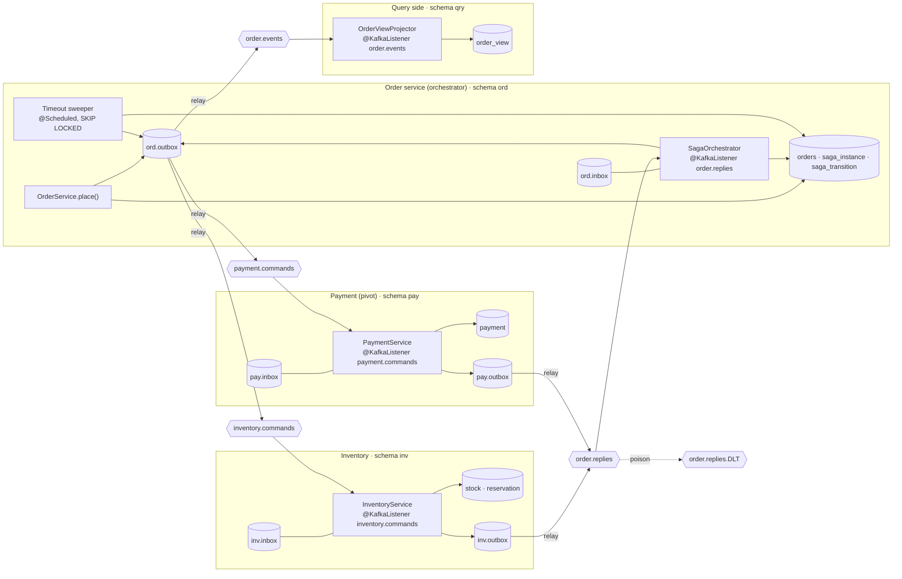
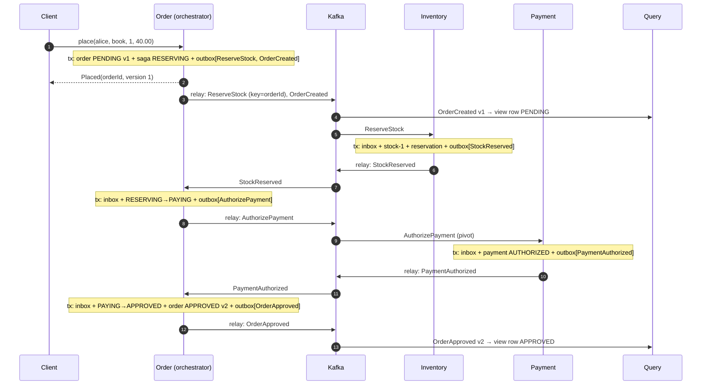
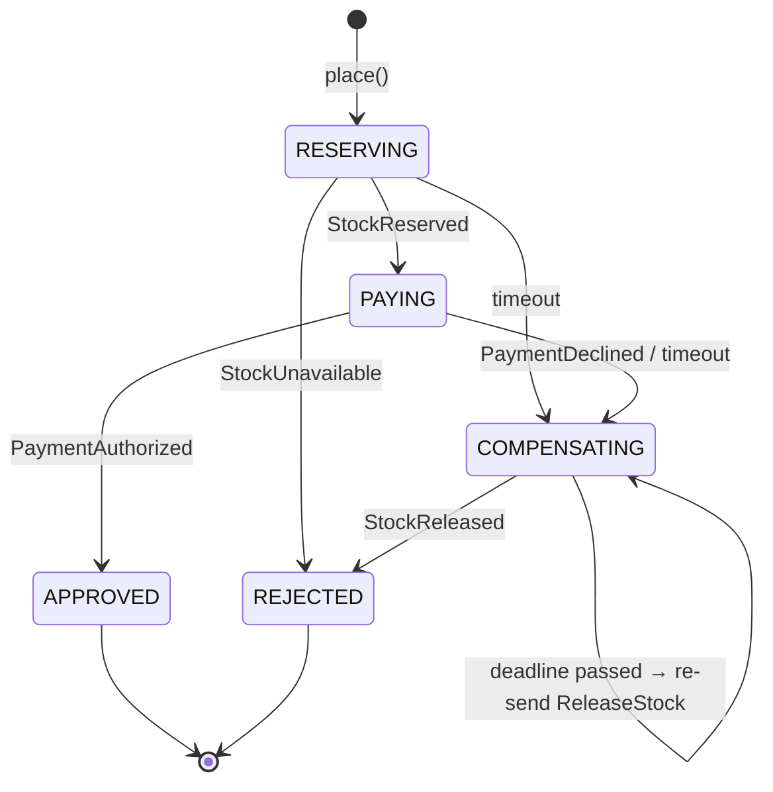

# 5.10 Reference Implementation: Orchestrated Saga + Kafka + Outbox/Inbox + Timeouts + CQRS, with 11 Failure Modes Run

> **Verified stack:** Spring Boot **4.1.2** / Spring Framework **7.0.10**, spring-kafka **4.1.2**, Apache Kafka **4.2.2** (embedded KRaft broker from `spring-kafka-test`, **3 partitions per topic**, **3 consumers per service**), PostgreSQL **18.6**, HikariCP, JDK **25**. One JVM runs four logical services that share nothing but Kafka topics. All 11 scenarios ran **twice** and every deterministic line was identical (`diff` clean); lines marked *(one run)* are timings.
>
> **Builds on:** [5.3](03-Sagas-Choreography-vs-Orchestration-Compensation-Semantic-Locks.md) (saga theory and the plain-JDBC saga log), [5.4](04-Transactional-Outbox-and-Idempotent-Consumer-Complete-Implementation.md) (one outbox, one consumer), [5.5](05-CQRS-and-Event-Sourcing.md) (projections), [2.6](../02-SQL-RDBMS-Internals/06-Isolation-Anomalies-Row-Locks-SKIP-LOCKED-Gap-Locks-Deadlocks.md) (`SKIP LOCKED`, `FOR UPDATE`). **This file** puts them together as one production-shaped system and breaks it on purpose.

---

## 0. What this file proves 🔥

| Claim | Scenario | Evidence |
|---|---|---|
| Every saga step is one local transaction (inbox + state + audit + outbox) | all | Transitions table; crash test |
| Every message is delivered at least once, and every effect happens exactly once | 2 | 6 messages re-sent; 4 inbox duplicates + 2 version-guard skips; 0 new transitions |
| Compensation runs in reverse order and restores stock | 3 | `PAYING → COMPENSATING → REJECTED`, stock back to 97 |
| A failed compensatable step needs no compensation | 4 | `RESERVING → REJECTED`, no payment row |
| A crash between "decide" and "commit" loses nothing and duplicates nothing | 5 | 1 crash, 1 failed delivery, 1 `AuthorizePayment` row, 1 payment |
| A timeout is not a failure: late replies are handled | 6, 7 | Stale `StockReserved` ignored; late `PaymentAuthorized` → **refund** |
| Compensations are retried and idempotent | 8 | 2 `ReleaseStock` sent, stock released once |
| Poison messages are classified and dead-lettered without blocking | 9 | 1 vs 4 attempts; both in `order.replies.DLT`; next order `APPROVED` |
| No overselling under contention | 10 | 200 orders vs 50 units → 50 `APPROVED`, 150 `REJECTED`, stock 0 |
| The read model converges, rebuilds from offset 0, and supports read-your-writes | 11 | 0 differences; rebuild = live; client waits for its version |
| Every message is accounted for | totals | 702 + 217 + 61 sends reconcile exactly ([§7](#7-message-accounting-every-send-explained-)) |

---

## 1. Architecture blueprint 🔥



**The rules the blueprint enforces:**

1. **Database per service:** separate schemas. No service reads another's tables; the projector reads only events.
2. **Every state change publishes through its own outbox** in the same local transaction. There are no dual writes anywhere.
3. **Every consumer that causes side effects deduplicates** with an inbox row in the same transaction. The projector instead uses a **version guard**, which is idempotent by construction.
4. **Every message is keyed by the order id.** All commands, replies and events of one saga land on one partition per topic, so they are processed in FIFO order per saga even with 3 consumers per group. Scenario 6 depends on this.
5. **The orchestrator owns the process state** (`saga_instance`). Participants own their resources and only answer commands.

### 1.1 The happy path as a message flow



### 1.2 The contract: topics, keys, headers

| Topic | Producer | Consumer group | Messages | Key |
|---|---|---|---|---|
| `inventory.commands` | order | `inventory` | `ReserveStock`, `ReleaseStock` | order id |
| `payment.commands` | order | `payment` | `AuthorizePayment`, `RefundPayment` | order id |
| `order.replies` | inventory, payment | `order-saga` | `StockReserved`, `StockUnavailable`, `StockReleased`, `PaymentAuthorized`, `PaymentDeclined`, `PaymentRefunded` | order id |
| `order.events` | order | `order-view` | `OrderCreated`, `OrderApproved`, `OrderRejected` (each carries `version`) | order id |
| `*.DLT` | error handler | `dlt-monitor` | anything that failed classification or exhausted retries | original key |

Headers: `messageId` (the outbox row's `uuidv7()`, used for dedup) and `type`. The payload is JSON with **money as `BigDecimal`** (`USE_BIG_DECIMAL_FOR_FLOATS`).

---

## 2. The state machine 🔥



| State | Reply | Next state | Side effects (same transaction) |
|---|---|---|---|
| `RESERVING` | `StockReserved` | `PAYING` | outbox `AuthorizePayment`, new deadline |
| `RESERVING` | `StockUnavailable` | `REJECTED` | order `REJECTED` v2, outbox `OrderRejected` |
| `PAYING` | `PaymentAuthorized` | `APPROVED` | order `APPROVED` v2, outbox `OrderApproved` |
| `PAYING` | `PaymentDeclined` | `COMPENSATING` | outbox `ReleaseStock`, new deadline |
| `COMPENSATING` | `StockReleased` | `REJECTED` | order `REJECTED` v2, outbox `OrderRejected` |
| `COMPENSATING`/`REJECTED` | `PaymentAuthorized` (late) | unchanged | outbox **`RefundPayment`**: the pivot happened after we gave up |
| `COMPENSATING`/`REJECTED` | `PaymentRefunded` | unchanged | audit only |
| any other pair | any | unchanged | "ignored stale X" audit; counter |
| `RESERVING`/`PAYING` past deadline | (sweeper) | `COMPENSATING` | outbox `ReleaseStock` |
| `COMPENSATING` past deadline | (sweeper) | unchanged | re-send `ReleaseStock` (compensations retry until they succeed) |

Step order follows [5.3](03-Sagas-Choreography-vs-Orchestration-Compensation-Semantic-Locks.md):

* **Compensatable:** create order `PENDING` (this is the semantic lock), reserve stock.
* **Pivot:** authorize payment.
* **Retriable:** approve the order.

After the pivot the saga goes forward. If the pivot "happens late", the only way back is a new forward action, the **refund**.

---

## 3. The code 🔥

### 3.1 Schema: one database, one schema per service

```sql
create table ord.orders (id uuid primary key, customer text not null, sku text not null, qty int not null,
  amount numeric(10,2) not null,
  status text not null,                 -- PENDING (semantic lock) -> APPROVED | REJECTED
  version int not null default 1,       -- bumped on every status change; carried in events
  created_at timestamptz not null default now());
create table ord.saga_instance (order_id uuid primary key references ord.orders(id), state text not null,
  deadline timestamptz,                 -- when the current step times out
  updated_at timestamptz not null default now());
create index saga_due on ord.saga_instance (deadline) where state in ('RESERVING', 'PAYING', 'COMPENSATING');
create table ord.saga_transition (id bigserial primary key, order_id uuid not null, from_state text,
  to_state text not null, cause text not null, at timestamptz not null default now());   -- the audit trail

create table inv.stock (sku text primary key, available int not null check (available >= 0));
create table inv.reservation (order_id uuid primary key, sku text, qty int not null,
  status text not null);                -- RESERVED | RELEASED; RELEASED with qty 0 = TOMBSTONE (release ran first)
create table pay.payment (order_id uuid primary key, amount numeric(10,2) not null, status text not null);
create table qry.order_view (order_id uuid primary key, customer text not null, sku text not null, qty int not null,
  amount numeric(10,2) not null, status text not null,
  version int not null,                 -- last applied order version: idempotent and order-safe
  event_created_at timestamptz not null, updated_at timestamptz not null default now());

-- the same outbox + inbox in ord, inv and pay (shown once)
create table ord.outbox (id uuid primary key,   -- uuidv7(): time-ordered, and the message id consumers dedup on
  topic text not null, msg_key text not null, msg_type text not null, payload jsonb not null,
  created_at timestamptz not null default now(), published_at timestamptz);
create index on ord.outbox (id) where published_at is null;
create table ord.inbox (message_id uuid primary key, received_at timestamptz not null default now());
```

### 3.2 The messaging kernel

In production this is a shared library or a platform starter ([4.7](../04-Spring-Boot-Internals/07-Auto-Configuration-Internals-Production-Starter-Blueprint.md)).

```java
public final class Messaging {
    private static final ObjectMapper JSON = new ObjectMapper().enable(DeserializationFeature.USE_BIG_DECIMAL_FOR_FLOATS);

    /** Outbox: write the message in the SAME local transaction as the business change. */
    public static void outbox(JdbcClient jdbc, String schema, String topic, String key, String type, Map<String, ?> payload) {
        jdbc.sql("insert into " + schema + ".outbox (id, topic, msg_key, msg_type, payload) values (uuidv7(), ?, ?, ?, ?::jsonb)")
            .params(topic, key, type, write(payload)).update();
    }

    /** Inbox: true the first time this service sees the message id; false for a duplicate. Same tx as the side effect. */
    public static boolean firstTime(JdbcClient jdbc, String schema, UUID messageId) {
        return jdbc.sql("insert into " + schema + ".inbox (message_id) values (?) on conflict do nothing")
                   .param(messageId).update() == 1;
    }
}
```

### 3.3 The relay: claim, send the batch, wait for every ack, then mark

```java
public int publishBatch() {
    Integer n = tx.execute(status -> {
        List<Row> rows = jdbc.sql("select id, topic, msg_key, msg_type, payload::text from " + schema + ".outbox "
                        + "where published_at is null order by id limit 100 for update skip locked")
                .query((rs, i) -> new Row(rs.getObject(1, UUID.class), rs.getString(2), rs.getString(3), rs.getString(4), rs.getString(5)))
                .list();
        List<CompletableFuture<?>> acks = new ArrayList<>();
        for (Row r : rows) {                                       // send the whole batch (pipelined, in id order) ...
            ProducerRecord<String, String> rec = new ProducerRecord<>(r.topic(), r.key(), r.payload());
            rec.headers().add("messageId", r.id().toString().getBytes(UTF_8));
            rec.headers().add("type", r.type().getBytes(UTF_8));
            acks.add(kafka.send(rec));
        }
        try { for (CompletableFuture<?> ack : acks) ack.get(10, SECONDS); }   // ... then wait for EVERY ack
        catch (Exception e) { throw new IllegalStateException("publish failed", e); } // rollback -> batch re-sent (at-least-once)
        for (Row r : rows) jdbc.sql("update " + schema + ".outbox set published_at = now() where id = ?").param(r.id()).update();
        return rows.size();
    });
    published.addAndGet(n);
    return n;
}
```

The producer runs with `acks=all` and `enable.idempotence=true`. Idempotence keeps per-partition order intact even with up to 5 in-flight requests, which is why pipelining the batch is safe ([10.1](../10-Kafka-Production/01-Kafka-Producers-Batching-Idempotence-Ordering.md)).

### 3.4 Starting the saga: five rows, one transaction

```java
@Transactional
public Placed place(String customer, String sku, int qty, BigDecimal amount) {
    UUID id = jdbc.sql("insert into ord.orders (id, customer, sku, qty, amount, status) values (uuidv7(), ?, ?, ?, ?, 'PENDING') returning id")
            .params(customer, sku, qty, amount).query(UUID.class).single();
    jdbc.sql("insert into ord.saga_instance (order_id, state, deadline) values (?, 'RESERVING', now() + make_interval(secs => ?))")
            .params(id, saga.stepTimeoutSeconds()).update();
    jdbc.sql("insert into ord.saga_transition (order_id, from_state, to_state, cause) values (?, null, 'RESERVING', 'order placed')").param(id).update();
    outbox(jdbc, "ord", Topics.INVENTORY_COMMANDS, id.toString(), "ReserveStock", Map.of("orderId", id, "sku", sku, "qty", qty));
    outbox(jdbc, "ord", Topics.ORDER_EVENTS, id.toString(), "OrderCreated",
            Map.of("orderId", id, "version", 1, "status", "PENDING", "customer", customer, "sku", sku, "qty", qty, "amount", amount,
                    "occurredAt", Instant.now().toString()));
    return new Placed(id, 1);          // the version lets the client wait for its own write in the read model (scenario 11)
}
```

### 3.5 The orchestrator: one reply = one transaction

```java
@KafkaListener(topics = Topics.ORDER_REPLIES, groupId = "order-saga", concurrency = "3")
@Transactional
public void onReply(ConsumerRecord<String, String> rec) {
    if (!firstTime(jdbc, "ord", messageId(rec))) { duplicatesIgnored.incrementAndGet(); return; }
    UUID orderId = UUID.fromString(rec.key());
    String reply = header(rec, "type");
    String state = jdbc.sql("select state from ord.saga_instance where order_id = ? for update")   // serializes with the sweeper
            .param(orderId).query(String.class).single();

    switch (state + "/" + reply) {
        case "RESERVING/StockReserved" -> {
            JsonNode order = orderRow(orderId);
            move(orderId, state, "PAYING", reply, true);
            outbox(jdbc, "ord", Topics.PAYMENT_COMMANDS, orderId.toString(), "AuthorizePayment",
                    Map.of("orderId", orderId, "amount", order.get("amount").decimalValue()));
            if (crashBeforeCommitFor.remove(orderId) && crashesInjected.incrementAndGet() > 0)       // failure injection (scenario 5)
                throw new IllegalStateException("simulated crash after writing the transition, before commit");
        }
        case "RESERVING/StockUnavailable" -> { move(orderId, state, "REJECTED", reply, false); finish(orderId, "REJECTED"); }
        case "PAYING/PaymentAuthorized"   -> { move(orderId, state, "APPROVED", reply, false); finish(orderId, "APPROVED"); }
        case "PAYING/PaymentDeclined" -> {
            move(orderId, state, "COMPENSATING", reply, true);
            outbox(jdbc, "ord", Topics.INVENTORY_COMMANDS, orderId.toString(), "ReleaseStock", Map.of("orderId", orderId));
        }
        case "COMPENSATING/StockReleased" -> { move(orderId, state, "REJECTED", reply, false); finish(orderId, "REJECTED"); }
        // The pivot's reply arrived AFTER we gave up on it (timeout): the charge happened, so undo it with a refund.
        case "COMPENSATING/PaymentAuthorized", "REJECTED/PaymentAuthorized" -> {
            note(orderId, state, "late PaymentAuthorized after timeout -> RefundPayment");
            outbox(jdbc, "ord", Topics.PAYMENT_COMMANDS, orderId.toString(), "RefundPayment", Map.of("orderId", orderId));
        }
        case "COMPENSATING/PaymentRefunded", "REJECTED/PaymentRefunded" -> note(orderId, state, "PaymentRefunded");
        default -> { staleRepliesIgnored.incrementAndGet(); note(orderId, state, "ignored stale " + reply); }
    }
}

/** Terminal step: release the semantic lock (PENDING) and announce the outcome with a bumped version. */
private void finish(UUID orderId, String status) {
    int version = jdbc.sql("update ord.orders set status = ?, version = version + 1 where id = ? returning version")
            .params(status, orderId).query(Integer.class).single();
    JsonNode o = orderRow(orderId);
    outbox(jdbc, "ord", Topics.ORDER_EVENTS, orderId.toString(), "Order" + status.charAt(0) + status.substring(1).toLowerCase(),
            Map.of("orderId", orderId, "version", version, "status", status, /* customer, sku, qty, amount, occurredAt */ ...));
}
```

The switch on `state + "/" + reply` makes the **whole transition table explicit**: every (state, reply) pair either moves, compensates, refunds, or is recorded as stale. A saga engine that throws on an "unexpected" reply turns every late or duplicate reply into a poison message.

### 3.6 The timeout sweeper

```java
@Scheduled(fixedDelayString = "${saga.sweeper-interval-ms}")
@Transactional
public void sweepTimeouts() {
    List<Map<String, Object>> due = jdbc.sql("""
            select order_id, state from ord.saga_instance
            where state in ('RESERVING', 'PAYING', 'COMPENSATING') and deadline < now()
            order by deadline limit 50 for update skip locked""").query().listOfRows();
    for (Map<String, Object> row : due) {
        UUID orderId = (UUID) row.get("order_id");
        String state = (String) row.get("state");
        if (state.equals("COMPENSATING")) move(orderId, state, state, "compensation retry: ReleaseStock re-sent", true);
        else move(orderId, state, "COMPENSATING", "timeout in " + state, true);
        outbox(jdbc, "ord", Topics.INVENTORY_COMMANDS, orderId.toString(), "ReleaseStock", Map.of("orderId", orderId));
    }
}
```

`SKIP LOCKED` does double duty. Several instances can sweep without double-compensating, and a saga the orchestrator is handling right now (it holds `FOR UPDATE` on the row) is skipped and seen on the next tick. Each row is locked by exactly one party, so the race between "reply arrives" and "deadline passes" is decided by whoever locks the row first. The loser then sees the winner's committed state.

### 3.7 The participants: idempotent, commutative, tombstoned

```java
// Inventory
private String reserve(UUID orderId, String sku, int qty) {
    String existing = jdbc.sql("select status from inv.reservation where order_id = ?").param(orderId).query(String.class).optional().orElse(null);
    if ("RESERVED".equals(existing)) return "StockReserved";      // idempotent by business key too, not only by message id
    if ("RELEASED".equals(existing)) return "StockUnavailable";   // TOMBSTONE: the compensation already ran -> never resurrect
    int taken = jdbc.sql("update inv.stock set available = available - ? where sku = ? and available >= ?")
            .params(qty, sku, qty).update();                      // atomic check-and-decrement: no read-modify-write race
    if (taken == 0) return "StockUnavailable";
    jdbc.sql("insert into inv.reservation (order_id, sku, qty, status) values (?, ?, ?, 'RESERVED')").params(orderId, sku, qty).update();
    return "StockReserved";
}

/** Compensation: idempotent, commutes with a late ReserveStock, never fails. */
private String release(UUID orderId) {
    List<Map<String, Object>> r = jdbc.sql("select sku, qty, status from inv.reservation where order_id = ? for update").param(orderId).query().listOfRows();
    if (r.isEmpty())                                               // the action never ran (or has not run YET): leave a tombstone
        jdbc.sql("insert into inv.reservation (order_id, sku, qty, status) values (?, null, 0, 'RELEASED')").param(orderId).update();
    else if ("RESERVED".equals(r.get(0).get("status"))) {
        jdbc.sql("update inv.stock set available = available + ? where sku = ?").params(r.get(0).get("qty"), r.get(0).get("sku")).update();
        jdbc.sql("update inv.reservation set status = 'RELEASED' where order_id = ?").param(orderId).update();
    }
    return "StockReleased";
}

// Payment (the pivot). A real PSP call runs OUTSIDE the DB transaction with idempotency key = orderId.
private String authorize(UUID orderId, BigDecimal amount) {
    String decision = amount.compareTo(LIMIT) <= 0 ? "AUTHORIZED" : "DECLINED";
    jdbc.sql("insert into pay.payment (order_id, amount, status) values (?, ?, ?) on conflict (order_id) do nothing")
            .params(orderId, amount, decision).update();          // first decision wins; a re-run reports the stored one
    String stored = jdbc.sql("select status from pay.payment where order_id = ?").param(orderId).query(String.class).single();
    return stored.equals("DECLINED") ? "PaymentDeclined" : "PaymentAuthorized";
}
private String refund(UUID orderId) {
    jdbc.sql("update pay.payment set status = 'REFUNDED' where order_id = ? and status = 'AUTHORIZED'").param(orderId).update();
    return "PaymentRefunded";                                      // a second refund changes nothing
}
```

Both participant listeners have the same shell:

```java
@KafkaListener(topics = Topics.INVENTORY_COMMANDS, groupId = "inventory", concurrency = "3")
@Transactional
public void onCommand(ConsumerRecord<String, String> rec) {
    if (!firstTime(jdbc, "inv", messageId(rec))) { duplicatesIgnored.incrementAndGet(); return; }
    ...
    String reply = switch (type) { case "ReserveStock" -> reserve(...); case "ReleaseStock" -> release(orderId); ... };
    outbox(jdbc, "inv", Topics.ORDER_REPLIES, orderId.toString(), reply, Map.of("orderId", orderId));   // reply in the same tx
}
```

### 3.8 The query side: version-guarded projector and rebuild

```java
@KafkaListener(topics = Topics.ORDER_EVENTS, groupId = "order-view", concurrency = "3")
public void on(ConsumerRecord<String, String> rec) {
    JsonNode e = body(rec);
    if (apply(jdbc, "qry.order_view", e) == 1) { applied.incrementAndGet(); lagMs.add(/* now - occurredAt */); }
    else skipped.incrementAndGet();
}

/** Idempotent, order-safe upsert: an event whose version is not newer than the row's changes nothing (returns 0). */
public static int apply(JdbcClient jdbc, String table, JsonNode e) {
    return jdbc.sql("""
            insert into %s as v (order_id, customer, sku, qty, amount, status, version, event_created_at)
            values (?, ?, ?, ?, ?, ?, ?, ?::timestamptz)
            on conflict (order_id) do update
               set status = excluded.status, version = excluded.version,
                   event_created_at = excluded.event_created_at, updated_at = now()
             where v.version < excluded.version""".formatted(table))
            .params(/* orderId, customer, sku, qty, amount, status, version, occurredAt */ ...)
            .update();
}

/** Rebuild: replay from offset 0 into a fresh table with the SAME apply logic (no group, no commits). */
public long rebuild() {
    jdbc.sql("truncate qry.order_view_rebuild").update();
    try (KafkaConsumer<String, String> c = new KafkaConsumer<>(props)) {        // enable.auto.commit=false, no group.id
        List<TopicPartition> tps = c.partitionsFor(Topics.ORDER_EVENTS).stream().map(i -> new TopicPartition(i.topic(), i.partition())).toList();
        c.assign(tps);
        c.seekToBeginning(tps);
        Map<TopicPartition, Long> end = c.endOffsets(tps);                       // replay up to "now", then hand over
        long n = 0;
        while (tps.stream().anyMatch(tp -> c.position(tp) < end.get(tp)))
            for (ConsumerRecord<String, String> r : c.poll(Duration.ofMillis(200))) { apply(jdbc, "qry.order_view_rebuild", body(r)); n++; }
        return n;
    }
}
```

Production swap: rebuild into `order_view_v2`, then switch the read path (view or synonym) to it, then drop v1. This is the blue/green pattern for read models.

### 3.9 Error policy: retry what can succeed, dead-letter the rest

```java
@Bean       // Boot wires a single CommonErrorHandler bean into the auto-configured listener container factory
DefaultErrorHandler kafkaErrorHandler(KafkaTemplate<String, String> template) {
    DeadLetterPublishingRecoverer toDlt = new DeadLetterPublishingRecoverer(template,
            (rec, ex) -> new TopicPartition(rec.topic() + ".DLT", rec.partition()));   // same partition: DLT needs >= partitions
    DefaultErrorHandler handler = new DefaultErrorHandler(toDlt, new FixedBackOff(100L, 3L));   // 1 delivery + 3 retries
    handler.addNotRetryableExceptions(EmptyResultDataAccessException.class);          // reply for a saga that does not exist
    handler.setRetryListeners((rec, ex, attempt) -> failedDeliveries.computeIfAbsent(rec.topic() + "/" + rec.key(), k -> new AtomicInteger()).incrementAndGet());
    handler.setLogLevel(KafkaException.Level.DEBUG);
    return handler;
}
```

### 3.10 Wiring and configuration

```properties
spring.datasource.url=jdbc:postgresql://localhost:55432/lab
spring.datasource.hikari.maximum-pool-size=20
spring.kafka.producer.acks=all
spring.kafka.producer.properties.enable.idempotence=true
spring.kafka.consumer.auto-offset-reset=earliest
spring.task.scheduling.pool.size=2          # relay and sweeper must not queue behind each other (Boot's default is 1)
saga.step-timeout-ms=10000
saga.relay-interval-ms=20
saga.sweeper-interval-ms=100
```

```java
@SpringBootApplication
@EnableScheduling
public class SagaApp {
    @Bean OutboxRelay ordRelay(JdbcClient jdbc, KafkaTemplate<String, String> kafka, TransactionTemplate tx) { return new OutboxRelay("ord", jdbc, kafka, tx); }
    @Bean OutboxRelay invRelay(...) { return new OutboxRelay("inv", ...); }
    @Bean OutboxRelay payRelay(...) { return new OutboxRelay("pay", ...); }

    @Component
    static class RelayScheduler {                       // in production: one relay (or CDC connector) per service
        private final List<OutboxRelay> relays;
        RelayScheduler(List<OutboxRelay> relays) { this.relays = relays; }
        @Scheduled(fixedDelayString = "${saga.relay-interval-ms}") void tick() { relays.forEach(OutboxRelay::publishBatch); }
    }

    public static void main(String[] args) throws Exception {
        EmbeddedKafkaKraftBroker broker = new EmbeddedKafkaKraftBroker(1, 3, Topics.ALL);   // 1 broker, 3 partitions/topic
        broker.afterPropertiesSet();
        try (ConfigurableApplicationContext ctx = SpringApplication.run(SagaApp.class,
                "--spring.kafka.bootstrap-servers=" + broker.getBrokersAsString())) {
            ctx.getBean(Scenarios.class).runAll();
        } finally { broker.destroy(); }
    }
}
```

The scenario runner waits for every listener container to own its partitions (`ContainerTestUtils.waitForAssignment(c, 3)`) before starting. It arms failure injection **inside the same transaction that places the order** (`tx.execute(...)`), so the flag is set before the first message can exist, which makes every run deterministic.

---

## 4. The failure-mode lab: complete output 🔥

**Output (verified, identical across two runs except the lines marked *one run*):**

```text
== 1. Happy path: 3 orders, 1 x book @ 40.00 each
  order 1 transitions:
    (start)       -> RESERVING     order placed
    RESERVING     -> PAYING        StockReserved
    PAYING        -> APPROVED      PaymentAuthorized
  statuses: APPROVED=3
  payments: AUTHORIZED=3
  book stock: 97
== 2. At-least-once: every message of order 1 delivered AGAIN (relays 'crashed' after send, before marking)
  messages re-published: 6 (ord 4: ReserveStock, OrderCreated, AuthorizePayment, OrderApproved; inv 1; pay 1)
  duplicates dropped: orchestrator inbox 2, inventory inbox 1, payment inbox 1, projector version guard 2
  order 1 transitions before / after: 3 / 3
  book stock (unchanged): 97
== 3. Payment declined (900.00 > 500.00 limit): compensate the reservation
  order transitions:
    (start)       -> RESERVING     order placed
    RESERVING     -> PAYING        StockReserved
    PAYING        -> COMPENSATING  PaymentDeclined
    COMPENSATING  -> REJECTED      StockReleased
  order / reservation / payment: REJECTED / RELEASED qty 2 / DECLINED 900.00
  book stock (2 reserved, then released): 97
== 4. Out of stock (sku 'rare' has 0): rejected before the pivot, nothing to compensate
  order transitions:
    (start)       -> RESERVING     order placed
    RESERVING     -> REJECTED      StockUnavailable
  order / reservation / payment: REJECTED / no reservation / no payment
== 5. Orchestrator crashes after writing PAYING + AuthorizePayment, before commit
  order transitions:
    (start)       -> RESERVING     order placed
    RESERVING     -> PAYING        StockReserved
    PAYING        -> APPROVED      PaymentAuthorized
  crashes injected: 1
  failed deliveries of its reply (then redelivered): 1
  AuthorizePayment rows in ord.outbox: 1
  payments for the order: 1
== 6. Step timeout 1 s; inventory takes 1.5 s: the late StockReserved is ignored, the release restores stock
  order transitions:
    (start)       -> RESERVING     order placed
    RESERVING     -> COMPENSATING  timeout in RESERVING
    COMPENSATING  -> COMPENSATING  ignored stale StockReserved
    COMPENSATING  -> REJECTED      StockReleased
  book stock before / after: 96 / 96
  reservation: RELEASED qty 1
== 7. Timeout in PAYING; PSP takes 2.5 s: compensate, then REFUND the late authorization (pivot already happened)
  order transitions:
    (start)       -> RESERVING     order placed
    RESERVING     -> PAYING        StockReserved
    PAYING        -> COMPENSATING  timeout in PAYING
    COMPENSATING  -> REJECTED      StockReleased
    REJECTED      -> REJECTED      late PaymentAuthorized after timeout -> RefundPayment
    REJECTED      -> REJECTED      PaymentRefunded
  order / payment: REJECTED / REFUNDED 40.00
  book stock: 96
== 8. Declined, and the compensation itself is slow (1.5 s > 1 s): sweeper re-sends ReleaseStock; 2nd release is a no-op
  order transitions:
    (start)       -> RESERVING     order placed
    RESERVING     -> PAYING        StockReserved
    PAYING        -> COMPENSATING  PaymentDeclined
    COMPENSATING  -> COMPENSATING  compensation retry: ReleaseStock re-sent
    COMPENSATING  -> REJECTED      StockReleased
    REJECTED      -> REJECTED      ignored stale StockReleased
  ReleaseStock commands sent: 2
  book stock before / after (released once): 96 / 96
== 9. Poison replies: classified, dead-lettered, the partition keeps flowing
  ghost reply: failed deliveries: 1 (EmptyResultDataAccessException is not retryable)
  header-less reply: failed deliveries: 4 (NullPointerException: retried 3x first)
  dead-lettered: key=<ghost> from order.replies group=order-saga cause=org.springframework.dao.EmptyResultDataAccessException
  dead-lettered: key=no-headers from order.replies group=order-saga cause=java.lang.NullPointerException
  order placed right after the poison: APPROVED
== 10. Contention: 200 concurrent orders for 'hot' (50 in stock), 3 consumers per service
  statuses: APPROVED=50, REJECTED=150
  hot stock left: 0
  RESERVED reservations / AUTHORIZED payments: 50 / 50
  rejected by StockUnavailable: 150
  wall time, 200 sagas end-to-end (one run): 434 ms
  event -> read model lag (one run): p50 125 ms, p99 224 ms, max 226 ms over 400 events
== 11. CQRS: read model == write model, rebuild from offset 0, read-your-writes
  orders in write model: 210
  (id, status, version) differences write vs read: 0
  events replayed into order_view_rebuild: 422
  rows differing rebuild vs live view: 0
  projector applied / skipped (duplicate or stale): 420 / 2
  read model right after place() returned: row absent (stale read)
  client waited for version 1 (one run): 43 ms
== Totals
  ordRelay published: 702
  invRelay published: 217
  payRelay published: 61
  inbox rows ord / inv / pay: 276 / 216 / 60
  unpublished outbox rows: 0
  sagas not terminal: 0
  negative stock rows: 0
```

---

## 5. Reading each failure mode 🔥

### Scenario 2: at-least-once everywhere, exactly-once effects

Resetting `published_at` on all six outbox rows of a finished saga simulates a relay that crashed after Kafka acked but before it marked the rows. Every consumer received every message a second time:

* **Inbox dedup:** inventory (1) and payment (1) dropped the repeated commands; the orchestrator (2) dropped the repeated replies.
* **Version guard:** the projector dropped `OrderCreated` v1 and `OrderApproved` v2 (`2 < 1` and `2 < 2` are both false).
* **Net effect:** zero new transitions, and stock unchanged.

**Lab gotcha (run 3):** without waiting for the originals to be published first, the projector skipped only 1. The original `OrderApproved` had not left the outbox yet, so "re-publishing" it was its first publication. **Counting duplicates requires a quiesced system**, which is also true when you reconcile in production.

### Scenarios 3 and 4: where the failure happens decides what to undo

* **Declined (scenario 3):** the failure came *after* a compensatable step. The orchestrator moved to `COMPENSATING` and sent `ReleaseStock`. Only after `StockReleased` did it reject the order. Reverse order, verified.
* **Out of stock (scenario 4):** the failure came *at* the first step. There was nothing to compensate and no payment row.

The order stays `PENDING` until the end. That is the **semantic lock**: other readers (the UI, the read model at version 1) see "in progress", never a half-approved order.

### Scenario 5: crash between deciding and committing

The orchestrator wrote `PAYING`, the audit row, the inbox row and the `AuthorizePayment` outbox row, then threw before commit. **All four rolled back together**, including the inbox row. So the redelivered `StockReserved` (1 failed delivery, then success) was processed as first-time and produced exactly one `AuthorizePayment` and one payment. This is the reason the inbox row must live in the same transaction as the effect. Commit the inbox row separately and the redelivery is treated as a duplicate, which leaves the saga stuck in `RESERVING` forever.

### Scenario 6: a timeout during a compensatable step

The inventory took 1.5 s, past the 1 s deadline, so the sweeper compensated (`RESERVING → COMPENSATING`, `ReleaseStock`). The reservation then **did** happen and replied `StockReserved`, which the state machine recorded as stale. Correctness comes from **per-key ordering**. `ReleaseStock` has the same key as `ReserveStock`, so it sits behind it on the same partition and is consumed after the reservation commits. The release then found and undid it: stock 96 before and after. The **tombstone** in `release()` covers the opposite race (the release processed first, for example over a transport without per-key FIFO). Here that race can't happen, but the guard costs one row.

### Scenario 7: a timeout during the pivot ⚡

This is the case interviewers probe hardest, because **a timeout is not a "no"**. The PSP took 2.5 s, so the saga timed out in `PAYING`, released stock and rejected the order. Then the authorization arrived (`REJECTED/PaymentAuthorized`). The pivot had happened, so the only correct move is a new forward action, **`RefundPayment`**, and the final payment state is `REFUNDED 40.00`. Two better production options exist:

* **Don't time out a pivot blindly.** Query the PSP by idempotency key before compensating ([5.8 Drill 2 Probe 4](08-Bar-Raiser-Drill-Downs.md#drill-2-place-an-order-order-inventory-and-payment-services-)).
* **Make the pivot step's timeout much longer than the PSP's.** Then a late "yes" is rare, and the refund path becomes a safety net instead of the normal path.

### Scenario 8: compensations are retried until they succeed

The release took longer than the deadline, so the sweeper re-sent `ReleaseStock` from `COMPENSATING`. The first release restored stock and the second found `RELEASED` and did nothing (stock 96 → 96). The orchestrator recorded the second `StockReleased` as stale. A compensation **must not fail** and **must be safe to repeat**. If it truly cannot succeed (an inventory service gone for hours), the saga stays `COMPENSATING` and is visible on the "stuck sagas" dashboard ([§8](#8-production-hardening-checklist-)).

### Scenario 9: poison messages

* **Ghost reply** (a valid message for an order that doesn't exist): `EmptyResultDataAccessException` is classified **not retryable**, so it took 1 attempt and went straight to the DLT.
* **Header-less reply:** `NullPointerException` is retryable by default, so it took 4 attempts (1 + 3 retries at 100 ms) before going to the DLT. The default classification is a decision you make, not a fact: a missing header will never succeed, so production code validates the envelope and throws a non-retryable exception.
* **The next order** placed after both was `APPROVED`. The partition was not blocked.

### Scenario 10: contention without distributed locks

200 virtual threads placed orders at once for 50 units, with 3 inventory consumers. The atomic `update … set available = available - ? where available >= ?` serializes on the stock row inside PostgreSQL. There is no read-modify-write window, so the result is exactly 50 `APPROVED`, 150 `REJECTED`, stock 0, 50 reservations and 50 payments. The `check (available >= 0)` constraint is the belt to that pair of braces.

### Scenario 11: CQRS guarantees

* **Convergence:** 0 differences in `(id, status, version)` between the write and read models.
* **Replay:** 422 events replayed (210 orders × 2 + the 2 re-sent in scenario 2) produced a table identical to the live view. Duplicates in the log are harmless because `apply` is idempotent.
* **Read-your-writes:** right after `place()` returned, the view row did not exist yet, which is a real stale read. The client knew it needed **version 1** (from `Placed.version`) and waited 43 ms *(one run)*. The same technique works for "after approval, wait for version 2". Alternatives: return the command result directly to the caller, or route that user's reads to the write model for a few seconds.

---

## 6. Measured numbers *(one run)* ⚡

| Metric | Value | What dominates it |
|---|---|---|
| 200 sagas end-to-end (5 transactions + 5 messages each) | **434 ms** wall | 3 consumers per group, 20 ms relay poll, local PG |
| Event → read model lag | p50 **125 ms**, p99 **224 ms**, max **226 ms** (400 events) | queueing behind the 200-order burst + poll interval |
| Read-your-writes wait for version 1 | **43 ms** | one relay poll + projector |

These are laptop numbers with one broker and local PostgreSQL. What transfers is their **shape**: end-to-end latency here is set by the relay poll interval, partition parallelism and transaction count, not by Kafka. CDC ([5.4 §6](04-Transactional-Outbox-and-Idempotent-Consumer-Complete-Implementation.md)) removes the poll interval from that list.

---

## 7. Message accounting: every send explained 🔥

**A staff-level habit:** before you trust a messaging system, **reconcile it**. Each total in the output is derived below from the scenarios.

| Counter | Value | Derivation |
|---|---|---|
| ord outbox rows | 698 | happy 3×4 = 12, declined 5, rare 3, crashed 4, slow-inventory 4, slow-PSP 6, slow-compensation 6, after-poison 4, contention 50×4 + 150×3 = 650, read-your-writes 4 |
| `ordRelay published` | **702** | 698 rows + 4 re-sent in scenario 2 |
| inv outbox rows (replies) | 216 | one per first-time inventory command: 211 `ReserveStock` + 5 `ReleaseStock` |
| `invRelay published` | **217** | 216 + 1 re-sent |
| pay outbox rows | 60 | 59 `AuthorizePayment` + 1 `RefundPayment` |
| `payRelay published` | **61** | 60 + 1 re-sent |
| `ord.inbox` | **276** | = 216 + 60: every reply row processed exactly once (the ghost's inbox row rolled back) |
| `inv.inbox` / `pay.inbox` | **216 / 60** | = commands first-seen; re-sends didn't add rows |
| events replayed (scenario 11) | **422** | 210 orders × 2 events + 2 re-sent |

If any of these didn't reconcile, the gap would be a lost message, a double effect, or a leaked transaction.

---

## 8. Production hardening checklist 🔥

| The lab does | Production does | Why |
|---|---|---|
| The PSP is a `sleep` inside the DB transaction | Record intent → call the PSP **outside** the transaction with idempotency key = order id → record the result | Never hold a DB connection across a network call ([3.5](../03-JPA-Hibernate-Spring-Data/05-Transactional-Propagation-Isolation-Pitfalls.md)) |
| One scheduler drains three outboxes | One relay per service, or CDC per database ([5.4 §7](04-Transactional-Outbox-and-Idempotent-Consumer-Complete-Implementation.md#7-polling-publisher-vs-log-tailing-)) | Ownership and isolation |
| Outbox and inbox rows are kept forever | Delete published outbox rows after N days and inbox rows after the max redelivery window. Partition both by day and drop old partitions ([2.7](../02-SQL-RDBMS-Internals/07-Scaling-Replicas-Partitioning-Pooling-Sharding.md)) | Bloat and vacuum cost |
| JSON with ad-hoc fields | A schema registry (Avro/Protobuf/JSON Schema) with compatibility rules; the `type` header carries a version | Producers and consumers deploy independently |
| Fixed step timeout | Per-step timeouts. The pivot's timeout is longer than the PSP's; query by idempotency key before compensating | Avoid the refund path (scenario 7) |
| DLT has a monitor that only counts | A DLT runbook: alert on depth, inspect, fix, **re-drive** with the original headers; never auto-replay blindly | Poison messages are bugs |
| `saga_transition` audit | Plus metrics: sagas by state × age, oldest non-terminal saga, compensation rate, refund rate, outbox lag (oldest unpublished `created_at`), consumer lag, DLT depth | "Where is order 42?" and "is anything stuck?" must be one query |
| Trace context not propagated | `traceparent` in Kafka headers through the relay ([5.7](07-Observability-Tracing-Correlation-IDs-Contract-Testing.md)) | One trace per saga across services |
| Hand-written state machine | Hand-written for a few short sagas; a durable-execution engine (Temporal) once you have timers, human steps, versioned workflows and many saga types | Engines give history, retries, timers and versioning for free |

---

## 9. Surprises from building it 🧊

1. **`spring.sql.init` can't run PostgreSQL `DO $$ … $$` blocks.** Spring's `ScriptUtils` splits on `;` and failed with *"Unterminated dollar quote"*. Spell out the DDL, use Flyway/Liquibase (they understand dollar quoting), or set a custom `spring.sql.init.separator`.
2. **A public field read through a `@Transactional` bean was `null`.** `SagaOrchestrator` is a CGLIB proxy, and `saga.duplicatesIgnored` read the *proxy's* field, which is never initialized (Objenesis skips constructors). Accessor methods are delegated to the target; fields are not. See [4.3](../04-Spring-Boot-Internals/03-AOP-Proxies-JDK-vs-CGLIB-Self-Invocation-Ordering.md).
3. **`AtomicReference.compareAndSet` compares by identity.** The crash injection never fired, because the listener's `UUID.fromString(key)` is a different object from the one stored. `Set.remove(orderId)` uses `equals()`.
4. **`text = uuid` has no operator in PostgreSQL.** Binding a `UUID` against the `text` column `msg_key` failed. The driver sends `uuid`, and there is no implicit cast.
5. **Duplicate counting needs quiescence** (scenario 2, above).

---

## 10. Bar-raiser Q&A on this implementation 🔥

🎤 *"I'd build checkout as an orchestrated saga with outbox and inbox on every service, keyed by order id."*

🔍 **Why not Kafka transactions (exactly-once semantics) instead of outbox and inbox?**

<details><summary>🛡️ Defense</summary>

Kafka EOS makes *consume → produce* atomic **within Kafka** (offsets plus output records in one Kafka transaction). Our side effects are **PostgreSQL rows** (stock, payments, saga state), and no transaction spans Kafka and PostgreSQL. So the database transaction must hold the "what happened" (state + outbox) and the "what I've seen" (inbox). With that in place, Kafka transactions add nothing for correctness. They help only for pure stream processing (Kafka in, Kafka out).
</details>

🔍 **Two orchestrator instances. A reply and the timeout sweeper hit the same saga at the same moment. What happens?**

<details><summary>🛡️ Defense</summary>

Both go through the `saga_instance` row lock:

* **The listener** takes `FOR UPDATE` and waits if the sweeper holds the row.
* **The sweeper** takes `FOR UPDATE SKIP LOCKED` and skips the row if the listener holds it.

Whoever locks the row first wins. The other sees the committed result: either the listener reads `COMPENSATING` and the reply becomes stale, or the sweeper finds the saga no longer in a timeout-eligible state on its next tick. Under `READ COMMITTED`, `FOR UPDATE` re-reads the latest committed row version after waiting. Scenarios 6–8 exercise exactly these interleavings.
</details>

🔍 **Your payment provider timed out. Did you charge the customer?**

<details><summary>🛡️ Defense</summary>

Unknown. A timeout is *indeterminate*. Scenario 7 shows the cost of treating it as "no": compensation ran, then the authorization landed, and we had to **refund**, which is a customer-visible double movement of money. Better:

* Use an **idempotency key** (the order id) on every PSP call.
* On timeout, **query the PSP by that key** before deciding.
* Give the pivot step a timeout longer than the PSP's.
* Keep the late-reply refund branch as the safety net.
</details>

🔍 **Why is the reservation release a tombstone and not a simple delete?**

<details><summary>🛡️ Defense</summary>

A compensation can arrive **before** the action it compensates: the timeout fired while the command was still in flight, or the transport doesn't preserve per-key order. A delete of nothing succeeds, and then the late `ReserveStock` reserves stock for a dead order, which is a leak. The tombstone (`RELEASED`, qty 0) makes `release` and `reserve` **commute**: whichever order they arrive in, the result is "not reserved". In this lab the per-key FIFO made the reverse order impossible, so scenario 6 shows the forward order. The tombstone guards the cases where FIFO doesn't hold.
</details>

🔍 **The projector has no inbox. Isn't that a bug?**

<details><summary>🛡️ Defense</summary>

No: its write is **idempotent by construction**. `on conflict … where v.version < excluded.version` turns duplicates and older events into no-ops. Scenario 2 showed 2 skips and scenario 11 a replay equal to the live view. An inbox is needed when the side effect isn't naturally idempotent (decrementing stock, charging a card). It also needs the producer to stamp a monotonic **version per aggregate**, which the order service does by bumping `version` in the same transaction as the status change.
</details>

🔍 **200 orders for 50 units. Where's the lock?**

<details><summary>🛡️ Defense</summary>

In PostgreSQL's row lock on `inv.stock`, taken by an atomic conditional update (`available = available - ? where available >= ?`). It needs no distributed lock and no read-then-write, and a check constraint backs it up. Verified: exactly 50 approved, stock 0. If one SKU is extremely hot, the next steps are:

* **Bucketed stock rows** (N rows per SKU, pick one at random).
* **A reservation queue per SKU**, which turns lock contention into ordered processing.
</details>

🔍 **A message is poison. What happens to the 1,000 messages behind it on that partition?**

<details><summary>🛡️ Defense</summary>

With the default blocking retry, they wait during the retries: `FixedBackOff(100, 3)` means about 300 ms of head-of-line blocking. Then the message is dead-lettered and the partition moves on. Verified: the next order was approved. Classification controls the cost: non-retryable exceptions skip the retries (the ghost reply took 1 attempt). For long back-offs, use non-blocking retry topics (`@RetryableTopic`), at the price of losing per-key ordering for the retried message. That trade-off is unacceptable for saga replies, so I keep saga topics on short blocking retries and a DLT.
</details>

🔍 **Why does the orchestrator record "ignored stale X" instead of throwing?**

<details><summary>🛡️ Defense</summary>

Because at-least-once delivery plus timeouts **guarantee** that unexpected (state, reply) pairs will occur: duplicates, late replies, compensation acknowledgements after the saga finished. Throwing turns them into retries and DLT noise. Ignoring them silently hides bugs. Recording them in the audit trail with a counter (`staleRepliesIgnored`) keeps the state machine **total** and the behavior observable.
</details>

---

## 11. How to run it

The lab is one Maven-less source tree compiled against the Boot 4.1.2 + spring-kafka 4.1.2 (+ `spring-kafka-test`) classpath, with PostgreSQL 18 on `localhost:55432`:

```bash
javac -d classes -parameters -cp "$CP" $(find src/main/java -name '*.java')
cp src/main/resources/* classes/
java -cp "classes:$CP" com.acme.saga.SagaApp          # starts the embedded KRaft broker, then the app, then runs 11 scenarios
```

`schema.sql` drops and recreates the four schemas on every start (`spring.sql.init.mode=always`), so the run is repeatable.

---

## Summary

| Topic | Key point | Evidence |
|---|---|---|
| Step = transaction | Inbox + state + audit + outbox commit together | Crash (scenario 5): 1 command, 1 payment |
| Delivery | At-least-once everywhere; effects exactly-once via inbox or version guard | Scenario 2: 6 re-sent, 0 effects |
| Compensation | Reverse order, idempotent, commutative (tombstone), retried by the sweeper | Scenarios 3, 6, 8 |
| Pivot timeout | Indeterminate: a late "yes" needs a refund; prefer query-by-idempotency-key | Scenario 7: `REFUNDED 40.00` |
| Ordering | Key everything by saga id → per-saga FIFO with N consumers | Scenario 6 correctness |
| Concurrency | Row lock (`FOR UPDATE`) vs sweeper (`SKIP LOCKED`); atomic conditional stock update | Scenarios 6–8, 10 (50/150, stock 0) |
| Poison | Classify exceptions; DLT; partition keeps flowing | Scenario 9: 1 vs 4 attempts |
| CQRS | Version-guarded upsert = idempotent and replayable; read-your-writes by version | Scenario 11: 0 diffs, rebuild = live |
| Reconciliation | Every send accounted for | 702 / 217 / 61 |
| Spring traps | No `$$` in `spring.sql.init`; never read fields through a proxy | Runs 1–2 |

**Next:** [5.11 Modular monolith blueprint: Spring Modulith, externalized events, extraction →](11-Modular-Monolith-Blueprint-Spring-Modulith-Externalized-Events-Extraction.md)
