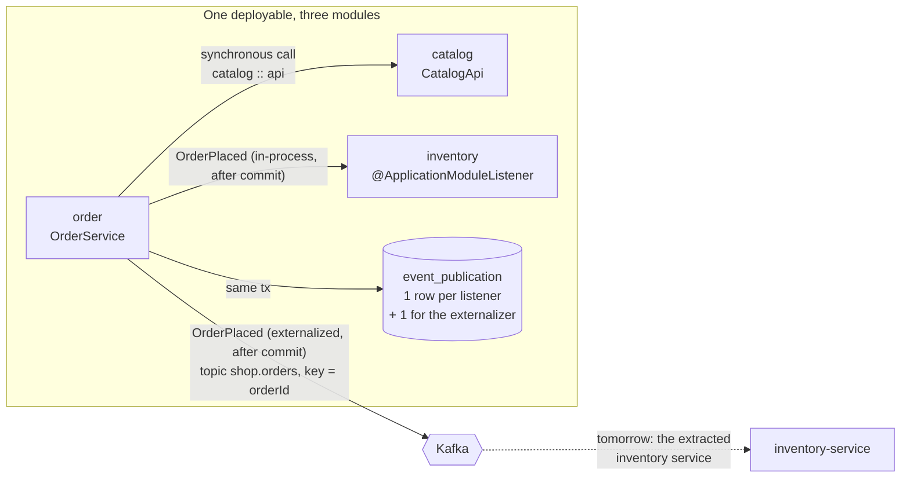
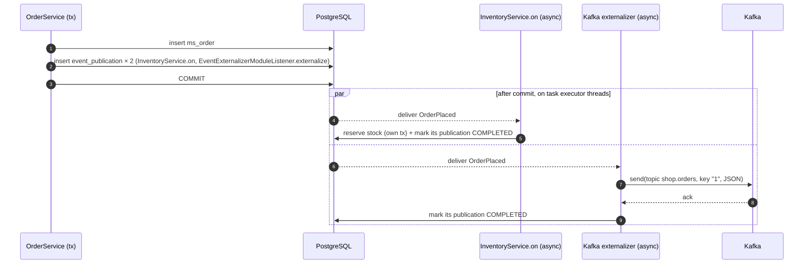
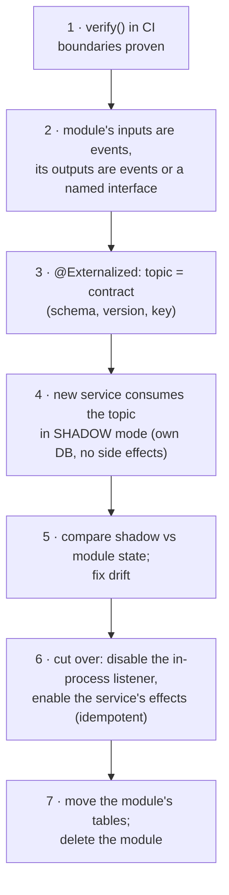

# 5.11 Modular Monolith Blueprint: Spring Modulith 2.1 with Named Interfaces, Module Tests, Kafka-Externalized Events, Outage Recovery, and an Extraction Path

> **Verified stack:** Spring Boot **4.1.2**, Spring Modulith **2.1.2** (`spring-modulith-starter-core`, `-starter-jdbc`, `-events-kafka`, `-starter-test`), spring-kafka **4.1.2**, Kafka **4.2.2** (embedded KRaft), PostgreSQL **18.6**, JDK **25**. `mvn test`: **5 tests, 0 failures**, plus one test that is *expected* to fail and was run on its own to capture the error. Every output below is copied from those runs.
>
> **Builds on:** [5.1 §2](01-Decomposition-Modular-Monolith-Strangler-Branch-by-Abstraction.md#2-spring-modulith-verified-boundaries-) (module convention, `verify()`, an internal-package violation, the event publication registry and `resubmitIncompletePublications`). **This file adds** named interfaces, module-scoped integration tests, events externalized to Kafka with the same registry, a full outage-and-restart drill, and the step-by-step path from module to microservice.

---

## 0. Why a modular monolith first 🔥

The expensive mistakes in microservices are **boundary** mistakes: two services that must change together, or one transaction split across a network. A modular monolith lets you find the boundaries while a mistake is still a refactor, not a migration:

| Property | Modular monolith (this file) | Microservices ([5.10](10-Reference-Implementation-Saga-Orchestrator-Kafka-Outbox-Inbox-CQRS.md)) |
|---|---|---|
| Boundary enforcement | `ApplicationModules.verify()` in CI (compile-time structure) | Network + separate repos |
| Cross-module consistency | Can still use one local transaction when a boundary is wrong | Sagas, outbox, inbox |
| Inter-module events | In-process, recorded in `event_publication` | Kafka + outbox/inbox |
| Deployment | One unit | Independent |
| Extraction cost of a module | Low if it already talks only via events and named interfaces | n/a |

The blueprint below makes **extraction a configuration change plus a new deployable**, not a rewrite.

---

## 1. The blueprint 🔥

```text
com.acme.shop
├── ShopApplication.java                 @SpringBootApplication @EnableAsync
├── catalog                              module "catalog"
│   ├── api/                             @NamedInterface("api"): the ONLY part other modules may use
│   │   ├── CatalogApi.java              interface: BigDecimal priceOf(String sku)
│   │   └── package-info.java
│   └── internal/PriceTable.java         implementation (public for Spring, invisible to other modules)
├── order                                module "order"
│   ├── package-info.java                @ApplicationModule(allowedDependencies = "catalog :: api")
│   ├── OrderService.java                API: place(sku, qty)
│   └── OrderPlaced.java                 API event, @Externalized("shop.orders::#{#this.orderId()}")
└── inventory                            module "inventory"
    ├── InventoryService.java            @ApplicationModuleListener on(OrderPlaced)
    └── internal/StockRepository.java
```



**The three rules:**

1. **Synchronous** dependencies only through **named interfaces**, and only to modules listed in `allowedDependencies`.
2. **State changes travel as events**, which are durable (registry), asynchronous, and run in their own transaction (`@ApplicationModuleListener`).
3. **Events that might cross a process boundary later are externalized now** (`@Externalized`). The topic becomes the contract before any service exists.

---

## 2. Named interfaces and allowed dependencies (verified) 🔥

```java
// catalog/api/package-info.java
@org.springframework.modulith.NamedInterface("api")
package com.acme.shop.catalog.api;

// order/package-info.java: order may use catalog's "api" and nothing else
@org.springframework.modulith.ApplicationModule(allowedDependencies = "catalog :: api")
package com.acme.shop.order;
```

```java
class ModularityTests {
    @Test
    void verifiesTheShop() {
        ApplicationModules modules = ApplicationModules.of(ShopApplication.class);
        for (ApplicationModule m : modules)
            System.out.println("MODULE " + m.getIdentifier()
                    + " | named interfaces " + m.getNamedInterfaces().stream().map(NamedInterface::getName).sorted().toList()
                    + " | depends on " + m.getDirectDependencies(modules).uniqueModules().map(d -> d.getIdentifier().toString()).sorted().toList());
        modules.verify();
        System.out.println("VERIFY shop: OK");
    }

    @Test
    void reportsANamedInterfaceViolation() {
        try { ApplicationModules.of(BadShop.class).verify(); }
        catch (Violations v) { v.getMessages().forEach(msg -> System.out.println("VIOLATION " + msg)); }
    }
}
```

`BadShop` is a second, deliberately broken app with the same `allowedDependencies = "catalog :: api"`, whose `OrderService` does `new PriceTable()` from `catalog.internal`.

**Output (verified):**

```text
MODULE catalog | named interfaces [<<UNNAMED>>, api] | depends on []
MODULE order | named interfaces [<<UNNAMED>>] | depends on [catalog]
MODULE inventory | named interfaces [<<UNNAMED>>] | depends on [order]
VERIFY shop: OK
VIOLATION Module 'order' depends on non-exposed type com.acme.badshop.catalog.internal.PriceTable within module 'catalog'!
Method <com.acme.badshop.order.OrderService.quote(java.lang.String)> calls method <com.acme.badshop.catalog.internal.PriceTable.priceOf(java.lang.String)> in (OrderService.java:7)
VIOLATION Module 'order' depends on non-exposed type com.acme.badshop.catalog.internal.PriceTable within module 'catalog'!
Constructor <com.acme.badshop.order.OrderService.<init>()> calls constructor <com.acme.badshop.catalog.internal.PriceTable.<init>()> in (OrderService.java:6)
VIOLATION Module 'order' depends on non-exposed type com.acme.badshop.catalog.internal.PriceTable within module 'catalog'!
Field <com.acme.badshop.order.OrderService.prices> has type <com.acme.badshop.catalog.internal.PriceTable> in (OrderService.java:0)
```

**Reading it:**

* **`<<UNNAMED>>`** is every module's default interface: its top-level package. `catalog` additionally exposes `api`.
* **The dependency graph** is `inventory → order → catalog` with no cycles. Inventory depends on order only through the *type* `OrderPlaced`, not through a bean.
* **One illegal dependency produced three violations:** a field type, a constructor call and a method call. ArchUnit reports every code-level edge with a source line, so the report points you to the exact line to fix.
* **Gotcha (hit while building this):** `BadShop` first lived under `src/test/java`, and `ApplicationModules.of` failed with *"No classes found in packages [com.acme.badshop]!"*. Modulith's class import **excludes test classes**, so the broken sample had to move to main sources.

---

## 3. Events: in-process and externalized through one registry 🔥

```java
/** Public event of the order module, delivered to in-process listeners AND published to Kafka "shop.orders", key = order id. */
@Externalized("shop.orders::#{#this.orderId()}")
public record OrderPlaced(long orderId, String sku, int quantity, BigDecimal total) {}

@Service
public class OrderService {
    @Transactional
    public long place(String sku, int quantity) {
        BigDecimal total = catalog.priceOf(sku).multiply(BigDecimal.valueOf(quantity));   // catalog :: api
        long id = jdbc.sql("insert into ms_order (sku, quantity, total) values (?, ?, ?) returning id")
                .params(sku, quantity, total).query(Long.class).single();
        events.publishEvent(new OrderPlaced(id, sku, quantity, total));   // registry rows written in THIS transaction
        return id;
    }
}

@Service
public class InventoryService {
    @ApplicationModuleListener        // = @Async + @TransactionalEventListener(AFTER_COMMIT) + @Transactional(REQUIRES_NEW)
    void on(OrderPlaced event) {
        if (failing.get()) throw new IllegalStateException("inventory store unavailable");   // failure injection
        stock.reserve(event.sku(), event.quantity());
    }
}
```

**What happens on `place()`:**



The registry gives each (event, listener) pair its own row, and that row is the unit of retry. **The externalizer is just another listener**, so Kafka publication inherits the same durability: it's an outbox built into the framework.

**What Modulith 2.1.2 configures for Kafka** (read from the jar):

* `kafka-json.properties` sets `spring.kafka.producer.value-serializer=ByteArraySerializer`.
* A `ByteArrayJacksonJsonMessageConverter` (Jackson 3) turns the event into JSON bytes.
* The routing target and key are passed as the `kafka_topic` / `kafka_messageKey` message headers.

You do not configure a JSON serializer yourself.

---

## 4. Outage and restart drill (verified) 🔥

One test runs four application "processes" in sequence against the same PostgreSQL and the same embedded broker:

1. **Healthy.**
2. **The inventory listener throws.**
3. **A new process starts while Kafka is down:** `--spring.kafka.bootstrap-servers=localhost:1`, `max.block.ms=1500`.
4. **A restart** with `--spring.modulith.events.republish-outstanding-events-on-restart=true`.

**Output (verified; stack traces trimmed, timings marked *one run*):**

```text
== 1. Healthy process: commit -> in-process listener AND Kafka
  event_publication:
    order 1   InventoryService.on                      status=COMPLETED  attempts=1 completed=true
    order 1   EventExternalizerModuleListener.externalize status=COMPLETED  attempts=1 completed=true
  topic shop.orders:
    p0@0 key=1 value={"orderId":1,"sku":"book","quantity":2,"total":25.00} headers: __TypeId__=com.acme.shop.order.OrderPlaced
== 2. Inventory listener throws (its store is down)
  [task-3] SimpleAsyncUncaughtExceptionHandler : Unexpected exception occurred invoking async method:
           void com.acme.shop.inventory.InventoryService.on(com.acme.shop.order.OrderPlaced)
           java.lang.IllegalStateException: inventory store unavailable
  event_publication:
    order 1   InventoryService.on                      status=COMPLETED  attempts=1 completed=true
    order 1   EventExternalizerModuleListener.externalize status=COMPLETED  attempts=1 completed=true
    order 2   InventoryService.on                      status=FAILED     attempts=1 completed=false
    order 2   EventExternalizerModuleListener.externalize status=COMPLETED  attempts=1 completed=true
  order 2 committed: 1
== 3. New process while Kafka is DOWN (bootstrap localhost:1, max.block.ms=1500)
  place() returned in 14 ms (one run): the commit does not wait for Kafka
  [task-2] LoggingProducerListener : Exception thrown when sending a message with key='3' and payload='byte[53]' to topic shop.orders:
           org.apache.kafka.common.errors.TimeoutException: Topic shop.orders not present in metadata after 1500 ms.
  event_publication:
    order 1   InventoryService.on                      status=COMPLETED  attempts=1 completed=true
    order 1   EventExternalizerModuleListener.externalize status=COMPLETED  attempts=1 completed=true
    order 2   InventoryService.on                      status=FAILED     attempts=1 completed=false
    order 2   EventExternalizerModuleListener.externalize status=COMPLETED  attempts=1 completed=true
    order 3   InventoryService.on                      status=COMPLETED  attempts=1 completed=true
    order 3   EventExternalizerModuleListener.externalize status=FAILED     attempts=1 completed=false
== 4. Restart with spring.modulith.events.republish-outstanding-events-on-restart=true (Kafka back, listener fixed)
  event_publication:
    order 1   InventoryService.on                      status=COMPLETED  attempts=1 completed=true
    order 1   EventExternalizerModuleListener.externalize status=COMPLETED  attempts=1 completed=true
    order 2   InventoryService.on                      status=COMPLETED  attempts=2 completed=true
    order 2   EventExternalizerModuleListener.externalize status=COMPLETED  attempts=1 completed=true
    order 3   InventoryService.on                      status=COMPLETED  attempts=1 completed=true
    order 3   EventExternalizerModuleListener.externalize status=COMPLETED  attempts=2 completed=true
  topic shop.orders:
    p2@0 key=2 value={"orderId":2,"sku":"pen","quantity":1,"total":1.20} headers: __TypeId__=com.acme.shop.order.OrderPlaced
    p2@1 key=3 value={"orderId":3,"sku":"book","quantity":1,"total":12.50} headers: __TypeId__=com.acme.shop.order.OrderPlaced
    p0@0 key=1 value={"orderId":1,"sku":"book","quantity":2,"total":25.00} headers: __TypeId__=com.acme.shop.order.OrderPlaced
  stock reserved: book=3, pen=1
  orders: 1, 2, 3
```

**What it proves:**

| Observation | Meaning |
|---|---|
| 2 registry rows per event | Each listener, and the Kafka externalizer, is tracked and retried **independently** |
| Order 2: inventory `FAILED`, externalizer `COMPLETED` | One failing consumer doesn't block others or roll back the order (committed: 1) |
| Order 3: `place()` returned in 14 ms with Kafka down | Externalization is **after commit and asynchronous** (the send failed on `task-2`, an executor thread). Kafka availability is not on the write path |
| Restart: both `FAILED` rows → `COMPLETED`, `attempts=2` | `republish-outstanding-events-on-restart` re-drove them; `completion_attempts` counts tries |
| Topic has all 3 orders; stock `book=3, pen=1` | Nothing lost across a listener failure, a broker outage and a process restart |
| `key=1`, `key=3` land per partition | The SpEL key routes by order id: per-order FIFO for downstream consumers |

**The registry lifecycle** (v2 schema, default in 2.1.2, which adds `status`, `completion_attempts` and `last_resubmission_date`): `PUBLISHED → PROCESSING → COMPLETED | FAILED`, and `RESUBMITTED` when re-driven (enum `EventPublication.Status`). The staleness monitor (`spring.modulith.events.staleness.*`) treats publications stuck in `PUBLISHED`/`PROCESSING`/`RESUBMITTED` for longer than a duration as failed. That covers a process that died mid-listener.

**Gotcha (hit while building this):** the first version passed the overrides with `new SpringApplicationBuilder(...).properties("k=v")`. Those are **default properties**, the lowest precedence, so `application.properties`'s `spring.sql.init.mode=always` won and `schema.sql` re-ran in every "process": order ids restarted at 1. The Kafka-down override didn't take effect either, because that event reached Kafka on its first attempt. Command-line arguments (`--k=v`) outrank `application.properties`. See [4.1](../04-Spring-Boot-Internals/01-IoC-Container-Startup-BeanDefinition-PostProcessors.md) on the property source order.

---

## 5. Module integration tests with `Scenario` (verified) ⚡

```java
@ApplicationModuleTest                                                     // STANDALONE: only inventory's beans
@TestPropertySource(properties = "spring.modulith.events.externalization.enabled=false")   // a module test needs no broker
class InventoryModuleTests {
    @Autowired ApplicationContext ctx;
    @Autowired StockRepository stock;

    @Test
    void reservesStockWhenAnOrderIsPlaced(Scenario scenario) {
        int before = stock.reserved("pen");
        scenario.publish(new OrderPlaced(4711L, "pen", 3, new BigDecimal("3.60")))   // published inside a transaction
                .andWaitForStateChange(() -> stock.reserved("pen"), r -> r > before)
                .andVerify(r -> assertThat(r).isEqualTo(before + 3));
    }
}

@ApplicationModuleTest(mode = BootstrapMode.DIRECT_DEPENDENCIES)          // order + catalog, NOT inventory
@TestPropertySource(properties = "spring.modulith.events.externalization.enabled=false")
class OrderModuleTests {
    @Autowired OrderService orders;

    @Test
    void placingAnOrderPublishesOrderPlaced(Scenario scenario) {
        scenario.stimulate(() -> orders.place("book", 2))
                .andWaitForEventOfType(OrderPlaced.class)
                .matchingMappedValue(OrderPlaced::sku, "book")
                .toArriveAndVerify((event, orderId) -> {
                    assertThat(event.orderId()).isEqualTo(orderId);
                    assertThat(event.total()).isEqualByComparingTo("25.00");
                });
    }
}
```

**Output (verified):**

```text
INVENTORY-TEST beans: OrderService=0 CatalogApi=0 InventoryService=1
INVENTORY-TEST reserved pen 0 -> 3
ORDER-TEST beans: OrderService=1 CatalogApi=1 InventoryService=0
ORDER-TEST event OrderPlaced[orderId=1, sku=book, quantity=2, total=25.00] for returned id 1
```

And the same order test in the default **STANDALONE** mode (run on its own, expected to fail):

```text
NoSuchBeanDefinitionException: No qualifying bean of type 'com.acme.shop.catalog.api.CatalogApi' available
```

**Reading it:**

* **The inventory test context** contained neither `OrderService` nor `CatalogApi`. The module was tested in isolation, with the event as its only input. This is the shape of the future service's contract test.
* **The order test** needed `DIRECT_DEPENDENCIES` because `OrderService` injects `CatalogApi`. The bootstrap mode is a **dependency audit**: if a module only boots with `ALL_DEPENDENCIES`, it is coupled to everything.
* **`Scenario`** handles the transaction (`publish`, `stimulate`), the asynchronous wait (Awaitility under the hood) and correlation (`matchingMappedValue`). Tests don't need `Thread.sleep`.

---

## 6. Configuration reference (2.1.2, read from the jars' metadata) ⚡

| Property | Default | Use |
|---|---|---|
| `spring.modulith.events.jdbc.schema-initialization.enabled` | `false` | Create `event_publication` (v2 schema); use Flyway in production |
| `spring.modulith.events.jdbc.use-legacy-structure` | — | By its name: keep the v1 table layout (no `status`/`attempts`) when upgrading. The metadata has no description |
| `spring.modulith.events.republish-outstanding-events-on-restart` | `false` | Re-drive incomplete publications at startup (verified §4). Caution with N instances (§7) |
| `spring.modulith.events.completion-mode` | `update` | `update` (keep rows, set `completion_date`), `delete`, or `archive` (move to an archive table) |
| `spring.modulith.events.staleness.{published,processing,resubmitted}` / `.check-interval` | — / 1 min | Treat stuck publications as failed |
| `spring.modulith.events.externalization.enabled` | `true` | Turn Kafka publishing off (module tests, §5) |
| `spring.modulith.events.externalization.mode` | `module-listener` | `module-listener` = after commit via the registry (verified). `outbox` delegates to an external outbox library: the Kafka module ships `KafkaOutboxConfiguration` with nested `JobRunrOutboxAutoConfiguration` and `NamastackOutboxAutoConfiguration` |

**Programmatic APIs** (verified signatures):

* `IncompleteEventPublications.resubmitIncompletePublicationsOlderThan(Duration)`
* `.resubmitIncompletePublications(ResubmissionOptions.defaults().withMinAge(…).withBatchSize(…).withMaxInFlight(…))`
* `FailedEventPublications.resubmit(ResubmissionOptions)`
* `CompletedEventPublications.deletePublicationsOlderThan(Duration)`

---

## 7. Modulith registry vs a hand-rolled outbox 🔥

The comparison is against the dedicated outbox of [5.4](04-Transactional-Outbox-and-Idempotent-Consumer-Complete-Implementation.md) and [5.10](10-Reference-Implementation-Saga-Orchestrator-Kafka-Outbox-Inbox-CQRS.md).

| Concern | Modulith registry + `@Externalized` | Hand-rolled outbox + relay |
|---|---|---|
| Atomic with the business change | ✅ same transaction | ✅ same transaction |
| Delivery | At-least-once (a listener that did its work but died before marking completion runs again), so listeners must be **idempotent** | At-least-once, inbox at the consumer |
| Ordering | In-process listeners are **async: no ordering across events**. A re-driven publication is sent *when it is re-driven*: order 3's event reached Kafka only after the restart, so a newer event for the same key published in between would have overtaken it | Relay sends in `id` order; per-key FIFO if one relay ([5.4 §7](04-Transactional-Outbox-and-Idempotent-Consumer-Complete-Implementation.md#7-polling-publisher-vs-log-tailing-)) |
| Re-drive | On restart (flag), via staleness monitor, or `IncompleteEventPublications` | The relay retries continuously |
| Multiple instances | `republish-on-restart` runs on **every** starting instance against the shared table, which can produce concurrent re-sends. Prefer one scheduled `resubmit…OlderThan` behind a leader/ShedLock | `SKIP LOCKED` |
| Table growth | `completion-mode=delete/archive` or `deletePublicationsOlderThan` | Delete or partition-drop published rows |
| Code to own | ~0 | Relay, inbox, monitoring |

**Rule of thumb:** inside a modular monolith, Modulith's registry is the outbox. Once ordering per aggregate matters downstream, or the event rate needs a tuned relay or CDC, use the dedicated outbox from 5.4/5.10. Either way, version the payload and key by aggregate id.

---

## 8. The extraction path: module → service, step by step 🔥



| Step | What you do | What this lab already has |
|---|---|---|
| 1 | `ApplicationModules.verify()` in CI, with no cycles and named interfaces only | §2 |
| 2 | The inventory module's only input is `OrderPlaced`, so there are no synchronous calls *into* it | `InventoryModuleTests` boots with **no other module** |
| 3 | `@Externalized("shop.orders::#{#this.orderId()}")`; add a schema (JSON Schema/Avro) and a `version` field | §4: the topic carries every order, keyed |
| 4 | The new `inventory-service` consumes `shop.orders` into its own DB and logs what it *would* do | (illustrative below) |
| 5 | Reconcile counts and sums between the module's tables and the service's ([5.10 §7](10-Reference-Implementation-Saga-Orchestrator-Kafka-Outbox-Inbox-CQRS.md#7-message-accounting-every-send-explained-)) | — |
| 6 | Feature flag: the monolith's listener off, the service's effects on. **The service needs an inbox**: Kafka redelivers | 5.10's inbox |
| 7 | Move `ms_stock` (only the inventory module touched it, as enforced by `verify()` and, better, by a per-module DB schema with grants) | — |

**The extracted consumer (illustrative, not run here). Note the type header:**

```java
// inventory-service: a different codebase; it does NOT have com.acme.shop.order.OrderPlaced on its classpath
public record OrderPlacedV1(long orderId, String sku, int quantity, BigDecimal total) {}

// application.properties
// spring.kafka.consumer.value-deserializer=org.springframework.kafka.support.serializer.JacksonJsonDeserializer
// spring.kafka.consumer.properties.spring.json.use.type.headers=false          # ignore __TypeId__=com.acme.shop.order.OrderPlaced
// spring.kafka.consumer.properties.spring.json.value.default.type=com.acme.inventory.OrderPlacedV1

@KafkaListener(topics = "shop.orders", groupId = "inventory-service")
@Transactional
void on(OrderPlacedV1 e, @Header("kafka_receivedMessageKey") String key) {
    if (!inbox.firstTime(/* topic-partition-offset or an event id */)) return;   // at-least-once → dedup
    stock.reserve(e.sku(), e.quantity());
}
```

The verified record shows the producer side stamps **`__TypeId__=com.acme.shop.order.OrderPlaced`**, the monolith's class name, on every message. A consumer using type headers would try to load that class. Either ignore type headers and bind to your own type (above), or configure a type mapping on both sides (`spring.json.type.mapping=orderPlaced:…`) so the wire carries a **logical name, not a Java FQCN**. This is the most common first bug after an extraction.

**The reverse direction.** If `order` later needs inventory data synchronously, today that is a named-interface call. After extraction it becomes a network call with all of [6.1](../06-Resilience-Caching-Kafka/01-Resilience4j-Circuit-Breaker-Internals-Sliding-Windows.md)'s failure modes. Prefer a **local replica** in `order`, fed by inventory's events, so `order` stays available when inventory is down.

---

## 9. Surprises from building it 🧊

1. **`SpringApplicationBuilder.properties(…)` sets default properties** (lowest precedence). `application.properties` silently overrode the test's overrides. Use `--k=v` args, `@TestPropertySource`, or `@DynamicPropertySource`.
2. **`ApplicationModules.of` ignores test classes**, so the deliberately broken sample must live in main sources.
3. **One illegal dependency = three violations** (field, constructor, method), each with a line number.
4. **Externalized records carry `__TypeId__` with the producer's FQCN.** This is fine inside one codebase and a trap across codebases.
5. **A failing `@ApplicationModuleListener` logs through `SimpleAsyncUncaughtExceptionHandler`** (it is `@Async`): the caller never sees the exception; only the registry (`FAILED`) and logs do. Alert on registry state, not on logs.

---

## 10. Bar-raiser Q&A 🔥

🎤 *"We'll start as a modular monolith with Spring Modulith and extract services when there's a reason."*

🔍 **What stops the modules from rotting into a big ball of mud anyway?**

<details><summary>🛡️ Defense</summary>

A failing build. `ApplicationModules.verify()` runs as a unit test and rejects cycles and any use of a type outside a module's exposed packages or named interfaces. `allowedDependencies` restricts *which* modules may be used at all. Verified: one `new PriceTable()` across the boundary produced three violations with line numbers. For data, give each module its own DB schema with grants, so "just join their table" fails too.
</details>

🔍 **Your `OrderPlaced` listener failed. What happened to the order, and how does the event get processed?**

<details><summary>🛡️ Defense</summary>

The order **committed**. The listener runs after commit in its own transaction, so it can't roll the order back. Its registry row went `FAILED` with `attempts=1`, while the Kafka externalizer's row for the same event completed independently. Re-drive options:

* restart with `republish-outstanding-events-on-restart`, which was verified: `COMPLETED`, `attempts=2`;
* the staleness monitor;
* a scheduled `IncompleteEventPublications.resubmitIncompletePublicationsOlderThan(…)`.

Because a listener can run twice, it must be idempotent.
</details>

🔍 **Kafka is down. Can customers still place orders?**

<details><summary>🛡️ Defense</summary>

Yes. Externalization is an after-commit, asynchronous registry listener, so `place()` returned in 14 ms (one run) while the producer was timing out on another thread. The publication stayed `FAILED` and reached Kafka after the restart. Kafka is not on the write path. The price is **latency to downstream consumers**, so alert on the age of the oldest incomplete publication.
</details>

🔍 **Three instances restart together with `republish-outstanding-events-on-restart=true`. What happens?**

<details><summary>🛡️ Defense</summary>

Each instance re-drives the same incomplete publications from the shared table, so concurrent duplicates are likely. Consumers must be idempotent anyway, but it's wasteful and makes ordering worse. In a cluster, I'd turn the flag off and run one resubmission job (ShedLock or leader election) with `ResubmissionOptions` (`minAge`, `batchSize`, `maxInFlight`), plus the staleness monitor.
</details>

🔍 **When would you NOT use the Modulith registry as your outbox?**

<details><summary>🛡️ Defense</summary>

* **Per-aggregate ordering matters downstream:** listeners are async, and a re-driven publication goes out only when re-driven. Order 3's event reached Kafka only after the restart, so a newer event for the same key could have overtaken it.
* **High event rates:** one row per listener per event, plus updates, is write amplification; tune with `completion-mode=delete` or use CDC.
* **Non-JVM consumers that need a strict schema.**

Then I'd use a dedicated outbox with a relay or Debezium ([5.4](04-Transactional-Outbox-and-Idempotent-Consumer-Complete-Implementation.md)) and a schema registry.
</details>

🔍 **Walk me through extracting `inventory`.**

<details><summary>🛡️ Defense</summary>

1. **Prove isolation:** `InventoryModuleTests` boots inventory with no other module (verified), so its only input is `OrderPlaced`.
2. **The contract already exists:** `shop.orders`, keyed by order id. Add a schema and a version, and replace the `__TypeId__` FQCN with a logical type.
3. **Shadow:** run `inventory-service` against the topic, writing to its own DB with no side effects, and reconcile.
4. **Cut over** behind a flag: the monolith's listener off, the service's effects on, with an inbox for dedup.
5. **Move the tables** and delete the module.

Each step is reversible until step 5.
</details>

---

## 11. How to run it

```bash
mvn test                                  # 5 tests: modularity + violation, 2 module tests, outage/restart drill
mvn test -Dtest=OrderStandaloneTests      # expected to FAIL: order needs catalog's CatalogApi in STANDALONE mode
```

Requirements: PostgreSQL on `localhost:55432` (database `lab`). The outage test starts its own embedded KRaft broker. Dependencies: the `pom.xml` imports the `spring-boot-dependencies` 4.1.2 and `spring-modulith-bom` 2.1.2 BOMs and adds the artifacts listed in the header.

---

## Summary

| Topic | Key point | Evidence |
|---|---|---|
| Boundaries | `verify()` in CI; named interfaces + `allowedDependencies` | §2: 3 violations, each with a line |
| Events | Registry row per (event, listener); after-commit, async, own transaction | §4 registry dumps |
| Externalization | `@Externalized("topic::#{key}")`; the externalizer is a registry listener → built-in outbox | §4: Kafka down, `place()` 14 ms, published after restart |
| Failure isolation | One listener `FAILED` doesn't affect others or the order | Order 2 |
| Re-drive | Restart flag, staleness monitor, `IncompleteEventPublications` | `attempts=2` → `COMPLETED` |
| Module tests | `@ApplicationModuleTest` + `Scenario`; bootstrap mode = dependency audit | §5: 0 foreign beans; STANDALONE fails for order |
| Registry vs outbox | No ordering guarantees, re-drive per instance; switch to a dedicated outbox for strict per-key order or high volume | §7 |
| Extraction | Contract first (topic), shadow, cut over with an inbox, move data; drop `__TypeId__` FQCNs | §8 |
| Spring traps | `builder.properties()` = defaults; Modulith ignores test classes | §9 |

**Next:** [5.8 Bar-raiser drill-downs (Round 2 covers 5.9–5.11) →](08-Bar-Raiser-Drill-Downs.md)
