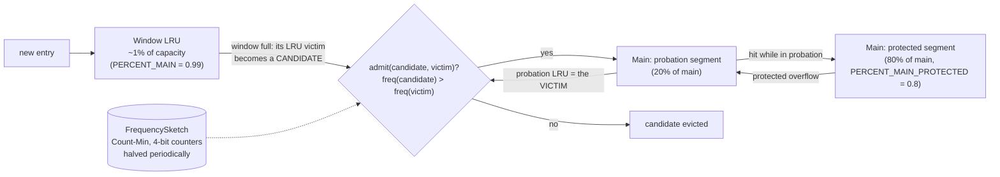

# 6.3 Caching: Caffeine's W-TinyLFU (L1) and Redis via Lettuce (L2)

> **Verified stack:** Caffeine **3.3.1** (constants and the admission method read from the jar with `javap`), Lettuce **7.9.0.RELEASE**, JDK **25.0.4.1**; Spring Boot **4.1.2** cache abstraction. Every experiment was run (`CacheLab.java`, `TwoLevelCacheLab.java`).
>
> ⚠️ **About the Redis server:** starting a real Redis binary on this machine was blocked by the sandbox, so the L2 experiments ran against **jedis-mock 1.1.20**, a Redis-protocol server written in Java that runs in-process. Lettuce talks real RESP to it. The *semantics* shown (`SET NX PX`, `EVAL` Lua, `PUBLISH`/`SUBSCRIBE`, TTLs) are standard Redis behavior; do **not** read Redis performance from those runs. Rerun them against a real Redis 7/8 before quoting latencies.
>
> **Related:** [6.4 stampede, penetration, avalanche, invalidation](04-Cache-Stampede-Penetration-Avalanche-Invalidation.md), sibling kit [2.1 collections internals](../../Java-Backend-Master-Reference/02-Core-Java/01-Collections-Internals.md) (`ConcurrentHashMap`, which Caffeine is built on).

---

## 0. First principles: a cache trades freshness for latency and load 🔥

The arithmetic of a cache:

```text
average latency  = h × t_cache + (1 − h) × t_source
load on source   = (1 − h) × request rate

10,000 req/s, h = 0.90 → 1,000 req/s reach the database
10,000 req/s, h = 0.95 →   500 req/s reach the database     ← 5 points of hit rate halved the DB load
10,000 req/s, h = 0.99 →   100 req/s
```

Near the top, small hit-rate gains are huge load reductions. The corollary is that **losing** the cache (a cold restart, a flush, Redis down) multiplies DB load by 10–100×. Plan for that moment, not just the steady state ([6.4](04-Cache-Stampede-Penetration-Avalanche-Invalidation.md)).

Every cache design answers five questions:

| Question | Mechanism | Covered in |
|---|---|---|
| What do we keep when full? | **Eviction** policy (LRU, LFU, W-TinyLFU) | §1.2 |
| How long is an entry valid? | **Expiration** (TTL, TTI, refresh) | §1.3 |
| What happens on a miss? | **Loading**: who loads, and how many times | §1.4, 6.4 |
| How do we learn the source changed? | **Invalidation** | §2.3, 6.4 |
| What if the cache itself fails? | **Degradation**: fall through, fail fast, L1 shields L2 | §2.3, 6.4 |

Rough orders of magnitude (general figures, not measured here): a local in-heap lookup is around 100 ns, a Redis round trip in the same data center is around a few hundred µs to 1 ms, and a database query is 1–50 ms.

---

## 1. Caffeine internals (L1) ⚡

### 1.1 The structure: an exact map plus an approximate policy

```text
                      reads (lock-free)                     writes
 cache.getIfPresent ─► ConcurrentHashMap<K, Node>    cache.put ─► ConcurrentHashMap.compute
        │                                                   │
        ▼ record the access                                 ▼ record the write
 StripedBuffer of BoundedBuffer rings (16 slots each)    MPSC write buffer (MpscGrowableArrayQueue)
 LOSSY: if the ring is full, the event is dropped        never dropped
        │                                                   │
        └───────────────► maintenance() ◄───────────────────┘
                 one thread at a time, under evictionLock.tryLock() (nobody waits)
                 drainReadBuffer → drainWriteBuffer → expire → evict → climb
                 runs on the configured Executor (default: ForkJoinPool.commonPool())
```

* The **map is exact**: a `get` never misses an entry that's present.
* The **policy is approximate**: under heavy read contention some access events are dropped, so the LRU/LFU order is slightly stale. This is the trade that makes reads scale with cores. The design comes from the *BP-Wrapper* paper (batch the policy updates, apply them under one lock).
* Node classes are **code-generated** for each combination of features (strong/weak keys, expiry, weight, refresh), so a cache without expiry doesn't pay for expiry fields.

### 1.2 W-TinyLFU: admission, not just eviction 🧊



How it works:

1. **Window**: new entries enter a small LRU (1 % of capacity to start). That absorbs bursts and gives brand-new keys a chance to prove themselves.
2. **Admission filter**: when the window overflows, its oldest entry is a candidate to enter the main space. Caffeine compares its estimated frequency with that of the main space's eviction victim. The 3.3.1 bytecode:

   ```text
   admit(candidate, victim):
       if freq(candidate) > freq(victim)  → admit
       else if freq(candidate) ≥ 6         → admit with probability 1/128   (ThreadLocalRandom & 127 == 0)
       else                                → reject the candidate
   ```

   The random branch (`ADMIT_HASHDOS_THRESHOLD = 6`) defends against an attacker who floods keys that collide in the sketch to keep a hot victim artificially "popular".
3. **Frequency sketch**: a Count-Min sketch with **4-bit counters** packed into a `long[]` (`ONE_MASK = 0x1111…`, `RESET_MASK = 0x7777…`). Counters saturate at 15. After a sample period proportional to the cache size, every counter is **halved** (`reset()`), so yesterday's popularity decays. The memory cost is a few bytes per cache entry, not per key ever seen.
4. **Main space** is a segmented LRU: hits promote entries from *probation* to *protected* (80 % of main).
5. **Hill climbing** (`WindowClimber`, `RESTART_THRESHOLD = 0.05`): Caffeine samples the hit rate and moves the window/main boundary. Recency-heavy workloads get a bigger window; frequency-heavy ones get a smaller one.

**Why that beats LRU:** a one-off scan (a report or batch job reading 5,000 keys once) flushes an LRU completely. Under W-TinyLFU, scan keys have frequency 1, lose the admission comparison, and die in the window.

**One measured run** (Zipf popularity over 100,000 keys, s = 0.9, plus a one-off scan of 5,000 new keys every other 20,000 requests; cache size 1,000; Caffeine's maintenance run on the caller thread for determinism):

```text
== A. 1,000,000 requests, cache size 1,000: LRU vs W-TinyLFU (Zipf popularity + periodic one-off scans)
  LRU        hit rate = 29.7%
  Caffeine   hit rate = 38.5%   (evictions=614296)
```

On the same trace, about 30 % more hits means about 13 % fewer misses reaching the source ((70.3 − 61.5) / 70.3).

### 1.3 Expiration ⚡

| Option | Data structure | Cost |
|---|---|---|
| `expireAfterWrite(d)` | write-order queue | O(1) |
| `expireAfterAccess(d)` | access-order queue (shared with LRU order) | O(1) |
| `expireAfter(Expiry)` (per-entry TTL) | hierarchical **TimerWheel** (`BUCKETS`, `SPANS` arrays of wheels) | amortized O(1) |
| `refreshAfterWrite(d)` | checked on read | async reload |

An expired entry is treated as absent **on read** right away, even if maintenance hasn't removed it yet. Without a `Scheduler` (`Caffeine.scheduler(Scheduler.systemScheduler())`), removal only happens during activity. That matters if you rely on removal listeners to release resources.

### 1.4 Loading: one load per key, and refresh vs expire 🔥

```java
// ❌ check-then-load: every concurrent miss loads
String v = map.get(key);
if (v == null) { v = loadFromDb(key); map.put(key, v); }

// ✅ atomic compute-if-absent: concurrent callers for the same key wait for ONE load
String v = cache.get(key, k -> loadFromDb(k));
```

**One measured run** (100 virtual threads, loader takes 200 ms):

```text
== B. 100 concurrent requests for the same missing key (loader takes 200 ms)
  check-then-load (map.get/put): loader ran 100 times
  Caffeine cache.get(key, loader): loader ran 1 time(s)
```

Two caveats interviewers like:

* `Cache.get(key, fn)` runs `fn` inside `ConcurrentHashMap.compute`, which **holds the bin lock** during the load. A slow loader blocks writes to other keys in the same bin, and a loader that touches the same cache can deadlock or throw. For slow or I/O-bound loads use **`AsyncCache`/`AsyncLoadingCache`**: the map holds a `CompletableFuture`, the load runs outside the lock, and callers still coalesce on the same future.
* Coalescing is **per JVM**. Fifty pods still mean up to fifty loads. That's the job of the distributed lock in §2.3.

**Refresh vs expire.** With a fake ticker advanced 6 minutes past a 5-minute policy, and a loader that takes 300 ms:

```text
== C. After the TTL: expireAfterWrite blocks the reader, refreshAfterWrite serves stale and reloads in the background
  expireAfterWrite   first read after TTL: price-v2  in 303 ms; a moment later: price-v2
  refreshAfterWrite  first read after TTL: price-v1  in  13 ms; a moment later: price-v2
```

`refreshAfterWrite` is **stale-while-revalidate**: the first reader after the interval gets the old value immediately and triggers one async reload. Combine both for a hard bound:

```java
LoadingCache<String, Price> prices = Caffeine.newBuilder()
        .maximumSize(50_000)
        .refreshAfterWrite(Duration.ofMinutes(1))     // usually fresh within ~1 min, never blocks readers
        .expireAfterWrite(Duration.ofMinutes(10))     // never older than 10 min, even if reloads keep failing
        .recordStats()
        .build(this::loadPrice);
```

### 1.5 Sizing L1 inside a container ⚡

L1 lives **in the heap**. `maximumSize(1_000_000)` with 2 KB values is about 2 GB, plus per-entry overhead (node object, map entry, key). In a pod with `-XX:MaxRAMPercentage=75` and a 2 GiB limit, that's an OOM. Use `maximumWeight` + a `weigher` for variable-size values, and size the heap for it ([7.1](../07-Docker-JVM-Kubernetes/01-JVM-in-Containers-cgroups-v2-Memory-OOMKilled.md)).

### 1.6 Spring Boot wiring

```yaml
spring:
  cache:
    type: caffeine
    cache-names: products, prices
    caffeine:
      spec: maximumSize=50000,expireAfterWrite=10m,recordStats
```

```java
@Cacheable(cacheNames = "products", key = "#id", sync = true)   // sync=true → Cache.get(key, loader): one load per key
public ProductView product(long id) { return repository.findView(id); }

@CacheEvict(cacheNames = "products", key = "#cmd.id")          // runs after the method returns, which is not necessarily after COMMIT
@Transactional
public void rename(RenameProduct cmd) { ... }
```

With `recordStats`, Boot binds Caffeine statistics to Micrometer (`cache.gets{result=hit|miss}`, `cache.evictions`, ...). Alert on the **hit rate**, not just latency.

⚠️ `@CacheEvict` on a `@Transactional` method **can evict before the commit**. Whether the cache advice runs inside or outside the transaction advice depends on advisor ordering (both default to lowest precedence), so don't rely on it. If it evicts first, a concurrent reader reloads the *old* row and caches it. Evict after commit with `@TransactionalEventListener(phase = AFTER_COMMIT)`, or with a transaction-aware cache manager (`TransactionAwareCacheManagerProxy`). The deeper version of this race is in [6.4 §5](04-Cache-Stampede-Penetration-Avalanche-Invalidation.md).

---

## 2. Redis as the shared L2, through Lettuce ⚡

### 2.1 Lettuce's connection model

* Built on **Netty**. One `StatefulRedisConnection` is **thread-safe and multiplexed**: many threads write commands into one TCP connection and responses are matched in order (Redis replies in request order). Spring Data Redis's `LettuceConnectionFactory` shares one native connection by default.
* You need **separate or pooled connections** for blocking commands (`BLPOP`, `XREAD BLOCK`), `MULTI`/`EXEC` transactions, and Pub/Sub subscriptions (a subscribed connection can't run normal commands).
* Redis executes commands on **one thread**. A slow command (`KEYS *`, a large `HGETALL`, a long Lua script, a 5 MB value) stalls *every* client. Use `SCAN`, keep values small (well under ~100 KB), and watch `SLOWLOG`.

### 2.2 Topology and server settings that matter for caching

| Setting | Why |
|---|---|
| `maxmemory` + `maxmemory-policy` | The default policy is **`noeviction`**: when memory is full, writes fail. For a pure cache use `allkeys-lfu` (Redis's approximate LFU: 8-bit log counters with decay) or `allkeys-lru`. |
| **Redis Cluster** | 16,384 hash slots, `slot = CRC16(key) mod 16384`. Multi-key commands and Lua scripts need all keys in one slot: use **hash tags**, `lock:{product:42}` and `{product:42}`. |
| Lettuce cluster topology refresh | After a failover the client must learn the new primary. Since Boot **4.1** all adaptive refresh triggers are on by default: the old `spring.data.redis.lettuce.cluster.refresh.adaptive` property is removed (metadata: deprecation level `error`, "All adaptive triggers are enabled by default", since 4.1.0). Add a periodic refresh with `spring.data.redis.lettuce.cluster.refresh.period`. Without topology refresh you see `MOVED` storms or timeouts until restart. |
| Timeouts | `spring.data.redis.timeout` (command timeout) and `connect-timeout`: a Redis brownout must not hang request threads. Put a circuit breaker on the L2 and **fall through to L1 or the DB** ([6.1](01-Resilience4j-Circuit-Breaker-Internals-Sliding-Windows.md)). |
| Serialization | JSON or another explicit format with a **versioned key prefix** (`v3:product:42`), so a DTO change doesn't need a flush. Avoid JDK serialization (size, versioning, deserialization attacks). |

### 2.3 Two-level cache: L1 Caffeine + L2 Redis 🧊

```text
read:   L1 hit? ─► return
        L2 hit? ─► put in L1, return
        miss    ─► take a distributed lock (SET lock:k token NX PX 5000)
                     won  → load from DB, SET k v EX ttl±jitter, release (compare-and-delete), return
                     lost → wait briefly, re-read L2 (someone else is loading)
write:  commit to DB ─► DEL k in L2 ─► PUBLISH cache-invalidation k ─► every instance invalidates its L1
```

The core of the lab (abridged):

```java
String get(String key) {
    return l1.get(key, k -> {                                      // L1 coalesces misses inside this JVM
        for (int attempt = 0; attempt < 100; attempt++) {
            String v = redis.get(k);                               // L2
            if (v != null) return v;
            String token = UUID.randomUUID().toString();
            if ("OK".equals(redis.set("lock:" + k, token, SetArgs.Builder.nx().px(5_000)))) {   // one loader, fleet-wide
                try {
                    String loaded = loadFromDb(k);
                    long ttl = 600 + ThreadLocalRandom.current().nextInt(60);                      // TTL jitter
                    redis.set(k, loaded, SetArgs.Builder.ex(ttl));
                    return loaded;
                } finally {
                    redis.eval(RELEASE, ScriptOutputType.INTEGER, new String[] {"lock:" + k}, token); // only MY lock
                }
            }
            sleep(20);                                             // someone else is loading
        }
        return loadFromDb(k);                                      // give up waiting (bounded)
    });
}

static final String RELEASE = """
        if redis.call('get', KEYS[1]) == ARGV[1] then return redis.call('del', KEYS[1]) else return 0 end""";

void updatePrice(String key, String newPrice) {
    db.update(key, newPrice);                    // 1. source of truth (after COMMIT in real code)
    redis.del(key);                              // 2. invalidate L2: delete, don't set
    redis.publish("cache-invalidation", key);    // 3. every instance drops its L1 copy
}
```

**Output (verified against jedis-mock 1.1.20 with Lettuce 7.9.0; three "instances" are three L1 caches + connections in one JVM):**

```text
== 1. Cold key: 3 instances x 50 concurrent requests
  database loads: 1   (150 requests)
== 2. Instance A changes the price; B and C had it in L1
  before: B=price=100  C=price=100
  after : B=price=80  C=price=80   database loads now: 2
== 3. Lock ownership: an expired holder must not delete someone else's lock
  holder-1 compare-and-delete returned 0; lock now held by: holder-2
```

What to say about each part:

* **150 requests → 1 DB load**: L1 coalesced within each instance, and the `SET NX PX` lock coalesced across instances.
* **Pub/Sub is at-most-once.** An instance that's disconnected (GC pause, network blip, restart) during the `PUBLISH` never sees it. Its L1 stays stale until **L1's own TTL** expires, which is why L1 TTLs are short (seconds to a minute) while L2 TTLs are longer. For stronger delivery, use Redis **client-side caching** (RESP3 `CLIENT TRACKING`: the server tracks which keys a connection read and pushes invalidations, and Lettuce supports it), or a durable channel (a Kafka topic, or CDC from the database: [5.4 §6](../05-Microservices-Patterns/04-Transactional-Outbox-and-Idempotent-Consumer-Complete-Implementation.md)).
* **Lock release must check ownership** (the Lua compare-and-delete). Holder 1 paused past its lease, holder 2 acquired the lock, and a plain `DEL` from holder 1 would have released holder 2's lock. A lease lock is still **not** a correctness lock: holder 1 *believes* it holds the lock after its lease expired. Use it to reduce duplicate work (a stampede), never to protect an invariant. For invariants, use a **fencing token** checked by the resource, or the database.

### 2.4 Spring's `CompositeCacheManager` is not a two-level cache 🧊

`CompositeCacheManager.getCache(name)` returns the **first** delegate manager that knows that cache name. It's a lookup fallback for names, not read-through tiering. A real L1/L2 needs a custom `Cache` implementation that consults both (or a library that provides one), plus the invalidation channel above.

---

## 3. Cache patterns compared 🔥

| Pattern | Who loads on miss | Write path | Consistency risk | Use when |
|---|---|---|---|---|
| **Cache-aside** (lazy loading) | The application | Write DB, then **delete** the cache key | Stale fill race ([6.4 §5](04-Cache-Stampede-Penetration-Avalanche-Invalidation.md)) | The default for read-heavy services |
| **Read-through** | The cache (a loader) | Same as cache-aside | Same | You want loading logic in one place (Caffeine `LoadingCache`) |
| **Write-through** | Cache or app | Write cache **and** DB synchronously | Partial failure between the two | Read-after-write must hit the cache |
| **Write-behind** (write-back) | Cache | Write the cache; flush to the DB asynchronously | **Data loss** if the cache dies before flushing | Counters and metrics where loss is tolerable |
| **Refresh-ahead** | Cache, before expiry | Any | Wasted reloads of cold keys | Hot keys with expensive loads (`refreshAfterWrite`) |

Why **delete, not set**, on write: if two writers update the DB in order A then B but their cache *sets* land in order B then A, the cache holds A's value forever. A delete is idempotent and order-independent, and the next reader loads the current row.

---

## 4. ❌ Naïve vs ✅ production-hardened

| ❌ Naïve | ✅ Production-hardened |
|---|---|
| `ConcurrentHashMap` as a cache (unbounded) | Caffeine with `maximumSize`/`maximumWeight`, so W-TinyLFU decides what stays |
| `map.get` then `map.put` | `cache.get(key, loader)` / `@Cacheable(sync = true)`; `AsyncCache` for slow loaders |
| `expireAfterWrite` only, so readers block at expiry | `refreshAfterWrite` + `expireAfterWrite` (stale-while-revalidate with a hard bound) |
| L1 sized by entry count with variable values | `maximumWeight` + weigher, and heap sized in the pod's memory budget |
| Redis with the default `noeviction` | `allkeys-lfu`, `maxmemory` set, alerts on evictions and memory |
| One Lettuce connection per request | One shared multiplexed connection; dedicated ones for Pub/Sub, blocking and `MULTI` |
| Redis outage = errors everywhere | Command timeouts, a breaker on L2, fall through to L1 and the DB with load shedding |
| Pub/Sub as the only invalidation channel | Pub/Sub + short L1 TTL, or client-side caching / CDC for stronger guarantees |
| `@CacheEvict` inside `@Transactional` | Evict after commit |
| `CompositeCacheManager` "for L1+L2" | A real two-level `Cache` with read-through and invalidation |
| `DEL lock` to release | Compare-and-delete with an owner token, and fencing for correctness |

---

## 5. Source to read

| Repo | Path | What to look for |
|---|---|---|
| [ben-manes/caffeine](https://github.com/ben-manes/caffeine) | `caffeine/src/main/java/com/github/benmanes/caffeine/cache/BoundedLocalCache.java` | `admit`, `evictFromMain`, `maintenance`, `afterRead`/`afterWrite`, `climb` |
| same | `caffeine/src/main/java/com/github/benmanes/caffeine/cache/FrequencySketch.java` | 4-bit counters in a `long[]`, `increment`, `reset` (halving) |
| same | `caffeine/src/main/java/com/github/benmanes/caffeine/cache/TimerWheel.java` | Hierarchical wheels for per-entry expiry |
| same | `caffeine/src/main/java/com/github/benmanes/caffeine/cache/StripedBuffer.java` and `BoundedBuffer.java` | Lossy striped read buffers |
| same | [Wiki: Efficiency](https://github.com/ben-manes/caffeine/wiki/Efficiency) and [Design](https://github.com/ben-manes/caffeine/wiki/Design) | Hit-rate traces and the design write-up |
| [redis/lettuce](https://github.com/redis/lettuce) | `src/main/java/io/lettuce/core/protocol/CommandHandler.java` | How one connection pipelines many commands |
| [spring-projects/spring-framework](https://github.com/spring-projects/spring-framework) | `spring-context/src/main/java/org/springframework/cache/support/CompositeCacheManager.java` | Proof it's a name-lookup fallback, not a tier |
| [spring-projects/spring-data-redis](https://github.com/spring-projects/spring-data-redis) | `src/main/java/org/springframework/data/redis/cache/RedisCache.java` | How `@Cacheable` maps to Redis commands and TTLs |

---

## 6. Interview soundbites

* "At high hit rates, every point of hit rate is a big change in database load. That's why a cold or flushed cache is an outage risk, not just a slowdown."
* "Caffeine keeps an exact `ConcurrentHashMap` and an approximate policy. Reads record into lossy striped buffers, and one thread applies them under a try-lock."
* "W-TinyLFU is an admission filter: a new key must beat the eviction victim's estimated frequency in a 4-bit Count-Min sketch that halves periodically. On my scan-polluted Zipf trace it hit 38.5 % against LRU's 29.7 %."
* "`cache.get(key, loader)` gives one load per key per JVM. Across pods, a `SET NX PX` lock with a compare-and-delete release took 150 cold requests on three instances down to one database load."
* "Pub/Sub invalidation is at-most-once, so L1 TTLs stay short. For stronger guarantees I'd use client-side caching or CDC."
* "A Redis lease lock prevents duplicate work, not concurrent writes. For correctness I need fencing tokens or the database."

**Next:** [6.4 Cache stampede, penetration, avalanche, invalidation →](04-Cache-Stampede-Penetration-Avalanche-Invalidation.md)
