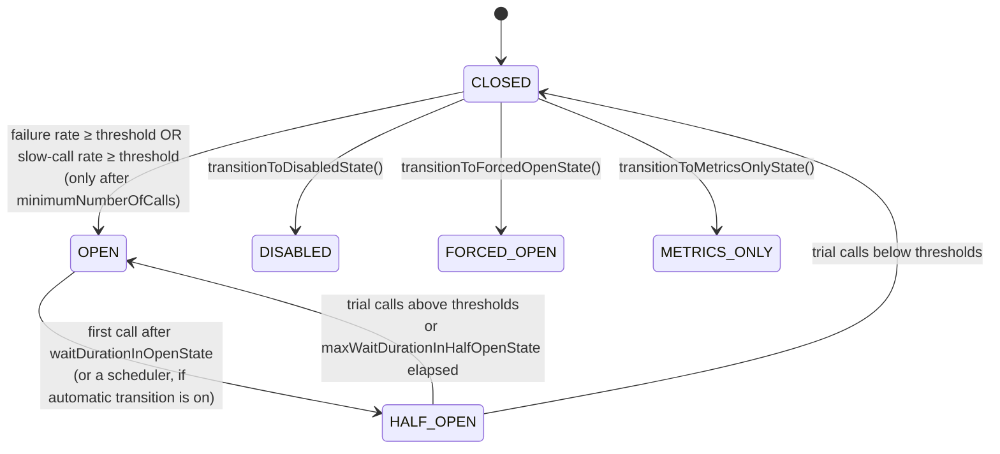

# 6.1 Resilience4j Circuit Breaker Internals: State Machine, Sliding Windows, Lock Strategy (and Why There Is No `RingBitBuffer`)

> **Verified stack:** Resilience4j **2.4.0** (`resilience4j-circuitbreaker`, `resilience4j-core`, `resilience4j-micrometer`, `resilience4j-spring6`), wired into Spring Boot **4.1.2** with `resilience4j-spring-boot4` **2.4.0**, JDK **25.0.4.1**. Class names, fields, defaults and aspect orders were read from the 2.4.0 jars with `javap`; every scenario was run (`R4jLab.java`).
>
> **Prereqs:** [4.3 AOP proxies](../04-Spring-Boot-Internals/03-AOP-Proxies-JDK-vs-CGLIB-Self-Invocation-Ordering.md) (annotations only work through the proxy). **Go deeper:** the sibling kit's [6.4 Resilience4j](../../Java-Backend-Master-Reference/06-Spring-Microservices/04-Resilience4j-CircuitBreaker-RateLimiter-Bulkhead.md).
>
> Tags: 🔥 must-know · ⚡ senior (L5) · 🧊 staff (L6)

---

## 0. First principles: failing fast is a capacity decision 🔥

A call to a sick dependency doesn't just fail; it **holds resources while it fails**: a thread or virtual thread, a pooled connection, a socket, request memory, and a slot in the downstream's own queue. Little's law makes the damage concrete:

```text
in-flight calls = arrival rate × latency

  healthy:   200 req/s × 0.05 s =   10 in flight
  sick:      200 req/s × 5 s    = 1000 in flight   (every call now waits for its timeout)
```

A pool of 200 connections is exhausted in a second, your own callers start timing out, and the failure has **cascaded** one hop upstream. Waiting doesn't help the dependency recover either; it keeps it saturated.

A circuit breaker is a **feedback loop** around the call:

1. **Measure** recent outcomes (failures and slow calls) in a sliding window.
2. **Decide** only when the sample is big enough (`minimumNumberOfCalls`).
3. **Open**: reject calls immediately (`CallNotPermittedException`), run a fallback, and give the dependency room to recover.
4. **Probe**: after a wait, let a *few* trial calls through (half-open). If they succeed, close; if not, open again.

Every configuration question is a question about one of those four steps.

---

## 1. Correcting the premise: `RingBitBuffer` and "lock-free" 🧊

Two claims you will hear (and that appeared in this kit's brief) are out of date:

| Claim | Reality in Resilience4j 2.4.0 (verified from the jars) |
|---|---|
| "The breaker stores outcomes in a `RingBitBuffer`" | That was the **0.x** design (one bit per call, success or failure). Since **1.0** outcomes go into the `Metrics` sliding windows in `resilience4j-core`, which also track **slow calls** and **durations**. There is no `RingBitBuffer` class in 2.4.0. |
| "The internals are lock-free" | **The state machine is**: the current state is an immutable object in an `AtomicReference` (`stateReference`) swapped with CAS. **The default sliding windows are not**: `FixedSizeSlidingWindowMetrics` and `SlidingTimeWindowMetrics` each guard their update with a `ReentrantLock`, because `DEFAULT_SLIDING_WINDOW_SYNCHRONIZATION_STRATEGY = SYNCHRONIZED`. Lock-free variants (`LockFreeFixedSizeSlidingWindowMetrics`, `LockFreeSlidingTimeWindowMetrics`, CAS through `VarHandle`s) are **opt-in** with `slidingWindowSynchronizationStrategy(LOCK_FREE)`. |

In an interview, correcting a premise with evidence ("I checked the 2.4.0 classes") is itself an L6 signal. Don't argue; show.

---

## 2. Under the hood: the state machine 🔥

### 2.1 The classes

```text
CircuitBreakerStateMachine                     (resilience4j-circuitbreaker/.../internal)
 ├─ AtomicReference<CircuitBreakerState> stateReference   ← the only mutable "which state" pointer
 ├─ CircuitBreakerConfig circuitBreakerConfig
 ├─ CircuitBreakerEventProcessor eventProcessor            ← onStateTransition, onError, onCallNotPermitted ...
 └─ inner state classes, each owning its own CircuitBreakerMetrics:
      ClosedState      { AtomicBoolean isClosed; CircuitBreakerMetrics circuitBreakerMetrics }
      OpenState        { Instant retryAfterWaitDuration; int attempts; AtomicBoolean isOpen;
                         ScheduledFuture<?> transitionToHalfOpenFuture }
      HalfOpenState    { AtomicInteger permittedNumberOfCalls; AtomicBoolean isHalfOpen; int attempts;
                         ScheduledFuture<?> transitionToFuture }
      DisabledState, ForcedOpenState, MetricsOnlyState      ← operational overrides
```

A transition builds a **new state object** (with fresh metrics) and swaps it in through `stateTransition(...)` → `stateReference.getAndUpdate(...)`, then publishes a `CircuitBreakerOnStateTransitionEvent`. Because each state owns its metrics, opening the circuit throws away the old window. When it closes again, it starts counting from zero.



### 2.2 One call, step by step

```text
decorated.get()
  1. acquirePermission()      → state.tryAcquirePermission()
        CLOSED     : true
        OPEN       : now > retryAfterWaitDuration ? (transition to HALF_OPEN, then ask again) : false
        HALF_OPEN  : permittedNumberOfCalls.getAndUpdate(c -> c == 0 ? c : c - 1) > 0
     false → throw CallNotPermittedException (downstream is NOT called)
  2. start = clock; result = supplier.get()
  3. onSuccess(duration) / onError(duration, throwable)
        is the throwable "ignored"?  → release the permission, record nothing
        is it "recorded"?            → metrics.onError(...)
        duration > slowCallDurationThreshold → also counts as a slow call
  4. metrics returns a Result:
        BELOW_MINIMUM_CALLS_THRESHOLD | BELOW_THRESHOLDS |
        FAILURE_RATE_ABOVE_THRESHOLDS | SLOW_CALL_RATE_ABOVE_THRESHOLDS | ABOVE_THRESHOLDS
     state.checkIfThresholdsExceeded(result) → maybe transition
```

The `HalfOpenState` permit lambda, decompiled from 2.4.0: `iload_0; ifne → iinc -1`. If the counter is already 0 it stays 0, otherwise it's decremented. Exactly `permittedNumberOfCallsInHalfOpenState` callers get through, with no lock.

### 2.3 OPEN → HALF_OPEN is lazy by default ⚡

`OpenState` stores `retryAfterWaitDuration` (an `Instant`). Nothing happens when that instant passes. The transition happens on **the next call that asks for permission**. The verified run shows it: wait duration 500 ms, but the lab slept 600 ms before the next call, and the transition is stamped at **617 ms**, when that call arrived.

`automaticTransitionFromOpenToHalfOpenEnabled(true)` schedules the transition on a scheduler thread instead. That's useful when dashboards should show `HALF_OPEN` on time or traffic is very sparse. The cost is one scheduled task per open breaker.

### 2.4 The half-open trap 🧊

Half-open hands out N permits and waits for N outcomes. If those trial calls **hang** (no timeout), they never report, the permits are never returned, and every other caller gets `CallNotPermittedException`. The breaker is stuck in HALF_OPEN. Two defenses:

* Every protected call has a **timeout shorter than `slowCallDurationThreshold`** (HTTP client read timeout, JDBC query timeout, or a `TimeLimiter`).
* `maxWaitDurationInHalfOpenState`: the 2.4.0 default is **0**, meaning wait indefinitely (`DEFAULT_WAIT_DURATION_IN_HALF_OPEN_STATE = 0`). Set it, and after it elapses the breaker transitions to `transitionToStateAfterWaitDuration` (default `OPEN`).

---

## 3. Under the hood: the sliding windows 🔥

### 3.1 Count-based: `FixedSizeSlidingWindowMetrics`

```text
fields: int windowSize; Measurement[] measurements; TotalAggregation totalAggregation; ReentrantLock lock

record(duration, outcome):                     window of the last N calls, O(1) per call
  lock.lock()
    m = moveWindowByOne()          ← head index advances; the measurement it lands on is the OLDEST call:
                                      subtract it from totalAggregation, reset it
    m.record(duration, outcome)    ← store the new call there
    totalAggregation.record(...)   ← add it to the running totals
    return snapshot(totalAggregation)
  lock.unlock()

     measurements (N = 10)                       totalAggregation (running sums)
  ┌───┬───┬───┬───┬───┬───┬───┬───┬───┬───┐     numberOfCalls, numberOfFailedCalls,
  │ ✓ │ ✓ │ ✗ │ ✗ │ ✓ │ ✗ │ ✓ │ ✓ │   │   │     numberOfSlowCalls, numberOfSlowFailedCalls,
  └───┴───┴───┴───┴───┴───┴───┴───┴───┴───┘     totalDurationInMillis
                                    ▲ head
```

The failure rate is never recomputed by scanning the array. Adding the new call and subtracting the evicted one keeps the totals exact in constant time. Memory is O(N) measurements per breaker.

### 3.2 Time-based: `SlidingTimeWindowMetrics`

```text
fields: PartialAggregation[] partialAggregations (one per second); int timeWindowSizeInSeconds;
        TotalAggregation totalAggregation; Clock clock; ReentrantLock lock

record(...):
  lock.lock()
    bucket = moveWindowToCurrentEpochSecond(latest)
        for every second that elapsed since the last call (bounded by the window size):
            subtract that old bucket from the total, reset it to the new epoch second
    bucket.record(...); totalAggregation.record(...)
  lock.unlock()
```

A 60 s window has 60 buckets no matter how many calls arrive, so a time window is the right choice for **high or variable** traffic. A count window of 100 covers 0.1 s at 1,000 rps but 100 s at 1 rps. That inconsistency is why the two window types behave so differently across services.

### 3.3 Does the lock matter? ⚡

The critical section is a few field updates. Contention appears only when **one breaker instance** sees a very high call rate from many cores. With virtual threads, a `ReentrantLock` doesn't pin the carrier, and since JDK 24 `synchronized` doesn't either (JEP 491). If a profiler shows contention on that lock (JFR `jdk.ThreadPark` events with the metrics class in the stack, or async-profiler `-e lock`), switch that breaker to `LOCK_FREE`. Don't switch on faith.

---

## 4. The defaults are a trap ⚡

Read from `CircuitBreakerConfig` 2.4.0 constants:

| Setting | Default | Why it bites |
|---|---|---|
| `slidingWindowType` | `COUNT_BASED` | Coverage in seconds depends on traffic |
| `slidingWindowSize` | **100** | |
| `minimumNumberOfCalls` | **100** | A service doing 2 req/s needs ~50 s of failures before the breaker *can* open |
| `failureRateThreshold` | 50 % | |
| `slowCallDurationThreshold` | **60 s** | Effectively "slow calls don't exist" |
| `slowCallRateThreshold` | **100 %** | Needs *every* call to be slow |
| `waitDurationInOpenState` | 60 s | Long for a blip; maybe right for a dead dependency |
| `permittedNumberOfCallsInHalfOpenState` | 10 | |
| `maxWaitDurationInHalfOpenState` | **0** (= forever) | The stuck-half-open trap (§2.4) |
| `slidingWindowSynchronizationStrategy` | `SYNCHRONIZED` | §3.3 |
| `writableStackTraceEnabled` | `true` | `CallNotPermittedException` stack traces cost CPU at high reject rates; set `false` |

Tune from the **SLO and traffic**, not from a blog post:

```text
Example: inventory-service, p99 = 120 ms, peak 300 req/s per pod, 20 pods

  window          TIME_BASED, 20 s       (≈ 6,000 calls per pod at peak, ~100+ off-peak)
  minimum calls   20                      (don't decide on 3 calls; do decide within a few seconds)
  slow threshold  1 s                     (≈ 8× p99; anything above is "sick")
  slow-call rate  60 %
  failure rate    50 %
  open wait       10 s, exponential to 60 s (waitIntervalFunctionInOpenState)
  half-open       5 trial calls, max wait 15 s
  client timeout  800 ms                  (< slow threshold, so slow calls finish and get recorded)
```

---

## 5. Verified experiments

### 5.1 Count-based breaker opening, rejecting, probing, closing

```java
CircuitBreaker cb = CircuitBreaker.of("inventory", CircuitBreakerConfig.custom()
        .slidingWindow(10, 5, CircuitBreakerConfig.SlidingWindowType.COUNT_BASED)   // size 10, min calls 5
        .failureRateThreshold(50)
        .waitDurationInOpenState(Duration.ofMillis(500))
        .permittedNumberOfCallsInHalfOpenState(2)
        .build());
cb.getEventPublisher().onStateTransition(e -> System.out.println(t() + "  TRANSITION " + e.getStateTransition()));

for (int i = 0; i < 12; i++) {
    Supplier<String> call = (i >= 4 && i < 8) ? boom : ok;       // 4 ok, 4 failures, then ok again
    try { cb.executeSupplier(call); }
    catch (CallNotPermittedException e) { rejected++; }          // the breaker said no; downstream untouched
    catch (IllegalStateException ignored) { }                    // the downstream failed
}
Thread.sleep(600);
cb.executeSupplier(ok); cb.executeSupplier(ok);                  // the two half-open trial calls
```

**One measured run** (Resilience4j 2.4.0):

```text
== 1. Count-based circuit breaker (window 10, min calls 5, failure rate 50%, open 500 ms, half-open trials 2)
      4 ms  TRANSITION State transition from CLOSED to OPEN
     11 ms  after 8 calls: failureRate=50.0% state=OPEN
     13 ms  calls 9-12 while OPEN: rejected without calling downstream = 4
    617 ms  TRANSITION State transition from OPEN to HALF_OPEN
    618 ms  TRANSITION State transition from HALF_OPEN to CLOSED
    619 ms  after 2 successful trial calls: state=CLOSED
```

Do the arithmetic before the interviewer does. After 5 calls the rate is 1/5 = 20 %. After 6 it's 2/6 = 33 %, after 7 it's 3/7 = 43 %, and after 8 it's 4/8 = **50 %**, which is ≥ the threshold, so the breaker opens. The four later calls never reached the downstream. HALF_OPEN appears at 617 ms, not 500, because the transition is lazy (§2.3).

### 5.2 Slow calls open the circuit even when every call succeeds

```java
CircuitBreaker cb = CircuitBreaker.of("pricing", CircuitBreakerConfig.custom()
        .slidingWindow(4, 4, CircuitBreakerConfig.SlidingWindowType.COUNT_BASED)
        .slowCallDurationThreshold(Duration.ofMillis(100))
        .slowCallRateThreshold(50)
        .build());
for (int i = 0; i < 4; i++) { final int k = i; cb.executeRunnable(() -> sleep(k < 2 ? 150 : 10)); }
```

```text
== 2. Slow calls open the circuit even when they succeed
  slowCallRate=50.0% failureRate=0.0% state=OPEN
```

This is the failure mode error-rate-only breakers miss. A dependency that answers in 4 s instead of 40 ms has a **0 % error rate** while it exhausts your pools.

---

## 6. Production wiring in Spring Boot 4 ⚡

### 6.1 Dependencies

```xml
<dependency>
  <groupId>io.github.resilience4j</groupId>
  <artifactId>resilience4j-spring-boot4</artifactId>   <!-- 2.4.0; brings the aspects + auto-configuration -->
</dependency>
<dependency>
  <groupId>org.springframework.boot</groupId>
  <artifactId>spring-boot-starter-aspectj</artifactId>  <!-- Boot 4 name (spring-boot-starter-aop stopped at 4.0.0-M2); annotations are applied by Spring AOP proxies -->
</dependency>
<dependency>
  <groupId>org.springframework.boot</groupId>
  <artifactId>spring-boot-starter-actuator</artifactId> <!-- /actuator/circuitbreakers, metrics -->
</dependency>
```

### 6.2 `application.yml`

```yaml
resilience4j:
  circuitbreaker:
    configs:
      default:
        sliding-window-type: TIME_BASED
        sliding-window-size: 20                      # seconds for TIME_BASED
        minimum-number-of-calls: 20
        failure-rate-threshold: 50
        slow-call-duration-threshold: 1s
        slow-call-rate-threshold: 60
        wait-duration-in-open-state: 10s
        permitted-number-of-calls-in-half-open-state: 5
        max-wait-duration-in-half-open-state: 15s
        writable-stack-trace-enabled: false
        record-exceptions:
          - java.io.IOException
          - java.util.concurrent.TimeoutException
          - org.springframework.web.client.HttpServerErrorException      # 5xx = the dependency is sick
        ignore-exceptions:
          - org.springframework.web.client.HttpClientErrorException      # 4xx = OUR request is wrong
    instances:
      inventory:
        base-config: default
      payments:
        base-config: default
        wait-duration-in-open-state: 30s             # slower to recover; don't hammer it
```

### 6.3 The annotated client and its fallbacks

```java
@Service
public class InventoryClient {
    private final RestClient rest;

    public InventoryClient(RestClient.Builder builder) {
        this.rest = builder.baseUrl("http://inventory").build();
    }

    @CircuitBreaker(name = "inventory", fallbackMethod = "availabilityFallback")
    public Availability availability(String sku) {                    // public, called from OUTSIDE this bean
        return rest.get().uri("/stock/{sku}", sku).retrieve().body(Availability.class);
    }

    // Same parameters + the exception. The most specific matching exception type wins.
    private Availability availabilityFallback(String sku, CallNotPermittedException open) {
        return Availability.unknown(sku, "inventory circuit open");   // degraded, explicit, observable
    }

    private Availability availabilityFallback(String sku, IOException io) {
        return Availability.unknown(sku, "inventory unreachable");
    }
    // No catch-all Exception fallback: a NullPointerException in OUR code should surface, not be "degraded".
}
```

Three rules interviewers probe:

1. **Self-invocation bypasses the proxy.** `this.availability(sku)` from inside the class is not protected ([4.3](../04-Spring-Boot-Internals/03-AOP-Proxies-JDK-vs-CGLIB-Self-Invocation-Ordering.md)).
2. **A fallback must be a business decision**: stale cached data, a default, a queued retry, or an honest error. "Return empty list" on a payment check is a bug.
3. **Count the right things.** A 4xx says your request is wrong, not that the dependency is sick. A `503` that comes back as a *response* (not an exception) needs `recordResult(r -> r.status() == 503)` or a client that throws.

### 6.4 Observability (names verified in `resilience4j-micrometer` 2.4.0)

| Metric | Use |
|---|---|
| `resilience4j.circuitbreaker.state` | Alert when a breaker is open for more than N minutes |
| `resilience4j.circuitbreaker.calls` (tag `kind`) | Successful / failed / ignored rates and latencies |
| `resilience4j.circuitbreaker.not.permitted.calls` | How much traffic is being shed, which is user impact |
| `resilience4j.circuitbreaker.failure.rate`, `.slow.call.rate` | Distance to the threshold; tune with real data |
| `resilience4j.circuitbreaker.buffered.calls`, `.slow.calls` | Window fill level |

🧊 **Never wire a downstream breaker into the readiness probe.** If `inventory` is down, every pod's breaker opens, every pod reports "not ready", Kubernetes removes all of them from the Service, and a partial outage becomes total. Readiness answers "can *this pod* serve?", not "are my dependencies healthy?" ([7.3](../07-Docker-JVM-Kubernetes/03-Kubernetes-Probes-and-Graceful-Shutdown.md)).

---

## 7. A breaker is per instance, so think about the fleet 🧊

Resilience4j state lives in one JVM. With 40 pods behind a load balancer, each pod sees 1/40 of the traffic, so:

* Each pod needs `minimumNumberOfCalls` of its own evidence. Size the window and minimum **per pod**, not per service.
* Pods open at slightly different times. That is fine and arguably good, because it means the fleet never stops calling the dependency all at once. Half-open probes are spread out too.
* A breaker protects a **logical dependency** (the inventory API). It can't tell that *one* inventory pod is bad. That's the job of **outlier detection** in the load balancer or mesh (Envoy ejects the bad host). Use both: mesh for per-host health, application breaker for per-dependency failure and fallbacks.
* Shared breaker state (in Redis) is almost always a mistake. It adds a network dependency to the thing that protects you from network dependencies.

---

## 8. ❌ Naïve vs ✅ production-hardened

| ❌ Naïve | ✅ Production-hardened |
|---|---|
| Defaults copied: window 100, min calls 100, slow threshold 60 s | Window and minimum sized from per-pod traffic; slow threshold ≈ a small multiple of p99 |
| No timeout on the protected call | Client timeouts < `slowCallDurationThreshold`; `maxWaitDurationInHalfOpenState` set |
| One breaker for "all external calls" | One breaker per dependency (sometimes per endpoint class with very different behavior) |
| 4xx counted as failures | `ignoreExceptions` for client errors; `recordResult` for error *responses* |
| Catch-all fallback returning empty data | Typed fallbacks with explicit degraded semantics, plus a metric for fallback usage |
| `@CircuitBreaker` on a method called via `this.` | Called through the Spring proxy (separate bean) |
| Breaker state in the readiness probe | Breaker state on dashboards and alerts, never in probes |
| `CallNotPermittedException` with stack traces at 10k rejects/s | `writableStackTraceEnabled(false)` |
| Lock-free "because it's faster" | `SYNCHRONIZED` until a profile shows contention on that breaker |

---

## 9. Source to read

| Repo | Path | What to look for |
|---|---|---|
| [resilience4j/resilience4j](https://github.com/resilience4j/resilience4j) | `resilience4j-circuitbreaker/src/main/java/io/github/resilience4j/circuitbreaker/internal/CircuitBreakerStateMachine.java` | Inner state classes, `stateTransition`, half-open permit counting, lazy OPEN → HALF_OPEN |
| same | `resilience4j-circuitbreaker/src/main/java/io/github/resilience4j/circuitbreaker/internal/CircuitBreakerMetrics.java` | `Result` enum and the threshold checks, including minimum calls |
| same | `resilience4j-core/src/main/java/io/github/resilience4j/core/metrics/FixedSizeSlidingWindowMetrics.java` | Circular array + running `TotalAggregation`, `moveWindowByOne` |
| same | `resilience4j-core/src/main/java/io/github/resilience4j/core/metrics/SlidingTimeWindowMetrics.java` | Epoch-second buckets, `moveWindowToCurrentEpochSecond` |
| same | `resilience4j-core/src/main/java/io/github/resilience4j/core/metrics/LockFreeFixedSizeSlidingWindowMetrics.java` | The opt-in CAS variant with `VarHandle`s |
| same | `resilience4j-spring6/src/main/java/io/github/resilience4j/spring6/circuitbreaker/configure/CircuitBreakerAspect.java` | How the annotation is applied and the fallback method chosen |

---

## 10. Interview soundbites

* "A breaker is a feedback loop: measure in a sliding window, decide only past a minimum sample, fail fast while open, probe with a few half-open calls."
* "Resilience4j hasn't used a `RingBitBuffer` since 1.0. In 2.4 the state is an immutable object behind an `AtomicReference`, and the default windows use a `ReentrantLock`. There's a lock-free option you turn on per breaker."
* "Count-based windows cover a different time span at every traffic level. For variable traffic I use time-based windows sized per pod."
* "Slow calls matter as much as errors. A dependency at 0 % errors and 4 s latency will still exhaust my pools."
* "Half-open needs timeouts. A hung trial call keeps the breaker in half-open forever, because the default max wait there is zero, which means unlimited."
* "Breakers protect a logical dependency per instance. Per-host ejection is the mesh's job, and dependency health never goes into readiness."

---

## 11. Deep dive: what the breaker bought under load, measured (verified) 🔥

The [6.6 chaos lab](06-Resilience-Under-Load-Chaos-Lab-Measured-Stack.md) put this module's breaker in front of a dependency with 20 workers, under open-loop load of 100 req/s. The dependency went through four 4-second phases: healthy, slow (600 ms), 50 % errors, and recovery. The breaker config was: count window 20, minimum 10 calls, 50 % failures or 50 % slow calls (> 250 ms), 1 s open, 5 half-open calls. Stack S1 (timeout only) against S3 (timeout + breaker):

| Phase | S1 dependency load | S3 dependency load | S1 dependency queue (max) | S3 dependency queue (max) | S3 cost |
|---|---|---|---|---|---|
| slow (600 ms) | 1.00× | **0.13×** | 284 | **22** | Rejections fail in 0 ms |
| errors (50 %) | 1.00× | **0.09×** | (same) | (same) | — |
| recovery | 1.00× | 0.86× | — | — | **57 failed** while OPEN → HALF_OPEN (1 s) → CLOSED (5 trial calls) |

What this adds to §1–§7:

* **The breaker's main beneficiary is the dependency.** The client's latency was already bounded by the timeout in S1 (p99 ≈ 313 ms). What the breaker did was **give capacity back**: load dropped to 0.13× and the queue to 22, so the dependency could drain instead of drowning. In a design review, describe a breaker as load shedding on behalf of the downstream service.
* **Set `slowCallDurationThreshold` below the client timeout** (250 ms < 300 ms here). Then slowness counts before it turns into timeouts, and the breaker opens on "getting slow", not only on "already failing".
* **Recovery has a price you choose.** 57 of 400 recovery-phase requests failed while the breaker waited out its open duration and ran 5 trial calls. A shorter wait recovers faster but probes more during the incident. Multiply by the fleet: 40 pods × 5 half-open calls means 200 probes the moment the dependency recovers (§7).
* **Breaker + bulkhead + fallback** (S4) turned **every** failure into a degraded success: 0 failed in all four phases. The breaker alone still returns errors; whether a fallback is acceptable is a product decision ([6.2 §10](02-Bulkheads-Rate-Limiters-Retries-Jitter-Decorator-Order.md)).

---

## Summary

| Topic | Key point | Evidence |
|---|---|---|
| Model | Measure in a sliding window, decide after a minimum sample, fail fast while open, probe half-open | §0 |
| Internals (2.4.0) | No `RingBitBuffer` since 1.0; immutable state behind an `AtomicReference`; windows default to `SYNCHRONIZED` | §1–§2, §3.3 |
| Windows | Count-based windows span different times at different traffic; time-based for variable load, sized per pod | §3 |
| Defaults that bite | `minimumNumberOfCalls` 100, `slowCallDurationThreshold` 60 s, `maxWaitDurationInHalfOpenState` 0 = unlimited | §4, §2.4 |
| Lazy transition | OPEN → HALF_OPEN happens on the first call after the wait (617 ms with a 500 ms wait) | §2.3, §5.1 |
| Slow calls | A breaker opens on latency even when every call succeeds | §5.2 |
| Spring Boot 4 wiring | Instances, ignore/record exceptions, fallbacks, metrics | §6 |
| Fleet view | Per-instance breakers; per-host ejection is the mesh's job; never in readiness | §7 |
| Under load | Dependency load 0.13× / 0.09×, queue 22 vs 284; 57 recovery failures; S4 = 0 failures | §11 (6.6) |

**Next:** [6.2 Bulkheads, rate limiters, retries, decorator order →](02-Bulkheads-Rate-Limiters-Retries-Jitter-Decorator-Order.md)
