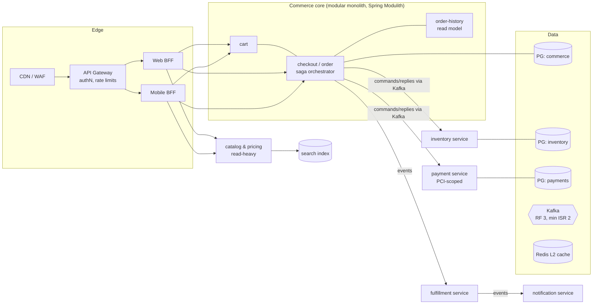

# 9.1 Reference Architecture: An End-to-End Order Platform

> **What this is:** the capstone that puts Pillars 1–8 into one design, the way you'd present it in a 45–60 minute staff-level system-design round. Every mechanism used here was explained and, where possible, **run** earlier in the kit; the links point to the evidence. The capacity numbers in §2 are **assumptions and arithmetic**, not measurements.
>
> Tags: 🔥 must-know · ⚡ senior (L5) · 🧊 staff (L6)

---

## 0. The prompt 🔥

> *"Design the order platform for a large retailer: web and mobile checkout, inventory across stores and distribution centers, payments, fulfillment (ship-to-home and store pickup), order history and notifications. Traffic triples during seasonal sales."*

Before drawing anything, pin down what "correct" means. These requirements drive every later decision:

| Requirement | Target | Why it shapes the design |
|---|---|---|
| **No lost orders** | An acknowledged order is never lost | Outbox, `acks=all`, replicated storage ([5.4](../05-Microservices-Patterns/04-Transactional-Outbox-and-Idempotent-Consumer-Complete-Implementation.md), [6.5](../06-Resilience-Caching-Kafka/05-Kafka-Producers-Batching-Idempotence-Ordering.md)) |
| **No double charge** | One authorization per order, even with retries | Idempotency keys end to end, unknown-outcome handling |
| **No oversell** (or a bounded, explicit amount) | Reservation never exceeds stock | Atomic conditional updates or a single owner per SKU ([2.6](../02-SQL-RDBMS-Internals/06-Isolation-Anomalies-Row-Locks-SKIP-LOCKED-Gap-Locks-Deadlocks.md)) |
| Checkout latency | p99 < 800 ms for the synchronous part | Few synchronous hops; everything else async |
| Availability | 99.95 % for checkout (≈ 22 min/month error budget) | Multi-zone, graceful degradation, no shared single points of failure |
| Freshness | Product page price: seconds; checkout price: exact | A staleness budget per data type ([6.4 §5.4](../06-Resilience-Caching-Kafka/04-Cache-Stampede-Penetration-Avalanche-Invalidation.md)) |

---

## 1. Shape: start as a modular monolith, extract with reasons 🧊



Why this split, and not twelve services on day one ([5.1](../05-Microservices-Patterns/01-Decomposition-Modular-Monolith-Strangler-Branch-by-Abstraction.md)):

| Unit | Separate deployable? | Reason |
|---|---|---|
| Cart, checkout/order, order history | **No**: modules in one service | Same team, same release cadence, tight consistency. Boundaries enforced by `ApplicationModules.verify()`; events through the publication registry (an outbox inside the monolith) |
| Inventory | **Yes** | Different scaling (store systems, DC feeds), different owner, hot-SKU contention to isolate |
| Payment | **Yes** | PCI scope minimization: the smallest possible thing touches card data; separate audit and deploy controls |
| Catalog & pricing | **Yes** | Read-heavy (100× checkout), cache-dominated, different SLO |
| Fulfillment, notification | **Yes** | Owned by other teams; async consumers of order events |

---

## 2. Back-of-the-envelope capacity (assumptions → arithmetic) ⚡

```text
Assumptions (state them out loud; the interviewer will adjust them):
  normal day         1.5 M orders/day         peak sale hour: 3× the busiest normal hour
  busiest normal hr  10 % of daily orders     events per order: ~10 (placed, reserved, authorized, …)
  product page views 100 per order            order record ~4 KB, events ~1 KB each

Orders
  normal busiest hour  150,000 / 3,600 s   ≈   42 orders/s
  peak sale            × 3                  ≈  125 orders/s  → design for 250 (2× headroom)

Kafka
  250 orders/s × 10 events ≈ 2,500 events/s × 1 KB ≈ 2.5 MB/s          (tiny for Kafka; partitions sized for
                                                                         consumer parallelism, not bandwidth)
Catalog reads
  250 × 100 = 25,000 page views/s at peak; at a 99 % cache hit rate → 250 DB reads/s
  at 90 % → 2,500 DB reads/s                                           (the 6.3 §0 arithmetic: hit rate is capacity)
Storage (orders DB)
  1.5 M × 365 × 4 KB ≈ 2.2 TB/year of order rows (+ indexes, + outbox churn) → partition by month (2.7)
Inventory hot spot
  flash sale: one SKU, 5,000 attempts/s for the first minute → one row = one serialization point (§4.3)
```

The point isn't the exact numbers. It's showing **where the scale actually is**: catalog reads and hot-SKU contention, not order writes.

---

## 3. The synchronous path: placing an order 🔥

```mermaid
sequenceDiagram
    autonumber
    participant C as Client
    participant B as BFF
    participant O as Checkout (order module)
    participant DB as PG commerce
    participant K as Kafka
    C->>B: POST /orders (Idempotency-Key: k-123)
    B->>O: placeOrder(cart, key)
    O->>DB: BEGIN; insert idempotency(k-123) / return stored response if present
    O->>DB: insert order (status PENDING), insert outbox(OrderPlaced); COMMIT
    O-->>B: 202 Accepted {orderId, status: PENDING}
    B-->>C: 202 + poll/push channel
    Note over O,K: relay (CDC or SKIP LOCKED poller) publishes OrderPlaced, key = orderId
```

* **Idempotency key** stored in the same transaction as the order: a client retry after a timeout returns the original response instead of creating a second order.
* **One local transaction** writes the order *and* the event (outbox). No dual write ([5.4](../05-Microservices-Patterns/04-Transactional-Outbox-and-Idempotent-Consumer-Complete-Implementation.md)).
* The response is **202 + order id**. The client sees `PENDING` immediately and gets the final state by push or poll. Optionally the BFF waits up to ~500 ms for the saga to finish, so most users see "confirmed" in one round trip, without coupling availability to the saga.
* Synchronous dependencies on this path: **one database**. Inventory and payment are not called synchronously, so their outages don't fail checkout submission.

---

## 4. The saga: reserve, authorize, confirm 🔥

### 4.1 Orchestration (in the checkout module)

```text
step 1  order PENDING                          compensation: reject order        (compensatable)
step 2  inventory.reserve(lines)               compensation: release            (compensatable)
step 3  payment.authorize(amount, key=orderId) — PIVOT —                        (no compensation after this)
step 4  inventory.confirm(reservation)                                           (retriable)
step 5  order APPROVED → OrderConfirmed event                                    (retriable)
timeouts: reservation 2 min, authorization 30 s → compensate in reverse order
```

Why orchestration here ([5.3](../05-Microservices-Patterns/03-Sagas-Choreography-vs-Orchestration-Compensation-Semantic-Locks.md)): the flow has a pivot, timeouts and compensations that the business wants to see in one place. FTGO's `CreateOrderSaga` has the same shape ([8.3 §1](../08-GitHub-Codebases-Study-Guide/03-Saga-Outbox-Event-Driven-Repos.md)). The saga state lives in the commerce DB (durable log: the kit's lab resumed exactly at `next_step = 2` after a crash). `PENDING` is the **semantic lock** other requests see.

### 4.2 Payment: the unknown-outcome problem 🧊

A timeout on `authorize` means **"don't know"**, not "failed".

* Every call carries `idempotencyKey = orderId` (the PSP deduplicates).
* On timeout: **query the PSP by key** before deciding. Retry only with the same key.
* A nightly **reconciliation** job compares PSP settlements with orders and fixes drift (authorized but no order, or the reverse).
* The payment service persists its own attempts table, keyed by order id, in the same transaction as the outbox event it emits ([5.4](../05-Microservices-Patterns/04-Transactional-Outbox-and-Idempotent-Consumer-Complete-Implementation.md)).

### 4.3 Inventory: no oversell under contention 🧊

Default design: one row per (SKU, location) and an **atomic conditional update**. No read-modify-write in Java ([2.6](../02-SQL-RDBMS-Internals/06-Isolation-Anomalies-Row-Locks-SKIP-LOCKED-Gap-Locks-Deadlocks.md)):

```sql
update stock
   set reserved = reserved + :qty
 where sku = :sku and location_id = :loc
   and on_hand - reserved >= :qty;          -- 0 rows → not enough stock: fail the step, compensate
```

The reservation row and its outbox event commit together; the consumer of `ReserveInventory` commands is idempotent (dedup on the command id).

For a **flash-sale SKU** (5,000 attempts/s on one row), that single row is a serialization point: each update waits for the previous one's row lock. Options, in order of preference:

| Option | Idea | Cost |
|---|---|---|
| **Pre-split stock into N buckets** (`sku, location, bucket 0..N-1`), pick a random bucket, fall back to others | Spreads row-lock contention N ways | Slight unfairness; "no stock" requires checking all buckets |
| **Token pre-allocation**: load "10,000 sale units" into a queue/table of tokens; reservation = claim a token with `SKIP LOCKED` | Turns contention into independent row claims ([2.6](../02-SQL-RDBMS-Internals/06-Isolation-Anomalies-Row-Locks-SKIP-LOCKED-Gap-Locks-Deadlocks.md)) | Extra setup per sale |
| **Single-writer partition**: route all reservations for a SKU to one Kafka partition and a single consumer that owns its count in memory, with a durable log | Removes locks entirely | Latency + operational complexity; correct only with exactly-once *effects* |
| Redis `DECRBY` with DB reconciliation | Very fast | Redis isn't the source of truth: needs reconciliation and a policy for drift. Say so explicitly |

---

## 5. Kafka topology ⚡

| Topic | Key | Partitions | Retention / policy | Producer → consumers | Ordering need | Failure policy |
|---|---|---|---|---|---|---|
| `order-events` | orderId | 24 | 7 days | commerce outbox → fulfillment, notification, history, analytics | per order | consumers: short blocking retries → DLT ([6.6 §4](../06-Resilience-Caching-Kafka/06-Kafka-Consumers-Rebalancing-EOS-Retries-DLQ.md)) |
| `inventory-commands` / `-replies` | sku (commands), orderId (replies) | 24 | 3 days | saga ↔ inventory | per SKU | idempotent handlers; DLT + alert |
| `payment-commands` / `-replies` | orderId | 12 | 3 days | saga ↔ payment | per order | **no automatic replays** without the unknown-outcome check |
| `inventory-levels` | sku+location | 48 | **compacted** | inventory → catalog (availability badges), search | latest per key | lag alerts only |
| `catalog-changes` (CDC) | productId | 12 | compacted | Debezium → cache invalidation, search | latest per key | — |

Producer settings from [6.5 §7](../06-Resilience-Caching-Kafka/05-Kafka-Producers-Batching-Idempotence-Ordering.md) (`acks=all`, idempotence, lz4, `linger.ms` 10); topic RF 3, `min.insync.replicas=2`, racks = zones. Consumers: cooperative or KIP-848 groups, static membership, `max.poll.records` bounded ([6.6](../06-Resilience-Caching-Kafka/06-Kafka-Consumers-Rebalancing-EOS-Retries-DLQ.md)). Partition counts chosen for **consumer parallelism at peak**, fixed up front because changing them remaps keys.

---

## 6. Reads: catalog, prices, order history ⚡

| Read | Source | Freshness | Mechanism |
|---|---|---|---|
| Product page (description, images) | Catalog DB → L2 Redis → L1 Caffeine | minutes | `refreshAfterWrite` + TTL jitter + leases ([6.3](../06-Resilience-Caching-Kafka/03-Caching-Caffeine-W-TinyLFU-and-Redis-Lettuce-L1-L2.md), [6.4](../06-Resilience-Caching-Kafka/04-Cache-Stampede-Penetration-Avalanche-Invalidation.md)) |
| Listing price | Pricing → cache, invalidated by CDC | seconds | Leases for the fill race; Bloom filter for unknown SKUs |
| **Checkout price** | Pricing DB (source of truth), versioned | exact | Price version captured on the order; never from cache |
| Availability badge | `inventory-levels` compacted topic → cache | seconds | Eventually consistent, labeled "in stock" vs "limited" |
| Order history | CQRS projection from `order-events` | seconds | Rebuildable read model ([5.5](../05-Microservices-Patterns/05-CQRS-and-Event-Sourcing.md)); the confirmation page reads the write side (read-your-writes) |
| Search | Search index from CDC | seconds–minutes | Reindex from compacted topics |

The cache tier has a **miss bulkhead**: at most N concurrent DB loads per pod, so a Redis failover can't multiply DB load by 100 ([6.4 §3.2](../06-Resilience-Caching-Kafka/04-Cache-Stampede-Penetration-Avalanche-Invalidation.md)).

---

## 7. Resilience per dependency ⚡

| Caller → dependency | Timeout | Retry | Breaker | Bulkhead | Fallback |
|---|---|---|---|---|---|
| BFF → checkout | 1 s | none (client retries with the idempotency key) | yes | per-route semaphore | "try again" with the same key |
| BFF → catalog | 300 ms | 1 retry, jittered | yes | semaphore | stale cache / reduced page |
| Saga → payment (async) | step timeout 30 s | same key only, after a status query | n/a (async) | consumer concurrency | compensate after the unknown outcome is resolved |
| Catalog → Redis | 50 ms command timeout | none | yes | — | L1 or DB through the miss bulkhead |
| Any service → its DB | `connectionTimeout` 2 s, statement timeouts | serialization failures only | — | **the pool** (sized from DB capacity) | 503 + `Retry-After` |

Configured as in [6.1](../06-Resilience-Caching-Kafka/01-Resilience4j-Circuit-Breaker-Internals-Sliding-Windows.md)/[6.2](../06-Resilience-Caching-Kafka/02-Bulkheads-Rate-Limiters-Retries-Jitter-Decorator-Order.md): `Retry(CircuitBreaker(…))`, slow-call thresholds from p99, breakers ignore client errors and self-inflicted rejections, one retry layer.

---

## 8. Deployment and operations ⚡

* **Per service**: the [7.5 blueprint](../07-Docker-JVM-Kubernetes/05-Production-Blueprints-application-yml-Dockerfile-Deployment.md): distroless image with layered jar and AOT cache, probes on the main port, preStop + 45 s grace, memory request = limit, no CPU limit with `ActiveProcessorCount`, PDB, zone spread.
* **Scaling**: HPA on CPU/RPS for HTTP services; **KEDA on lag** for fulfillment and notification consumers, capped at partitions ([7.4](../07-Docker-JVM-Kubernetes/04-CPU-Throttling-GC-Choice-HPA-KEDA.md)); pre-scaling before announced sales (autoscaling reacts, sales are scheduled).
* **Data**: PostgreSQL with a synchronous standby in another zone for commerce and payments (RPO ≈ 0), async read replicas for history queries with lag-aware routing ([2.7](../02-SQL-RDBMS-Internals/07-Scaling-Replicas-Partitioning-Pooling-Sharding.md)); monthly partitions for orders; vacuum and wraparound monitoring ([2.5](../02-SQL-RDBMS-Internals/05-MVCC-Visibility-Vacuum-Wraparound-vs-InnoDB-Undo.md)); replication-slot lag alerts for CDC.
* **Builds**: the [1.4](../01-Build-Systems/04-Enterprise-Builds-OCI-Images-Annotation-Processors-Enforcer.md) platform BOM + Enforcer rules, reproducible images, SBOM, signed artifacts.

---

## 9. Observability and SLOs ⚡

| Journey | SLI | SLO | Alert |
|---|---|---|---|
| Submit order | Share of `POST /orders` answered 2xx/202 within 800 ms | 99.95 % / 30 days | Multi-window burn rate (fast: 2 % budget in 1 h; slow: 5 % in 6 h) |
| Order completion | Share of orders reaching a terminal state within 2 min | 99.9 % | Saga age p99, stuck-saga count |
| Event delivery | Outbox oldest-unpublished age, consumer lag (time) | < 30 s at p99 | Age and lag *growth* |
| Catalog page | p99 latency, cache hit rate | 300 ms, > 97 % | Hit-rate drop is an early warning |

Traces cross Kafka hops through record headers (observation enabled in producers and consumers: [5.7](../05-Microservices-Patterns/07-Observability-Tracing-Correlation-IDs-Contract-Testing.md)); every log line carries trace id, order id and idempotency key.

---

## 10. Failure-mode analysis 🧊

| Failure | Detection | Blast radius | Mitigation | Evidence in the kit |
|---|---|---|---|---|
| Kafka broker down | Under-replicated partitions | None for producers (RF 3, ISR 2) | Leader election; idempotent retries | [6.5 §3–4](../06-Resilience-Caching-Kafka/05-Kafka-Producers-Batching-Idempotence-Ordering.md) |
| Outbox relay crashed after publishing, before marking | Duplicate event | Consumers see a duplicate | Idempotent consumers (dedup row in the same tx) | [5.4 §5](../05-Microservices-Patterns/04-Transactional-Outbox-and-Idempotent-Consumer-Complete-Implementation.md) (one duplicate, ignored) |
| CDC connector down 2 h | Slot lag / retained WAL | Events delayed; **primary disk fills** | Slot-lag alerts, `max_slot_wal_keep_size` | [5.4 §6](../05-Microservices-Patterns/04-Transactional-Outbox-and-Idempotent-Consumer-Complete-Implementation.md) |
| Payment PSP slow | Slow-call rate | Sagas wait; checkout submission unaffected | Breaker, step timeout, status query, compensation | [6.1 §5.2](../06-Resilience-Caching-Kafka/01-Resilience4j-Circuit-Breaker-Internals-Sliding-Windows.md) |
| Redis failover (cold L2) | Hit-rate drop, Redis errors | Catalog DB load ×10–100 | L1 shield, miss bulkhead, TTL jitter | [6.4 §3](../06-Resilience-Caching-Kafka/04-Cache-Stampede-Penetration-Avalanche-Invalidation.md) |
| Poison event on `order-events` | DLT arrivals | One order stuck (blocking) / reordered (non-blocking) | Short blocking retries → DLT + replay tool | [6.6 §4.2](../06-Resilience-Caching-Kafka/06-Kafka-Consumers-Rebalancing-EOS-Retries-DLQ.md) |
| Bad deploy (OOMKilled loop) | Restarts, exit 137 | One service | Rollback; memory budget per [7.1](../07-Docker-JVM-Kubernetes/01-JVM-in-Containers-cgroups-v2-Memory-OOMKilled.md); `maxUnavailable: 0` keeps capacity | [7.1 §3–4](../07-Docker-JVM-Kubernetes/01-JVM-in-Containers-cgroups-v2-Memory-OOMKilled.md) |
| Rolling deploy drops requests | 5xx/connection errors during rollout | Users mid-request | preStop sleep, graceful shutdown, grace budget | [7.3 §3](../07-Docker-JVM-Kubernetes/03-Kubernetes-Probes-and-Graceful-Shutdown.md) |
| DB connection exhaustion with virtual threads | Pool wait time | Whole service | Pool sized from DB capacity, semaphore bulkhead | [4.4](../04-Spring-Boot-Internals/04-Web-Concurrency-Tomcat-Virtual-Threads-WebFlux.md), [8.4 §1](../08-GitHub-Codebases-Study-Guide/04-High-Performance-Internals-HikariCP-Resilience4j-Caffeine.md) |
| Zone outage | Probes, zone metrics | ⅓ capacity | Zone spread `DoNotSchedule`, sync standby in another zone, Kafka racks | [7.5 §4.1](../07-Docker-JVM-Kubernetes/05-Production-Blueprints-application-yml-Dockerfile-Deployment.md) |

---

## 11. Security in one table

| Concern | Decision |
|---|---|
| Edge authN | OIDC at the gateway; JWTs validated again in each service (no "trusted network") ([4.5](../04-Spring-Boot-Internals/05-Security-Filter-Chain-JWT-Method-Security-Rate-Limiting.md)) |
| Service-to-service | mTLS (mesh or platform), least-privilege service accounts, NetworkPolicies ([7.5](../07-Docker-JVM-Kubernetes/05-Production-Blueprints-application-yml-Dockerfile-Deployment.md)) |
| PCI scope | Card data tokenized by the PSP; only the payment service handles tokens; separate namespace and DB |
| Abuse | Rate limits per client at the gateway; per-tenant quotas; idempotency keys prevent replay-driven duplicates |
| Supply chain | Pinned base digests, SBOM, scanning, signed images ([7.2 §6](../07-Docker-JVM-Kubernetes/02-Dockerfiles-Multistage-Distroless-Layers-Buildpacks-Jib.md)) |

---

## 12. Decisions to record as ADRs

1. Modular monolith for the commerce core; extraction criteria for each module.
2. Orchestrated saga for checkout; payment authorization as the pivot.
3. Outbox via CDC (Debezium) for commerce, polling relay for low-volume services.
4. Inventory reservation via conditional updates; flash-sale mode via token pre-allocation.
5. Event schema compatibility rules (backward-compatible changes only, versioned event types).
6. Kafka partition counts per topic, fixed for 2 years of growth.
7. JVM/container sizing policy (memory = limit, no CPU limit + `ActiveProcessorCount`).

---

## 13. How to run this in a 45-minute interview

| Minutes | Do |
|---|---|
| 0–5 | Requirements and the four correctness properties (no lost orders, no double charge, no oversell, freshness budgets) |
| 5–10 | Capacity math: show where the scale is (catalog reads, hot SKUs) |
| 10–20 | Shape (§1) and the order path (§3): idempotency key, outbox, 202 |
| 20–30 | Saga with the pivot, unknown payment outcomes, inventory contention options |
| 30–38 | Kafka topology and reads (keys, partitions, caches, staleness budgets) |
| 38–45 | Failure modes and SLOs, then what you'd build first and what you'd defer |

Let the interviewer pull you into any row of §10. That's where the bar-raiser probes, and where the kit's drill-downs ([6.7](../06-Resilience-Caching-Kafka/07-Bar-Raiser-Drill-Downs.md), [7.6](../07-Docker-JVM-Kubernetes/06-Bar-Raiser-Drill-Downs.md), [5.8](../05-Microservices-Patterns/08-Bar-Raiser-Drill-Downs.md)) prepare you.

**Next:** [9.2 Comparison matrices master sheet →](02-Comparison-Matrices-Master-Sheet.md)
