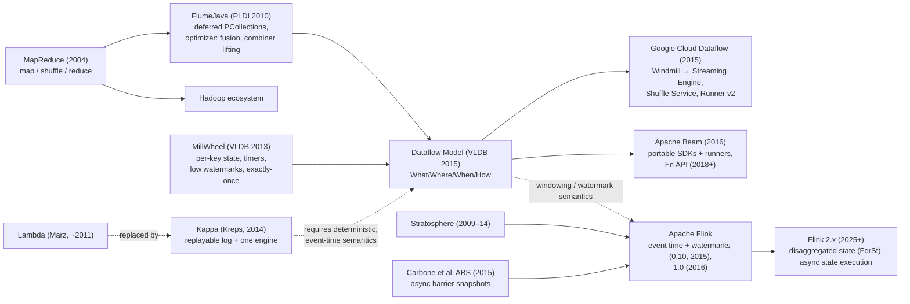
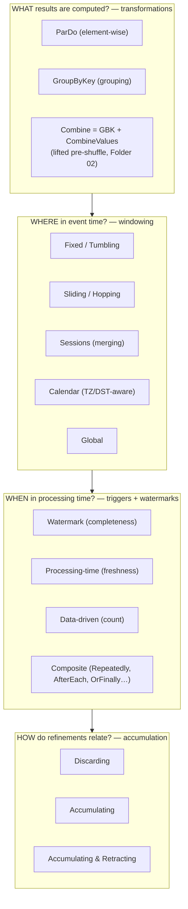

# 01 · What / Where / When / How: Time Domains, Skew, and the Algebra of Unbounded Data

> **Folder:** `01-First-Principles-and-The-Dataflow-Model/` · **File 1 of 3**
> **Anchoring papers:** Akidau et al., *The Dataflow Model: A Practical Approach to Balancing Correctness, Latency, and Cost
> in Massive-Scale, Unbounded, Out-of-Order Data Processing* (VLDB 2015) · Akidau et al., *MillWheel: Fault-Tolerant Stream
> Processing at Internet Scale* (VLDB 2013) · Chambers et al., *FlumeJava: Easy, Efficient Data-Parallel Pipelines* (PLDI 2010)
> · Begoli et al., *Watermarks in Stream Processing Systems: Semantics and Comparative Analysis of Apache Flink and Google
> Cloud Dataflow* (VLDB 2021) · Li et al., *Semantics and Evaluation Techniques for Window Aggregates in Data Streams*
> (SIGMOD 2005) · Gray et al., *Data Cube* (DMKD 1997).
> **Code baseline:** Java 21 · Beam Java SDK 2.6x+ · Flink 1.20 LTS / 2.x · `flink-connector-kafka` (3.x for 1.20, 4.x for 2.x).
> **Next:** [02 · Watermark calculus](02-watermark-calculus-monotonicity-idleness-and-hold-locks.md)

---

## 0. The thesis in one paragraph

A stream processor never sees a finished dataset. It sees an ever-growing prefix that arrives out of order, and it can never
know for sure that a given slice of event time is complete. Everything in this knowledge base follows from that sentence.
Once completeness is unknowable, "correct" can't mean "computed over all the data". It has to mean that the result converges
to the batch answer as late data arrives, given explicit choices about how much latency and cost you accept. The Dataflow
Model breaks those choices into four orthogonal questions: **What** is computed (transformations), **Where** in event time
(windowing), **When** in processing time results are emitted (triggers, gated by watermarks), and **How** successive results
for the same window relate to each other (accumulation). Beam, Dataflow, Flink, Spark Structured Streaming, and Kafka
Streams are all partial or complete implementations of these answers. An L7 engineer can explain any design in those terms,
price it in bytes, timers, and dollars, and say where it breaks.

---

## 1. First principles: three axioms and the trilemma they force

### 1.1 The axioms

| # | Axiom | Physical cause | Consequence |
|---|-------|----------------|-------------|
| A1 | **Unboundedness.** No processing-time instant exists at which the dataset is complete. | Data is generated continuously by systems that do not stop. | Every result is a function of a *prefix*, so correctness has to be redefined as **convergence**. |
| A2 | **Disorder.** Arrival order ≠ event order. | Network queues, retries, batching producers, partitions consumed at different rates, mobile devices offline for days. | Grouping by event time needs **buffering** (state), and buffering costs memory and latency. |
| A3 | **Unknowable completeness.** For an arbitrary event time $t$, the system cannot decide whether all events with timestamp $\le t$ have arrived. | A disconnected producer can reappear at any later time. Nothing upstream is obliged to tell you it exists. | Completeness can only be **estimated** (the watermark). Estimates can be wrong, which creates late data, which needs a policy. |

A3 is the crux. It's an information-theoretic limit, not an engineering gap. The only ways to make completeness *knowable*
are to (a) control every producer and have it emit progress assertions (punctuations, heartbeats, or per-partition
low-watermarks), or (b) bound the input (batch). Every "perfect watermark" in practice is one of those two cases.

### 1.2 The trilemma, formalized

Let window $w$ have event-time end $\mathrm{end}(w)$. A streaming system emits a sequence of results (panes) for $w$ at processing
times $p_1 < p_2 < \dots$. Define three quantities:

$$
\textbf{Latency:}\quad L(w) = p_{\mathrm{first}}(w) - \mathrm{end}(w)
$$

$$
\textbf{Completeness at } p:\quad C(w,p) = \frac{\lvert D_w(p) \rvert}{\lvert D_w(\infty) \rvert},\qquad D_w(p) = \{\, e : t_e \in w \wedge p_e \le p \,\}
$$

$$
\textbf{Cost:}\quad K = \underbrace{\int \mathrm{StateBytes}(p)\,dp}_{\text{GB·s of buffered state}} + \mathrm{CPU} + \mathrm{ShuffleBytes} + \mathrm{SinkWrites}
$$

- **Batch** chooses $C \approx 1$ (modulo data that lands after the batch ran!) and minimal $K$ per byte, and pays enormous $L$.
- **Lambda architecture** runs two systems, a fast approximate one and a slow exact one, and pays $K$ twice plus the cost
  of reconciling them.
- **The Dataflow Model** turns $(L, C, K)$ into tunable knobs on a *single* pipeline:
  - Watermarks set the default point of "complete enough" (the $C$-vs-$L$ frontier).
  - Early triggers buy lower $L$ with extra panes ($K$).
  - Late triggers plus allowed lateness buy higher $C$ with retained state ($K$).
  - Accumulation mode decides who pays for refinement: the system (state and retractions) or the consumer (merge logic).

The paper's core stance: stop trying to groom unbounded data into finite, eventually-complete pools. Assume you will never
know whether you have seen everything. Then give practitioners principled abstractions for choosing their tradeoff among
correctness, latency, and cost.

### 1.3 Lineage: why the model looks the way it does



Three inheritance lines matter for the rest of this KB:

1. **FlumeJava** contributed *deferred evaluation*. You build a DAG of `PCollection`s and an optimizer rewrites it
   (fusion, combiner lifting) before execution. Folder 02 covers this.
2. **MillWheel** contributed *per-key persistent state, timers, low watermarks, and exactly-once via idempotent
   commits*. Folder 03 covers this.
3. **The Dataflow Model** unified the two: batch is a bounded stream, and windowing, triggering, and accumulation are
   orthogonal. Flink adopted the event-time/watermark/window vocabulary from this lineage. Its distinctive contribution is
   asynchronous barrier snapshots (Folder 04) and, in 2.x, disaggregated state.

---

## 2. The formal model

### 2.1 Elements

Every element flowing through a Beam pipeline is logically a 5-tuple:

$$
e = (k,\; v,\; t_e,\; \mathcal{W}_e,\; \pi_e)
$$

| Field | Meaning | Beam representation | Flink representation |
|-------|---------|---------------------|----------------------|
| $k$ | Key (only meaningful after a key-extracting transform) | `KV<K, V>` | `keyBy(KeySelector)` → key carried *implicitly* via key groups |
| $v$ | Value | user type with a `Coder` | user type with a `TypeSerializer` |
| $t_e$ | Event timestamp | `WindowedValue.getTimestamp()` (Joda `Instant`, ms) | `StreamRecord.timestamp` (primitive `long`, ms) |
| $\mathcal{W}_e$ | Set of windows the element belongs to | `WindowedValue.getWindows()` (carried on the wire!) | **not carried**: assigned inside `WindowOperator` |
| $\pi_e$ | Pane metadata (which firing produced it) | `PaneInfo` (timing, index, first/last) | **no equivalent**; emulate (see file 03) |

That last two rows are an architectural fork. Beam treats windows as **data** that travels with the element, so any transform
can observe them and windows survive through `ParDo`. Flink treats windows as **operator-internal state** that exists only
between `window(...)` and the window function. Section 6 shows how this difference costs bytes on the wire.

### 2.2 The time domains

- **Event time** $t_e \in E$: when the event happened *according to whoever stamped it*. It is a claim, not a fact
  (§2.4).
- **Processing time** $p_e(S) \in P$: when stage $S$ observes $e$, according to $S$'s machine clock. Different stages
  observe the same element at different processing times.
- **Ingestion time**: processing time at the source, frozen into the element as its timestamp. Examples are Kafka
  `LogAppendTime` and Flink's historical "ingestion time" characteristic. It gives monotone-ish, trustworthy timestamps but
  loses the semantics of when the event actually happened.

**Skew** at stage $S$:

$$
s_e(S) = p_e(S) - t_e \;\;\ge 0 \quad\text{(if clocks were perfect)}
$$

On a plot with event time on the x-axis and processing time on the y-axis, perfect real-time processing would place every
element on the diagonal $P = E$. Reality lies above it.

```
  P (processing time)
  ▲                                                    ideal: P = E
  │                                  W(P)            ╱
  │                                 ╱              ╱
  │                                ╱             ╱
 p₁ ┼ · · · · · · · · · · · · · · ◆━━━━━━━━━━━━━◆    ← EVENT-TIME SKEW at p₁ = p₁ − W(p₁)
  │                    ✖         ╱   (horizontal) ╱      "how far behind real time is our
  │              (late: t < W)  ╱               ╱         notion of completeness?"
  │                            ╱     ●        ╱
  │                           ╱      ┃      ╱       ● = element e plotted at (t_e, p_e)
  │                          ╱       ┃    ╱         ┃ = PROCESSING-TIME LAG of e = p_e − t_e
  │                         ╱        ┃  ╱               (vertical distance to the ideal line)
  │                        ╱         ┃╱
  │                       ╱         ╱┃
  └──────────────────────┴─────────────┴──────────────┴──────────────────────► E (event time)
                       W(p₁)          t_e            p₁
```

Two views of the same gap:

- **Processing-time lag** (vertical) of element $e$: $p_e - t_e$. *"How long after it happened did we see it?"*
- **Event-time skew** (horizontal) of the *pipeline* at processing time $p$: $p - W(p)$. *"How far behind the present is our
  completeness frontier?"* Dataflow surfaces this as **data freshness** / `data_watermark_age`. Flink surfaces it as
  `now − currentOutputWatermark`.

### 2.3 Skew is not disorder, and the watermark only cares about disorder

Define the **out-of-orderness** (disorder) of element $e$ relative to the elements that arrived before it in the same
watermark-generating stream:

$$
o_e = \Big(\max_{e' :\, p_{e'} < p_e} t_{e'}\Big) - t_e
$$

$o_e > 0$ means $e$ arrived *behind* something newer. Skew and disorder are independent:

| Scenario | Skew $s_e$ | Disorder $o_e$ | Late under a bounded-out-of-orderness watermark with $\Delta$ = 2 min? |
|----------|-----------|----------------|-------------------------------------------------------------------------|
| Consumer is 1 h behind but reads each partition in order | ≈ 1 h | ≈ 0 | **No.** The pipeline is merely slow; nothing is late. |
| One stream merges two partitions, one of them 1 h behind (watermark generated *after* the merge) | 0 to 1 h | up to 1 h | **Yes**: the lagging partition's records are all late and silently dropped. |
| Mobile client flushes a 3-day-old buffer into a live stream | 3 days | 3 days | Yes. This is inherent and needs allowed lateness or a batch correction. |
| Producer's clock runs 10 min fast | −10 min (negative skew!) | pushes $\max t$ forward, so *other* elements see +10 min disorder | Yes, for everyone else. One bad clock poisons the watermark (§8, F3). |

The bounded-out-of-orderness heuristic, $W(p) = \max_{p_{e'} \le p} t_{e'} - \Delta$, makes element $e$ late iff
$t_e < W(p_e)$, which is iff $o_e > \Delta$. **The watermark charges you for disorder, not for delay.** That's why
watermarks must be generated **per source partition/split, before any shuffle**. Disorder within a partition is small.
Disorder across partitions equals their relative consumer lag, which is unbounded.

> **Semantic offset (Beam vs. Flink).** Beam's watermark is strict: $W$ means no more $t < W$. Flink's is non-strict:
> `Watermark(t)` means no more $t' \le t$. That's why Flink's `BoundedOutOfOrdernessWatermarks` emits
> `maxTimestamp − outOfOrderness − 1`: the $-1$ ms makes Flink's $\le$ test equivalent to Beam's $<$ test. Both declare $e$
> late iff $o_e > \Delta$ (integer milliseconds). File 02 derives the timer-firing consequences.

### 2.4 Clock physics: event time is a claim

| Timestamp source | Typical error | Monotone per stream? | Trust | Notes |
|------------------|---------------|----------------------|-------|-------|
| Server app clock with NTP/chrony | ~0.1–10 ms intra-DC; NTP *steps* can jump backward | **No** | Medium | Leap-second smearing differs across providers. |
| Cloud time-sync / PTP (Google, AWS, Azure) | µs to sub-ms | Approximately | High | Still a *local* claim of the producer. |
| Spanner commit timestamp (TrueTime) | bounded by ε (single-digit ms) | Monotone per transaction order | Very high | External consistency. Great as a CDC event time. |
| Kafka `CreateTime` | whatever the producer says | No | **Low**: any client can set it | Default for most topics. |
| Kafka `LogAppendTime` | broker clock | Nearly. Leader failover to a broker with a skewed clock can step it backward. | High | Loses true event time; becomes ingestion time. |
| Pub/Sub `publishTime` | service-assigned | Approximately | High | Use the `timestampAttribute` to carry true event time. |
| CDC commit timestamp (MySQL binlog, Postgres WAL) | DB server clock | Approximately per shard, in commit order | High | Per-shard heartbeats make it watermark-friendly (file 02). |
| Mobile / IoT device | seconds to **days**; user-adjustable; offline buffering | **No** | **Untrusted** | Always sanitize (§7). |

**Units are a production hazard.** The same instant can be represented in at least five ways across the stack:

| System | Representation | Precision |
|--------|----------------|-----------|
| Beam Java SDK | Joda `Instant` | ms |
| Beam portability protos (Fn API, Runner API) | `int64` since epoch | µs |
| Beam Python SDK | `Timestamp` | µs |
| Flink | primitive `long` | ms |
| Kafka record timestamp | `long` | ms |
| Pub/Sub `publishTime` | RFC 3339 | ns |
| BigQuery `TIMESTAMP` | int64 | µs |
| Iceberg `timestamp`/`timestamptz` (v3 adds `timestamp_ns`) | int64 | µs (ns) |
| Avro logical types | `timestamp-millis` / `timestamp-micros` | ms / µs |
| Protobuf `google.protobuf.Timestamp` | seconds + nanos | ns |

Beam's representable event-time range is `BoundedWindow.TIMESTAMP_MIN_VALUE … TIMESTAMP_MAX_VALUE`. That's
$\pm(2^{63}-1)$ µs converted to ms, about ±292,000 years. `GlobalWindow.INSTANCE.maxTimestamp()` is deliberately
`TIMESTAMP_MAX_VALUE − 1 day`, which leaves headroom so that timers set "at the end of the global window plus a bit" don't
overflow. A seconds-for-milliseconds bug lands events in January 1970. A microseconds-for-milliseconds bug lands them around
the year 58,000, and Beam rejects the element or it poisons the watermark (F2 in §8).

---

## 3. The four questions in depth



### 3.1 What: transformations, and the algebra that unlocks optimizations

The Dataflow paper reduces everything to two primitives:

- **`ParDo`**: for each input element, emit 0..n outputs. It is element-wise and embarrassingly parallel. Timestamps and
  windows propagate.
- **`GroupByKey`**: collect all values for a key (and, with windowing, a window) into one group. It is the only operation
  that needs data movement *and* knowledge of completeness.

`Combine.perKey(f)` is `GroupByKey` followed by `CombineValues(f)`, but a runner may **lift** partial combining before the
shuffle (Folder 02). Whether lifting is legal, and whether each accumulation mode is cheap, depends on the *algebra* of $f$.
This is the single most under-appreciated first principle in streaming design:

| Algebraic property of the aggregate $\oplus$ | Examples | What it unlocks |
|-----------------------------------------------|----------|-----------------|
| **Associative** (semigroup) | concatenation, sum, max | Tree-shaped partial aggregation. |
| **+ identity** (monoid) | sum (0), count (0), product (1) | Empty-pane handling; `createAccumulator()`. |
| **+ commutative** (commutative monoid) | sum, count, min, max, HLL merge | **Combiner lifting** in any order and partition. **Discarding panes** can be summed downstream. |
| **+ inverse** (abelian group) | sum, count (signed) | **Cheap retractions** (subtract the old value). **Subtract-on-evict** sliding windows (file 03). |
| **+ idempotent** ($a \oplus a = a$; semilattice) | max, min, set union, HLL/Theta sketch merge, last-writer-wins by version | **Duplicates are harmless**, so at-least-once delivery yields exactly-once *results*. |
| None of the above (holistic) | exact median, exact top-k with eviction, exact distinct count | Must buffer raw elements: no lifting, $O(n)$ state, expensive late data. |

Gray et al.'s data-cube taxonomy names the same split: **distributive** aggregates (sum, count, min, max), **algebraic**
ones (avg = (sum, count); variance = (n, Σx, Σx²)), and **holistic** ones (median, mode). An L7 engineer's first design
move is to *re-express a holistic metric as an algebraic or idempotent one*: a t-digest or KLL sketch for quantiles, HLL for
distinct counts, Count-Min for heavy hitters. That turns $O(n)$ state into $O(1)$, makes combiner lifting legal, and makes
duplicates and late data cheap.

### 3.2 Where: windowing as an extension of the grouping key

The key insight is that **windowing extends the grouping key**. `GroupByKey` over a windowed `PCollection` groups by
$(k, w)$. An unbounded group (all values for key $k$ forever) becomes infinitely many *bounded* groups, each of which can
eventually be declared complete, emitted, and garbage-collected.

A window function is an assignment $A : E \to 2^{\mathcal{W}}$ (non-merging) or a stateful assignment followed by a merge
(merging). Both Beam and Flink use half-open windows $[s, e)$ with `maxTimestamp = e − 1 ms`.

**Fixed (tumbling)**, size $w$, offset $o$:

$$
\mathrm{start}(t) = t - \big((t - o) \bmod^{+} w\big), \qquad \lvert A(t) \rvert = 1
$$

where $\bmod^{+}$ is the non-negative floor-mod. Naïve `%` in Java returns negative remainders for negative operands, so
timestamps before the epoch (or before the offset) land in the wrong window unless you use `Math.floorMod`. Both Beam and
Flink special-case this, but custom `WindowFn`s often get it wrong.

**Sliding (hopping)**, size $w$, period $s$:

$$
A(t) = \Big\{\, [\,k s + o,\; k s + o + w\,) \;:\; \Big\lfloor \tfrac{t - o - w}{s} \Big\rfloor < k \le \Big\lfloor \tfrac{t - o}{s} \Big\rfloor \Big\},
\qquad \lvert A(t) \rvert = \Big\lceil \tfrac{w}{s} \Big\rceil \;(s \le w)
$$

The **amplification factor** $w/s$ is the critical number. A 24 h window sliding every minute assigns each element to 1,440
windows. If $s > w$ (sampling windows), elements in the gaps belong to *zero* windows and disappear silently.

**Sessions**, gap $g$: each element gets a proto-window $[t, t+g)$, and the runner computes the transitive closure under
overlap *per key*. The window isn't a function of $t$ alone. It depends on the key's other elements, so sessions need
**merging** and state (file 03).

**Calendar windows** (days, months, years in a time zone) have *non-uniform* length. A "day" in `America/New_York` is 23,
24, or 25 hours. A fixed window with a −5 h offset is wrong for half the year. Beam's
`CalendarWindows.days(1).withTimeZone(...)` handles DST. Flink's `TumblingEventTimeWindows.of(Duration.ofDays(1), offset)`
does **not**: the offset is fixed.

**Global**: one window $[\,-\infty, +\infty)$. Grouping in the global window over unbounded data never completes, so Beam
refuses to build `GroupByKey` on an unbounded, globally windowed `PCollection` without an explicit trigger (§7.1).

### 3.3 When: triggers as predicates over pane state

A trigger is a predicate evaluated per $(k, w)$:

$$
\mathrm{fire}(k, w) = \phi\big(\text{pane state},\ \mathrm{IWM}(S),\ p_{\text{now}},\ \text{element count},\ \dots\big)
$$

| Family | Beam | Flink DataStream | What it optimizes |
|--------|------|------------------|-------------------|
| Watermark | `AfterWatermark.pastEndOfWindow()` | `EventTimeTrigger` (the default for event-time assigners) | Completeness |
| Processing time | `AfterProcessingTime.pastFirstElementInPane().plusDelayOf(d)` | `ContinuousProcessingTimeTrigger`, `ProcessingTimeTrigger` | Freshness |
| Data-driven | `AfterPane.elementCountAtLeast(n)` | `CountTrigger` | Batch size / sink efficiency |
| Composite | `Repeatedly.forever`, `AfterEach.inOrder`, `AfterFirst`, `AfterAll`, `orFinally` | hand-written `Trigger` | Combinations |

The canonical Beam shape is:

```java
AfterWatermark.pastEndOfWindow()
    .withEarlyFirings(AfterProcessingTime.pastFirstElementInPane().plusDelayOf(Duration.standardSeconds(30)))
    .withLateFirings(AfterProcessingTime.pastFirstElementInPane().plusDelayOf(Duration.standardMinutes(1)))
```

That produces zero or more **EARLY** panes, at most one **ON_TIME** pane, and zero or more **LATE** panes per window until
garbage-collection time = `window.maxTimestamp() + allowedLateness`.

Beam's **default trigger** is `Repeatedly.forever(AfterWatermark.pastEndOfWindow())` with allowed lateness 0. It fires
once when the watermark passes the end of the window. If you raise allowed lateness without changing the trigger, it fires
*again for every late element*. File 03 develops the trigger state machine, the "finished trigger closes the window"
footgun, and the timer cost of each trigger.

Cross-engine equivalents:

- **Spark Structured Streaming**: `trigger(ProcessingTime(...))` sets the micro-batch cadence, and the output mode
  (`append` / `update` / `complete`) is a coarse When+How.
- **Kafka Streams**: emits on every update by default. Use `suppress(untilWindowCloses(...))` or
  `EmitStrategy.onWindowClose()` (KIP-825) for watermark-like behavior driven by *stream time* plus grace.

### 3.4 How: accumulation, previewed

For successive panes $1..n$ of window $w$, let $V_i$ be the elements that arrived between firing $i-1$ and firing $i$:

| Mode | Pane $i$ emits | Consumer must… |
|------|----------------|----------------|
| Discarding | $f(V_i)$ | combine deltas, which requires $\oplus$ to be a commutative monoid |
| Accumulating | $f(V_1 \cup \dots \cup V_i)$ | overwrite (idempotent upsert keyed by $(k,w)$, versioned by pane index) |
| Accumulating & retracting | $-f(V_1..V_{i-1}),\; +f(V_1..V_i)$ | apply signed deltas, which requires an inverse (a group) or multiset state |

Beam ships the first two. The portability proto reserves a `RETRACTING` mode, but no production runner implements it ⚠
verify. Flink SQL implements retraction pervasively as changelog `RowKind`s (`+I`, `-U`, `+U`, `-D`). File 03 has the full
cost model, including the **quadratic-output trap** of accumulating `GroupByKey` with frequent early firings.

### 3.5 Decomposing real use cases

| Use case | What | Where | When | How | Why |
|----------|------|-------|------|-----|-----|
| Per-customer daily billing | Sum (abelian group) | `CalendarWindows.days(1)` in the **customer's** time zone | On-time, plus late firings batched per 10 min, for 72 h | Accumulating plus an upsert guarded by pane index | Must converge exactly. Usage records arrive up to days late. |
| Real-time ops dashboard | Count, t-digest p99 | Fixed 1 min | Early every 5 s, then on-time | Accumulating (the tile is overwritten) | Freshness beats completeness. Late data rarely matters. |
| Card-fraud features | Per-card velocity counts | Per-key state (stateful `DoFn`/`KeyedProcessFunction`) | Per element | n/a | Millisecond latency. Windows are too coarse. |
| Sessionization analytics | Session length, events per session | Sessions(30 min), capped at 4 h | On-time plus late | Accumulating plus emulated retraction | Late data *merges* sessions, so earlier outputs become wrong (file 03). |
| ML rolling features | 24 h sums, sliding every minute | Sliced sliding (file 03) | Per slice | Latest-value | Naive sliding is 1,440× amplification. |
| Dead-man / absence alert | count == 0 | Fixed plus a processing-time timer | Processing time | n/a | Absence of data is not an event. Only timers can observe it. |

---

## 4. Cross-engine mapping

| Question | Beam Java | Flink DataStream | Flink SQL | Spark Structured Streaming | Kafka Streams |
|----------|-----------|------------------|-----------|----------------------------|---------------|
| What | `ParDo`, `GroupByKey`, `Combine.perKey` | `map`/`process`, `keyBy().aggregate()` | `SELECT … GROUP BY` | `groupBy().agg()` | `aggregate`/`reduce` |
| Where | `Window.into(FixedWindows/SlidingWindows/Sessions/CalendarWindows/GlobalWindows)` | `.window(TumblingEventTimeWindows/SlidingEventTimeWindows/EventTimeSessionWindows/GlobalWindows)` | `TUMBLE`/`HOP`/`CUMULATE`/`SESSION` TVFs | `window()`/`session_window()` | `TimeWindows`/`SlidingWindows`/`SessionWindows` |
| Completeness signal | Watermark (source estimators, aggregated by the runner) | In-band `Watermark` from per-split `WatermarkGenerator`s | `WATERMARK FOR ts AS ts - INTERVAL …` | `withWatermark("ts", "10 minutes")` (global, per micro-batch) | Stream time (max seen) + grace |
| When | `.triggering(...)`, `.withAllowedLateness(...)` | `.trigger(...)`, `.allowedLateness(...)` | Watermark (early-fire configs are experimental) | `trigger(...)`, output mode | `suppress()`, `EmitStrategy` |
| How | `.discardingFiredPanes()` / `.accumulatingFiredPanes()` | `FIRE` (accumulating) vs `FIRE_AND_PURGE` (discarding) | Changelog with retractions | `append`/`update`/`complete` | KTable upserts |
| Late data | Dropped after GC time (counter `droppedDueToLateness`) | Dropped, or `sideOutputLateData(tag)` | Dropped | Dropped (state evicted) | Dropped after grace |

Two defaults differ and regularly cause incidents in migrations:

1. **Beam defaults to discarding. Flink DataStream windows default to accumulating.** `EventTimeTrigger` returns `FIRE`,
   not `FIRE_AND_PURGE`, so with allowed lateness each late element re-emits the *whole* window.
2. **Beam has no built-in late-data side output.** Flink has `sideOutputLateData`. In Beam you route late data by setting
   generous allowed lateness and branching on `PaneInfo.getTiming() == LATE`, or by detecting lateness in a stateful
   `DoFn` (Folder 07).

---

## 5. Batch as a special case: semantics yes, execution no

### 5.1 The semantic claim

For a **bounded** `PCollection`, the watermark is (conceptually) $-\infty$ until the input is exhausted and then jumps to
$+\infty$. Runners may advance it per completed split, but the observable effect is the same. Consequences:

- No element is ever late.
- Every window gets exactly one meaningful final pane.
- Accumulation mode is irrelevant.

Most batch execution paths simply collapse to one final pane per window.

**Equivalence theorem (informal).** Let pipeline $\mathcal{P}$ satisfy all of the following:

1. Deterministic `DoFn`s.
2. Event-time windowing.
3. Only watermark-based triggers.
4. Allowed lateness at least the maximum observed lateness in the data.
5. Consumers that read only the final pane per window (or upsert by pane index).

Then the streaming execution of $\mathcal{P}$ over input $D$ converges to the batch output over $D$.

*Proof sketch.* For each $(k, w)$, `GroupByKey` collects the same multiset regardless of arrival order (A2), because no
element is dropped (condition 4). A commutative, associative combine produces the same accumulator for the same multiset.
Pane boundaries depend on arrival timing, but condition 5 makes the consumer see only the limit. ∎

### 5.2 Where the equivalence breaks

| Violation | Why results diverge between stream and batch (and between two stream runs) |
|-----------|----------------------------------------------------------------------------|
| Processing-time triggers with discarding panes and a non-additive consumer | Pane boundaries depend on arrival timing. |
| Late drops | The set of dropped elements depends on processing-time races. In Flink it isn't even replay-invariant across recovery (file 02 §4.3). |
| Non-deterministic `DoFn`s (`Instant.now()`, `Random`, external lookups) | Retries and replays compute different outputs. |
| Slowly-updating side inputs | The side-input version joined depends on processing time. |
| Order-dependent logic ("first seen wins" dedup, `OrderedListState` without sorted input) | Arrival order differs. |
| Floating-point sums | Non-associativity: $(a+b)+c \ne a+(b+c)$. Partial-combine order changes the low bits. Use `long` cents/micros or Kahan/Neumaier summation if you need bit-exact reconciliation. |

### 5.3 Execution is not unified, and shouldn't be

A bounded input carries *global knowledge* that a streaming engine can't assume:

| Capability | Batch | Streaming |
|------------|-------|-----------|
| Shuffle | Sort-merge or hash, blocking, spill-friendly, can be disaggregated (Dataflow Shuffle) | Pipelined, per-record, credit-based flow control (Flink) or Windmill (Dataflow) |
| State | None persistent. Flink `BATCH` mode sorts by key, so one key's state lives in memory at a time. | Per-key persistent state for every open window |
| Fault tolerance | Recompute lineage from deterministic inputs (MapReduce/FlumeJava style). Region failover. | Checkpoints (Flink ABS) or per-key atomic commits (MillWheel/Windmill) |
| Watermarks | Unnecessary (perfect) | Central and fragile |
| Work balancing | Dynamic work rebalancing / liquid sharding, because sizes are known (Folder 03) | Key-range splitting is harder because state must move |
| Speculative execution | Safe | Requires idempotent or transactional sinks |

Flink's `execution.runtime-mode: BATCH` makes this concrete. It uses blocking shuffles, sorts keyed inputs so each key is
processed contiguously, replaces the state backend with an in-memory per-key store, takes no checkpoints, and fires a
key's event-time timers when that key's input is exhausted.

The L7 framing: *"The Dataflow Model unifies semantics, so the same code produces the same answer. It deliberately does
not unify execution, so the runner exploits boundedness."*

---

## 6. Hardware sympathy: the physical cost of time

### 6.1 Beam `WindowedValue` on the wire

`WindowedValue.FullWindowedValueCoder` encodes, in order: **timestamp, windows, pane, value**. The value goes last so
it can use the outer (unprefixed) context.

```
 ┌───────────────────┬──────────────────────────────────────────────┬──────────┬─────────────────────┐
 │ timestamp (8 B)   │ windows: count (4 B, int32) + Σ window bytes │ pane     │ value (user Coder)  │
 │ InstantCoder:     │   GlobalWindow   → 0 B each                  │ (1 B for │                     │
 │ big-endian long,  │   IntervalWindow → end (8 B InstantCoder)    │ common   │                     │
 │ shifted by        │                    + duration (VarLong:      │ panes;   │                     │
 │ Long.MIN_VALUE so │                      5 min = 300000 ms → 3 B)│ + varints│                     │
 │ byte order ==     │                    ≈ 11 B each               │ for idx) │                     │
 │ numeric order     │                                              │          │                     │
 └───────────────────┴──────────────────────────────────────────────┴──────────┴─────────────────────┘
```

| Windowing | Metadata bytes per element | Overhead on a 40 B payload (`KV<String(16), Long>`) |
|-----------|----------------------------|------------------------------------------------------|
| Global | 8 + 4 + 0 + 1 = **13 B** | 33 % |
| Fixed / Sessions (one `IntervalWindow`) | 8 + 4 + 11 + 1 = **24 B** | 60 % |
| Sliding 1 h / 1 min, *before* explosion (one value, 60 windows) | 8 + 4 + 660 + 1 = **673 B** | 1,680 % |
| Sliding, *after* `explodeWindows()` at the GBK (60 copies) | 60 × (24 + 40) = **3,840 B** shuffled | 96× the payload |

Lessons:

- **Combiner lifting** (Folder 02) matters because it collapses many windowed values into one accumulator per
  $(k, w)$ *before* paying shuffle metadata.
- Sliding windows before a GBK multiply shuffle bytes by $w/s$. Slicing (file 03) avoids this.
- The Fn API can use parameterized/elided windowed-value coders (`beam:coder:param_windowed_value:v1`) when metadata is
  constant ⚠ verify per runner. Never assume metadata is free.

### 6.2 Flink `StreamElement` on the wire

Flink's `StreamElementSerializer` writes a **1-byte tag** (record with timestamp, record without timestamp, watermark,
latency marker, watermark status, …), then an **8-byte `long` timestamp** if present, then the record. Windows are *not*
transmitted. They are recomputed by the `WindowOperator` after `keyBy`. So Flink pays **9 B** per record for time.
**Beam-on-Flink pays both**: the Beam `WindowedValue` is serialized *inside* a Flink record through a coder-backed
`TypeSerializer`. That's one reason native Flink pipelines beat the Beam Flink runner on CPU per byte.

Watermarks are **in-band** in Flink. Each subtask broadcasts each new watermark to *all* of its output channels. With
$M$ upstream and $N$ downstream subtasks in an all-to-all exchange and an emission interval $i$ (default
`pipeline.auto-watermark-interval` = 200 ms), the steady-state watermark traffic is about $M \cdot N / i$ watermark
elements per second:

$$
1000 \times 1000 / 0.2\,\mathrm{s} = 5 \times 10^{6}\ \text{watermark elements/s}
$$

Each one costs a valve update (`StatusWatermarkValve`) on the receiver. That is negligible at 100×100 and material at
1000×1000. Dataflow propagates watermarks **out of band** through its backend (file 02 §3), which trades this fan-out for
a central aggregator.

### 6.3 Object and GC cost

In Beam Java every element carries heap objects:

- a Joda `Instant` (header plus a `long`, ~24 B);
- for interval windows, an `IntervalWindow` with two `Instant`s (~70+ B);
- the `WindowedValue` wrapper (~32 B);
- `PaneInfo`, which is interned for common cases.

At 2M elements/s per worker that's on the order of **200+ MB/s of allocation for time metadata alone**. Young-gen GC
copes, but allocation rate drives GC frequency, TLAB refills, and cache pollution. Flink's primitive `long` timestamp
allocates nothing. This is a quiet reason Runner v2's C++ runner harness and Flink's binary row formats exist: they move
hot-path metadata out of object graphs and into flat byte ranges.

### 6.4 Sortable timestamp encodings

`InstantCoder` adds `Long.MIN_VALUE` before writing big-endian, which flips the sign bit. Unsigned lexicographic byte order
then equals numeric order, including for negative timestamps. That lets timers and watermark holds be range-scanned in
order in a sorted KV store (Bigtable-backed Windmill, RocksDB). Flink's RocksDB timer service does the same:

- Timer keys are laid out as `[key-group prefix][timestamp, sign-flipped, big-endian][key][namespace]` in a dedicated
  column family (`_timer_state/event_…`).
- "Fire all timers ≤ watermark" becomes an ordered prefix scan per key group.
- With 100M keys × 2 open windows × (trigger timer + cleanup timer), that's up to **400M timer entries**. Timers are state
  too, and they show up in checkpoint size and in the compaction budget (Folder 04).

---

## 7. Production Java 21 code blueprints

### 7.1 Beam anti-pattern: four time bugs in twenty lines

```java
// ANTI-PATTERN. Every numbered line is a production incident waiting to happen.
public final class NaiveClickCounter {
  public static void main(String[] args) {
    Pipeline p = Pipeline.create(PipelineOptionsFactory.fromArgs(args).create());
    p.apply("ReadKafka", KafkaIO.<String, String>read()
            .withBootstrapServers("broker:9092")
            .withTopic("clicks")
            .withKeyDeserializer(StringDeserializer.class)
            .withValueDeserializer(StringDeserializer.class)
            .withoutMetadata())                                   // (1) default policy = PROCESSING time
     .apply("Stamp", WithTimestamps.<KV<String, String>>of(
            kv -> Instant.now()))                                 // (2) wall clock as event time: replay ≠ original
     .apply("CountInMemory", ParDo.of(new DoFn<KV<String, String>, KV<String, Long>>() {
        private final Map<String, Long> counts = new HashMap<>(); // (3) instance-local "state": not checkpointed,
                                                                  //     lost on failure, double-counted on retry,
                                                                  //     split arbitrarily across workers
        @ProcessElement
        public void process(@Element KV<String, String> e, OutputReceiver<KV<String, Long>> out) {
          long c = counts.merge(e.getKey(), 1L, Long::sum);
          if (c % 1_000 == 0) out.output(KV.of(e.getKey(), c));
        }
     }))
     .apply(GroupByKey.create());                                  // (4) IllegalStateException at construction:
                                                                   //  "GroupByKey cannot be applied to non-bounded
                                                                   //   PCollection in the GlobalWindow without a trigger"
    p.run();
  }
}
```

Bug (4) is the *good* one: Beam refuses to build it. Bugs (1)–(3) compile, pass unit tests on small bounded inputs, and
produce wrong numbers only under replay, failure, or autoscaling. Those are exactly the conditions you can't reproduce on
a laptop.

### 7.2 Beam production: event time end to end

Design decisions, each traceable to a section above:

- Event time comes from a **Kafka header first** (no payload decode in the reader's hot path), then the payload, then the
  record timestamp.
- **Future timestamps are clamped inside the timestamp policy**, which is the only place that protects the partition
  watermark (§2.3, F3).
- **Units are normalized and flagged, never silently trusted** (F2).
- The watermark is computed **per partition** by `CustomTimestampPolicyWithLimitedDelay`.
- **Anomalies are quarantined, not dropped**. The pipeline protects the watermark at the source and protects
  correctness downstream.
- A **log-bucketed skew histogram** exists because Beam's `Distribution` metric has no percentiles.
- The **full What/Where/When/How** is spelled out explicitly. Defaults are never left implicit in production.
- **Pane metadata is preserved** in the output so the sink can do a versioned upsert (file 03 §9.2).
- A **hand-written, deterministic coder** is used. `SerializableCoder` is never used on a hot path (Folder 02).

```java
package dev.l7.dataflow.time;

import java.io.EOFException;
import java.io.IOException;
import java.io.InputStream;
import java.io.OutputStream;
import java.nio.ByteBuffer;
import java.nio.charset.StandardCharsets;
import java.util.Map;
import java.util.Optional;
import org.apache.beam.sdk.Pipeline;
import org.apache.beam.sdk.coders.Coder;
import org.apache.beam.sdk.coders.CustomCoder;
import org.apache.beam.sdk.coders.InstantCoder;
import org.apache.beam.sdk.coders.StringUtf8Coder;
import org.apache.beam.sdk.coders.VarLongCoder;
import org.apache.beam.sdk.io.kafka.CustomTimestampPolicyWithLimitedDelay;
import org.apache.beam.sdk.io.kafka.KafkaIO;
import org.apache.beam.sdk.io.kafka.KafkaRecord;
import org.apache.beam.sdk.metrics.Counter;
import org.apache.beam.sdk.metrics.Metrics;
import org.apache.beam.sdk.options.Description;
import org.apache.beam.sdk.options.PipelineOptionsFactory;
import org.apache.beam.sdk.options.StreamingOptions;
import org.apache.beam.sdk.options.Validation;
import org.apache.beam.sdk.transforms.DoFn;
import org.apache.beam.sdk.transforms.ParDo;
import org.apache.beam.sdk.transforms.Sum;
import org.apache.beam.sdk.transforms.windowing.AfterProcessingTime;
import org.apache.beam.sdk.transforms.windowing.AfterWatermark;
import org.apache.beam.sdk.transforms.windowing.FixedWindows;
import org.apache.beam.sdk.transforms.windowing.IntervalWindow;
import org.apache.beam.sdk.transforms.windowing.PaneInfo;
import org.apache.beam.sdk.transforms.windowing.TimestampCombiner;
import org.apache.beam.sdk.transforms.windowing.Window;
import org.apache.beam.sdk.values.KV;
import org.apache.beam.sdk.values.PCollection;
import org.apache.beam.sdk.values.PCollectionTuple;
import org.apache.beam.sdk.values.TupleTag;
import org.apache.beam.sdk.values.TupleTagList;
import org.apache.kafka.clients.consumer.ConsumerConfig;
import org.apache.kafka.common.header.Header;
import org.apache.kafka.common.serialization.ByteArrayDeserializer;
import org.apache.kafka.common.serialization.StringDeserializer;
import org.apache.kafka.common.serialization.StringSerializer;
import org.joda.time.Duration;
import org.joda.time.Instant;

public final class EventTimeCampaignCounts {

  public interface Options extends StreamingOptions {
    @Description("Kafka bootstrap servers")
    @Validation.Required
    String getBootstrapServers();
    void setBootstrapServers(String value);
  }

  // Every constant below is a business decision with a state-size price (see Q&A 2).
  static final Duration MAX_OUT_OF_ORDERNESS = Duration.standardMinutes(2);  // per-partition disorder budget
  static final Duration MAX_FUTURE_SKEW      = Duration.standardSeconds(30); // tolerated fast producer clocks
  static final Duration ALLOWED_LATENESS     = Duration.standardHours(2);    // state retained after window end
  static final String   EVENT_TIME_HEADER    = "event-ts-ms";                // 8-byte big-endian epoch millis

  public record Click(String campaignId, String userId, long eventTimeMillis) {}

  /** Public: consumed by the pane-versioned upsert sink in file 03 §9.2. */
  public record WindowedCount(String campaignId, Instant windowStart, Instant windowEnd, long count,
                              long paneIndex, PaneInfo.Timing timing, boolean isLast) {}

  static final TupleTag<KV<String, Long>> VALID = new TupleTag<>() {};
  static final TupleTag<String> QUARANTINE = new TupleTag<>() {};

  public static void main(String[] args) {
    Options opts = PipelineOptionsFactory.fromArgs(args).withValidation().as(Options.class);
    opts.setStreaming(true);
    Pipeline p = Pipeline.create(opts);

    PCollectionTuple parsed = p
        .apply("ReadClicks", KafkaIO.<String, byte[]>read()
            .withBootstrapServers(opts.getBootstrapServers())
            .withTopic("clicks")
            .withKeyDeserializer(StringDeserializer.class)
            .withValueDeserializer(ByteArrayDeserializer.class)
            // Watermark = max(sanitized event time) − 2 min, computed PER PARTITION inside the reader;
            // when a partition's backlog is zero the policy advances it from the backlog-check time instead.
            .withTimestampPolicyFactory((partition, previousWatermark) ->
                new CustomTimestampPolicyWithLimitedDelay<>(
                    EventTimeCampaignCounts::sanitizedEventTime, MAX_OUT_OF_ORDERNESS, previousWatermark))
            .withConsumerConfigUpdates(Map.of(ConsumerConfig.GROUP_ID_CONFIG, "campaign-counts"))
            .commitOffsetsInFinalize())
        .apply("ValidateAndKey", ParDo.of(new ValidateAndKeyFn())
            .withOutputTags(VALID, TupleTagList.of(QUARANTINE)));

    parsed.get(QUARANTINE)
        .apply("Quarantine", KafkaIO.<Void, String>write()
            .withBootstrapServers(opts.getBootstrapServers())
            .withTopic("clicks-quarantine")
            .withValueSerializer(StringSerializer.class)
            .values());

    PCollection<WindowedCount> counts = parsed.get(VALID)
        .apply("SkewHistogram", ParDo.of(new EventTimeSkewHistogramFn()))
        .apply("Window5m", Window.<KV<String, Long>>into(FixedWindows.of(Duration.standardMinutes(5)))
            .triggering(AfterWatermark.pastEndOfWindow()
                .withEarlyFirings(AfterProcessingTime.pastFirstElementInPane()
                    .plusDelayOf(Duration.standardSeconds(30)))
                // Late data batched per minute: per-element late firings multiply sink writes.
                .withLateFirings(AfterProcessingTime.pastFirstElementInPane()
                    .plusDelayOf(Duration.standardMinutes(1))))
            .withAllowedLateness(ALLOWED_LATENESS, Window.ClosingBehavior.FIRE_IF_NON_EMPTY)
            .withOnTimeBehavior(Window.OnTimeBehavior.FIRE_IF_NON_EMPTY)
            .withTimestampCombiner(TimestampCombiner.END_OF_WINDOW)   // see file 02 §7 before changing
            .accumulatingFiredPanes())                                // consumer upserts; never sums panes
        .apply("CountPerCampaign", Sum.longsPerKey())                 // commutative monoid → combiner lifting
        .apply("AttachWindowAndPane", ParDo.of(new ToWindowedCountFn()))
        .setCoder(WindowedCountCoder.of());

    // counts → idempotent upsert keyed by (campaignId, windowStart), guarded by paneIndex (file 03 §9.2).
    p.run();
  }

  // ---------------------------------------------------------------------------------------------------------
  // Timestamp policy helpers. They run inside the Kafka reader for EVERY record, so they must be cheap and
  // must never throw.
  // ---------------------------------------------------------------------------------------------------------

  /** Header (no decode) → payload → record timestamp; then unit-normalize; then clamp the future. */
  static Instant sanitizedEventTime(KafkaRecord<String, byte[]> rec) {
    long ts = headerEventTime(rec)
        .orElseGet(() -> ClickCodec.decode(rec.getKV().getValue())
            .map(Click::eventTimeMillis)
            .orElse(rec.getTimestamp()));
    ts = normalizeUnits(ts);
    long ceiling = System.currentTimeMillis() + MAX_FUTURE_SKEW.getMillis();
    return new Instant(Math.min(ts, ceiling));   // a fast clock may not drag the partition watermark forward
  }

  static Optional<Long> headerEventTime(KafkaRecord<?, ?> rec) {
    if (rec.getHeaders() == null) {
      return Optional.empty();
    }
    Header h = rec.getHeaders().lastHeader(EVENT_TIME_HEADER);
    return (h == null || h.value() == null || h.value().length != Long.BYTES)
        ? Optional.empty()
        : Optional.of(ByteBuffer.wrap(h.value()).getLong());
  }

  /** Magnitude-based repair: s → ms, µs/ns → ms. Repairs are flagged downstream, never trusted silently. */
  static long normalizeUnits(long ts) {
    while (ts >= 100_000_000_000_000L) {   // ≥ 1e14 read as ms is ~year 5138 → it is µs or ns
      ts /= 1_000;
    }
    if (ts > 0 && ts < 100_000_000_000L) { // < 1e11 read as ms is before 1973-03-03 → it is seconds
      ts *= 1_000;
    }
    return ts;
  }

  /** Demo wire format "campaignId|userId|eventTimeMillis" (UTF-8). Production: Avro/Protobuf + schema registry. */
  static final class ClickCodec {
    static Optional<Click> decode(byte[] payload) {
      if (payload == null) {
        return Optional.empty();
      }
      String[] f = new String(payload, StandardCharsets.UTF_8).split("\\|", -1);
      if (f.length != 3 || f[0].isEmpty()) {
        return Optional.empty();
      }
      try {
        return Optional.of(new Click(f[0], f[1], Long.parseLong(f[2])));
      } catch (NumberFormatException e) {
        return Optional.empty();
      }
    }
  }

  // ---------------------------------------------------------------------------------------------------------
  // Downstream: protect CORRECTNESS (the reader already protected the WATERMARK).
  // ---------------------------------------------------------------------------------------------------------

  static final class ValidateAndKeyFn extends DoFn<KafkaRecord<String, byte[]>, KV<String, Long>> {
    private final Counter undecodable = Metrics.counter(ValidateAndKeyFn.class, "undecodable");
    private final Counter repaired = Metrics.counter(ValidateAndKeyFn.class, "timestamp_repaired_or_clamped");
    private final Counter ancient = Metrics.counter(ValidateAndKeyFn.class, "timestamp_older_than_7d");

    @ProcessElement
    public void process(@Element KafkaRecord<String, byte[]> rec, @Timestamp Instant assigned,
                        MultiOutputReceiver out) {
      String where = rec.getTopic() + "/" + rec.getPartition() + "@" + rec.getOffset();
      Optional<Click> click = ClickCodec.decode(rec.getKV().getValue());
      if (click.isEmpty()) {
        undecodable.inc();
        out.get(QUARANTINE).output("undecodable " + where);
        return;
      }
      long raw = headerEventTime(rec).orElse(click.get().eventTimeMillis());
      if (raw != assigned.getMillis()) {
        // Counted under the sanitized time (best estimate); the quarantine copy feeds reconciliation.
        repaired.inc();
        out.get(QUARANTINE).output("ts_repaired " + where + " raw=" + raw + " assigned=" + assigned.getMillis());
      }
      if (assigned.isBefore(Instant.now().minus(Duration.standardDays(7)))) {
        // The window would drop it as late anyway; make the loss explicit and recoverable.
        ancient.inc();
        out.get(QUARANTINE).output("ancient " + where + " ts=" + assigned.getMillis());
        return;
      }
      out.get(VALID).output(KV.of(click.get().campaignId(), 1L));
    }
  }

  /**
   * Beam's Distribution metric exposes only min/max/mean/count, so there's no p99 to alert on.
   * Log2 buckets (1 s … 2^23 s ≈ 97 days) give a percentile view at a fixed cost of 25 counters.
   */
  static final class EventTimeSkewHistogramFn extends DoFn<KV<String, Long>, KV<String, Long>> {
    private static final int BUCKETS = 24;
    private final Counter[] lessOrEqual = new Counter[BUCKETS];
    private final Counter future = Metrics.counter(EventTimeSkewHistogramFn.class, "skew_negative_future");

    EventTimeSkewHistogramFn() {
      for (int i = 0; i < BUCKETS; i++) {
        lessOrEqual[i] = Metrics.counter(EventTimeSkewHistogramFn.class, "skew_le_2pow" + i + "_s");
      }
    }

    @ProcessElement
    public void process(@Element KV<String, Long> e, @Timestamp Instant ts, OutputReceiver<KV<String, Long>> out) {
      long skewMs = System.currentTimeMillis() - ts.getMillis();
      if (skewMs < 0) {
        future.inc();
      } else {
        long seconds = Math.max(1L, skewMs / 1_000);
        int bucket = Math.min(BUCKETS - 1, 63 - Long.numberOfLeadingZeros(seconds));
        lessOrEqual[bucket].inc();
      }
      out.output(e);
    }
  }

  static final class ToWindowedCountFn extends DoFn<KV<String, Long>, WindowedCount> {
    @ProcessElement
    public void process(@Element KV<String, Long> kv, IntervalWindow window, PaneInfo pane,
                        OutputReceiver<WindowedCount> out) {
      out.output(new WindowedCount(kv.getKey(), window.start(), window.end(), kv.getValue(),
          pane.getIndex(), pane.getTiming(), pane.isLast()));
    }
  }

  /** Explicit, deterministic, versionable wire format. Enum ordinals are NOT a wire contract. */
  static final class WindowedCountCoder extends CustomCoder<WindowedCount> {
    private static final WindowedCountCoder INSTANCE = new WindowedCountCoder();
    private static final Coder<String> STRING = StringUtf8Coder.of();
    private static final Coder<Instant> INSTANT = InstantCoder.of();
    private static final Coder<Long> VARLONG = VarLongCoder.of();

    static WindowedCountCoder of() {
      return INSTANCE;
    }

    @Override
    public void encode(WindowedCount v, OutputStream out) throws IOException {
      STRING.encode(v.campaignId(), out);     // 2-arg encode = NESTED context = length-prefixed
      INSTANT.encode(v.windowStart(), out);
      INSTANT.encode(v.windowEnd(), out);
      VARLONG.encode(v.count(), out);
      VARLONG.encode(v.paneIndex(), out);
      out.write(switch (v.timing()) {
        case EARLY -> 0;
        case ON_TIME -> 1;
        case LATE -> 2;
        case UNKNOWN -> 3;
      });
      out.write(v.isLast() ? 1 : 0);
    }

    @Override
    public WindowedCount decode(InputStream in) throws IOException {
      String campaign = STRING.decode(in);
      Instant start = INSTANT.decode(in);
      Instant end = INSTANT.decode(in);
      long count = VARLONG.decode(in);
      long pane = VARLONG.decode(in);
      PaneInfo.Timing timing = switch (readByte(in)) {
        case 0 -> PaneInfo.Timing.EARLY;
        case 1 -> PaneInfo.Timing.ON_TIME;
        case 2 -> PaneInfo.Timing.LATE;
        case 3 -> PaneInfo.Timing.UNKNOWN;
        default -> throw new IOException("unknown pane timing tag");
      };
      return new WindowedCount(campaign, start, end, count, pane, timing, readByte(in) == 1);
    }

    private static int readByte(InputStream in) throws IOException {
      int b = in.read();
      if (b < 0) {
        throw new EOFException();
      }
      return b;
    }

    @Override
    public void verifyDeterministic() {
      // All component coders are deterministic, so this coder is safe as a GroupByKey key.
    }
  }
}
```

### 7.3 Flink anti-pattern: the silent-drop pipeline

```java
// ANTI-PATTERN. It compiles, runs, and drops data from lagging partitions without telling anyone.
DataStream<Click> clicks = env
    .fromSource(kafkaSource, WatermarkStrategy.noWatermarks(), "kafka-clicks") // (1) no per-split watermarks
    .rebalance()                                                               // (2) shuffle BEFORE timestamping:
                                                                               //     cross-partition lag → disorder
    .assignTimestampsAndWatermarks(WatermarkStrategy
        .<Click>forMonotonousTimestamps()                                       // (3) Δ = 0: anything behind max is late
        .withTimestampAssigner((c, ts) -> c.eventTimeMillis()));                // (4) trusts producer clocks blindly

clicks.keyBy(Click::campaignId)
    .window(TumblingEventTimeWindows.of(Duration.ofMinutes(5)))                 // (5) no allowedLateness, no
    .aggregate(new CountAgg());                                                 //     sideOutputLateData → silent loss

clicks.keyBy(Click::campaignId)
    .window(TumblingProcessingTimeWindows.of(Duration.ofMinutes(5)))           // (6) wall-clock windows on another
    .aggregate(new CountAgg());                                                 //     path: disagrees with (5) forever
```

Bugs (2)+(3) are the expensive pair. After `rebalance()`, each subtask's watermark generator sees a round-robin mix of all
partitions, so $\max t$ is driven by the *fastest* partition. During any catch-up (deploy, restart, rebalance), lagging
partitions' records fall below that max, and (5) drops them without a counter you'd ever look at.

### 7.4 Flink production: per-split watermarks, sanitization, explicit lateness

```java
package dev.l7.dataflow.time;

import java.io.IOException;
import java.nio.charset.StandardCharsets;
import java.time.Duration;
import org.apache.flink.api.common.eventtime.WatermarkStrategy;
import org.apache.flink.api.common.functions.AggregateFunction;
import org.apache.flink.api.common.functions.OpenContext;
import org.apache.flink.api.common.serialization.AbstractDeserializationSchema;
import org.apache.flink.api.common.state.ValueState;
import org.apache.flink.api.common.state.ValueStateDescriptor;
import org.apache.flink.api.common.typeinfo.TypeInformation;
import org.apache.flink.configuration.Configuration;
import org.apache.flink.configuration.PipelineOptions;
import org.apache.flink.connector.kafka.source.KafkaSource;
import org.apache.flink.connector.kafka.source.enumerator.initializer.OffsetsInitializer;
import org.apache.flink.metrics.Counter;
import org.apache.flink.metrics.Histogram;
import org.apache.flink.runtime.metrics.DescriptiveStatisticsHistogram;
import org.apache.flink.streaming.api.datastream.DataStream;
import org.apache.flink.streaming.api.datastream.SingleOutputStreamOperator;
import org.apache.flink.streaming.api.environment.StreamExecutionEnvironment;
import org.apache.flink.streaming.api.functions.ProcessFunction;
import org.apache.flink.streaming.api.functions.windowing.ProcessWindowFunction;
import org.apache.flink.streaming.api.windowing.assigners.TumblingEventTimeWindows;
import org.apache.flink.streaming.api.windowing.windows.TimeWindow;
import org.apache.flink.util.Collector;
import org.apache.flink.util.OutputTag;
import org.apache.kafka.clients.consumer.OffsetResetStrategy;

public final class EventTimeCampaignCountsJob {

  public record Click(String campaignId, String userId, long eventTimeMillis) {}

  public record CampaignCount(String campaignId, long windowStart, long windowEnd, long count, String timing) {}

  static final long MAX_FUTURE_SKEW_MS = Duration.ofSeconds(30).toMillis();

  public static void main(String[] args) throws Exception {
    Configuration conf = new Configuration();
    conf.set(PipelineOptions.GENERIC_TYPES, false);                          // fail fast on any Kryo fallback
    conf.set(PipelineOptions.AUTO_WATERMARK_INTERVAL, Duration.ofMillis(200)); // periodic generator cadence
    StreamExecutionEnvironment env = StreamExecutionEnvironment.getExecutionEnvironment(conf);

    KafkaSource<Click> source = KafkaSource.<Click>builder()
        .setBootstrapServers(args[0])
        .setTopics("clicks")
        .setGroupId("campaign-counts")
        .setStartingOffsets(OffsetsInitializer.committedOffsets(OffsetResetStrategy.EARLIEST))
        .setValueOnlyDeserializer(new ClickDeserializer())
        .build();

    WatermarkStrategy<Click> watermarks = WatermarkStrategy
        .<Click>forBoundedOutOfOrderness(Duration.ofMinutes(2))   // emits max − 2 min − 1 ms
        .withTimestampAssigner((click, kafkaTs) -> sanitize(click.eventTimeMillis(), kafkaTs))
        .withIdleness(Duration.ofMinutes(1));                      // read file 02 §6 before copying this line

    // fromSource(...) runs one generator PER SPLIT (Kafka partition) inside the reader and combines splits by min.
    DataStream<Click> clicks = env.fromSource(source, watermarks, "kafka-clicks")
        .process(new SkewHistogram()).name("event-time-skew");     // chained (forward): no shuffle, no mixing

    OutputTag<Click> late = new OutputTag<>("late-clicks", TypeInformation.of(Click.class));

    SingleOutputStreamOperator<CampaignCount> counts = clicks
        .keyBy(Click::campaignId)
        .window(TumblingEventTimeWindows.of(Duration.ofMinutes(5)))
        .allowedLateness(Duration.ofHours(2))                      // Flink default trigger ⇒ ACCUMULATING re-fires
        .sideOutputLateData(late)                                  // beyond lateness: explicit, never silent
        .aggregate(new CountAgg(), new LabelWindow())
        .uid("campaign-counts-5m");                                // stable state identity across upgrades

    counts.getSideOutput(late).print("LATE");   // production: sinkTo(KafkaSink) → reconciliation path
    counts.print();                             // production: idempotent upsert keyed by (campaign, windowStart)
    env.execute("event-time-campaign-counts");
  }

  /** Clamp the future (protects the watermark); fall back to the Kafka timestamp when the field is missing. */
  static long sanitize(long eventTimeMillis, long kafkaTimestamp) {
    long ts = eventTimeMillis > 0 ? normalizeUnits(eventTimeMillis) : kafkaTimestamp;
    return Math.min(ts, System.currentTimeMillis() + MAX_FUTURE_SKEW_MS);
  }

  static long normalizeUnits(long ts) {
    while (ts >= 100_000_000_000_000L) {
      ts /= 1_000;
    }
    return (ts > 0 && ts < 100_000_000_000L) ? ts * 1_000 : ts;
  }

  static final class ClickDeserializer extends AbstractDeserializationSchema<Click> {
    private transient Counter corrupt;

    @Override
    public void open(InitializationContext ctx) {
      corrupt = ctx.getMetricGroup().counter("corruptRecords");
    }

    @Override
    public Click deserialize(byte[] message) throws IOException {
      if (message != null) {
        String[] f = new String(message, StandardCharsets.UTF_8).split("\\|", -1);
        try {
          if (f.length == 3 && !f[0].isEmpty()) {
            return new Click(f[0], f[1], Long.parseLong(f[2]));
          }
        } catch (NumberFormatException ignored) {
          // fall through
        }
      }
      corrupt.inc();
      return null;   // null ⇒ skipped by DeserializationSchema#deserialize(byte[], Collector)
    }
  }

  /** Measures skew of the timestamp Flink actually uses (ctx.timestamp()), not the raw payload field. */
  static final class SkewHistogram extends ProcessFunction<Click, Click> {
    private transient Histogram skewMs;
    private transient Counter future;

    @Override
    public void open(OpenContext openContext) {
      skewMs = getRuntimeContext().getMetricGroup()
          .histogram("eventTimeSkewMs", new DescriptiveStatisticsHistogram(10_000));
      future = getRuntimeContext().getMetricGroup().counter("futureTimestamps");
    }

    @Override
    public void processElement(Click c, Context ctx, Collector<Click> out) {
      Long ts = ctx.timestamp();
      if (ts != null) {
        long skew = System.currentTimeMillis() - ts;
        if (skew < 0) {
          future.inc();
        } else {
          skewMs.update(skew);
        }
      }
      out.collect(c);
    }
  }

  static final class CountAgg implements AggregateFunction<Click, Long, Long> {
    @Override public Long createAccumulator() { return 0L; }
    @Override public Long add(Click c, Long acc) { return acc + 1; }
    @Override public Long getResult(Long acc) { return acc; }
    @Override public Long merge(Long a, Long b) { return a + b; }
  }

  /**
   * Labels each firing. With the default EventTimeTrigger there's one ON_TIME firing and then one accumulating
   * re-firing per late element. A window whose FIRST element is already late is labeled ON_TIME here; file 03 §9.4
   * has the exact pane-index emulation.
   */
  static final class LabelWindow extends ProcessWindowFunction<Long, CampaignCount, String, TimeWindow> {
    private final ValueStateDescriptor<Boolean> onTimeFired = new ValueStateDescriptor<>("on-time-fired", Boolean.class);

    @Override
    public void process(String campaign, Context ctx, Iterable<Long> counts, Collector<CampaignCount> out)
        throws IOException {
      ValueState<Boolean> fired = ctx.windowState().getState(onTimeFired);
      String timing;
      if (ctx.currentWatermark() < ctx.window().maxTimestamp()) {
        timing = "EARLY";
      } else if (fired.value() == null) {
        timing = "ON_TIME";
        fired.update(true);
      } else {
        timing = "LATE";
      }
      out.collect(new CampaignCount(campaign, ctx.window().getStart(), ctx.window().getEnd(),
          counts.iterator().next(), timing));
    }

    @Override
    public void clear(Context ctx) {
      ctx.windowState().getState(onTimeFired).clear();   // per-window state is ours to clean
    }
  }
}
```

> **Records in Flink.** Recent Flink versions serialize Java records with the POJO serializer ⚠ verify for your version.
> `pipeline.generic-types=false` is the guardrail either way: if anything falls back to Kryo, the job fails at submission
> instead of silently paying 3–10× serialization CPU.

---

## 8. Production failure modes and P99 debugging

| ID | Failure | First symptom | Metric signature | Root cause |
|----|---------|---------------|------------------|------------|
| F1 | Numbers change on replay or after outages | Recovery spikes; replay ≠ original | Window counts correlate with consumer throughput, not event volume | Processing-time windows or `Instant.now()` stamping |
| F2 | Unit mismatch (s / µs / ns) | Output empties, *or* everything fires at once | `droppedDueToLateness` ≫ 0; watermark ≫ wall clock | Producer schema drift |
| F3 | Future timestamps poison the watermark | Late drops across **all** keys after one producer deploy | `currentOutputWatermark > now` | Fast producer clock; no clamp at the source |
| F4 | Watermark generated after a shuffle | Late drops during catch-up only | Late counter tracks the spread of per-partition consumer lag | `assignTimestampsAndWatermarks` after `rebalance`/`keyBy` |
| F5 | DST / time-zone daily windows | Daily totals off by one hour, twice a year | Reconciliation diffs cluster on DST dates | Fixed offset used for calendar days |
| F6 | Global window + accumulating trigger | State grows linearly forever | Checkpoint size / per-key state monotone ↑ | No window means no GC timer |
| F7 | Event time used as a conflict-resolution version | "Lost updates" after NTP steps or device clock changes | Out-of-order upserts in the sink | Wall clocks aren't versions |

### F1 · Processing-time semantics leak into business metrics

- **Physics.** The grouping key contains $p$, and $p$ is a function of *system speed*. Autoscaling, rebalances, and
  outages change $p - t$ by minutes to hours.
- **Debug.** Replay a fixed offset range at 1× and at 10× throughput and diff the outputs. Any diff proves processing
  time is in your semantics. Then grep for `Instant.now()`, `System.currentTimeMillis()`, `ProcessingTime` windows, and
  default Kafka timestamp policies.
- **Fix.** Use event-time windows and watermark triggers. Processing time is allowed only in *triggers for freshness*
  (early panes) and in system concerns (flush deadlines, RPC timeouts). It is never allowed in the grouping key.
- **Prevention.** Run a **determinism test in CI**: the same input at two speeds must produce byte-identical final panes.

### F2 · Unit mismatch

- **Seconds instead of ms:** events land in 1970, every element is late, and the counters say so, but only if someone
  looks.
- **µs instead of ms:** events land around the year 58,000. Two outcomes are possible. Beam rejects timestamps beyond
  `TIMESTAMP_MAX_VALUE` with an exception (the bundle fails and retries forever in streaming, which pins the watermark).
  Or the watermark leaps forward and every subsequent *correct* element is late (F3).
- **Fix.** Normalize by magnitude in the source assigner and quarantine the anomalies (§7). Enforce logical types
  (`timestamp-millis`) in the schema registry and reject at the ingestion gateway.

### F3 · A single fast clock poisons everyone

- **Physics.** With bounded out-of-orderness, $W = \max t - \Delta$. One element at $t = $ 2099 sets $\max t$ for that
  split forever, because generators are monotone. The split's watermark leaps. If that split is not idle, the min across
  splits rises only as far as the *slowest* split allows. But any operator fed only by that split (or by a merged
  generator) sees the leap. With F4 (merged generator) it is global.
- **Detection.** Alert on `watermark − wall_clock > MAX_FUTURE_SKEW`. A watermark ahead of the wall clock is **always** a
  bug.
- **Recovery is not in-place.** Watermarks are monotone, so you can't un-advance them. On Flink: stop the job, deploy the
  clamp, and restore from the last checkpoint or savepoint *before* the poison. Operators restart with a fresh watermark
  that is regenerated from replayed, now-clamped data. On Dataflow: watermarks persist in the backend across `--update`,
  so you need a new job that replays from Kafka offsets or a Pub/Sub snapshot/seek.
- **Prevention.** Clamp inside the timestamp assigner (§7.2 / §7.4). Partition topics by producer domain so one bad
  fleet affects one split.

### F4 · Watermarks after a shuffle

- **Physics.** §2.3: generating after a merge turns cross-partition *lag* into *disorder*. Lag is unbounded (a deploy, a
  rebalance, a slow broker), so lateness is unbounded.
- **Debug.** Plot `records-lag-max` per partition next to late-record counters. They move together.
- **Fix.** Flink: `env.fromSource(source, strategy, name)` (per split) and nothing timestamp-related after a shuffle.
  Beam: KafkaIO timestamp policies are per partition. Custom `UnboundedSource`/SDF readers need per-restriction watermark
  estimators (Folder 02, file 03).

### F5 · Calendar windows and DST

- **Physics.** A local day is 23, 24, or 25 hours, and tzdata changes several times a year (governments change DST rules
  at short notice).
- **Fix (recommended).** Aggregate in UTC at **15-minute** granularity (every real-world UTC offset, including +5:30,
  +5:45, and +12:45, is a multiple of 15 minutes) and roll up to local days in the serving layer or lakehouse. That
  rollup can be *recomputed* when tzdata changes, whereas streaming windows already assigned can't be.
- **Alternative.** Beam's `CalendarWindows.days(1).withTimeZone(zone)` per zone. Flink has no DST-aware assigner built in.

### F6 · Global window with accumulation

- **Physics.** The global window's GC time is the end of time, so accumulating panes retain every value forever.
- **Fix.** Use discarding panes with an additive consumer, real windows, or a stateful `DoFn`/`KeyedProcessFunction` with
  explicit TTL timers (Folder 07).

### F7 · Wall clocks used as versions

- **Physics.** NTP steps, device clock changes, and leader failovers make timestamps non-monotone per entity.
  Last-writer-wins by event time loses updates.
- **Fix.** Version with a per-entity sequence number (source offset, CDC LSN/GTID, or pane index for window outputs, as
  in file 03). Event time answers *when it happened*. It never answers *which write wins*.

---

## 9. FAANG L7 bar-raiser Q&A chains

### Q1 · "Why not just window by processing time? It's simpler and has no late data."

**L5 textbook answer.** Event time reflects when events happened, while processing time is affected by network and
system delays, so event time is more accurate for analytics.

**Why L5 breaks at petabyte scale.** At scale the system is *never* in steady state: autoscaling, partition rebalances,
backfills, broker failovers, regional evacuations. Each one moves $p - t$ by minutes to hours, so processing-time windows
encode infrastructure incidents into business metrics. Concretely: a 20-minute consumer outage at 2M events/s puts 2.4B
events into the first few post-recovery 5-minute windows (a 5× spike) and zeros into the outage windows. Rate alerts page
twice and finance sees a phantom dip. Worse, replay no longer reproduces outputs. That kills the most important safety
tool at scale: validating a new pipeline version by replaying the log and diffing against the old version.

**L7 principal defense.**

1. **State the requirement as determinism.** Outputs must be a pure function of (input log, code version, config).
   Event-time windows, watermark triggers, deterministic `DoFn`s, and final-pane (or pane-versioned) consumers satisfy it
   (§5.1).
2. **Name what determinism buys.** Shadow pipelines diffed by replay; backfills with the *same* code; active-active
   regions that converge; streaming/lakehouse reconciliation.
3. **Quantify the price.** Event time requires buffering: state ∝ rate × disorder budget × bytes per element (or per key
   for combinable aggregates). At 2M events/s, a 2-minute budget, and incremental aggregation over 10M keys, that's a few
   GB. Cheap.
4. **Keep processing time where it belongs.** Freshness triggers (early panes), flush deadlines, RPC timeouts, rate
   limits, and dead-man alerts (absence of data is only observable by a processing-time timer). It is never in the
   grouping key.

### Q2 · "How do you choose allowed lateness?"

**L5 textbook answer.** Look at how late data usually arrives and pick something generous, like a day, so nothing is lost.

**Why L5 breaks at petabyte scale.** Allowed lateness is a *state-retention* decision. Open windows per key are
$\le L/w + 1$:

$$
\mathrm{State} \approx \underbrace{50\mathrm{M}}_{\text{keys/window}} \times \underbrace{160\,\mathrm{B}}_{64\,\mathrm{B\ acc}\ \times\ 2.5\ \text{store overhead}} \times \underbrace{\big(\tfrac{24\,\mathrm{h}}{5\,\mathrm{min}} + 1\big)}_{289\ \text{windows}} \approx 2.3\ \mathrm{TB}
$$

On top of that you get ~29B timers (trigger plus GC per key-window), compaction pressure (Folder 04), and a late firing
per late element or batch, which amplifies sink writes. Late panes are themselves late *downstream*, so every downstream
re-windowing needs lateness ≥ upstream or it silently drops the corrections.

**L7 principal defense.**

1. **Measure lateness relative to the watermark, not skew.** Build the CDF of $W(p_e) - t_e$ for late elements in log
   buckets. Server sources usually reach p99.9 within minutes. Mobile sources have a heavy tail.
2. **Segment sources.** Server events: $L$ = 10 min on 5-min windows. Mobile: a separate branch with hourly windows and
   $L$ = 6 h, which keeps $L/w$ small.
3. **Route the tail to a cheaper path.** Beyond $L$, elements go to a side output or quarantine and then to a nightly
   lakehouse `MERGE`. Kappa handles freshness and batch handles the long tail. *Never drop silently. Drop explicitly into
   a cheaper path.*
4. **Price it on a curve.** Plot marginal completeness gained per TB of state and stop where the slope is below the
   business value of the data.
5. **Propagate.** Downstream re-windowed aggregations need lateness ≥ upstream lateness plus upstream window size.

### Q3 · "Mobile game leaderboard: devices are offline for days, and clocks are user-adjustable."

**L5 textbook answer.** Use event time with a 7-day allowed lateness.

**Why L5 breaks at petabyte scale.** 500M players × hourly windows × 168 windows of retention is billions of live
key-windows. Device clocks are adversarial: cheaters set clocks into closed tournament periods, and future timestamps
poison watermarks (F3). Historical leaderboards that nobody views get rewritten for a week.

**L7 principal defense.** Push the semantic question back to the product.

- **Separate "when it happened" from "when it counts".** Analytics uses event time. The *leaderboard* usually should use
  **server receipt time** with a server-signed receipt, which is deterministic, trustworthy, and has no long tail. The
  device time becomes an anti-cheat feature, not a grouping key.
- **If event-time periods are contractual** (tournaments), define a **submission cutoff**: scores with device time in the
  period but received more than $X$ after the close are adjudicated, not auto-applied. Allowed lateness becomes $X$, a
  product decision.
- **Clamp the device time** to $[\text{lastServerSync} - \epsilon,\ \text{receiveTime}]$ before watermark generation.
- **Handle the long tail by batch recomputation** of historical boards, so streaming state stays bounded.

### Q4 · "Batch is a special case of streaming. Defend or attack."

**L5 textbook answer.** It's true: a batch dataset is a bounded stream, and Beam runs both with the same code.

**Why L5 breaks at petabyte scale.** Teams take the slogan literally and run 500 TB backfills through streaming execution.
They pay per-record state access, checkpointing, watermark bookkeeping, pipelined exchanges that can't spill gracefully,
and no dynamic work rebalancing: often 5–20× the cost of batch execution. Or they run a daily batch as a streaming job
and hit per-key state limits.

**L7 principal defense.** *Semantics unified, execution specialized.*

- Boundedness enables sort-merge shuffle, no persistent state (Flink `BATCH` processes one key at a time), lineage
  recomputation instead of checkpoints, liquid sharding/dynamic work rebalancing, speculative execution, and blocking
  exchanges with region failover.
- The architecture: the **same transform code** runs in two execution modes. Live traffic runs in streaming mode, and
  backfills run in batch mode over the lakehouse. Outputs reconcile *because* semantics match (§5.1).
- Then name the four things that silently break that equivalence: processing-time triggers, late drops,
  non-deterministic `DoFn`s, and floating-point combine order.

### Q5 · "A producer deploy starts emitting microsecond timestamps (or the year 2099). What happens in Flink and in Dataflow? Design the defenses."

**L5 textbook answer.** Add a validation `filter` that drops records with invalid timestamps.

**Why L5 breaks at petabyte scale.** A filter after the source is too late. The watermark generator has already absorbed
$\max t$ = 2099. Every open window fires, every subsequent correct element is late and dropped, and watermarks are
monotone, so you can't undo it in place. On Dataflow the advanced watermark persists in the backend across pipeline
updates. On Flink, any filter after a `rebalance` is irrelevant to the source's generators.

**L7 principal defense.** Defense in depth, ordered by blast radius:

1. **Contract.** Schema logical types plus producer-SDK validation, enforced at the ingestion gateway.
2. **Clamp in the timestamp assigner.** It is the *only* place that protects the watermark (§7.2, §7.4).
3. **Quarantine downstream** by comparing raw and assigned timestamps, so you keep correctness data for reconciliation.
4. **Page on watermark > wall clock + ε.**
5. **Runbook.** Stop the job, ship the clamp, then restore from the pre-incident checkpoint (Flink) or replay from offsets
   or a snapshot into a new job (Dataflow).
6. **Contain the blast radius structurally.** Partition by producer domain and use per-split generators, so one bad fleet
   affects one split. Combine that with idleness rules carefully (file 02).

### Q6 · "Skew vs. out-of-orderness: where must watermark generation happen? What if event time is only available after a CPU-heavy decode you need to parallelize beyond the partition count?"

**L5 textbook answer.** Generate watermarks at the source, per partition.

**Why L5 breaks at petabyte scale.** Producers batch thousands of events into one compressed or encrypted Kafka record.
Extracting event time requires decode, and decode needs more parallelism than the partitions provide, so engineers insert
`rebalance()` before timestamp assignment. That's F4: cross-partition lag becomes disorder.

**L7 principal defense.**

1. **Envelope timestamps.** The producer writes $\min(t)$ of the batch into a header. The source generator uses it, which
   is conservative and correct, and the decoded events inherit per-event timestamps without moving the watermark.
2. **Decode inside the source.** Flink's `KafkaRecordDeserializationSchema` can emit many records per Kafka record via its
   `Collector`. In Beam, keep decode fused with the read (no shuffle), but remember the reader's timestamp policy must
   still see event time, hence the header.
3. **Scale with partitions, not shuffles.** Repartition the topic if decode is the bottleneck.
4. **Last resort.** Carry the source partition ID through the shuffle and compute a per-partition max, then a min across
   partitions, plus per-partition idleness, in a custom operator. You'd be re-implementing Flink's
   `WatermarkOutputMultiplexer`, which is a sign the earlier options are better.

### Q7 · "Per-customer daily billing in local time, 300+ time zones, DST."

**L5 textbook answer.** Use daily tumbling windows with a per-customer offset.

**Why L5 breaks at petabyte scale.** Fixed offsets are wrong for 23- and 25-hour days. Tzdata changes, so a window
assigned last month may be wrong today. Billing lateness is days, so 24 h windows × tens of millions of customers ×
multi-day retention is a lot of state for a problem that's fundamentally a rollup.

**L7 principal defense.**

- **Stream in UTC at 15-minute granularity** (every real-world offset is a multiple of 15 minutes) with pane-versioned
  upserts.
- **Roll up to customer-local days in the lakehouse** using a time-zone table, which is recomputable when tzdata changes.
- **The invoice cut** is a batch job after the lateness horizon. Data arriving afterward becomes an explicit adjustment
  line item, which matches how finance already works.
- **If local days must be streamed**, a custom `WindowFn` can read the customer's zone from the element
  (`AssignContext.element()`) and compute DST-correct boundaries with `java.time.ZonedDateTime`. One zone per key keeps
  merging and coders simple. Note the cost: per-element zone lookup and no ability to re-assign after tzdata changes.

---

## 10. Invariants checklist

1. **Event time is a claim.** Sanitize (normalize, clamp the future) *inside the timestamp assigner*, before watermark
   generation.
2. **Generate watermarks per partition/split, before any shuffle.** Disorder must stay intra-partition.
3. **Never use event time as a version** for conflict resolution. Use offsets, LSNs, sequence numbers, or pane indices.
4. **Outputs are a pure function of (input, code, config).** No `Instant.now()` in business logic. CI runs the
   two-speed determinism test.
5. **Every allowed-lateness value has a state price.** Compute $\text{keys} \times \text{bytes} \times (L/w + 1)$
   before you set it.
6. **Never drop silently.** Count, route, and reconcile.
7. **Prefer aggregates with algebra:** commutative monoid → lifting; group → retractions and sliding; semilattice →
   duplicate-immunity. Re-express holistic metrics as sketches.
8. **Time-zone and calendar logic belongs in recomputable rollups**, not in streaming state, unless you've proven
   otherwise.
9. **Watermark ahead of wall clock = P1 incident.**

---

## 11. References

- T. Akidau, R. Bradshaw, C. Chambers, S. Chernyak, R. Fernández-Moctezuma, R. Lax, S. McVeety, D. Mills, F. Perry,
  E. Schmidt, S. Whittle. *The Dataflow Model: A Practical Approach to Balancing Correctness, Latency, and Cost in
  Massive-Scale, Unbounded, Out-of-Order Data Processing.* PVLDB 8(12), 2015.
- T. Akidau, A. Balikov, K. Bekiroğlu, S. Chernyak, J. Haberman, R. Lax, S. McVeety, D. Mills, P. Nordstrom, S. Whittle.
  *MillWheel: Fault-Tolerant Stream Processing at Internet Scale.* PVLDB 6(11), 2013.
- C. Chambers, A. Raniwala, F. Perry, S. Adams, R. Henry, R. Bradshaw, N. Weizenbaum. *FlumeJava: Easy, Efficient
  Data-Parallel Pipelines.* PLDI 2010.
- E. Begoli, T. Akidau, S. Chernyak, F. Hueske, K. Knight, K. Knowles, D. Mills, D. Sotolongo. *Watermarks in Stream
  Processing Systems: Semantics and Comparative Analysis of Apache Flink and Google Cloud Dataflow.* PVLDB 14(12), 2021.
- E. Begoli, T. Akidau, F. Hueske, J. Hyde, K. Knight, K. Knowles. *One SQL to Rule Them All: An Efficient and
  Syntactically Idiomatic Approach to Management of Streams and Tables.* SIGMOD 2019.
- J. Li, D. Maier, K. Tufte, V. Papadimos, P. Tucker. *Semantics and Evaluation Techniques for Window Aggregates in Data
  Streams.* SIGMOD 2005.
- J. Gray, S. Chaudhuri, A. Bosworth, A. Layman, D. Reichart, M. Venkatrao, F. Pellow, H. Pirahesh. *Data Cube: A
  Relational Aggregation Operator Generalizing Group-By, Cross-Tab, and Sub-Totals.* DMKD 1(1), 1997.
- T. Akidau, S. Chernyak, R. Lax. *Streaming Systems.* O'Reilly, 2018 (ch. 1–3: time domains, watermarks).
- T. Akidau. *Streaming 101* and *Streaming 102.* O'Reilly Radar, 2015–2016.
- Apache Beam source: `sdks/java/core/.../transforms/windowing/` (`Window`, `PaneInfo`, `TimestampCombiner`),
  `sdks/java/core/.../util/WindowedValue` (`FullWindowedValueCoder`), `sdks/java/io/kafka/` (`TimestampPolicy`,
  `CustomTimestampPolicyWithLimitedDelay`).
- Apache Flink source: `flink-core/.../api/common/eventtime/` (`WatermarkStrategy`, `BoundedOutOfOrdernessWatermarks`,
  `WatermarksWithIdleness`, `WatermarkOutputMultiplexer`), `flink-streaming-java/.../runtime/streamrecord/StreamElementSerializer`.

**Next →** [02 · Watermark calculus: monotonicity, idleness, and hold locks](02-watermark-calculus-monotonicity-idleness-and-hold-locks.md)

