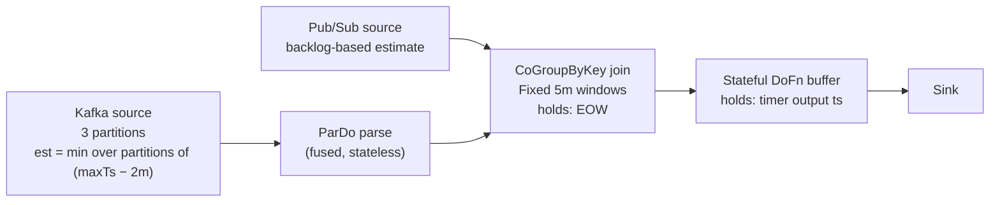
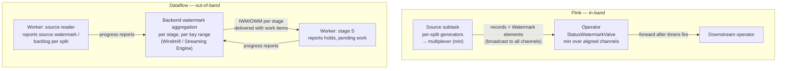
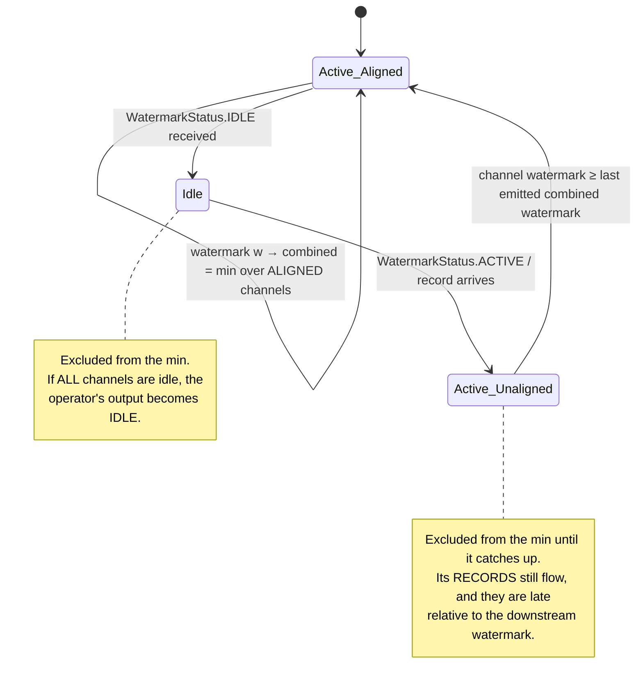
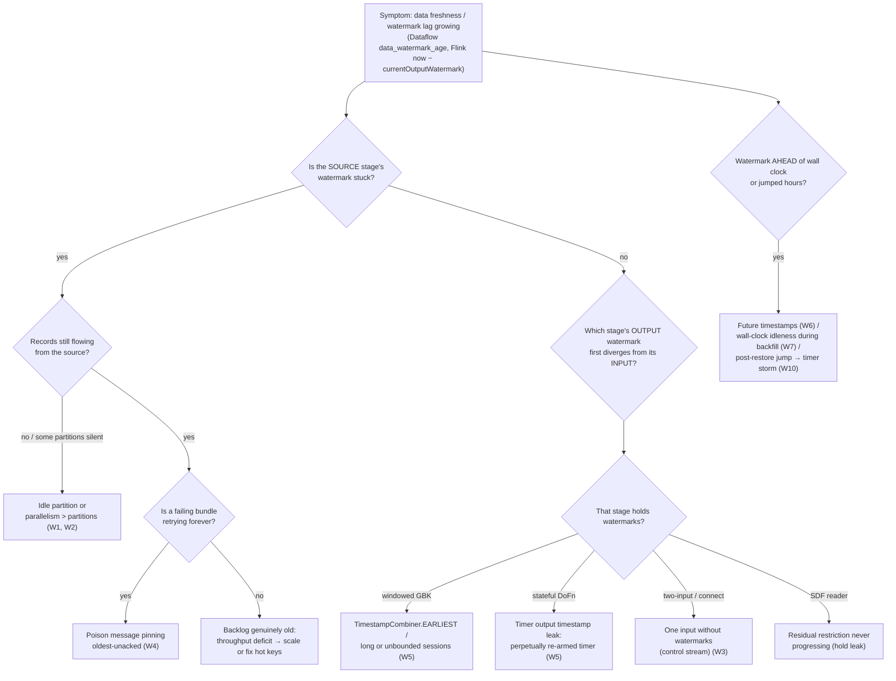

# 02 · Watermark Calculus: Monotonicity, Idleness, and Hold Locks

> **Folder:** `01-First-Principles-and-The-Dataflow-Model/` · **File 2 of 3**
> **Anchoring papers:** Akidau et al., *MillWheel* (VLDB 2013): low watermarks and the "oldest work" recurrence · Akidau
> et al., *The Dataflow Model* (VLDB 2015) · Begoli et al., *Watermarks in Stream Processing Systems: Semantics and
> Comparative Analysis of Apache Flink and Google Cloud Dataflow* (VLDB 2021) · Tucker et al., *Exploiting Punctuation
> Semantics in Continuous Data Streams* (TKDE 2003) · Li et al., *Out-of-Order Processing: A New Architecture for
> High-Performance Stream Systems* (VLDB 2008).
> **Prev:** [01 · Time domains and skew](01-what-where-when-how-and-time-domains-skew.md) · **Next:**
> [03 · Windowing internals](03-windowing-internals-merging-pane-accumulation-and-retractions.md)

---

## 0. The thesis

A watermark is a **promise** a stage makes to its consumers: *"I will not send you anything with an event time earlier
than this."* Everything else follows from treating it as a promise:

- **Monotonicity.** A promise can't be withdrawn. Downstream has already fired timers and deleted state on the strength
  of it.
- **Propagation.** You can only promise what your inputs promised you, minus whatever you're still holding. That gives the
  min-recurrence.
- **Idleness.** An input that says nothing makes no promise, so the min can't advance until you decide, heuristically,
  that silence means "nothing coming".
- **Holds.** A stage that has buffered data it will emit later must *withhold* part of its promise, and the hold must
  constrain its **output**, never its input.

Get these four right and you can debug any watermark stall in Beam, Dataflow, or Flink from first principles.

---

## 1. Why watermarks must exist

From file 01, axiom A3: completeness is unknowable. Yet event-time operations need *some* signal to act on:

- closing a window,
- firing an event-time timer,
- garbage-collecting state.

Three families of signal exist in the literature:

| Signal | Definition | Who emits | Strength |
|--------|------------|-----------|----------|
| **Punctuation** (Tucker et al. 2003) | An in-stream predicate: "no more tuples matching $\phi$" | Producer, in-band | Arbitrary predicates (e.g., "no more for auction #42"). Watermarks are the special case $\phi = (t < W)$. |
| **Heartbeat / low watermark** (MillWheel; Li et al. 2008) | A time-based progress assertion | Source injector or central authority | Composes across a DAG with min. |
| **Stream time / grace** (Kafka Streams) | max observed timestamp per task, plus a grace period | The task itself | No propagation protocol. Each sub-topology re-derives it from repartition-topic records. |

Watermarks won because time-based assertions **compose** through a DAG with a single associative, commutative operator
(min). Arbitrary punctuations don't compose generically.

---

## 2. Formal definitions

### 2.1 The watermark function

For each stage $S$:

$$
W_S : P \to E \cup \{-\infty, +\infty\}, \qquad p_1 \le p_2 \;\Rightarrow\; W_S(p_1) \le W_S(p_2)\quad\text{(monotone)}
$$

**Perfect watermark** (Beam's strict semantics). For every element $e$ that arrives at $S$ after processing time $p$:

$$
p_e(S) > p \;\Rightarrow\; t_e \ge W_S(p)
$$

Flink's non-strict semantics: `Watermark(t)` asserts that elements arriving later have $t_e > t$.

**Heuristic watermark.** Violations are allowed. An element is **late** iff:

$$
\mathrm{late}(e, S) \iff t_e < W_S\big(p_e(S)\big) \quad\text{(Beam)} \qquad\qquad t_e \le W_S\big(p_e(S)\big) \quad\text{(Flink)}
$$

**Droppable** (window semantics with allowed lateness $\lambda$):

$$
\mathrm{droppable}(e, w) \iff \mathrm{maxTs}(w) + \lambda < \mathrm{IWM}(S) \quad\text{(Beam: LateDataDroppingDoFnRunner)}
$$

$$
\mathrm{maxTs}(w) + \lambda \le \mathrm{currentWatermark} \quad\text{(Flink: WindowOperator.isWindowLate)}
$$

Note that droppability is decided **per window**, not per element. An element late by the watermark definition is still
accepted if its window hasn't reached GC time. Flink's `sideOutputLateData` receives an element only when *all* its
windows are late (`isElementLate` and every assigned window `isWindowLate`).

### 2.2 Timer firing conditions, and why Flink subtracts 1 ms

| Engine | Event-time timer at $\tau$ fires when | Window $[s, e)$ on-time firing | Bounded out-of-orderness generator |
|--------|----------------------------------------|---------------------------------|------------------------------------|
| Beam (runners-core `InMemoryTimerInternals`, Dataflow) | $\mathrm{IWM}(S) > \tau$ | timer at `maxTs = e − 1`, fires when $\mathrm{IWM} \ge e$ | $W = \max t - \Delta$ |
| Flink (`InternalTimerServiceImpl.advanceWatermark`) | $\mathrm{currentWatermark} \ge \tau$ | timer at `maxTs = e − 1`, fires when $\mathrm{WM} \ge e - 1$ | $W = \max t - \Delta - 1$ |

Both formulations fire window $[s, e)$ once the system believes no element with $t \le e - 1$ will arrive. The $-1$ in
Flink's `BoundedOutOfOrdernessWatermarks` restores equivalence: an element at exactly $\max t - \Delta$ is on time in both
engines. **When porting a pipeline between engines, port the semantics, not the arithmetic.** A hand-written Flink
generator that emits `max − Δ` (forgetting the −1) declares elements at exactly $\max - \Delta$ late. That's a 1 ms
boundary bug that shows up as a tiny, persistent late-drop rate on high-volume streams with millisecond-truncated
timestamps (many events share the same ms).

---

## 3. Propagation calculus in a DAG

### 3.1 The stage model

```
                 ┌──────────────────────────────── stage S ─────────────────────────────────┐
 upstream U₁ ───►│ input   ┌──────────┐   ┌─────────────────────────┐   ┌───────────────┐   │──► downstream D₁
 OWM(U₁)         │ queues  │ process  │──►│ state: buffers, panes,  │──►│ output queue  │   │    sees OWM(S)
 upstream U₂ ───►│ (in-    │ bundles/ │   │ timers, HOLDS h₁..hₙ    │   │ (in-flight)   │   │──► downstream D₂
 OWM(U₂)         │ flight) │ records  │   └─────────────────────────┘   └───────────────┘   │
                 │         └──────────┘                                                    │
                 │   IWM(S) = min OWM(Uᵢ)          OWM(S) = min(IWM(S), holds, in-flight)  │
                 └─────────────────────────────────────────────────────────────────────────┘
```

### 3.2 The correct recurrences

$$
\boxed{\;\mathrm{IWM}(S) \;=\; \min_{U \in \mathrm{Up}(S)} \mathrm{OWM}(U)\;}
\qquad\text{(sources: } \mathrm{IWM} := \text{source estimate)}
$$

$$
\boxed{\;\mathrm{OWM}(S) \;=\; \max\!\Big(\mathrm{OWM}_{\text{prev}}(S),\;\; \min\big(\,\mathrm{IWM}(S),\;\; \min_{h \in \mathrm{Holds}(S)} h,\;\; \min_{x \in \mathrm{Pending}(S)} t_x\,\big)\Big)\;}
$$

- $\mathrm{Holds}(S)$: watermark holds owned by $S$, from windowing/GBK holds, timer output timestamps, and SDF watermark
  estimators (§7).
- $\mathrm{Pending}(S)$: elements received but not yet committed. In Dataflow these are uncommitted work items. In Flink
  they're records buffered in the operator before the watermark is forwarded.
- The outer $\max$ with the previous value enforces monotonicity (§4).

**MillWheel's original form** says the same thing with one watermark per computation:

$$
\mathrm{lowWM}(A) = \min\Big(\mathrm{oldestWork}(A),\; \min_{C \,\to\, A} \mathrm{lowWM}(C)\Big)
$$

Here "oldest work" covers pending records, pending timers, and pending outputs. MillWheel's low watermark equals Beam's
**output** watermark. Beam's input watermark is the min over upstream low watermarks.

### 3.3 A common mis-statement, and the deadlock proof

Interview prep material sometimes writes:

$$
\mathrm{InputWatermark}(S) = \min\Big(\min_{U} \mathrm{OutputWatermark}(U),\; \min_{\tau \in \mathrm{StateHoldTimestamps}(S)} \tau\Big)
$$

If $\mathrm{StateHoldTimestamps}(S)$ means holds **owned by $S$**, this formulation **deadlocks**:

> **Proof (Beam strict semantics).** Let $S$ be a windowed GBK holding buffered data for window $w = [0, 10)$. $S$ owns an
> end-of-window hold $h = \mathrm{maxTs}(w) = 9$, released when the on-time pane fires. The on-time pane fires when the
> event-time timer at $9$ fires, which requires $\mathrm{IWM}(S) > 9$. Under the formula,
> $\mathrm{IWM}(S) \le h = 9$. So the timer never fires, the hold is never released, and the window never emits. ∎

The intuition: **the input watermark is a fact about upstream.** You can't change facts by holding. A hold is a
*promise about what $S$ will emit*, so it constrains $\mathrm{OWM}(S)$, which then becomes part of the *input* watermark
of $S$'s consumers. The formula is correct only if $\tau$ ranges over holds of **upstream** stages. In that case it's
redundant, because $\mathrm{OWM}(U)$ already includes $U$'s holds.

Placing holds on the output also gives the correct **liveness argument**. If every timer eventually fires (the input
watermark advances independently of $S$'s own holds), every hold tied to a timer is eventually released, so
$\mathrm{OWM}(S)$ eventually advances. Progress depends only on upstream progress, never on yourself.

### 3.4 Worked example: a five-stage DAG



Watermarks in minutes past 12:00 (sampled every minute of processing time):

| Proc time | Kafka p0 / p1 / p2 (maxTs − 2) | IWM(K)=OWM(K) | OWM(P) | OWM(PubSub) | IWM(J) | J holds (EOW) | OWM(J) | G hold | OWM(G) |
|-----------|-------------------------------|---------------|--------|-------------|--------|---------------|--------|--------|--------|
| 12:06 | 4 / 3 / 4 | **3** | 3 | 5 | 3 | 4:59 (window [0,5)) | 3 | — | 3 |
| 12:07 | 5 / 4 / 5 | **4** | 4 | 6 | 4 | 4:59 | 4 | — | 4 |
| 12:08 | 6 / **4** / 6 | **4** | 4 | 7 | 4 | 4:59 | 4 | — | 4 |
| 12:09 | 7 / **4** / 7 | **4** | 4 | 8 | 4 | 4:59 | 4 | — | 4 |
| 12:10 | 8 / 7 / 8 | **7** | 7 | 8 | 7 | [0,5) fires at IWM > 4:59, so hold released; 9:59 for [5,10) | 7 | 4:59 (buffered pane, ts = maxTs) | **4:59** |
| 12:11 | 9 / 8 / 9 | 8 | 8 | 9 | 8 | 9:59 | 8 | 4:59 | **4:59** |
| 12:12 | 10 / 9 / 10 | 9 | 9 | 10 | 9 | 9:59 | 9 | released (flushed) | 9 |

Observations:

1. **Partition p1 stalled from 12:08 to 12:09.** A single partition pinned the whole DAG at 4. That's the min-trap (§6).
2. **J's EOW hold never lowers its output** below its input here (the hold sits at the window end, ahead of IWM). EOW
   holds only matter for keeping the on-time pane itself non-late.
3. **G's hold at 4:59** (the buffered pane carries the window's `maxTs`) pins OWM(G) for two minutes even though IWM(G)
   advanced to 8. That's the cost of a buffering stage
   (§7.3), visible as per-stage watermark lag in Dataflow's UI.

### 3.5 The min is a tail-latency amplifier

If each of $N$ inputs to a min (partitions, splits, upstream subtasks) is independently stalled with probability $q$ at
any moment:

$$
\Pr[\text{global watermark stalled}] = 1 - (1 - q)^{N}
$$

| $N$ | $q = 10^{-4}$ | $q = 10^{-3}$ | $q = 10^{-2}$ |
|-----|---------------|---------------|---------------|
| 16 | 0.16 % | 1.6 % | 14.9 % |
| 256 | 2.5 % | 22.6 % | 92.4 % |
| 1,024 | 9.7 % | 64.1 % | ≈100 % |
| 4,096 | 33.6 % | 98.3 % | ≈100 % |

This is the "tail at scale" law (Dean & Barroso) applied to event time. At 1,024 partitions, an individually rare
per-partition hiccup (a GC pause, a slow broker, a leader election) stalls global event time most of the time. **Wide
fan-in needs idleness handling, alignment, or out-of-band progress (heartbeats) by design, not as an afterthought.**

### 3.6 Watermark lag as a queue, and the state-growth integral

Define lag $\ell(p) = p - W(p)$. Then:

$$
\frac{d\ell}{dp} = 1 - \frac{dW}{dp}
$$

- A healthy pipeline keeps $dW/dp \approx 1$, so $\ell$ is roughly constant.
- A frozen watermark ($dW/dp = 0$) grows lag at **1 second per second**.
- Catch-up after a backlog needs $dW/dp > 1$.

State held for event time grows with lag. For a windowed aggregation with incremental accumulators:

$$
\mathrm{State}(p) \approx \underbrace{K_{\text{act}}}_{\text{active keys/window}} \cdot \underbrace{b}_{\text{bytes/acc}} \cdot \Big(\frac{\ell(p) + \lambda}{w} + 1\Big)
\qquad\text{vs. buffering raw elements:}\qquad
\mathrm{State}(p) \approx r \cdot \bar{s} \cdot \big(\ell(p) + \lambda\big)
$$

**Time to OOM after a stall** (raw buffering, e.g., a `ProcessWindowFunction` without incremental aggregation):

$$
T_{\mathrm{OOM}} = \frac{M_{\text{budget}} - M_0}{r \cdot \bar{s}}
= \frac{512\,\mathrm{GB} - 100\,\mathrm{GB}}{10^6/\mathrm{s} \times 300\,\mathrm{B}} \approx 23\ \text{minutes}
$$

With an incremental `AggregateFunction` (10M keys, 100 B per accumulator, 1-minute windows) growth is per *new window*
(≈1 GB/min) plus **timers**: 10M per minute, which is 600M after an hour. On the heap timer service at ~100 B per timer
that's another 60 GB. The rule: **when a watermark stalls, timers are the second OOM**.

---

## 4. Monotonicity

### 4.1 Why it's non-negotiable

Downstream acts **irreversibly** on a watermark:

- fires timers and emits panes,
- garbage-collects window state (once the GC time passes, state is *deleted*),
- closes windows (Beam tracks closed windows; late data for them is dropped),
- commits outputs to sinks.

A watermark that moved backward would require undoing all of this. So every engine enforces:

$$
W_S(p) := \max\big(W_S(p^-),\ \widehat{W}_S(p)\big)
$$

where $\widehat{W}$ is the freshly computed candidate.

| Engine | Enforcement point |
|--------|-------------------|
| Flink sources | `WatermarkToDataOutput` emits only if the new watermark > the max emitted so far. `BoundedOutOfOrdernessWatermarks` tracks a monotone max. |
| Flink operators | `StatusWatermarkValve` emits a new combined min only if it exceeds the last output. A channel's watermark below its previous value is ignored. |
| Beam SDF | `WatermarkEstimators.MonotonicallyIncreasing`; `Manual` rejects regression ⚠ verify the exact behavior per version. |
| Beam KafkaIO | Timestamp policies keep `currentWatermark = max(current, candidate)`. |
| Dataflow | The backend persists per-stage watermarks and only advances them. |

### 4.2 What "monotone" does not protect you from

Monotonicity makes **a poisoned watermark permanent** (file 01, F3). A jump caused by a bad timestamp can't be corrected
in place. Recovery means restoring from state *before* the jump and replaying with the fix. Design the source assigner to
be robust (clamping) because there's no undo.

### 4.3 Restart semantics (a subtle L7 point)

- **Flink** checkpoints source positions and operator state (including timers), but **not the watermark itself**. After
  restore, every operator's current watermark starts at `Long.MIN_VALUE` and is regenerated from replayed data.
  Consequences:
  1. Replayed records arrive while the watermark is low, so they're on time even if, before the failure, they would have
     been judged late. **The set of late-dropped elements is not replay-invariant.** State is exactly-once; drop decisions
     depend on how fast watermarks regenerate.
  2. After a long outage, the first post-restore watermark can leap hours forward in one step and fire millions of
     restored timers at once: a **timer storm** that can blow checkpoint timeouts (§9, W10).
- **Dataflow** persists watermarks and holds in the backend. A work item's drop decisions commit atomically with its
  state, so a retried work item never double-applies, and after an `--update` the watermark continues from where it was.
  That's stronger consistency for lateness decisions, at the cost of a centralized progress service (§5.2).

---

## 5. Source watermark estimation

### 5.1 In-band (Flink) vs. out-of-band (Dataflow)



| Dimension | Flink (in-band) | Dataflow (out-of-band) |
|-----------|-----------------|------------------------|
| Transport | `Watermark` elements interleaved with records on every channel | Progress reports to backend; watermarks delivered with work |
| Coupling to backpressure | **Coupled.** A congested channel delays watermarks (and checkpoint barriers, Folder 04). | Decoupled from the data path, coupled to the backend's aggregation cadence. |
| Fan-out cost | $O(M \cdot N / \text{interval})$ watermark elements (file 01 §6.2) | $O(\text{workers} + \text{key ranges})$ reports |
| Idle-input handling | Explicit `WatermarkStatus.IDLE` and valve exclusion | Implicit: a split with zero backlog reports an advancing watermark |
| Granularity | Per channel | Per key range per stage |
| Visibility | Metrics `currentInputWatermark`, `currentOutputWatermark`, FLIP-33 `watermarkLag` | Per-stage data watermark; `per_stage_data_watermark_age`, `system_lag` |

### 5.2 Kafka

**Beam KafkaIO** gives each partition a `TimestampPolicy`:

| Policy | Record timestamp | Watermark | Idle partition behavior |
|--------|------------------|-----------|-------------------------|
| `withProcessingTime()` (**default**) | wall clock | wall clock | never stalls, and is semantically processing time (file 01, F1) |
| `withLogAppendTime()` | broker timestamp | ≈ max seen (nearly monotone per partition) | advances on backlog-zero checks |
| `withCreateTime(maxDelay)` | producer timestamp | max seen − maxDelay | when backlog = 0, advances to backlog-check time − maxDelay |
| `CustomTimestampPolicyWithLimitedDelay(fn, maxDelay, prev)` | `fn(record)` | max seen − maxDelay | same backlog-aware idle advance |

The critical design choice in Beam's limited-delay policy: **idle advance is gated on `PartitionContext.getMessageBacklog()
== 0`.** A partition advances its watermark by wall clock *only when the reader has verified there's nothing left to
read*. During a backfill the backlog is non-zero, so the watermark stays data-driven. That's backlog-aware idleness,
which is safer than silence-based idleness (§6.3).

**Flink KafkaSource (FLIP-27).** The strategy passed to `env.fromSource(...)` instantiates **one `WatermarkGenerator` per
split** inside `SourceOperator`. A `WatermarkOutputMultiplexer` combines split outputs by min over non-idle splits. Then:

- Periodic generators emit on the `pipeline.auto-watermark-interval` cadence (200 ms default).
- Punctuated generators emit in `onEvent`.
- **Gotcha:** a source subtask with *no* assigned splits (source parallelism > partition count) does not automatically go
  idle. The Kafka connector docs say to lower parallelism or set an idle timeout. Otherwise that subtask's watermark stays
  at `Long.MIN_VALUE` and stalls everything downstream.

### 5.3 Pub/Sub on Dataflow

Dataflow estimates Pub/Sub watermarks from **backlog metadata**, not from silence:

- With `publishTime` as the event time, the estimate tracks the oldest *unacknowledged* message in the subscription
  backlog.
- With a custom `timestampAttribute`, Dataflow creates an additional **tracking subscription** to sample event timestamps
  in the backlog, so it can bound the oldest un-processed event time. That costs extra (Pub/Sub delivery is billed on the
  tracking subscription too) and carries an assumption about how out-of-order publish order and event time can be.
- **Empty backlog ⇒ the watermark advances toward "now".** An idle subscription never stalls the pipeline.
- **Low-volume subscriptions** give noisier estimates. Sparse samples mean wider uncertainty.

The structural consequence: **a poison message that is never acked keeps the oldest-unacked timestamp old forever.**
Dataflow streaming retries failing bundles indefinitely, so a single deterministic exception in a `DoFn` pins the
watermark at that element's timestamp (W4).

### 5.4 Beam SDF watermark estimators

A splittable `DoFn` reading an unbounded source declares a watermark estimator per restriction (Folder 02):

| Estimator | Watermark | Use |
|-----------|-----------|-----|
| `WatermarkEstimators.MonotonicallyIncreasing` | max output timestamp so far | Sources whose timestamps are in order per restriction |
| `WatermarkEstimators.Manual` | whatever you `setWatermark(...)`, monotone | Backlog-aware logic you implement yourself (the Kafka-style pattern) |
| `WatermarkEstimators.WallTime` | wall clock | Processing-time sources |

The estimator **state is checkpointed with the residual restriction** on every split or checkpoint. The runner's source
watermark is the min over all outstanding restrictions' estimators, so **each residual is a hold** (§7.4).

### 5.5 CDC, files, and bounded sources

- **CDC (Debezium, Datastream):** event time = commit timestamp. Per-shard progress during quiet periods comes from
  **heartbeats** (`heartbeat.interval.ms`), which emit progress records even when no tables change. Without them, a quiet
  shard is an idle partition.
- **Continuous file matching** (`FileIO.match().continuously(...)`): the watermark is driven by poll/match time, and
  output timestamps are file-discovery times unless you re-stamp.
- **Bounded sources:** $-\infty$ until done, then $+\infty$. A bounded side branch **unioned** with an unbounded main
  branch holds the union's watermark at the bounded branch's progress until it finishes.

---

## 6. Idleness: the min-trap

### 6.1 Problem statement

From §3.2, $\mathrm{IWM}(S) = \min_U \mathrm{OWM}(U)$. An input that **emits nothing** never advances its watermark, so
the min is frozen and lag grows at 1 s/s (§3.6). Causes:

- Kafka partitions with no traffic (key skew, off-hours producers, a decommissioned producer).
- Source parallelism greater than the partition count (§5.2 gotcha).
- Control/configuration streams connected to a data stream (`connect`, broadcast state) that carry no watermarks.
- CDC shards with no writes and no heartbeats.
- A bounded side input branch in a union (§5.5).

### 6.2 Flink: `withIdleness` and the valve

`WatermarkStrategy.withIdleness(d)` wraps the generator in `WatermarksWithIdleness`:

- An `IdlenessTimer` checks on each periodic emit whether any event arrived since the last check.
- If none has for longer than $d$, the output calls `markIdle()`.
- The next event (or emitted watermark) implicitly marks it active again.

Idle status propagates downstream as `WatermarkStatus.IDLE`. The receiving `StatusWatermarkValve` applies these rules:



Consequences an L7 engineer must be able to recite:

1. **Reactivation doesn't rewind.** A channel returning from idle with an old watermark is excluded from the min until it
   catches up. Its records still flow, and every one behind the downstream watermark is **late**. Idleness converts a
   stall into potential data loss.
2. **The idleness timeout is measured in processing time, as silence.** It's an assertion about the *producer* ("nothing
   is coming"), made by observing the *consumer* ("nothing arrived"). These differ whenever the consumer can't read:
   backpressure, a watermark-alignment pause, a broker outage. Newer Flink versions measure the timeout on a
   `RelativeClock` exposed as `WatermarkGeneratorSupplier.Context#getInputActivityClock()`, which pauses while the split
   is paused, so a backpressured or alignment-paused split isn't falsely declared idle ⚠ verify availability (it arrived
   in the 1.18 era). On older versions, false idleness under backpressure is a real failure mode.
3. **All-idle propagates.** If every input is idle, the operator's output is idle, and downstream operators ignore it for
   their own min. When the last active channel goes idle, the valve may flush to the max watermark across channels
   before going idle ⚠ verify per version, which is a source of sudden watermark jumps.

### 6.3 Four strategies compared

| Strategy | Mechanism | Safe during backfill? | Safe when a producer is merely paused? | Cost |
|----------|-----------|-----------------------|----------------------------------------|------|
| **Silence-based idleness** (Flink `withIdleness`) | no events for $d$ ⇒ exclude from min | Mostly. A fully-consumed lagging partition goes idle correctly, but a *paused reader* can falsely idle on older versions. | **No.** When the producer resumes with buffered old events, they're late. | Trivial |
| **Backlog-aware advance** (Beam KafkaIO, Dataflow Pub/Sub) | backlog verified empty ⇒ advance to now − δ | **Yes.** Backlog > 0 blocks the advance. | **No**, for the same reason. | Requires backlog metadata from the broker |
| **Wall-clock advance without a backlog check** | no events ⇒ $W := \text{now} - \delta$ | **Catastrophic.** During replay of yesterday's data, now − δ is far ahead of event time, so everything is late. | No | Trivial, and deadly |
| **Producer heartbeats / punctuations** | producers write periodic low-watermark records to **every** partition | Yes | **Yes.** A paused producer stops heartbeating, so the watermark correctly waits for it. | Producer cooperation; ~1 small record per partition per interval |
| **Watermark alignment** (complementary) | pause *fast* splits whose watermark exceeds the group min by more than the max drift | Yes | n/a. Solves the opposite problem: fast splits filling state. | Throughput coupling |

**Producer heartbeats are the only strategy that turns a heuristic watermark into a near-perfect one.** That's what
MillWheel's injectors and Debezium's heartbeats do: the producer, the only party that knows "nothing is coming", says so
explicitly. At L7, propose heartbeats whenever you control the producers.

### 6.4 Watermark alignment: bounding the *fast* side

Idleness handles slow or silent inputs. Alignment handles **fast** ones. Consider a backfill where partition 0 is a day
ahead of partition 1. Every window between them is open, and the state of everything p0 produced waits for p1.

`WatermarkStrategy.withWatermarkAlignment(group, maxAllowedDrift, updateInterval)` coordinates source readers through the
`SourceCoordinator`, and since FLIP-217 also per split within a reader. A split whose local watermark exceeds the group's
minimum plus `maxAllowedDrift` is **paused**:

$$
\mathrm{State}_{\text{backfill}} \;\propto\; r \cdot \big(\underbrace{W_{\max} - W_{\min}}_{\text{unbounded}}\big)
\quad\longrightarrow\quad
r \cdot \underbrace{\mathrm{maxDrift}}_{\text{bounded}}
$$

Trade-offs: too small a drift causes constant pause/resume and collapses throughput toward the slowest split. It also
interacts with idleness, since a split paused by alignment isn't "silent" (§6.2, point 2).

### 6.5 Flink SQL and Spark equivalents

| Engine | Idleness | Alignment |
|--------|----------|-----------|
| Flink SQL | `table.exec.source.idle-timeout` | `scan.watermark.alignment.group` / `max-drift` table options (connector support varies) |
| Spark Structured Streaming | none. The global watermark is max event time seen in the previous micro-batch minus the delay; with multiple inputs, `spark.sql.streaming.multipleWatermarkPolicy` = `min` (default) or `max` | none |
| Kafka Streams | `max.task.idle.ms` (how long a task waits for empty input partitions before processing others, for join synchronization) | n/a |

---

## 7. Hold locks

### 7.1 The concept

A **watermark hold** is a lower bound $h$ that stage $S$ places on its own output watermark:

$$
\mathrm{OWM}(S) \le h \quad\text{while the hold is held}
$$

It's a **lock on downstream event-time progress**, and it has a lock's lifecycle:

| Lock concept | Watermark hold |
|--------------|----------------|
| Acquire | Write to hold state (element hold, timer with output timestamp, residual restriction) |
| Lock scope | Per key + window (+ state address) |
| Re-entrancy / merge | Holds combine by min (or by the `TimestampCombiner` for element holds) |
| Release | Pane fires, timer fires, residual finishes, or state is cleared |
| **Lock leak** | A hold whose release condition never happens: a timer that never fires, a session that never ends |
| **Deadlock** | Hold placed on the *input* watermark (§3.3), or a cyclic dependency (Beam disallows cycles; Flink iterations make watermarks ill-defined) |

**Why holds exist at all.** A stage that buffers element $e$ (timestamp $t_e$) and emits it later must ensure downstream
hasn't advanced past $t_e$ in the meantime, or the emitted element arrives late. Without holds, the output watermark would
follow the input watermark and race ahead of buffered data.

### 7.2 Holds in windowed GroupByKey (Beam `ReduceFnRunner` / `WatermarkHold`)

| Hold | Placed at | Placed when | Released when | Effect on OWM(GBK) |
|------|-----------|-------------|---------------|--------------------|
| **Element hold** | `TimestampCombiner` over buffered elements: `END_OF_WINDOW` → `maxTs(w)`; `EARLIEST` → min $t$; `LATEST` → max $t$ | An element arrives, unless it's already behind the output watermark or the window's end-of-window has passed (then it's "too late to hold") | The pane fires (`extractAndRelease`) | `END_OF_WINDOW`: no extra lag. **`EARLIEST`: OWM lags IWM by up to the window span.** |
| **End-of-window hold** | `maxTs(w)` | The window has state and its EOW hasn't passed | The on-time pane fires | Guarantees the ON_TIME pane is not late downstream |
| **GC hold** | `maxTs(w) + allowedLateness` | After EOW, when allowed lateness > 0 and (a late pane is pending, or `ClosingBehavior.FIRE_ALWAYS`) | Pane fires / GC | **Benign.** It sits at or above IWM (open windows have GC time ≥ IWM), so it only stops OWM from jumping past GC before the final pane. |

**Output timestamp of a pane** = the extracted hold, except that **late panes** (whose element holds were "too late")
and GC-hold-only panes are stamped `maxTs(w)`. **Late panes are late downstream.** That's why a downstream re-windowing
needs allowed lateness ≥ the upstream's, or it drops every correction.

**The `EARLIEST` trap.** With `Sessions` and `TimestampCombiner.EARLIEST`, each open session holds the GBK's output
watermark at the session's *first* element. A 3-hour user session (or an endless bot session) holds every downstream
event-time operation, for every key, by 3 hours (or forever). Downstream windows don't close, downstream state grows, and
the per-stage watermark graph shows a sawtooth that tracks session length. `END_OF_WINDOW` (the default) avoids this.

### 7.3 Holds in stateful `DoFn`s: timer output timestamps

A Beam timer carries an **output timestamp**: the timestamp of anything emitted from its `@OnTimer`, and simultaneously a
hold on the stage's output watermark while the timer is pending.

| Timer | Default output timestamp (hold) | Notes |
|-------|----------------------------------|-------|
| Event-time timer at $\tau$ | $\tau$ | Holds OWM at the firing time. Harmless if $\tau \ge$ IWM; pins downstream if you set $\tau$ far ahead "just for cleanup". |
| Processing-time timer | the input element's timestamp (current Beam Java) ⚠ verify per version | **A processing-time timer that's perpetually re-armed but never fires is a permanent hold.** |
| `.withOutputTimestamp(ts)` | `ts` | Must be ≥ the current element's (or firing timer's) timestamp minus the allowed skew, and must not exceed the window's expiry. |
| `.withNoOutputTimestamp()` | no hold | For timers whose `@OnTimer` emits nothing (cleanup, GC) ⚠ verify availability in your SDK. |

The SDK enforces the lower bound. Setting an output timestamp earlier than the current input's timestamp fails with
*"Cannot output timer with output timestamp … Output timestamps must be no earlier than the timestamp of the current input
or timer …"*. Holds can't be retroactively placed behind data you've already been told about. That's how monotonicity is
enforced at the API boundary.

### 7.4 Holds in SDF: residuals

When a runner checkpoints or splits a splittable `DoFn`, the residual restriction carries its watermark estimator state.
The source's output watermark is the min over all outstanding residuals. A residual that's never resumed (for example, a
bug that returns `ProcessContinuation.resume()` without ever making progress) is a hold leak. Folder 02 covers SDF
mechanics.

### 7.5 Flink has no holds, and what that implies

Flink operators don't expose user-level holds. `AbstractStreamOperator.processWatermark` does two things in order:

1. Advance timers to the new watermark, firing them and emitting their outputs.
2. Forward the watermark.

Outputs produced *by timers* are therefore emitted **before** the watermark that triggered them, so they're not late
downstream. But:

- A `KeyedProcessFunction` that buffers elements and emits them later *from `processElement`* with old timestamps
  produces **late data downstream**, because nothing held the watermark back.
- Emitting from `onTimer` stamps the output with the **timer's** timestamp (the `TimestampedCollector` is set to the
  timer time), not the buffered element's original timestamp.
- Operators that genuinely need holds implement them by overriding `processWatermark`. `AsyncWaitOperator` treats
  watermarks as barriers in its queue, and temporal join operators delay watermarks until buffered rows are processed.

**Design implication:** in Flink, buffer-and-release patterns must release through event-time timers, or accept that
releases are stamped at timer time.

---

## 8. Production Java 21 code blueprints

### 8.1 Flink anti-pattern: a control stream that freezes event time

```java
// ANTI-PATTERN: the rules stream has no watermarks, so the connected operator's min is stuck at Long.MIN_VALUE.
DataStream<Event> events = env.fromSource(eventSource, eventWatermarks, "events");
DataStream<Rule> rules = env.fromSource(ruleSource, WatermarkStrategy.noWatermarks(), "rules");  // ← never advances

events.keyBy(Event::accountId)
    .connect(rules.broadcast(RULES_DESCRIPTOR))
    .process(new RuleEvaluator())   // event-time timers inside NEVER fire; state grows until OOM
    .sinkTo(alertSink);
```

`noWatermarks()` means the input's watermark stays at `Long.MIN_VALUE`, and $\min(\mathrm{events}, -\infty) = -\infty$.
The job looks healthy (records flow, CPU is fine) while every event-time timer and window behind the connect is frozen.

### 8.2 Flink production: lag-aware idleness, alignment, and a control stream that steps aside

```java
package dev.l7.dataflow.watermarks;

import java.time.Duration;
import org.apache.flink.api.common.eventtime.Watermark;
import org.apache.flink.api.common.eventtime.WatermarkGenerator;
import org.apache.flink.api.common.eventtime.WatermarkOutput;
import org.apache.flink.api.common.eventtime.WatermarkStrategy;
import org.apache.flink.api.common.functions.OpenContext;
import org.apache.flink.metrics.Gauge;
import org.apache.flink.streaming.api.functions.ProcessFunction;
import org.apache.flink.util.Collector;
import org.apache.flink.util.clock.RelativeClock;

/**
 * Bounded-out-of-orderness generator with two-tier idleness:
 *
 *  - SOFT idle: the split was LIVE (caught up to wall clock) when it went quiet, so silence very likely means "no
 *    traffic". Idle after softIdle.
 *  - HARD idle: the split was BEHIND when it went quiet (backfill, dead producer with a stale tail), so silence is
 *    ambiguous. Idle only after hardIdle, which is much longer.
 *
 * Idle time is measured on the input-activity clock, which does not advance while the split is paused
 * (backpressure / watermark alignment), so pauses are never mistaken for silence.
 */
public final class LagAwareIdlenessWatermarks<T> implements WatermarkGenerator<T> {

  private final long outOfOrdernessMs;
  private final long softIdleMs;
  private final long hardIdleMs;
  private final long liveLagMs;
  private final RelativeClock activityClock;

  private long maxTimestamp;
  private long lastRecordActivityMs;
  private long lagAtLastRecordMs = 0L;   // an empty split counts as "caught up"
  private boolean idle;

  public LagAwareIdlenessWatermarks(Duration outOfOrderness, Duration softIdle, Duration hardIdle,
                                    Duration liveLag, RelativeClock activityClock) {
    this.outOfOrdernessMs = outOfOrderness.toMillis();
    this.softIdleMs = softIdle.toMillis();
    this.hardIdleMs = hardIdle.toMillis();
    this.liveLagMs = liveLag.toMillis();
    this.activityClock = activityClock;
    this.maxTimestamp = Long.MIN_VALUE + outOfOrdernessMs + 1;   // same overflow guard as Flink's built-in
    this.lastRecordActivityMs = activityClock.relativeTimeMillis();
  }

  @Override
  public void onEvent(T event, long eventTimestamp, WatermarkOutput output) {
    if (eventTimestamp > maxTimestamp) {
      maxTimestamp = eventTimestamp;
    }
    lastRecordActivityMs = activityClock.relativeTimeMillis();
    lagAtLastRecordMs = Math.max(0L, System.currentTimeMillis() - maxTimestamp);
    idle = false;   // the next emitWatermark() implicitly marks the output active again
  }

  @Override
  public void onPeriodicEmit(WatermarkOutput output) {
    long quietForMs = activityClock.relativeTimeMillis() - lastRecordActivityMs;
    boolean wasLive = lagAtLastRecordMs <= liveLagMs;
    if ((wasLive && quietForMs >= softIdleMs) || quietForMs >= hardIdleMs) {
      if (!idle) {
        output.markIdle();
        idle = true;
      }
      return;
    }
    output.emitWatermark(new Watermark(maxTimestamp - outOfOrdernessMs - 1));   // Flink ≤-semantics: note the −1
  }

  /** Strategy with alignment so FAST splits cannot run ahead and fill state during a backfill. */
  public static <T> WatermarkStrategy<T> strategy(Duration outOfOrderness, String alignmentGroup) {
    return WatermarkStrategy
        .<T>forGenerator(ctx -> new LagAwareIdlenessWatermarks<>(
            outOfOrderness,
            Duration.ofMinutes(1),     // soft idle
            Duration.ofHours(1),       // hard idle
            Duration.ofMinutes(5),     // "live" = within 5 min of wall clock at the last record
            ctx.getInputActivityClock()))   // ⚠ verify: Flink 1.18+; older versions use SystemClock
        .withWatermarkAlignment(alignmentGroup, Duration.ofMinutes(10), Duration.ofSeconds(1));
  }

  /** For control/config streams: never participate in the event-time min. */
  public static <R> WatermarkStrategy<R> controlStream() {
    return WatermarkStrategy.forGenerator(ctx -> new WatermarkGenerator<R>() {
      @Override
      public void onEvent(R event, long eventTimestamp, WatermarkOutput output) {
        // Control records carry no event-time promise.
      }

      @Override
      public void onPeriodicEmit(WatermarkOutput output) {
        output.markIdle();   // excluded from the downstream valve's min
      }
    });
  }

  /** Exposes now − currentWatermark as a gauge at any point in the graph, the Flink analogue of Dataflow freshness. */
  public static final class WatermarkLagProbe<E> extends ProcessFunction<E, E> {
    private transient volatile long lastSeenWatermark = Long.MIN_VALUE;

    @Override
    public void open(OpenContext openContext) {
      getRuntimeContext().getMetricGroup().gauge("watermarkLagMs", (Gauge<Long>) () ->
          lastSeenWatermark == Long.MIN_VALUE ? -1L : System.currentTimeMillis() - lastSeenWatermark);
    }

    @Override
    public void processElement(E value, Context ctx, Collector<E> out) {
      lastSeenWatermark = ctx.timerService().currentWatermark();
      out.collect(value);
    }
  }
}
```

Wiring:

```java
DataStream<Event> events = env.fromSource(eventSource,
        LagAwareIdlenessWatermarks.<Event>strategy(Duration.ofMinutes(2), "events")
            .withTimestampAssigner((e, ts) -> e.eventTimeMillis()),
        "events");
DataStream<Rule> rules = env.fromSource(ruleSource, LagAwareIdlenessWatermarks.<Rule>controlStream(), "rules");

events.keyBy(Event::accountId)
    .connect(rules.broadcast(RULES_DESCRIPTOR))
    .process(new RuleEvaluator())
    .process(new LagAwareIdlenessWatermarks.WatermarkLagProbe<>()).name("wm-lag-after-rules")
    .sinkTo(alertSink);
```

Why each choice:

- **Soft vs. hard idle.** These separate "no traffic" from "stale tail". A split that went quiet while 3 hours behind
  wall clock is far more likely to resume with old data than one that went quiet while live.
- **The activity clock** prevents backpressure and alignment pauses from being read as silence.
- **Alignment** caps the state that fast splits can create during backfills.
- **The control stream marks itself idle.** A bounded control source would instead emit `MAX_WATERMARK` on completion
  automatically.
- **The probe** gives a per-operator freshness gauge you can alert on next to `currentOutputWatermark`.

### 8.3 Beam: a backlog-aware, future-clamping Kafka timestamp policy

`CustomTimestampPolicyWithLimitedDelay` (file 01) covers most cases. Write your own `TimestampPolicy` when you need
policy-level control, for example clamping, per-partition delay budgets, or different idle rules:

```java
package dev.l7.dataflow.watermarks;

import java.util.Optional;
import org.apache.beam.sdk.io.kafka.KafkaRecord;
import org.apache.beam.sdk.io.kafka.TimestampPolicy;
import org.apache.beam.sdk.transforms.SerializableFunction;
import org.apache.beam.sdk.transforms.windowing.BoundedWindow;
import org.joda.time.Duration;
import org.joda.time.Instant;

/**
 * Per-partition policy:
 *   timestamp = min(extract(record), now + maxFutureSkew)                     (a fast clock cannot poison us)
 *   watermark = max(prev, maxSeen − maxDelay, [backlog == 0] ? checkTime − maxDelay : −∞)
 * The idle advance happens ONLY when the reader has verified zero backlog, so backfills stay data-driven.
 */
public final class ClampingBacklogAwarePolicy<K, V> extends TimestampPolicy<K, V> {

  private final SerializableFunction<KafkaRecord<K, V>, Instant> extract;
  private final Duration maxDelay;
  private final Duration maxFutureSkew;
  private Instant maxSeen;
  private Instant currentWatermark;

  public ClampingBacklogAwarePolicy(SerializableFunction<KafkaRecord<K, V>, Instant> extract, Duration maxDelay,
                                    Duration maxFutureSkew, Optional<Instant> previousWatermark) {
    this.extract = extract;
    this.maxDelay = maxDelay;
    this.maxFutureSkew = maxFutureSkew;
    this.currentWatermark = previousWatermark.orElse(BoundedWindow.TIMESTAMP_MIN_VALUE);
    this.maxSeen = this.currentWatermark;
  }

  @Override
  public Instant getTimestampForRecord(PartitionContext ctx, KafkaRecord<K, V> record) {
    Instant ceiling = Instant.now().plus(maxFutureSkew);
    Instant ts = extract.apply(record);
    if (ts.isAfter(ceiling)) {
      ts = ceiling;
    }
    if (ts.isAfter(maxSeen)) {
      maxSeen = ts;
    }
    return ts;
  }

  @Override
  public Instant getWatermark(PartitionContext ctx) {
    Instant candidate = maxSeen.minus(maxDelay);
    if (ctx.getMessageBacklog() == 0) {                       // verified caught up: silence means "no data"
      Instant idleCandidate = ctx.getBacklogCheckTime().minus(maxDelay);
      if (idleCandidate.isAfter(candidate)) {
        candidate = idleCandidate;
      }
    }
    if (candidate.isAfter(currentWatermark)) {
      currentWatermark = candidate;                           // monotone by construction
    }
    return currentWatermark;
  }
}
```

```java
KafkaIO.<String, byte[]>read()
    // ...
    .withTimestampPolicyFactory((tp, prev) -> new ClampingBacklogAwarePolicy<>(
        EventTimeCampaignCounts::sanitizedEventTime,   // from file 01 §7.2 (normalizes units)
        Duration.standardMinutes(2), Duration.standardSeconds(30), prev));
```

### 8.4 Beam anti-pattern: buffering without a hold

```java
// ANTI-PATTERN: buffers elements and flushes them later with their ORIGINAL timestamps, with no hold.
// The timer's default output timestamp / skew rules either REJECT the outputs, or (with a hold that's too new) the
// outputs come out LATE downstream and get dropped by the next windowed aggregation.
@OnTimer("flush")
public void onFlush(@Key String key, @StateId("buffer") BagState<TimestampedValue<Long>> buffer,
                    OutputReceiver<KV<String, Long>> out) {
  for (TimestampedValue<Long> tv : buffer.read()) {
    out.outputWithTimestamp(KV.of(key, tv.getValue()), tv.getTimestamp());  // IllegalArgumentException:
  }                                                                         // "Cannot output with timestamp …"
  buffer.clear();
}
```

### 8.5 Beam production: buffering with an explicit, minimal watermark hold

The rule the SDK enforces (§7.3): a timer's output timestamp can't be earlier than the **current** element's timestamp.
So the hold can only be lowered to the current element's timestamp, and only when that element is the new minimum. That's
exactly "hold = min over buffered timestamps", updated lazily:

```java
package dev.l7.dataflow.watermarks;

import org.apache.beam.sdk.coders.InstantCoder;
import org.apache.beam.sdk.coders.VarLongCoder;
import org.apache.beam.sdk.metrics.Counter;
import org.apache.beam.sdk.metrics.Metrics;
import org.apache.beam.sdk.state.BagState;
import org.apache.beam.sdk.state.StateSpec;
import org.apache.beam.sdk.state.StateSpecs;
import org.apache.beam.sdk.state.TimeDomain;
import org.apache.beam.sdk.state.Timer;
import org.apache.beam.sdk.state.TimerSpec;
import org.apache.beam.sdk.state.TimerSpecs;
import org.apache.beam.sdk.state.ValueState;
import org.apache.beam.sdk.transforms.DoFn;
import org.apache.beam.sdk.values.KV;
import org.apache.beam.sdk.values.TimestampedValue;
import org.joda.time.Duration;
import org.joda.time.Instant;

/**
 * Per-key micro-batching (e.g., to amortize an expensive downstream call) that is SAFE for event time:
 *  - flushes at most MAX_BUFFER_DELAY of processing time after the first buffered element (a fixed deadline, so
 *    steady traffic can't starve the timer by re-arming it forever),
 *  - holds the output watermark at min(buffered timestamps), so flushed elements are never late downstream.
 */
public final class BufferWithWatermarkHoldFn extends DoFn<KV<String, Long>, KV<String, Long>> {

  private static final Duration MAX_BUFFER_DELAY = Duration.standardSeconds(10);

  private final Counter heldBehindWatermark = Metrics.counter(BufferWithWatermarkHoldFn.class, "late_on_arrival");

  @StateId("buffer")
  private final StateSpec<BagState<TimestampedValue<Long>>> bufferSpec =
      StateSpecs.bag(TimestampedValue.TimestampedValueCoder.of(VarLongCoder.of()));

  @StateId("hold")
  private final StateSpec<ValueState<Instant>> holdSpec = StateSpecs.value(InstantCoder.of());

  @StateId("deadline")
  private final StateSpec<ValueState<Instant>> deadlineSpec = StateSpecs.value(InstantCoder.of());

  @TimerId("flush")
  private final TimerSpec flushSpec = TimerSpecs.timer(TimeDomain.PROCESSING_TIME);

  @ProcessElement
  public void process(@Element KV<String, Long> element, @Timestamp Instant ts,
                      @StateId("buffer") BagState<TimestampedValue<Long>> buffer,
                      @StateId("hold") ValueState<Instant> hold,
                      @StateId("deadline") ValueState<Instant> deadline,
                      @TimerId("flush") Timer flush) {
    buffer.add(TimestampedValue.of(element.getValue(), ts));

    Instant now = Instant.now();
    Instant due = deadline.read();
    if (due == null) {
      due = now.plus(MAX_BUFFER_DELAY);      // fixed at the FIRST element: no timer starvation
      deadline.write(due);
    }

    Instant currentHold = hold.read();
    if (currentHold == null || ts.isBefore(currentHold)) {
      // ts is the CURRENT element's timestamp, so the SDK's "no earlier than current input" rule is satisfied,
      // and the hold only ever moves DOWN to the new minimum. (If ts is already behind this stage's output
      // watermark, the element is late on arrival and no hold can make it on-time; count it.)
      hold.write(ts);
      Duration remaining = due.isAfter(now) ? new Duration(now, due) : Duration.ZERO;
      // Re-arm with the SAME deadline but a LOWER hold. Processing-time timers only accept relative setting.
      flush.withOutputTimestamp(ts).offset(remaining).setRelative();
    }
  }

  @OnTimer("flush")
  public void onFlush(@Key String key,
                      @StateId("buffer") BagState<TimestampedValue<Long>> buffer,
                      @StateId("hold") ValueState<Instant> hold,
                      @StateId("deadline") ValueState<Instant> deadline,
                      OutputReceiver<KV<String, Long>> out) {
    for (TimestampedValue<Long> tv : buffer.read()) {
      // Every buffered timestamp ≥ hold == this timer's output timestamp, so all outputs are legal and on time.
      out.outputWithTimestamp(KV.of(key, tv.getValue()), tv.getTimestamp());
    }
    buffer.clear();
    hold.clear();
    deadline.clear();   // releasing the timer releases the hold
  }
}
```

Notes:

- Processing-time timers reject absolute `set(Instant)` (*"Cannot only set relative timers in processing time domain. Use
  #setRelative()"*), hence `offset(remaining).setRelative()` to keep a fixed deadline.
- The hold is lowered **only when needed**, so the timer is re-armed at most once per new minimum, not once per element.
- `late_on_arrival` should be incremented when you can detect lateness. Beam doesn't expose the watermark to `DoFn`s, so
  in practice you measure it on the Dataflow per-stage watermark graph or with `PaneInfo` downstream.

---

## 9. Production failure modes and P99 debugging

### 9.1 The watermark-stall decision tree



### 9.2 Catalog

| ID | Failure | Signature | Fix |
|----|---------|-----------|-----|
| W1 | **Idle partition stall** | Source watermark flat; per-partition lag shows a few partitions with no records; state and timer counts grow linearly; eventually OOM or checkpoint timeouts | Idleness (silence- or backlog-based), producer heartbeats, or fewer partitions |
| W2 | **Source parallelism > partitions** (Flink) | Some source subtasks show `currentOutputWatermark = Long.MIN_VALUE`; no records on them | Match parallelism to partitions, or set `withIdleness` |
| W3 | **Control stream without watermarks** | Two-input operator: `currentInput2Watermark` stuck at `MIN_VALUE` | `markIdle()` control generator (§8.2), or `MAX_WATERMARK` for bounded control sources |
| W4 | **Poison message on Dataflow streaming** | One work item failing repeatedly in logs; watermark pinned at that element's timestamp; Pub/Sub oldest-unacked age climbing | try/catch to a dead-letter output (`MapElements…exceptionsVia(...)` / `WithFailures`); fix the deterministic bug; never let user exceptions escape |
| W5 | **Hold leak** | A stage's OWM lags its IWM by a large, steady or sawtooth amount | `END_OF_WINDOW` combiner; cap sessions; fixed flush deadlines; `withNoOutputTimestamp()` on cleanup timers |
| W6 | **Future timestamp jump** | Watermark > wall clock; late-drop counters spike across all keys | Clamp in the assigner; restore from a pre-incident snapshot (file 01, F3) |
| W7 | **Wall-clock idleness during a backfill** | All replayed data late; outputs empty during reprocessing | Backlog-gated idleness or lag-aware idleness; never bare wall-clock advance |
| W8 | **Alignment drift too small** | Throughput collapses toward the slowest split; sources oscillate paused/resumed | Raise `maxAllowedDrift` to cover normal partition skew; fix the slow split |
| W9 | **Watermark fan-out overhead** | At very high parallelism, CPU in watermark handling and valve updates; watermark propagation latency grows | Reduce all-to-all exchanges (pre-aggregate, fewer shuffle stages), raise the emission interval, rescale parallelism |
| W10 | **Post-restore timer storm** (Flink) | After a long outage, the first watermark leaps hours; millions of timers fire at once; checkpoint timeouts; backpressure spike | Alignment during catch-up; rate-limit sources on restore; RocksDB timers (not heap); bigger checkpoint timeout during recovery |

### 9.3 Runbooks for the expensive ones

**W1 · Idle partition, state growth, OOM (Flink).**

1. Confirm the source operator's `currentOutputWatermark` is flat and downstream `currentInputWatermark` equals it.
2. Check per-split metrics (FLIP-33 `sourceIdleTime`, `pendingRecords`, and Kafka consumer `records-lag` by partition).
   One or more partitions show zero records consumed.
3. Size the blast radius: checkpointed state size slope and `numberOfRegisteredTimers`-style gauges (or RocksDB
   `estimate-num-keys` on the timer column family).
4. Fix in order of preference:
   - Producer heartbeats into every partition.
   - Backlog-aware or lag-aware idleness (§8.2).
   - `withIdleness`, with a late side output to measure what idleness costs you.
5. Prevent it: alert on `max(now − currentOutputWatermark)` per source subtask, not just per job.

**W4 · Poison message (Dataflow streaming).**

1. Dataflow streaming retries failed work **indefinitely**, so the job never fails. It just stops advancing.
2. Symptoms: data freshness climbs; logs show the same exception and stack repeatedly; Pub/Sub
   `oldest_unacked_message_age` climbs; system lag climbs on one stage.
3. Immediate relief: `--update` with a code fix that routes failures to a dead-letter `PCollection` (you can't drop the
   message without a code change).
4. Prevent it: every user-code `DoFn` that parses or calls out wraps failures into a dead-letter output (Folder 07). Treat
   "an exception escaped a `DoFn` in streaming" as a severity-1 code smell.

**W5 · `EARLIEST` on sessions (Beam).**

1. Dataflow per-stage watermark: the session GBK's output watermark lags its input by roughly p99 session length.
2. Downstream windowed aggregations show EARLY panes but late ON_TIME panes; their state grows.
3. Fix: `withTimestampCombiner(TimestampCombiner.END_OF_WINDOW)`. If downstream needs the session start, carry it in the
   value. Never encode it in the element timestamp.
4. Also cap session length (file 03 §4.5). Bots produce sessions that never close.

**W10 · Timer storm after restore (Flink).**

1. After a multi-hour outage, the source regenerates watermarks from replayed data in the first seconds and leaps hours.
2. Restored timers for all those hours fire in one `advanceWatermark` loop. Each fire may emit, which causes backpressure,
   which delays barriers, which causes checkpoint timeouts and restarts. The loop repeats.
3. Mitigate with watermark alignment (bounds how fast event time can move per split relative to others), a source rate
   limit during catch-up, RocksDB timers (not heap) so timer state doesn't OOM, unaligned checkpoints during catch-up
   (Folder 04), and a temporarily larger checkpoint timeout.

---

## 10. FAANG L7 bar-raiser Q&A chains

### Q1 · "512 Kafka partitions, 3 of them idle; the watermark is stuck. Fix it."

**L5 textbook answer.** Add `.withIdleness(Duration.ofMinutes(1))` to the watermark strategy so idle partitions are
excluded.

**Why L5 breaks at petabyte scale.** Idleness asserts something about the **producer** ("nothing is coming") from an
observation of the **consumer** ("nothing arrived"). At scale those diverge constantly:

- A producer fleet stalled by its own incident resumes and flushes 2 hours of buffered events into a partition marked
  idle. Every event is behind the downstream watermark and gets dropped.
- On older Flink versions, a backpressured reader goes "silent" and gets marked idle while it has a backlog.
- At 512 partitions, by §3.5, *some* partition is momentarily quiet most of the time. A short idle timeout means the
  watermark is effectively driven by the fastest partitions.

**L7 principal defense.**

1. **Ask who knows the truth.** Only producers know "nothing is coming". If we own them, emit per-partition **heartbeat
   records** carrying the producer's low watermark (MillWheel injector style). That converts the heuristic watermark into
   a near-perfect one.
2. **If we don't own the producers,** use backlog-aware idleness (Beam KafkaIO / Dataflow model) or lag-aware two-tier
   idleness (§8.2), measured on the input-activity clock.
3. **Make idleness's cost observable.** Use a late-data side output with per-partition counters. If idleness causes
   drops, we'll see exactly which partitions and how much.
4. **Add alignment** for the opposite failure (fast partitions bloating state during backfill).
5. **Fix the topology.** Three permanently idle partitions out of 512 usually means the partitioning key is wrong for
   current traffic.

### Q2 · "Why does Beam need watermark holds when Flink doesn't?"

**L5 textbook answer.** Beam holds keep the watermark from advancing while windows are being computed. Flink handles this
inside the window operator.

**Why L5 breaks at petabyte scale.** "Handled inside the operator" hides a real semantic gap. Engineers port Beam
buffering patterns to Flink `KeyedProcessFunction`s and get silently late outputs. Or they port Flink patterns to Dataflow
and see stalls they can't explain.

**L7 principal defense.**

- **Flink's watermark is in-band and processed synchronously.** `processWatermark` fires timers, emits their outputs, and
  then forwards the watermark. Anything emitted *because of* the watermark precedes it, so no hold is needed for
  timer-driven output. Flink simply forbids the other case by convention: output emitted from `onTimer` is stamped with
  the timer time.
- **Beam's model allows a stage to emit buffered elements with their original (older) timestamps:** GBK with `EARLIEST`,
  stateful `DoFn` buffers, SDF residuals. Dataflow propagates watermarks **out of band**, decoupled from when a worker
  emits. So the stage must *tell* the backend "don't let my output watermark pass $h$". That's a hold, persisted with the
  key's state and released atomically with the emitting commit.
- **The trade:** holds give Beam richer, correct buffer-and-release semantics, at the price of hold leaks as a failure
  class (W5). Flink avoids hold leaks by being less expressive.

### Q3 · "Two-input join: the right side's watermark is hours behind because its upstream is slow. What happens, and what do you do?"

**L5 textbook answer.** The join waits for the slower watermark, which is correct because otherwise right-side data would
be late.

**Why L5 breaks at petabyte scale.** "Waits" means *buffers*. Every left-side element is held in join state until the
combined watermark passes its timestamp plus the join bound:

$$
\mathrm{State}_{\text{left}} \approx r_{\text{left}} \cdot \bar{s} \cdot (\ell_{\text{right}} + \text{join bound})
$$

At 500k/s × 1 KB × 3 h, that's about 5.4 TB on the left side alone. Checkpoints balloon, RocksDB compaction falls behind,
and the job dies before the right side catches up.

**L7 principal defense.**

1. **Classify the right side.** If it's a slowly changing **dimension**, it shouldn't gate event time at all. Use a
   temporal (versioned) join keyed on the dimension's own versions, broadcast state, or a lookup join. Mark its stream
   idle or give it a control-stream strategy.
2. **If both sides are facts,** bound the asymmetry with **watermark alignment** across both sources (same group). The
   fast side gets paused, so state is bounded by the drift rather than by the lag.
3. **Make the slowness someone's SLO.** A 3-hour-behind upstream is an incident, not a steady state. Alert on
   cross-source watermark spread.
4. **Fallback:** TTL on join state with a late-data path to a batch re-join. You trade completeness for survival,
   explicitly.

### Q4 · "Critique this formula: InputWM(S) = min(min upstream OutputWM, min over state holds of S)."

**L5 textbook answer.** It looks right: the stage can't progress past upstream or its own holds.

**Why L5 breaks.** It deadlocks on the first windowed GBK. The end-of-window hold at `maxTs(w)` caps the input watermark
at `maxTs(w)`, so the timer at `maxTs(w)` (which needs IWM > `maxTs(w)`) never fires and the hold is never released (§3.3).
Implementations that "work" with this mental model usually special-case it silently, and then engineers can't reason
about stalls.

**L7 principal defense.** Holds are promises about **output**:

$$
\mathrm{IWM}(S) = \min_U \mathrm{OWM}(U), \qquad \mathrm{OWM}(S) = \max\big(\mathrm{OWM}_{\text{prev}},\ \min(\mathrm{IWM}(S),\ \mathrm{holds}(S),\ \mathrm{pending}(S))\big)
$$

- **Liveness:** $S$'s timers depend only on upstream progress, so they fire, so they release holds, so OWM advances.
- **Safety:** downstream never passes data $S$ still intends to emit.
- The original formula is correct only if "holds" means *upstream* holds, and then it's redundant. Bonus: MillWheel's
  `lowWM(A) = min(oldestWork(A), lowWM(upstream))` is the same recurrence. "Oldest work" is the output-side term.

### Q5 · "Design the watermark for a CDC pipeline reading 200 MySQL shards into a single stream."

**L5 textbook answer.** Use the binlog commit timestamp as event time with bounded out-of-orderness, and add idleness for
quiet shards.

**Why L5 breaks at petabyte scale.**

- Quiet shards plus silence-based idleness means that when a shard wakes up after a maintenance window, its
  first transactions may be late.
- A shard replaying after a connector restart has commit timestamps hours old.
- Long-running transactions commit with old start times but new commit times, and the choice of which timestamp to use
  changes correctness.
- Clock skew across 200 DB hosts is real.

**L7 principal defense.**

1. **Event time = commit timestamp** (commit order is the serialization order). Never use transaction start.
2. **One split per shard,** so generators are per shard and disorder within a shard is ~0 (binlog order).
3. **Heartbeats per shard** (Debezium `heartbeat.interval.ms`, or a heartbeat table updated every few seconds). The
   watermark advances on heartbeats, so silence is never ambiguous and idleness isn't needed.
4. **Alignment group** across shards to bound state when one shard replays.
5. **Per-host clock monitoring.** Skew between DB hosts becomes cross-shard disorder, so the out-of-orderness bound
   must cover the measured max skew.
6. **Restart semantics:** source state checkpoints binlog position (GTID set). The watermark regenerates from replay
   (§4.3), and alignment prevents a single replaying shard from being outrun.

### Q6 · "Your Dataflow job's data freshness climbs steadily, but CPU is low and there's no backlog growth on most stages. Debug it."

**L5 textbook answer.** Scale up workers or check for hot keys.

**Why L5 breaks.** Low CPU and no backlog means it isn't a throughput problem. Scaling adds cost and fixes nothing. The
signature is *one stage's output watermark diverging from its input watermark*, which is a hold, or a source watermark
pinned by something that isn't data volume.

**L7 principal defense.**

1. **Walk the per-stage watermark graph from source to sink** and find the first stage where OWM ≪ IWM.
2. **If that's the source:**
   - Pub/Sub oldest-unacked age climbing plus repeated identical exceptions in logs means a poison message (W4). Fix
     with a dead-letter route via `--update`.
   - A Kafka partition with stale backlog checks means a custom policy without a backlog-zero advance.
3. **If that's a GBK:** check the `TimestampCombiner` (`EARLIEST`?) and the window type (sessions without a cap?) (W5).
4. **If that's a stateful `DoFn`:** look for timers re-armed per element (starved processing-time timers holding at old
   input timestamps) and cleanup timers set far in the future without `withNoOutputTimestamp()`.
5. **Verify the fix by watching OWM − IWM collapse** for that stage, not by watching CPU.

### Q7 · "After a 6-hour outage, your Flink job restarts from a checkpoint and immediately starts failing checkpoints. Explain and fix."

**L5 textbook answer.** The backlog is large, so increase parallelism and the checkpoint timeout.

**Why L5 breaks.** More parallelism doesn't help if the bottleneck is a **timer storm**. The watermark regenerates from
replayed data and leaps 6 hours in seconds. Every restored timer for 6 hours of windows fires in one go. The emitted
panes backpressure the sink, barriers queue behind them (aligned checkpoints), checkpoints time out, the job restarts, and
the cycle repeats.

**L7 principal defense.**

1. **Control event-time velocity.** Watermark alignment across sources and splits during catch-up makes event time
   advance in bounded steps.
2. **Rate-limit sources on recovery** (rate-limited source readers, or a catch-up mode with lower consumer fetch sizes).
3. **Decouple checkpoints from backpressure.** Use unaligned checkpoints or buffer debloating (Folder 04) during
   catch-up.
4. **Make timers cheap to hold.** RocksDB timer service rather than heap, so millions of pending timers don't OOM.
5. **Make the sink absorb bursts:** batching, idempotent writes, and a dedicated backfill write path.
6. **Postmortem item:** a regular *catch-up game day*. Replay 6 hours in staging and measure time to steady state. It's
   a capacity metric like any other.

---

## 11. Invariants checklist

1. **Holds constrain output watermarks, never input watermarks.** Progress depends only on upstream.
2. **Watermarks are monotone, so poisoning is permanent.** Protect them at the assigner.
3. **Idleness is a claim about producers.** Prefer heartbeats, then backlog-aware advance, then lag-aware silence. Never
   use bare wall-clock advance.
4. **Alignment bounds the fast side. Idleness unblocks the slow side.** Wide fan-in needs both.
5. **Every buffering stage must hold (Beam) or release via event-time timers (Flink).**
6. **Every timer is a hold** unless explicitly not. Cleanup timers get `withNoOutputTimestamp()` where available.
7. **Stalls are debugged by finding the first stage where OWM diverges from IWM,** not by looking at CPU.
8. **After restore, event time can leap.** Plan for timer storms.

---

## 12. References

- T. Akidau et al. *MillWheel: Fault-Tolerant Stream Processing at Internet Scale.* PVLDB 6(11), 2013 (§4 low
  watermarks, injectors).
- T. Akidau et al. *The Dataflow Model.* PVLDB 8(12), 2015.
- E. Begoli, T. Akidau, S. Chernyak, F. Hueske, K. Knight, K. Knowles, D. Mills, D. Sotolongo. *Watermarks in Stream
  Processing Systems: Semantics and Comparative Analysis of Apache Flink and Google Cloud Dataflow.* PVLDB 14(12), 2021.
- P. Tucker, D. Maier, T. Sheard, L. Fegaras. *Exploiting Punctuation Semantics in Continuous Data Streams.* IEEE TKDE
  15(3), 2003.
- J. Li, K. Tufte, V. Shkapenyuk, V. Papadimos, T. Johnson, D. Maier. *Out-of-Order Processing: A New Architecture for
  High-Performance Stream Systems.* PVLDB 1(1), 2008.
- J. Dean, L. A. Barroso. *The Tail at Scale.* CACM 56(2), 2013.
- T. Akidau, S. Chernyak, R. Lax. *Streaming Systems.* O'Reilly, 2018 (ch. 3 watermarks, ch. 7 persistent state).
- Apache Flink FLIPs: FLIP-27 (new source interface), FLIP-33 (standardized connector metrics), FLIP-182 (watermark
  alignment), FLIP-217 (split-level watermark alignment).
- Apache Flink source: `flink-core/.../api/common/eventtime/` (`WatermarksWithIdleness`, `WatermarkOutputMultiplexer`,
  `BoundedOutOfOrdernessWatermarks`), `flink-streaming-java/.../runtime/watermarkstatus/StatusWatermarkValve`,
  `.../api/operators/InternalTimerServiceImpl`.
- Apache Beam source: `runners/core-java/.../WatermarkHold`, `ReduceFnRunner`, `LateDataDroppingDoFnRunner`,
  `SimpleDoFnRunner` (timer output-timestamp validation); `sdks/java/io/kafka/.../TimestampPolicy`,
  `CustomTimestampPolicyWithLimitedDelay`; `sdks/java/core/.../transforms/splittabledofn/WatermarkEstimators`.

**Next →** [03 · Windowing internals: merging, panes, accumulation, and retractions](03-windowing-internals-merging-pane-accumulation-and-retractions.md)
