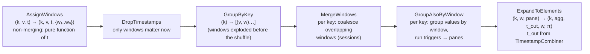

# 03 · Windowing Internals: Merging, Panes, Accumulation, and Retractions

> **Folder:** `01-First-Principles-and-The-Dataflow-Model/` · **File 3 of 3**
> **Anchoring papers:** Akidau et al., *The Dataflow Model* (VLDB 2015), §2.2–2.4 (windowing, triggers, accumulation,
> retractions) · Li et al., *No Pane, No Gain: Efficient Evaluation of Sliding-Window Aggregates over Data Streams*
> (SIGMOD Record 2005) · Tangwongsan et al., *General Incremental Sliding-Window Aggregation* (VLDB 2015) · Traub et
> al., *Scotty: Efficient Window Aggregation for Out-of-Order Stream Processing* (ICDE 2018) · Begoli et al., *One SQL
> to Rule Them All* (SIGMOD 2019).
> **Prev:** [02 · Watermark calculus](02-watermark-calculus-monotonicity-idleness-and-hold-locks.md) · **Next folder:**
> `02-Apache-Beam-Execution-and-Portability-Internals/`

---

## 0. The thesis

A window extends the grouping key into event time. A trigger is a state machine that decides when a $(k, w)$ group is
emitted as a **pane**. The accumulation mode is a contract with the consumer about what successive panes mean. Three hard
problems live in the seams:

1. **Merging windows** (sessions) make the grouping key itself mutable. State must be re-addressed when windows coalesce,
   and previously emitted results can become wrong.
2. **Repeated panes** turn one logical result into a *changelog*. The consumer must be able to apply it, and the bytes
   emitted can grow quadratically.
3. **Retractions** are the only fully general way to make a changelog self-correcting. They are cheap only when the
   aggregate has an inverse, which is why Flink SQL has them and Beam doesn't.

---

## 1. First principles: GroupByKeyAndWindow, decomposed

The Dataflow paper defines windowed grouping as `AssignWindows` followed by a five-step composite, **GroupByKeyAndWindow**.
Seeing the steps explains every runtime behavior that follows:



Runtime mapping:

| Paper step | Beam runner implementation | Flink DataStream implementation |
|------------|----------------------------|---------------------------------|
| AssignWindows | `Window.into(WindowFn)` → `WindowFn.assignWindows`, carried on `WindowedValue` | `WindowAssigner.assignWindows` *inside* `WindowOperator` (after `keyBy`) |
| GroupByKey | Shuffle (Dataflow Shuffle / Windmill / Flink exchange) on the key | `keyBy` hash-partitioning into key groups |
| MergeWindows | `MergingActiveWindowSet` + `WindowFn.mergeWindows` in `ReduceFnRunner` | `MergingWindowSet` + `MergingWindowAssigner.mergeWindows` |
| GroupAlsoByWindow | `ReduceFnRunner` (runners-core): buffers per (key, window), drives `TriggerStateMachine`s | `WindowOperator` keyed state with window as namespace, `Trigger` per window |
| ExpandToElements | `ReduceFnRunner.onTrigger` → output with `PaneInfo` + hold-derived timestamp | `emitWindowContents` → output stamped `window.maxTimestamp()` |

The key observation: **after MergeWindows, the window is part of the state address.** Everything about state cost,
merging cost, and garbage collection is "per $(k, w)$".

---

## 2. Window function contracts

### 2.1 Beam `WindowFn<T, W extends BoundedWindow>`

| Method | Purpose | Gotchas |
|--------|---------|---------|
| `assignWindows(AssignContext)` | element (+ timestamp, + existing windows) → windows | `AssignContext.element()` is available, so windows *can* depend on the element (e.g., a per-customer time zone) |
| `mergeWindows(MergeContext)` | given the key's current windows, call `merge(toBeMerged, result)` | Must be deterministic. Must only merge windows that are "the same session". |
| `isNonMerging()` | enables optimizations; non-merging `WindowFn`s extend `NonMergingWindowFn` | Stateful `DoFn` **requires** non-merging windows (state can't be merged generically) |
| `windowCoder()` | encodes windows on the wire and in state | Part of the update-compatibility contract (Folder 07) |
| `getDefaultWindowMappingFn()` | maps a main-input window to a side-input window | Sessions throw: merging windows can't be side-input windows |
| `assignsToOneWindow()` | lets runners avoid window explosion bookkeeping | Fixed/sessions: true. Sliding: false. |
| `isCompatible` / `verifyCompatibility` | `Flatten`/`CoGroupByKey` require compatible windowing on all inputs | Mismatched windowing across join inputs fails at construction |

### 2.2 Flink `WindowAssigner<T, W extends Window>`

| Method | Purpose |
|--------|---------|
| `assignWindows(element, timestamp, context)` | element → windows |
| `getDefaultTrigger()` | `EventTimeTrigger` for event-time assigners, `ProcessingTimeTrigger` otherwise |
| `getWindowSerializer(...)` | window serializer (state namespace) |
| `isEventTime()` | toggles lateness and cleanup semantics |
| `MergingWindowAssigner.mergeWindows(windows, callback)` | session-style merging |

### 2.3 Per-element cost of assignment

| Window type | Windows per element | Beam wire metadata per element (file 01 §6.1) | Flink state copies per element |
|-------------|---------------------|-----------------------------------------------|--------------------------------|
| Fixed | 1 | 24 B | 1 (or 1 accumulator update) |
| Sliding $w/s$ | $w/s$ | 24 B × $w/s$ after explosion | **$w/s$ copies** (each window is its own namespace: `ListState` holds a copy, `AggregatingState` updates $w/s$ accumulators) |
| Sessions | 1 proto-window, then merges | 24 B | 1, plus merge copies |
| Global | 1 | 13 B | 1 |

**Flink's DataStream sliding windows duplicate the element into every window's state.** A 24 h/1 min sliding window with
a `ProcessWindowFunction` (no incremental aggregation) stores every element 1,440 times. Flink SQL's window TVFs avoid
this with *slicing* (§8).

---

## 3. Merging internals

### 3.1 Why merging is hard

For non-merging windows, $(k, w)$ is immutable: state for the address is created, updated, fired, and garbage-collected.
With sessions, a new element can make two existing addresses **become one**. The runner must then:

1. Decide which windows merge (the `WindowFn`'s job).
2. Re-address state: buffers, accumulators, **watermark holds**, **trigger state**, and **timers** all have to move to
   the merged window.
3. Re-evaluate the trigger for the merged window, which may fire immediately.
4. Deal with the fact that panes already emitted for the old windows are now semantically superseded (§7.5).

### 3.2 Beam: `MergingActiveWindowSet` and state-address indirection

Beam's `ReduceFnRunner` tracks, per key, which windows are **ACTIVE** (have state) and which are **NEW** (just assigned in
this bundle). To avoid physically renaming state on every merge, it maintains an indirection from each *logical* active
window to the set of **state address windows** under which its state physically lives. The merge proceeds in five steps:

1. New proto-windows from this bundle are added to the active set.
2. `WindowFn.mergeWindows` runs over all active and new windows. `MergeOverlappingIntervalWindows` sorts by start and
   sweeps (O(n log n) in the key's live window count).
3. For each merge `(toBeMerged → result)`, the `MergingActiveWindowSet` records `result` with the union of the merged
   windows' state addresses.
4. `ReduceFnRunner.onMerge` invokes the callbacks:
   - `ReduceFn.onMerge` merges buffers/accumulators (`StateMerging.mergeBags`, `mergeCombiningValues`).
   - `TriggerStateMachineRunner.onMerge` merges trigger state.
   - `WatermarkHold.onMerge` combines holds via `TimestampCombiner.merge`, so the merged hold is the min under `EARLIEST`
     or the new end-of-window under `END_OF_WINDOW`.
   - End-of-window and GC timers are re-set for the merged window.
5. The window set is persisted with the key's state (system tag ⚠ verify the exact tag names in your runners-core
   version).

| State type | Merge semantics | Cost |
|------------|-----------------|------|
| `BagState` (buffered elements) | union; may stay at multiple addresses until read, or be copied into one | read and write of all merged elements if physically merged |
| `CombiningState` (accumulator) | `mergeAccumulators` | O(1) reads + 1 write |
| `WatermarkHoldState` | `TimestampCombiner.merge` | O(1) |
| `ValueState` | **not mergeable** | This is why `ParDo` with state/timers rejects merging windows. Do sessionization in the global window yourself (Folder 07). |
| Trigger finished bits | OR / per-trigger rules | O(1) |

### 3.3 Flink: `MergingWindowSet` and the "state window"

Flink's `WindowOperator` with a `MergingWindowAssigner` keeps, **per key**, a mapping `window → stateWindow` persisted as
keyed `ListState<Tuple2<W, W>>`. When windows merge, Flink picks the state window of one of the merged windows as the
physical namespace for the result, so it doesn't have to rename it. It then:

1. calls `windowMergingState.mergeNamespaces(stateWindowResult, mergedStateWindows)`, which copies or merges the *other*
   namespaces into the chosen one;
2. calls `trigger.onMerge(...)`, which requires `canMerge() == true` or the job fails;
3. calls `triggerContext.clear()` and deletes the cleanup timer for each merged-away window;
4. re-registers the cleanup timer for the merged window.

Stale timers from merged-away windows can still fire. `WindowOperator` looks up the state window, finds none, and ignores
them.

Costs an L7 engineer should be able to estimate:

- **Per element on a merging assigner:** read the whole per-key mapping list, compute merges, write it back if it changed.
  That's O(open sessions for the key) of (de)serialization *per element*. Hot keys with thousands of open sessions (a bot,
  or a high-cardinality "session per device per key" design with long lateness) spend most of their CPU here.
- **Per merge on RocksDB:** `mergeNamespaces` reads each source namespace's value and writes into the target. For
  `ListState` it appends through the RocksDB merge operator and deletes the sources. A bridging element that merges $m$
  sessions holding $n$ total buffered elements costs O(n) bytes of read and write, plus later compaction.
- **Per-window state in `ProcessWindowFunction.Context.windowState()` is not supported with merging windows.** Flink
  throws when you access it. Pane bookkeeping for sessions needs global state keyed by window bounds (§9.5).

### 3.4 Worked example: a bridging element

Gap $g$ = 5 min. Elements for key `u42` arrive in the order shown:

| Step | Arrives (event time) | Proto-window | Active windows after merge | State moves | Notes |
|------|----------------------|--------------|----------------------------|-------------|-------|
| 1 | 12:00 | [12:00, 12:05) | {[12:00, 12:05)} | — | EOW timer at 12:04:59.999 |
| 2 | 12:02 | [12:02, 12:07) | {[12:00, 12:07)} | merge 2 → 1 | EOW timer moved to 12:06:59.999 |
| 3 | 12:09 | [12:09, 12:14) | {[12:00, 12:07), [12:09, 12:14)} | — | two sessions |
| — | watermark passes 12:07 | — | — | — | **ON_TIME pane for [12:00, 12:07) = 2 events** |
| 4 | 12:05 (*late, within lateness*) | [12:05, 12:10) | {[12:00, 12:14)} | **merge 3 → 1** (bridges both) | the session already emitted as [12:00, 12:07) is now *superseded* by [12:00, 12:14) |

```
event time ─►  12:00   12:02   12:05   12:07   12:09   12:10       12:14
               ├─────────────┤ [12:00,12:05)
                       ├─────────────┤ [12:02,12:07)
               ├─────────────────────┤ merged [12:00,12:07)  ── fired ON_TIME (count = 2)
                                               ├─────────────────────┤ [12:09,12:14)
                               ├─────────────────────┤ [12:05,12:10)  ← late bridge
               ├─────────────────────────────────────────────────────┤ merged [12:00,12:14) (count = 4)
```

Step 4 is the crux of §7.5. What the consumer sees depends entirely on the accumulation mode.

### 3.5 Unbounded sessions and the case for caps

A key with continuous activity (bots, health checks, a stuck client retrying every second) never has a gap ≥ $g$, so its
session never closes:

- The EOW timer keeps moving, so **the ON_TIME pane never fires**.
- Under `TimestampCombiner.EARLIEST`, the GBK's output watermark is **held at the session start forever** (file 02 §7.2),
  which stalls every downstream event-time operation for every key.
- Buffered state (or the accumulator, plus merge overhead) grows without bound.

Two capping strategies:

| Strategy | Mechanism | Deterministic under replay? |
|----------|-----------|-----------------------------|
| Greedy cap during merge | refuse merges that would exceed `maxLength` | **No.** Which windows exist at merge time depends on arrival order, so boundaries differ across replays. |
| **Epoch-clipped sessions** | clip each proto-window at fixed epoch boundaries (e.g., every 4 h UTC); merge normally | **Yes.** The transitive closure within each epoch is unique. Sessions are force-split at epoch boundaries. |

The epoch approach (§9.3) is the production choice. You trade an artificial split at boundaries for determinism and a hard
bound on state and holds.

---

## 4. Triggers: the pane-production state machine

### 4.1 Grammar

```
Trigger      ::= AfterWatermark.pastEndOfWindow() [.withEarlyFirings(T)] [.withLateFirings(T)]
               | AfterProcessingTime.pastFirstElementInPane() [.plusDelayOf(d)] [.alignedTo(p)]
               | AfterPane.elementCountAtLeast(n)
               | AfterSynchronizedProcessingTime          (internal: continuation of processing-time triggers)
               | Repeatedly.forever(T)
               | AfterEach.inOrder(T, T, …)
               | AfterFirst.of(T, T, …)  |  AfterAll.of(T, T, …)
               | T.orFinally(T)
               | Never.ever()  |  DefaultTrigger
```

At pipeline construction, Beam SDK triggers are translated to a portable proto. Runners then rebuild them as
**`TriggerStateMachine`s** (runners-core). The SDK `Trigger` classes describe; the state machines execute.

### 4.2 Lifecycle per (key, window)

```mermaid
stateDiagram-v2
    [*] --> Early : first element creates window
    Early --> Early : early sub-trigger fires → EARLY pane
    Early --> OnTimeFired : IWM > maxTs → ON_TIME pane (if non-empty, or FIRE_ALWAYS)
    OnTimeFired --> Late : late element buffered
    Late --> Late : late sub-trigger fires → LATE pane
    OnTimeFired --> Closed : GC timer (IWM > maxTs + lateness)
    Late --> Closed : GC timer → final pane if FIRE_ALWAYS or non-empty
    Early --> Closed : a NON-repeating trigger finishes (window CLOSED early)
    Closed --> [*] : state cleared; data for this window is dropped (droppedDueToClosedWindow)
```



The runner loop in `ReduceFnRunner`:

1. **On element:**
   - Merge windows if the `WindowFn` merges.
   - For each window: if the window is closed (trigger finished), drop and count the element. Otherwise buffer it, add
     holds, and call `trigger.onElement`.
   - If `shouldFire`, emit a pane (`onTrigger`) and then call `trigger.onFire`.
   - If the trigger is now finished, mark the window closed and clear its buffers.
2. **On timer:**
   - EOW timer: evaluate the watermark trigger (the ON_TIME pane).
   - GC timer: emit the final pane if needed, then **clear everything** (buffers, holds, trigger state, pane tracker,
     closed bits).
   - Processing-time trigger timers: re-evaluate `shouldFire`.

### 4.3 The finished-trigger footgun

A trigger that can **finish** (anything not wrapped in `Repeatedly.forever`, and not `AfterWatermark` with late firings)
closes the window permanently on its first firing. Every subsequent element for that window is dropped, counted only in
`droppedDueToClosedWindow`.

```java
// Fires ONCE at 100 elements, then closes the window: element #101 onward vanishes.
Window.<KV<String, Long>>into(FixedWindows.of(Duration.standardHours(1)))
    .triggering(AfterPane.elementCountAtLeast(100))
    .withAllowedLateness(Duration.ZERO)
    .discardingFiredPanes();
```

`AfterWatermark.pastEndOfWindow()` alone also finishes once it fires. With allowed lateness > 0 and no late firings, the
window is closed after the ON_TIME pane and late data is dropped even though you "allowed" lateness. **Rule: in streaming,
every trigger is either `Repeatedly.forever(...)` or `AfterWatermark` with explicit late firings.**

### 4.4 Trigger cost: timers and state per (key, window)

| Trigger | Timers per (k, w) | Extra state per (k, w) |
|---------|-------------------|------------------------|
| `AfterWatermark` (no early/late) | EOW (+ GC if lateness > 0) | finished bits |
| `.withEarlyFirings(AfterProcessingTime…plusDelayOf(d))` | + 1 processing-time timer per pending early pane | delay target |
| `AfterPane.elementCountAtLeast(n)` | 0 | element count |
| `Repeatedly.forever(AfterProcessingTime…)` in global window | 1 processing-time timer per key, re-armed per pane | delay target |

Processing-time timers scale with **active (k, w) pairs**, not with throughput. 50M keys × 2 open windows × an early
firing timer is 100M processing-time timers in Windmill or RocksDB, each firing every $d$ seconds. Early firings are
billed per key, not per byte.

### 4.5 Flink mapping

Flink triggers return a `TriggerResult`: `CONTINUE`, `FIRE`, `PURGE`, or `FIRE_AND_PURGE`. Differences from Beam:

- **No "finished" concept.** A Flink window lives until its cleanup time (`maxTimestamp + allowedLateness`). Triggers
  can't close it early. They can only purge contents.
- **Accumulation is a trigger result, not a window property.** `FIRE` keeps state (accumulating). `FIRE_AND_PURGE` clears
  it (discarding).
- **Replacing the trigger replaces the default.** `.trigger(ContinuousProcessingTimeTrigger.of(...))` *removes* the
  end-of-window `EventTimeTrigger` unless your trigger also fires at `maxTimestamp`. §9.4 has a correct composite.
- **Pane metadata doesn't exist.** Emulate it with per-window state in `ProcessWindowFunction` (non-merging only, §9.4).

---

## 5. Panes

### 5.1 `PaneInfo`

| Field | Meaning |
|-------|---------|
| `isFirst()` | first pane emitted for this (k, w) |
| `isLast()` | no more panes will be emitted (the GC firing, or a finished trigger) |
| `getTiming()` | `EARLY`, `ON_TIME`, `LATE`, `UNKNOWN` |
| `getIndex()` | 0-based count of panes emitted for this (k, w), **deterministic and committed with state** |
| `getNonSpeculativeIndex()` | −1 for EARLY panes; 0 for ON_TIME; 1, 2, … for subsequent LATE panes |

**Timing rule** (runners-core `PaneInfoTracker`):

- `EARLY` while the input watermark hasn't passed `maxTs(w)`.
- `ON_TIME` for the first non-early pane *if the output watermark hasn't passed `maxTs(w)`*. The end-of-window hold
  normally guarantees this.
- `LATE` otherwise.

Consequence: a window whose *first* data arrives after its end gets a **LATE** first pane, never ON_TIME.

**Encoding** (`PaneInfoCoder`): one header byte packs (isFirst, isLast, timing, encoding kind), followed by 0, 1, or 2
varints. The first pane needs no index (1 byte). Typical panes add one index varint. Panes where index ≠ non-speculative
index carry two. Panes are nearly free on the wire. **Use the index downstream.**

### 5.2 Pane state per (key, window)

What a runner stores for one open window of a windowed `Combine`/GBK:

| State | Beam (`ReduceFnRunner`) | Flink (`WindowOperator`) | Size |
|-------|-------------------------|--------------------------|------|
| Contents | Bag of values, or combining accumulator | `ListState` / `ReducingState` / `AggregatingState` in namespace = window | O(n) or O(1) |
| Element hold | `WatermarkHoldState` by `TimestampCombiner` | — | 8–16 B |
| EOW / GC hold | extra hold state | — | 8–16 B |
| Trigger state | per-sub-trigger state + finished bits | trigger's partitioned state (user-defined) | small |
| Pane tracker | last `PaneInfo` | — (emulate) | ~4 B |
| Non-empty-pane counter | count of elements since the last firing (for `FIRE_IF_NON_EMPTY`) | — | ~4 B |
| Merging window set | per key: active windows → state addresses | per key: `ListState<Tuple2<W, W>>` | O(open sessions) |
| Timers | EOW, GC, processing-time delays | trigger timer at `maxTs`, cleanup at `maxTs + lateness` (deduplicated when equal) | ~2 per (k, w) |

Plus the **key and window bytes in every state key**. In RocksDB each entry is `[key-group][key][namespace(window)][state
name]`, so a 16 B user key with a 16 B window namespace can make the *addressing* larger than an 8 B accumulator. Folder
04 covers RocksDB key layout.

### 5.3 Firing sequence example

Fixed window [12:00, 12:05), early firings every 30 s of processing time after the first element, late firings per minute,
allowed lateness 2 h, accumulating.

| Proc time | Event | IWM | Pane | Timing | index | nonSpecIndex | Emitted (accumulating) |
|-----------|-------|-----|------|--------|-------|--------------|------------------------|
| 12:01:10 | +5 | 11:59 | — | — | — | — | — |
| 12:01:40 | (early timer) | 12:00 | #0 | EARLY | 0 | −1 | 5 |
| 12:03:00 | +7 | 12:02 | — | — | — | — | — |
| 12:03:30 | (early timer) | 12:02 | #1 | EARLY | 1 | −1 | 12 |
| 12:05:20 | +3 | 12:04 | — | — | — | — | — |
| 12:07:00 | (watermark passes 12:05) | 12:05 | #2 | ON_TIME | 2 | 0 | 15 |
| 12:31:00 | +4 (late) | 12:29 | — | — | — | — | — |
| 12:32:00 | (late timer) | 12:30 | #3 | LATE | 3 | 1 | 19 |
| 14:07:00 | (GC: IWM > 14:04:59.999) | 14:05 | — | — | — | — | state cleared (no final pane under `FIRE_IF_NON_EMPTY`) |

### 5.4 `OnTimeBehavior` × `ClosingBehavior`

| Setting | Values | Effect |
|---------|--------|--------|
| `Window.OnTimeBehavior` | `FIRE_ALWAYS` (default) / `FIRE_IF_NON_EMPTY` | Whether an ON_TIME pane is emitted when no new data arrived since the last (early) pane. `FIRE_ALWAYS` gives the consumer a definitive ON_TIME marker. `FIRE_IF_NON_EMPTY` saves writes. |
| `Window.ClosingBehavior` | `FIRE_IF_NON_EMPTY` (default) / `FIRE_ALWAYS` | Whether a final pane is emitted at GC time when empty. `FIRE_ALWAYS` gives an explicit `isLast()` pane per window (useful for "finalize" semantics), at the cost of one write per window. |

At 50M keys × 288 windows/day, each "always" choice is about 14.4B extra sink writes per day. Choose `FIRE_ALWAYS` only
when the consumer actually needs the marker.

---

## 6. Accumulation modes: formal definitions

Let pane $i$ of window $w$ cover the elements $V_i$ that arrived since pane $i-1$. Let $A_i = V_1 \cup \dots \cup V_i$, and
let $f$ be the aggregate.

$$
\textbf{Discarding:}\quad \mathrm{out}_i = f(V_i)
$$

$$
\textbf{Accumulating:}\quad \mathrm{out}_i = f(A_i)
$$

$$
\textbf{Accumulating \& retracting:}\quad \mathrm{out}_i = \big\{\, -f(A_{i-1}),\; +f(A_i) \,\big\}\quad (\text{the retraction is omitted for } i = 1)
$$

### 6.1 What each mode demands of the consumer

| Mode | Consumer operation | Algebraic requirement on $f$ / consumer | Idempotence under redelivery |
|------|--------------------|------------------------------------------|------------------------------|
| Discarding | $\mathrm{result} = \bigoplus_i \mathrm{out}_i$ | $f$ **decomposable**, $f(A \cup B) = f(A) \oplus f(B)$, with $\oplus$ a commutative monoid | **No.** Re-applying a pane double-counts, so you need exactly-once delivery or dedup by `(k, w, paneIndex)`. |
| Accumulating | $\mathrm{result} = \mathrm{out}_{\max i}$ (last writer by pane index) | none on $f$; the consumer needs a **versioned upsert** | **Yes**, if guarded by pane index |
| Retracting | $\mathrm{result} \mathrel{+}= \mathrm{out}_i$ (signed) | an inverse (abelian group), or multiset state in the consumer for non-invertible aggregates | **No.** Needs exactly-once or dedup. |

**Accumulating + pane-index-versioned upsert is the only combination that is correct under at-least-once delivery for
any aggregate.** That's why it's the default recommendation for sinks (§9.2).

### 6.2 Worked example

Window [12:00, 12:02), elements arrive: 5 (early pane), then 7 and 3 (on-time pane), then 4 (late pane). $f$ = SUM.

| Pane | Timing | New elements | Discarding | Accumulating | Accumulating & retracting |
|------|--------|--------------|------------|--------------|---------------------------|
| 0 | EARLY | {5} | **5** | **5** | **+5** |
| 1 | ON_TIME | {7, 3} | **10** | **15** | **−5, +15** |
| 2 | LATE | {4} | **4** | **19** | **−15, +19** |
| Consumer **sums** all panes | | | 19 ✅ | 39 ❌ | 19 ✅ |
| Consumer **keeps last** | | | 4 ❌ | 19 ✅ | 19 ✅ |

Retracting is correct under both consumer behaviors. That's its whole value, and it costs more messages and requires an
inverse.

### 6.3 Cost model

Let $n$ = panes per window and $m$ = new elements per pane (uniform for simplicity).

| Mode | State held between firings | Elements/bytes emitted over the window's life | Sink operations |
|------|---------------------------|-----------------------------------------------|-----------------|
| Discarding (combine) | accumulator reset per pane | $n$ accumulators | $n$ appends |
| Discarding (GBK, iterable) | buffer reset per pane | $n \cdot m$ elements total (each element once) | $n$ appends |
| Accumulating (combine) | **full accumulator until GC** | $n$ accumulators | $n$ upserts |
| **Accumulating (GBK, iterable)** | **all elements until GC** | $\sum_{i=1}^{n} i\,m = m \cdot \frac{n(n+1)}{2}$ (**quadratic**) | $n$ upserts of growing size |
| Retracting (combine) | full accumulator + last emitted value | $2n - 1$ accumulators | $2n - 1$ signed ops |

**The quadratic trap, quantified.** A 1-day window with early firings every 10 s gives $n$ = 8,640. At $m$ = 100
elements per pane per key, total emitted elements per key-day are

$$
100 \cdot \frac{8640 \cdot 8641}{2} \approx 3.7 \times 10^{9}
$$

against $8.6 \times 10^{5}$ actual elements: roughly **4,300× amplification**. With a combine it's 8,640 small
accumulators, which is fine. **Never use accumulating mode with a non-combining `GroupByKey` and frequent early firings.**

### 6.4 State retention: the hidden cost of accumulating

Accumulating keeps the full accumulator or buffer until GC time $= \mathrm{maxTs}(w) + \lambda$. For combinable aggregates
that's small per window but multiplied by $(\lambda / w + 1)$ open windows per key (file 01, Q2). Discarding mode doesn't
eliminate retention: the window still needs trigger state, holds, and timers until GC, so it can label late panes and
drop data correctly. It just doesn't keep the *contents*.

---

## 7. Merging windows × accumulation: why retractions were invented

Replay §3.4 (session [12:00, 12:07) fires with count 2, then a late bridge merges everything into [12:00, 12:14) with
count 4) under each mode:

| Mode | Panes emitted | What a consumer upserting by (k, w) ends up with | Correct? |
|------|---------------|---------------------------------------------------|----------|
| Discarding | ([12:00, 12:07), **2**), then ([12:00, 12:14), **2**). The merged window's buffer holds only post-firing data. | two rows, summing to 4, under **different keys** | Only if the consumer merges overlapping windows itself |
| Accumulating | ([12:00, 12:07), **2**), then ([12:00, 12:14), **4**) | two rows: stale 2 and new 4, which **double-counts to 6** if summed | ❌ unless the consumer deletes overlapping sessions |
| Accumulating & retracting | ([12:00, 12:07), **2**), then **−([12:00, 12:07), 2)**, **+([12:00, 12:14), 4)** | one row: 4 | ✅ |

This is the Dataflow paper's motivating example for retractions. Once windows can merge, a correct changelog must be able
to **delete results under keys that no longer exist**. Accumulation alone can't express "the old window is gone".

### 7.1 Retractions in practice

| System | Status | Mechanism |
|--------|--------|-----------|
| Beam | Not implemented in production runners. The portability proto reserves a `RETRACTING` accumulation mode ⚠ verify. | Emulate at the edges (§9.5) |
| Flink SQL / Table API | **Pervasive** | Every row carries a `RowKind`: `+I` insert, `-U` update-before, `+U` update-after, `-D` delete |
| Kafka Streams | KTable semantics | Upserts by key, tombstones for deletes. No general retraction of *derived* windows. |
| Spark Structured Streaming | `update` output mode | Upsert semantics. No retraction of superseded session windows. |

**Why Flink SQL can and Beam can't.** Retraction must flow through *every* downstream operator.

- **Relational operators have defined inverses or multiset semantics.**
  - `SUM`/`COUNT` subtract.
  - `MAX`/`MIN` keep a multiset: Flink's `MaxWithRetractAggFunction` stores value → count in a `MapView`, so a
    retracted max can fall back to the next value.
  - Joins retract matched rows.
- **A Beam `ParDo` is arbitrary user code.** Retracting its output would require it to be deterministic and invertible,
  or the runner would have to remember every output to re-emit negations. It would also double message volume
  everywhere, and every sink would need delete semantics.

The cost Flink pays for this generality:

- `-U`/`+U` pairs double traffic. Mini-batch (`table.exec.mini-batch.*`) folds updates per key to cut retraction volume.
- Non-invertible aggregates need multiset state.
- Upsert sinks with keys that differ from the changelog's upsert key need `SinkUpsertMaterializer`, which keeps per-key
  row history to resolve out-of-order changes.

---

## 8. Sliding windows done right: slicing

### 8.1 The amplification problem

A 24 h window sliding every 1 min ($w/s$ = 1,440):

| Approach | Per-element work | Shuffle bytes | State per key |
|----------|------------------|---------------|---------------|
| Beam `SlidingWindows` + `Combine` | 1,440 accumulator updates (combiner lifting helps only within a bundle) | up to 1,440 partials per key per bundle | 1,440 accumulators |
| Flink `SlidingEventTimeWindows` + `aggregate` | 1,440 `AggregatingState` updates | 1 (windows assigned after `keyBy`) | 1,440 accumulators |
| Flink `SlidingEventTimeWindows` + `process` (no incremental agg) | **1,440 element copies** | 1 | 1,440 × elements |
| **Slicing** (pane-based) | **1 slice update** | 1 slice partial per (k, minute) | 1,440 slice partials + running aggregate |

### 8.2 The slicing idea (Li et al. 2005; Flink SQL window TVFs; Scotty)

Partition event time into non-overlapping **slices** of length $\gcd(w, s)$ (here 1 min). Each element updates exactly one
slice. A window is the combine of its slices:

$$
\mathrm{agg}\big([T - w, T)\big) = \bigoplus_{j=0}^{w/s - 1} \mathrm{slice}_{T - (j+1)s}
$$

- **Invertible $\oplus$** (sum, count): keep a running total. Add the new slice, subtract the evicted one. O(1) per
  slide.
- **Non-invertible $\oplus$** (max, sketches): use a two-stacks queue or FlatFAT (Tangwongsan et al. 2015). Amortized
  O(1) or O(log n) per slide without recomputing all slices.
- Flink SQL `HOP`/`CUMULATE` window TVF aggregations use slice assigners internally, so the SQL path avoids DataStream's
  per-window duplication.

§9.6 implements subtract-on-evict slicing in Beam with a stateful `DoFn`.

---

## 9. Production Java 21 code blueprints

### 9.1 Beam anti-patterns: four windowing bugs

```java
// (A) One-shot trigger: fires at 100 elements, FINISHES, CLOSES the window → element #101+ silently dropped.
.apply(Window.<KV<String, Long>>into(FixedWindows.of(Duration.standardHours(1)))
    .triggering(AfterPane.elementCountAtLeast(100))
    .withAllowedLateness(Duration.ZERO)
    .discardingFiredPanes())

// (B) Quadratic output: accumulating GroupByKey (no combine) with early panes every 10 s on a 1-day window.
.apply(Window.<KV<String, Event>>into(FixedWindows.of(Duration.standardDays(1)))
    .triggering(AfterWatermark.pastEndOfWindow()
        .withEarlyFirings(AfterProcessingTime.pastFirstElementInPane().plusDelayOf(Duration.standardSeconds(10))))
    .withAllowedLateness(Duration.standardHours(6))
    .accumulatingFiredPanes())
.apply(GroupByKey.create())          // each pane re-emits the ENTIRE growing Iterable<Event>

// (C) 1,440× amplification of shuffle bytes and accumulator updates.
.apply(Window.<KV<String, Long>>into(SlidingWindows.of(Duration.standardHours(24)).every(Duration.standardMinutes(1))))
.apply(Sum.longsPerKey())

// (D) Uncapped sessions + EARLIEST: bots never close sessions, and EARLIEST holds every downstream watermark.
.apply(Window.<KV<String, Long>>into(Sessions.withGapDuration(Duration.standardMinutes(30)))
    .withTimestampCombiner(TimestampCombiner.EARLIEST))
```

### 9.2 Beam: pane-versioned idempotent upsert, correct under retries and reordering

Accumulating panes plus a **conditional upsert guarded by `(epoch, paneIndex)`** converge to the final value regardless
of delivery order, duplicates, or parallel writers:

- **Pane index** is deterministic and committed with state, so a retried bundle re-emits the same index.
- **Epoch** covers the case pane index can't: a *replacement* job (drain + new job rather than `--update`) restarts pane
  indices at 0 for windows that already have rows.

```java
package dev.l7.dataflow.windowing;

import dev.l7.dataflow.time.EventTimeCampaignCounts;
import java.sql.Timestamp;
import org.apache.beam.sdk.io.jdbc.JdbcIO;
import org.apache.beam.sdk.transforms.PTransform;
import org.apache.beam.sdk.values.PCollection;
import org.apache.beam.sdk.values.PDone;

/** Sink for file 01's WindowedCount stream: ON CONFLICT … WHERE (stored version) < (incoming version). */
public final class PaneVersionedUpsert
    extends PTransform<PCollection<EventTimeCampaignCounts.WindowedCount>, PDone> {

  private static final String UPSERT_SQL = """
      INSERT INTO campaign_counts AS t
             (campaign_id, window_start, window_end, cnt, job_epoch, pane_index, timing, is_final)
      VALUES (?, ?, ?, ?, ?, ?, ?, ?)
      ON CONFLICT (campaign_id, window_start) DO UPDATE
         SET window_end = EXCLUDED.window_end,
             cnt        = EXCLUDED.cnt,
             job_epoch  = EXCLUDED.job_epoch,
             pane_index = EXCLUDED.pane_index,
             timing     = EXCLUDED.timing,
             is_final   = EXCLUDED.is_final
       WHERE (t.job_epoch, t.pane_index) < (EXCLUDED.job_epoch, EXCLUDED.pane_index)
      """;

  private final JdbcIO.DataSourceConfiguration dataSource;
  private final long jobEpoch;   // bump on every NON-update redeploy (drain + new job); keep on --update

  public PaneVersionedUpsert(JdbcIO.DataSourceConfiguration dataSource, long jobEpoch) {
    this.dataSource = dataSource;
    this.jobEpoch = jobEpoch;
  }

  @Override
  public PDone expand(PCollection<EventTimeCampaignCounts.WindowedCount> counts) {
    final long epoch = jobEpoch;
    return counts.apply("ConditionalUpsert", JdbcIO.<EventTimeCampaignCounts.WindowedCount>write()
        .withDataSourceConfiguration(dataSource)
        .withStatement(UPSERT_SQL)
        .withBatchSize(500)
        .withPreparedStatementSetter((wc, ps) -> {
          ps.setString(1, wc.campaignId());
          ps.setTimestamp(2, new Timestamp(wc.windowStart().getMillis()));
          ps.setTimestamp(3, new Timestamp(wc.windowEnd().getMillis()));
          ps.setLong(4, wc.count());
          ps.setLong(5, epoch);
          ps.setLong(6, wc.paneIndex());
          ps.setString(7, wc.timing().name());
          ps.setBoolean(8, wc.isLast());
        }));
  }
}
```

Why each piece is there:

| Element | Failure it prevents |
|---------|---------------------|
| `ON CONFLICT … DO UPDATE` | duplicates from at-least-once retries become no-ops or overwrites |
| `WHERE (epoch, pane) < (EXCLUDED…)` | a stale pane delivered late (retry, parallel writer) can't regress the row |
| `job_epoch` | a replacement job's pane 0 can't be rejected forever by the old job's pane 37. (The replayed epoch may briefly write a less complete value until replay catches up. That's acceptable and convergent.) |
| `is_final` / `timing` | consumers can distinguish speculative values (EARLY) from settled ones |
| Batching (500) | amortizes round trips. The version guard makes intra-batch reordering harmless. |

### 9.3 Beam: deterministic, capped sessions (epoch-clipped)

```java
package dev.l7.dataflow.windowing;

import java.util.Collection;
import java.util.List;
import java.util.Objects;
import org.apache.beam.sdk.coders.Coder;
import org.apache.beam.sdk.transforms.windowing.IncompatibleWindowException;
import org.apache.beam.sdk.transforms.windowing.IntervalWindow;
import org.apache.beam.sdk.transforms.windowing.MergeOverlappingIntervalWindows;
import org.apache.beam.sdk.transforms.windowing.WindowFn;
import org.apache.beam.sdk.transforms.windowing.WindowMappingFn;
import org.joda.time.Duration;
import org.joda.time.Instant;

/**
 * Gap-based sessions that can never exceed {@code epoch} in length and never cross an epoch boundary.
 *
 * Each proto-window [t, t + gap) is clipped at the end of t's epoch. Windows in different epochs can't
 * intersect (half-open intervals touching at the boundary don't overlap), so the standard overlap-merge
 * produces a UNIQUE transitive closure per epoch: identical boundaries under any arrival order or replay.
 * A greedy "refuse merges beyond maxLength" cap is arrival-order dependent; this is not.
 */
public final class EpochCappedSessions extends WindowFn<Object, IntervalWindow> {

  private final Duration gap;
  private final Duration epoch;

  private EpochCappedSessions(Duration gap, Duration epoch) {
    if (!epoch.isLongerThan(gap)) {
      throw new IllegalArgumentException("epoch must be longer than gap");
    }
    this.gap = gap;
    this.epoch = epoch;
  }

  public static EpochCappedSessions of(Duration gap, Duration epoch) {
    return new EpochCappedSessions(gap, epoch);
  }

  @Override
  public Collection<IntervalWindow> assignWindows(AssignContext c) {
    long t = c.timestamp().getMillis();
    long epochMs = epoch.getMillis();
    long epochEnd = t - Math.floorMod(t, epochMs) + epochMs;     // floorMod: correct for negative timestamps
    long end = Math.min(t + gap.getMillis(), epochEnd);
    return List.of(new IntervalWindow(c.timestamp(), new Instant(end)));
  }

  @Override
  public void mergeWindows(MergeContext c) throws Exception {
    MergeOverlappingIntervalWindows.mergeWindows(c);              // sort by start, sweep, merge overlaps
  }

  @Override
  public boolean assignsToOneWindow() {
    return true;
  }

  @Override
  public boolean isCompatible(WindowFn<?, ?> other) {
    return equals(other);
  }

  @Override
  public void verifyCompatibility(WindowFn<?, ?> other) throws IncompatibleWindowException {
    if (!isCompatible(other)) {
      throw new IncompatibleWindowException(other, "EpochCappedSessions with different gap/epoch");
    }
  }

  @Override
  public Coder<IntervalWindow> windowCoder() {
    return IntervalWindow.getCoder();
  }

  @Override
  public WindowMappingFn<IntervalWindow> getDefaultWindowMappingFn() {
    throw new UnsupportedOperationException("Merging windows cannot be used as side-input windows");
  }

  @Override
  public boolean equals(Object o) {
    return o instanceof EpochCappedSessions s && s.gap.equals(gap) && s.epoch.equals(epoch);
  }

  @Override
  public int hashCode() {
    return Objects.hash(gap, epoch);
  }
}
```

Trade-off to state in a design review: sessions spanning an epoch boundary (e.g., 04:00 UTC with 4 h epochs) are split in
two. Choose the epoch so boundaries fall in low-traffic hours for your user base, or carry a `continued_from` flag
downstream if analysts need to stitch them.

### 9.4 Flink: a Beam-equivalent early/on-time/late trigger plus pane metadata

Flink has no `AfterWatermark.withEarlyFirings(...).withLateFirings(...)`, and replacing the trigger drops the default
end-of-window firing. This trigger restores Beam semantics. Accumulation is a constructor choice (`FIRE` vs.
`FIRE_AND_PURGE`):

```java
package dev.l7.dataflow.windowing;

import java.time.Duration;
import org.apache.flink.api.common.state.ReducingState;
import org.apache.flink.api.common.state.ReducingStateDescriptor;
import org.apache.flink.streaming.api.windowing.triggers.Trigger;
import org.apache.flink.streaming.api.windowing.triggers.TriggerResult;
import org.apache.flink.streaming.api.windowing.windows.TimeWindow;

/**
 * EARLY:   processing-time firing `earlyDelay` after the first element of each pane (pastFirstElementInPane).
 * ON_TIME: event-time firing when the watermark reaches window.maxTimestamp().
 * LATE:    one firing per late element while within allowedLateness (WindowOperator drops beyond it).
 */
public final class EarlyOnTimeLateTrigger extends Trigger<Object, TimeWindow> {

  public enum Accumulation { DISCARDING, ACCUMULATING }

  private final long earlyDelayMs;
  private final Accumulation accumulation;
  private final ReducingStateDescriptor<Long> pendingEarlyDesc =
      new ReducingStateDescriptor<>("pending-early-fire", (a, b) -> Math.min(a, b), Long.class);

  private EarlyOnTimeLateTrigger(Duration earlyDelay, Accumulation accumulation) {
    this.earlyDelayMs = earlyDelay.toMillis();
    this.accumulation = accumulation;
  }

  public static EarlyOnTimeLateTrigger of(Duration earlyDelay, Accumulation accumulation) {
    return new EarlyOnTimeLateTrigger(earlyDelay, accumulation);
  }

  private TriggerResult fire() {
    return accumulation == Accumulation.DISCARDING ? TriggerResult.FIRE_AND_PURGE : TriggerResult.FIRE;
  }

  @Override
  public TriggerResult onElement(Object element, long timestamp, TimeWindow window, TriggerContext ctx)
      throws Exception {
    if (window.maxTimestamp() <= ctx.getCurrentWatermark()) {
      return fire();                                         // LATE pane (same rule as Flink's EventTimeTrigger)
    }
    ctx.registerEventTimeTimer(window.maxTimestamp());       // ON_TIME pane (idempotent re-registration)
    ReducingState<Long> pending = ctx.getPartitionedState(pendingEarlyDesc);
    if (pending.get() == null) {                             // first element of a new pane
      long fireAt = ctx.getCurrentProcessingTime() + earlyDelayMs;
      pending.add(fireAt);
      ctx.registerProcessingTimeTimer(fireAt);
    }
    return TriggerResult.CONTINUE;
  }

  @Override
  public TriggerResult onProcessingTime(long time, TimeWindow window, TriggerContext ctx) throws Exception {
    ReducingState<Long> pending = ctx.getPartitionedState(pendingEarlyDesc);
    Long due = pending.get();
    if (due == null || due.longValue() != time) {
      return TriggerResult.CONTINUE;                         // stale timer (e.g., left over from a merge)
    }
    pending.clear();
    // Once the watermark has passed the end, the event-time path owns firing: no "early" panes after on-time.
    return window.maxTimestamp() > ctx.getCurrentWatermark() ? fire() : TriggerResult.CONTINUE;
  }

  @Override
  public TriggerResult onEventTime(long time, TimeWindow window, TriggerContext ctx) throws Exception {
    if (time != window.maxTimestamp()) {
      return TriggerResult.CONTINUE;                         // the WindowOperator's cleanup timer: it handles GC
    }
    cancelPendingEarly(ctx);
    return fire();                                           // ON_TIME pane
  }

  @Override
  public void clear(TimeWindow window, TriggerContext ctx) throws Exception {
    ctx.deleteEventTimeTimer(window.maxTimestamp());
    cancelPendingEarly(ctx);
  }

  @Override
  public boolean canMerge() {
    return true;
  }

  @Override
  public void onMerge(TimeWindow window, OnMergeContext ctx) throws Exception {
    ctx.mergePartitionedState(pendingEarlyDesc);             // keep the earliest pending early deadline
    if (window.maxTimestamp() > ctx.getCurrentWatermark()) { // if already past, onElement fires it (no double fire)
      ctx.registerEventTimeTimer(window.maxTimestamp());
    }
    Long due = ctx.getPartitionedState(pendingEarlyDesc).get();
    if (due != null) {
      ctx.registerProcessingTimeTimer(due);
    }
  }

  private void cancelPendingEarly(TriggerContext ctx) throws Exception {
    ReducingState<Long> pending = ctx.getPartitionedState(pendingEarlyDesc);
    Long due = pending.get();
    if (due != null) {
      ctx.deleteProcessingTimeTimer(due);
      pending.clear();
    }
  }

  @Override
  public String toString() {
    return "EarlyOnTimeLateTrigger(early=" + earlyDelayMs + "ms, " + accumulation + ")";
  }
}
```

And the `PaneInfo` emulation. **Non-merging windows only**, because Flink rejects per-window state for merging assigners:

```java
package dev.l7.dataflow.windowing;

import org.apache.flink.api.common.state.ValueState;
import org.apache.flink.api.common.state.ValueStateDescriptor;
import org.apache.flink.streaming.api.functions.windowing.ProcessWindowFunction;
import org.apache.flink.streaming.api.windowing.windows.TimeWindow;
import org.apache.flink.util.Collector;

public final class PaneAwareEmitter extends ProcessWindowFunction<Long, PaneAwareEmitter.PaneResult, String, TimeWindow> {

  public enum Timing { EARLY, ON_TIME, LATE }

  public record PaneResult(String key, long windowStart, long windowEnd, long value, long paneIndex, Timing timing) {}

  private final ValueStateDescriptor<Long> paneIndexDesc = new ValueStateDescriptor<>("pane-index", Long.class);
  private final ValueStateDescriptor<Boolean> nonEarlySeenDesc = new ValueStateDescriptor<>("non-early-seen", Boolean.class);

  @Override
  public void process(String key, Context ctx, Iterable<Long> aggregate, Collector<PaneResult> out) throws Exception {
    ValueState<Long> paneIndex = ctx.windowState().getState(paneIndexDesc);
    ValueState<Boolean> nonEarlySeen = ctx.windowState().getState(nonEarlySeenDesc);

    long index = paneIndex.value() == null ? 0L : paneIndex.value() + 1;
    paneIndex.update(index);

    Timing timing;
    if (ctx.currentWatermark() < ctx.window().maxTimestamp()) {
      timing = Timing.EARLY;
    } else if (nonEarlySeen.value() == null) {
      // First firing at/after the end. Beam would call it LATE if the window's FIRST data was already late;
      // distinguishing that needs a flag set in the trigger. Documented approximation.
      timing = Timing.ON_TIME;
      nonEarlySeen.update(true);
    } else {
      timing = Timing.LATE;
    }
    out.collect(new PaneResult(key, ctx.window().getStart(), ctx.window().getEnd(),
        aggregate.iterator().next(), index, timing));
  }

  @Override
  public void clear(Context ctx) {
    // Per-window state survives FIRE_AND_PURGE (which purges only contents); it must be cleared at window GC.
    ctx.windowState().getState(paneIndexDesc).clear();
    ctx.windowState().getState(nonEarlySeenDesc).clear();
  }
}
```

Wiring:

```java
SingleOutputStreamOperator<PaneAwareEmitter.PaneResult> panes = clicks
    .keyBy(Click::campaignId)
    .window(TumblingEventTimeWindows.of(Duration.ofMinutes(5)))
    .allowedLateness(Duration.ofHours(2))
    .trigger(EarlyOnTimeLateTrigger.of(Duration.ofSeconds(30), EarlyOnTimeLateTrigger.Accumulation.ACCUMULATING))
    .sideOutputLateData(lateTag)
    .aggregate(new CountAgg(), new PaneAwareEmitter())       // incremental: one accumulator per (key, window)
    .uid("campaign-panes-5m");
// → versioned upsert keyed by (campaign, windowStart), guarded by paneIndex (same contract as §9.2).
```

### 9.5 Beam: emulating retractions for sessions, order-insensitive across shuffles

Beam doesn't retract. This transform turns accumulating session panes into a **changelog** (`Retract` / `Upsert`) that a
downstream relational layer (Flink SQL, BigQuery CDC, Iceberg/Paimon row-level ops) can apply. Two first-principles
details make it correct:

1. **Supersession is encoded in the data, not in arrival order.** Beam doesn't guarantee the order of two panes for the
   same key across a shuffle, so the merged session can arrive *before* a stale pane of one of its parts. Sessions only
   grow, so if a stored session **strictly contains** the incoming one, the incoming one is stale. For the *same* window,
   the higher pane index wins.
2. **State lives in the global window, keyed by user.** Stateful `ParDo` rejects merging windows, so we re-window into
   `GlobalWindows` and manage session bounds ourselves.

```java
package dev.l7.dataflow.windowing;

import java.io.EOFException;
import java.io.IOException;
import java.io.InputStream;
import java.io.OutputStream;
import java.util.ArrayList;
import java.util.List;
import java.util.Map;
import org.apache.beam.sdk.coders.Coder;
import org.apache.beam.sdk.coders.CustomCoder;
import org.apache.beam.sdk.coders.InstantCoder;
import org.apache.beam.sdk.coders.KvCoder;
import org.apache.beam.sdk.coders.StringUtf8Coder;
import org.apache.beam.sdk.coders.VarLongCoder;
import org.apache.beam.sdk.metrics.Counter;
import org.apache.beam.sdk.metrics.Metrics;
import org.apache.beam.sdk.state.MapState;
import org.apache.beam.sdk.state.StateSpec;
import org.apache.beam.sdk.state.StateSpecs;
import org.apache.beam.sdk.state.TimeDomain;
import org.apache.beam.sdk.state.Timer;
import org.apache.beam.sdk.state.TimerSpec;
import org.apache.beam.sdk.state.TimerSpecs;
import org.apache.beam.sdk.state.ValueState;
import org.apache.beam.sdk.transforms.DoFn;
import org.apache.beam.sdk.transforms.PTransform;
import org.apache.beam.sdk.transforms.ParDo;
import org.apache.beam.sdk.transforms.Sum;
import org.apache.beam.sdk.transforms.windowing.AfterPane;
import org.apache.beam.sdk.transforms.windowing.AfterProcessingTime;
import org.apache.beam.sdk.transforms.windowing.AfterWatermark;
import org.apache.beam.sdk.transforms.windowing.GlobalWindows;
import org.apache.beam.sdk.transforms.windowing.IntervalWindow;
import org.apache.beam.sdk.transforms.windowing.PaneInfo;
import org.apache.beam.sdk.transforms.windowing.Repeatedly;
import org.apache.beam.sdk.transforms.windowing.TimestampCombiner;
import org.apache.beam.sdk.transforms.windowing.Window;
import org.apache.beam.sdk.values.KV;
import org.apache.beam.sdk.values.PCollection;
import org.joda.time.Duration;
import org.joda.time.Instant;

/** userId → 1 per event (event-time stamped)  ⟶  changelog of per-session event counts with retractions. */
public final class SessionChangelog extends PTransform<PCollection<KV<String, Long>>, PCollection<SessionChangelog.Change>> {

  public record SessionAgg(long startMillis, long endMillis, long value, long paneIndex) {
    boolean sameWindow(SessionAgg o) { return startMillis == o.startMillis && endMillis == o.endMillis; }
    boolean overlaps(SessionAgg o) { return startMillis < o.endMillis && o.startMillis < endMillis; }
    boolean strictlyContains(SessionAgg o) {
      return !sameWindow(o) && startMillis <= o.startMillis && o.endMillis <= endMillis;
    }
  }

  public sealed interface Change permits Change.Retract, Change.Upsert {
    String userId();
    long startMillis();
    long endMillis();
    long value();

    record Retract(String userId, long startMillis, long endMillis, long value) implements Change {}

    record Upsert(String userId, long startMillis, long endMillis, long value) implements Change {}
  }

  private final Duration gap;
  private final Duration epoch;
  private final Duration allowedLateness;

  public SessionChangelog(Duration gap, Duration epoch, Duration allowedLateness) {
    this.gap = gap;
    this.epoch = epoch;
    this.allowedLateness = allowedLateness;
  }

  @Override
  public PCollection<Change> expand(PCollection<KV<String, Long>> events) {
    return events
        .apply("Sessionize", Window.<KV<String, Long>>into(EpochCappedSessions.of(gap, epoch))
            .triggering(AfterWatermark.pastEndOfWindow()
                .withLateFirings(AfterProcessingTime.pastFirstElementInPane()
                    .plusDelayOf(Duration.standardMinutes(1))))
            .withAllowedLateness(allowedLateness)
            .withTimestampCombiner(TimestampCombiner.END_OF_WINDOW)   // never EARLIEST on sessions
            .accumulatingFiredPanes())
        .apply("EventsPerSession", Sum.longsPerKey())
        .apply("CaptureBounds", ParDo.of(new CaptureBoundsFn()))
        .setCoder(KvCoder.of(StringUtf8Coder.of(), SessionAggCoder.INSTANCE))
        .apply("ToGlobal", Window.<KV<String, SessionAgg>>into(new GlobalWindows())
            .triggering(Repeatedly.forever(AfterPane.elementCountAtLeast(1)))
            .discardingFiredPanes())
        .apply("EmitChangelog", ParDo.of(new RetractionFn(allowedLateness)))
        .setCoder(ChangeCoder.INSTANCE);
  }

  static final class CaptureBoundsFn extends DoFn<KV<String, Long>, KV<String, SessionAgg>> {
    @ProcessElement
    public void process(@Element KV<String, Long> e, IntervalWindow w, PaneInfo pane,
                        OutputReceiver<KV<String, SessionAgg>> out) {
      out.output(KV.of(e.getKey(),
          new SessionAgg(w.start().getMillis(), w.end().getMillis(), e.getValue(), pane.getIndex())));
    }
  }

  static final class RetractionFn extends DoFn<KV<String, SessionAgg>, Change> {
    private final Duration allowedLateness;
    private final Counter stale = Metrics.counter(RetractionFn.class, "stale_pane_ignored");

    @StateId("live")
    private final StateSpec<MapState<Long, SessionAgg>> liveSpec =
        StateSpecs.map(VarLongCoder.of(), SessionAggCoder.INSTANCE);

    @StateId("gcAt")
    private final StateSpec<ValueState<Instant>> gcAtSpec = StateSpecs.value(InstantCoder.of());

    @TimerId("gc")
    private final TimerSpec gcSpec = TimerSpecs.timer(TimeDomain.EVENT_TIME);

    RetractionFn(Duration allowedLateness) {
      this.allowedLateness = allowedLateness;
    }

    @ProcessElement
    public void process(@Element KV<String, SessionAgg> element,
                        @StateId("live") MapState<Long, SessionAgg> live,
                        @StateId("gcAt") ValueState<Instant> gcAt,
                        @TimerId("gc") Timer gc,
                        OutputReceiver<Change> out) {
      String user = element.getKey();
      SessionAgg next = element.getValue();

      List<Map.Entry<Long, SessionAgg>> overlapping = new ArrayList<>();
      for (Map.Entry<Long, SessionAgg> prior : live.entries().read()) {
        SessionAgg p = prior.getValue();
        if (!p.overlaps(next)) {
          continue;
        }
        boolean nextIsStale = p.strictlyContains(next)                              // an older part of a merged session
            || (p.sameWindow(next) && p.paneIndex() >= next.paneIndex());            // an older pane of the same window
        if (nextIsStale) {
          stale.inc();
          return;
        }
        overlapping.add(prior);
      }

      for (Map.Entry<Long, SessionAgg> prior : overlapping) {
        SessionAgg p = prior.getValue();
        out.output(new Change.Retract(user, p.startMillis(), p.endMillis(), p.value()));
        live.remove(prior.getKey());
      }
      live.put(next.startMillis(), next);
      out.output(new Change.Upsert(user, next.startMillis(), next.endMillis(), next.value()));

      // After end + lateness no upstream pane can supersede this session, so its state can go.
      Instant expiry = new Instant(next.endMillis()).plus(allowedLateness);
      Instant scheduled = gcAt.read();
      if (scheduled == null || expiry.isAfter(scheduled)) {
        gcAt.write(expiry);
        // Cleanup emits nothing, so it must NOT hold the output watermark (file 02 §7.3). ⚠ verify the API exists
        // in your SDK; otherwise set an output timestamp no later than the current element's timestamp.
        gc.withNoOutputTimestamp().set(expiry);
      }
    }

    @OnTimer("gc")
    public void onGc(@StateId("live") MapState<Long, SessionAgg> live, @StateId("gcAt") ValueState<Instant> gcAt) {
      live.clear();      // the timer is set to the max expiry seen, so every stored session has expired
      gcAt.clear();
    }
  }

  static final class SessionAggCoder extends CustomCoder<SessionAgg> {
    static final SessionAggCoder INSTANCE = new SessionAggCoder();
    private static final Coder<Long> VARLONG = VarLongCoder.of();

    @Override
    public void encode(SessionAgg s, OutputStream out) throws IOException {
      VARLONG.encode(s.startMillis(), out);
      VARLONG.encode(s.endMillis(), out);
      VARLONG.encode(s.value(), out);
      VARLONG.encode(s.paneIndex(), out);
    }

    @Override
    public SessionAgg decode(InputStream in) throws IOException {
      return new SessionAgg(VARLONG.decode(in), VARLONG.decode(in), VARLONG.decode(in), VARLONG.decode(in));
    }

    @Override
    public void verifyDeterministic() {}
  }

  static final class ChangeCoder extends CustomCoder<Change> {
    static final ChangeCoder INSTANCE = new ChangeCoder();
    private static final int RETRACT = 0;
    private static final int UPSERT = 1;
    private static final Coder<String> STRING = StringUtf8Coder.of();
    private static final Coder<Long> VARLONG = VarLongCoder.of();

    @Override
    public void encode(Change c, OutputStream out) throws IOException {
      out.write(switch (c) {                       // exhaustive over the sealed hierarchy: a new subtype won't compile
        case Change.Retract r -> RETRACT;
        case Change.Upsert u -> UPSERT;
      });
      STRING.encode(c.userId(), out);
      VARLONG.encode(c.startMillis(), out);
      VARLONG.encode(c.endMillis(), out);
      VARLONG.encode(c.value(), out);
    }

    @Override
    public Change decode(InputStream in) throws IOException {
      int tag = in.read();
      if (tag < 0) {
        throw new EOFException();
      }
      String user = STRING.decode(in);
      long start = VARLONG.decode(in);
      long end = VARLONG.decode(in);
      long value = VARLONG.decode(in);
      return switch (tag) {
        case RETRACT -> new Change.Retract(user, start, end, value);
        case UPSERT -> new Change.Upsert(user, start, end, value);
        default -> throw new IOException("unknown change tag " + tag);
      };
    }

    @Override
    public void verifyDeterministic() {}
  }
}
```

Cost and limits: state is O(open sessions per user) within the lateness horizon. Retract+Upsert doubles output on merges
and re-fires. The consumer must apply the changelog **exactly once** or deduplicate by
`(user, start, end, kind, value)`. Retractions are signed deltas, not idempotent upserts.

### 9.6 Beam: 24 h sliding SUM per key by slicing, O(1) per element and per slide

```java
package dev.l7.dataflow.windowing;

import org.apache.beam.sdk.coders.InstantCoder;
import org.apache.beam.sdk.coders.VarLongCoder;
import org.apache.beam.sdk.metrics.Counter;
import org.apache.beam.sdk.metrics.Metrics;
import org.apache.beam.sdk.state.MapState;
import org.apache.beam.sdk.state.StateSpec;
import org.apache.beam.sdk.state.StateSpecs;
import org.apache.beam.sdk.state.TimeDomain;
import org.apache.beam.sdk.state.Timer;
import org.apache.beam.sdk.state.TimerSpec;
import org.apache.beam.sdk.state.TimerSpecs;
import org.apache.beam.sdk.state.ValueState;
import org.apache.beam.sdk.transforms.DoFn;
import org.apache.beam.sdk.values.KV;
import org.joda.time.Duration;
import org.joda.time.Instant;

/**
 * Rolling 24 h SUM per key, emitted at every 1-minute boundary while the key has data in range.
 *
 * Upstream contract (wired below): FixedWindows(1 min) + Sum.longsPerKey(), DISCARDING panes, END_OF_WINDOW
 * timestamps, re-windowed into GlobalWindows. So each input is a DELTA for exactly one slice and carries
 * timestamp = sliceEnd − 1 ms.
 *
 * Output contract: LATEST-VALUE per key (dashboards, feature stores). A late slice corrects the current rolling
 * value; it does NOT re-emit the up-to-1,440 historical windows it touched (that would be per-window semantics
 * again, with per-window cost).
 */
public final class SlicedSlidingSumFn extends DoFn<KV<String, Long>, KV<String, Long>> {

  private static final long SLICE_MS = Duration.standardMinutes(1).getMillis();
  private static final long RANGE_MS = Duration.standardHours(24).getMillis();

  private final Counter tooOld = Metrics.counter(SlicedSlidingSumFn.class, "slice_older_than_range");
  private final Counter corrections = Metrics.counter(SlicedSlidingSumFn.class, "late_slice_corrections");

  @StateId("slices")    // sliceStartMillis → partial sum. MapState writes ~16 B per update; a ValueState<long[1440]>
                        // would rewrite 11.5 KB per update (write amplification in Windmill/RocksDB).
  private final StateSpec<MapState<Long, Long>> slicesSpec = StateSpecs.map(VarLongCoder.of(), VarLongCoder.of());

  @StateId("total")
  private final StateSpec<ValueState<Long>> totalSpec = StateSpecs.value(VarLongCoder.of());

  @StateId("lastTick")
  private final StateSpec<ValueState<Instant>> lastTickSpec = StateSpecs.value(InstantCoder.of());

  @StateId("nextTick")
  private final StateSpec<ValueState<Instant>> nextTickSpec = StateSpecs.value(InstantCoder.of());

  @TimerId("tick")
  private final TimerSpec tickSpec = TimerSpecs.timer(TimeDomain.EVENT_TIME);

  @ProcessElement
  public void process(@Element KV<String, Long> e, @Timestamp Instant ts,
                      @StateId("slices") MapState<Long, Long> slices,
                      @StateId("total") ValueState<Long> total,
                      @StateId("lastTick") ValueState<Instant> lastTick,
                      @StateId("nextTick") ValueState<Instant> nextTick,
                      @TimerId("tick") Timer tick,
                      OutputReceiver<KV<String, Long>> out) {
    long sliceStart = ts.getMillis() + 1 - SLICE_MS;
    Instant last = lastTick.read();
    if (last != null && sliceStart < last.getMillis() + 1 - RANGE_MS) {
      tooOld.inc();                                   // outside every window we will ever emit again
      return;
    }

    Long prev = slices.get(sliceStart).read();
    slices.put(sliceStart, orZero(prev) + e.getValue());
    long newTotal = orZero(total.read()) + e.getValue();
    total.write(newTotal);

    if (last != null && !ts.isAfter(last)) {          // boundary already emitted: correct the CURRENT value now
      corrections.inc();
      out.output(KV.of(e.getKey(), newTotal));
      return;
    }
    Instant next = nextTick.read();
    if (next == null || ts.isBefore(next)) {
      nextTick.write(ts);
      tick.set(ts);                                   // fires once IWM > ts: the window ending at ts + 1 ms is complete
    }
  }

  @OnTimer("tick")
  public void onTick(OnTimerContext c, @Key String key,
                     @StateId("slices") MapState<Long, Long> slices,
                     @StateId("total") ValueState<Long> total,
                     @StateId("lastTick") ValueState<Instant> lastTick,
                     @StateId("nextTick") ValueState<Instant> nextTick,
                     @TimerId("tick") Timer tick,
                     OutputReceiver<KV<String, Long>> out) {
    Instant fired = c.fireTimestamp();                // = windowEnd − 1 ms
    long windowStart = fired.getMillis() + 1 - RANGE_MS;
    long evictStart = windowStart - SLICE_MS;         // the slice that just slid out of [windowStart, windowEnd)

    long t = orZero(total.read());
    Long evicted = slices.get(evictStart).read();
    if (evicted != null) {
      t -= evicted;                                   // subtract-on-evict requires an inverse: SUM is a group
      slices.remove(evictStart);
      total.write(t);
    }
    out.output(KV.of(key, t));                        // timestamp = fired = window maxTimestamp

    if (Boolean.TRUE.equals(slices.isEmpty().read())) {
      total.clear();                                  // key went quiet: no timers, no state left behind
      lastTick.clear();
      nextTick.clear();
      return;
    }
    lastTick.write(fired);
    Instant following = fired.plus(Duration.millis(SLICE_MS));
    nextTick.write(following);
    tick.set(following);                              // after a big watermark jump this re-fires immediately
  }                                                   // (catch-up loop: one tick per elapsed minute per key)

  private static long orZero(Long v) {
    return v == null ? 0L : v;
  }
}
```

Wiring and cost:

```java
PCollection<KV<String, Long>> rolling24h = clicksPerUser          // KV<userId, 1L>, event-time stamped
    .apply("Slice1m", Window.<KV<String, Long>>into(FixedWindows.of(Duration.standardMinutes(1)))
        .triggering(AfterWatermark.pastEndOfWindow()
            .withLateFirings(AfterProcessingTime.pastFirstElementInPane().plusDelayOf(Duration.standardMinutes(1))))
        .withAllowedLateness(Duration.standardMinutes(30))
        .withTimestampCombiner(TimestampCombiner.END_OF_WINDOW)
        .discardingFiredPanes())                                     // panes are DELTAS (additive downstream)
    .apply("SumPerSlice", Sum.longsPerKey())                         // combiner lifting: 1 partial per (user, minute)
    .apply("ToGlobal", Window.<KV<String, Long>>into(new GlobalWindows())
        .triggering(Repeatedly.forever(AfterPane.elementCountAtLeast(1)))
        .discardingFiredPanes())
    .apply("Slide24h", ParDo.of(new SlicedSlidingSumFn()));
```

| | `SlidingWindows(24h, 1m)` + `Sum` | Slicing (this) |
|---|---|---|
| Window assignments per element | 1,440 | 1 |
| Shuffle records | up to 1,440 partials per (user, bundle) | ≤ 1 per (user, active minute) |
| State per active user | up to 1,440 accumulators + per-window holds and timers | ≤ 1,440 map entries + 2 values + 1 timer |
| Emissions | 1 per (user, window containing data) | 1 per (user, minute) while data is in range, same order of magnitude |

### 9.7 Flink anti-pattern and the SQL alternative

```java
// ANTI-PATTERN: SlidingEventTimeWindows stores each element in all 1,440 window namespaces; the evictor disables
// incremental aggregation; process() rescans every element of every window at every firing.
clicks.keyBy(Click::userId)
    .window(SlidingEventTimeWindows.of(Duration.ofHours(24), Duration.ofMinutes(1)))
    .evictor(TimeEvictor.of(Duration.ofHours(24)))
    .process(new ProcessWindowFunction<Click, Long, String, TimeWindow>() {
      @Override
      public void process(String user, Context ctx, Iterable<Click> all, Collector<Long> out) {
        long n = 0;
        for (Click ignored : all) n++;
        out.collect(n);
      }
    });
```

Flink SQL's window TVF aggregation slices internally:

```sql
SELECT user_id, window_start, window_end, COUNT(*) AS clicks_24h
FROM TABLE(
  HOP(TABLE clicks, DESCRIPTOR(event_time), INTERVAL '1' MINUTE, INTERVAL '24' HOUR))
GROUP BY user_id, window_start, window_end;

-- "Today so far, refreshed every minute" without quadratic early firings: CUMULATE.
SELECT user_id, window_start, window_end, COUNT(*) AS clicks_today
FROM TABLE(
  CUMULATE(TABLE clicks, DESCRIPTOR(event_time), INTERVAL '1' MINUTE, INTERVAL '1' DAY))
GROUP BY user_id, window_start, window_end;
```

---

## 10. Production failure modes and P99 debugging

| ID | Failure | Signature | Root cause | Fix |
|----|---------|-----------|------------|-----|
| P1 | **Finished trigger closes windows** | Output stops after the first pane per window; `droppedDueToClosedWindow` ≫ 0 | Non-repeating trigger (`AfterPane`, bare `AfterWatermark` with lateness) | `Repeatedly.forever(...)` or `AfterWatermark` with late firings; `GroupIntoBatches` if the goal was batching |
| P2 | **Quadratic accumulating GBK** | Sink bytes and worker egress grow through each window's life; OOMs late in the window | Accumulating + non-combining GBK + frequent early panes | Combine; discarding with an additive consumer; fewer early panes; `CUMULATE` in Flink SQL |
| P3 | **Sliding amplification** | Shuffle bytes ≈ $w/s$ × input; Flink state ≈ $w/s$ × expected | Naive sliding windows | Slicing (§8, §9.6), Flink SQL `HOP` |
| P4 | **Unbounded sessions** | Some keys never emit ON_TIME panes; downstream watermark held (with `EARLIEST`) | Bots or continuous keys | Epoch-capped sessions (§9.3), `END_OF_WINDOW`, bot routing |
| P5 | **Merge storms** (Flink RocksDB) | CPU in `MergingWindowSet` (de)serialization and `mergeNamespaces`; compaction pressure | Hot keys with many open sessions; per-element merging-set read-modify-write | Cap open sessions per key; pre-aggregate; a `KeyedProcessFunction` sessionizer for hot keys |
| P6 | **Downstream drops late panes** | Corrections never reach final tables; downstream `droppedDueToLateness` | Late panes are stamped `maxTs(w)` (late downstream) and downstream lateness < upstream | Downstream lateness ≥ upstream lateness + upstream window size, or no re-windowing (upsert sink) |
| P7 | **Write amplification from panes** | Sink QPS ≫ data change rate; many zero-delta writes | `FIRE_ALWAYS` behaviors; per-element late firings | `FIRE_IF_NON_EMPTY`; batch late firings with `AfterProcessingTime` |
| P8 | **Processing-time trigger timer explosion** | Timer state dominates; Windmill/RocksDB timer column family huge | Early firings on every (key, window) | Early panes only where consumers need them; coarser windows; top-N pre-filter; stateful emit-on-change |
| P9 | **Out-of-order pane writes regress the sink** | Dashboards flicker backward; "final" values stale | Retries and parallel writers without a version guard | Conditional upsert on `(epoch, paneIndex)` (§9.2) |

### Runbook · P1 (closed windows)

1. Look for `droppedDueToClosedWindow` on the GBK step. It's a runners-core counter, so it's visible in Dataflow step
   metrics and in Flink-runner operator metrics.
2. Inspect the windowing strategy in the job graph. Any trigger tree without `Repeatedly` at the root, and any
   `AfterWatermark` without late firings when lateness > 0, is suspect.
3. If the intent was "emit every N elements for sink efficiency", the right primitive is **`GroupIntoBatches`** (a
   stateful, key-scoped batcher with a max buffering duration). It isn't a windowing concept at all.

### Runbook · P2 (quadratic output)

1. Compute the ratio of output bytes to input bytes per window over the window's lifetime. A rising curve within each
   window period is the signature.
2. Check the downstream of the GBK. If it's an `Iterable` consumer (not a `Combine`), every early pane re-emits all
   elements.
3. Fix in order:
   - Replace the GBK with a `Combine` if the downstream computes an aggregate.
   - Otherwise use discarding panes and make the consumer append.
   - Otherwise reduce early-firing frequency to the consumer's real refresh rate.

### Runbook · P6 (late corrections vanish downstream)

1. Trace one late element: an upstream LATE pane is emitted (`PaneInfo.timing = LATE`, timestamp `maxTs(w)`), then the
   downstream stage drops it.
2. Rule: downstream allowed lateness must be ≥ upstream lateness, *plus* the upstream window size if downstream windows
   are larger and start earlier.
3. Better design: don't re-window panes downstream at all. Upsert them by `(k, w)` into a store and do roll-ups at read
   time.

### Runbook · P9 (sink regression)

1. Query the sink for rows whose stored version is lower than versions observed in pipeline logs or output metrics.
2. If there's no version column, you can't prove convergence. Add `(epoch, pane_index)` and the conditional-update
   guard.
3. For BigQuery Storage Write API CDC upserts, supply an explicit ordering column (`_CHANGE_SEQUENCE_NUMBER`) derived
   from `(epoch, paneIndex)` ⚠ verify the format (Folder 06).

---

## 11. FAANG L7 bar-raiser Q&A chains

### Q1 · "Rolling 24 h count per user, refreshed every minute: 1M events/s, 200M users."

**L5 textbook answer.** `SlidingWindows.of(24h).every(1 min)` with `Count.perKey()`. In Flink,
`SlidingEventTimeWindows` with an `AggregateFunction`.

**Why L5 breaks at petabyte scale.**

- 1,440 window assignments per element is 1.44B accumulator updates per second.
- Beam's combiner lifting helps only within a bundle. Shuffle carries up to 1,440 partials per (user, bundle).
- Flink stores up to 1,440 accumulators per active user (and 1,440 element copies without incremental aggregation), plus
  per-window timers.
- Output is one row per (user, window with data): billions per hour.

**L7 principal defense.**

1. **Slice:** 1-minute tumbling pre-aggregation, then a per-key slice map with subtract-on-evict (§9.6). That's O(1)
   per element and per slide, one shuffle record per (user, active minute), and a bounded state of ≤ 1,440 small
   entries.
2. **Choose the output contract explicitly.** Latest-value per key (feature store) means late slices correct only the
   current value. Per-window history means you've chosen per-window cost.
3. **Push work to the read path when reads are rare.** Store per-minute counts (a Bigtable row per user, minute
   columns, TTL 25 h) and sum at read time. Writes stay O(1). Each read is 1,440 cells, cheap if reads ≪ writes.
4. **Question exactness.** If the product needs "recent activity", an **exponentially decayed counter** (one double per
   key, update $c \leftarrow c \cdot e^{-\Delta t/\tau} + 1$) is algebraic, needs no eviction, and needs no timers.
5. **In Flink,** use SQL `HOP` (sliced internally) rather than DataStream sliding windows.

### Q2 · "Sessionize clickstream. Some bots generate events every second, forever."

**L5 textbook answer.** `Sessions.withGapDuration(30 min)`, and filter bots later.

**Why L5 breaks at petabyte scale.**

- A bot's session never closes, so there's no ON_TIME pane and state grows unbounded.
- Under `EARLIEST` it holds the GBK's output watermark at session start, which stalls *all* downstream event-time
  processing for all keys (file 02 §7.2).
- In Flink, each event on that key reads and writes the per-key `MergingWindowSet`.
- Filtering "later" means the damage already happened in state.

**L7 principal defense.**

1. **Deterministic cap with epoch-clipped sessions** (§9.3). Max session length is bounded and boundaries are
   replay-stable. Greedy caps are arrival-order dependent.
2. **Use `END_OF_WINDOW` timestamps.** If you need the session start downstream, carry it in the value.
3. **Route bots before sessionization.** A per-key rate detector (a stateful `DoFn` counting events per minute)
   sends keys above a threshold to a cheap fixed-window path.
4. **Express data-driven session ends** (logout, checkout) with a stateful sessionizer in the global window. A gap-only
   `WindowFn` can't close on an event.
5. **Monitor the session-length distribution.** p99.9 approaching the cap means the cap is shaping your metrics.

### Q3 · "Write windowed aggregates to an OLAP store with early, on-time, and late panes. Accumulating or discarding?"

**L5 textbook answer.** Accumulating, and overwrite the row each time with a MERGE.

**Why L5 breaks at petabyte scale.**

- Parallel writers and retries deliver panes out of order, so a stale pane can overwrite a newer one.
- A drained and replaced job restarts pane indices.
- MERGE-per-pane on warehouses is expensive and quota-limited.
- `FIRE_ALWAYS` doubles writes for nothing.

**L7 principal defense.**

1. **Accumulating plus a version-guarded upsert on `(epoch, paneIndex)`** (§9.2). This is correct under at-least-once
   delivery, retries, and reordering for any aggregate.
2. **Batch writes.** Use the Storage Write API with CDC upserts (`_CHANGE_TYPE`, `_CHANGE_SEQUENCE_NUMBER`) instead of
   DML MERGE per pane (Folder 06).
3. **Batch late firings** (one per minute, not per element) and use `FIRE_IF_NON_EMPTY` unless consumers need explicit
   markers.
4. **Use discarding only when** the sink is append-only with an exactly-once write path (or dedup by
   `(k, w, paneIndex)`) and the read path sums. Then you've moved the combine to the read side.

### Q4 · "Why doesn't Beam implement retractions? How do you get retraction semantics end to end anyway?"

**L5 textbook answer.** It isn't implemented yet. Use accumulating mode instead.

**Why L5 breaks.** Accumulating mode plus merging windows double-counts superseded sessions (§7). Any downstream
aggregation of session outputs, such as "total session minutes per day", over-counts by an amount that depends on how
often late data bridges sessions. The error is non-deterministic and invisible.

**L7 principal defense.**

- **The general cost of retraction:**
  - It must flow through every operator.
  - Arbitrary `ParDo` code isn't invertible, so the runner would have to log every output to emit negations.
  - It doubles message volume.
  - Sinks need delete semantics.
  - Non-invertible aggregates need multiset state.
  - Relational engines (Flink SQL) can pay this because operator semantics are closed and known.
- **The design:**
  - Emit a changelog at the boundary with supersession encoded *in the data*: containment plus pane index (§9.5), which
    is order-insensitive across shuffles.
  - Apply it in a retraction-native layer: Flink SQL changelog sources, BigQuery CDC, Iceberg v2 / Paimon row-level
    deletes.
  - Use exactly-once application, or dedup keys, because retractions are signed deltas.
- **In Flink SQL,** enable mini-batch to fold `-U`/`+U` churn and watch `MAX`/`MIN` multiset state growth.

### Q5 · "Late data bridges two sessions that were already emitted. What does each consumer see?"

**L5 textbook answer.** The window merges and the new combined session is emitted.

**Why L5 breaks.** "The new session is emitted" is only half the story. The *old* sessions were also emitted, under
different window keys:

| Mode | Consumer sees |
|------|---------------|
| Discarding | partial results under incompatible keys |
| Accumulating | stale rows that double-count |

And the panes may arrive in either order after a shuffle.

**L7 principal defense.** Recite the §7 table. Then:

1. Choose retraction semantics (emulated, §9.5) if consumers aggregate sessions further.
2. Make the emitter **order-insensitive** (containment plus pane index), because Beam doesn't order panes across
   shuffles.
3. Bound the problem: lateness and the epoch cap limit how far back a bridge can reach, which bounds emitter state.
4. Measure the bridge rate (retractions per upsert). If it's high, the gap is too small relative to client
   batching/flush intervals.

### Q6 · "Early firings every 10 seconds on a daily window for a dashboard. What does it cost?"

**L5 textbook answer.** A bit more output, but the dashboard is fresher.

**Why L5 breaks at petabyte scale.**

- **Sink writes:** with 50M active keys and `pastFirstElementInPane` delays, up to 8,640 panes per key per day is up to
  ~432B writes per day for keys that change constantly.
- **Timers:** one processing-time timer per active (key, window) at all times is 50M+ timers churning every 10 s.
- **Bytes:** with a non-combining GBK it's quadratic (§6.3).
- **Readers:** the dashboard shows the top 100 rows.

**L7 principal defense.**

1. **Tie cadence to the consumer.** The dashboard refreshes every 30 s and shows top-N, so compute top-N per
   region/tenant in a second stage and emit early panes only for that.
2. **Fire only for changed keys** (`pastFirstElementInPane` already does) and combine, never accumulate a raw GBK.
3. **"Today so far" is a cumulative window:** Flink SQL `CUMULATE` (1-min steps, 1-day max), or Beam fixed 1-min windows
   plus a stateful daily running total that emits per minute only for changed keys.
4. **Price timers and writes explicitly in the design doc,** next to the latency SLO they buy.

### Q7 · "`AfterPane.elementCountAtLeast(100)` loses data in production but not in tests. Why?"

**L5 textbook answer.** Data arrives late. Increase allowed lateness.

**Why L5 breaks.** Lateness isn't the problem. The trigger **finishes** after its first firing, the window **closes**,
and all subsequent elements are dropped into `droppedDueToClosedWindow`. Tests with fewer than 100 elements per window
never fire it, or the tests only assert the first pane.

**L7 principal defense.**

1. **Explain trigger lifecycle:** finished triggers close windows (§4.3). Use `Repeatedly.forever(...)` or
   `AfterWatermark` with late firings.
2. **Diagnose intent.** "Every 100 elements" is almost always *batching for sink efficiency*, not *windowing semantics*.
   The right primitive is `GroupIntoBatches.ofSize(100).withMaxBufferingDuration(...)`. It's keyed and stateful, with no
   window semantics to get wrong.
3. **Add guardrails:** a CI check that rejects trigger trees whose root can finish in streaming pipelines, and alerts on
   `droppedDueToClosedWindow > 0`.

---

## 12. Invariants checklist

1. **The window is part of the state address.** Every cost is per $(k, w)$: state, holds, timers.
2. **In streaming, triggers are `Repeatedly.forever` or `AfterWatermark` with late firings.** Never a trigger that can
   finish.
3. **Accumulating + `(epoch, paneIndex)`-versioned upsert** is the universally safe sink contract.
4. **Never accumulate a non-combining `GroupByKey` with frequent early panes.** It's quadratic.
5. **Sliding windows with $w/s \gg 1$ must be sliced.**
6. **Sessions must be capped deterministically (epoch-clipped) and use `END_OF_WINDOW` timestamps.**
7. **Merging windows invalidate emitted results.** Either emit retractions (emulated) or make consumers merge.
8. **Late panes are late downstream.** Downstream lateness ≥ upstream, or don't re-window.
9. **Changelog emitters must be order-insensitive** across shuffles. Encode supersession in the data.

---

## 13. References

- T. Akidau et al. *The Dataflow Model.* PVLDB 8(12), 2015 (§2.2 windowing and GroupByKeyAndWindow, §2.3 triggers,
  §2.4 accumulation and retractions).
- J. Li, D. Maier, K. Tufte, V. Papadimos, P. Tucker. *No Pane, No Gain: Efficient Evaluation of Sliding-Window
  Aggregates over Data Streams.* SIGMOD Record 34(1), 2005.
- K. Tangwongsan, M. Hirzel, S. Schneider, K.-L. Wu. *General Incremental Sliding-Window Aggregation.* PVLDB 8(7), 2015.
- J. Traub, P. Grulich, A. Rodríguez Cuéllar, S. Breß, A. Katsifodimos, T. Rabl, V. Markl. *Scotty: Efficient Window
  Aggregation for Out-of-Order Stream Processing.* ICDE 2018.
- E. Begoli, T. Akidau, F. Hueske, J. Hyde, K. Knight, K. Knowles. *One SQL to Rule Them All.* SIGMOD 2019
  (time-varying relations, changelogs, EMIT).
- T. Akidau, S. Chernyak, R. Lax. *Streaming Systems.* O'Reilly, 2018 (ch. 2 triggers and accumulation, ch. 4 advanced
  windowing, ch. 6 streams and tables).
- Apache Beam source, `runners/core-java`: `ReduceFnRunner`, `MergingActiveWindowSet`, `WatermarkHold`,
  `PaneInfoTracker`, `triggers/TriggerStateMachine*`, `LateDataDroppingDoFnRunner`. `sdks/java/core`:
  `transforms/windowing/*` (`Window`, `Sessions`, `MergeOverlappingIntervalWindows`, `PaneInfo`).
- Apache Flink source, `flink-streaming-java`: `runtime/operators/windowing/WindowOperator`, `MergingWindowSet`,
  `EvictingWindowOperator`; `api/windowing/triggers/*`. `flink-table-runtime`: window TVF slicing (`SliceAssigners`),
  `MaxWithRetractAggFunction`, `SinkUpsertMaterializer`.

---

**End of Folder 01.** Next: `02-Apache-Beam-Execution-and-Portability-Internals/`: FlumeJava fusion and combiner lifting,
Runner v2 and the Fn API (control, data, and state planes), splittable `DoFn`s, and coder determinism.

