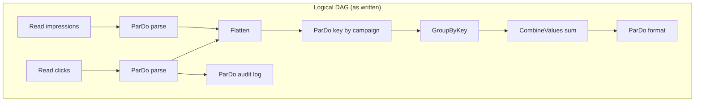
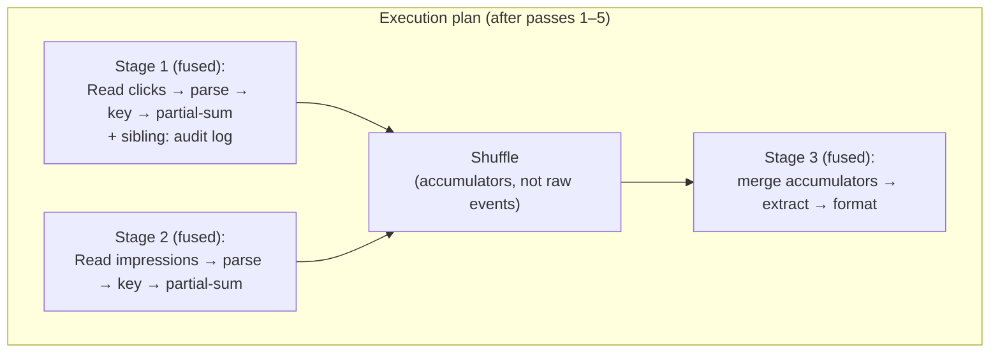
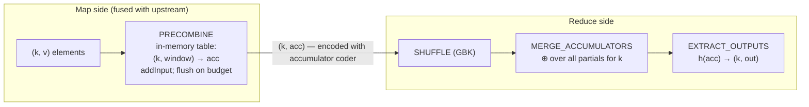

# 01 · FlumeJava DAG Optimizations: Fusion and Combiner Lifting

> **Folder:** `02-Apache-Beam-Execution-and-Portability-Internals/` · **File 1 of 3**
> **Anchoring papers:** Chambers et al., *FlumeJava: Easy, Efficient Data-Parallel Pipelines* (PLDI 2010) · Dean &
> Ghemawat, *MapReduce: Simplified Data Processing on Large Clusters* (OSDI 2004) · Akidau et al., *The Dataflow Model*
> (VLDB 2015) · Chan, Golub & LeVeque, *Algorithms for Computing the Sample Variance* (1983; the parallel merge formula) ·
> Gray et al., *Data Cube* (1997; distributive/algebraic/holistic).
> **Prev folder:** [01 · First principles](../01-First-Principles-and-The-Dataflow-Model/03-windowing-internals-merging-pane-accumulation-and-retractions.md)
> · **Next:** [02 · Runner v2 and the Fn API](02-runner-v2-portability-fn-api-grpc-bundles-and-sdk-harness.md)

---

## 0. The thesis

An optimizer for data-parallel pipelines makes exactly two kinds of bets:

1. **Fusion** bets that the cost of *materializing* an intermediate `PCollection` (encode, write, shuffle, read, decode)
   is greater than the *parallelism* you'd gain by redistributing it.
2. **Combiner lifting** bets that partially aggregating *before* the shuffle shrinks shuffle bytes enough to pay for the
   extra CPU and memory of a pre-shuffle hash table.

Both bets usually win, which is why they're on by default. An L7 engineer knows the exact conditions under which each one
loses:

- Fusion loses after a high-fanout step, or next to a slow sink, or across heterogeneous hardware.
- Lifting loses when keys are unique per bundle and the accumulator is larger than the value.

The L7 engineer also knows how to override the optimizer without destroying the properties (exactly-once, determinism)
that made the default safe.

---

## 1. First principles: why deferred evaluation exists

### 1.1 The eager MapReduce problem

Before FlumeJava, a Google pipeline was a hand-chained sequence of MapReduces. Every boundary was:

- written to GFS,
- re-read by the next job,
- scheduled independently,
- *hand-optimized*: engineers manually merged mappers and pushed combiners to save stages.

That made code unreadable, and every refactor risked a performance regression. FlumeJava's insight was **deferred
evaluation**:

- Calling `parallelDo` or `groupByKey` doesn't execute anything. It appends a node to a DAG of `PCollection`s.
- Only `run()` hands the whole DAG to an **optimizer**, which can see the *entire program* and rewrite it globally.
- Beam inherited this model directly: a `Pipeline` is a DAG of `PTransform`s, and a runner may rewrite it arbitrarily as
  long as semantics are preserved.

### 1.2 The primitive set

| FlumeJava primitive | Beam equivalent | Data movement | Optimizer role |
|---------------------|-----------------|---------------|----------------|
| `parallelDo` | `ParDo` | none | fusible, the main unit of fusion |
| `groupByKey` | `GroupByKey` | **shuffle** | fusion *barrier*; the core of an MSCR |
| `combineValues` | `Combine.GroupedValues` (inside `Combine.perKey`) | none by itself | **liftable** into the shuffle |
| `flatten` | `Flatten.pCollections()` | none (logical union) | sinkable / unzippable |
| derived: `count`, `join`, `top` | `Count`, `CoGroupByKey`, `Top` | composites | expanded, then optimized |

### 1.3 The cost model the optimizer approximates

For an execution plan with stages $S_1..S_n$ separated by materialization boundaries $B_1..B_m$:

$$
T \approx \max_{\text{critical path}} \sum_i \frac{\mathrm{CPU}(S_i)}{\mathrm{Parallelism}(S_i)} \;+\; \sum_j \underbrace{\Big(c_{\mathrm{enc}} + c_{\mathrm{dec}}\Big) N_j}_{\text{per-element serialization}} + \underbrace{\frac{\mathrm{Bytes}_j}{\mathrm{BW}_{\text{shuffle}}}}_{\text{I/O}} + \underbrace{\sigma_j}_{\text{scheduling / barrier}}
$$

$$
\mathrm{Parallelism}(S_i) \le \min\big(\#\text{splits of the stage's root input},\; \text{workers} \times \text{threads}\big)
$$

The two optimizations attack different terms:

| Optimization | Term it shrinks | Term it can inflate |
|--------------|-----------------|---------------------|
| Fusion | $\sum_j (c_{\mathrm{enc}} + c_{\mathrm{dec}})N_j + \mathrm{Bytes}_j/\mathrm{BW}$ (removes boundaries) | **$\mathrm{CPU}/\mathrm{Parallelism}$**, because fused stages inherit the root's split count |
| Combiner lifting | $\mathrm{Bytes}_j$ at the shuffle | $\mathrm{CPU}$ and memory of the pre-shuffle table; can *increase* bytes when accumulator > value |

### 1.4 MSCR: the generalized MapReduce

FlumeJava's execution unit is the **MapShuffleCombineReduce (MSCR)** operation, which generalizes one MapReduce to
**M input channels** (each with its own mapper) and **R output channels** (each with an optional
shuffle → combine → reduce, or a straight pass-through):

```
 input₁ ─► map₁ ─┐                                ┌─► combine₁ ─► reduce₁ ─► output₁
 input₂ ─► map₂ ─┼─► (multi-output) ─► shuffle ───┤
 input₃ ─► map₃ ─┘     tagged by channel          ├─► combine₂ ─► reduce₂ ─► output₂
                                                  └─► (pass-through, no shuffle) ─► output₃
```

One MSCR replaces several MapReduces that share inputs or shuffle phases. Dataflow's execution stages are the descendants
of MSCRs: fused chains of element-wise work separated by shuffles.

---

## 2. The FlumeJava optimizer passes, in order

The paper's optimizer runs a fixed sequence of graph rewrites. The order matters: each pass creates opportunities for the
next.

### Pass 1 · Sink Flattens

Push `ParDo`s *through* `Flatten` so the flatten moves toward consumers:

$$
h\big(f(a) \uplus g(b)\big) \;\Longrightarrow\; h(f(a)) \uplus h(g(b))
$$

This duplicates $h$ into each branch, which is free because $h$ is element-wise, so that $h \circ f$ and $h \circ g$ can
fuse. Flattens then end up directly in front of `GroupByKey`s, where they become MSCR input channels. Dataflow's docs call
the related rewrite *flatten unzipping* ⚠ verify the exact naming per runner.

### Pass 2 · Lift CombineValues

A `CombineValues` that immediately follows a `GroupByKey` is absorbed into the GBK's MSCR as a **combiner**:

- run on the map side (partial aggregation) *and*
- run on the reduce side (final merge).

Beam's `Combine.perKey(fn)` is exactly a composite of `GroupByKey` + `Combine.GroupedValues(fn)`, so runners recognize the
composite and lift it (§5).

### Pass 3 · Insert fusion blocks

When two GBKs are connected by a chain of `ParDo`s, each `ParDo` could fuse **up** (into the earlier GBK's reduce-side
output channel) or **down** (into the later GBK's map-side input channel). The optimizer estimates intermediate sizes
along the chain and places the boundary at the `PCollection` with the **smallest expected size**. That's where the
materialization is cheapest.

### Pass 4 · Fuse ParallelDos

- **Producer-consumer fusion:** `ParDo(f)` → `ParDo(g)` becomes `ParDo(g ∘ f)`. The intermediate is never materialized.
- **Sibling fusion:** `ParDo(f)`, `ParDo(g)`, `ParDo(h)` all reading the same input become one multi-output
  `ParDo(f, g, h)`. The input is read and decoded once.

### Pass 5 · Fuse MSCRs

GBKs that share inputs, or whose inputs come from the same fused `ParDo`, are merged into a single MSCR with multiple
input and output channels.

### A before/after example





Three things happened. The flatten disappeared: the key step was pushed into each branch and the shuffle takes both as
input channels. The sum was lifted, so the shuffle carries one accumulator per (campaign, bundle) instead of one record
per event. The audit `ParDo` fused as a sibling of `parse`, so clicks are decoded once.

---

## 3. Fusion in Beam runners

### 3.1 Where fusion happens

| Runner | Fusion implementation | What you see |
|--------|------------------------|--------------|
| **Dataflow** (legacy and Runner v2) | Service-side graph optimization at job submission | Fused stage names (e.g., `F12`) and "optimized" step-to-stage mapping in the UI and in `gcloud dataflow jobs describe` stage info |
| **Portable runners** (Flink/Spark portable, Prism, Python's FnApiRunner) | Java: `GreedyPipelineFuser` (runners-core-construction) produces `ExecutableStage`s. Python: translation phases such as `lift_combiners`, `sink_flattens`, `greedily_fuse`, `expand_sdf`. | Each `ExecutableStage` becomes one `ProcessBundleDescriptor` executed by an SDK harness (file 02) |
| **Classic Flink runner** (Java, non-portable) | Translates transforms to Flink operators; **Flink operator chaining** provides the fusion | Flink job graph chains |

### 3.2 Producer-consumer fusion mechanics: a depth-first push model

Inside an SDK harness, a fused stage is a tree of `DoFn` runners connected by **in-memory receivers**:

- When `ParDo A` calls `output(x)`, the harness *immediately* invokes `ParDo B.processElement(x)` on the same thread,
  before A's `processElement` returns.
- Execution is **depth-first per element**. An element runs through the entire fused chain before the next input element
  is read.
- **No encoding happens inside a fused stage.** `x` is passed by reference as a `WindowedValue`. Coders run only at stage
  boundaries: data-plane reads and writes, shuffle, and state.

Consequences:

| Property | Implication |
|----------|-------------|
| Pass-by-reference | **Mutating an input or an emitted element corrupts siblings and consumers.** Beam's `DirectRunner` enforces immutability and fails with "illegal mutation"; production runners don't check, they just compute wrong answers. |
| Depth-first | Good cache locality (the element stays hot in L1/L2). Memory is O(depth), not O(fanout), for a single element. |
| Same thread | A slow consumer slows its producer directly. A fused chain's throughput is set by its slowest member. |
| One bundle, one commit | All outputs of the fused stage for a bundle commit atomically, so a failure anywhere retries the whole bundle, including expensive upstream work and external side effects. |

### 3.3 Fusion barriers

A barrier is any point where the runner *must* materialize or redistribute data:

| Barrier | Why |
|---------|-----|
| `GroupByKey` / `CoGroupByKey` / `Combine.perKey` (shuffle part) | Data must be co-located by key |
| `Reshuffle` / `Redistribute` | Explicit request to redistribute (and, on some runners, to checkpoint) |
| **Side input** | The producer of a side input must complete or materialize the view before consumers can read it. Producer and consumer can't be in one fused stage. |
| **Stateful `ParDo`** | State and timers are per key, so input must be key-partitioned (an implicit shuffle on most runners) |
| **Splittable `DoFn`** expansion | Initial splits are typically redistributed between "split and size" and "process" (file 03) |
| `@RequiresStableInput` | The runner must make input replay-stable: a materialization point on Dataflow; buffering until checkpoint on Flink |
| **Environment change** | Cross-language transforms run in a different SDK harness, so data crosses the data plane |
| **Resource hints** (`ResourceHints`) | Steps with different resource requirements (e.g., GPU) are placed in separate stages on runners that support right-fitting ⚠ verify per runner |

### 3.4 Sibling fusion and wide fan-out

Sibling fusion means **one read and one decode** of a `PCollection` for all its consumers. With 20 consumers of a decoded
`PCollection<Event>`, the unfused alternative would encode once and decode 20 times. The trade: all 20 consumers now run
on the same thread, in sequence, per element. If one is slow (e.g., an RPC), all of them are slow.

---

## 4. When fusion hurts: the parallelism math

### 4.1 The fan-out trap

Let a stage's root produce $N$ elements (or splits), each fanning out to $F$ downstream elements that cost $c$ seconds
each. Let $P$ be the cluster's total thread count.

$$
T_{\text{fused}} \approx \frac{N F c}{\min(N, P)}
\qquad\qquad
T_{\text{redistributed}} \approx \underbrace{\frac{N F\, (c_{\mathrm{enc}} + c_{\mathrm{dec}})}{\min(N, P)} + \frac{N F \bar{s}}{\mathrm{BW}}}_{\text{materialize the fan-out}} + \frac{N F c}{P}
$$

Redistribution wins when $N \ll P$ and $c \gg c_{\mathrm{enc}} + c_{\mathrm{dec}} + \bar{s}/\mathrm{BW}$.

**Worked example.** 10 gzip files (gzip is not splittable), each 5 GB, about 50M lines each, enriched at 2 ms per line, on
1,000 workers × 4 threads (P = 4,000):

| Plan | Parallelism | Time |
|------|-------------|------|
| Fused (read → parse → enrich) | **10** threads (one per file) | $50\mathrm{M} \times 2\,\mathrm{ms} = 100{,}000$ s ≈ **27.8 h** |
| `Redistribute` after parse | 4,000 threads | read/parse ~minutes, plus ~100 GB shuffle (minutes), plus $500\mathrm{M} \times 2\,\mathrm{ms} / 4000 = 250$ s ≈ **~10–15 min** |

Autoscaling makes it *worse*: Dataflow sees a long-running stage and adds workers, which sit idle because the stage
can't use more than 10 threads.

### 4.2 Why dynamic work rebalancing can't save you

Dynamic work rebalancing (liquid sharding, Folder 03) splits the **root restriction** of a running stage: the unread byte
range of a file, the unread key range of a table.

- A gzip file has no splittable restriction, so there's nothing to split.
- More fundamentally, **the outputs of a fused `ParDo` aren't a restriction.** The runner can't steal "the second half of
  element 7's fan-out".
- The exception is if the fan-out is itself written as a **splittable `DoFn`** (e.g., "expand ID range [a, b)" with an
  `OffsetRange` restriction). Then the runner *can* split it mid-flight without any shuffle (file 03). That's often the
  best fix of all: no materialization, and dynamic parallelism.

### 4.3 The slow-sink trap

In streaming, `Read → parse → enrich → write-to-slow-sink` fused into one stage has throughput

$$
\Theta_{\text{stage}} = \min\big(\Theta_{\text{read}}, \Theta_{\text{parse}}, \Theta_{\text{enrich}}, \Theta_{\text{sink}}\big)
$$

and the slow sink's latency sits *inside* the bundle that also holds source progress. Effects:

- source backlog (Pub/Sub oldest-unacked age climbs),
- the watermark held at the oldest unfinished bundle,
- retries of the *whole* fused bundle when the sink throws, re-doing the enrichment RPCs too.

Breaking fusion before the sink decouples them. Upstream commits its work, and the sink stage retries independently from
materialized input.

### 4.4 The heterogeneous-hardware trap

A GPU inference step fused with CPU-bound parsing runs both on GPU workers, so the GPUs idle while the CPU parses. Resource
hints separate the stages on runners that support right-fitting. Each stage gets its own worker pool. The cost is a
materialization boundary between them, which is almost always worth it for accelerators.

### 4.5 The tools: `Reshuffle`, `Redistribute`, `@RequiresStableInput`

| Tool | Semantics | Cost | Use |
|------|-----------|------|-----|
| `Reshuffle.viaRandomKey()` | Random key → GBK → ungroup, preserving timestamps and windows (reified), with a trigger that re-emits per element | Full shuffle: encode, write, read, decode | Break fusion after fan-out; spread hot work |
| `Reshuffle.of()` (by existing key) | Redistribute by the element's key | Full shuffle | Re-partition keyed data |
| `Redistribute.arbitrarily()` / `.byKey()` | *Portable intent* to redistribute. Runners choose the mechanism, and with duplicates allowed ⚠ verify the builder method, a runner may use a cheaper at-least-once path. | ≤ Reshuffle | Preferred in new code: says *what* you want, not *how* |
| `@RequiresStableInput` on `@ProcessElement` | Guarantees the input to this `DoFn` is identical across retries | Dataflow: materialization. Flink runner: buffer until checkpoint completes (adds checkpoint-interval latency). | Non-idempotent side effects (e.g., a sink that can't dedup) |

> **Historical note.** For years, engineers used `Reshuffle` for two unrelated side effects: breaking fusion *and*
> "checkpointing" input so retries saw the same data (true on Dataflow because shuffle output is durable). The second use
> was never portable. Runners aren't obliged to make GBK output stable for downstream retries, which is why `Reshuffle`
> carried deprecation warnings for a long time. The modern decomposition: **`Redistribute` for parallelism,
> `@RequiresStableInput` for stability.** Each says exactly one thing.

---

## 5. Combiner lifting

### 5.1 The `CombineFn` contract as algebra

```java
abstract class CombineFn<InputT, AccumT, OutputT> {
  AccumT createAccumulator();                       // identity element e
  AccumT addInput(AccumT acc, InputT input);        // monoid action: acc ⊲ x
  AccumT mergeAccumulators(Iterable<AccumT> accs);  // ⊕ (n-ary)
  OutputT extractOutput(AccumT acc);                // h
  AccumT compact(AccumT acc);                       // optional: shrink before encoding (e.g., buffered → sketch)
  Coder<AccumT> getAccumulatorCoder(CoderRegistry r, Coder<InputT> inputCoder);
}
```

For lifting to preserve semantics, the runner relies on these laws:

$$
a \oplus (b \oplus c) = (a \oplus b) \oplus c \qquad a \oplus b = b \oplus a \qquad a \oplus e = a
$$

$$
h\Big(\mathrm{fold}_{\lhd}(e, X) \oplus \mathrm{fold}_{\lhd}(e, Y)\Big) = h\big(\mathrm{fold}_{\lhd}(e, X \uplus Y)\big)
\quad\text{for any partition of the input multiset into } X, Y
$$

The last law is the operational one. **The runner may split your input arbitrarily**: across bundles, across workers,
across flushes of the pre-shuffle table, across retries. It may then merge partial results in any order and any tree
shape. A `CombineFn` that's correct only for one partitioning is a latent bug that surfaces as run-to-run or
runner-to-runner differences.

`Combine.perKey(SerializableFunction<Iterable<V>, V>)` is the trap version. The function is applied to *partial
subsets* and then again to the partial results, so it must be associative and commutative over `V` itself. `sum` and
`max` qualify. "Average" doesn't: an average of averages is wrong (§8.1).

### 5.2 The lifted execution plan



The portable Runner API names these phases as standard transform URNs: `beam:transform:combine_per_key_precombine:v1`,
`…_merge_accumulators:v1`, `…_extract_outputs:v1`, and `combine_grouped_values` for the unlifted form. A runner that
doesn't lift can always fall back to GBK followed by `combine_grouped_values`.

**The precombine table.** The table is keyed by (structural key, window) and lives in SDK harness memory. When its
estimated size exceeds a budget, it **flushes** partial accumulators downstream and continues. A key can therefore appear
several times per bundle, which is correct because ⊕ is associative and commutative. The budget is configurable ⚠ verify
the option (historically a "grouping table max size" around 100 MB). Size estimation samples element sizes, so heavily
skewed value sizes make the estimate (and the GC behavior) noisy.

### 5.3 Shuffle reduction math

Let $N$ be the number of input elements, $B$ the bundles, $K_b$ the distinct keys in bundle $b$, $\bar{s}_k$ the key size,
$\bar{s}_v$ the value size, and $\bar{s}_a$ the encoded accumulator size.

$$
\mathrm{Bytes}_{\text{unlifted}} = N(\bar{s}_k + \bar{s}_v)
\qquad
\mathrm{Bytes}_{\text{lifted}} \approx \Big(\sum_{b=1}^{B} K_b + \text{flush duplicates}\Big)(\bar{s}_k + \bar{s}_a)
$$

| Workload | $N$ | $\sum_b K_b$ | $\bar{s}_v$ → $\bar{s}_a$ | Reduction |
|----------|-----|--------------|---------------------------|-----------|
| Count by country (200 keys), 10k bundles | $10^{10}$ | $2 \times 10^{6}$ | 8 B → 8 B | **~5,000×** |
| Sum per campaign (1M keys), 10k bundles of 1M elements | $10^{10}$ | ≈ $6.3 \times 10^{9}$ (most keys appear in most bundles) | 8 B → 8 B | ~1.6× |
| Distinct users per page via HLL, keys ≈ unique per bundle | $10^{10}$ | ≈ $10^{10}$ | 8 B → **~1.5 KB** sketch | **0.005× (≈190× more bytes!)** |

The third row is the lifting-loses case. When keys are nearly unique within a bundle, lifting can't reduce element count,
and if $\bar{s}_a \gg \bar{s}_v$ it *inflates* shuffle bytes. Mitigations:

1. A sparse-mode accumulator: HLL++ sparse representation, or a `compact()` that encodes small sets as raw values until
   they cross a threshold.
2. Group first and combine after, if the runner allows you to prevent lifting.
3. Re-key to a coarser key before the combine.

### 5.4 Correctness caveats of lifting

| Caveat | Why |
|--------|-----|
| **Count-based triggers** count *partials*, not elements | `AfterPane.elementCountAtLeast(n)` downstream of a lifted combine sees accumulators |
| **Merging windows** | Partial accumulators are keyed by *unmerged* windows and merged after the shuffle. Some runners skip lifting for merging windows or non-default timestamp combiners ⚠ verify per runner. |
| **Floating-point** | ⊕ over doubles is commutative but not associative in IEEE-754. Different partitionings give different low bits. Use integer units (cents, micros) or compensated summation if results must reconcile bit-exactly. |
| **Mutable accumulators** | `mergeAccumulators` may mutate and return one of its arguments. `extractOutput` must not mutate in a way that breaks a later merge (an accumulating pane can extract and then continue merging the same accumulator). |

### 5.5 Global combines and fan-out

`Combine.globally(fn)` lifts to per-bundle partials, then shuffles **all** partials to a single key, so one worker merges
them. With 100k bundles of HLL sketches, that one worker is the bottleneck. `Combine.globally(fn).withFanout(n)` inserts an
intermediate level ($n$ random sub-keys, then a final merge). For per-key hot spots, use
`Combine.perKey(fn).withHotKeyFanout(n)`, the same idea per key, covered with skew in Folder 05.

---

## 6. Flink comparison

| Concept | Beam / Dataflow | Flink DataStream | Flink SQL |
|---------|-----------------|------------------|-----------|
| Producer-consumer fusion | Automatic (fused stages) | **Operator chaining**: requires the same parallelism, a `forward` partitioner, the same slot-sharing group, and chaining not disabled | Codegen'd operators, chained |
| Sibling fusion | Automatic | Chained operator with multiple chained outputs | Multi-sink optimization / sub-plan reuse |
| Explicit fusion break | `Reshuffle` / `Redistribute` | `rebalance()`, `rescale()`, `shuffle()`, `disableChaining()`, `startNewChain()` | n/a |
| Combiner lifting | Automatic for `Combine.perKey` | **None.** `keyBy().aggregate()` ships raw records and aggregates in keyed state on the receiver. | **Two-phase (local-global) aggregation** with mini-batch: `table.optimizer.agg-phase-strategy = TWO_PHASE` |
| Mutation hazard | Pass-by-reference within fused stages | With `pipeline.object-reuse = true`, chained operators pass the *same* object | n/a (binary rows) |

Two points to make in an interview. First, **Flink DataStream has no combiner lifting**. A `keyBy` on a skewed key sends
every raw record across the network to one subtask. You build the equivalent yourself with a local pre-aggregation
operator before `keyBy`, or use Flink SQL's two-phase aggregation (Folder 05). Second, **when parallelism differs between
two operators and no partitioner is specified, Flink silently inserts `rebalance`**. That's an implicit fusion break, so
be explicit.

---

## 7. Hardware sympathy: what a fusion boundary physically costs

| Inside a fused stage | Across a boundary (Dataflow shuffle / Streaming Engine) |
|----------------------|----------------------------------------------------------|
| Method call, pointer passed | Coder `encode` (CPU, allocation of byte arrays / `ByteString` chunks) |
| Element stays in L1/L2 | Copy into gRPC/data-plane buffers (file 02), then a network hop off the VM to the shuffle service or Windmill |
| No persistence | Durable write (it's what makes retries cheap downstream) |
| No per-element metadata on the wire | Windowed-value metadata, ~13–24 B per element (Folder 01, file 01 §6.1) |
| — | Read, decode, allocate objects again on the consumer side |

Rule of thumb for small elements: per-element serialization and framing CPU dominates byte-level I/O. For large elements,
network and storage bandwidth dominate. Batching small elements before a boundary (combine, or `GroupIntoBatches` for
RPCs) attacks the first. Projection (schemas, file 03) and compression attack the second.

---

## 8. Production Java 21 code blueprints

### 8.1 Beam anti-patterns

```java
// (A) Fan-out fused with expensive work: parallelism capped at the number of (non-splittable) input files.
p.apply(TextIO.read().from("gs://bucket/exports/*.gz").withCompression(Compression.GZIP))  // 10 files → 10 splits
 .apply("Parse", ParDo.of(new ParseFn()))                                                   // 500M records
 .apply("Enrich", ParDo.of(new EnrichViaRpcFn()))      // 2 ms each, on 10 threads: ~28 hours
 .apply("Write", BigQueryIO.<Enriched>write() /* ... */);

// (B) "Average" through a SerializableFunction combine: applied to partial subsets, then to partial results.
//     avg(avg(1, 2, 3), avg(10)) = avg(2, 10) = 6 ≠ avg(1, 2, 3, 10) = 4.
PCollection<KV<String, Double>> wrongAvg = latencies.apply(
    Combine.perKey((Iterable<Double> xs) -> {
      double sum = 0; long n = 0;
      for (double x : xs) { sum += x; n++; }
      return n == 0 ? 0.0 : sum / n;
    }));

// (C) GroupByKey + manual sum: ships every raw record through the shuffle (no lifting).
PCollection<KV<String, Long>> slowSum = counts
    .apply(GroupByKey.create())
    .apply(MapElements.into(kvs(strings(), longs()))
        .via(kv -> KV.of(kv.getKey(), StreamSupport.stream(kv.getValue().spliterator(), false)
            .mapToLong(Long::longValue).sum())));

// (D) Mutating an element in one sibling branch. In a fused stage, the other branch sees the mutation.
events.apply("Normalize", ParDo.of(new DoFn<Event, Event>() {
  @ProcessElement public void process(@Element Event e, OutputReceiver<Event> out) {
    e.setAmountCents(e.getAmountCents() * 100);   // ILLEGAL: mutates the shared input object
    out.output(e);
  }
}));
events.apply("Audit", ParDo.of(new AuditFn()));   // may observe the mutated amount, depending on sibling order
```

### 8.2 Beam production: fan-out redistribution, resource-aware stages, and a lawful `CombineFn`

```java
package dev.l7.dataflow.fusion;

import java.io.IOException;
import java.io.InputStream;
import java.io.OutputStream;
import java.util.Iterator;
import org.apache.beam.sdk.Pipeline;
import org.apache.beam.sdk.coders.Coder;
import org.apache.beam.sdk.coders.CoderRegistry;
import org.apache.beam.sdk.coders.CustomCoder;
import org.apache.beam.sdk.coders.DoubleCoder;
import org.apache.beam.sdk.coders.VarLongCoder;
import org.apache.beam.sdk.io.Compression;
import org.apache.beam.sdk.io.TextIO;
import org.apache.beam.sdk.options.PipelineOptionsFactory;
import org.apache.beam.sdk.transforms.Combine;
import org.apache.beam.sdk.transforms.ParDo;
import org.apache.beam.sdk.transforms.Redistribute;
import org.apache.beam.sdk.transforms.resourcehints.ResourceHints;
import org.apache.beam.sdk.values.KV;
import org.apache.beam.sdk.values.PCollection;

public final class FusionAwarePipeline {

  public static void main(String[] args) {
    Pipeline p = Pipeline.create(PipelineOptionsFactory.fromArgs(args).withValidation().create());

    PCollection<Event> parsed = p
        .apply("ReadGzip", TextIO.read().from("gs://bucket/exports/*.gz").withCompression(Compression.GZIP))
        .apply("Parse", ParDo.of(new ParseFn()));                 // cheap: fine to fuse with the read

    PCollection<Enriched> enriched = parsed
        // Fusion break: the fan-out of 10 non-splittable files is spread over every worker thread.
        // Redistribute states intent (parallelism). It doesn't promise stability; use @RequiresStableInput for that.
        .apply("SpreadWork", Redistribute.arbitrarily())
        .apply("Enrich", ParDo.of(new EnrichViaRpcFn()));         // 2 ms each, now on all threads

    PCollection<Scored> scored = enriched
        .apply("Score", ParDo.of(new GpuScoreFn())
            // Separate stage on accelerator workers where right-fitting is supported (⚠ verify runner support).
            .setResourceHints(ResourceHints.create()
                .withMinRam("16GiB")
                .withAccelerator("type:nvidia-l4;count:1;install-nvidia-driver")));

    // Lawful, lifted aggregation: one accumulator per (key, bundle) crosses the shuffle.
    PCollection<KV<String, MeanVarianceFn.Stats>> latencyStats = scored
        .apply("KeyByService", ParDo.of(new ToServiceLatencyFn()))   // KV<String, Double>
        .apply("MeanVariance", Combine.perKey(new MeanVarianceFn()));

    p.run();
  }

  /**
   * Count, mean, and variance in one pass. Welford's update on input; Chan–Golub–LeVeque on merge.
   * Associative and commutative (up to floating-point rounding), so it's correct under ANY partitioning the runner
   * chooses: bundles, table flushes, retries, merge trees.
   */
  public static final class MeanVarianceFn
      extends Combine.CombineFn<Double, MeanVarianceFn.Acc, MeanVarianceFn.Stats> {

    /** Mutable on purpose: addInput/mergeAccumulators update in place to avoid per-element allocation. */
    public static final class Acc {
      long n;
      double mean;
      double m2;   // Σ (x − mean)²
    }

    public record Stats(long count, double mean, double sampleVariance) {}

    @Override
    public Acc createAccumulator() {
      return new Acc();
    }

    @Override
    public Acc addInput(Acc a, Double x) {
      a.n++;
      double delta = x - a.mean;
      a.mean += delta / a.n;
      a.m2 += delta * (x - a.mean);   // numerically stable; never Σx² − n·mean²
      return a;
    }

    @Override
    public Acc mergeAccumulators(Iterable<Acc> accumulators) {
      Iterator<Acc> it = accumulators.iterator();
      if (!it.hasNext()) {
        return createAccumulator();
      }
      Acc out = it.next();            // the contract allows mutating and returning an argument accumulator
      while (it.hasNext()) {
        Acc b = it.next();
        if (b.n == 0) {
          continue;
        }
        if (out.n == 0) {
          out.n = b.n;
          out.mean = b.mean;
          out.m2 = b.m2;
          continue;
        }
        long n = out.n + b.n;
        double delta = b.mean - out.mean;
        out.mean += delta * b.n / n;
        out.m2 += b.m2 + delta * delta * ((double) out.n * b.n / n);
        out.n = n;
      }
      return out;
    }

    @Override
    public Stats extractOutput(Acc a) {
      return new Stats(a.n, a.n == 0 ? Double.NaN : a.mean, a.n < 2 ? Double.NaN : a.m2 / (a.n - 1));
    }

    @Override
    public Coder<Acc> getAccumulatorCoder(CoderRegistry registry, Coder<Double> inputCoder) {
      return AccCoder.INSTANCE;       // explicit: 1 varint + 2 doubles per partial crossing the shuffle
    }

    @Override
    public Coder<Stats> getDefaultOutputCoder(CoderRegistry registry, Coder<Double> inputCoder) {
      return StatsCoder.INSTANCE;
    }

    static final class AccCoder extends CustomCoder<Acc> {
      static final AccCoder INSTANCE = new AccCoder();
      private static final Coder<Long> N = VarLongCoder.of();
      private static final Coder<Double> D = DoubleCoder.of();

      @Override
      public void encode(Acc a, OutputStream out) throws IOException {
        N.encode(a.n, out);
        D.encode(a.mean, out);
        D.encode(a.m2, out);
      }

      @Override
      public Acc decode(InputStream in) throws IOException {
        Acc a = new Acc();
        a.n = N.decode(in);
        a.mean = D.decode(in);
        a.m2 = D.decode(in);
        return a;
      }
      // No verifyDeterministic override: accumulators are never grouping keys, so determinism isn't required.
    }

    static final class StatsCoder extends CustomCoder<Stats> {
      static final StatsCoder INSTANCE = new StatsCoder();
      private static final Coder<Long> N = VarLongCoder.of();
      private static final Coder<Double> D = DoubleCoder.of();

      @Override
      public void encode(Stats s, OutputStream out) throws IOException {
        N.encode(s.count(), out);
        D.encode(s.mean(), out);
        D.encode(s.sampleVariance(), out);
      }

      @Override
      public Stats decode(InputStream in) throws IOException {
        return new Stats(N.decode(in), D.decode(in), D.decode(in));
      }
    }
  }
}
```

### 8.3 Proving the `CombineFn` laws in CI

Beam ships `CombineFnTester`, which runs a `CombineFn` under many partitionings and merge orders and asserts the same
result. Pair it with a randomized partition test of your own:

```java
package dev.l7.dataflow.fusion;

import static org.hamcrest.MatcherAssert.assertThat;
import static org.hamcrest.Matchers.closeTo;

import java.util.ArrayList;
import java.util.Collections;
import java.util.List;
import java.util.Random;
import org.apache.beam.sdk.testing.CombineFnTester;
import org.hamcrest.Description;
import org.hamcrest.Matcher;
import org.hamcrest.TypeSafeMatcher;
import org.junit.jupiter.api.Test;

class MeanVarianceFnTest {

  private final FusionAwarePipeline.MeanVarianceFn fn = new FusionAwarePipeline.MeanVarianceFn();

  @Test
  void beamTesterAcrossPartitionings() {
    List<Double> xs = List.of(1.0, 2.0, 3.0, 10.0, 10.0, 11.0);
    // The tester partitions, merges in different shapes, and checks every result against the matcher.
    // Use a tolerance matcher, not equals(): merge order legitimately changes the last bits of a double.
    CombineFnTester.testCombineFn(fn, xs, statsCloseTo(fn.extractOutput(foldAll(xs)), 1e-9));
  }

  private static Matcher<FusionAwarePipeline.MeanVarianceFn.Stats> statsCloseTo(
      FusionAwarePipeline.MeanVarianceFn.Stats expected, double tolerance) {
    return new TypeSafeMatcher<>() {
      @Override
      protected boolean matchesSafely(FusionAwarePipeline.MeanVarianceFn.Stats s) {
        return s.count() == expected.count()
            && Math.abs(s.mean() - expected.mean()) <= tolerance
            && Math.abs(s.sampleVariance() - expected.sampleVariance()) <= tolerance;
      }

      @Override
      public void describeTo(Description d) {
        d.appendText("stats within " + tolerance + " of " + expected);
      }
    };
  }

  @Test
  void randomPartitionsAndMergeOrders() {
    Random rnd = new Random(42);
    List<Double> xs = new ArrayList<>();
    for (int i = 0; i < 100_000; i++) {
      xs.add(1e9 + rnd.nextGaussian());   // large offset: catches the catastrophic-cancellation formula
    }
    FusionAwarePipeline.MeanVarianceFn.Stats reference = fn.extractOutput(foldAll(xs));

    for (int trial = 0; trial < 50; trial++) {
      Collections.shuffle(xs, rnd);
      List<FusionAwarePipeline.MeanVarianceFn.Acc> partials = new ArrayList<>();
      int i = 0;
      while (i < xs.size()) {
        int len = 1 + rnd.nextInt(5_000);
        partials.add(foldAll(xs.subList(i, Math.min(xs.size(), i + len))));
        i += len;
      }
      Collections.shuffle(partials, rnd);
      FusionAwarePipeline.MeanVarianceFn.Stats got = fn.extractOutput(fn.mergeAccumulators(partials));
      assertThat(got.mean(), closeTo(reference.mean(), 1e-6));
      assertThat(got.sampleVariance(), closeTo(reference.sampleVariance(), 1e-6 * reference.sampleVariance()));
    }
  }

  private FusionAwarePipeline.MeanVarianceFn.Acc foldAll(List<Double> xs) {
    FusionAwarePipeline.MeanVarianceFn.Acc a = fn.createAccumulator();
    for (double x : xs) {
      a = fn.addInput(a, x);
    }
    return a;
  }
}
```

The `1e9 + gaussian` input is deliberate. The naïve formula $\frac{\sum x^2 - n\bar{x}^2}{n-1}$ loses most significant
digits to cancellation at that offset and fails the test. The Welford/Chan form passes.

### 8.4 Flink: explicit chaining control around a fan-out

```java
package dev.l7.dataflow.fusion;

import org.apache.flink.api.common.eventtime.WatermarkStrategy;
import org.apache.flink.connector.file.src.FileSource;
import org.apache.flink.connector.file.src.reader.TextLineInputFormat;
import org.apache.flink.core.fs.Path;
import org.apache.flink.streaming.api.datastream.DataStream;
import org.apache.flink.streaming.api.environment.StreamExecutionEnvironment;

public final class ChainingAwareJob {

  public static void main(String[] args) throws Exception {
    StreamExecutionEnvironment env = StreamExecutionEnvironment.getExecutionEnvironment();

    FileSource<String> files = FileSource
        .forRecordStreamFormat(new TextLineInputFormat(), new Path("s3://bucket/exports/"))
        .build();                                     // .gz files are not splittable: one split per file

    DataStream<Event> parsed = env
        .fromSource(files, WatermarkStrategy.noWatermarks(), "exports")
        .setParallelism(10)                           // ≈ number of files: more subtasks would idle
        .flatMap(new ParseFlatMap()).name("parse")
        .setParallelism(10);                          // same parallelism + forward ⇒ chained with the source

    parsed
        .rebalance()                                  // EXPLICIT fusion break: round-robin to all 400 subtasks
        .map(new EnrichFn()).name("enrich")
        .setParallelism(400)
        .disableChaining()                            // isolate enrich metrics/backpressure from the sink
        .sinkTo(new EnrichedSink()).name("sink")
        .setParallelism(100);                         // differing parallelism ⇒ implicit rebalance (be explicit)

    env.execute("chaining-aware");
  }
}
```

`ParseFlatMap`, `EnrichFn`, and `EnrichedSink` are ordinary user classes. The point is the topology: chain the cheap
fan-out to the source, break explicitly before the expensive step, and size each side independently. Folder 07 covers
`AsyncDataStream` for the RPC itself.

---

## 9. Production failure modes and P99 debugging

| ID | Failure | Signature | Root cause | Fix |
|----|---------|-----------|------------|-----|
| F1 | **Fusion-capped parallelism** | One stage runs for hours on a handful of busy threads; most workers idle; autoscaler adds workers to no effect | High fan-out fused to a root with few splits (non-splittable compressed files, small `Create`, few partitions) | `Redistribute`/`Reshuffle` after the fan-out; or make the fan-out an SDF; or use splittable formats |
| F2 | **Slow sink fused with the source** (streaming) | Backlog and watermark lag grow; retries redo upstream RPCs; "Operation ongoing in step … without outputting or completing" logs on the sink step | Sink latency inside the bundle | Fusion break before the sink; batch writes; dead-letter failures |
| F3 | **Lifting inflates shuffle** | Shuffle bytes > input bytes on a combine; worker GC pressure in the pre-combine table | Unique keys per bundle with large accumulators (sketches, lists) | Sparse/`compact()` accumulators; coarser keys; group-then-combine |
| F4 | **Non-lawful `CombineFn`** | Results differ between runs, between runners, or between DirectRunner and Dataflow | Non-associative or non-commutative logic (average of averages, "first element", order-dependent lists) | Restate as a commutative monoid (sum, count, sketch); test with `CombineFnTester` |
| F5 | **Mutation across fused siblings** | Inexplicable corruption in one branch, depending on deployment | Pass-by-reference in fused stages; `DoFn` or `CombineFn` mutates inputs or outputs | Treat inputs as immutable; copy before modifying; run tests on the DirectRunner (it enforces immutability) |
| F6 | **`Combine.globally` hot merge** | The final stage of a global combine runs on one worker for a long time | All partials go to one key | `.withFanout(n)` |
| F7 | **Reshuffle everywhere** | Cost and latency up; Streaming Engine bytes and shuffle bytes much higher than needed | Defensive `Reshuffle` after every step | Break fusion only at measured fan-out or sink boundaries; prefer `Redistribute` |
| F8 | **Retried fused bundle repeats expensive side effects** | External system sees duplicate calls; RPC quota exhausted during incidents | A failure late in a fused chain retries the whole bundle | Idempotent calls (request IDs); fusion break before the side effect; `@RequiresStableInput` for non-idempotent sinks |

### Runbook · F1 (the most common Dataflow batch performance bug)

1. In the Dataflow UI, open the slow stage's **execution details**. Look for a small number of long-running work items
   and low parallelism compared to the worker count.
2. Map the stage to steps (the optimized graph). If it begins with a read of compressed files, a `Create`, or a small
   keyed input, and contains a step whose output element count is ≫ its input count, it's F1.
3. Confirm with step metrics: `Parse` elements out ≫ `Read` elements out, and wall time concentrated in a later step of
   the same stage.
4. Fix: `Redistribute.arbitrarily()` immediately after the fan-out. Re-run and confirm the stage split in two with the
   second stage's parallelism ≈ total threads.
5. Prevent: lint pipelines for `Compression.GZIP` reads followed by expensive transforms without a fusion break, and
   prefer splittable formats (uncompressed text, Avro/Parquet with block compression) for large inputs.

### Runbook · F3 (lifting makes it worse)

1. Compare the combine's input bytes with the shuffle bytes written (Dataflow step metrics; shuffle bytes per stage).
2. Measure the distinct keys per bundle. If it's close to elements per bundle, lifting can't reduce element count.
3. Measure the accumulator size against the value size by encoding a sample accumulator with the accumulator coder.
4. Fix with a sparse representation, or a coarser key, or by moving the sketch construction after the shuffle.

---

## 10. FAANG L7 bar-raiser Q&A chains

### Q1 · "Explain fusion. When would you deliberately break it?"

**L5 textbook answer.** Fusion combines consecutive `ParDo`s into one stage so data isn't serialized between them. You
break it with `Reshuffle` when you need more parallelism.

**Why L5 breaks at petabyte scale.** "When you need more parallelism" is not a decision procedure. Teams either never break
fusion (27-hour jobs, §4.1) or break it everywhere (paying a shuffle per step and doubling cost). Neither knows why a
fused stage can't use the workers the autoscaler adds, or why dynamic work rebalancing doesn't help.

**L7 principal defense.**

1. **The model:** a fused stage's parallelism equals its root's split count. Fusion removes
   $(c_{\mathrm{enc}} + c_{\mathrm{dec}})N + \mathrm{Bytes}/\mathrm{BW}$ per boundary but inherits root parallelism.
2. **Break fusion when** $N_{\text{root}} \ll P$ and the per-element cost after fan-out dominates serialization (§4.1
   inequality), when a slow or flaky sink would stall and retry upstream work, or when hardware differs (GPU).
3. **Prefer structural fixes first.** A splittable fan-out (SDF) gives dynamic parallelism without materialization.
   Splittable input formats remove the root bottleneck.
4. **Use `Redistribute`** for intent (parallelism) and `@RequiresStableInput` for stability. Don't conflate them through
   `Reshuffle`.
5. **Verify** in the optimized graph and the stage parallelism, not by intuition.

### Q2 · "Your Dataflow batch job reads 10 large `.gz` files, and 1,000 workers are mostly idle. Diagnose and fix."

**L5 textbook answer.** Increase the number of workers or use a bigger machine type.

**Why L5 breaks at petabyte scale.** Gzip isn't splittable, so the read has 10 splits. Everything fused after it runs on 10
threads. Adding workers adds idle cost, and bigger machines don't add threads to a single-split read. Dynamic work
rebalancing can't split a gzip stream or a fused `ParDo`'s outputs.

**L7 principal defense.**

1. **Immediate:** `Redistribute.arbitrarily()` after parsing, so the shuffle cost (~100 GB) buys 400× parallelism (§4.1).
2. **Structural:** have producers write splittable formats (Avro/Parquet with block compression, or many smaller files),
   or decompress-and-rechunk as an ingestion step.
3. **Cost check:** right-size workers *after* the fix. Before it, the autoscaler's signal is meaningless.
4. **Guardrail:** a pipeline lint and a dashboard on "stage parallelism / provisioned threads".

### Q3 · "`Combine.perKey(sum)` vs. `GroupByKey` + summing in a `ParDo`: what's the difference at petabyte scale?"

**L5 textbook answer.** They produce the same result. `Combine` is more concise.

**Why L5 breaks at petabyte scale.** The results are identical, but the execution isn't. GBK + `ParDo` ships every raw record
through the shuffle, and the reducer for a hot key has to iterate (and on Runner v2, page in, file 02) every value.
`Combine.perKey` lets the runner lift: for low-cardinality keys that's a 1,000–5,000× shuffle reduction (§5.3), and the
hot-key reducer merges a handful of accumulators instead of iterating billions of values.

**L7 principal defense.**

1. **Lifting changes the shuffle term** from $N(\bar{s}_k + \bar{s}_v)$ to $(\sum_b K_b)(\bar{s}_k + \bar{s}_a)$.
2. **It also changes skew behavior:** hot keys are pre-reduced on every mapper, which is a form of fan-out for free.
   `withHotKeyFanout` adds an explicit level when per-bundle reduction isn't enough.
3. **The cost:** the `CombineFn` must be lawful (associative, commutative, identity), so write it as such and test it
   (§8.3).
4. **The exception:** unique keys with large accumulators (§5.3, row 3), where lifting loses.

### Q4 · "When does combiner lifting make things worse?"

**L5 textbook answer.** Never. It always reduces data.

**Why L5 breaks.** Lifting can't reduce the element count when keys are nearly unique per bundle. If the accumulator is
larger than the value (sketches, top-k heaps, buffered lists), bytes grow. The pre-combine table also costs memory and GC.
With count triggers, semantics shift (partials are counted). With doubles, the low bits differ.

**L7 principal defense.** Quantify: the reduction ratio is $N\bar{s}_v / (\sum_b K_b \cdot \bar{s}_a)$. Measure distinct
keys per bundle and the encoded accumulator size. When the ratio is < 1:

- use sparse accumulators with `compact()`,
- re-key coarser before combining,
- or build sketches after the shuffle.

Note the semantic caveats (count triggers, merging windows, floating point) and verify lifting in the optimized graph
rather than assuming.

### Q5 · "Design a mean/variance/percentile aggregation that's correct under arbitrary partial combining."

**L5 textbook answer.** Keep the sum, the sum of squares, and the count. For percentiles, collect values and sort.

**Why L5 breaks at petabyte scale.** Sum of squares suffers catastrophic cancellation for large-magnitude data (latencies in
ns since epoch, prices in micros), so variances come out negative or zero. "Collect and sort" is holistic: $O(n)$ state
per key, no lifting, and OOMs on hot keys.

**L7 principal defense.**

1. **Mean and variance:** $(n, \bar{x}, M_2)$ with Welford's update and Chan's merge,
   $M_2 = M_{2a} + M_{2b} + \delta^2 \frac{n_a n_b}{n}$. It's associative and commutative up to rounding, and stable
   (§8.2).
2. **Percentiles:** a mergeable quantile sketch (t-digest, KLL, or DDSketch for relative-error guarantees). It's a
   commutative monoid with bounded size, so lifting works and the error bounds are documented.
3. **Prove the laws in CI** with `CombineFnTester` and randomized partitions on adversarial data (§8.3).
4. **State the reconciliation contract:** bit-exact equality across runs is not promised for floating point. Use integer
   units for money.

### Q6 · "Why did `Reshuffle` carry a deprecation warning for years, and what does `Redistribute` change?"

**L5 textbook answer.** `Reshuffle` was deprecated in favor of something newer, but everyone still uses it.

**Why L5 breaks.** Teams relied on an undocumented *side effect* of `Reshuffle` on Dataflow: durable shuffle output made
downstream retries see identical input, which "checkpointed" non-deterministic upstream steps. They then ported pipelines
to runners without that property and got duplicate or divergent side effects.

**L7 principal defense.**

- **Separate the two intents.**
  - `Redistribute` (arbitrarily or by key) requests redistribution for parallelism. Runners may implement it cheaply,
    including at-least-once paths when duplicates are explicitly allowed.
  - `@RequiresStableInput` requests replay-stable input for non-idempotent side effects. Each runner implements it with
    whatever mechanism guarantees stability (materialization on Dataflow; buffering until checkpoint on the Flink runner).
- **Code review rule:** any `Reshuffle` must be justified as *parallelism* (then use `Redistribute`) or *stability*
  (then use `@RequiresStableInput`, or better, make the side effect idempotent).

### Q7 · "Flink DataStream has no combiner lifting. How do you get the same effect?"

**L5 textbook answer.** Use `keyBy().reduce()`. It aggregates incrementally.

**Why L5 breaks at petabyte scale.** `reduce` is incremental *on the receiver*. Every raw record still crosses the network to
the subtask owning the key. A hot key (a celebrity, a default value like `"unknown"`) saturates one subtask's network
input and state, and backpressure spreads to the sources.

**L7 principal defense.**

1. **Flink SQL:** two-phase local-global aggregation with mini-batch, which is lifting.
2. **DataStream:** a local pre-aggregation operator *before* `keyBy`. It buffers per key in operator memory or state,
   flushes on count, time, or checkpoint, and emits partial accumulators. It's correct because the aggregate is a
   commutative monoid, and it's checkpoint-safe if buffered partials are snapshotted (Folder 05 has the implementation).
3. **Price the trade:** latency rises by up to the flush interval, and the shuffle drops by the per-subtask key
   cardinality ratio, the same math as §5.3.

---

## 11. Invariants checklist

1. **A fused stage's parallelism equals its root's split count.** Know your roots: files, partitions, `Create`.
2. **Break fusion only for measured reasons:** fan-out, slow or flaky sinks, heterogeneous hardware. Prefer splittable
   fan-outs over shuffles.
3. **`Redistribute` means parallelism. `@RequiresStableInput` means stability.** Never rely on `Reshuffle`'s
   runner-specific side effects.
4. **Use `Combine.perKey`, not GBK + loop,** for aggregations, and make every `CombineFn` lawful and tested.
5. **Lifting loses when keys are unique per bundle and $\bar{s}_a > \bar{s}_v$.** Measure it.
6. **Never mutate inputs or emitted elements.** Fused stages pass by reference.
7. **Global combines need fan-out.** Hot keys need hot-key fan-out.

---

## 12. References

- C. Chambers, A. Raniwala, F. Perry, S. Adams, R. Henry, R. Bradshaw, N. Weizenbaum. *FlumeJava: Easy, Efficient
  Data-Parallel Pipelines.* PLDI 2010 (§4 optimizer: sink flattens, lift CombineValues, fusion blocks, ParallelDo and
  MSCR fusion).
- J. Dean, S. Ghemawat. *MapReduce: Simplified Data Processing on Large Clusters.* OSDI 2004 (combiner functions).
- T. Akidau et al. *The Dataflow Model.* PVLDB 8(12), 2015.
- T. F. Chan, G. H. Golub, R. J. LeVeque. *Algorithms for Computing the Sample Variance: Analysis and Recommendations.*
  The American Statistician 37(3), 1983. B. P. Welford, *Note on a Method for Calculating Corrected Sums of Squares and
  Products*, Technometrics 4(3), 1962.
- T. Dunning, O. Ertl. *Computing Extremely Accurate Quantiles Using t-Digests* (2019). Z. Karnin, K. Lang, E. Liberty,
  *Optimal Quantile Approximation in Streams* (FOCS 2016, KLL).
- Google Cloud Dataflow documentation: *Pipeline lifecycle → graph optimization (fusion, combine optimization)*; *Right
  fitting / resource hints*.
- Apache Beam source: `runners/core-construction-java/.../graph/GreedyPipelineFuser`, `ExecutableStage`;
  `sdks/python/apache_beam/runners/portability/fn_api_runner/translations.py` (`lift_combiners`, `sink_flattens`,
  `greedily_fuse`); `sdks/java/core/.../transforms/Combine`, `Redistribute`, `Reshuffle`; `CombineFnTester`;
  `model/pipeline/src/main/proto/.../beam_runner_api.proto` (combine component URNs).
- Apache Flink docs: *Task chaining and resource groups*; Flink SQL *Performance tuning → MiniBatch, Local-Global
  aggregation*.

**Next →** [02 · Runner v2, portability, Fn API, gRPC bundles, and the SDK harness](02-runner-v2-portability-fn-api-grpc-bundles-and-sdk-harness.md)
