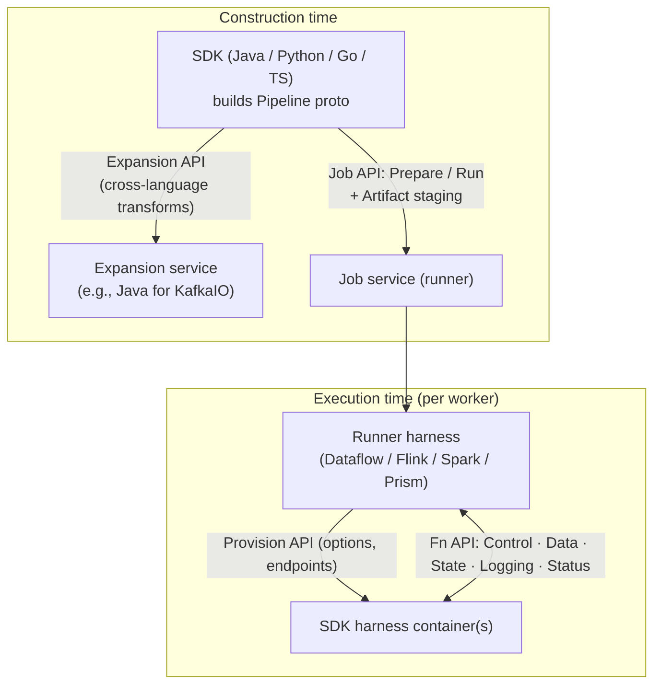
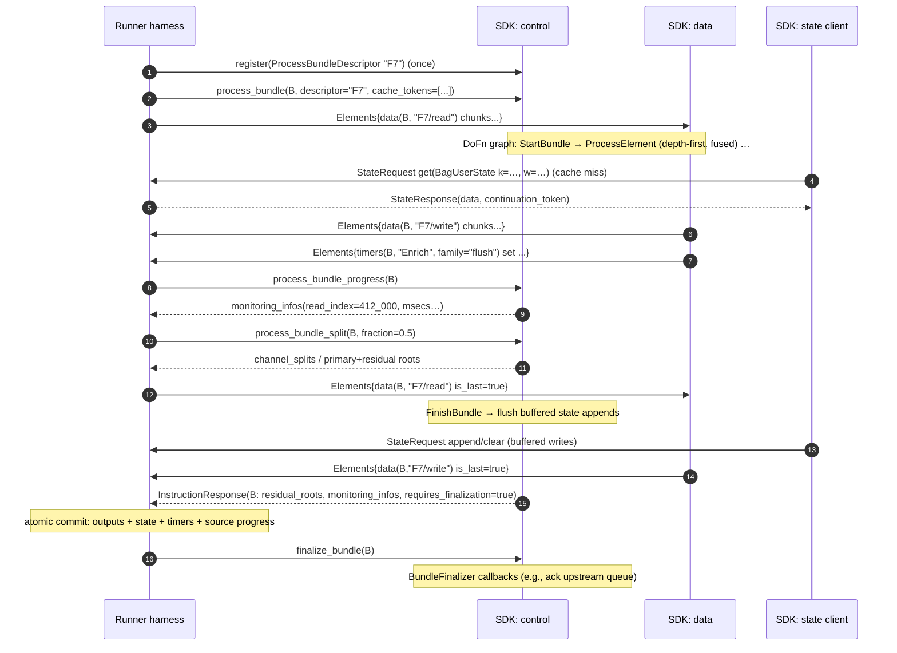
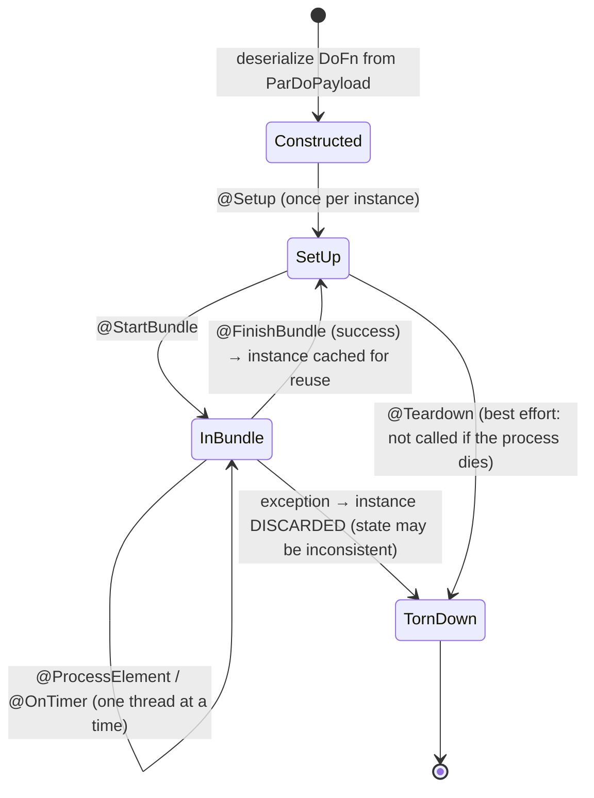
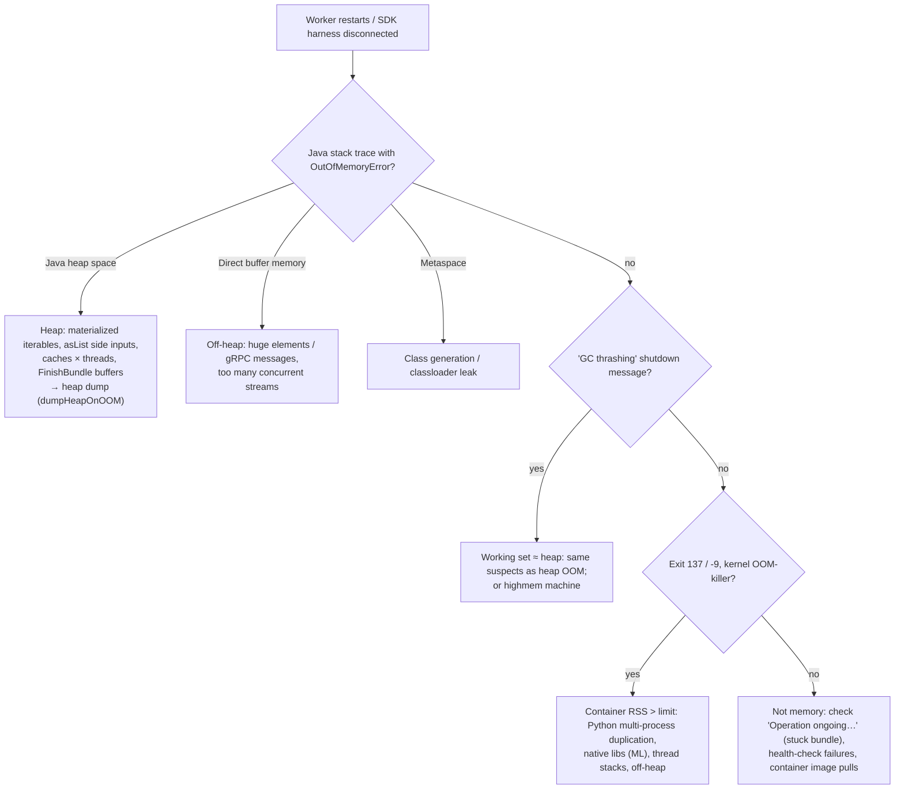

# 02 · Runner v2 and Portability: the Fn API, gRPC Bundles, and the SDK Harness

> **Folder:** `02-Apache-Beam-Execution-and-Portability-Internals/` · **File 2 of 3**
> **Anchors:** Apache Beam portability framework design docs (Runner API, Fn API, Job API, Expansion API) ·
> `model/fn-execution/src/main/proto/org/apache/beam/model/fn_execution/v1/beam_fn_api.proto` ·
> `model/pipeline/src/main/proto/org/apache/beam/model/pipeline/v1/beam_runner_api.proto` · Google Cloud Dataflow Runner v2
> documentation · Akidau et al., *MillWheel* (VLDB 2013) for atomic per-work-item commits.
> **Prev:** [01 · Fusion and combiner lifting](01-flumejava-dag-optimizations-fusion-and-combiner-lifting.md) · **Next:**
> [03 · Splittable DoFn and coder determinism](03-splittable-dofn-sdf-restriction-trackers-and-coder-determinism.md)

---

## 0. The thesis

Portability moves the language boundary from a **function call** to a **process boundary with a protocol**. Once you see
that, four engineering facts follow:

1. **Every stage boundary is a serialization point.** Elements cross as coder-encoded bytes in multiplexed gRPC streams.
   Fusion (file 01) is what makes this affordable, because only stage inputs and outputs cross.
2. **State, side inputs, and large iterables become RPCs** with paging and cache tokens. Your `BagState.read()` is a
   network request unless it was cached.
3. **The bundle is the unit of everything:** work assignment, atomic commit, retry, progress, splitting, and
   finalization. Bundle size is a first-class latency/throughput knob.
4. **Memory on a worker VM is split between two (or more) processes:** the runner harness and the SDK harness(es). OOMs
   come in several distinct species, each with a different fix.

---

## 1. First principles: why portability, and the four APIs

### 1.1 The N × M problem

Without portability, every (SDK language × runner) pair needs a bespoke translation: Java-on-Flink, Python-on-Flink,
Go-on-Spark, and so on. With $N$ SDKs and $M$ runners that's $N \times M$ integrations, each with its own bugs.
Portability defines **language-neutral protobuf contracts** so that each SDK implements the protocol once and each runner
implements it once:

$$
N \times M \;\longrightarrow\; N + M
$$

It also enables **cross-language pipelines**. A Python pipeline can use Java's `KafkaIO`, and a Java pipeline can use
Python's ML transforms, because a transform is just a protobuf node with an environment.

### 1.2 The API layers



| API | Proto | Purpose |
|-----|-------|---------|
| **Runner API** | `beam_runner_api.proto` | The `Pipeline` itself: `Components` (transforms, pcollections, windowing strategies, coders, environments), each transform a `FunctionSpec{urn, payload}`, plus **`requirements`** |
| **Job API** | `beam_job_api.proto` | Submit, run, monitor, and cancel. Artifact staging (jars, wheels). |
| **Expansion API** | `beam_expansion_api.proto` | Ask a foreign-language service to expand a transform into protos and return its environment |
| **Fn API** | `beam_fn_api.proto` | Runner ↔ SDK harness execution protocol (§2) |
| Provision / Artifact retrieval | `beam_provision_api.proto`, `beam_artifact_api.proto` | The SDK harness learns pipeline options, endpoints, and artifacts at startup |

**`requirements`** is an underrated field. A pipeline declares URNs like `beam:requirement:pardo:stateful:v1`,
`…:splittable_dofn:v1`, `…:requires_stable_input:v1`, `…:requires_time_sorted_input:v1`, and `…:bundle_finalization:v1`.
A runner **must reject** a pipeline whose requirements it doesn't understand, rather than silently running it with weaker
semantics. That's the portable mechanism behind "this runner doesn't support X" failing loudly at submission.

**Environments** say *where* a transform's user code runs: `beam:env:docker:v1` (container image), `beam:env:process:v1`
(a local process), `beam:env:external:v1` (a pre-started worker pool), or the embedded/loopback variants used in testing.
Two adjacent transforms with different environments can never fuse. Every environment change is a data-plane crossing.

---

## 2. The Fn API in detail

### 2.1 Services

| Service | RPC shape | Server | Carries |
|---------|-----------|--------|---------|
| `BeamFnControl` | bidirectional stream `Control(stream InstructionResponse) → stream InstructionRequest` | **runner** (the SDK harness dials in) | instructions: register, process, progress, split, finalize, monitoring |
| `BeamFnData` | bidirectional stream of `Elements` | runner | element bytes and timer bytes, multiplexed |
| `BeamFnState` | bidirectional stream `StateRequest ↔ StateResponse` | runner | user state, side inputs, large iterables |
| `BeamFnLogging` | client stream of log entries | runner | SDK logs, forwarded to Cloud Logging and similar |
| `BeamFnWorkerStatus` | stream | runner | thread dumps and status (`/status` style debugging) |
| `BeamFnExternalWorkerPool` | unary | SDK-side pool | start workers on demand (`beam:env:external:v1`) |

The **runner is the gRPC server for all of them**. The SDK harness is a client that connects to the endpoints it learned
from the Provision API. That direction is deliberate: the runner controls admission, and an SDK harness crash is just a
disconnected client.

### 2.2 Control-plane instructions

| `InstructionRequest` | Meaning | Response highlights |
|----------------------|---------|---------------------|
| `register` | Install `ProcessBundleDescriptor`s (one per fused stage) | — |
| `process_bundle` | Run descriptor `D` as bundle `B`, with `cache_tokens` | `residual_roots`, `monitoring_infos`, `requires_finalization` |
| `process_bundle_progress` | "How far along is bundle `B`?" | monitoring infos: element counts, data-channel read index, msecs per state |
| `process_bundle_split` | "Split bundle `B` at about fraction $f$ of its remainder" | `primary_roots`, `residual_roots`, `channel_splits` |
| `finalize_bundle` | "Bundle `B` is durably committed: run its finalization callbacks" | — |
| `monitoring_infos` / `harness_monitoring_infos` | metric metadata and harness-level metrics | — |

### 2.3 Anatomy of a `ProcessBundleDescriptor`

A fused stage, as the runner hands it to the SDK harness:

```text
ProcessBundleDescriptor {
  id: "stage-F7"
  transforms {
    "F7/read":    { spec { urn: "beam:runner:source:v1"                     # data-plane INPUT port
                           payload: RemoteGrpcPort{ api_service_descriptor{ url: "localhost:12371" },
                                                    coder_id: "c_wv_lp_kv" } }
                    outputs { "o": "pc_in" } }
    "Parse":      { spec { urn: "beam:transform:pardo:v1"
                           payload: ParDoPayload{ do_fn: <serialized Java DoFn>, ... } }
                    inputs { "i": "pc_in" }  outputs { "o": "pc_parsed" }  environment_id: "java21" }
    "Enrich":     { spec { urn: "beam:transform:pardo:v1" ... }
                    inputs { "i": "pc_parsed" }  outputs { "o": "pc_enriched" }  environment_id: "java21" }
    "F7/write":   { spec { urn: "beam:runner:sink:v1"                       # data-plane OUTPUT port
                           payload: RemoteGrpcPort{ ..., coder_id: "c_wv_lp_enriched" } }
                    inputs { "i": "pc_enriched" } }
  }
  pcollections { "pc_in": { coder_id: "c_wv_lp_kv", windowing_strategy_id: "ws_fixed5m" } ... }
  coders {
    "c_wv_lp_kv": windowed_value( length_prefix( kv(string_utf8, <SDK-specific value coder>) ), interval_window )
    ...
  }
  windowing_strategies { "ws_fixed5m": { window_fn: fixed(5m), trigger: ..., accumulation: ..., ... } }
  state_api_service_descriptor { url: "localhost:12372" }
  timer_api_service_descriptor { url: "localhost:12371" }
}
```

Reading guide:

- **Data enters and leaves only through `beam:runner:source:v1` / `beam:runner:sink:v1` ports.** Everything in between is
  in-process, fused, and passed by reference (file 01 §3.2).
- **Coders are named in the descriptor.** The runner must be able to *frame* every byte stream. For SDK-specific coders
  it doesn't understand, it relies on **`length_prefix`** (§2.4).
- The descriptor is registered **once** and executed for many bundles. Instructions reference it by ID.

### 2.4 The data plane: multiplexed byte streams

```text
Elements {
  repeated Data   { string instruction_id; string transform_id; bytes data; bool is_last; }
  repeated Timers { string instruction_id; string transform_id; string timer_family_id; bytes timers; bool is_last; }
}
```

- **Multiplexing.** One gRPC stream per data endpoint carries chunks for many concurrent bundles. Each chunk is tagged
  `(instruction_id, transform_id)`, the bundle and the port. The receiver reassembles a logical byte stream per tag.
- **Framing.** The bytes are concatenated coder encodings of `WindowedValue`s. A chunk boundary can fall anywhere. The
  stream for `(B, port)` ends with `is_last = true`.
- **Buffering.** Senders aggregate encoded elements and flush at a size threshold or a time limit. Size flushes amortize
  per-message overhead. Time flushes bound latency for trickling streams ⚠ verify the option names and defaults per SDK
  (the Java outbound aggregator is on the order of 1 MB; time limits are configurable through experiments).
- **Timers ride the data plane.** The SDK emits timer set/clear records on a timer stream. The runner stores timers
  (and their watermark holds) and delivers fired timers back as input on the same stream type. **The runner owns timers;
  the SDK only requests them.**

**Why length-prefixing matters.** A runner written in Java or C++ can't decode a Python pickled value or a Go-specific
encoding. To still be able to *split a stream into elements*, group by key, and route, the pipeline wraps unknown coders
in `beam:coder:length_prefix:v1` (a varint length followed by opaque bytes). The runner then treats the value, or the
key, as **opaque bytes**. For `GroupByKey`, that means the runner groups by **byte equality of the encoded key**, and
that's exactly why key coders must be **deterministic** (file 03).

Coders the runner *does* understand are the **standard model coders**: `bytes`, `string_utf8`, `kv`, `varint`, `bool`,
`double`, `iterable`, `timer`, `interval_window`, `global_window`, `length_prefix`, `windowed_value`,
`param_windowed_value`, `state_backed_iterable`, `row`, `sharded_key`, `custom_window`, `nullable`. Using model coders for
keys lets runners avoid an extra length-prefix and, for `row`, lets different SDKs exchange typed data.

### 2.5 The state plane: state, side inputs, and big iterables as RPCs

```text
StateRequest  { string id; string instruction_id; StateKey state_key;
                oneof request { StateGetRequest get; StateAppendRequest append; StateClearRequest clear; } }
StateKey      { oneof type { Runner runner; BagUserState bag_user_state;
                             MultimapUserState / MultimapKeysUserState; OrderedListUserState;
                             IterableSideInput; MultimapSideInput; MultimapKeysSideInput; ... } }
StateGetResponse { bytes continuation_token; bytes data; }      # paging
```

| Use | StateKey type | Access pattern | Cost notes |
|-----|---------------|----------------|------------|
| `ValueState`/`BagState`/`CombiningState` | `BagUserState` (per key, window, state ID) | get (paged), append, clear | Writes are **buffered in the SDK** and flushed at bundle end. Reads are RPCs unless cached. |
| `MapState`/`SetState` | `MultimapUserState` / `MultimapKeysUserState` | per-map-key get, keys enumeration | Point lookups don't transfer the whole map |
| `OrderedListState` | `OrderedListUserState` | range reads by sort key | Runner support varies ⚠ verify |
| `View.asIterable()` / `asList()` side input | `IterableSideInput` | whole iterable, paged | Reading it fully pulls *everything* into the harness |
| `View.asMap()` / `asMultimap()` side input | `MultimapSideInput` (key in the StateKey) | **per-key lookup** | Only that key's values cross the boundary (Folder 05 OOM discussion) |
| Large GBK output values | `Runner` key + `state_backed_iterable` coder | first page inline, rest fetched lazily | **An `Iterable<V>` from GBK can exceed memory if you stream it once.** Copying it into a `List` defeats the design. |

**Cache tokens.** `ProcessBundleRequest.cache_tokens` tells the SDK which user-state and side-input entries it may cache
*across bundles*. A token stays valid while the runner guarantees no one else has written. With tokens, a hot key's state
is read once and served from SDK memory for subsequent bundles. Without them, every bundle re-reads. The SDK cache is
budgeted ⚠ verify the option names, e.g. a "max cache memory usage" MB/percent setting in Java, `state_cache_size` in
Python. **Prefetch with `readLater()`.** Calling `state.readLater()` on several states at the start of `@ProcessElement`
lets the harness issue the RPCs concurrently instead of serially on first `read()`.

### 2.6 Progress, splitting, and finalization

**Progress.** The runner polls `process_bundle_progress`, and the SDK reports `MonitoringInfo`s. Element counts per
PCollection (`beam:metric:element_count:v1`), execution msecs per transform and state, sampled byte sizes, and **the
data-channel read index** (how many input elements have been consumed). The runner uses these for straggler detection,
autoscaling signals, and split decisions.

**Splitting** (dynamic work rebalancing in Runner v2):

```text
ProcessBundleSplitRequest {
  instruction_id: "B"
  desired_splits { "F7/read": { fraction_of_remainder: 0.5, estimated_input_elements: 1_000_000,
                                allowed_split_points: [...] } }
}
ProcessBundleSplitResponse {
  channel_splits { transform_id: "F7/read", last_primary_element: 412_877, first_residual_element: 412_878 }
  primary_roots  [ BundleApplication{...} ]          # SDF: the claimed part of the current element
  residual_roots [ DelayedBundleApplication{...} ]   # SDF: the unclaimed part, rescheduled elsewhere
}
```

Two split mechanisms compose:

1. **Channel split.** "Stop consuming input after element #412,877." The runner re-sends the rest of the input elsewhere.
   It works for any stage but only at element granularity.
2. **SDF split.** If the element currently in process is a splittable restriction, such as a file's byte range, the SDK
   calls `tracker.trySplit(fraction)` *while processing continues*, producing primary/residual restrictions. That's
   sub-element granularity (file 03).

**Finalization.** If a bundle registered callbacks through `BundleFinalizer`, the response sets `requires_finalization`.
After the runner **durably commits** the bundle's outputs, state, and source progress, it sends `finalize_bundle`, and the
SDK runs the callbacks (acks to an external queue, deleting processed files). Callbacks are best-effort and carry an
expiry. If the worker dies first, they never run, the external system redelivers, and the pipeline must tolerate
duplicates.

### 2.7 One bundle, end to end



---

## 3. Bundles: the unit of work, commit, retry, and split

### 3.1 Semantics

A bundle is a set of input elements (or a restriction, or a batch of timers) processed by one fused stage on one SDK
harness thread. It is:

- **The unit of atomic commit.** Outputs, state mutations, timer changes, and source position advance together or not at
  all (MillWheel's per-work-item commit, generalized).
- **The unit of retry.** A failure anywhere in the fused stage discards the bundle's effects and re-processes the whole
  bundle, including upstream work in the same fused stage and **any external side effects already performed**.
- **The unit of `@StartBundle`/`@FinishBundle`.** Batching and flushing tied to bundle boundaries inherit the runner's
  bundle-size choices.

| Context | Who decides bundle size | Typical shape |
|---------|-------------------------|---------------|
| Dataflow batch | Runner: splits of the source, then dynamic splitting | Large: thousands to millions of elements |
| Dataflow streaming | Runner: work items per key range from Windmill/Streaming Engine | Small to medium; latency-bounded |
| Flink runner (classic or portable) | `--maxBundleSize`, `--maxBundleTimeMills` / `--max_bundle_size`, `--max_bundle_time_millis` ⚠ verify names | Bounded by count or time. Bundles must finish before a checkpoint barrier is processed. |
| DirectRunner | Small, often randomized to flush out bundle-boundary bugs | Tiny |

### 3.2 The DoFn lifecycle mapped onto bundles



Facts that drive production design:

| Fact | Consequence |
|------|-------------|
| An instance processes **one bundle at a time** (thread-confined) | Instance fields need no synchronization. **Static** fields are shared by all threads and need it. |
| Instances are **reused across bundles** and cached per stage per thread | Expensive setup belongs in `@Setup`, not `@StartBundle` or `@ProcessElement` |
| Instance count ≈ **fused stages × concurrent bundles (threads)**, × processes for Python | 20 stages × 300 streaming threads = up to 6,000 instances. A 50-connection pool per instance is 300,000 connections. |
| A failed bundle **discards** the instance, and `@Teardown` is best effort | Resources must survive abrupt process death (the OS reclaims sockets). Share them process-wide with reference counting (§7.2). |
| `@FinishBundle` runs **before** the commit | Its side effects happen even if the commit later fails, so they get retried. Flushes must be idempotent. |
| Outputs from `@FinishBundle` need an **explicit timestamp and window** | Buffer `(value, timestamp, window)`. Never default to `GlobalWindow.INSTANCE` (§7.1). |

### 3.3 Bundle-size math

Let per-bundle overhead be $o$ (scheduling, commit, `StartBundle`/`FinishBundle`, state flush), per-element cost $c$, and
bundle size $b$:

$$
\text{throughput} = \frac{b}{o + b\,c}
\qquad\qquad
\text{latency}_{\text{commit}} \gtrsim b\,c + o
\qquad\qquad
\text{overhead share} = \frac{o}{o + b c}
$$

With $o$ = 20 ms (commit round trip plus a per-bundle flush RPC) and $c$ = 50 µs, keeping overhead under 10% needs
$b \ge 3{,}600$ elements, which adds ≥ 180 ms of commit latency. Streaming runners favor small bundles for latency, so
**per-bundle batching in `@FinishBundle` degenerates to tiny batches in streaming**. If you need large batches for an
external API in streaming, batch by *key and time* with `GroupIntoBatches` (stateful, independent of bundle size)
rather than by bundle (Folder 07).

### 3.4 Side-effect semantics: three different guarantees

| Mechanism | Guarantee | Typical use |
|-----------|-----------|-------------|
| **Idempotent side effect** (upsert by business key + version) | Retries are harmless | Default for sinks |
| **`@RequiresStableInput`** | Retries see identical input, so deterministic replays of a non-idempotent effect send the *same* request | Sinks that support dedup by request content but not by key |
| **`BundleFinalizer.afterBundleCommit`** | Callback runs *after* durable commit (best effort, with expiry) | Acking an upstream queue or deleting consumed files, so data isn't lost if the bundle fails |

These compose. A typical source-to-sink at-least-once pipeline uses finalization upstream (ack after commit) and
idempotence downstream (upsert). Exactly-once *effects* require idempotence or a transactional sink (Folder 06).

---

## 4. Dataflow Runner v2 architecture

### 4.1 A worker VM

```
┌──────────────────────────────────────── Dataflow worker VM ────────────────────────────────────────┐
│                                                                                                    │
│  ┌──────────────────────────────── Runner harness (Google-managed) ───────────────────────────┐   │
│  │  Fn API servers (control / data / state / logging)                                          │   │
│  │  Native I/O: Pub/Sub source & sink (streaming), shuffle reader/writer, Windmill/Streaming    │   │
│  │  Engine client (state, timers, watermarks, work items), runner-side GBK / grouping           │   │
│  │  Work-item leasing, progress reporting, split coordination, commits                          │   │
│  └───────────────▲─────────────────────────────▲───────────────────────────────────────────────┘   │
│                  │ localhost gRPC              │ localhost gRPC                                      │
│  ┌───────────────┴───────────────┐   ┌─────────┴─────────────────────┐                              │
│  │ SDK harness: Java (one JVM,   │   │ SDK harness: Python (by       │  ← one container per          │
│  │ many bundle threads)          │   │ default ~one process per vCPU)│    environment / language     │
│  │ user DoFns, coders, combiners,│   │ user DoFns, coders, models    │                               │
│  │ state cache, side-input cache │   │                               │                               │
│  └───────────────────────────────┘   └───────────────────────────────┘                               │
│                                                                                                    │
└───────────────────────────────▲───────────────────────────────▲────────────────────────────────────┘
                                │ network                       │ network
                   Dataflow Shuffle service (batch)    Streaming Engine / Windmill (streaming)
```

| Concern | Runs in | Why it matters |
|---------|---------|----------------|
| User `DoFn`s, user coders, `CombineFn` pre-combine | SDK harness | Your heap, your GC, your threads |
| Shuffle read/write (batch) | Runner harness ↔ Shuffle service | Off-VM, so worker disk and memory don't bound shuffle size |
| State, timers, watermarks (streaming) | Runner harness ↔ Streaming Engine | Off-VM durable state (Folder 03); the SDK sees it through the State API |
| Pub/Sub read/write (streaming) | Runner harness (native) | Elements enter the SDK as bytes over the data plane |
| Cross-language transforms | The foreign SDK's harness | An extra environment, so extra crossings |

The runner harness is language-agnostic. Google has described it as a shared, largely native implementation ⚠ verify the
specifics, so improvements to shuffle, state, and I/O apply to every SDK. Runner v2 is required for cross-language
pipelines and for full SDF support, and it's the default for many SDK/job combinations on recent releases (Python and Go
broadly; Java on recent SDKs). Check `--experiments=use_runner_v2` / `disable_runner_v2` behavior for your version ⚠
verify.

### 4.2 Threads and processes

| SDK | Process model | Concurrency | Memory implication |
|-----|---------------|-------------|--------------------|
| Java | One SDK JVM per worker | Many bundle threads (`--numberOfWorkerHarnessThreads`; streaming defaults are high) | One heap shared by all threads, so static caches and per-instance resources × threads |
| Python | Multiple SDK processes per worker by default (to sidestep the GIL) | Each process runs its own threads | **Everything loaded per process is duplicated.** A 4 GB model × 8 processes = 32 GB. |
| Go | One process | Goroutines | Shared heap |

Python model-loading pathologies have dedicated tools ⚠ verify per Beam version:

- Process-wide sharing (`apache_beam.utils.shared`).
- Cross-process sharing (`multi_process_shared`).
- RunInference's large-model options.
- The single-process experiment (`no_use_multiple_sdk_containers`), which trades parallelism for memory.

### 4.3 The memory budget, and the five OOM species

```
VM memory = runner harness (I/O buffers, grouping, Windmill client)
          + SDK harness heap(s)                         ← -Xmx / Python process RSS
          + off-heap: gRPC/Netty direct buffers, thread stacks, Metaspace, native libs
          + page cache / OS
```

| Species | Signature | Typical cause | Fix |
|---------|-----------|---------------|-----|
| **Java heap OOM** | `java.lang.OutOfMemoryError: Java heap space` in worker logs; heap dump if enabled | Materialized GBK iterables, large `asList` side inputs, per-instance caches × threads, buffering in `FinishBundle` | Stream iterables; `asMap` lookups; share caches; bound buffers; `--dumpHeapOnOOM --saveHeapDumpsToGcsPath` |
| **GC thrashing kill** | Dataflow Java logs "Shutting down JVM after N consecutive periods of measured GC thrashing…" | Heap nearly full but not quite OOM: working set ≈ heap | Same as above, or a highmem machine type |
| **Direct-memory OOM** | `OutOfMemoryError: Direct buffer memory` / Netty allocation failures | Huge gRPC messages, many concurrent streams, large elements | Smaller elements and chunks, fewer threads, cap element size |
| **Container / kernel OOM kill** | SDK harness "disconnected", exit code 137 / −9, no Java stack trace | Total RSS (heap + off-heap + native libs + Python processes) > container limit | Reduce processes or threads, native allocations, model duplication; bigger machine |
| **Metaspace / class loading** | `OutOfMemoryError: Metaspace` | Dynamic class generation (codegen per element), classloader leaks | Cache generated classes; avoid per-bundle codegen |

---

## 5. Portable runners on Flink, and the native contrast

On the **Flink portable runner**, each `ExecutableStage` becomes a Flink operator (`ExecutableStageDoFnOperator`) that
talks to an SDK harness through a `JobBundleFactory` (environments: DOCKER, PROCESS, EXTERNAL, LOOPBACK). Consequences:

- **Bundles versus checkpoints.** A Flink checkpoint barrier can't be processed mid-bundle. The operator *finishes the
  current bundle* before snapshotting. Large bundles (count or time) therefore delay barrier alignment and stretch
  checkpoint duration. Bundle limits are checkpoint-latency knobs.
- **State.** Fn API state requests are served from Flink keyed state (RocksDB or heap) by the operator.
- **Timers.** They map to Flink's timer service, and watermark holds are implemented by the operator holding back its
  output watermark.

**Native Flink** has no process boundary. Operators share the TaskManager JVM, and chained operators pass objects by
reference (or reuse them, with `pipeline.object-reuse=true`). Network exchanges use Flink's binary serializers and
credit-based flow control (Folder 04). That's a real per-element CPU advantage for JVM pipelines. Portability buys
language freedom and cross-language I/O, and charges for it in the crossings.

---

## 6. Hardware sympathy: the cost of crossing the boundary

### 6.1 The path of one element

```
SDK object ─► coder.encode ─► ByteString chunk ─► Elements.Data proto ─► gRPC (HTTP/2 frames)
          ─► Netty (direct ByteBuf; epoll via JNI) ─► loopback TCP (kernel copy) ─► runner ─► decode / opaque bytes
```

That's at least 2–4 memory copies, plus protobuf framing and HTTP/2 flow control per message (amortized over many
elements per message), plus encode and decode CPU per element.

**This is IPC, not JNI.** A JNI call into RocksDB (Flink, Folder 04) costs a JNI transition plus copying across the
boundary, with no syscall. The Fn API costs syscalls, copies, and framing. The cost profiles differ: JNI hurts per
*call*, while the Fn API hurts per *element and byte*, amortized by batching. Netty itself uses JNI for its native epoll
transport, but that's per I/O operation, not per element.

### 6.2 Cost model

$$
C_{\text{cross}}(N, \bar{s}) \approx N\,(c_{\mathrm{enc}} + c_{\mathrm{dec}}) \;+\; \frac{N}{E}\,c_{\mathrm{msg}} \;+\; N\,\bar{s}\,k\,c_{\mathrm{copy}}
$$

Here $E$ is elements per data message (larger with size-based flushing) and $k$ is the number of copies. For tiny
elements, the per-element encode/decode term dominates, so batch elements into larger logical records before the
boundary (combine; `GroupIntoBatches`; Python batched DoFns that process arrays or dataframes per call). For large
elements, the copy term dominates, so avoid shipping unused fields (schemas and projection, file 03) and compress at the
source.

### 6.3 State round trips

An uncached `BagState.read()` costs a loopback RPC plus a backend fetch (Windmill or RocksDB). Within one
`@ProcessElement`, serial reads of three states take three sequential round trips. Calling `readLater()` on all three
first lets the harness pipeline them. Across bundles, **cache tokens** turn repeated reads of a hot key's state into
memory hits. A pipeline whose state cache is undersized shows high per-element latency on stateful steps with low CPU,
because it's waiting on RPCs.

---

## 7. Production Java 21 code blueprints

### 7.1 Anti-patterns: lifecycle, threading, windows, and memory

```java
// ANTI-PATTERN collection. Each numbered line is a real incident class.
public class NaiveEnrichFn extends DoFn<KV<String, Iterable<Event>>, Enriched> {

  private static final Map<String, Profile> CACHE = new HashMap<>();   // (1) static + non-thread-safe:
                                                                        //     corrupted under concurrent bundles
  private ConnectionPool pool;                                          // (2) per INSTANCE: × stages × threads

  @Setup
  public void setup() {
    pool = new ConnectionPool(50);                                       //     6,000 instances × 50 = 300k sockets
  }

  @ProcessElement
  public void process(@Element KV<String, Iterable<Event>> grouped, OutputReceiver<Enriched> out) {
    List<Event> all = new ArrayList<>();
    grouped.getValue().forEach(all::add);                                // (3) materializes a state-backed iterable:
                                                                         //     hot key ⇒ heap OOM
    HttpClient client = HttpClient.newHttpClient();                      // (4) client per element: TLS handshakes
    Profile p = CACHE.computeIfAbsent(grouped.getKey(), k -> blockingFetch(client, k));  // (5) no timeout:
                                                                         //     a hung call stalls the bundle forever
    all.forEach(e -> out.output(enrich(e, p)));
  }

  private final List<Enriched> pending = new ArrayList<>();

  @FinishBundle
  public void finish(FinishBundleContext c) {
    pending.forEach(e -> c.output(e, Instant.now(), GlobalWindow.INSTANCE)); // (6) silently moves every element
    pending.clear();                                                         //     into the GLOBAL window with a
  }                                                                          //     wall-clock timestamp
}
```

### 7.2 Production: shared resources, bounded calls, idempotent flushes, correct windows

**A process-wide, reference-counted resource holder.** One client per (JVM, config), not per instance:

```java
package dev.l7.dataflow.harness;

import java.util.concurrent.ConcurrentHashMap;
import java.util.function.Function;

/**
 * Process-wide, ref-counted sharing for expensive thread-safe clients (connection pools, gRPC channels).
 * DoFn instances ≈ stages × bundle threads; without this, every instance would open its own pool.
 */
public final class SharedResource<K, T extends AutoCloseable> {

  private static final class Entry<T> {
    final T value;
    int refs;

    Entry(T value) {
      this.value = value;
    }
  }

  private final ConcurrentHashMap<K, Entry<T>> entries = new ConcurrentHashMap<>();

  /** Atomic per key; the factory runs at most once per key while the resource is live. */
  public T acquire(K key, Function<K, T> factory) {
    return entries.compute(key, (k, existing) -> {
      Entry<T> e = existing != null ? existing : new Entry<>(factory.apply(k));
      e.refs++;
      return e;
    }).value;
  }

  public void release(K key) {
    entries.computeIfPresent(key, (k, e) -> {
      if (--e.refs > 0) {
        return e;
      }
      try {
        e.value.close();
      } catch (Exception ignored) {
        // closing is best effort; the process may be shutting down anyway
      }
      return null;   // removes the entry
    });
  }
}
```

**An idempotent, batched writer with bounded calls and honest metrics:**

```java
package dev.l7.dataflow.harness;

import java.io.IOException;
import java.io.Serializable;
import java.util.ArrayList;
import java.util.List;
import org.apache.beam.sdk.metrics.Counter;
import org.apache.beam.sdk.metrics.Distribution;
import org.apache.beam.sdk.metrics.Metrics;
import org.apache.beam.sdk.transforms.DoFn;
import org.apache.beam.sdk.values.KV;

/** Sink-side DoFn: no outputs (so windows are irrelevant), idempotent upserts, bounded latency per call. */
public final class IdempotentBatchWriterFn extends DoFn<KV<String, IdempotentBatchWriterFn.Order>, Void> {

  public record Order(long version, long amountCents, String status) implements Serializable {}

  public record SinkConfig(String endpoint, String table) implements Serializable {}

  /** Thread-safe client contract. Upserts are keyed by (key) and guarded by version on the server side. */
  public interface SinkClient extends AutoCloseable {
    record Upsert(String key, long version, Order order) {}

    void upsertAll(List<Upsert> batch, java.time.Duration timeout) throws IOException;

    static SinkClient connect(SinkConfig config) {
      throw new UnsupportedOperationException("wire your client here");
    }
  }

  private static final SharedResource<SinkConfig, SinkClient> CLIENTS = new SharedResource<>();

  private final SinkConfig config;
  private final int maxBatch;
  private final Distribution batchSizes = Metrics.distribution(IdempotentBatchWriterFn.class, "batch_size");
  private final Counter written = Metrics.counter(IdempotentBatchWriterFn.class, "rows_written");

  private transient SinkClient client;
  private transient List<SinkClient.Upsert> buffer;

  public IdempotentBatchWriterFn(SinkConfig config, int maxBatch) {
    this.config = config;
    this.maxBatch = maxBatch;
  }

  @Setup
  public void setup() {
    client = CLIENTS.acquire(config, SinkClient::connect);
  }

  @StartBundle
  public void startBundle() {
    buffer = new ArrayList<>(maxBatch);
  }

  @ProcessElement
  public void process(@Element KV<String, Order> e) throws IOException {
    // Idempotency: a retried bundle re-sends the same (key, version); the server-side version guard
    // makes the replay a no-op. That's what makes flushing BEFORE the commit safe.
    buffer.add(new SinkClient.Upsert(e.getKey(), e.getValue().version(), e.getValue()));
    if (buffer.size() >= maxBatch) {
      flush();
    }
  }

  @FinishBundle
  public void finishBundle() throws IOException {
    flush();   // the bundle can't commit until this returns: keep it bounded
  }

  @Teardown
  public void teardown() {
    if (client != null) {
      CLIENTS.release(config);
      client = null;
    }
  }

  private void flush() throws IOException {
    if (buffer.isEmpty()) {
      return;
    }
    batchSizes.update(buffer.size());   // in streaming, expect small batches: bundle sizes are latency-driven
    client.upsertAll(buffer, java.time.Duration.ofSeconds(30));
    written.inc(buffer.size());
    buffer.clear();
  }
}
```

**Outputs from `@FinishBundle` that keep their timestamps and windows:**

```java
package dev.l7.dataflow.harness;

import java.util.ArrayList;
import java.util.List;
import java.util.Map;
import org.apache.beam.sdk.transforms.DoFn;
import org.apache.beam.sdk.transforms.windowing.BoundedWindow;
import org.apache.beam.sdk.values.KV;
import org.joda.time.Instant;

/**
 * One batched lookup per bundle. Each output keeps its input's timestamp AND window. Memory is bounded by bundle
 * size, which the runner controls; in streaming, prefer GroupIntoBatches (Folder 07) for predictable batches.
 */
public final class BundleBatchedLookupFn extends DoFn<String, KV<String, String>> {

  public interface ProfileClient {
    Map<String, String> batchGet(List<String> keys);   // must enforce its own timeout
  }

  private record Pending(String key, Instant timestamp, BoundedWindow window) {}

  private final ProfileClientFactory factory;
  private transient ProfileClient client;
  private transient List<Pending> pending;

  public interface ProfileClientFactory extends java.io.Serializable {
    ProfileClient create();
  }

  public BundleBatchedLookupFn(ProfileClientFactory factory) {
    this.factory = factory;
  }

  @Setup
  public void setup() {
    client = factory.create();
  }

  @StartBundle
  public void startBundle() {
    pending = new ArrayList<>();
  }

  @ProcessElement
  public void process(@Element String key, @Timestamp Instant ts, BoundedWindow window) {
    pending.add(new Pending(key, ts, window));
  }

  @FinishBundle
  public void finishBundle(FinishBundleContext c) {
    if (pending.isEmpty()) {
      return;
    }
    Map<String, String> results = client.batchGet(pending.stream().map(Pending::key).distinct().toList());
    for (Pending p : pending) {
      c.output(KV.of(p.key(), results.getOrDefault(p.key(), "")), p.timestamp(), p.window());
    }
    pending.clear();
  }
}
```

**Ack after durable commit with `BundleFinalizer`:**

```java
@ProcessElement
public void process(@Element ReceivedMessage m, BundleFinalizer finalizer, OutputReceiver<Payload> out) {
  out.output(decode(m));
  // Runs only after the runner durably commits this bundle. If the bundle fails or the worker dies first,
  // there's no ack, the queue redelivers, and downstream must tolerate the duplicate (idempotent sink).
  finalizer.afterBundleCommit(Instant.now().plus(Duration.standardMinutes(5)), () -> queue.ack(m.ackId()));
}
```

**Consume large GBK iterables as streams, never as lists:**

```java
@ProcessElement
public void process(@Element KV<String, Iterable<Event>> grouped, OutputReceiver<KV<String, Summary>> out) {
  Summary.Builder s = Summary.builder();
  for (Event e : grouped.getValue()) {        // single pass: pages are fetched lazily over the State API
    s.add(e);                                  // O(1) memory per key, even for a billion-value hot key
  }
  out.output(KV.of(grouped.getKey(), s.build()));
  // A second iteration would re-fetch pages (or rely on the cache). If you need two passes, combine instead.
}
```

### 7.3 Observability: measure the bundle sizes you actually get

```java
package dev.l7.dataflow.harness;

import org.apache.beam.sdk.metrics.Distribution;
import org.apache.beam.sdk.metrics.Metrics;
import org.apache.beam.sdk.transforms.DoFn;

/** Insert anywhere (then .setCoder(input.getCoder())) to see the runner's real bundle-size distribution. */
public final class BundleSizeProbe<T> extends DoFn<T, T> {
  private final Distribution elementsPerBundle = Metrics.distribution(BundleSizeProbe.class, "elements_per_bundle");
  private transient long count;

  @StartBundle
  public void startBundle() {
    count = 0;
  }

  @ProcessElement
  public void process(@Element T element, OutputReceiver<T> out) {
    count++;
    out.output(element);
  }

  @FinishBundle
  public void finishBundle() {
    elementsPerBundle.update(count);
  }
}
```

### 7.4 Operating Runner v2: options that matter (⚠ verify names and defaults for your SDK version)

```text
# Java
--experiments=use_runner_v2                 # explicit opt-in where not already the default
--numberOfWorkerHarnessThreads=64           # concurrent bundles per worker: bounds DoFn instances, memory, RPC fan-out
--dumpHeapOnOOM
--saveHeapDumpsToGcsPath=gs://my-bucket/heapdumps
--sdkContainerImage=REGION-docker.pkg.dev/PROJECT/REPO/beam-java21:2.xx   # prebuilt: faster start, pinned deps
--workerMachineType=n2-highmem-4            # when the working set, not CPU, is the constraint

# Python
--sdk_container_image=...                   # prebuild heavy deps (ML libs) into the image
--experiments=no_use_multiple_sdk_containers  # one process per worker: less memory, less parallelism
--number_of_worker_harness_threads=12
```

### 7.5 Flink native: lifecycle and the object-reuse hazard

```java
// Lifecycle analogue: open/close per parallel subtask (no process boundary, no per-element framing).
public final class EnrichFn extends RichMapFunction<Event, Enriched> {
  private transient ProfileClient client;

  @Override
  public void open(OpenContext ctx) {
    client = ProfileClient.connect(/* config */);   // once per subtask
  }

  @Override
  public Enriched map(Event e) {
    return client.enrich(e);
  }

  @Override
  public void close() throws Exception {
    if (client != null) {
      client.close();
    }
  }
}

// HAZARD with pipeline.object-reuse=true: a chained operator that STORES input references sees them overwritten,
// because upstream may reuse one mutable instance for every record.
public final class LastNBuffer extends RichFlatMapFunction<Event, List<Event>> {
  private final List<Event> lastN = new ArrayList<>();

  @Override
  public void flatMap(Event e, Collector<List<Event>> out) {
    lastN.add(e);                      // WRONG under object reuse: store a copy instead
    if (lastN.size() == 100) {
      out.collect(List.copyOf(lastN));
      lastN.clear();
    }
  }
}
```

---

## 8. Production failure modes and P99 debugging

### 8.1 OOM triage



### 8.2 Catalog

| ID | Failure | Signature | Root cause | Fix |
|----|---------|-----------|------------|-----|
| H1 | **SDK heap OOM** | `OutOfMemoryError: Java heap space` | Materialized GBK iterables; big iterable side inputs; per-instance caches × threads | Stream iterables; `asMap` lookups; `SharedResource`; heap dumps to GCS |
| H2 | **Resource multiplication** | Connection storms, `EMFILE`, backend rate limits at startup or autoscale | Per-instance pools × stages × threads (× processes) | Process-wide shared clients; cap harness threads |
| H3 | **Stuck bundle** | "Operation ongoing in step/bundle … for at least 05m00s without outputting or completing in state process" with a stack trace; the watermark is pinned | Blocking RPC without a timeout; deadlock on a static lock | Timeouts on every external call; circuit breakers; dead-letter instead of infinite retry |
| H4 | **Wrong windows from `@FinishBundle`** | Downstream windowed aggregates miss data; elements appear in the global window | `c.output(x, now, GlobalWindow.INSTANCE)` | Buffer `(value, timestamp, window)` (§7.2) |
| H5 | **Duplicate side effects** | External system sees repeats after worker restarts or bundle retries | Non-idempotent flush in `@ProcessElement`/`@FinishBundle` before the commit | Idempotent keys; `@RequiresStableInput`; transactional sinks |
| H6 | **Python model duplication** | Container OOM kill with no Python traceback | Model loaded once per SDK process × processes per VM | Shared model utilities; single-process mode; a bigger machine; RunInference large-model options |
| H7 | **Slow startup / autoscale lag** | Minutes from VM creation to processing; backlog grows during scale-up | Heavy dependencies installed at startup; large images | Prebuilt custom containers; slimmer images; pin and cache dependencies |
| H8 | **Cross-language mismatch** | Coder or schema decode errors at runtime in cross-language steps | Expansion service version skew; incompatible Row schemas | Pin expansion service versions to the SDK; integration-test the expanded transforms |
| H9 | **Tiny-bundle overhead** | High CPU per element on `StartBundle`/`FinishBundle`; batch-size metric ~1–5 in streaming | Bundle-scoped batching in streaming | `GroupIntoBatches` (key + time scoped) |
| H10 | **State RPC latency** | Stateful step slow with low CPU; high state-read latency | Cache misses; serial reads | Prefetch with `readLater()`; increase the state cache; reduce per-element state reads |

### 8.3 Runbook · H3 (stuck bundle pins the pipeline)

1. Find the "Operation ongoing…" log. It names the step and includes a **stack trace of the stuck thread**.
2. A stack in a socket read or `Future.get()` without a timeout means a missing deadline. A stack in `synchronized` or a
   lock means contention on a static resource.
3. Impact in streaming: the work item is leased but never completes, so its key range's progress and the stage watermark
   stop advancing (Folder 01, file 02 §9).
4. Fix: deadlines everywhere (`java.time.Duration` timeouts on clients), bulkheads (bounded concurrency per dependency),
   and a dead-letter output for elements that exhaust retries. Deploy with `--update` in streaming.

### 8.4 Runbook · H1 (heap OOM on a GBK consumer)

1. Enable `--dumpHeapOnOOM --saveHeapDumpsToGcsPath=…` and wait for a dump.
2. Open it in Eclipse MAT. If the dominator tree shows an `ArrayList` of the GBK value type under a `DoFn`, someone
   materialized an iterable.
3. Confirm with the key distribution: a hot key whose value count × size exceeds heap / threads.
4. Fix: single-pass consumption. If two passes are needed, restructure as a `Combine` or a two-stage aggregation. Handle
   hot keys with fan-out (Folder 05).

---

## 9. FAANG L7 bar-raiser Q&A chains

### Q1 · "Walk me through what happens when Dataflow Runner v2 processes one bundle."

**L5 textbook answer.** The worker gets elements, runs the `DoFn`s, and writes outputs.

**Why L5 breaks at petabyte scale.** Without the protocol in your head you can't explain why a stateful step is slow at
low CPU (state RPC misses), why a stage is stuck (an unacked bundle pinning the watermark), why outputs appear in the
wrong window (`FinishBundle`), or why splitting works mid-bundle.

**L7 principal defense.** Narrate §2.7:

1. **Register** the fused stage's descriptor once.
2. **`process_bundle`** with cache tokens.
3. Input bytes stream over the data plane, tagged (bundle, port), and are decoded with model or length-prefixed coders.
4. The fused `DoFn` graph runs depth-first by reference. State reads are State API RPCs (paged, cached by token), and
   writes are buffered until the bundle ends. Timers are emitted on the data plane, and the runner stores them and their
   holds.
5. The runner polls progress (read index) and may request a **split**: a channel split, or an SDF `trySplit`.
6. `FinishBundle`, then flush state, then `is_last` on outputs, then the response with residuals and metrics.
7. The runner commits outputs, state, timers, and source progress **atomically**.
8. **`finalize_bundle`** runs post-commit callbacks.

Close with the consequences: the bundle is the unit of retry, so side effects must be idempotent; and state misses cost
RPCs, so prefetch and cache.

### Q2 · "Why do length-prefix coders exist, and what breaks if an SDK's key coder isn't deterministic?"

**L5 textbook answer.** Length prefixing lets the runner know where elements end. Determinism is required for GBK.

**Why L5 breaks.** The deeper point is that **a portable runner never deserializes your keys**. It groups by *encoded
bytes*. If two equal keys can encode differently (HashMap order, identity-hash-based ordering across JVMs, `-0.0` vs.
`0.0`), the runner sees two keys. Counts split, state for one logical key is spread across two addresses, and joins miss.
None of it raises an error.

**L7 principal defense.**

1. **Framing.** `length_prefix` gives the runner element boundaries without understanding the coder.
2. **Grouping.** It's byte equality, so the key coder must be a deterministic function consistent with your intended
   equivalence (file 03 formalizes this).
3. **Prefer model coders** (`string_utf8`, `varint`, `row` with deterministic fields) for keys. The runner understands
   them, and cross-language pipelines agree on bytes.
4. **Prove it in CI** with coder property tests. Beam's `verifyDeterministic` at construction catches declared
   non-determinism, but not a custom coder that lies.

### Q3 · "Your Python Beam pipeline on Dataflow OOMs when loading a 4 GB model."

**L5 textbook answer.** Use a machine type with more memory.

**Why L5 breaks.** By default, a Python worker runs multiple SDK processes, roughly one per vCPU. Each loads the model, so
on a 16-vCPU highmem machine that's 16 × 4 GB = 64 GB before any data. A bigger machine adds vCPUs, which adds processes,
which adds copies. The kill is a container OOM with no Python traceback.

**L7 principal defense.**

1. **Share the model across processes** (cross-process shared-memory utilities or RunInference large-model mode), or
   across threads in one process (single-process experiment plus more harness threads), and accept the GIL trade-off.
2. **Right-size for accelerators:** a GPU stage via resource hints, so the model lives in GPU memory on a separate
   worker pool (file 01 §4.4).
3. **Measure RSS per process** and model-load time. Prebuild the model into the container image or a local cache to cut
   cold start.
4. **Batch inference** (batched DoFns or RunInference batching) so per-element crossing overhead doesn't dominate.

### Q4 · "Batching in `@FinishBundle`: what are the semantics and the pitfalls?"

**L5 textbook answer.** Buffer elements in `@ProcessElement` and flush them in `@FinishBundle` for efficiency.

**Why L5 breaks at petabyte scale.**

- **Bundle sizes belong to the runner.** In streaming they're small, so batches are tiny (H9).
- **`@FinishBundle` runs before the commit,** so flushed side effects repeat on retry (H5).
- **Outputs need an explicit timestamp and window,** and defaulting to the global window corrupts downstream windowing
  (H4).
- **Buffers are bounded only by bundle size,** which can be huge in batch and cause OOMs.

**L7 principal defense.**

1. **Make flushes idempotent** (key plus version upserts), or use `@RequiresStableInput` for deterministic replays.
2. **Buffer `(value, timestamp, window)` tuples** and emit with `FinishBundleContext.output(value, ts, window)`.
3. **Bound buffers:** flush on size inside `@ProcessElement` when there are no outputs (sinks); cap memory otherwise.
4. **In streaming, use `GroupIntoBatches`** (stateful, key- and time-scoped, independent of bundles) for predictable batch
   sizes and latency.
5. **Measure** with a bundle-size distribution metric (§7.3) before tuning anything.

### Q5 · "Why is a gRPC process boundary acceptable for a high-throughput engine? When isn't it?"

**L5 textbook answer.** gRPC is fast, and it all happens on localhost.

**Why L5 breaks.** "Fast" isn't a cost model. A pipeline with many stage boundaries, tiny elements, and cross-language
hops can spend most of its CPU encoding, framing, and decoding. A stateful step with cache misses spends its time on
round trips.

**L7 principal defense.**

- **Acceptable because:**
  - Fusion limits crossings to stage inputs and outputs.
  - Size-based flushing amortizes per-message cost over thousands of elements.
  - Heavy I/O (shuffle, state, Pub/Sub) runs natively in the runner harness.
  - Cache tokens remove most repeated state reads.
- **Not acceptable when:**
  - elements are tiny and boundaries are many (every `Reshuffle`, every environment hop);
  - per-element state access misses the cache;
  - large values ship unused fields.
- **Mitigations:** fewer boundaries, batching into larger logical elements, projection (schemas), `readLater()`
  prefetch, and a larger state cache.
- **Compare honestly:** native Flink (in-JVM) wins on CPU per element for JVM-only pipelines. Portability wins on
  language reach and cross-language I/O.

### Q6 · "How does Runner v2 rebalance work mid-bundle?"

**L5 textbook answer.** Dataflow splits work across workers when some are slow.

**Why L5 breaks.** Without the mechanism, engineers write `DoFn`s that can't be split (work before claim, ignoring
`tryClaim` results) and then wonder why stragglers persist or duplicates appear after splits.

**L7 principal defense.**

- **The runner sends `process_bundle_split`** with a desired fraction of the remainder.
- **The SDK answers with:**
  - a **channel split** ("stop after input element #n"), the runner resending the rest, and/or
  - an **SDF split** of the in-flight restriction via `tracker.trySplit(f)`, which is thread-safe with respect to
    concurrent `tryClaim` calls. That yields primary and residual roots, and the residual is scheduled elsewhere.
- **Correctness rests on the claim protocol:** never output for unclaimed positions, and stop when `tryClaim` fails
  (file 03).
- **Progress reports** (read index, `getProgress`) drive the runner's choice of whom to split and where.

### Q7 · "Exactly-once side effects from a `DoFn`: compare idempotence, `@RequiresStableInput`, and `BundleFinalizer`."

**L5 textbook answer.** Beam is exactly-once, so side effects happen once.

**Why L5 breaks.** Beam's exactly-once applies to *state and outputs committed by the runner*. External side effects
performed inside a bundle repeat on retry. Teams discover duplicate payments, emails, and API calls during their first big
incident.

**L7 principal defense.**

| Need | Mechanism | Caveat |
|------|-----------|--------|
| Retries must be harmless | **Idempotence** (upsert by key + version; request IDs the server dedups) | Requires sink support. The best default. |
| A replay must send the *same* request | **`@RequiresStableInput`** | Adds a materialization or checkpoint delay. Doesn't make a non-idempotent sink safe by itself, but it makes request-ID dedup possible. |
| Ack or delete upstream only after durable processing | **`BundleFinalizer`** | Best effort with expiry. On failure, redelivery happens, so downstream still needs idempotence. |

Combine them. Ack-after-commit upstream, plus stable input and request IDs for non-idempotent APIs, plus idempotent
upserts downstream gives exactly-once *effects*. Transactional sinks are covered in Folder 06.

---

## 10. Invariants checklist

1. **Every stage boundary is serialization.** Count the boundaries and environment hops; each costs encode, frame, copy,
   and decode.
2. **Portable runners group by encoded bytes.** Key coders must be deterministic and consistent with equality.
3. **The bundle is the unit of commit and retry.** Side effects inside a bundle must be idempotent.
4. **`@Setup` is for expensive resources. Share them process-wide.** Instances ≈ stages × threads (× processes).
5. **`@FinishBundle` outputs carry an explicit timestamp and window.** Its effects precede the commit.
6. **Large GBK iterables are lazy.** Iterate once and never materialize.
7. **State reads are RPCs.** Prefetch with `readLater()`, size the cache, and minimize per-element reads.
8. **Know the five OOM species** and which knob fixes each one.

---

## 11. References

- Apache Beam: *Portability framework* and *Fn API* design documents; `beam_fn_api.proto`, `beam_runner_api.proto`,
  `beam_job_api.proto`, `beam_expansion_api.proto`, `beam_provision_api.proto`.
- Apache Beam Java SDK harness: `sdks/java/harness/.../FnHarness`, `control/ProcessBundleHandler`,
  `data/BeamFnDataGrpcClient`, `state/StateFetchingIterators`, `state/FnApiStateAccessor`, `Caches`.
- Apache Beam portable runner support: `runners/java-fn-execution/.../control/DefaultJobBundleFactory`,
  `runners/flink/.../ExecutableStageDoFnOperator`.
- Google Cloud Dataflow documentation: *Use Dataflow Runner v2*, *Troubleshoot Dataflow out of memory errors*,
  *Pipeline options*, *Custom containers*, *Dataflow ML / RunInference*.
- T. Akidau et al. *MillWheel.* PVLDB 6(11), 2013 (per-work-item atomic commit, which bundles generalize).

**Next →** [03 · Splittable DoFn, restriction trackers, and coder determinism](03-splittable-dofn-sdf-restriction-trackers-and-coder-determinism.md)
