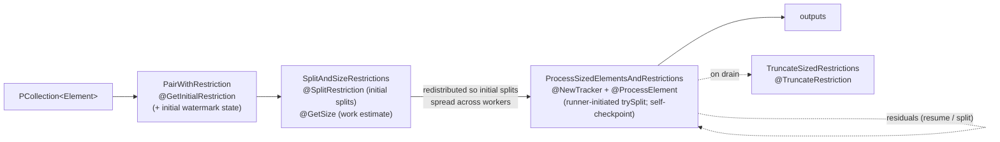

# 03 · Splittable DoFn, Restriction Trackers, and Coder Determinism

> **Folder:** `02-Apache-Beam-Execution-and-Portability-Internals/` · **File 3 of 3**
> **Anchors:** E. Kirpichov et al., *Splittable DoFn* proposal and design docs (Apache Beam, 2016–2017) and the Beam blog
> *Powerful and modular I/O connectors with Splittable DoFn* · Apache Flink FLIP-27 (*Refactor Source Interface*) ·
> Akidau et al., *The Dataflow Model* (VLDB 2015) · `beam_runner_api.proto` (SDF and coder URNs) · Flink SQL's binary row
> format (`BinaryRowData`) as the contrast for "zero-deserialization" field access.
> **Prev:** [02 · Runner v2 and the Fn API](02-runner-v2-portability-fn-api-grpc-bundles-and-sdk-harness.md) · **Next folder:**
> `03-Google-Cloud-Dataflow-and-MillWheel-Internals/`

---

## 0. The thesis

This file covers two protocols in which **correctness depends on user code honoring invariants the runner can only
partially check**:

1. **Splittable `DoFn` (SDF).** Reading becomes a `DoFn` over *(element, restriction)*. A **claim protocol** lets the
   runner split work *while it's being processed* without losing or duplicating records, but only if the `DoFn` claims
   before it acts and stops when a claim fails.
2. **Coder determinism.** Runners group and address state by **encoded bytes**. Grouping is correct only if equal keys
   always encode to equal bytes, and unequal keys never do.

Break either and the pipeline keeps running, with silently wrong results. An L7 engineer can state the invariants
formally, prove why they suffice, and build CI that enforces them.

---

# Part A: Splittable DoFn

## 1. First principles: why sources had to become DoFns

Beam originally had two source APIs, `BoundedSource` (split, size, read, dynamic splitting through
`splitAtFraction`) and `UnboundedSource` (readers with checkpoint marks and watermarks). They had structural limits:

| Limitation | Example |
|------------|---------|
| **Not composable** | You couldn't read files whose names arrive in a `PCollection` (from a Pub/Sub notification) without `ReadAll` workarounds |
| **Static topology** | Kafka partitions or Pub/Sub Lite partitions added at runtime required restarting the pipeline |
| **Two APIs, two runner paths** | Every runner implemented both. Batch and streaming reads diverged. |
| **Reads were roots** | A read couldn't be preceded by computation (list buckets, query a catalog, then read) |

**SDF's unification:** a read is a `DoFn` whose input is a *description of work* (a file, a partition, a table shard)
paired with a **restriction** (a byte range, an offset range, a key range) that can be split. Reading becomes an ordinary
transform with inputs, so it's composable. Splitting becomes a protocol between the runner and a **restriction
tracker**, so it's dynamic.

## 2. The model, formally

### 2.1 Objects

| Object | Meaning | Examples |
|--------|---------|----------|
| **Element** $x$ | What to read | `FileIO.ReadableFile`, a Kafka topic-partition descriptor, a BigQuery stream |
| **Restriction** $R$ | Which part of $x$ to read: a totally ordered set of **positions** | `OffsetRange[a, b)`, `ByteKeyRange`, `[a, ∞)` for unbounded |
| **Tracker** $T$ | Mutable cursor over $R$: `tryClaim(p)`, `trySplit(f)`, `checkDone()`, `currentRestriction()`, `getProgress()` | `OffsetRangeTracker`, `GrowableOffsetRangeTracker`, `ByteKeyRangeTracker` |
| **Watermark estimator** | Per-restriction event-time progress (Folder 01, file 02 §5.4) | `MonotonicallyIncreasing`, `Manual`, `WallTime` |
| **`ProcessContinuation`** | Return value of an unbounded `@ProcessElement`: `stop()` or `resume()[.withResumeDelay(d)]` | — |

### 2.2 The claim protocol: five invariants

| # | Invariant | Who enforces it |
|---|-----------|-----------------|
| **I1** | Work for position $p$ (reading it, emitting outputs derived from it) happens **only after** `tryClaim(p)` returns `true` | **You.** The runner can't see your I/O. |
| **I2** | Claimed positions are **strictly increasing** | Tracker (`checkArgument` on monotonicity) |
| **I3** | After `tryClaim` returns `false`, `@ProcessElement` **returns without further output** | **You** |
| **I4** | On normal return, the restriction is **fully processed**: the last attempted claim reached the end, or a claim failed | Tracker (`checkDone()` throws otherwise) |
| **I5** | `trySplit(f)` can be invoked **concurrently** (from the runner's split request) and may only cut the **unclaimed suffix** | Tracker plus the SDK's synchronized wrapper |

**Theorem (exactly-once partitioning under splits).** If a `DoFn` satisfies I1 and I3, and the tracker satisfies I2, I4,
and I5, then for any sequence of splits, every position of the original restriction is processed by **exactly one**
(sub)restriction.

*Proof sketch.* Let $c$ be the last attempted position when `trySplit` cuts at $s > c$:

- The primary becomes $[a, s)$ and the residual $[s, b)$.
- Any later `tryClaim(p)` in the primary with $p \ge s$ returns `false` (the primary's end is now $s$). By I3, nothing is
  produced for $p \ge s$ there.
- Positions $< s$ were either already claimed (and, by I1, processed only after claiming) or will be claimed by the
  primary.
- The residual starts unclaimed at $s$ and owns $[s, b)$.

So $[a, s) \cup [s, b) = [a, b)$ and $[a, s) \cap [s, b) = \emptyset$, and induction over splits gives the result. ∎

Violating **I1** (outputting before claiming) breaks it. A record at position $p \ge s$ is emitted by the primary *and*
again by the residual: a duplicate. Violating **I3** (ignoring a failed claim) has the same effect.

### 2.3 How `OffsetRangeTracker` splits

With range $[a, b)$ and last attempted position $c$ (or $a - 1$ if nothing has been attempted):

$$
s = c + \max\Big(1,\; \big\lfloor (b - c)\cdot f \big\rfloor\Big), \qquad \text{split iff } s < b
$$

$$
\text{primary} = [a, s), \qquad \text{residual} = [s, b)
$$

- $f = 0$ is a **checkpoint**: $s = c + 1$. The primary is exactly what has been claimed, and the residual is everything
  else. Unbounded SDFs self-checkpoint by returning `resume()`, which makes the runner call `trySplit(0)`.
- $f = 0.5$ is **rebalancing**: hand half the remaining work to another worker.
- `tryClaim(p)` with $p \ge b$ records $p$ as the last attempted position and returns `false`. Claiming beyond the end is
  legal and is how you signal "done" (I4) even at EOF (§8.2).

### 2.4 Expansion into runner primitives



The portable URNs are `beam:transform:sdf_pair_with_restriction:v1`, `…sdf_split_and_size_restrictions:v1`,
`…sdf_process_sized_element_and_restrictions:v1`, and `…sdf_truncate_sized_restrictions:v1`. On runners without full SDF
support, the SDK or runner may fall back to wrapping legacy sources, or reject the pipeline via `requirements` (file 02
§1.2).

### 2.5 The SDF method surface

| Annotation | Required? | Purpose | Production note |
|------------|-----------|---------|-----------------|
| `@GetInitialRestriction` | yes | element → full restriction | Unbounded: `[start, Long.MAX_VALUE)` |
| `@SplitRestriction` | no | initial splitting into many restrictions | Bounded files: ~64–256 MB pieces so readers start balanced |
| `@NewTracker` | no if the restriction implements `HasDefaultTracker` | restriction → tracker | Unbounded: a growable tracker with an end estimator |
| `@GetSize` | strongly recommended | work estimate per (element, restriction) | **Drives initial balancing, autoscaling backlog, and split choice.** Use bytes when possible. |
| `@GetRestrictionCoder` | when inference fails | restriction coder | Residuals are persisted, so coder stability matters for updates |
| `@GetInitialWatermarkEstimatorState` / `@NewWatermarkEstimator` / `@GetWatermarkEstimatorStateCoder` | unbounded: yes, in practice | event-time progress per restriction | Be explicit. Relying on defaults often leaves the watermark pinned near the input element's timestamp ⚠ verify the default per version. |
| `@TruncateRestriction` | no | what to do with an unfinished restriction on **drain** | Default (⚠ verify): bounded restrictions finish; unbounded ones stop. Override for "read up to the current end, then stop". |
| `@UnboundedPerElement` / `@BoundedPerElement` | infer or declare | boundedness per element | Unbounded makes the output `PCollection` unbounded |

## 3. Bounded vs. unbounded processing

| | Bounded SDF | Unbounded SDF |
|---|---|---|
| `@ProcessElement` returns | `void` (implicitly done) | `ProcessContinuation` |
| Termination | restriction exhausted | `stop()`, or truncation on drain |
| Checkpointing | only by runner splits | **self-checkpoint** via `resume()` → `trySplit(0)`; the residual is persisted with its watermark state |
| Resume delay | n/a | `resume().withResumeDelay(d)` when caught up, to avoid hot polling |
| Watermark | irrelevant (bounded) | per-restriction estimator; the stage watermark is the min over all live residuals (each residual is a **hold**) |

**Self-checkpoint frequency is a three-way trade.** Each `resume()` persists a residual and commits the bundle's outputs:

- Too frequent: commit overhead dominates (state writes, per-bundle cost from file 02 §3.3).
- Too rare: output latency and redo-on-failure grow, and the runner can't rebalance.

Production SDFs run a **time budget** (e.g., 5–10 s of processing) or a record budget per invocation, then `resume()`.

## 4. Progress and size: the signals behind autoscaling and splitting

- `@GetSize` is called before processing (initial balancing) and feeds the runner's **backlog estimate**. Dataflow
  autoscaling in streaming reasons about backlog bytes and throughput. An SDF that returns `0` or a constant blinds it.
- `RestrictionTracker.HasProgress#getProgress()` returns `Progress(workCompleted, workRemaining)` during processing. The
  runner uses it to choose split fractions and to detect stragglers.
- **Units must be consistent across restrictions of the same transform**, so the runner can compare them. Bytes are
  the safest unit. For record-count positions, multiply by the average record size.

## 5. Drain and truncation

Draining a streaming pipeline means *stop reading new input, finish what's in flight, then end*. For an unbounded SDF,
"in flight" is a residual restriction `[next, ∞)`. Without truncation it would never end. `@TruncateRestriction` maps it
to a bounded restriction (or `null` for "drop"):

- **Stop now** (the common default for unbounded restrictions ⚠ verify): data after `next` isn't read by this pipeline.
  The replacement pipeline must start from the committed position, so the source's committed offsets must reflect what
  was actually processed.
- **Read to current end:** truncate to `[next, endAtDrainTime)`. That's useful when the replacement starts at "latest",
  so nothing is lost in between.

## 6. Split alignment for record-oriented formats

Positions are **bytes**, but outputs are **records** that can straddle range boundaries. The universal rule:

> **A record belongs to the restriction that contains its first byte.**

```
bytes:     0                100                 200                 300
records:   [r0------][r1-----------][r2---][r3---------------][r4--]
           ^0        ^40           ^130   ^170               ^290
ranges:    [0, 100)                [100, 200)                [200, 300)
owns:      r0 (0), r1 (40)         r2 (130), r3 (170)        r4 (290)
reads:     0 … end of r1 (130):    seek 99, skip to 130;     seek 199, skip to 290;
           crosses 100, legal      r3 runs to 290, legal     claim 290 → r4 → EOF
```

Reader algorithm for range $[a, b)$:

1. If $a > 0$, seek to $a - 1$ and **discard through the next delimiter**. If the byte at $a - 1$ *is* the delimiter, that
   discards exactly one byte, so a record starting at $a$ is kept.
2. Loop: let `start` be the current position. If `!tryClaim(start)`, return. Read one full record, *even past $b$*, and
   emit it.
3. At EOF, claim `Long.MAX_VALUE` (always fails) to satisfy I4, then return.

Every record is read exactly once: the range containing its first byte claims it, and the next range skips its tail.
Classic bugs:

- counting **chars instead of bytes** with multi-byte UTF-8,
- forgetting `\r\n`,
- multi-byte delimiters split across the boundary,
- compressed inputs, whose byte offsets aren't seekable record boundaries, so splitting is impossible without block
  formats.

## 7. Flink contrast: FLIP-27 sources

| Dimension | Beam SDF | Flink FLIP-27 (`Source` = `SplitEnumerator` + `SourceReader`) |
|-----------|----------|----------------------------------------------------------------|
| Unit of parallel work | (element, restriction) | **Split** (file block, partition) |
| Assignment | runner-scheduled bundles | enumerator assigns splits, typically on reader request (pull) |
| **Mid-split splitting** | **Yes.** Runner-initiated `trySplit` while processing (dynamic work rebalancing). | **No.** A split assigned to a reader is read by that reader. Balancing happens at split granularity. |
| Dynamic discovery | SDF over a `PCollection` of descriptors (e.g., KafkaIO `readSourceDescriptors` with discovery upstream) | enumerator periodic discovery (e.g., Kafka partition discovery interval) |
| Checkpoint | residual restrictions (+ watermark state) persisted by the runner | reader split state + enumerator state in the Flink checkpoint |
| Watermarks | per-restriction estimator | per-split generator inside the reader (Folder 01, file 02 §5.2) |
| Straggler mitigation | split the straggler's restriction | pre-split finely; rely on dynamic assignment of *unassigned* splits |

The L7 consequence: **in Flink, choose split granularity up front.** Too coarse and one huge split becomes an unfixable
straggler. Too fine and enumerator overhead plus checkpointed split state grow. In Beam/Dataflow, the runner fixes
stragglers after the fact, provided your SDF honors the claim protocol.

---

# Part B: Coder determinism

## 8. First principles: grouping by bytes

### 8.1 Why bytes

From file 02 §2.4: a portable runner groups keys by **byte equality of their encoding**. State is addressed by encoded
key (plus window and state ID). Shuffle partitioning hashes encoded bytes. Even non-portable runners hash and compare
encoded keys in shuffle. So the coder *defines* key identity.

### 8.2 Formal requirements

Let $C : T \to \{0,1\}^*$ be the key coder and $\equiv$ the equivalence you *intend* (usually `equals`).

$$
\textbf{Deterministic:}\quad x \equiv y \;\Rightarrow\; C(x) = C(y)
\qquad\qquad
\textbf{Injective on classes:}\quad C(x) = C(y) \;\Rightarrow\; x \equiv y
$$

| Violation | Effect on `GroupByKey` | Effect on state |
|-----------|------------------------|-----------------|
| Not deterministic | **One logical key splits into several groups.** Counts are divided, joins miss, "unique" outputs are duplicated. | One key's state is spread across addresses. Timers fire per fragment. |
| Not injective | **Distinct keys merge.** Data from different entities is combined. | Cross-entity state corruption |

Beam exposes related coder properties:

- `verifyDeterministic()` throws `NonDeterministicException` if the coder declares itself non-deterministic.
  `GroupByKey` calls it on the key coder **at construction time**. Stateful `ParDo` key coders are held to the same
  standard, because state is addressed by encoded key.
- `consistentWithEquals()` says whether `C(x) = C(y) ⇔ x.equals(y)`. If true, runners may compare objects directly.
- `structuralValue(x)` is what runners use for in-memory equality (pre-combine tables, caches). For coders not
  consistent with equals, it's a wrapper over the encoded bytes.

**What the construction-time check cannot catch:** a custom coder that *claims* determinism (`verifyDeterministic() {}`)
but iterates a `HashMap`. That passes construction and fails silently at runtime (§12.1).

### 8.3 Where non-determinism comes from

| Source | Mechanism | Beam's stance | Fix |
|--------|-----------|---------------|-----|
| `SerializableCoder` (Java serialization) | class descriptors, `serialVersionUID`, object-graph handles, and *nested* `HashMap`/`HashSet` iteration order | `verifyDeterministic` throws ("Java Serialization may be non-deterministic") | Explicit coders or schemas |
| `HashMap` / `HashSet` iteration | order depends on capacity, resize history, and collision insertion order. **Equal maps built differently iterate differently.** | `MapCoder`/`SetCoder` declare non-determinism | Sorted structures (`SortedMapCoder`, sort before encoding) or canonicalize in the type |
| `Enum.hashCode()` (identity hash) | **differs across JVMs.** Any order or encoding derived from it (e.g., a `HashSet<Enum>`) differs per worker | covered via the containers above | Encode `name()`; never rely on enum hash order |
| `double` / `float` | `-0.0 == 0.0` but has different bits; many NaN bit patterns | `DoubleCoder`/`FloatCoder` **throw** in `verifyDeterministic` ("Floating point encodings are not guaranteed to be deterministic") | Don't key on floats: scaled integers (micros, cents), buckets, or canonicalize `-0.0`/NaN in the type |
| Avro `map` fields | `HashMap` ordering | `AvroCoder` determinism checker rejects maps (and some unions) | Records instead of maps for keys; sort |
| Protobuf `map` fields, unknown fields | wire format doesn't guarantee field or map order | `ProtoCoder` deterministic only without maps ⚠ verify | Avoid maps in key protos; extract a canonical key |
| Unicode | `"é"` (U+00E9) vs `"e"` + U+0301: visually identical, different bytes and `equals` | consistent (strings differ) but surprising | Normalize to NFC at the type boundary |
| `BigDecimal` | `1.0` vs `1.00`: `equals` false, `compareTo` 0 | consistent with `equals` | Normalize the scale (`stripTrailingZeros()`) if the business means "numerically equal" |
| Time zones | the same instant with different zones in `ZonedDateTime` | depends on the coder | Key on `Instant` (UTC epoch) |

### 8.4 Schemas and `Row`: what "zero-deserialization" really means

Beam schemas attach a field-level schema to a `PCollection`. A `SchemaProvider` (`JavaFieldSchema`, `JavaBeanSchema`,
`AutoValueSchema`, …) maps user types to and from `Row`. `RowCoder` encodes a row roughly as **field count, a null
bitmap, then each non-null field with its field coder**, in schema order or in explicit **encoding positions** (which
exist so that fields can be added compatibly across pipeline updates) ⚠ verify the exact layout for your version.

Claims about schemas are often overstated, so be precise:

| Claim | Reality in Beam | Where it's literally true |
|-------|-----------------|---------------------------|
| "Zero-deserialization field access" | **No.** Decoding a `Row` from bytes decodes its fields (generated code, but full decode). | **Flink SQL's `BinaryRowData`:** a fixed-length region with a null bitset and 8-byte slots (inline values or offset+length pointers into a variable region), so one field can be read straight from a `MemorySegment` without materializing the row. Spark's `UnsafeRow` is the same idea. |
| "Zero-copy conversion from user types" | **Partly.** `RowWithGetters` wraps a user object and calls generated getters lazily, so no eager copy into a `Row` is needed. | — |
| "Schemas reduce bytes moved" | **Yes, via projection.** `Select.fieldNames(...)` drops fields before a shuffle, and schema-aware IOs push projections into the source (BigQuery Storage Read selected fields, Parquet column projection), so unused columns are never read. | — |
| "Schemas are cross-language" | **Yes.** `beam:coder:row:v1` is a model coder, so Python, Java, and Go agree on bytes. | — |
| "Schemas are deterministic keys" | **Only if every field type is deterministic.** No floats, no maps (⚠ verify `RowCoder` determinism rules per version). | — |

The correct L7 summary: Beam schemas buy **projection** and **portability**. True field-level lazy access from bytes is
a property of binary row formats such as Flink SQL's `BinaryRowData` and Spark's `UnsafeRow`.

### 8.5 Flink: keys route by `hashCode()`, not by bytes

Flink's `keyBy` assigns a record to a **key group** with
`KeyGroupRangeAssignment.assignToKeyGroup(key, maxParallelism)`, which is a murmur hash of **`key.hashCode()`**. Both the
sending subtask (partitioner) and the receiving subtask (state backend) compute it, **each in its own JVM**. So:

- **Keys must have a `hashCode()` that's stable across JVMs.** `String`, boxed primitives, and records or POJOs composed of
  them are fine. **Enums are not**: `Enum.hashCode()` is identity-based. **Records containing enums inherit the
  problem**, because a record's `hashCode` mixes component hash codes.
- **Symptoms:** `IllegalArgumentException: Key group X is not in KeyGroupRange{…}` at the receiver, or *silent*
  misrouting, where one logical key's state ends up split across subtasks, and state isn't found after restore or
  rescale.
- **State serialization is separate.** `TypeSerializer`s (POJO, Avro, Kryo fallback) encode state values and keys for
  RocksDB. Kryo fallback is slow and blocks schema evolution, so set `pipeline.generic-types=false` (Folder 01, file 01
  §7.4).

## 9. Hardware sympathy: coder costs

| Coder | Bytes for a small POJO (3 fields) | CPU | Notes |
|-------|-----------------------------------|-----|-------|
| `SerializableCoder` | hundreds (class descriptor, field names) | **slowest by roughly an order of magnitude** | Also fragile across code changes (`serialVersionUID`) |
| Custom `CustomCoder` with varints | tens | fast | You own versioning |
| `RowCoder` (schema) | tens, plus a null bitmap | generated code, fast | Cross-language and evolvable via encoding positions |
| Flink `PojoSerializer` | tens, plus a null mask and subclass tag | fast | Supports evolution of POJO fields |
| Flink `KryoSerializer` | variable | slow | No evolution guarantees |
| Flink `BinaryRowData` (SQL) | fixed region + variable region | **field access without full decode** | Sorting on binary keys uses normalized-key prefixes (byte-wise compare) |

Varint encoding saves bytes for small numbers but costs a branchy decode loop. Fixed-width big-endian encodings are faster
to decode and **byte-order-sortable** (which is why `InstantCoder` uses fixed width with a sign flip, Folder 01, file 01
§6.4).

---

## 10. Production Java 21 code blueprints

### 10.1 SDF anti-pattern

```java
// ANTI-PATTERN: violates I1 and I3, ignores its own restriction, and blinds the autoscaler.
@DoFn.BoundedPerElement
class BrokenFileReadFn extends DoFn<FileIO.ReadableFile, String> {

  @GetInitialRestriction
  public OffsetRange init(@Element FileIO.ReadableFile f) {
    return new OffsetRange(0, f.getMetadata().sizeBytes());
  }

  @GetSize
  public double size(@Restriction OffsetRange r) {
    return 0;                                              // (1) splitting and autoscaling are now blind
  }

  @ProcessElement
  public void process(@Element FileIO.ReadableFile f, RestrictionTracker<OffsetRange, Long> tracker,
                      OutputReceiver<String> out) throws IOException {
    String all = f.readFullyAsUTF8String();               // (2) every split reads the WHOLE file
    long offset = tracker.currentRestriction().getFrom();
    for (String line : all.split("\n")) {
      out.output(line);                                    // (3) output BEFORE claim (violates I1)
      tracker.tryClaim(offset);                            // (4) result ignored (violates I3): duplicates after a split
      offset += line.length() + 1;                         // (5) chars ≠ bytes for UTF-8
    }
  }
}
```

### 10.2 Production bounded SDF: a newline-delimited reader that splits correctly

```java
package dev.l7.dataflow.sdf;

import java.io.ByteArrayOutputStream;
import java.io.IOException;
import java.nio.ByteBuffer;
import java.nio.channels.SeekableByteChannel;
import java.nio.charset.StandardCharsets;
import org.apache.beam.sdk.coders.Coder;
import org.apache.beam.sdk.io.FileIO;
import org.apache.beam.sdk.io.range.OffsetRange;
import org.apache.beam.sdk.transforms.DoFn;
import org.apache.beam.sdk.transforms.splittabledofn.OffsetRangeTracker;
import org.apache.beam.sdk.transforms.splittabledofn.RestrictionTracker;

/**
 * Reads uncompressed newline-delimited files with byte-range restrictions.
 * Ownership rule: a record belongs to the restriction containing its FIRST byte (§6).
 * Safe under initial splits AND runner-initiated dynamic splits, because every output is preceded by a
 * successful tryClaim(recordStart) and processing stops on the first failed claim.
 */
@DoFn.BoundedPerElement
public final class SplittableLineReadFn extends DoFn<FileIO.ReadableFile, String> {

  private static final long TARGET_SPLIT_BYTES = 128L << 20;   // initial pieces: ~128 MiB
  private static final long MIN_SPLIT_BYTES = 8L << 20;

  @GetInitialRestriction
  public OffsetRange initialRestriction(@Element FileIO.ReadableFile file) {
    return new OffsetRange(0, file.getMetadata().sizeBytes());
  }

  @SplitRestriction
  public void splitRestriction(@Restriction OffsetRange range, OutputReceiver<OffsetRange> out) {
    for (OffsetRange part : range.split(TARGET_SPLIT_BYTES, MIN_SPLIT_BYTES)) {
      out.output(part);
    }
  }

  @GetSize
  public double getSize(@Restriction OffsetRange range) {
    return range.getTo() - range.getFrom();                    // bytes: comparable across files
  }

  @NewTracker
  public OffsetRangeTracker newTracker(@Restriction OffsetRange range) {
    return new OffsetRangeTracker(range);
  }

  @GetRestrictionCoder
  public Coder<OffsetRange> restrictionCoder() {
    return OffsetRange.Coder.of();                             // ⚠ verify accessor name in your SDK version
  }

  @ProcessElement
  public void process(@Element FileIO.ReadableFile file,
                      RestrictionTracker<OffsetRange, Long> tracker,
                      OutputReceiver<String> out) throws IOException {
    long from = tracker.currentRestriction().getFrom();
    try (SeekableByteChannel channel = file.openSeekable()) {
      LineReader reader = new LineReader(channel, from == 0 ? 0 : from - 1);
      if (from > 0) {
        reader.readLine();                                     // discard the tail of the record owned by the previous range
      }
      while (true) {
        long recordStart = reader.position();
        if (!tracker.tryClaim(recordStart)) {
          return;                                              // past our end, or a split moved our end: I3
        }
        byte[] line = reader.readLine();                       // may legally run past the range end
        if (line == null) {                                    // EOF right after a successful claim (file shrank or
          tracker.tryClaim(Long.MAX_VALUE);                    // trailing position): mark the restriction done (I4)
          return;
        }
        out.output(new String(line, StandardCharsets.UTF_8));
      }
    }
  }

  /** Buffered reader over a SeekableByteChannel that tracks the absolute offset of the next unread byte. */
  static final class LineReader {
    private final SeekableByteChannel channel;
    private final ByteBuffer buffer = ByteBuffer.allocate(64 * 1024);
    private long position;

    LineReader(SeekableByteChannel channel, long start) throws IOException {
      this.channel = channel;
      channel.position(start);
      this.position = start;
      buffer.flip();                                           // start empty
    }

    long position() {
      return position;
    }

    /** Next line without its '\n' (and without a trailing '\r'), or null at EOF with nothing read. */
    byte[] readLine() throws IOException {
      ByteArrayOutputStream line = new ByteArrayOutputStream(256);
      boolean readAny = false;
      while (true) {
        if (!buffer.hasRemaining()) {
          buffer.clear();
          int n = channel.read(buffer);
          buffer.flip();
          if (n < 0) {
            return readAny ? stripCr(line.toByteArray()) : null;
          }
          if (n == 0) {
            continue;
          }
        }
        byte b = buffer.get();
        position++;
        readAny = true;
        if (b == '\n') {
          return stripCr(line.toByteArray());
        }
        line.write(b);
      }
    }

    private static byte[] stripCr(byte[] bytes) {
      int n = bytes.length;
      return (n > 0 && bytes[n - 1] == '\r') ? java.util.Arrays.copyOf(bytes, n - 1) : bytes;
    }
  }
}
```

```java
p.apply(FileIO.match().filepattern("gs://bucket/logs/*.ndjson"))
 .apply(FileIO.readMatches().withCompression(Compression.UNCOMPRESSED))   // byte offsets must be seekable
 .apply("ReadLines", ParDo.of(new SplittableLineReadFn()));
```

The byte-at-a-time copy keeps the boundary logic readable. A production reader scans the buffer for `'\n'` in bulk, but
the claim protocol stays identical.

### 10.3 Production unbounded SDF: polling a partitioned log

A custom source for a proprietary log (offsets per partition, event time per record). It demonstrates:

- a growable tracker,
- a cached end estimate (safe to call from the runner's split and progress thread),
- backlog-aware watermark advance,
- a time-budgeted self-checkpoint,
- `@GetSize` in bytes,
- drain truncation.

```java
package dev.l7.dataflow.sdf;

import java.io.IOException;
import java.io.Serializable;
import java.util.List;
import java.util.concurrent.ConcurrentHashMap;
import org.apache.beam.sdk.coders.Coder;
import org.apache.beam.sdk.coders.InstantCoder;
import org.apache.beam.sdk.io.range.OffsetRange;
import org.apache.beam.sdk.transforms.DoFn;
import org.apache.beam.sdk.transforms.splittabledofn.GrowableOffsetRangeTracker;
import org.apache.beam.sdk.transforms.splittabledofn.ManualWatermarkEstimator;
import org.apache.beam.sdk.transforms.splittabledofn.OffsetRangeTracker;
import org.apache.beam.sdk.transforms.splittabledofn.RestrictionTracker;
import org.apache.beam.sdk.transforms.splittabledofn.WatermarkEstimators;
import org.apache.beam.sdk.transforms.windowing.BoundedWindow;
import org.joda.time.Duration;
import org.joda.time.Instant;

@DoFn.UnboundedPerElement
public final class PollPartitionFn extends DoFn<PollPartitionFn.Partition, byte[]> {

  /** Input element: which partition to read and from where. Low volume, so SerializableCoder is acceptable here. */
  public record Partition(String log, int id, long startOffset) implements Serializable {}

  /** Thread-safe client for the proprietary log. */
  public interface LogClient extends AutoCloseable {
    record LogRecord(long offset, long eventTimeMillis, byte[] payload) {}

    /** Offset that the NEXT appended record will get (exclusive end of what exists now). */
    long endOffset(Partition p) throws IOException;

    List<LogRecord> fetch(Partition p, long fromOffset, int maxRecords) throws IOException;
  }

  public interface LogClientFactory extends Serializable {
    LogClient create();
  }

  private static final int MAX_BATCH = 5_000;
  private static final long PROCESS_BUDGET_NANOS = 10_000_000_000L;      // self-checkpoint about every 10 s
  private static final Duration POLL_DELAY_WHEN_IDLE = Duration.standardSeconds(2);
  private static final double AVG_RECORD_BYTES = 512.0;                   // keeps @GetSize in bytes

  private final LogClientFactory clientFactory;
  private final Duration maxOutOfOrderness;

  private transient LogClient client;
  private transient ConcurrentHashMap<Partition, Long> knownEnds;         // read by the split/progress thread

  public PollPartitionFn(LogClientFactory clientFactory, Duration maxOutOfOrderness) {
    this.clientFactory = clientFactory;
    this.maxOutOfOrderness = maxOutOfOrderness;
  }

  @Setup
  public void setup() {
    client = clientFactory.create();
    knownEnds = new ConcurrentHashMap<>();
  }

  @Teardown
  public void teardown() throws Exception {
    if (client != null) {
      client.close();
    }
  }

  // ---------------------------------------------------------------- restriction

  @GetInitialRestriction
  public OffsetRange initialRestriction(@Element Partition p) {
    return new OffsetRange(p.startOffset(), Long.MAX_VALUE);
  }

  @NewTracker
  public OffsetRangeTracker newTracker(@Element Partition p, @Restriction OffsetRange r) {
    if (r.getTo() != Long.MAX_VALUE) {
      return new OffsetRangeTracker(r);                     // already bounded (a split or truncated residual)
    }
    // The estimator is called from the runner's progress/split thread: read a cached value, never the client.
    return new GrowableOffsetRangeTracker(r.getFrom(), () -> knownEnds.getOrDefault(p, r.getFrom()));
  }

  @GetRestrictionCoder
  public Coder<OffsetRange> restrictionCoder() {
    return OffsetRange.Coder.of();                          // ⚠ verify accessor name in your SDK version
  }

  @GetSize
  public double getSize(@Element Partition p, @Restriction OffsetRange r) throws IOException {
    long end = r.getTo() != Long.MAX_VALUE ? r.getTo() : knownEnds.computeIfAbsent(p, this::endOffsetUnchecked);
    return Math.max(0L, end - r.getFrom()) * AVG_RECORD_BYTES;   // backlog in BYTES for autoscaling
  }

  // ---------------------------------------------------------------- watermark

  @GetInitialWatermarkEstimatorState
  public Instant initialWatermark(@Timestamp Instant elementTimestamp) {
    return elementTimestamp;
  }

  @NewWatermarkEstimator
  public WatermarkEstimators.Manual newWatermarkEstimator(@WatermarkEstimatorState Instant state) {
    return new WatermarkEstimators.Manual(state);
  }

  @GetWatermarkEstimatorStateCoder
  public Coder<Instant> watermarkStateCoder() {
    return InstantCoder.of();
  }

  // ---------------------------------------------------------------- processing

  @ProcessElement
  public ProcessContinuation process(@Element Partition p,
                                     RestrictionTracker<OffsetRange, Long> tracker,
                                     ManualWatermarkEstimator<Instant> watermark,
                                     OutputReceiver<byte[]> out) throws IOException {
    long next = tracker.currentRestriction().getFrom();
    long deadline = System.nanoTime() + PROCESS_BUDGET_NANOS;
    Instant maxEventTime = BoundedWindow.TIMESTAMP_MIN_VALUE;

    while (System.nanoTime() < deadline) {
      List<LogClient.LogRecord> batch = client.fetch(p, next, MAX_BATCH);
      if (batch.isEmpty()) {
        knownEnds.put(p, next);                             // verified caught up: backlog is zero
        advance(watermark, Instant.now().minus(maxOutOfOrderness));   // backlog-aware idle advance
        return ProcessContinuation.resume().withResumeDelay(POLL_DELAY_WHEN_IDLE);
      }
      for (LogClient.LogRecord r : batch) {
        if (!tracker.tryClaim(r.offset())) {
          return ProcessContinuation.stop();                // split or truncated: the residual owns the rest (I3)
        }
        Instant ts = new Instant(r.eventTimeMillis());
        out.outputWithTimestamp(r.payload(), ts);           // claim-then-emit (I1); gaps in offsets are fine
        if (ts.isAfter(maxEventTime)) {
          maxEventTime = ts;
        }
        next = r.offset() + 1;
      }
      knownEnds.merge(p, next, Math::max);
      advance(watermark, maxEventTime.minus(maxOutOfOrderness));
    }
    return ProcessContinuation.resume();                    // budget spent: checkpoint now, continue immediately
  }

  // ---------------------------------------------------------------- drain

  @TruncateRestriction
  public RestrictionTracker.TruncateResult<OffsetRange> truncate(@Element Partition p, @Restriction OffsetRange r)
      throws IOException {
    if (r.getTo() != Long.MAX_VALUE) {
      return RestrictionTracker.TruncateResult.of(r);       // bounded residual: finish it
    }
    long end = client.endOffset(p);                         // drain = read what exists now, then stop
    return end > r.getFrom()
        ? RestrictionTracker.TruncateResult.of(new OffsetRange(r.getFrom(), end))
        : null;                                             // nothing left: drop (⚠ verify null semantics)
  }

  // ---------------------------------------------------------------- helpers

  private static void advance(ManualWatermarkEstimator<Instant> w, Instant candidate) {
    if (candidate.isAfter(w.currentWatermark())) {
      w.setWatermark(candidate);                            // keep it monotone ourselves
    }
  }

  private long endOffsetUnchecked(Partition p) {
    try {
      return client.endOffset(p);
    } catch (IOException e) {
      throw new IllegalStateException("cannot read end offset for " + p, e);
    }
  }
}
```

```java
p.apply("Partitions", Create.of(partitions).withCoder(SerializableCoder.of(PollPartitionFn.Partition.class)))
 .apply("Poll", ParDo.of(new PollPartitionFn(clientFactory, Duration.standardMinutes(1))));
```

Design notes worth saying out loud in a review:

- **Committed progress is the runner's checkpoint of the residual**, not a commit to the log. If the log needs consumer
  commits, as Kafka does, do them in a separate step after durable processing, or with bundle finalization (file 02 §2.6).
- **Records older than the current watermark estimate are late downstream.** The out-of-orderness budget must cover
  intra-partition disorder (Folder 01, file 02 §2.3).
- **For dynamic partition discovery,** feed `Partition` elements from an upstream periodic-discovery transform (a
  `Watch`-style poll or a separate SDF) so new partitions start without a restart.

### 10.4 Coder determinism: a lying coder, a canonical key, and property tests

```java
// ANTI-PATTERN: claims determinism, iterates a HashMap. Passes GroupByKey's construction check; splits groups at runtime.
final class TagsKeyCoder extends CustomCoder<Map<String, String>> {
  @Override
  public void encode(Map<String, String> tags, OutputStream out) throws IOException {
    VarIntCoder.of().encode(tags.size(), out);
    for (Map.Entry<String, String> e : tags.entrySet()) {     // order depends on capacity and insertion history
      StringUtf8Coder.of().encode(e.getKey(), out);
      StringUtf8Coder.of().encode(e.getValue(), out);
    }
  }

  @Override
  public Map<String, String> decode(InputStream in) throws IOException { /* … */ return Map.of(); }

  @Override
  public void verifyDeterministic() {}                         // LIES
}
```

The fix moves canonicalization **into the type**, so that `equals` and the encoding agree by construction. Records
guarantee their canonical constructor runs, including during deserialization.

```java
package dev.l7.dataflow.coders;

import java.io.IOException;
import java.io.InputStream;
import java.io.OutputStream;
import java.text.Normalizer;
import java.util.Collections;
import java.util.Map;
import java.util.Objects;
import java.util.TreeMap;
import org.apache.beam.sdk.coders.BigEndianLongCoder;
import org.apache.beam.sdk.coders.Coder;
import org.apache.beam.sdk.coders.CustomCoder;
import org.apache.beam.sdk.coders.StringUtf8Coder;
import org.apache.beam.sdk.coders.VarIntCoder;

/** A grouping key that is canonical by construction: NFC strings, sorted tags, no −0.0, no NaN. */
public record MetricKey(String name, Map<String, String> tags, double bucketLowerBound) {

  public MetricKey {
    name = nfc(Objects.requireNonNull(name, "name"));
    TreeMap<String, String> sorted = new TreeMap<>();
    Objects.requireNonNull(tags, "tags").forEach((k, v) -> sorted.put(nfc(k), nfc(v)));
    tags = Collections.unmodifiableSortedMap(sorted);          // always a SortedMap, whatever the caller passed
    if (Double.isNaN(bucketLowerBound)) {
      throw new IllegalArgumentException("NaN is not a valid bucket bound");
    }
    if (bucketLowerBound == 0.0) {
      bucketLowerBound = 0.0;                                  // −0.0 == 0.0 is true: collapse to +0.0
    }
  }

  private static String nfc(String s) {
    return Normalizer.normalize(s, Normalizer.Form.NFC);
  }

  /** Deterministic and consistent with equals, because the type is canonical and the encoding is ordered. */
  public static final class MetricKeyCoder extends CustomCoder<MetricKey> {
    public static final MetricKeyCoder INSTANCE = new MetricKeyCoder();
    private static final Coder<String> STRING = StringUtf8Coder.of();
    private static final Coder<Integer> VARINT = VarIntCoder.of();
    private static final Coder<Long> FIXED64 = BigEndianLongCoder.of();

    @Override
    public void encode(MetricKey k, OutputStream out) throws IOException {
      STRING.encode(k.name(), out);
      VARINT.encode(k.tags().size(), out);
      for (Map.Entry<String, String> e : k.tags().entrySet()) {   // sorted iteration by construction
        STRING.encode(e.getKey(), out);
        STRING.encode(e.getValue(), out);
      }
      FIXED64.encode(Double.doubleToLongBits(k.bucketLowerBound()), out);
    }

    @Override
    public MetricKey decode(InputStream in) throws IOException {
      String name = STRING.decode(in);
      int n = VARINT.decode(in);
      TreeMap<String, String> tags = new TreeMap<>();
      for (int i = 0; i < n; i++) {
        tags.put(STRING.decode(in), STRING.decode(in));
      }
      return new MetricKey(name, tags, Double.longBitsToDouble(FIXED64.decode(in)));
    }

    @Override
    public void verifyDeterministic() {
      // Honest: canonical type + ordered, fixed-width encoding.
    }

    @Override
    public boolean consistentWithEquals() {
      return true;                                             // runners may compare objects instead of bytes
    }
  }
}
```

```java
package dev.l7.dataflow.coders;

import static org.junit.jupiter.api.Assertions.assertEquals;

import java.util.HashMap;
import java.util.LinkedHashMap;
import java.util.Map;
import org.apache.beam.sdk.testing.CoderProperties;
import org.junit.jupiter.api.Test;

class MetricKeyCoderTest {

  private final MetricKey.MetricKeyCoder coder = MetricKey.MetricKeyCoder.INSTANCE;

  @Test
  void equalKeysBuiltDifferentlyEncodeIdentically() throws Exception {
    Map<String, String> a = new HashMap<>(64);                 // different capacity …
    a.put("region", "us");
    a.put("az", "b");
    Map<String, String> b = new LinkedHashMap<>();             // … different insertion order
    b.put("az", "b");
    b.put("region", "us");

    MetricKey k1 = new MetricKey("latency", a, -0.0);
    MetricKey k2 = new MetricKey("latency", b, 0.0);

    assertEquals(k1, k2);
    CoderProperties.coderDeterministic(coder, k1, k2);
    CoderProperties.coderConsistentWithEquals(coder, k1, k2);
    CoderProperties.coderDecodeEncodeEqual(coder, k1);
  }

  @Test
  void unicodeVariantsCollapse() throws Exception {
    MetricKey composed = new MetricKey("café", Map.of(), 1.0);     // é as one code point
    MetricKey decomposed = new MetricKey("café", Map.of(), 1.0);  // e + combining acute accent
    assertEquals(composed, decomposed);
    CoderProperties.coderDeterministic(coder, composed, decomposed);
  }
}
```

### 10.5 Schemas: projection before the shuffle

```java
package dev.l7.dataflow.coders;

import org.apache.beam.sdk.schemas.JavaFieldSchema;
import org.apache.beam.sdk.schemas.annotations.DefaultSchema;
import org.apache.beam.sdk.schemas.annotations.SchemaCreate;
import org.apache.beam.sdk.schemas.transforms.Group;
import org.apache.beam.sdk.schemas.transforms.Select;
import org.apache.beam.sdk.transforms.Sum;
import org.apache.beam.sdk.values.PCollection;
import org.apache.beam.sdk.values.Row;

@DefaultSchema(JavaFieldSchema.class)
public final class Purchase {
  public final String userId;
  public final String country;
  public final long amountCents;          // integer money: deterministic, associative sums
  public final String rawPayload;         // large; never needed for aggregation

  @SchemaCreate
  public Purchase(String userId, String country, long amountCents, String rawPayload) {
    this.userId = userId;
    this.country = country;
    this.amountCents = amountCents;
    this.rawPayload = rawPayload;
  }

  /** rawPayload is dropped BEFORE the shuffle; the grouping key is a deterministic schema field. */
  public static PCollection<Row> revenueByCountry(PCollection<Purchase> purchases) {
    return purchases
        .apply("Project", Select.fieldNames("country", "amountCents"))
        .apply("ByCountry", Group.<Row>byFieldNames("country")
            .aggregateField("amountCents", Sum.ofLongs(), "revenueCents"));
    // Output rows: { key: { country }, value: { revenueCents } }
  }
}
```

If `Purchase` instead came from a schema-aware source (BigQuery Storage Read, Parquet), the same `Select` can be pushed
into the read so `rawPayload` is never fetched. That's where schemas save the most.

### 10.6 Flink: enum-bearing keys and the `KeyGroupRange` failure

```java
enum Region { US, EU, APAC }

// ANTI-PATTERN: the record's hashCode() mixes Region.hashCode(), which is an identity hash and differs per JVM.
record RouteKey(Region region, String tenant) {}

orders.keyBy(o -> new RouteKey(o.region(), o.tenant()))
      .process(new PerTenantLimiter());
// Sender and receiver JVMs compute different key groups:
//   IllegalArgumentException: Key group 87 is not in KeyGroupRange{startKeyGroup=64, endKeyGroup=79}
// or silent misrouting, where one tenant's limiter state is split across subtasks and lost on restore or rescale.
```

```java
// FIX: key components with JLS-specified hash codes (String). Don't use ordinal(): reordering the enum
// would silently remap every key group on restore.
record RouteKey(String region, String tenant) {}

orders.keyBy(o -> new RouteKey(o.region().name(), o.tenant()))
      .process(new PerTenantLimiter());
```

---

## 11. Production failure modes and P99 debugging

| ID | Failure | Signature | Root cause | Fix |
|----|---------|-----------|------------|-----|
| S1 | **Duplicates after dynamic splits** | Duplicate records correlated with rebalancing or straggler events; counts exceed source totals | Output before claim (I1) or ignoring a failed claim (I3) | Claim-then-emit; stop on `false`; test with forced splits (§11.1) |
| S2 | **Lost or duplicated records at range boundaries** | Small, steady discrepancies per file; worse for multi-byte text | Split-alignment bugs (chars vs. bytes, `\r\n`, multi-byte delimiters) | "First byte owns the record" (§6); byte-level tests at every boundary offset |
| S3 | **Blind autoscaling and splitting** | Backlog grows but workers don't scale; initial splits unbalanced | `@GetSize` returns 0 or a constant | Bytes-based size and progress |
| S4 | **Watermark stuck on a custom SDF** | Source stage watermark flat while data flows | No (or default) watermark estimator; never advanced when idle | Explicit `Manual` estimator with a backlog-aware idle advance |
| S5 | **Hot-polling SDF** | CPU and commit rate high with little data; many tiny bundles | `resume()` without delay when caught up | `resume().withResumeDelay(d)` when the fetch is empty |
| S6 | **Checkpoint overhead** | High state or commit bytes on the SDF stage | Self-checkpoint on every small batch | Time or record budget per invocation |
| S7 | **Unsplittable stragglers** | A long tail of work items on huge files or partitions | No `@SplitRestriction`; non-seekable inputs (compressed) | Initial splits; splittable formats; SDF fan-out |
| S8 | **Drain hangs or loses data** | Drain never completes, or the replacement misses records | Truncation semantics not designed | `@TruncateRestriction` per contract; commit offsets that match processing |
| K1 | **Split groups (non-deterministic coder)** | Counts lower than expected, duplicate "unique" outputs; correct on DirectRunner, wrong on Dataflow | Lying custom coder, `HashMap` order, enum-hash-derived order across JVMs | Canonical key types; ordered encodings; `CoderProperties` tests |
| K2 | **Flink `KeyGroupRange` exceptions / misrouting** | `Key group X is not in KeyGroupRange` | Keys with JVM-unstable `hashCode()` (enums, identity-hash objects) | String or primitive key components; `name()` not `ordinal()` |
| K3 | **Floating-point keys** | GBK construction fails, or (worked around) `-0.0`/`0.0` split groups | `DoubleCoder` is declared non-deterministic | Scaled integers or buckets; canonicalize in the type |
| K4 | **Unicode duplicates** | "Same" names appear as separate keys | NFC vs. NFD input | Normalize at the type boundary |
| K5 | **`SerializableCoder` tax** | High CPU in serialization; big shuffle bytes; update incompatibility after refactors | Default coder fallback | Explicit coders or schemas; fail CI on `SerializableCoder` in hot paths |
| K6 | **Kryo fallback (Flink)** | CPU in Kryo; state evolution impossible | Generic types | `pipeline.generic-types=false`; POJOs, records, or Avro |

### 11.1 Runbook · S1/S2: prove split safety before production

1. **Split-everywhere test.** For a test file, run the reader once per possible split point $s$ (every byte offset, or a
   dense sample). Concatenate the outputs of $[0, s)$ and $[s, \text{EOF})$ and assert they equal a single unsplit read,
   **as a multiset and in order**.
2. **Dynamic split simulation.** Wrap the tracker so that `trySplit(0.5)` is invoked after the $k$-th claim, for many
   $k$. Assert primary ∪ residual outputs equal the unsplit read, with no duplicates.
3. **Encoding coverage.** Include multi-byte UTF-8 at boundaries, `\r\n`, empty lines, a missing final newline, and
   lines longer than the read buffer.
4. Beam's DirectRunner exercises splitting and checkpointing paths, but **explicit boundary tests are the real
   guarantee**.

### 11.2 Runbook · K1: "counts are lower on Dataflow than on DirectRunner"

1. Pick a key with a wrong count. Fetch its raw encoded bytes from two different workers' outputs or debug logs. Different
   bytes for the "same" key confirm non-determinism.
2. Audit the key coder: custom coders that iterate maps or sets, nested `SerializableCoder`s, floats, and any ordering
   derived from `hashCode` (enums in hash collections).
3. DirectRunner runs in **one JVM**, where identity hash codes and `HashMap` construction histories are often consistent,
   so the bug hides. That's why **DirectRunner success doesn't prove determinism**.
4. Fix with canonical key types plus ordered encodings, and add `CoderProperties.coderDeterministic` tests with keys
   built in different orders and capacities.
5. Remediate history: affected aggregates must be recomputed (backfill), because split groups can't be merged after the
   fact without knowing which fragments belong together.

---

## 12. FAANG L7 bar-raiser Q&A chains

### Q1 · "Explain the SDF protocol. Why must you claim before you output?"

**L5 textbook answer.** An SDF processes a restriction, and `tryClaim` marks progress so the runner can split the remaining
work.

**Why L5 breaks at petabyte scale.** "Marks progress" sounds like bookkeeping, so engineers emit first and claim later.
Under dynamic work rebalancing (constant on large Dataflow jobs), every split after an emit-before-claim produces
duplicates at the boundary. At 10⁵ splits per day, that's a steady, unexplained duplicate rate.

**L7 principal defense.**

- **`tryClaim(p)` is the commit point of ownership.** A split chooses $s >$ last attempted position. The primary may only
  produce positions $< s$, and the residual owns $\ge s$.
- **Claim-then-emit (I1) and stop-on-false (I3) are exactly what make the union disjoint and complete** (§2.2 proof).
  Emit-then-claim lets the primary produce a record at $p \ge s$ that the residual will produce again.
- **Mention the supporting pieces:**
  - claims must be strictly increasing (I2);
  - `checkDone` enforces completeness (I4);
  - `trySplit` is concurrent-safe and only cuts the unclaimed suffix (I5);
  - claiming `Long.MAX_VALUE` at EOF is the idiom for "done".
- **Testing:** split-everywhere and forced dynamic-split tests in CI (§11.1).

### Q2 · "How does Dataflow split a running file read in half without duplicating or losing records?"

**L5 textbook answer.** It assigns half of the remaining bytes to another worker.

**Why L5 breaks.** Bytes aren't records. A naive byte split cuts a line in two: one half emits a broken prefix and the
other a broken suffix, or both emit the full line.

**L7 principal defense.**

1. **Runner side:** a `process_bundle_split` request reaches the SDK, which calls `tracker.trySplit(0.5)`. The tracker
   picks $s = c + \lfloor (b - c)/2 \rfloor$ beyond the last claim. The primary becomes $[a, s)$ and the residual
   $[s, b)$ is scheduled on another worker (file 02 §2.6).
2. **Record alignment:** *a record belongs to the range containing its first byte.* The primary keeps claiming record
   starts $< s$ and may read its last record past $s$. The residual seeks to $s - 1$, discards through the next
   delimiter, and starts claiming at the first record start $\ge s$.
3. **Completeness:** every record start lies in exactly one range, so exactly one reader claims it.
4. **Preconditions:** a seekable byte stream (no gzip), a well-defined delimiter, and a byte-accurate position tracker.

### Q3 · "GroupByKey counts are about half what you expect on Dataflow, but correct on DirectRunner. Why?"

**L5 textbook answer.** Data loss on Dataflow, or late data being dropped.

**Why L5 breaks.** Lateness drops would show up in the drop counters, and data loss would show up in source/sink totals.
"Half" with matching totals and correct local results is the signature of **non-deterministic key encoding**: the same
logical key lands in two groups (one per encoding variant), each with roughly half the data.

**L7 principal defense.**

1. **Mechanism:** runners group by encoded bytes. Typical causes:
   - `HashMap`/`HashSet` iteration order in a key, which depends on capacity and history;
   - enum identity hashes influencing order across JVMs;
   - nested `SerializableCoder`;
   - `-0.0`/`0.0`.
2. **Why the DirectRunner passes:** it runs in one JVM, where construction histories and identity hashes are consistent.
3. **Fix:** canonical key types (sorted, normalized, no floats) plus honest coders, proven with
   `CoderProperties.coderDeterministic` on keys built differently (§10.4).
4. **Remediation:** recompute affected outputs; add CI gates that reject `SerializableCoder`, `MapCoder`, and float
   coders as key coders.

### Q4 · "Why does Beam reject `DoubleCoder` for `GroupByKey` keys? How would you key on a measured value?"

**L5 textbook answer.** Floating point isn't precise, so equality comparisons are unreliable.

**Why L5 breaks.** Imprecision isn't the issue. Determinism is. `-0.0` and `0.0` compare equal with `==` but have different
bits. Many NaN payloads exist (and `NaN != NaN` with `==`, while `Double.equals` treats them as equal). Any business
equivalence on doubles disagrees with bitwise equality somewhere, and grouping is bitwise.

**L7 principal defense.**

- **Don't key on raw doubles.** Key on:
  - a **scaled integer** (`Math.round(x * 1e6)` µs, cents);
  - a **bucket index** (`floor(x / width)`, or log-linear buckets for latencies);
  - or a canonicalized value in a type that collapses `-0.0` and rejects NaN (§10.4).
- **Decide the equivalence explicitly** (tolerance, bucket width). The coder then implements that decision, which keeps
  it deterministic and injective on the intended classes.

### Q5 · "Design a custom unbounded source in Beam for a proprietary partitioned log."

**L5 textbook answer.** Implement `UnboundedSource` with a reader and checkpoint marks.

**Why L5 breaks at petabyte scale.** Legacy `UnboundedSource` has a fixed topology (new partitions need a restart). It
isn't composable with upstream discovery, and on Runner v2 it's wrapped into SDF machinery anyway. Engineers also forget
the watermark when partitions go idle, size estimates for autoscaling, and drain behavior.

**L7 principal defense.** Write an **unbounded SDF** (§10.3):

- **Element:** a partition descriptor, fed by an upstream discovery transform, so partitions are dynamic.
- **Restriction:** `[start, ∞)` with a growable tracker. The end estimator reads a *cached* end, because it's called from
  the runner's thread.
- **Claim-then-emit** per offset, and stop on a failed claim.
- **Time-budgeted self-checkpoint** with `resume()`, and `resume().withResumeDelay` when caught up.
- **Explicit `Manual` watermark estimator:** max event time minus out-of-orderness, plus a backlog-verified idle advance.
  Never advance on wall clock while there's backlog.
- **`@GetSize` in bytes** for autoscaling.
- **`@TruncateRestriction`** matching the drain contract.
- **Consumer-offset commits** (if the log needs them) after durable processing, through finalization or a downstream
  step.
- **Tests:** split safety, idle partitions, and restart from residuals.

### Q6 · "Beam schemas give zero-deserialization field access. True?"

**L5 textbook answer.** Yes. `Row` coders let you access fields without deserializing the whole object.

**Why L5 breaks.** It conflates three things. Teams then expect field-level lazy decoding from `RowCoder`, design wide rows
with huge unused fields, and pay full decode costs at every stage boundary.

**L7 principal defense.**

- **Decoding a Beam `Row` from bytes decodes its fields.**
- **What schemas provide:**
  - lazy *object-to-row* views (`RowWithGetters`), so no eager copy from user types;
  - **projection** (`Select`) that drops fields before shuffles, and **pushdown** into schema-aware sources so unused
    columns are never read;
  - **portable, evolvable encodings** (`row` model coder, encoding positions).
- **True offset-based field access from bytes** belongs to binary row formats: Flink SQL's `BinaryRowData` (fixed slots
  plus a variable region over `MemorySegment`s) and Spark's `UnsafeRow`.
- **Design advice:** project early, keep keys narrow and deterministic, and push projection into I/O.

### Q7 · "A Flink job throws 'Key group 87 is not in KeyGroupRange' in production. Root cause?"

**L5 textbook answer.** The max parallelism changed, or state is corrupted. Restore from an older savepoint.

**Why L5 breaks.** Restoring doesn't help if the key's `hashCode()` is JVM-dependent. Every new TaskManager JVM computes
different key groups for the same key, so the error comes back, or worse, routing silently splits state.

**L7 principal defense.**

1. **Mechanism:** Flink computes the key group from `key.hashCode()` on *both* the sender (partitioner) and the receiver
   (state backend), each in its own JVM. The hash must be stable across JVMs.
2. **Usual culprits:** an enum key, or a record/POJO *containing* an enum or an identity-hashed object.
3. **Fix:** key with `String` and primitive components (`region.name()`, not `ordinal()`). Add a unit test that
   computes `KeyGroupRangeAssignment.assignToKeyGroup` for the key in two separate JVMs (or forked tests) and asserts
   equality.
4. **State migration:** existing state was written under unstable key groups and may be unrecoverable for the affected
   keys. Plan a state rebuild (savepoint plus backfill) after the fix.

---

## 13. Invariants checklist

1. **SDF: claim, then work; stop on the first failed claim.** That's the whole exactly-once argument.
2. **Records belong to the range containing their first byte.** Readers skip the head of the range and finish their last
   record.
3. **Give `@GetSize` and progress in bytes, consistently,** or autoscaling and splitting are blind.
4. **Unbounded SDFs:** explicit watermark estimator, backlog-aware idle advance, time-budgeted `resume()`, and delayed
   resume when idle.
5. **Design drain semantics** (`@TruncateRestriction`) together with offset commits.
6. **Key coders must be deterministic *and* injective** on the intended equivalence. Canonicalize in the type and
   encode in order.
7. **Never key on floats, maps, `SerializableCoder`, or anything whose order comes from `hashCode()`.** In Flink, never
   key on enums.
8. **DirectRunner success proves nothing about determinism.** Use `CoderProperties` tests with differently constructed
   equal keys.
9. **Schemas buy projection and portability, not lazy field decode.** For that, look to binary row formats.

---

## 14. References

- E. Kirpichov. *Splittable DoFn* proposal and design documents, Apache Beam (2016–2017). Apache Beam blog: *Powerful
  and modular I/O connectors with Splittable DoFn in Apache Beam*.
- Apache Beam source: `sdks/java/core/.../transforms/splittabledofn/` (`OffsetRangeTracker`,
  `GrowableOffsetRangeTracker`, `RestrictionTracker`, `WatermarkEstimators`, `ManualWatermarkEstimator`),
  `.../io/range/OffsetRange`, `.../coders/` (`Coder#verifyDeterministic`, `consistentWithEquals`, `structuralValue`),
  `.../testing/CoderProperties`, `.../schemas/` (`RowCoder`, `Select`, `Group`, `JavaFieldSchema`).
- `beam_runner_api.proto`: SDF transform URNs, standard coder URNs, `requirements`.
- Apache Flink: FLIP-27 *Refactor Source Interface*; `KeyGroupRangeAssignment`; Flink SQL binary formats
  (`BinaryRowData`, `MemorySegment`); *Data types & serialization* docs (POJO rules, Kryo fallback,
  `pipeline.generic-types`).
- T. Akidau, S. Chernyak, R. Lax. *Streaming Systems.* O'Reilly, 2018 (ch. 5 exactly-once and determinism).

---

**End of Folder 02.** Next: `03-Google-Cloud-Dataflow-and-MillWheel-Internals/`: MillWheel and the Streaming Engine
(Windmill), the Dataflow Shuffle service and liquid sharding, and exactly-once via Bloom filters, the BigQuery Storage
Write API, and Dataflow Prime.
