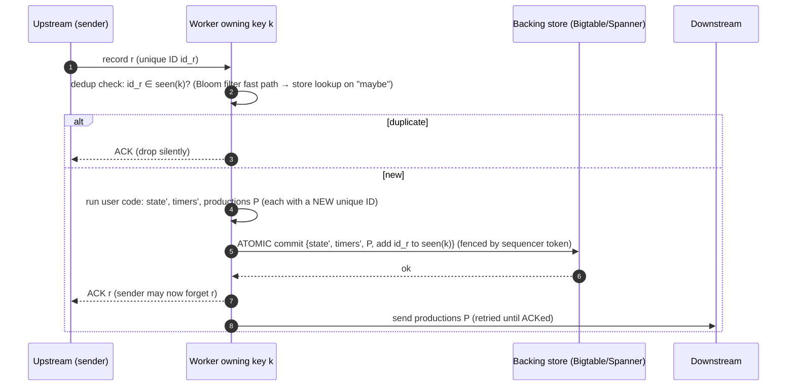
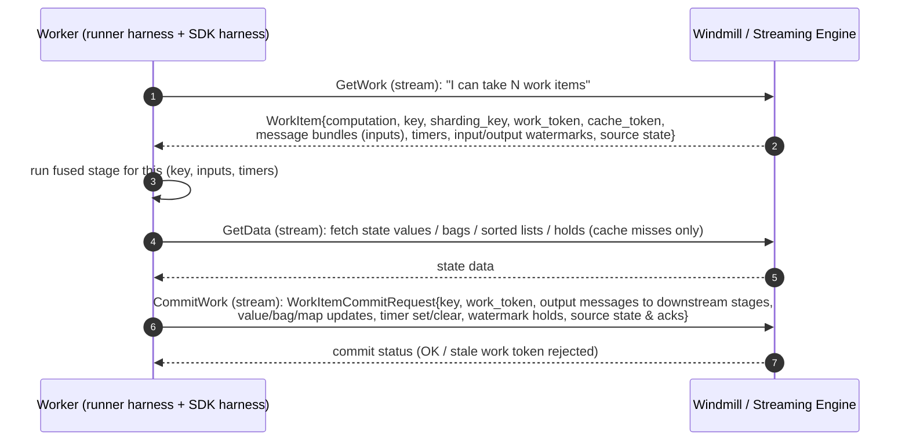

# 01 · MillWheel and the Streaming Engine (Windmill) Architecture

> **Folder:** `03-Google-Cloud-Dataflow-and-MillWheel-Internals/` · **File 1 of 3**
> **Anchoring papers and sources:** Akidau et al., *MillWheel: Fault-Tolerant Stream Processing at Internet Scale*
> (VLDB 2013) · Akidau et al., *The Dataflow Model* (VLDB 2015) · R. Lax, *After Lambda: Exactly-once processing in
> Google Cloud Dataflow*, parts 1–3 (Google Cloud blog, 2017) · Akidau, Chernyak & Lax, *Streaming Systems* (O'Reilly
> 2018), ch. 5 and 7 · Chang et al., *Bigtable* (OSDI 2006) · Corbett et al., *Spanner* (OSDI 2012) · Apache Beam's
> open-source Dataflow worker (`runners/google-cloud-dataflow-java/worker`, including `windmill.proto`).
> **Prev folder:** [02 · SDF and coder determinism](../02-Apache-Beam-Execution-and-Portability-Internals/03-splittable-dofn-sdf-restriction-trackers-and-coder-determinism.md)
> · **Next:** [02 · Shuffle service and liquid sharding](02-dataflow-shuffle-service-liquid-sharding-and-stragglers.md)

> **Scope note.** MillWheel is a published paper. Dataflow's streaming backend (Windmill, Streaming Engine) is
> proprietary. This file builds on the paper, Google's public documentation and blogs, and the open-source Dataflow
> worker code in the Beam repository, which speaks Windmill's RPC protocol. Statements about internal storage engines,
> exact limits, and billing are marked **⚠ verify**.

---

## 0. The thesis

MillWheel's central idea is to make **each key's processing step a small transaction**. Reading inputs, mutating that
key's state, setting timers, and producing outputs commit **atomically**, with **unique record IDs** for deduplication
and **fenced writers** to stop zombies. That gives exactly-once processing without a global barrier.

Dataflow's streaming backend, **Windmill**, is MillWheel's descendant. **Streaming Engine** runs Windmill as a
disaggregated, multi-tenant service. Workers become mostly stateless executors of user code, while state, timers,
watermarks, and inter-stage shuffle live in the service.

Everything an L7 engineer needs to predict about Dataflow streaming follows from that design:

- the per-key throughput ceiling (hot keys),
- per-key and per-commit size limits,
- end-to-end latency per fused stage,
- the cost model,
- why small workers make sense.

---

## 1. First principles: the MillWheel model

### 1.1 Why MillWheel existed

Google's motivating application in the paper was **Zeitgeist**, which detects spikes and dips in search query traffic in
real time. Its requirements:

| Requirement | Why the existing systems failed it |
|-------------|------------------------------------|
| Per-key **persistent state** (historical query rates per query) | Stateless stream processors pushed state into ad-hoc external stores, with no atomicity against outputs |
| **Exactly-once** (a duplicate spike signal is a false alarm) | At-least-once systems (Storm-era) needed application-level dedup |
| **Out-of-order** data with low-watermark-based completion | Most systems processed in arrival order |
| **Low latency** (seconds or less), at Google scale | Batch (MapReduce) was too slow; micro-batching added latency |

### 1.2 The programming model

| Concept | MillWheel | Beam/Dataflow descendant |
|---------|-----------|--------------------------|
| **Computation** | user code subscribed to streams; `ProcessRecord`, `ProcessTimer` | a fused stage of `DoFn`s |
| **Key** | extracted *per consumer* by a key extractor; all state and processing is per key | `KV` keys; stateful `DoFn` keys; GBK keys |
| **Stream** | a named channel between computations | an inter-stage `PCollection` edge (a shuffle) |
| **Persistent state** | an opaque byte string per key in the backing store | `ValueState`, `BagState`, `MapState`, … |
| **Timers** | per key, on wall time or low watermark | `@TimerId` in processing time or event time |
| **Low watermark** | `min(oldest work, upstream low watermarks)` from a central authority | input/output watermarks (Folder 01, file 02) |
| **Productions** | records emitted downstream | `output(...)` |

### 1.3 The exactly-once delivery algorithm

On receipt of an input record for key $k$, MillWheel performs (paper §6.1):



Why each step is necessary:

| Step | Failure it handles |
|------|--------------------|
| **Dedup by record ID** | The upstream sender retries until ACKed. A retry after a lost ACK would otherwise double-apply. |
| **Atomic commit of state + timers + productions + seen-ID** | A crash between "update state" and "record outputs" would otherwise leave them inconsistent |
| **ACK only after commit** | If the worker dies before commit, the sender retries and the record is reprocessed from scratch (nothing was durable) |
| **Send productions after commit, with retries** | Downstream receives each production at least once. Its own dedup (step 1, recursively) makes it exactly once. |

**Strong productions** (the default): productions are checkpointed in the same atomic write *before* delivery. If the
user code is **non-deterministic** (random numbers, wall-clock reads, external lookups), a retry after a crash would
compute *different* outputs. Checkpointing freezes the first committed version, so downstream only ever sees one.

**Weak productions** (an optimization): for computations known to be **idempotent/deterministic**, MillWheel sends
productions *optimistically before* checkpointing them and checkpoints only if downstream ACKs are slow. That saves a
storage write on the hot path. A retry recomputes the identical output, which downstream dedups by ID. The paper notes the
risk of long chains of unacknowledged optimistic sends and handles it by checkpointing stragglers.

### 1.4 Record IDs, fingerprints, and Bloom filters

- Every production gets a **unique ID** at production time. A receiver stores the IDs it has processed **per key** in the
  backing store.
- Checking every incoming record against the store would cost one random read per record. MillWheel keeps a **Bloom
  filter of known record fingerprints** as a fast path:
  - *"definitely not seen"* skips the store read,
  - *"maybe seen"* falls back to the authoritative lookup.

  Bloom filters have no false negatives, so the fast path never admits a duplicate.
- IDs are **garbage-collected** once MillWheel can guarantee that all senders have stopped retrying them. File 03 covers
  Dataflow's time-bucketed filters and the GC watermark, with sizing math.

### 1.5 Single-writer semantics: sequencer tokens and zombies

Key ranges are assigned to worker processes by a replicated master, and they move for load balancing and on failure.
During a move, the old owner can still be alive (a network partition, a GC pause), which makes it a **zombie** that may
try to commit stale state.

MillWheel attaches a **sequencer token** to each writer's ownership of a key interval. The backing store checks the token
on every write, and a new owner's token invalidates the old one. Zombie writes are rejected. Without this, two owners
could both commit, and exactly-once would be lost even with perfect dedup.

> The same pattern appears everywhere in this KB under different names: Kafka producer epochs (Folder 06), Flink
> checkpoint IDs and transactional ID prefixes, Windmill **work tokens** (§2.3), and lease epochs in any
> leader-election scheme. *Fencing is how distributed systems turn "at most one owner" from a hope into an invariant.*

### 1.6 Why "per key" and not a global snapshot

| Dimension | MillWheel (per-key transactions) | Global consistent snapshots (Flink ABS, Folder 04) |
|-----------|----------------------------------|-----------------------------------------------------|
| Commit granularity | each key's work item | the whole job, per checkpoint interval |
| Output visibility | after each key's commit (milliseconds) | for transactional sinks, after the checkpoint completes (seconds or more) |
| Recovery scope | only the failed key range's uncommitted work | roll the entire job back to the last checkpoint and replay |
| Coordination | none global, but every record needs dedup bookkeeping | barrier alignment and a snapshot coordinator; no per-record dedup |
| Cost per record | ID storage, dedup lookups, a per-commit write | amortized: snapshot cost per interval, nothing per record |
| Hot-key behavior | serialized per key (§2.4) | serialized per key too (keyed state is single-threaded per subtask) |

Neither dominates. Per-key commits buy low-latency, fine-grained recovery and low-latency exactly-once outputs, and
charge for it per record. Snapshots buy cheap steady state and charge at recovery and in sink visibility latency.

---

## 2. From MillWheel to Windmill

### 2.1 Two deployment modes

| | Appliance mode (no Streaming Engine) | **Streaming Engine** (service mode) |
|---|---|---|
| Where Windmill runs | on the worker VMs, alongside user code | as a Google-managed, multi-tenant backend service |
| Where state, timers, and shuffle live | **Persistent Disks attached to workers**, key ranges mapped to disks | in the service backend (storage internals not published ⚠ verify) |
| Scaling | disks move between VMs; the number of disks (fixed at launch from `maxNumWorkers`) bounds scale-out | key ranges are reassigned among workers without moving disks |
| Worker size | larger defaults (historically n1-standard-4 with large PDs) ⚠ verify | smaller defaults (n1-standard-2 class) ⚠ verify |
| Service updates | some require pipeline redeploys | applied in the backend |
| Billing | VMs + PD | VMs + Streaming Engine charges (§5) |

Google's documentation describes Streaming Engine as moving pipeline execution *out of the worker VMs into the Dataflow
service backend*, with more responsive autoscaling and lower worker CPU, memory, and disk use.

### 2.2 The worker loop

The open-source Dataflow Java worker in the Beam repo talks to Windmill over streaming RPCs defined in `windmill.proto`.
In outline (⚠ verify exact message and field names in your Beam version):



| Field / concept | Role | MillWheel analogue |
|-----------------|------|--------------------|
| **key** | the user key (encoded bytes) | key |
| **sharding_key** | hash routing the key to a key range / backend shard | key interval assignment |
| **work_token** | monotonically increasing token per key's work; **commits with stale tokens are rejected** | sequencer token (zombie fencing) |
| **cache_token** | validates the worker-side **state cache** for this key; changes when ownership changes | — |
| **message bundles** | the batched input messages for this key (many records per work item) | coalesced checkpoints for multiple records |
| **output messages in the commit** | records to downstream computations, written into Windmill **as part of the same commit** | strong productions |
| **watermark holds** | per-key holds committed atomically with state | oldest work |
| **source state / acks** | e.g., Pub/Sub ack IDs and Kafka offsets committed with the work | sender ACK after commit |

**Every fusion boundary in streaming is a Windmill write and a Windmill read.** A downstream stage's inputs are
messages committed by the upstream stage. Exactly-once across the boundary comes from per-message IDs and dedup on
receipt (file 03).

### 2.3 Per-key serialization and the work queue

Windmill gives each key **at most one active work item at a time**. While a work item for key $k$ is in flight, new
messages for $k$ queue in the backend, and the next work item for $k$ carries the accumulated batch. This is the price of
per-key atomicity, and also its gift: no locks in user code, deterministic per-key ordering of commits, and natural
batching under load.

**Per-key throughput ceiling:**

$$
\Theta_{\max}(k) \;=\; \frac{\bar{m}}{t_{\text{fetch}} + t_{\text{process}}(\bar{m}) + t_{\text{commit}}}
\quad\text{messages/s},\qquad \bar{m} = \text{messages per work item}
$$

With $t_{\text{commit}} \approx 10$ ms, $t_{\text{fetch}} \approx 2$ ms (cache hit), and 20 µs of processing per
message:

- At a batch of 100 messages per work item: $100 / (2 + 2 + 10)\,\mathrm{ms} \approx 7{,}100$ msg/s for that key.
- At 1,000: $1000 / (2 + 20 + 10)\,\mathrm{ms} \approx 31{,}000$ msg/s.

Batching per work item rescues throughput, but only up to the point where per-message processing dominates. **A single
key can never use more than one worker thread.** No autoscaling setting changes that, because it's a semantic property.
The workarounds are key-space changes: sharding, combiners, fan-out (Folder 05).

### 2.4 The state model and the worker cache

| Beam state | Windmill representation (conceptual) | Access pattern |
|------------|--------------------------------------|----------------|
| `ValueState` | value tag | GetData read, CommitWork write (whole value) |
| `BagState` | list tag with append | blind appends in commit; paged reads |
| `CombiningState` | value or bag (implementation-dependent) | read-modify-write, or append plus lazy combine |
| `MapState` / `SetState` | multimap tags | point reads and writes per map key |
| `OrderedListState` | sorted list tag | range reads and deletes by sort key |
| Watermark holds | hold tags | committed with state |
| Timers | timer entries per key | set/clear in commit; delivered as work-item timers |

The **worker state cache** (keyed by computation, key, and cache token) holds recently read state, so a hot key's next
work item usually hits memory. Cache efficiency is the difference between a stateful stage that's CPU-bound and one
that's RPC-bound. Signs of an undersized cache: high GetData latency or volume per work item, and low CPU with growing
system lag on stateful stages.

**Write cost depends on state layout.** A `ValueState<List<…>>` holding 10k items rewrites the entire value every commit.
The same data as a `BagState` appends only the new items. Maps update one entry. On a remote state service, bytes written
per commit are network and storage bytes, which makes write amplification directly visible in latency and cost.

### 2.5 Timers, watermarks, and shuffle in the backend

- **Timers** are stored per key in the backend and delivered as part of work items when they fire. An event-time timer
  fires when the computation's input watermark passes it (Folder 01, file 02 §2.2).
- **Watermarks** are aggregated by the backend per computation and key range, from source progress and committed holds.
  That's the out-of-band propagation described in Folder 01, file 02 §5.1.
- **Shuffle** in streaming *is* the commit of output messages into the downstream computation's queues, keyed by the
  downstream key.

### 2.6 Key ranges, parallelism, and autoscaling

The key space of each computation is partitioned into **key ranges** (by sharding key), assigned to workers.
Consequences:

- **Max parallelism is bounded by key cardinality and distribution.** 50 distinct keys means at most 50 concurrent work
  items for that stage, whatever the worker count.
- **Rebalancing moves key-range ownership,** and the cache token changes, so the new owner's cache starts cold. Expect a
  transient latency bump after scaling events.
- **Autoscaling signals** include backlog (bytes and estimated seconds to drain) and CPU utilization. With Streaming
  Engine, scaling is faster because no disks move. Dataflow's maximum worker counts and per-job limits apply ⚠ verify the
  quotas page.

---

## 3. Streaming Engine vs. appliance mode

| Aspect | Appliance (PD-based) | Streaming Engine |
|--------|----------------------|------------------|
| Autoscaling responsiveness | slower (disk moves); scale-out capped by the disk count chosen at launch | faster, finer-grained |
| Worker resources | CPU, memory, and PD consumed by Windmill on each VM | mostly user code |
| Failure blast radius | a VM loss moves disks and replays | key-range reassignment; state is safe in the backend |
| Update agility | some service changes need redeploys | backend-side |
| Cost structure | pay for big VMs and PDs | smaller VMs plus Streaming Engine units/bytes |
| Required for | — | several newer features (e.g., at-least-once streaming mode, resource-based billing) ⚠ verify |

---

## 4. Limits: why per-key state must be bounded

### 4.1 What's documented

Dataflow publishes Streaming Engine limits on **element size, key size, and per-commit/value size**. Figures on the order
of **80 MB per element/value** and **2 MB per key** have appeared in the quotas documentation ⚠ verify the current page.
Violations surface as errors such as the Dataflow worker's **`KeyCommitTooLargeException`**:

> *"Commit request for stage S and key K has size X which is more than the limit of Y. This may be caused by grouping a
> very large amount of data in a single window without using Combine, or by producing a large amount of data from a
> single input element."* (wording varies by version ⚠ verify)

> **On the "60 GB per-key state limit".** I couldn't confirm a published 60 GB per-key figure in Dataflow's
> documentation. Treat specific numbers you haven't checked against the current quotas page as folklore. The design
> argument below holds whatever the exact number is.

### 4.2 The first-principles argument

Per-key state must be bounded in any MillWheel-style system:

1. **A key is the unit of serialization.** Every work item for $k$ potentially reads and writes $k$'s state on the
   critical path. If $k$'s state is $S_k$ bytes and a fraction $\phi$ of it is touched per work item, latency grows with
   $\phi S_k$ and throughput falls with it.
2. **A key is the unit of atomic commit.** A commit must be applied atomically. Large commits mean long-held backend
   resources, large RPC messages, and a high retry cost. MillWheel relied on single-row atomicity in Bigtable (or
   transactions in Spanner), and row and transaction sizes are bounded there for the same reasons.
3. **A key is the unit of placement.** A key can't be split across shards. All of $S_k$ lives on one backend partition
   and is served by one owner at a time, so one huge key is one hot partition.
4. **A key is the unit of movement.** Rebalancing or recovering a key range costs time proportional to its state (cold
   cache, re-reads). Huge keys make rebalancing slow and recovery spiky.

So the bound isn't arbitrary. It's the price of making the key the atom of consistency.

**Design rule:** if a key's state can grow without bound (a global window bag, a per-user history), **compact it** (a
combiner or sketch), **TTL it** (timers), **shard it** (sub-keys), or **move it out** (an external store keyed for point
lookups).

---

## 5. Billing and worker sizing

### 5.1 Billing models (⚠ verify current pricing pages)

Streaming Engine has been billed in two styles:

| Model | Basis | Incentive |
|-------|-------|-----------|
| **Data-processed** | GB of data processed by Streaming Engine (shuffle and state bytes through the backend) | Minimize stage boundaries and bytes per element |
| **Resource-based** | **Streaming Engine Compute Units (SECUs)**, the backend resources actually consumed | Minimize backend work (commits, state operations, shuffle) rather than raw bytes |

### 5.2 Why small workers win with Streaming Engine

With state and shuffle in the backend, a worker VM only needs enough CPU and memory for **user code, coders, and the
state cache**:

$$
\text{Cost} \approx \underbrace{N_w \cdot (c_{\text{vCPU}} \cdot v + c_{\text{GB}} \cdot g) \cdot T}_{\text{workers}} + \underbrace{\text{SE units or bytes}}_{\text{backend}} + \text{PD (small)} + \text{source/sink costs}
$$

- **Scaling granularity.** Autoscaling adds or removes whole VMs. With 2-vCPU VMs, provisioned capacity tracks demand
  in 2-vCPU steps. With 16-vCPU VMs, in 16-vCPU steps. Average idle capacity is about half a VM, so smaller VMs waste
  less.
- **Failure blast radius.** Losing a small VM reassigns fewer key ranges.
- **When to go bigger:**
  - CPU-heavy user code with large per-thread working sets;
  - large models (ML inference, where memory per process dominates);
  - large state caches for hot-key-heavy workloads;
  - JVM overhead per VM (heap headroom, harness threads), which is a fixed cost that favors fewer, larger VMs once the
    pipeline is big and steady.

A practical method: start at 2–4 vCPU, measure CPU utilization, state-cache hit rate, and GC, then step up only when one
of them is the binding constraint.

---

## 6. Flink comparison: converging architectures

| Dimension | Dataflow Streaming Engine | Flink 1.x (RocksDB + checkpoints) | Flink 2.x (ForSt, disaggregated) |
|-----------|---------------------------|-----------------------------------|----------------------------------|
| Primary state location | remote backend service | **local** disk (RocksDB), snapshotted to DFS | **remote DFS** as primary, local disk as cache (Folder 04) |
| Consistency mechanism | per-key atomic commits + record-ID dedup | global barrier snapshots | global barrier snapshots (cheaper with remote primary state) |
| State access latency | RPC (ms) on cache miss | local (µs to ms, JNI + NVMe) | remote on cache miss, hidden by **async execution** |
| Rescaling | key-range reassignment, no state copy | redistribute key groups (download state) | faster: state already remote |
| Exactly-once output latency | per commit (ms) with idempotent sinks | per checkpoint (transactional sinks) | per checkpoint |
| Hot keys | serialized per key | serialized per key | serialized per key |

The industry trend runs from coupled compute and state toward **disaggregated state with local caches**. Windmill was
there early. Flink 2.x moves the same way and adds an asynchronous execution model, so that remote state latency overlaps
with processing instead of stalling it.

---

## 7. Hardware sympathy: latency per stage

End-to-end latency through $n$ fused streaming stages:

$$
L_{\text{e2e}} \;\approx\; \sum_{i=1}^{n} \Big( \underbrace{q_i}_{\text{queueing for key}} + \underbrace{t^{\text{fetch}}_i}_{\text{state miss RPCs}} + t^{\text{proc}}_i + \underbrace{t^{\text{commit}}_i}_{\text{backend write RTT}} \Big) \;+\; t_{\text{source}} + t_{\text{sink}}
$$

| Term | Typical driver | Lever |
|------|----------------|-------|
| $n$ | number of fusion breaks (GBKs, stateful steps, `Reshuffle`) | remove unnecessary breaks; combine stages |
| $q_i$ | per-key serialization under load | key sharding; combiners |
| $t^{\text{fetch}}$ | state cache misses | cache sizing; state layout; `readLater()` prefetch |
| $t^{\text{commit}}$ | backend RTT plus commit size | smaller commits (append, not rewrite); fewer bytes per element |
| $t_{\text{sink}}$ | sink batching (e.g., BigQuery triggering frequency) | tune frequency against cost |

Compare with Flink, where a stateful operator touches local RocksDB (JNI, page cache, NVMe) with no network RTT per
record, but where exactly-once output visibility waits for the checkpoint. The two systems are optimized for different
points on the latency-versus-recovery curve.

---

## 8. Production Java 21 code blueprints

### 8.1 Anti-patterns: hot keys and state that grows without bound

```java
// ANTI-PATTERN 1: a global count through ONE key. Every message serializes through one work item at a time.
events
    .apply(WithKeys.of("ALL"))                                  // single key → single thread, forever
    .apply(ParDo.of(new DoFn<KV<String, Event>, Long>() {
      @StateId("count") private final StateSpec<ValueState<Long>> countSpec = StateSpecs.value(VarLongCoder.of());

      @ProcessElement
      public void process(@StateId("count") ValueState<Long> count, OutputReceiver<Long> out) {
        long c = Optional.ofNullable(count.read()).orElse(0L) + 1;
        count.write(c);
        out.output(c);                                           // also emits one record per input: write amplification
      }
    }));

// ANTI-PATTERN 2: per-user history in a ValueState<List<…>> in the global window:
// rewrites the ENTIRE list on every commit, grows forever, and eventually trips per-key/commit limits.
@StateId("history")
private final StateSpec<ValueState<List<Event>>> historySpec = StateSpecs.value(ListCoder.of(EventCoder.of()));

@ProcessElement
public void process(@Element KV<String, Event> e, @StateId("history") ValueState<List<Event>> history) {
  List<Event> h = new ArrayList<>(Optional.ofNullable(history.read()).orElse(List.of()));  // full read
  h.add(e.getValue());
  history.write(h);                                                                      // full rewrite
}
```

### 8.2 Production: sharded hot counters, bounded per-key state, cheap writes

```java
package dev.l7.dataflow.windmill;

import java.util.concurrent.ThreadLocalRandom;
import org.apache.beam.sdk.coders.InstantCoder;
import org.apache.beam.sdk.coders.VarLongCoder;
import org.apache.beam.sdk.metrics.Counter;
import org.apache.beam.sdk.metrics.Metrics;
import org.apache.beam.sdk.state.CombiningState;
import org.apache.beam.sdk.state.MapState;
import org.apache.beam.sdk.state.ReadableState;
import org.apache.beam.sdk.state.StateSpec;
import org.apache.beam.sdk.state.StateSpecs;
import org.apache.beam.sdk.state.TimeDomain;
import org.apache.beam.sdk.state.Timer;
import org.apache.beam.sdk.state.TimerSpec;
import org.apache.beam.sdk.state.TimerSpecs;
import org.apache.beam.sdk.state.ValueState;
import org.apache.beam.sdk.transforms.Combine;
import org.apache.beam.sdk.transforms.DoFn;
import org.apache.beam.sdk.transforms.MapElements;
import org.apache.beam.sdk.transforms.PTransform;
import org.apache.beam.sdk.transforms.Sum;
import org.apache.beam.sdk.transforms.windowing.FixedWindows;
import org.apache.beam.sdk.transforms.windowing.Window;
import org.apache.beam.sdk.values.KV;
import org.apache.beam.sdk.values.PCollection;
import org.apache.beam.sdk.values.TypeDescriptors;
import org.joda.time.Duration;
import org.joda.time.Instant;

public final class WindmillFriendlyState {

  /**
   * Global (or very hot) counts without a hot key: spread over S shards, then merge. Per-shard work items run
   * in parallel; the final merge sees only S partial sums per window. Equivalent in spirit to
   * Combine.globally(...).withFanout(S), spelled out so the mechanics are visible.
   */
  public static final class ShardedGlobalCount extends PTransform<PCollection<String>, PCollection<Long>> {
    private final int shards;

    public ShardedGlobalCount(int shards) {
      this.shards = shards;
    }

    @Override
    public PCollection<Long> expand(PCollection<String> events) {
      final int s = shards;
      return events
          .apply("Window1m", Window.into(FixedWindows.of(Duration.standardMinutes(1))))
          .apply("AssignShard", MapElements
              .into(TypeDescriptors.kvs(TypeDescriptors.integers(), TypeDescriptors.longs()))
              .via(e -> KV.of(ThreadLocalRandom.current().nextInt(s), 1L)))  // non-determinism is frozen at commit
          .apply("PartialPerShard", Sum.longsPerKey())                       // S keys in parallel, lifted
          .apply("DropShard", MapElements.into(TypeDescriptors.longs()).via(KV::getValue))
          .apply("Total", Combine.globally(Sum.ofLongs()).withoutDefaults()); // S partials → 1
    }
  }

  /**
   * Per-user rolling profile with BOUNDED state and CHEAP commits:
   *  - CombiningState: O(1) accumulator, no list rewrites;
   *  - MapState: point updates for per-category counters (only touched entries are written);
   *  - an inactivity TTL timer that clears the key's state, so dormant users cost nothing;
   *  - readLater() prefetch so cache misses are fetched in one round trip.
   */
  public static final class UserProfileFn extends DoFn<KV<String, UserEvent>, KV<String, UserProfile>> {

    public record UserEvent(String category, long amountCents) implements java.io.Serializable {}

    public record UserProfile(long totalCents, boolean firstEventInCategory) implements java.io.Serializable {}

    private static final Duration INACTIVITY_TTL = Duration.standardDays(30);

    private final Counter ttlExpirations = Metrics.counter(UserProfileFn.class, "profile_ttl_expired");

    @StateId("totalCents")
    private final StateSpec<CombiningState<Long, long[], Long>> totalSpec = StateSpecs.combining(Sum.ofLongs());

    @StateId("perCategory")
    private final StateSpec<MapState<String, Long>> perCategorySpec =
        StateSpecs.map(org.apache.beam.sdk.coders.StringUtf8Coder.of(), VarLongCoder.of());

    @StateId("expiry")
    private final StateSpec<ValueState<Instant>> expirySpec = StateSpecs.value(InstantCoder.of());

    @TimerId("ttl")
    private final TimerSpec ttlSpec = TimerSpecs.timer(TimeDomain.PROCESSING_TIME);

    @ProcessElement
    public void process(@Element KV<String, UserEvent> e,
                        @StateId("totalCents") CombiningState<Long, long[], Long> total,
                        @StateId("perCategory") MapState<String, Long> perCategory,
                        @StateId("expiry") ValueState<Instant> expiry,
                        @TimerId("ttl") Timer ttl,
                        OutputReceiver<KV<String, UserProfile>> out) {
      UserEvent ev = e.getValue();
      ReadableState<Long> categoryCount = perCategory.get(ev.category()).readLater();   // prefetch
      total.readLater();
      expiry.readLater();

      total.add(ev.amountCents());                                  // accumulator update, no list rewrite
      Long prev = categoryCount.read();
      perCategory.put(ev.category(), (prev == null ? 0L : prev) + 1);   // one map entry written

      // Re-arm the TTL at most once per day per key, not on every event: fewer timer writes per commit.
      Instant now = Instant.now();
      Instant current = expiry.read();
      if (current == null || current.minus(INACTIVITY_TTL).plus(Duration.standardDays(1)).isBefore(now)) {
        Instant next = now.plus(INACTIVITY_TTL);
        expiry.write(next);
        ttl.withNoOutputTimestamp().offset(INACTIVITY_TTL).setRelative();   // cleanup emits nothing: no hold ⚠ verify
      }

      out.output(KV.of(e.getKey(), new UserProfile(total.read(), prev == null)));
    }

    @OnTimer("ttl")
    public void onTtl(@StateId("totalCents") CombiningState<Long, long[], Long> total,
                      @StateId("perCategory") MapState<String, Long> perCategory,
                      @StateId("expiry") ValueState<Instant> expiry) {
      Instant scheduled = expiry.read();
      if (scheduled != null && scheduled.isAfter(Instant.now())) {
        return;                                                     // re-armed meanwhile: not expired yet
      }
      total.clear();
      perCategory.clear();
      expiry.clear();
      ttlExpirations.inc();
    }
  }
}
```

Notes:

- **`StateSpecs.combining(Sum.ofLongs())`** infers the accumulator coder from the `CombineFn` at binding time. If your
  SDK can't, use the overload that takes an accumulator coder ⚠ verify.
- **`ThreadLocalRandom` in a `DoFn`** is non-deterministic. That's safe here because Dataflow commits outputs before
  downstream consumes them (strong productions, §1.3), so a retry can't create a second, different shard assignment
  that's both visible. On runners without that property, derive the shard from a hash of a stable field instead.
- **The TTL re-arms once per day,** not once per event, because every timer change is part of the commit.

### 8.3 Operating Streaming Engine (⚠ verify option names for your SDK version)

```text
--enableStreamingEngine                                   # Java (Python: --enable_streaming_engine); default on many new jobs
--workerMachineType=n2-standard-2                         # start small; scale up only on measured need
--maxNumWorkers=200                                       # ceiling for autoscaling
--hotKeyLoggingEnabled=true                               # log the actual hot key in "hot key detected" messages
--dataflowServiceOptions=enable_streaming_engine_resource_based_billing   # if not already default for your project
--numberOfWorkerHarnessThreads=...                        # bound concurrent work items per worker if memory-bound
```

### 8.4 Flink contrast: the same profile with local keyed state and TTL

```java
public final class UserProfileFunction
    extends KeyedProcessFunction<String, UserEvent, UserProfile> {

  private transient ValueState<Long> totalCents;
  private transient MapState<String, Long> perCategory;

  @Override
  public void open(OpenContext ctx) {
    StateTtlConfig ttl = StateTtlConfig.newBuilder(Duration.ofDays(30))
        .setUpdateType(StateTtlConfig.UpdateType.OnCreateAndWrite)
        .cleanupInRocksdbCompactFilter(1_000)              // expired entries dropped during compaction (Folder 04)
        .build();
    ValueStateDescriptor<Long> totalDesc = new ValueStateDescriptor<>("totalCents", Long.class);
    totalDesc.enableTimeToLive(ttl);
    MapStateDescriptor<String, Long> catDesc = new MapStateDescriptor<>("perCategory", String.class, Long.class);
    catDesc.enableTimeToLive(ttl);
    totalCents = getRuntimeContext().getState(totalDesc);
    perCategory = getRuntimeContext().getMapState(catDesc);
  }

  @Override
  public void processElement(UserEvent ev, Context ctx, Collector<UserProfile> out) throws Exception {
    long t = (totalCents.value() == null ? 0L : totalCents.value()) + ev.amountCents();
    totalCents.update(t);                                   // local RocksDB write (JNI), no network RTT
    Long prev = perCategory.get(ev.category());
    perCategory.put(ev.category(), (prev == null ? 0L : prev) + 1);
    out.collect(new UserProfile(t, prev == null));
  }
}
```

The semantics are the same, and the physics differ. Flink's write is local and becomes durable at the next checkpoint.
Dataflow's write is remote and durable at the commit. Flink 2.x with ForSt moves Flink's primary copy remote as well
(Folder 04).

---

## 9. Production failure modes and P99 debugging

| ID | Failure | Signature | Root cause | Fix |
|----|---------|-----------|------------|-----|
| W1 | **Hot key** | Logs: "A hot key was detected in step … with age of …"; one stage's system lag climbs; adding workers doesn't help | Per-key serialization (§2.3) | Shard keys, combine before grouping, `withHotKeyFanout`; find the key with `--hotKeyLoggingEnabled` |
| W2 | **Commit too large** | `KeyCommitTooLargeException` / commit-size errors; a work item retried forever, watermark pinned | GBK of a huge window without `Combine`; one input producing massive output; unbounded per-key state | Combine; split outputs across keys; bound state (TTL, compaction) |
| W3 | **State-RPC-bound stage** | Low CPU, high system lag, high GetData volume per work item | Cache misses (undersized cache, constant rebalancing), whole-value rewrites, serial reads | `readLater()`; bag/map layouts; fewer state reads per element; more memory per worker |
| W4 | **Latency from too many stages** | E2E latency ≈ number of stages × hundreds of ms | Unnecessary fusion breaks (`Reshuffle`, extra GBKs, stateful steps) | Collapse stages; remove defensive reshuffles |
| W5 | **Parallelism-capped stage** | A stage never uses more than N workers | Few distinct keys (or skewed key ranges) | Increase key cardinality (sub-keys); combine |
| W6 | **Appliance-mode scaling wall** | Can't scale beyond a ceiling; slow scaling | Disk count fixed by `maxNumWorkers` at launch | Migrate to Streaming Engine (or set `maxNumWorkers` appropriately at launch) |
| W7 | **Cold cache after rebalancing** | Latency spikes right after autoscaling events | Cache token change on key-range moves | Expected; smooth autoscaling (min workers, cooldowns), smaller state per key |
| W8 | **Streaming Engine cost blowup** | SE units/bytes ≫ expectation | Many boundaries, large elements, state rewrites, chatty timers | Projection, fewer boundaries, append-style state, fewer timer re-arms |

### 9.1 Runbook · W1 (hot key in streaming)

1. Find "hot key detected" log entries. They name the step and the age (how long the key has been backlogged).
2. Turn on `--hotKeyLoggingEnabled` (with an `--update`) to log the key value. Make sure that's acceptable under your
   PII rules.
3. Classify the key:
   - a **sentinel** (`null`, `""`, `"unknown"`, a default tenant) is a data-quality bug, so fix it upstream;
   - a **genuine celebrity** (a top seller, a viral post) is a design problem.
4. Fix a celebrity key in order of preference:
   - a commutative combine (lifting spreads the work);
   - `Combine.perKey(fn).withHotKeyFanout(n)`;
   - explicit salting (Folder 05);
   - for stateful logic, **sub-key the state** (key = (entity, shard)) with a periodic merge.
5. Verify that the stage's system lag returns to baseline and that per-key work items stop growing.

### 9.2 Runbook · W2 (commit too large)

1. The exception names the stage and key. Map the stage to the step: usually a GBK into an `Iterable` consumer, or a
   `DoFn` that expands one element into millions.
2. For GBK: replace with `Combine`, or window smaller, or shard the key.
3. For fan-out: emit across many keys (so commits split), or stage the large output externally (write files and emit
   references).
4. For state: audit the global-window state for unbounded growth (missing TTL or `@OnWindowExpiration`).

---

## 10. FAANG L7 bar-raiser Q&A chains

### Q1 · "Explain MillWheel's exactly-once algorithm. Why per-key transactions and not global snapshots?"

**L5 textbook answer.** MillWheel checkpoints state and deduplicates records by ID, so each record is processed once.

**Why L5 breaks at petabyte scale.** "Checkpoint and dedup" leaves out what makes it correct under failure: the *order*
(dedup, compute, atomic commit, ACK, send), fencing against zombie owners, the handling of non-deterministic code, and
garbage collection of IDs. Each one, missing, produces duplicates or loss at scale.

**L7 principal defense.**

1. **The algorithm:** dedup by record ID (Bloom fast path, then store) → run user code → **atomic commit** of state,
   timers, productions, and the seen-ID → ACK upstream → send productions with retries.
2. **Strong productions** freeze non-deterministic outputs at commit. **Weak productions** skip the checkpoint for
   deterministic code and checkpoint only stragglers.
3. **Sequencer tokens** (Windmill work tokens) reject zombie commits after key-range moves.
4. **ID GC** happens once no sender can still retry.
5. **Why per key:** recovery is local to a key range, exactly-once outputs are visible per commit (milliseconds), and
   there's no global barrier, so no alignment stalls under backpressure.
6. **The cost:** per-record dedup bookkeeping and a write per commit. Snapshots (Flink) amortize consistency cost per
   interval, but roll everything back on failure and delay transactional sink visibility to checkpoint completion.

### Q2 · "Why does Streaming Engine favor small worker VMs?"

**L5 textbook answer.** Smaller VMs are cheaper.

**Why L5 breaks.** Smaller VMs aren't cheaper per vCPU. The real reasons are structural, and getting them wrong leads to
tiny VMs that thrash on GC, or huge VMs that waste capacity.

**L7 principal defense.**

- **With state and shuffle in the backend,** workers need only CPU and memory for user code and caches, so the big-PD,
  big-VM appliance rationale disappears.
- **Autoscaling granularity:** average idle capacity is about half a VM, so smaller VMs track load more tightly.
- **Blast radius:** fewer key ranges move when one VM dies.
- **Billing:** you pay for backend work separately (SECUs or bytes), so worker size should be chosen for the user-code
  footprint.
- **Counter-cases:** heavy per-process memory (ML models), large hot-key state caches, CPU-bound per-element code with
  JVM fixed overheads. Measure CPU, GC, and cache hit rate, and step up only when one binds.

### Q3 · "Someone computes a global running count in Dataflow streaming with a single key. What happens? Fix it."

**L5 textbook answer.** It works, though it may be a bit slow. Add more workers.

**Why L5 breaks at petabyte scale.** One key means one active work item at a time. Throughput is capped at roughly
$\bar{m} / (t_{\text{fetch}} + t_{\text{proc}} + t_{\text{commit}})$, on the order of thousands to tens of thousands per
second regardless of worker count (§2.3). Backlog grows, the watermark stalls, and "hot key detected" logs appear.
Emitting one output per input amplifies writes too.

**L7 principal defense.**

1. **Window or trigger** the count, because a "running global count" is a stream of *refinements* (Folder 01, file 03).
2. **Shard:** S random shards, then a sum per shard (lifted), then a global combine over S partials (§8.2), or
   `Combine.globally(...).withFanout(S)`.
3. **Emit at the consumer's refresh rate** (trigger), not per element.
4. **Size S** so that the per-shard load is well under the per-key ceiling at peak. With S = 64 and a 10k/s per-key
   ceiling, about 640k/s of headroom.

### Q4 · "Is there a per-key state limit in Dataflow? Why must there be one in any such system?"

**L5 textbook answer.** Yes, it's something like 60 GB per key, so keep state under that.

**Why L5 breaks.** Quoting an unverified number misses the point. Performance collapses long before any hard limit,
because a key's state sits on the serialized critical path. Commit-size limits (tens of MB per commit) are usually hit
first, by GBK-without-Combine or by large outputs.

**L7 principal defense.** Treat specific numbers as "check the quotas page". Then argue from first principles (§4.2). A
key is the unit of serialization, atomic commit, placement, and movement, so per-key state and commit size must be
bounded, and latency degrades with the state touched per work item well before any limit. The design responses: combine
or sketch, TTL, sub-key sharding, external point-lookup stores, and append-style layouts that keep commits small.

### Q5 · "Strong vs. weak productions: when can a system skip checkpointing its outputs?"

**L5 textbook answer.** When performance matters more than correctness.

**Why L5 breaks.** Weak productions aren't a correctness trade-off when used correctly. They're an optimization that's
safe only under **determinism**. Applied to non-deterministic code, they produce two different "exactly-once" outputs
after a retry, and downstream dedup can't catch that, because the IDs or contents differ.

**L7 principal defense.**

- **Strong:** persist outputs atomically with state before sending, so retries resend the *same* records with the same
  IDs. Required when the code is non-deterministic.
- **Weak:** send optimistically before checkpointing. A retry recomputes *identical* outputs (determinism), and
  downstream dedups by ID. Checkpoint only when ACKs straggle, to bound chains of unconfirmed sends.
- **The decision rule:** you can skip checkpointing outputs iff recomputation is guaranteed to reproduce them
  bit-for-bit, IDs included.
- **The same rule appears elsewhere:** Beam's `@RequiresStableInput`, Flink's deterministic replay from sources, and
  idempotent sinks keyed by deterministic IDs (file 03).

### Q6 · "Compare Dataflow Streaming Engine with Flink 2.x disaggregated state."

**L5 textbook answer.** Both store state remotely. Dataflow is managed and Flink is open source.

**Why L5 breaks.** The consistency mechanisms differ fundamentally (per-key commits vs. global snapshots), and so do the
latency profiles (an RPC per cache miss vs. async-overlapped remote reads). That changes sink design, recovery behavior,
and cost.

**L7 principal defense.**

- **Dataflow:** remote state is authoritative; per-key atomic commits; dedup by record IDs; outputs visible per commit;
  local caches validated by cache tokens.
- **Flink 2.x (ForSt):** remote DFS is the primary store, with a local cache; consistency via barrier snapshots (now
  cheaper, because state is already remote); an async execution model overlaps remote I/O while preserving per-key
  order; rescaling is faster.
- **Both:** hot keys serialize, and per-key state size governs latency.
- **When to choose which:**
  - Dataflow for fully managed operation, per-commit exactly-once outputs, and autoscaling without state moves.
  - Flink when you need open deployment (Kubernetes, multi-cloud), checkpoint-based 2PC sinks, or fine control of state
    tuning (Folder 08 decision matrix).

### Q7 · "Your streaming pipeline has 2 s end-to-end latency across 8 stages. Get it to 300 ms."

**L5 textbook answer.** Add workers and use faster machines.

**Why L5 breaks.** Latency here is dominated by per-stage commit round trips and queueing, not CPU. Eight stages at
~200–250 ms each (commit, queueing, state misses) is about 2 s, and more workers change none of those terms.

**L7 principal defense.** Apply the §7 equation:

1. **Cut $n$.** Remove defensive `Reshuffle`s, merge consecutive stateful steps keyed the same way, and push stateless
   steps into neighboring fused stages. 8 → 3 stages is often achievable.
2. **Cut $t^{\text{fetch}}$:** state layout (append and map, not rewrite), `readLater()`, cache headroom.
3. **Cut $q$:** shard hot keys and combine early.
4. **Cut $t_{\text{sink}}$:** lower the triggering frequency for exactly-once sinks, or use at-least-once with idempotent
   upserts (file 03).
5. **Measure per-stage system lag** in Dataflow and attack the largest term first.

---

## 11. Invariants checklist

1. **The key is the atom:** serialization, commit, placement, movement. One key can never use more than one thread.
2. **Exactly-once = dedup by ID + atomic commit (state, timers, outputs, seen-IDs) + ACK after commit + fenced writers.**
3. **Non-deterministic code needs strong productions** (outputs committed before delivery). Weak productions require
   determinism.
4. **Every streaming fusion boundary is a backend write and read.** Fewer boundaries means lower latency and cost.
5. **Per-key state and commits must be bounded.** Combine, TTL, shard, or externalize.
6. **Prefer append and point-update state layouts** over whole-value rewrites.
7. **With Streaming Engine, size workers for user code.** Start small and scale up on measured constraints.
8. **Treat unverified limits as folklore.** Design for the principle, then check the current quotas page.

---

## 12. References

- T. Akidau, A. Balikov, K. Bekiroğlu, S. Chernyak, J. Haberman, R. Lax, S. McVeety, D. Mills, P. Nordstrom, S. Whittle.
  *MillWheel: Fault-Tolerant Stream Processing at Internet Scale.* PVLDB 6(11), 2013.
- T. Akidau et al. *The Dataflow Model.* PVLDB 8(12), 2015.
- R. Lax. *After Lambda: Exactly-once processing in Google Cloud Dataflow*, Parts 1–3. Google Cloud Blog, 2017.
- T. Akidau, S. Chernyak, R. Lax. *Streaming Systems.* O'Reilly, 2018 (ch. 5 exactly-once, ch. 7 persistent state).
- F. Chang et al. *Bigtable: A Distributed Storage System for Structured Data.* OSDI 2006. J. C. Corbett et al. *Spanner:
  Google's Globally-Distributed Database.* OSDI 2012.
- Google Cloud Dataflow documentation: *Streaming Engine*, *Quotas and limits*, *Pricing*, *Troubleshoot hot keys*,
  *Dataflow worker machine types*.
- Apache Beam: `runners/google-cloud-dataflow-java/worker/` (Windmill client, state cache,
  `KeyCommitTooLargeException`), `windmill.proto`.

**Next →** [02 · Dataflow Shuffle service, liquid sharding, and stragglers](02-dataflow-shuffle-service-liquid-sharding-and-stragglers.md)
