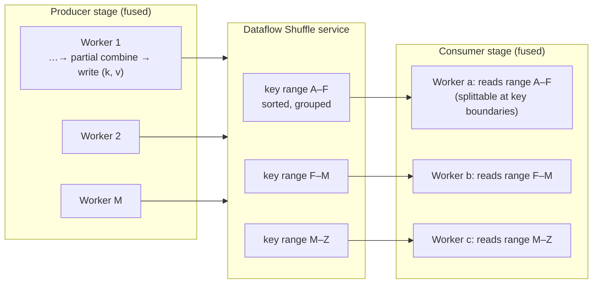

# 02 · The Dataflow Shuffle Service, Liquid Sharding, and Stragglers

> **Folder:** `03-Google-Cloud-Dataflow-and-MillWheel-Internals/` · **File 2 of 3**
> **Anchoring sources:** Dean & Ghemawat, *MapReduce* (OSDI 2004): backup tasks for stragglers · Dean & Barroso, *The
> Tail at Scale* (CACM 2013) · E. Kirpichov & M. Denielou, *No shard left behind: dynamic work rebalancing in Google Cloud
> Dataflow* (Google Cloud blog, 2016) · Ananthanarayanan et al., *Reining in the Outliers in Map-Reduce Clusters using
> Mantri* (OSDI 2010) · Zaharia et al., *Improving MapReduce Performance in Heterogeneous Environments (LATE)* (OSDI 2008)
> · Google Cloud Dataflow docs: *Dataflow Shuffle*, *Dynamic work rebalancing*, *FlexRS*, *Troubleshoot stragglers*.
> **Prev:** [01 · MillWheel and Streaming Engine](01-millwheel-and-streaming-engine-windmill-architecture.md) · **Next:**
> [03 · Exactly-once, Bloom filters, BigQuery Storage Write API, and Prime](03-exactly-once-bloom-filters-BigQuery-storage-write-api-and-prime.md)

> **Scope note.** Dataflow Shuffle's internal design isn't published. This file uses the public documentation and blogs,
> the open-source worker code, and first principles shared by every large-scale shuffle. Internal specifics are marked
> **⚠ verify**. Generic push-vs-pull and remote shuffle service design (Celeborn, Uniffle, Magnet) is in Folder 05.

---

## 0. The thesis

Batch job time is $\max_i T_i$ over parallel tasks, so a batch engine is only as fast as its **slowest task** and its
**shuffle**. Dataflow attacks both:

1. **Disaggregated shuffle.** Shuffle data lives in a service, not on worker disks. Losing a worker no longer loses
   shuffle data, scaling down is cheap, and preemptible capacity becomes practical.
2. **Liquid sharding (dynamic work rebalancing).** Instead of *duplicating* slow tasks (speculative execution), the
   runner *splits* their unfinished work mid-flight and hands the remainder to idle workers.

Both depend on two properties of your pipeline that only you control: **splittability** (of sources, SDFs, and key
ranges) and **honest progress and size reporting**. A single hot key or a non-splittable input defeats them both.

---

## 1. First principles: why shuffle is the hard part

### 1.1 The all-to-all problem

$M$ producers and $N$ consumers. Each producer partitions its output into $N$ partitions, and each consumer needs its
partition from all $M$ producers:

$$
\#\text{segments} = M \times N, \qquad \bar{s}_{\text{segment}} = \frac{D}{M N}
$$

| $D$ (shuffle bytes) | $M = N$ | Segments | Avg segment |
|---------------------|---------|----------|-------------|
| 1 TB | 1,000 | $10^6$ | 1 MB |
| 10 TB | 10,000 | $10^8$ | **100 KB** |
| 100 TB | 20,000 | $4 \times 10^8$ | 250 KB |

At 100 KB per segment, a consumer reading from 10,000 producers does 10,000 small random reads. On spinning or networked
disks that's seek-bound, not bandwidth-bound. That's the **small-segment problem**, and it's why every large shuffle
system eventually **aggregates segments per partition** (push-merge, service-side merging) instead of letting consumers
pull $M$ fragments.

### 1.2 Failure semantics

In classic MapReduce, map outputs live on mapper-local disks. If a mapper machine dies *after* finishing, its outputs are
gone, and every reducer that hasn't fetched them forces a **re-execution** of that map task. With preemptible VMs or
aggressive downscaling, this turns into cascading recomputation.

**Disaggregation fixes the failure model.** If shuffle data lives in a durable service:

- worker loss doesn't require recomputing finished producers;
- the autoscaler can **remove workers mid-job** without losing data;
- **preemptible/spot VMs** become safe (FlexRS, §5.3).

### 1.3 Sort vs. hash, and why grouping implies ordering work

A `GroupByKey` must bring all values for a key together. Two families:

| Approach | Mechanism | Strength | Weakness |
|----------|-----------|----------|----------|
| Hash-partition + hash-aggregate | in-memory hash tables per partition | fast when partitions fit in memory | spills awkwardly; memory-bound |
| **Sort-based** | sort by (partition, key) and merge runs | scales beyond memory (external merge sort); produces key-ordered streams for range splitting | $O(D \log D)$ CPU; multiple I/O passes when $D \gg$ memory |

External merge sort costs about $2D \cdot \lceil \log_{F}(D / \text{mem}) \rceil$ bytes of I/O for fan-in $F$. With
enough memory for $F$-way merges, most shuffles finish in one or two passes. Sorted key-ordered output is also what makes
**key-range splitting** of a GBK's read possible (§3.5).

---

## 2. Dataflow Shuffle (batch)

### 2.1 What it is

Dataflow's docs describe **Dataflow Shuffle** as moving the shuffle operation (`GroupByKey`, `CoGroupByKey`, `Combine`)
*out of worker VMs and into the Dataflow service backend*. The documented benefits:

- faster execution for most batch pipelines,
- lower worker CPU, memory, and Persistent Disk consumption,
- better horizontal autoscaling (VMs don't hold shuffle data),
- better fault tolerance (an unhealthy VM holding shuffle data doesn't fail the job).

It is the default for batch in supported regions ⚠ verify. Worker disks can be small, because shuffle no longer needs
local space: the default batch boot disk with Shuffle is on the order of 25 GB, versus hundreds of GB for VM-based
shuffle ⚠ verify. Streaming shuffle is part of the Streaming Engine (file 01).

### 2.2 A conceptual model



Properties that follow from the public description and first principles (internal specifics ⚠ verify):

- **Writers stream** keyed records to the service, partitioned by key. They don't own their output after the write is
  acknowledged.
- **The service groups and orders by key**, so consumers read **key ranges** as streams of (key, values) groups.
  Iterables for large keys are read lazily (paged), consistent with file 02's state-backed iterables in Folder 02.
- **Key ranges are the unit of consumer work.** They can be split dynamically **at key boundaries** (§3.5).
- **Billing** includes shuffle data volume processed ⚠ verify the current pricing model. Combiner lifting (Folder 02,
  file 01) and projection reduce it directly.

### 2.3 Value ordering

Beam doesn't guarantee any value order within a group. For per-key ordered processing, use the **sorter extension**
(`SortValues` with `BufferedExternalSorter`), which sorts each key's values **by the encoded bytes of a secondary key**.
That makes the coder choice semantic (§8.4).

---

## 3. Work items, progress, and liquid sharding

### 3.1 Work items in batch

A batch stage is executed as **work items**: a source split, a shuffle key range, or a bundle of elements. A worker
**leases** a work item and periodically reports **progress**:

- position and fraction consumed,
- remaining-work estimate (from `getProgress()`/`@GetSize` for SDFs, byte offsets for files, key positions for shuffle
  reads).

The service can then ask the worker to **split** the work item.

### 3.2 Liquid sharding: the mechanism

From *No shard left behind* (2016) and the Fn API split protocol (Folder 02, file 02 §2.6):

1. **Initial static splitting** uses size estimates (bytes, `@GetSize`) to create balanced initial work items.
2. **Continuous monitoring** of progress rates per work item.
3. **Straggler detection:** a work item whose estimated time to completion exceeds the others'.
4. **Dynamic split:** the service asks the owner to split its remaining work at a fraction. The worker's reader
   (tracker) cuts the unclaimed suffix, keeps the primary, and returns the residual.
5. **Re-assignment:** the residual becomes a new work item for an idle worker, including workers *added by autoscaling
   mid-stage*.
6. **Repeat** until the tail is shorter than the split overhead.

No work is duplicated, and correctness rests on the claim protocol (Folder 02, file 03 §2.2).

### 3.3 Straggler math: why splitting beats static partitioning

With $N$ tasks of i.i.d. exponential duration with mean $\mu$, the makespan of a static partition is the maximum:

$$
\mathbb{E}\big[\max_{i \le N} T_i\big] = \mu \, H_N \approx \mu\,(\ln N + 0.577)
$$

| $N$ | $\mathbb{E}[\max]/\mu$ |
|-----|------------------------|
| 10 | 2.93 |
| 100 | 5.19 |
| 1,000 | 7.49 |
| 10,000 | 9.79 |

Real task durations are often **heavier-tailed** than exponential (log-normal or Pareto, from data skew, hot keys,
expensive records, and noisy neighbors), which makes the ratio worse. With ideal dynamic rebalancing, the makespan
approaches

$$
T_{\text{DWR}} \approx \frac{W}{P} + c_{\max} + \varepsilon_{\text{split}}
$$

where $W$ is total work, $P$ the parallel capacity, $c_{\max}$ the cost of the **largest unsplittable unit** (one element,
one key, one non-seekable file), and $\varepsilon_{\text{split}}$ the overhead of detecting and splitting. **The
irreducible tail is your largest indivisible unit.** That's the number to engineer down.

### 3.4 Choosing the split point

For a straggler with remaining work $R_i$ at rate $r_i$, the estimated time left is $t_i = R_i / r_i$. Given a target
completion time $t^\ast$ (roughly total remaining work divided by total capacity, idle workers included), the runner
wants the primary to finish at $t^\ast$:

$$
f_i = \frac{t^\ast}{t_i} \qquad \Rightarrow \qquad \texttt{trySplit}(f_i)\ \text{keeps fraction } f_i \text{ of the remainder}
$$

(Beam's `OffsetRangeTracker.trySplit(f)` keeps $f$ of the remainder in the primary; Folder 02, file 03 §2.3.)

This only works if $r_i$ and $R_i$ are honest. An SDF reporting `@GetSize = 0`, or a reader with a broken progress
estimate, makes the runner either ignore the straggler or split it badly.

### 3.5 What can and can't be split

| Work | Splittable? | Granularity | Notes |
|------|-------------|-------------|-------|
| Uncompressed text / Avro / Parquet (block-compressed) files | ✅ | record/block boundaries | Avro sync markers and Parquet row groups are natural split points |
| gzip/bzip2 whole-file compressed text | ❌ (gzip) / limited | whole file | One file is one indivisible unit, so $c_{\max}$ = whole-file time |
| BigQuery Storage Read API | ✅ | read streams (the service can split streams) | The service supports dynamic stream splitting ⚠ verify |
| Bigtable / Spanner reads | ✅ | key ranges | |
| SDF with an `OffsetRange`/`ByteKeyRange` restriction | ✅ | positions | If the claim protocol is honored |
| **Shuffle read (GBK output)** | ✅ **between keys** | key boundaries | **❌ within a key**: a hot key is one indivisible unit |
| A single huge element (one 10 GB record, one 1-hour RPC) | ❌ | element | $c_{\max}$ = that element |
| Outputs of a fused fan-out `ParDo` | ❌ (not a restriction) | — | Make the fan-out an SDF, or redistribute (Folder 02, file 01 §4.2) |

### 3.6 Hot keys in batch

A GBK where one key holds 20% of the data:

$$
T_{\text{stage}} \ge \frac{0.2\,D}{\theta_{\text{single worker}}} \quad\text{regardless of } P
$$

At $D$ = 10 TB and 200 MB/s for one worker's GBK consumption, that's ≥ 10,000 s (2.8 h) for one key, while the rest
of the stage finishes in minutes. Dynamic rebalancing can split *other* keys away from that worker, but never the hot
key itself. Fixes are always **key-space** fixes:

- **Combine** (lifting spreads the work across producers);
- **`withHotKeyFanout`**;
- **salting** for non-combinable logic, with a merge step;
- **sub-keying by a natural dimension** (user × day) when the computation allows it (§8.2);
- for joins, **broadcast** the small side or **split the skewed key** (Folder 05).

Dataflow's job UI flags stragglers and may attribute them to causes such as hot keys ⚠ verify.

---

## 4. Streaming stragglers are different

In streaming (file 01), parallelism is **key ranges**, and each key is serialized. Key-range ownership can move
(rebalancing), but a single hot key is the irreducible unit, exactly like batch. Differences:

- There's no "end", so a straggler shows up as growing **system lag** or **data freshness** on a stage, not a long tail.
- The remedy for a slow worker (as opposed to a slow key) is key-range reassignment. For a slow key it's key-space
  redesign.
- Dataflow surfaces **"hot key detected"** logs and per-stage lag. Investigate the key, not the worker count.

---

## 5. Autoscaling and cost levers in batch

### 5.1 Autoscaling signals

Batch autoscaling (throughput-based) estimates remaining work and current throughput, and sizes the worker pool to
finish efficiently. Shuffle disaggregation and liquid sharding make it effective:

- **Scale-up** helps only if work can be split onto new workers, which requires splittable inputs and key ranges.
- **Scale-down** is cheap because no shuffle data is stranded on departing workers.

### 5.2 Why autoscaling fails on the wrong pipelines

| Pipeline shape | Autoscaler behavior | Real fix |
|----------------|---------------------|----------|
| 10 gzip inputs, fused fan-out | adds workers that stay idle | redistribute after parse; splittable formats |
| Hot key in a GBK | scales up for the long tail, wasting money | key-space fix |
| SDF with `@GetSize` = 0 | underestimates remaining work, so under-scales | honest sizes |
| One expensive element | waits on it | split the element's work |

### 5.3 FlexRS

**Flexible Resource Scheduling** runs batch jobs on a mix of preemptible and regular VMs, with **delayed scheduling**
(the job may start within a documented window, historically up to ~6 hours ⚠ verify), at lower cost. It's only
practical because of the disaggregated shuffle (§1.2) and liquid sharding: preempted workers' unfinished work items are
reassigned, and finished shuffle output survives. Use it for backfills and nightly jobs with slack.

---

## 6. Flink and Spark contrast: splitting vs. speculation

| Dimension | Dataflow (liquid sharding) | Spark (speculation + AQE) | Flink batch (adaptive scheduler + speculation) |
|-----------|----------------------------|---------------------------|------------------------------------------------|
| Straggler response | **split** remaining work, with no duplication | **speculative execution**: duplicate attempts, first to finish wins | **speculative execution** (since 1.16) for slow tasks |
| Wasted resources | none (disjoint work) | duplicate attempts | duplicate attempts |
| Sink requirement | none beyond normal (work is disjoint) | an output commit protocol must discard losing attempts | the same: committers dedup attempts |
| Skew handling | key-space fixes; DWR between keys | **AQE skew join**: splits skewed partitions at runtime into sub-partitions (+ replicates the other side) | adaptive batch scheduler (auto parallelism); adaptive broadcast and skewed-join optimizations in newer releases ⚠ verify |
| Shuffle storage | Dataflow Shuffle service | local disk + external shuffle service; push-based shuffle (Magnet) | blocking/hybrid shuffle; remote shuffle services (e.g., Apache Celeborn) |
| Requires | splittable restrictions, honest progress | idempotent attempt commit | idempotent attempt commit |

**The L7 framing:** speculation is a *generic* answer that needs no knowledge of the task, but it burns capacity and
can't fix data skew, because the duplicate attempt is just as slow on the same hot partition. Splitting is a *semantic*
answer: it needs splittable work and progress, wastes nothing, and still can't split a single key. Spark's AQE skew-join
splitting is the third answer: **change the key space at runtime** by splitting a skewed partition and replicating the
matching side. That's the runtime analogue of salting.

---

## 7. Hardware sympathy: where shuffle time goes

| Phase | Dominant resource | Levers |
|-------|-------------------|--------|
| Producer encode | CPU (coders) | efficient coders; schemas; avoid `SerializableCoder` |
| Pre-shuffle combine | CPU + memory | combiner lifting; compact accumulators |
| Write to shuffle | network egress | fewer bytes: projection, combine, compression (CPU ↔ network trade) |
| Service sort/merge | (service side) | billed volume, so fewer bytes |
| Consumer read | network ingress; random-read amplification in non-disaggregated designs | larger segments; service-side merging |
| Consumer decode + group | CPU, memory (large groups) | stream iterables; never materialize hot groups |

**Compression trade-off:** compressing shuffle data costs about $c_{\text{comp}} \cdot D$ of CPU and saves
$(1 - \rho) D / \text{BW}$ of network time (with ratio $\rho$). When network or billed bytes bind, compress. When CPU
binds, don't. For tiny elements, per-element coder CPU usually dominates both.

---

## 8. Production Java 21 code blueprints

### 8.1 Anti-patterns

```java
// (A) Hot key + materialized group: one worker iterates (and holds) 20% of the dataset.
events
    .apply(WithKeys.of((Event e) -> e.merchantId()).withKeyType(TypeDescriptors.strings()))  // a few giant merchants
    .apply(GroupByKey.create())
    .apply(ParDo.of(new DoFn<KV<String, Iterable<Event>>, Report>() {
      @ProcessElement
      public void process(@Element KV<String, Iterable<Event>> g, OutputReceiver<Report> out) {
        List<Event> all = new ArrayList<>();
        g.getValue().forEach(all::add);            // OOM on the hot merchant; unsplittable straggler anyway
        all.sort(Comparator.comparingLong(Event::ts));
        out.output(Report.of(g.getKey(), all));
      }
    }));

// (B) Global combine without fan-out: every bundle's partial goes to ONE reducer.
PCollection<HllSketch> allUsers = userIds.apply(Combine.globally(new HllCombineFn()));

// (C) A fan-out with no splittable structure: the expansion of each element is an indivisible unit.
tenants.apply(ParDo.of(new DoFn<Tenant, Long>() {
  @ProcessElement
  public void process(@Element Tenant t, OutputReceiver<Long> out) {
    for (long id = t.firstId(); id < t.lastId(); id++) {     // 50M ids for the biggest tenant
      out.output(enrichSlowly(id));                            // c_max = this tenant's whole range
    }
  }
}));
```

### 8.2 Production: hot-key fan-out, sub-keying by a natural dimension, and secondary sort

```java
package dev.l7.dataflow.shuffle;

import java.util.Set;
import org.apache.beam.sdk.coders.BigEndianLongCoder;
import org.apache.beam.sdk.coders.KvCoder;
import org.apache.beam.sdk.coders.StringUtf8Coder;
import org.apache.beam.sdk.extensions.sorter.BufferedExternalSorter;
import org.apache.beam.sdk.extensions.sorter.SortValues;
import org.apache.beam.sdk.transforms.Combine;
import org.apache.beam.sdk.transforms.GroupByKey;
import org.apache.beam.sdk.transforms.MapElements;
import org.apache.beam.sdk.transforms.Sum;
import org.apache.beam.sdk.values.KV;
import org.apache.beam.sdk.values.PCollection;
import org.apache.beam.sdk.values.TypeDescriptors;

public final class SkewAwareBatch {

  /** Known celebrity keys get fan-out; everyone else stays at 1, which costs nothing. */
  public static PCollection<KV<String, Long>> revenueByMerchant(PCollection<KV<String, Long>> amounts,
                                                                Set<String> hotMerchants) {
    return amounts.apply("RevenuePerMerchant",
        Combine.<String, Long, Long>perKey(Sum.ofLongs())
            .withHotKeyFanout(merchant -> hotMerchants.contains(merchant) ? 128 : 1));
  }

  /**
   * Per-merchant, per-DAY timelines sorted by event time. Sub-keying by day turns one 20%-of-data hot key into
   * ~365 normal-sized groups (splittable between keys), and SortValues does an external sort per group
   * (bounded memory, spills to disk), so no List materialization.
   */
  public static PCollection<KV<String, Iterable<KV<Long, String>>>> dailyTimelines(
      PCollection<KV<String, KV<Long, String>>> merchantToTsAndPayload) {
    return merchantToTsAndPayload
        .apply("SubKeyByDay", MapElements
            .into(TypeDescriptors.kvs(TypeDescriptors.strings(),
                TypeDescriptors.kvs(TypeDescriptors.longs(), TypeDescriptors.strings())))
            .via(kv -> KV.of(kv.getKey() + "|" + Math.floorDiv(kv.getValue().getKey(), 86_400_000L), kv.getValue())))
        // The secondary key MUST use a byte-order-preserving coder: SortValues sorts by ENCODED bytes.
        // VarLongCoder isn't order-preserving (300 encodes as 0xAC 0x02 and sorts before 200 = 0xC8 0x01).
        // BigEndianLongCoder is order-preserving for non-negative values (epoch millis after 1970).
        .setCoder(KvCoder.of(StringUtf8Coder.of(), KvCoder.of(BigEndianLongCoder.of(), StringUtf8Coder.of())))
        .apply("Group", GroupByKey.create())
        .apply("SortByEventTime", SortValues.<String, Long, String>create(
            BufferedExternalSorter.options().withMemoryMB(512)));
  }
}
```

### 8.3 Production: a splittable fan-out that liquid sharding can split

Replace anti-pattern (C) with an SDF over the ID range. Dynamic work rebalancing can then cut the biggest tenant's range
mid-flight, and fused downstream enrichment follows the split, with no shuffle needed.

```java
package dev.l7.dataflow.shuffle;

import java.io.Serializable;
import org.apache.beam.sdk.coders.Coder;
import org.apache.beam.sdk.io.range.OffsetRange;
import org.apache.beam.sdk.transforms.DoFn;
import org.apache.beam.sdk.transforms.splittabledofn.OffsetRangeTracker;
import org.apache.beam.sdk.transforms.splittabledofn.RestrictionTracker;
import org.apache.beam.sdk.values.KV;

@DoFn.BoundedPerElement
public final class ExpandIdRangeFn extends DoFn<KV<String, ExpandIdRangeFn.IdRange>, KV<String, Long>> {

  public record IdRange(long fromInclusive, long toExclusive) implements Serializable {}

  /** Relative cost per id, so @GetSize is comparable across tenants (time units here, not bytes). */
  private static final double COST_PER_ID = 1.0;

  @GetInitialRestriction
  public OffsetRange initialRestriction(@Element KV<String, IdRange> e) {
    return new OffsetRange(e.getValue().fromInclusive(), e.getValue().toExclusive());
  }

  @SplitRestriction
  public void splitRestriction(@Restriction OffsetRange range, OutputReceiver<OffsetRange> out) {
    for (OffsetRange part : range.split(50_000, 5_000)) {   // balanced initial work items
      out.output(part);
    }
  }

  @GetSize
  public double getSize(@Restriction OffsetRange range) {
    return (range.getTo() - range.getFrom()) * COST_PER_ID;  // honest remaining-work estimate
  }

  @NewTracker
  public OffsetRangeTracker newTracker(@Restriction OffsetRange range) {
    return new OffsetRangeTracker(range);
  }

  @GetRestrictionCoder
  public Coder<OffsetRange> restrictionCoder() {
    return OffsetRange.Coder.of();                            // ⚠ verify accessor name in your SDK version
  }

  @ProcessElement
  public void process(@Element KV<String, IdRange> e,
                      RestrictionTracker<OffsetRange, Long> tracker,
                      OutputReceiver<KV<String, Long>> out) {
    for (long id = tracker.currentRestriction().getFrom(); tracker.tryClaim(id); id++) {
      out.output(KV.of(e.getKey(), id));                      // claim, then emit: split-safe (Folder 02, file 03)
    }
  }
}
```

```java
tenants
    .apply("ToIdRanges", MapElements.into(/* KV<String, IdRange> */ ...).via(t -> KV.of(t.id(), new IdRange(t.firstId(), t.lastId()))))
    .apply("ExpandIds", ParDo.of(new ExpandIdRangeFn()))       // dynamically splittable
    .apply("Enrich", ParDo.of(new EnrichFn()));                // fused: follows the SDF's splits
```

### 8.4 Batch job options that matter (⚠ verify names and defaults)

```text
--experiments=shuffle_mode=service        # Dataflow Shuffle (default for batch in supported regions)
--autoscalingAlgorithm=THROUGHPUT_BASED
--maxNumWorkers=2000
--diskSizeGb=30                           # small disks suffice with service-based shuffle
--flexRSGoal=COST_OPTIMIZED               # FlexRS for slack-tolerant backfills
--numberOfWorkerHarnessThreads=...        # only if per-element memory, not CPU, is the constraint
```

### 8.5 Flink batch: adaptive scheduling and speculation (⚠ verify keys per version)

```yaml
execution.runtime-mode: BATCH
# Adaptive batch scheduler: derive per-vertex parallelism from data volume.
execution.batch.adaptive.auto-parallelism.enabled: true
execution.batch.adaptive.auto-parallelism.avg-data-volume-per-task: 64 mb
# Speculative execution for slow tasks (duplicates attempts; sinks must commit idempotently).
execution.batch.speculative.enabled: true
execution.batch.speculative.max-concurrent-executions: 2
slow-task-detector.check-interval: 1 s
slow-task-detector.execution-time.baseline-ratio: 0.75
slow-task-detector.execution-time.baseline-multiplier: 1.5
```

---

## 9. Production failure modes and P99 debugging

| ID | Failure | Signature | Root cause | Fix |
|----|---------|-----------|------------|-----|
| B1 | **Long tail on a GBK stage** | 95% of the stage done quickly; one or a few work items run for hours; DWR splits don't help | Hot key (unsplittable within a key) | Combine/fan-out/salting/sub-keying; find the key from straggler insights or sampling |
| B2 | **Unsplittable input** | Stage parallelism ≈ number of input files; idle workers | gzip/whole-file compression; huge single files | Splittable formats; more, smaller files; redistribute after parse |
| B3 | **Expensive single elements** | One work item stuck on one element; "Operation ongoing…" logs | Element-level cost (a huge record, a slow RPC) | Split the element's work (SDF over sub-units); timeouts; dead-letter |
| B4 | **Bad size estimates** | Unbalanced initial splits; autoscaler mis-sizes; DWR ignores stragglers | `@GetSize`/progress dishonest or constant | Bytes-based or cost-based size; test progress reporting |
| B5 | **OOM on large groups** | Heap OOM in the consumer stage of a GBK | Materializing iterables; in-memory sort | Stream iterables; `SortValues` with external sorting; sub-keying |
| B6 | **Global combine bottleneck** | The final merge step runs on one worker for a long time | `Combine.globally` without fan-out | `.withFanout(n)` |
| B7 | **Shuffle volume blowup** | Shuffle bytes ≫ input bytes; cost spike | Sliding windows before GBK; no projection; lifting losing (unique keys + big accumulators) | Slicing; `Select` projection; sparse accumulators (Folder 02, file 01 §5.3) |
| B8 | **Disk full on workers** (VM-based shuffle) | Worker disk exhaustion; job failures | Shuffle on local PD | Use the Shuffle service; larger disks if it's unavailable |
| B9 | **FlexRS surprises** | Job starts hours later; preemption churn | Expected FlexRS behavior | Use only for slack-tolerant jobs; monitor the start delay |
| B10 | **Duplicate side effects in batch** | External system sees repeats after retries | Bundle retries (not DWR splits, which are disjoint) | Idempotent writes; batch sinks with commit protocols |

### 9.1 Runbook · B1 ("95% in 20 minutes, the last 5% takes 3 hours")

1. Open the stage's execution details and straggler insights. Identify the long-running work item(s) and whether the
   service attributes them to a hot key ⚠ verify UI naming.
2. Confirm the skew with a quick sampling job: `Count.perKey()` on the grouping key over a 1% sample, then the top-20 keys
   by count. A key with ≥ 1% of the data in a 10,000-key GBK is a red flag.
3. Classify the computation:
   - **Combinable:** `Combine.perKey` + `withHotKeyFanout`.
   - **Needs all values but decomposes by a dimension** (time, region): sub-key (merchant × day) and post-merge if
     needed (§8.2).
   - **A join:** broadcast the small side, or split the skewed key and replicate the other side's matches (Folder 05).
4. Re-run and verify that the stage's tail collapses to about $W/P + c_{\max}$ (§3.3).

### 9.2 Runbook · B2 (unsplittable input)

1. Stage parallelism ≈ number of input files, and workers are mostly idle: confirm the input compression.
2. Quick fix: `Redistribute.arbitrarily()` after parsing (Folder 02, file 01 §8.2).
3. Durable fix: upstream producers write block-compressed Avro or Parquet, or many uncompressed or chunked files. Add an
   ingestion step that recompresses once.

---

## 10. FAANG L7 bar-raiser Q&A chains

### Q1 · "Explain liquid sharding. How is it different from speculative execution?"

**L5 textbook answer.** Dataflow moves work from slow workers to fast ones. Speculative execution runs backup copies of
slow tasks.

**Why L5 breaks at petabyte scale.** The difference matters operationally:

- Speculation **duplicates** work (wasted capacity) and requires attempt-safe commits. It **can't fix data skew**: the
  backup of a hot-partition task is just as slow.
- Liquid sharding **splits** work without duplication, but needs splittable restrictions and honest progress. It also
  can't split a single key or element.

**L7 principal defense.**

1. **The mechanism:** progress reports, then straggler detection, then a `trySplit(f)` with $f = t^\ast / t_i$ that keeps
   a fraction of the remainder. The residual becomes a new work item for idle or new workers. It's correct because of
   the claim protocol (Folder 02, file 03).
2. **The math:** static makespan ≈ $\mu H_N$ (7.5× the mean at $N$ = 1,000 for exponential tasks, worse for heavy
   tails). With DWR it's ≈ $W/P + c_{\max}$.
3. **The comparison:** speculation is generic and wasteful. Splitting is semantic and efficient. Spark AQE's skew-join
   split *changes the key space* at runtime, which is the third option.
4. **The engineering goal:** minimize $c_{\max}$ (splittable inputs, SDF fan-outs, no hot keys), because that's the
   irreducible tail.

### Q2 · "A batch job is 95% done in 20 minutes, and the last 5% takes 3 hours. Diagnose."

**L5 textbook answer.** Some workers are slow. Increase the worker count or the machine size.

**Why L5 breaks.** More workers can't help an indivisible unit. The autoscaler will add capacity and burn money during the
tail. "Slow workers" is rarely the cause on a managed service with liquid sharding. Indivisible units are.

**L7 principal defense.**

- **Enumerate the indivisible units:**
  - a hot key in a GBK (most common);
  - a non-splittable file (gzip);
  - one expensive element;
  - a global combine without fan-out.
- **Use evidence:** straggler insights, per-key sampling, step timings, and "Operation ongoing" stack traces.
- **Fix the unit, not the cluster** (§9.1).
- **Prove it:** after the fix, the stage tail should be on the order of $W/P$ plus the largest element.

### Q3 · "Why is a service-based shuffle better than worker-local shuffle? What does it cost?"

**L5 textbook answer.** It's faster and uses less worker disk.

**Why L5 breaks.** "Faster" isn't guaranteed for every pipeline, and it misses the main point, which is **failure and
elasticity semantics**.

**L7 principal defense.**

- **Wins:**
  - Shuffle data survives worker loss, so there's no recomputation of finished producers.
  - Scale-down mid-job is safe.
  - Preemptible capacity (FlexRS) is viable.
  - Workers need small disks.
  - Service-side grouping avoids the $M \times N$ small-segment random-read problem.
- **Costs:**
  - Billed shuffle volume, so every byte is now a line item (combine, project, compress).
  - Network egress from workers.
  - Less control over shuffle internals.
- **When worker-local could win:** small jobs where shuffle fits in memory or page cache and the service's per-byte
  cost dominates. That's rare at petabyte scale.

### Q4 · "Quantify why dynamic rebalancing matters at 10,000 tasks."

**L5 textbook answer.** Some tasks will be slow, so rebalancing helps.

**Why L5 breaks.** Without numbers, nobody can justify engineering effort on splittability, or decide when speculation is
enough.

**L7 principal defense.**

- **The exponential baseline:** $\mathbb{E}[\max] = \mu H_{10^4} \approx 9.8\mu$. The job takes ~10× the mean task time
  under static partitioning, and with log-normal or Pareto tails it's worse.
- **With DWR:** makespan ≈ $W/P + c_{\max} + \varepsilon$. If $c_{\max}$ (largest indivisible unit) is ≤ 1% of $W/P$,
  the job finishes within ~1–2% of ideal.
- **The derived requirement:** design inputs and keys so $c_{\max} \ll W/P$. That means block-splittable files, SDF
  fan-outs, hot-key fan-out, and timeouts on per-element external calls.

### Q5 · "Exact per-key processing that needs all values (a sorted per-merchant timeline), with skewed keys. Design it."

**L5 textbook answer.** Group by merchant and sort the values in the `DoFn`.

**Why L5 breaks at petabyte scale.** The hot merchant's group is an unsplittable straggler and an OOM risk (materialize and
sort in memory). Salting doesn't help, because the timeline needs all values in order.

**L7 principal defense.**

1. **Find a natural decomposition dimension.** Timelines decompose by time: key = (merchant, day). That gives ~365×
   smaller groups, splittable between keys.
2. **Sort externally:** `SortValues` with `BufferedExternalSorter` (bounded memory, spills). Use a **byte-order-preserving
   secondary key coder** (`BigEndianLongCoder`, not varint) because it sorts by encoded bytes (§8.2).
3. **Stitch** per-day outputs downstream (file naming by merchant/day, or a lightweight final concatenation) when a
   single artifact is needed.
4. **If no natural dimension exists,** range-partition values by a sampled quantile split of the sort key (a two-pass
   sample-then-partition), the classic TeraSort approach.

### Q6 · "Why can't Dataflow split a hot key, and what could any system do?"

**L5 textbook answer.** Because all values of a key have to be processed together.

**Why L5 breaks.** That's only true for some computations. The real constraint is semantic: a `GroupByKey` promises *one
group per key*, and a stateful `DoFn` promises *one serialized state per key*. A runner can't silently break either
promise without changing your program's meaning.

**L7 principal defense.**

- **The promise is the constraint.** Runners can't split a key without your consent.
- **What systems do instead:**
  - **lifting/combining** (the algebra permits splitting);
  - **explicit fan-out or salting** (you consent);
  - **runtime skew splitting for joins** (Spark AQE: semantics preserved by replicating the other side);
  - **sub-keying by a dimension** your logic tolerates.
- **Why join skew is special:** a join's output for a key is the cross product of both sides' values. You can partition
  one side's values arbitrarily as long as each part sees all matching values from the other side, and that's what makes
  runtime splitting legal for joins but not for arbitrary GBK consumers.

### Q7 · "Design a 2 PB backfill under a tight cost budget."

**L5 textbook answer.** Run the streaming pipeline in batch mode with many workers.

**Why L5 breaks.** Without attention to shuffle volume, splittability, and capacity type, a 2 PB backfill costs multiples
of what it should, and can tail for hours on a few hot keys.

**L7 principal defense.**

1. **Inputs:** block-splittable formats (Parquet or Avro), with column projection pushed into the read.
2. **Shuffle volume:**
   - combine early (lifting);
   - project before every GBK;
   - avoid sliding windows (slice instead);
   - check that lifting isn't losing.
3. **Skew:** sample key distributions first, then apply hot-key fan-out, sub-keying, and join-skew strategies.
4. **Capacity:** **FlexRS** (preemptible plus delayed start) on the Shuffle service, with small-disk workers.
5. **Partitioning the backfill:** split by time ranges into independent jobs, so failures are cheap and results land
   incrementally.
6. **Sinks:** batch-mode file sinks or BigQuery batch loads (pending streams or load jobs), committed at the end
   (file 03).
7. **Measure** cost per TB on a 1% slice, extrapolate, and fix the biggest term before running at full scale.

---

## 11. Invariants checklist

1. **Makespan ≈ $W/P + c_{\max}$ with liquid sharding.** Engineer $c_{\max}$ (the largest indivisible unit) down.
2. **Splittability is a design property:** block-splittable files, SDF fan-outs, and key ranges that split *between*
   keys.
3. **A hot key is indivisible** in GBK and stateful semantics. Fix it in the key space (combine, fan-out, salt, or
   sub-key).
4. **Honest `@GetSize` and progress** are prerequisites for initial balancing, autoscaling, and dynamic splits.
5. **Disaggregated shuffle buys failure resilience and elasticity.** Pay for it in bytes, so minimize them.
6. **Secondary sort sorts encoded bytes.** Use order-preserving coders.
7. **Speculation duplicates, splitting divides, and skew-splitting changes the key space.** Know which one your engine
   uses.

---

## 12. References

- J. Dean, S. Ghemawat. *MapReduce: Simplified Data Processing on Large Clusters.* OSDI 2004 (backup tasks).
- J. Dean, L. A. Barroso. *The Tail at Scale.* CACM 56(2), 2013.
- E. Kirpichov, M. Denielou. *No shard left behind: dynamic work rebalancing in Google Cloud Dataflow.* Google Cloud Blog,
  2016.
- G. Ananthanarayanan et al. *Reining in the Outliers in Map-Reduce Clusters using Mantri.* OSDI 2010.
- M. Zaharia, A. Konwinski, A. Joseph, R. Katz, I. Stoica. *Improving MapReduce Performance in Heterogeneous
  Environments.* OSDI 2008 (LATE).
- Google Cloud Dataflow documentation: *Dataflow Shuffle for batch jobs*, *Dynamic work rebalancing*, *Flexible Resource
  Scheduling*, *Troubleshoot stragglers in batch jobs*, *Pricing*.
- Apache Beam: `sdks/java/extensions/sorter` (`SortValues`, `BufferedExternalSorter`); `Combine.PerKey#withHotKeyFanout`;
  `splittabledofn` trackers.
- Apache Spark: *Adaptive Query Execution* (skew join, coalescing). Apache Flink: FLIP-187 (adaptive batch scheduler),
  FLIP-168 (speculative execution).

**Next →** [03 · Exactly-once: Bloom filters, BigQuery Storage Write API, and Dataflow Prime](03-exactly-once-bloom-filters-BigQuery-storage-write-api-and-prime.md)
