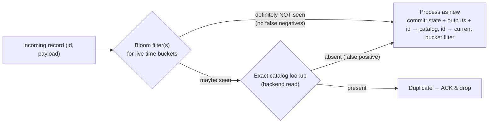
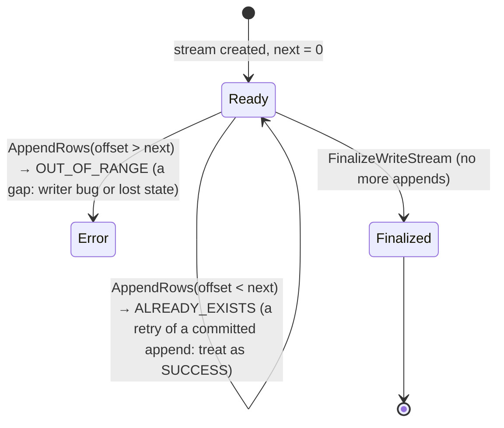
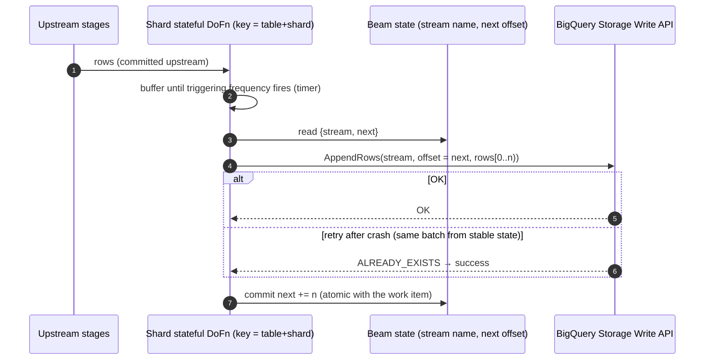

# 03 · Exactly-Once: Bloom Filters, the BigQuery Storage Write API, and Dataflow Prime

> **Folder:** `03-Google-Cloud-Dataflow-and-MillWheel-Internals/` · **File 3 of 3**
> **Anchoring sources:** Akidau et al., *MillWheel* (VLDB 2013), §6 · R. Lax, *After Lambda: Exactly-once processing in
> Google Cloud Dataflow*, Parts 1–3 (Google Cloud blog, 2017) · B. H. Bloom, *Space/Time Trade-offs in Hash Coding with
> Allowable Errors* (CACM 1970) · Broder & Mitzenmacher, *Network Applications of Bloom Filters: A Survey* (2004) ·
> BigQuery *Storage Write API* documentation · Dataflow docs: *Exactly-once in Dataflow*, *At-least-once streaming mode*,
> *Dataflow Prime* (vertical autoscaling, right fitting).
> **Prev:** [02 · Shuffle and liquid sharding](02-dataflow-shuffle-service-liquid-sharding-and-stragglers.md) · **Next folder:**
> `04-Apache-Flink-Runtime-Checkpointing-and-State/`

> **Scope note.** Dataflow's dedup internals (catalog layout, filter bucketing, GC watermark) are described publicly in
> Lax's blog series and *Streaming Systems*, and they evolve. Mechanisms are explained from those sources and first
> principles. Exact current parameters are marked **⚠ verify**.

---

## 0. The thesis

"Exactly-once" is three different guarantees, and conflating them causes most production incidents:

| Layer | Question | Who provides it in Dataflow |
|-------|----------|-----------------------------|
| **Ingestion** | Is each source record admitted once, despite redelivery? | The runner, for supported sources (Pub/Sub message IDs, Kafka offsets committed with work, deterministic file splits) |
| **Processing** | Do state and inter-stage outputs reflect each record once? | **The runner, natively:** record-ID dedup + atomic per-key commits (MillWheel, file 01) |
| **Effects** | Does the outside world (BigQuery, an API, a database) see each result once? | **You**, by choosing idempotent or transactional sinks: BigQuery Storage Write API with offsets, keyed upserts, Kafka transactions |

Dataflow guarantees the middle layer for free and the first for its supported sources. It guarantees nothing about side
effects you perform inside a `DoFn`. Every exactly-once mechanism costs something:

- dedup catalogs and Bloom filters (memory, lookups),
- checkpointed outputs (writes),
- offset bookkeeping (state writes),
- commit latency (visibility).

**At-least-once mode exists precisely to stop paying for exactly-once when your sink is idempotent anyway.**

---

## 1. First principles: what "exactly-once" means formally

Let $L$ be the input log, $F$ a failure schedule (crashes, retries, redeliveries, key-range moves), and $\mathcal{S}_F(L)$
the durable outcome: pipeline state plus external sink contents. A pipeline is **effectively exactly-once** iff

$$
\forall F:\quad \mathcal{S}_F(L) = \mathcal{S}_\varnothing(L)
$$

It is exactly-once *in outcome*, not in execution. Work may run many times, as long as its *effect* is applied once.
Four requirements, each with a mechanism:

| # | Requirement | Mechanism (Dataflow / MillWheel) | Flink equivalent |
|---|-------------|----------------------------------|------------------|
| R1 | State and outputs change together, atomically | per-key atomic commit | consistent snapshot (barriers) |
| R2 | Redelivered inputs are not re-applied | record-ID dedup (catalog + Bloom filter) | replay from snapshotted source offsets (no dedup needed) |
| R3 | External effects apply once | idempotent writes, offset-based appends, transactions | two-phase-commit sinks |
| R4 | A superseded owner can't commit | work tokens / sequencer tokens | checkpoint IDs, transactional ID fencing |

**R2 differs fundamentally between the two families.** Dataflow commits *continuously*, so every record that crosses a
boundary may be redelivered after a partial failure, and the receiver must **remember IDs**. Flink rolls the *whole job*
back to a snapshot and replays deterministically, so nothing needs per-record memory. Dataflow pays in dedup bookkeeping;
Flink pays in rollback scope and sink visibility latency.

---

## 2. Exactly-once inside Dataflow

### 2.1 Exactly-once shuffle (Lax, Part 1)

At every **stage boundary** (fused steps are in-memory, so only boundaries need this):

1. The producing stage assigns each output record a **unique ID** and commits the record, with its ID, atomically with
   its state (strong production, file 01 §1.3).
2. It delivers the record to the consuming stage's key and retries until ACKed.
3. The consumer checks the ID against its **dedup catalog** for that key. A duplicate is ACKed and dropped. A new record
   is processed, and its ID is recorded **in the same atomic commit** as the resulting state and outputs.
4. **A Bloom filter** in front of the catalog answers "definitely new" for the vast majority of records, so they skip
   the catalog read.
5. **Garbage collection.** IDs can't be stored forever. The system tracks how old a record can be and still be retried
   (a watermark over record *system* timestamps), and drops catalog entries and filter buckets older than that.



**Why non-deterministic `DoFn`s are fine here.** Outputs are committed *before* downstream sees them, so a retry after a
crash resends the *committed* records (same IDs, same contents). It never sends a recomputed, different version.
Non-determinism is **frozen at the commit boundary**. That's Dataflow's answer to the problem Flink solves by requiring
deterministic replay from sources.

### 2.2 Bloom filter math

A Bloom filter with $m$ bits, $k$ hash functions, and $n$ inserted IDs has a false-positive probability of

$$
p \approx \left(1 - e^{-kn/m}\right)^{k}, \qquad k_{\text{opt}} = \frac{m}{n}\ln 2, \qquad \frac{m}{n} = -\frac{\ln p}{(\ln 2)^2} \approx 1.44 \log_2 \tfrac{1}{p}
$$

| Target $p$ | Bits per ID | $k_{\text{opt}}$ | Memory for $n = 10^7$ IDs |
|------------|-------------|------------------|---------------------------|
| 10% | 4.8 | 3 | 6 MB |
| 1% | 9.6 | 7 | 12 MB |
| 0.1% | 14.4 | 10 | 18 MB |
| 0.01% | 19.2 | 13 | 24 MB |

**The payoff.** Without a filter, every record costs a catalog read: a backend RPC, ~1 ms or more if uncached. With a
filter, only $p \cdot N_{\text{new}} + N_{\text{dup}}$ records need a read. At 1M records/s with $p = 1\%$ and a 0.1%
duplicate rate, that's about 11k reads/s instead of 1M/s, roughly a **90× reduction** in dedup I/O. The check itself is
$k$ memory probes, which means $k$ cache misses (~100 ns each) once the filter exceeds L3: about 0.7 µs per record at
$k = 7$.

**Time bucketing.** To garbage-collect, keep $B$ filters, one per time bucket of width $\Delta$, covering horizon
$H = B\Delta$. Insert into the current bucket and test against all live buckets. **False positives compound across
buckets:**

$$
p_{\text{lookup}} = 1 - (1 - p_b)^{B} \approx B\,p_b \quad\Rightarrow\quad p_b = p_{\text{target}} / B
$$

Size each bucket's filter for $p_b$, not $p_{\text{target}}$. Dropping the oldest bucket is O(1), with no per-ID
deletion (which plain Bloom filters can't do).

**Correctness argument.** Bloom filters have **no false negatives**, so "definitely new" is always true and the fast path
can never admit a duplicate. False positives only cost an extra exact lookup. The filter is purely a performance device
*in front of* an authoritative catalog. Using a Bloom filter **alone** for dedup (dropping on "maybe") would silently
drop a fraction $p$ of legitimate records. That's a correctness bug (§9.1 shows the anti-pattern).

### 2.3 Why the filter belongs inside the runner

The runner knows **which worker currently owns a key range** (work and cache tokens, file 01 §2.2). It can rebuild or
invalidate a filter when ownership moves. A user-space in-memory Bloom filter in a `DoFn` can't see ownership changes. If
key range R moves from worker A to B and back, A's stale filter misses IDs that B recorded and answers "definitely new"
for a real duplicate. **In user code, use exact, state-backed dedup** (§8.4) and let the runner's state cache provide the
speed.

### 2.4 Sources: exactly-once ingestion

| Source | Redelivery model | Dataflow mechanism | Caveats |
|--------|------------------|--------------------|---------|
| **Pub/Sub** | at-least-once delivery; redeliveries keep the same `messageId` | dedup by message ID; acks after durable commit | **Publisher retries create new message IDs.** Set an `idAttribute` (a publisher-assigned ID) so Dataflow dedups those too, within a bounded window ⚠ verify the window |
| **Kafka (KafkaIO)** | consumer re-reads from an offset | offsets are part of the source state **committed atomically with each work item's outputs** | `commitOffsetsInFinalize()` only updates the consumer group for monitoring/restarts; it isn't the exactly-once mechanism |
| **Files / BigQuery reads** | deterministic splits | each split's restriction is processed exactly once (claim protocol) | Inputs mutated mid-read aren't snapshot-consistent |
| **Custom SDF** | your restriction | residuals checkpointed with watermark state | You must honor the claim protocol (Folder 02, file 03) |

---

## 3. Exactly-once effects: sinks

### 3.1 The taxonomy

| Strategy | Requirement | Examples | Notes |
|----------|-------------|----------|-------|
| **Idempotent write** | a deterministic key; overwrite semantics; a version guard if out-of-order delivery is possible | DB upsert by PK + version; Bigtable `SetCell` with an **explicit** timestamp; Spanner `InsertOrUpdate`; BigQuery CDC upsert | The simplest and most robust. Increments and appends are **not** idempotent. |
| **Offset-tracked append** | a writer-owned stream; a durable "next offset"; deterministic replay of the same rows at the same offsets | BigQuery Storage Write API **committed** streams | The service rejects re-appends at used offsets (`ALREADY_EXISTS`) |
| **Transactional / 2PC** | the sink supports transactions with fencing | Kafka transactions (`KafkaIO.withEOS`), Flink 2PC sinks | Visibility waits for the commit |
| **Atomic batch publish** | stage then commit atomically | BigQuery PENDING streams + batch commit; load jobs; FileIO temp files + finalize | Batch-oriented; all-or-nothing per commit |
| **Downstream dedup** | stable IDs on messages | Pub/Sub with an ID attribute, consumer-side dedup | Pushes the cost to consumers |

### 3.2 The "freeze, then act" pattern (Lax, Part 2)

Side effects inside a `DoFn` repeat when the bundle retries. If an external API needs a **request ID** for dedup, that ID
must be **identical across retries**:

1. **Generate** the ID (even randomly) in step A, whose output is committed.
2. **Act** in step B, which reads the committed ID. Retries of B re-read the *same* ID, so the API dedups.
3. Between A and B you need a boundary that makes B's input **stable**:
   - On Dataflow, any stage boundary (GBK, `Reshuffle`) works because outputs are committed. That's the classic
     "generate `insertId` then `Reshuffle`" recipe for legacy BigQuery streaming inserts.
   - **Portable:** annotate B's `@ProcessElement` with **`@RequiresStableInput`**.

Prefer **deterministic IDs** whenever the inputs allow it, because they survive *even a replacement pipeline* replaying
the same input:

| Data shape | Deterministic idempotency key |
|------------|-------------------------------|
| Kafka record → one output | `topic/partition/offset` |
| Pub/Sub message → one output | publisher-assigned event ID (not `messageId`, which changes on publisher retry) |
| One input → many outputs | `inputId + ":" + outputIndex` |
| Windowed aggregate | `(key, windowStart, paneIndex)` (Folder 01, file 03 §9.2), plus a job epoch for replacements |
| CDC row | `(primary key, source LSN/GTID)` |

---

## 4. The BigQuery Storage Write API

### 4.1 Stream types

| Stream type | Visibility | Exactly-once? | Typical use |
|-------------|------------|---------------|-------------|
| **Default stream** | immediate | **No** (at-least-once; retries can duplicate) | high-throughput streaming where duplicates are acceptable or neutralized by CDC upserts |
| **Committed** (application-created) | immediate on append | **Yes, with offsets** | streaming exactly-once |
| **Pending** (application-created) | after finalize + `BatchCommitWriteStreams` (atomic across streams) | **Yes** (all-or-nothing) | batch loads |
| **Buffered** (application-created) | after explicit flush to an offset | Yes, with offsets | advanced: row-level visibility control |

### 4.2 Offset semantics: the exactly-once state machine



For an exactly-once writer:

1. **Each stream has exactly one writer** (single-writer semantics, like any fenced resource).
2. **The writer durably records `next` for its stream.** In Beam, it lives in the stateful `DoFn`'s state, committed
   with the work item.
3. **A retry must re-append the same rows at the same offsets.** That requires the batch to come from *stable* input:
   Beam batches with a stateful buffer (`GroupIntoBatches`-style), so a retried bundle replays identical batches.
4. **`ALREADY_EXISTS` means "already written"**, which is success, not error.

### 4.3 How `BigQueryIO` uses it (⚠ verify internals per Beam version)

| Method | Mode | Mechanism |
|--------|------|-----------|
| `Method.STORAGE_WRITE_API` (batch) | exactly-once | per-bundle **pending** streams, then finalize, then an atomic batch commit at the end |
| `Method.STORAGE_WRITE_API` (streaming) | exactly-once | elements are **sharded** (fixed `withNumStorageWriteApiStreams(n)` or auto-sharding), batched per shard by a **triggering frequency**, then appended to **committed streams with explicit offsets** tracked in Beam state |
| `Method.STORAGE_API_AT_LEAST_ONCE` | at-least-once | **default stream**: no offsets, no shard state, lower latency and cost |
| CDC upserts (`withRowMutationInformationFn`) | idempotent by PK + sequence | `_CHANGE_TYPE` (`UPSERT`/`DELETE`) and a change sequence number; requires a primary key and the table's `max_staleness` setting; typically used with at-least-once writes ⚠ verify |



**Triggering frequency** is the central streaming knob:

| Frequency | Effect |
|-----------|--------|
| Shorter (1–2 s) | lower freshness latency; more, smaller append requests (per-request overhead, quota pressure) |
| Longer (10–60 s) | larger batches, better throughput per request and lower cost; staler tables |

**Streams = write parallelism.** Each committed stream is single-writer, and per-stream throughput is bounded ⚠ verify
current per-stream and per-project limits. Size `withNumStorageWriteApiStreams` for peak throughput divided by
per-stream throughput, with headroom, or use auto-sharding. Too many streams waste connections and quota.

**Quotas to plan for** (⚠ verify current values): `AppendRows` request size (on the order of 10 MB), concurrent
connections per project and region, and regional throughput caps. Many small shards or many concurrent jobs exhaust
connection quotas before throughput.

### 4.4 CDC upserts versus exactly-once appends

| Need | Choose | Why |
|------|--------|-----|
| An append-only fact table with no duplicates | `STORAGE_WRITE_API` (exactly-once) | offsets guarantee single appends |
| A "current state" table (one row per entity) | **CDC upsert** with `STORAGE_API_AT_LEAST_ONCE` | duplicates are harmless (idempotent by PK); the sequence number orders updates |
| Windowed aggregates with early, on-time, and late panes | CDC upsert keyed by `(key, window_start)` with sequence = `(epoch, paneIndex)` | pane-versioned convergence (Folder 01, file 03) |
| Lowest cost and latency, duplicates acceptable | at-least-once default stream | no shard state or offsets |

CDC trade-off: BigQuery applies upserts in the background, with staleness bounded by `max_staleness`. Queries may merge
pending changes at read time, which affects cost and latency, so set `max_staleness` to what consumers can tolerate.

---

## 5. At-least-once streaming mode

Dataflow offers an **at-least-once streaming mode** (requires Streaming Engine; enabled via a service option ⚠ verify the
flag). It relaxes the runner's exactly-once processing guarantees in exchange for **lower latency and cost**, since there
are fewer dedup and checkpoint operations. Records may be processed more than once.

Use it when **every sink is idempotent** (CDC upserts, keyed overwrites, idempotent APIs) or the analytics tolerate rare
duplicates (approximate metrics, sampling, alerting with dedup downstream).

**Don't use it** when state carries non-idempotent aggregates whose double-counting matters (billing sums) and
downstream can't dedup.

The L7 framing: exactly-once processing is a per-record tax. If R3 (idempotent effects) already makes duplicates
harmless, paying for R2 (dedup) buys nothing.

---

## 6. Dataflow Prime

### 6.1 The first-principles problem

Classic Dataflow gives a job **one worker shape** (machine type), chosen up front. Reality is heterogeneous:

- **Across stages:** fused stages (Folder 02, file 01) put a memory-hungry ML step and a light parser on the same VM
  shape.
- **Over time:** memory needs drift (state caches warming, skew bursts, a large side input arriving).
- **Unknown at launch:** engineers over-provision "to be safe" (paying for idle memory) or under-provision (OOM loops).

### 6.2 The features (⚠ verify current naming and availability)

| Feature | Mechanism | What it fixes |
|---------|-----------|---------------|
| **Vertical autoscaling** | the service observes memory pressure and OOMs and **replaces workers with larger (or smaller) memory** | OOM loops; chronic over-provisioning |
| **Right fitting** | per-step **resource hints** (`min_ram`, accelerators) create stage-specific worker pools | heterogeneous stages forced onto one shape (e.g., GPU inference + CPU parsing) |
| **Diagnostics and recommendations** | automated detection of common problems (hot keys, stuck work) | operator toil |
| **Billing in Data Compute Units (DCUs)** | resource-normalized units instead of per-VM billing | aligns cost with resources consumed |

Enabled through a Dataflow service option (e.g., `enable_prime`) ⚠ verify.

### 6.3 Trade-offs

- **Vertical autoscaling replaces workers,** which causes key-range moves, cold state caches, and latency blips in
  streaming (file 01, W7). It can also **mask memory leaks**: a leaking pipeline just keeps getting bigger workers. Watch
  memory trends and cost.
- **Right fitting adds stage boundaries** between differently resourced pools, so materialization costs (Folder 02,
  file 01 §4.4) and latency per boundary (file 01 §7). Use it where hardware truly differs (GPUs, very high memory).
- **DCU pricing versus explicit sizing.** For stable, well-understood pipelines, hand-tuned machine types can be cheaper.
  Prime pays off for heterogeneous or drifting workloads and for teams without dedicated tuning effort.

---

## 7. Flink contrast

| Aspect | Dataflow | Flink |
|--------|----------|-------|
| Internal exactly-once | per-key commits + record-ID dedup (catalog + Bloom) | barrier snapshots + deterministic replay; **no per-record dedup** |
| Non-deterministic user code | safe internally (outputs committed before delivery) | replay may produce different outputs. Exactly-once *state* holds, but outputs emitted before a failure may differ after replay. Transactional sinks hide pre-failure outputs until commit. |
| Sink exactly-once | idempotent / offset-based / transactional writes per commit | **2PC**: pre-commit at the checkpoint barrier, commit on checkpoint completion (Folder 06) |
| Output visibility | per commit (ms) for idempotent sinks; triggering frequency for BigQuery | checkpoint interval for transactional sinks (`read_committed` consumers wait) |
| Cost model | per-record dedup bookkeeping | per-checkpoint snapshot cost; full-job rollback on failure |

---

## 8. Production Java 21 code blueprints

### 8.1 Anti-patterns

```java
// (A) Side effect with a per-attempt random ID: every retry sends a NEW id, so the API can't dedup.
class ChargeCardFn extends DoFn<Payment, Receipt> {
  @ProcessElement
  public void process(@Element Payment p, OutputReceiver<Receipt> out) {
    String requestId = UUID.randomUUID().toString();          // regenerated on every bundle retry
    out.output(paymentApi.charge(p, requestId));              // double charges during worker restarts
  }
}

// (B) "Exactly-once" BigQuery that isn't: the at-least-once default stream for an append-only fact table.
facts.apply(BigQueryIO.<Fact>write().to(table)
    .withFormatFunction(Fact::toTableRow)
    .withMethod(BigQueryIO.Write.Method.STORAGE_API_AT_LEAST_ONCE));   // duplicates on retries

// (C) Bloom-only dedup: drops a fraction p of LEGITIMATE records forever (false positives treated as duplicates).
if (bloom.mightContain(id)) {
  return;                                                     // WRONG: "maybe" is not "yes"
}
bloom.put(id);
out.output(event);

// (D) Counting with a non-idempotent external increment inside a DoFn: retries over-count.
redis.incrBy("clicks:" + campaign, 1);
```

### 8.2 Production: BigQuery exactly-once appends, CDC upserts, and a DLQ

```java
package dev.l7.dataflow.eos;

import com.google.api.services.bigquery.model.TableRow;
import java.util.List;
import org.apache.beam.sdk.io.gcp.bigquery.BigQueryIO;
import org.apache.beam.sdk.io.gcp.bigquery.BigQueryStorageApiInsertError;
import org.apache.beam.sdk.io.gcp.bigquery.RowMutationInformation;
import org.apache.beam.sdk.io.gcp.bigquery.WriteResult;
import org.apache.beam.sdk.transforms.MapElements;
import org.apache.beam.sdk.values.PCollection;
import org.apache.beam.sdk.values.TypeDescriptors;
import org.joda.time.Duration;

public final class BigQuerySinks {

  public record Order(String orderId, long version, long amountCents, String status) implements java.io.Serializable {
    TableRow toTableRow() {
      return new TableRow().set("order_id", orderId).set("version", version)
          .set("amount_cents", amountCents).set("status", status);
    }
  }

  /** Append-only facts, exactly once: committed streams + offsets tracked in Beam state (streaming). */
  public static WriteResult appendFactsExactlyOnce(PCollection<Order> orders, String table) {
    WriteResult result = orders.apply("BQ-ExactlyOnce", BigQueryIO.<Order>write()
        .to(table)
        .withFormatFunction(Order::toTableRow)
        .withMethod(BigQueryIO.Write.Method.STORAGE_WRITE_API)
        .withTriggeringFrequency(Duration.standardSeconds(5))       // freshness vs request count
        .withNumStorageWriteApiStreams(32)                          // ≈ peak MB/s ÷ per-stream MB/s, with headroom
        .withCreateDisposition(BigQueryIO.Write.CreateDisposition.CREATE_NEVER)
        .withWriteDisposition(BigQueryIO.Write.WriteDisposition.WRITE_APPEND));
    routeFailures(result, "orders_facts");
    return result;
  }

  /** Current-state table: one row per order, idempotent by PK, ordered by version (⚠ verify API per Beam version). */
  public static WriteResult upsertCurrentState(PCollection<Order> orders, String table) {
    WriteResult result = orders.apply("BQ-CDC-Upsert", BigQueryIO.<Order>write()
        .to(table)                                                   // table needs PRIMARY KEY + max_staleness
        .withFormatFunction(Order::toTableRow)
        .withMethod(BigQueryIO.Write.Method.STORAGE_API_AT_LEAST_ONCE) // duplicates are harmless: upserts by PK
        .withRowMutationInformationFn(o ->
            RowMutationInformation.of(RowMutationInformation.MutationType.UPSERT, o.version()))
        .withPrimaryKey(List.of("order_id"))
        .withCreateDisposition(BigQueryIO.Write.CreateDisposition.CREATE_NEVER)
        .withWriteDisposition(BigQueryIO.Write.WriteDisposition.WRITE_APPEND));
    routeFailures(result, "orders_current");
    return result;
  }

  /** Schema mismatches and rejects become data, not infinite retries that pin the watermark. */
  private static void routeFailures(WriteResult result, String sinkName) {
    PCollection<BigQueryStorageApiInsertError> failed = result.getFailedStorageApiInserts();
    failed
        .apply("FormatDLQ-" + sinkName, MapElements.into(TypeDescriptors.strings())
            .via(err -> sinkName + "\t" + err.getErrorMessage() + "\t" + err.getRow()))
        .apply("WriteDLQ-" + sinkName, new DeadLetterSink(sinkName));  // e.g., GCS files or a DLQ table
  }
}
```

`DeadLetterSink` is your choice of durable DLQ (a GCS `FileIO` write, or a separate BigQuery table written at-least-once).
The point is that failed rows are **data with a path**, never exceptions that retry forever (file 01, W2; Folder 01,
file 02, W4).

### 8.3 Production: deterministic idempotency keys and "freeze, then act"

```java
package dev.l7.dataflow.eos;

import java.util.UUID;
import org.apache.beam.sdk.io.kafka.KafkaRecord;
import org.apache.beam.sdk.transforms.DoFn;
import org.apache.beam.sdk.values.KV;

public final class IdempotencyKeys {

  /** Best: a deterministic ID from source coordinates. It survives retries AND replacement pipelines. */
  public static final class KafkaCoordinatesIdFn extends DoFn<KafkaRecord<String, byte[]>, KV<String, byte[]>> {
    @ProcessElement
    public void process(@Element KafkaRecord<String, byte[]> r, OutputReceiver<KV<String, byte[]>> out) {
      String id = r.getTopic() + "/" + r.getPartition() + "/" + r.getOffset();
      out.output(KV.of(id, r.getKV().getValue()));
    }
  }

  /** When no stable coordinates exist: generate once, commit, then act on the committed value. */
  public static final class AssignRequestIdFn extends DoFn<Payment, KV<String, Payment>> {
    @ProcessElement
    public void process(@Element Payment p, OutputReceiver<KV<String, Payment>> out) {
      out.output(KV.of(UUID.randomUUID().toString(), p));   // non-deterministic, but FROZEN once committed
    }
  }

  /** Acts on stable input: retries see the same request ID, so the payment API deduplicates. */
  public static final class ChargeWithStableIdFn extends DoFn<KV<String, Payment>, Receipt> {
    private transient PaymentApi api;

    @Setup
    public void setup() {
      api = PaymentApi.connect();
    }

    @ProcessElement
    @RequiresStableInput                                      // portable guarantee: identical input across retries
    public void process(@Element KV<String, Payment> e, OutputReceiver<Receipt> out) {
      out.output(api.charge(e.getValue(), /* idempotency key */ e.getKey()));
    }
  }

  // Domain stubs
  public record Payment(String account, long amountCents) implements java.io.Serializable {}

  public record Receipt(String requestId, String status) implements java.io.Serializable {}

  public interface PaymentApi {
    Receipt charge(Payment p, String idempotencyKey);

    static PaymentApi connect() {
      throw new UnsupportedOperationException("wire your client");
    }
  }
}
```

```java
payments
    .apply("AssignRequestId", ParDo.of(new IdempotencyKeys.AssignRequestIdFn()))
    .apply("Charge", ParDo.of(new IdempotencyKeys.ChargeWithStableIdFn()));
// On Dataflow, @RequiresStableInput materializes the input (a commit boundary) before Charge.
// On the Flink runner, Charge's input is buffered until the checkpoint completes.
```

### 8.4 Production: exact, state-backed dedup with time-based GC (no user-space Bloom filter)

Beam's built-in `Deduplicate` is the first choice:

```java
PCollection<Event> unique = events.apply("Dedup30m",
    Deduplicate.<Event, String>withRepresentativeValueFn(Event::eventId)
        .withRepresentativeCoder(StringUtf8Coder.of())
        .withDuration(Duration.standardMinutes(30))
        .withTimeDomain(TimeDomain.PROCESSING_TIME));
// Keys by the ID: one state entry + one timer per distinct ID within the horizon. Simple and exact.
```

When you need to control the state layout (fewer timers, sharded keys, 64-bit fingerprints), write it yourself, keeping
the dedup **exact**:

```java
package dev.l7.dataflow.eos;

import java.nio.ByteBuffer;
import java.nio.charset.StandardCharsets;
import java.security.MessageDigest;
import java.security.NoSuchAlgorithmException;
import org.apache.beam.sdk.coders.BooleanCoder;
import org.apache.beam.sdk.coders.VarLongCoder;
import org.apache.beam.sdk.metrics.Counter;
import org.apache.beam.sdk.metrics.Metrics;
import org.apache.beam.sdk.state.MapState;
import org.apache.beam.sdk.state.OrderedListState;
import org.apache.beam.sdk.state.StateSpec;
import org.apache.beam.sdk.state.StateSpecs;
import org.apache.beam.sdk.state.TimeDomain;
import org.apache.beam.sdk.state.Timer;
import org.apache.beam.sdk.state.TimerSpec;
import org.apache.beam.sdk.state.TimerSpecs;
import org.apache.beam.sdk.state.ValueState;
import org.apache.beam.sdk.transforms.DoFn;
import org.apache.beam.sdk.transforms.windowing.BoundedWindow;
import org.apache.beam.sdk.values.KV;
import org.apache.beam.sdk.values.TimestampedValue;
import org.joda.time.Duration;
import org.joda.time.Instant;

/**
 * Exact dedup over a processing-time horizon, keyed by SHARD (not by ID):
 *  - seen:    MapState<fingerprint, true>   point lookups (served from the runner's state cache when warm)
 *  - gcIndex: OrderedListState<fingerprint> sorted by first-seen time → range-read and range-delete for GC
 *  - one GC timer per shard (not one per ID, as Deduplicate does)
 *
 * 64-bit fingerprints: P(collision) ≈ n² / 2^65 per shard per horizon (n = 10^7 → ~3e-6). Use two longs for more.
 * Upstream must key elements as KV<shard, Event> with shard = top bits of the fingerprint (e.g., 1,024 shards).
 * The DoFn is generic, so set the output coder explicitly: .apply(ParDo.of(new ShardedFingerprintDedupFn<>())).setCoder(eventCoder).
 * ⚠ verify OrderedListState support on your runner (Dataflow streaming supports it on recent versions).
 */
public final class ShardedFingerprintDedupFn<E extends ShardedFingerprintDedupFn.HasEventId>
    extends DoFn<KV<Integer, E>, E> {

  public interface HasEventId {
    String eventId();
  }

  private static final Duration HORIZON = Duration.standardMinutes(30);
  private static final Duration GC_EVERY = Duration.standardMinutes(1);

  private final Counter duplicates = Metrics.counter(ShardedFingerprintDedupFn.class, "duplicates_dropped");

  @StateId("seen")
  private final StateSpec<MapState<Long, Boolean>> seenSpec = StateSpecs.map(VarLongCoder.of(), BooleanCoder.of());

  @StateId("gcIndex")
  private final StateSpec<OrderedListState<Long>> gcIndexSpec = StateSpecs.orderedList(VarLongCoder.of());

  @StateId("gcArmed")
  private final StateSpec<ValueState<Boolean>> gcArmedSpec = StateSpecs.value(BooleanCoder.of());

  @TimerId("gc")
  private final TimerSpec gcSpec = TimerSpecs.timer(TimeDomain.PROCESSING_TIME);

  @ProcessElement
  public void process(@Element KV<Integer, E> element,
                      @StateId("seen") MapState<Long, Boolean> seen,
                      @StateId("gcIndex") OrderedListState<Long> gcIndex,
                      @StateId("gcArmed") ValueState<Boolean> gcArmed,
                      @TimerId("gc") Timer gc,
                      OutputReceiver<E> out) {
    long fp = fingerprint64(element.getValue().eventId());
    if (seen.get(fp).read() != null) {             // exact check: never drops a first occurrence
      duplicates.inc();
      return;
    }
    seen.put(fp, Boolean.TRUE);
    gcIndex.add(TimestampedValue.of(fp, Instant.now()));
    out.output(element.getValue());

    if (gcArmed.read() == null) {
      gcArmed.write(Boolean.TRUE);
      gc.withNoOutputTimestamp().offset(GC_EVERY).setRelative();   // cleanup emits nothing: no hold ⚠ verify
    }
  }

  @OnTimer("gc")
  public void onGc(@StateId("seen") MapState<Long, Boolean> seen,
                   @StateId("gcIndex") OrderedListState<Long> gcIndex,
                   @StateId("gcArmed") ValueState<Boolean> gcArmed,
                   @TimerId("gc") Timer gc) {
    Instant cutoff = Instant.now().minus(HORIZON);
    for (TimestampedValue<Long> expired : gcIndex.readRange(BoundedWindow.TIMESTAMP_MIN_VALUE, cutoff)) {
      seen.remove(expired.getValue());
    }
    gcIndex.clearRange(BoundedWindow.TIMESTAMP_MIN_VALUE, cutoff);

    if (Boolean.TRUE.equals(gcIndex.isEmpty().read())) {
      gcArmed.clear();                               // idle shard: no timer, no state
    } else {
      gc.withNoOutputTimestamp().offset(GC_EVERY).setRelative();
    }
  }

  static long fingerprint64(String id) {
    try {
      byte[] digest = MessageDigest.getInstance("SHA-256").digest(id.getBytes(StandardCharsets.UTF_8));
      return ByteBuffer.wrap(digest).getLong();      // production: a fast 64/128-bit hash (xxHash, Murmur3)
    } catch (NoSuchAlgorithmException e) {
      throw new IllegalStateException(e);
    }
  }
}
```

The design choices to defend:

- **Exact over probabilistic.** A false "duplicate" is data loss.
- **Shard keys** bound the number of keys and timers: 1,024 shards × 1 timer, versus one timer per ID with `Deduplicate`.
- **`OrderedListState`** turns GC into range operations instead of a full map scan.
- **The runner's state cache** supplies the speed a user-space Bloom filter would, without the ownership-staleness hazard
  (§2.3).

### 8.5 Other sinks: Kafka transactions and Pub/Sub IDs (⚠ verify per version)

```java
// Kafka exactly-once sink: Kafka transactions + runner-managed state per shard.
enriched.apply("ToKafkaEOS", KafkaIO.<String, String>write()
    .withBootstrapServers(brokers)
    .withTopic("orders-enriched")
    .withKeySerializer(StringSerializer.class)
    .withValueSerializer(StringSerializer.class)
    .withEOS(16, "orders-enriched-sink"));      // numShards, sinkGroupId (stable across updates)

// Pub/Sub: at-least-once delivery. Attach a stable ID attribute so consumers (incl. Dataflow readers with
// .withIdAttribute) can deduplicate publisher retries.
messages.apply("ToPubsub", PubsubIO.writeMessages()
    .to("projects/p/topics/orders-enriched")
    .withIdAttribute("event_id"));
```

### 8.6 Service options (⚠ verify names for your SDK and region)

```text
--dataflowServiceOptions=streaming_mode_at_least_once   # when every sink is idempotent
--dataflowServiceOptions=enable_prime                   # vertical autoscaling + right fitting + DCU billing
# Right fitting = per-step ResourceHints (Folder 02, file 01 §8.2), e.g. .setResourceHints(ResourceHints.create().withMinRam("32GiB"))
```

### 8.7 Flink contrast: transactional Kafka sink

```java
KafkaSink<String> sink = KafkaSink.<String>builder()
    .setBootstrapServers(brokers)
    .setRecordSerializer(KafkaRecordSerializationSchema.builder()
        .setTopic("orders-enriched")
        .setValueSerializationSchema(new SimpleStringSchema())
        .build())
    .setDeliveryGuarantee(DeliveryGuarantee.EXACTLY_ONCE)     // 2PC aligned to checkpoints
    .setTransactionalIdPrefix("orders-enriched-v1")            // fencing identity: keep it stable across restarts
    .build();
// Consumers with isolation.level=read_committed see records only after the checkpoint commits
// (visibility latency ≈ checkpoint interval). Transaction timeout must exceed the max checkpoint duration (Folder 06).
```

---

## 9. Production failure modes and P99 debugging

| ID | Failure | Signature | Root cause | Fix |
|----|---------|-----------|------------|-----|
| E1 | **Duplicate external effects** | Double charges or emails after worker restarts | Side effects with per-attempt IDs inside a `DoFn` | Deterministic IDs, or freeze-then-act with `@RequiresStableInput` (§8.3) |
| E2 | **Duplicates in a BigQuery fact table** | Row counts > source counts; duplicate keys | At-least-once method used for facts; legacy inserts without stable `insertId` | `STORAGE_WRITE_API` exactly-once; or CDC upsert for state tables |
| E3 | **Silent data loss from probabilistic dedup** | Small, steady shortfall vs. the source; worse at high volume | Bloom-only dedup | Exact catalog behind any filter (§2.2, §8.4) |
| E4 | **Publisher-retry duplicates from Pub/Sub** | Duplicates with *different* `messageId`s | Publisher retries create new messages | Publisher-assigned ID attribute plus `withIdAttribute`; downstream dedup beyond the dedup window |
| E5 | **Storage Write API quota or connection exhaustion** | `RESOURCE_EXHAUSTED`, throttling, rising append latency | Too many streams or jobs; tiny triggering frequency | Fewer streams (auto-sharding); a longer triggering frequency; consolidate writers |
| E6 | **Watermark pinned by sink errors** | One sink step retrying forever; freshness climbing | Schema mismatches or rejects thrown as exceptions | `getFailedStorageApiInserts()` to a DLQ; schema evolution policy |
| E7 | **Stale or out-of-order upserts** | A current-state table regresses to older versions | Missing or wrong sequence number in CDC; no version guard | `RowMutationInformation` with a monotonic sequence (version, LSN, or `(epoch, pane)`) |
| E8 | **Dedup window exceeded** | Duplicates that arrive hours apart slip through | Runner/source dedup windows are bounded; the user dedup horizon is too short | Size the horizon to the max redelivery delay; idempotent sinks as a backstop |
| E9 | **At-least-once mode surprises** | Aggregates slightly high after incidents | Non-idempotent state with at-least-once mode | Use exactly-once mode for non-idempotent aggregates, or make the aggregates idempotent |
| E10 | **Prime vertical-autoscaling churn** | Periodic latency spikes; memory steps upward over days | Worker replacement causes cold caches; a leak masked by upsizing | Investigate the memory trend; fix the leak; cap the max memory |
| E11 | **Kafka EOS fencing errors** | `ProducerFencedException`, stalled sink after deploy | Changed sink group ID or transactional ID; concurrent old and new jobs | Stable IDs; drain the old job before starting the new; transaction timeout > checkpoint and commit delays |

### 9.1 Runbook · E1 (double charges during an incident)

1. Correlate duplicates with worker restarts or bundle retries in the job logs. They cluster around restarts.
2. Inspect the code path: is the external call inside a `DoFn` with an ID generated in the same `DoFn`?
3. Immediate mitigation: the provider's idempotency-key support with a **deterministic** key (§3.2 table). If no key
   is derivable, deploy freeze-then-act (§8.3).
4. Reconcile: dedup the provider's records by business key and time window, and refund duplicates.
5. Prevent: a code-review rule that every external side effect has an idempotency key derived from committed data, with
   a test that retries the bundle and asserts a single effect.

### 9.2 Runbook · E2 (duplicates in BigQuery)

1. Count rows per natural key. Duplicates with identical payloads mean retry duplication.
2. Check the write method. `STORAGE_API_AT_LEAST_ONCE` or legacy inserts without stable IDs explain it.
3. Fix forward: switch facts to `STORAGE_WRITE_API` (exactly-once), or switch state tables to CDC upserts.
4. Clean history: `MERGE`/dedup by natural key in BigQuery, scoped to the affected partitions.

---

## 10. FAANG L7 bar-raiser Q&A chains

### Q1 · "Dataflow is exactly-once. So are my BigQuery writes exactly-once?"

**L5 textbook answer.** Yes. Dataflow guarantees exactly-once processing end to end.

**Why L5 breaks at petabyte scale.** Dataflow guarantees exactly-once *processing* (state and inter-stage records). Sinks
are external effects. With the at-least-once method (default stream), legacy streaming inserts, or custom `DoFn` writes,
retries duplicate rows. At scale, retries happen every day: worker restarts, autoscaling, preemption.

**L7 principal defense.**

1. **Separate the three layers** (§0): ingestion, processing, effects.
2. **For BigQuery facts,** use `STORAGE_WRITE_API`: committed streams with offsets tracked in Beam state. `ALREADY_EXISTS`
   on a replayed append is success. That's exactly-once.
3. **For state tables,** use CDC upserts keyed by PK with a monotonic sequence. Duplicates become harmless, so the cheaper
   at-least-once method is fine.
4. **For custom sinks,** use idempotent keys from committed data.
5. **State the costs:** triggering frequency (freshness vs. request count), stream quotas, shard state.

### Q2 · "How does Dataflow deduplicate at scale? Why Bloom filters? Size one."

**L5 textbook answer.** It keeps a set of processed IDs and checks each record against it. Bloom filters save memory.

**Why L5 breaks.** A naive set means one remote lookup per record (≈1M RPCs/s at 1M records/s) and unbounded growth.
"Save memory" misses the real role: the Bloom filter is a **fast-negative cache** in front of an authoritative store, and
it's correct only because it has no false negatives.

**L7 principal defense.**

- **The mechanism:** per-key ID catalog in backend state, plus a Bloom filter answering "definitely new" for most
  records, with exact lookups only for "maybe".
- **Garbage collection:** time-bucketed filters and catalog entries, dropped when a GC watermark guarantees no more
  retries.
- **Sizing:** $m/n = -\ln p / (\ln 2)^2$. At 1%, 9.6 bits per ID and $k = 7$: 12 MB per 10M IDs. With $B$ buckets, size
  each for $p/B$.
- **The payoff:** catalog reads drop from $N$ to $pN + N_{\text{dup}}$, about 90× fewer at $p$ = 1%.
- **The trap:** never drop on "maybe". That turns FP rate into data loss. In user code, prefer exact state-backed dedup,
  because only the runner can keep a filter consistent across key-range moves (§2.3).

### Q3 · "Design exactly-once from Pub/Sub to BigQuery, where publishers retry."

**L5 textbook answer.** Pub/Sub plus Dataflow plus BigQuery is exactly-once out of the box.

**Why L5 breaks.** Publisher retries create **new** Pub/Sub messages with new `messageId`s. Dataflow's message-ID dedup
can't see them as duplicates, and any at-least-once sink adds more duplicates on top.

**L7 principal defense.**

1. **Publishers attach a stable event ID attribute** (a UUID created *once* per business event, persisted before the
   first publish attempt).
2. **Read with `withIdAttribute("event_id")`** so Dataflow dedups publisher retries within its window. Add exact user
   dedup (`Deduplicate` or §8.4) for horizons longer than that window.
3. **Process:** Dataflow's internal exactly-once covers state and shuffles.
4. **Write:** use `STORAGE_WRITE_API` exactly-once for facts, or CDC upsert by event ID or business key for state.
5. **Verify:** a reconciliation job comparing distinct event IDs in the source archive vs. BigQuery per hour, with an
   alert above a threshold.

### Q4 · "When would you choose Dataflow's at-least-once streaming mode?"

**L5 textbook answer.** When you don't need correctness.

**Why L5 breaks.** At-least-once mode isn't "incorrect". It's correct whenever effects are idempotent. Rejecting it out of
hand wastes latency and money on dedup that buys nothing.

**L7 principal defense.**

- **Choose it when every sink is idempotent** (CDC upserts, keyed overwrites, idempotent APIs) and state holds only
  idempotent or overwrite-style values, or when metrics tolerate rare duplicates (approximate analytics, alerting with
  downstream dedup).
- **Avoid it for non-idempotent aggregates** (sums or counts in state feeding billing) unless downstream dedups.
- **The quantified benefit:** fewer dedup lookups and checkpoint writes per record, so lower latency and cost. Measure
  on a shadow pipeline before switching.

### Q5 · "Storage Write API committed vs. pending vs. default streams. How does `BigQueryIO` achieve exactly-once?"

**L5 textbook answer.** The Storage Write API supports exactly-once, and `BigQueryIO` uses it.

**Why L5 breaks.** Without the offset protocol, engineers misconfigure streams (too many → quota errors; too few →
throughput limits), treat `ALREADY_EXISTS` as an error and retry forever, or use the default stream for facts and get
duplicates.

**L7 principal defense.**

| Stream | Exactly-once mechanism |
|--------|------------------------|
| **Default** | At-least-once, immediate visibility, no offsets. |
| **Committed** | Appends with **explicit offsets**. A re-append at a used offset returns `ALREADY_EXISTS`. Single writer per stream, `next` offset in durable state. |
| **Pending** | Invisible until finalize plus `BatchCommitWriteStreams`. Atomic across streams, which suits batch. |

`BigQueryIO`'s streaming exactly-once does the following:

- shards rows (fixed count or auto-sharding),
- batches per triggering frequency,
- appends with offsets from Beam state, committed atomically with the work item,
- replays identical batches on retry because the input is stable state, and gets `ALREADY_EXISTS`, which means success.

Batch mode uses pending streams plus a final atomic commit.

The knobs are triggering frequency (latency vs. request overhead), stream count (throughput ÷ per-stream limit), and
quotas (connections, request size).

### Q6 · "A `DoFn` generates random IDs. Does Dataflow's exactly-once still hold? What about side effects in that `DoFn`?"

**L5 textbook answer.** No. Exactly-once requires deterministic code.

**Why L5 breaks.** That's true for snapshot-and-replay systems (Flink), but not for Dataflow's internal guarantee. Dataflow
commits outputs before downstream reads them, so a retried random ID never escapes in two versions. The *side effects
performed inside* that `DoFn` before the commit, though, can repeat with different IDs.

**L7 principal defense.**

- **Internal state and outputs:** exactly-once regardless of non-determinism (strong productions, §2.1).
- **External side effects in the same `DoFn`:** not covered. Each retry generates a new ID, so the external system sees
  distinct requests.
- **The fix:** freeze, then act (§3.2, §8.3). Generate in step A (committed), act in step B with
  `@RequiresStableInput`. Better still, derive deterministic IDs from source coordinates.
- **Contrast with Flink:** replay after failure re-runs the `DoFn`, and random IDs differ from the pre-failure run.
  Transactional sinks hide pre-failure outputs, but external non-transactional effects need the same idempotency
  discipline.

### Q7 · "What problem does Dataflow Prime solve, from first principles? When wouldn't you use it?"

**L5 textbook answer.** Prime is the newer, serverless Dataflow with better autoscaling.

**Why L5 breaks.** "Better autoscaling" hides the mechanism, and so the failure modes: worker replacement causing cache
churn, masked leaks, extra stage boundaries from right fitting, and a DCU cost model that can exceed hand-tuned VMs.

**L7 principal defense.**

- **The problem:** one fixed worker shape per job, versus needs that are heterogeneous across stages (fusion
  homogenizes them) and drifting over time.
- **Vertical autoscaling** adjusts memory by replacing workers, which fixes OOM loops and over-provisioning.
- **Right fitting** uses per-step resource hints to create stage-specific pools (GPUs, high memory), at the cost of
  stage boundaries.
- **Don't use it** for stable, well-characterized pipelines where explicit sizing is cheaper, for latency-critical
  streaming jobs that can't absorb replacement blips, or when unsupported features are required ⚠ verify the current
  feature matrix.
- **Operate it** by watching memory trends (to catch leaks) and DCU cost per unit of throughput.

---

## 11. Invariants checklist

1. **Exactly-once has three layers:** ingestion, processing, and effects. Dataflow owns the middle one, and you own
   effects.
2. **Exactly-once = atomic commit + ID dedup + idempotent or transactional effects + fencing.**
3. **A Bloom filter is a fast-negative cache in front of an exact catalog.** Never drop on "maybe".
4. **Size Bloom filters per bucket for $p_{\text{target}}/B$.** GC by dropping whole time buckets.
5. **Non-determinism is safe inside Dataflow, but side effects aren't.** Freeze, then act, or derive deterministic IDs.
6. **Use BigQuery facts with `STORAGE_WRITE_API` (offsets) and state tables with CDC upserts** (PK + sequence).
   `ALREADY_EXISTS` means success.
7. **Failed rows go to a DLQ,** never into infinite retries.
8. **At-least-once mode is correct when effects are idempotent.** Use it to stop paying for dedup that buys nothing.
9. **Prime trades explicit sizing for adaptive sizing.** Watch for churn and masked leaks.

---

## 12. References

- T. Akidau et al. *MillWheel: Fault-Tolerant Stream Processing at Internet Scale.* PVLDB 6(11), 2013 (§6 fault
  tolerance, record IDs, Bloom filters, sequencer tokens).
- R. Lax. *After Lambda: Exactly-once processing in Google Cloud Dataflow*, Part 1 (exactly-once shuffle, Bloom filters,
  GC), Part 2 (sources and sinks, determinism), Part 3. Google Cloud Blog, 2017.
- T. Akidau, S. Chernyak, R. Lax. *Streaming Systems.* O'Reilly, 2018 (ch. 5).
- B. H. Bloom. *Space/Time Trade-offs in Hash Coding with Allowable Errors.* CACM 13(7), 1970. A. Broder,
  M. Mitzenmacher. *Network Applications of Bloom Filters: A Survey.* Internet Mathematics 1(4), 2004.
- Google Cloud documentation: *BigQuery Storage Write API* (stream types, offsets, exactly-once, CDC with `_CHANGE_TYPE`
  and `_CHANGE_SEQUENCE_NUMBER`), *Exactly-once in Dataflow*, *At-least-once streaming mode*, *Dataflow Prime*,
  *Pub/Sub with Dataflow (id attributes)*.
- Apache Beam: `sdks/java/io/google-cloud-platform/.../bigquery/` (`BigQueryIO`, `StorageApiWriteUnshardedRecords`,
  `StorageApiWritesShardedRecords`, `RowMutationInformation`), `Deduplicate`, `KafkaIO.Write#withEOS`,
  `PubsubIO#withIdAttribute`.
- Apache Flink: `KafkaSink` with `DeliveryGuarantee.EXACTLY_ONCE`; two-phase commit sink framework (Folder 06).

---

**End of Folder 03.** Next: `04-Apache-Flink-Runtime-Checkpointing-and-State/`: Chandy-Lamport barriers and aligned vs.
unaligned checkpoints, RocksDB LSM tuning vs. Flink 2.x ForSt disaggregated state, and credit-based flow control with
buffer debloating.
