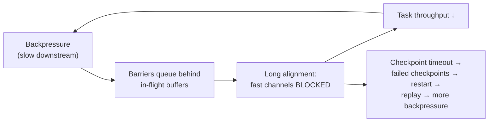

# 01 · Chandy-Lamport Barriers: Aligned vs. Unaligned Checkpoints

> **Folder:** `04-Apache-Flink-Runtime-Checkpointing-and-State/` · **File 1 of 3**
> **Anchoring papers:** K. M. Chandy & L. Lamport, *Distributed Snapshots: Determining Global States of Distributed
> Systems* (ACM TOCS 1985) · P. Carbone, G. Fóra, S. Ewen, S. Haridi, K. Tzoumas, *Lightweight Asynchronous Snapshots for
> Distributed Dataflows* (arXiv 2015) · P. Carbone et al., *State Management in Apache Flink: Consistent Stateful
> Distributed Stream Processing* (PVLDB 2017) · Flink FLIP-76 (*Unaligned Checkpoints*), FLIP-158 (*Generalized
> incremental checkpoints*) · J. W. Young, *A First Order Approximation to the Optimum Checkpoint Interval* (CACM 1974).
> **Prev folder:** [03 · Exactly-once and Prime](../03-Google-Cloud-Dataflow-and-MillWheel-Internals/03-exactly-once-bloom-filters-BigQuery-storage-write-api-and-prime.md)
> · **Next:** [02 · RocksDB vs. ForSt](02-rocksdb-lsm-tuning-vs-flink-2-forst-disaggregated-state.md)

---

## 0. The thesis

Flink's exactly-once guarantee is a **consistent global snapshot** of a running dataflow, taken without stopping it.
Barriers flow with the data and cut the stream into "before" and "after". Every record is either reflected in the
snapshot's state or is replayed from the sources after recovery, never both.

- **Aligned checkpoints** make the cut clean by waiting until a barrier has arrived on every input channel, so no
  in-flight data has to be saved. Under backpressure, that wait is exactly what kills you.
- **Unaligned checkpoints** let barriers overtake in-flight data and save that data as part of the snapshot. They're
  decoupled from backpressure, at the price of bigger checkpoints and I/O storms.

Every Flink checkpointing incident in production comes from not knowing which of those two costs you're paying, and how
much.

---

## 1. First principles: what a consistent snapshot is

### 1.1 The Chandy-Lamport model

A distributed system is a set of processes connected by FIFO channels. A **global state** is the set of process states
plus channel states (messages in flight). A snapshot is **consistent** iff it corresponds to a **consistent cut**:

$$
\forall m:\quad \mathrm{recv}(m) \in C \;\Rightarrow\; \mathrm{send}(m) \in C
$$

In words: you never record a message as received without also recording that it was sent. Chandy-Lamport achieves this
with **markers**:

1. The initiator records its state and sends a marker on every outgoing channel.
2. On receiving the **first** marker, a process records its state, sends markers on all outgoing channels, and **starts
   recording** messages arriving on its other incoming channels.
3. On receiving a marker on channel $c$, it **stops recording** $c$. The recorded messages are $c$'s channel state.

The snapshot is the process states plus the recorded channel states.

### 1.2 ABS: the dataflow specialization (Carbone et al. 2015)

A stream dataflow has **sources** (the only processes that ingest external data) and, usually, **no cycles**. Two
consequences:

- **Sources are the initiators.** Barriers are injected at all sources together, and a source's "state" is just its
  read position (Kafka offsets, file splits).
- **Alignment makes channel state empty.** If an operator *stops reading* a channel once that channel's barrier arrives,
  and resumes only after barriers have arrived on *all* its input channels, no post-barrier message is processed
  before the snapshot. In an acyclic graph, recorded channel state is therefore **always empty**, and the snapshot is
  just operator states plus source positions.

For **cyclic** graphs (iterations), ABS records only the records in the back-edge channels: upstream backup of the loop.

**Recovery semantics.** Restore every operator's state from snapshot $n$, rewind sources to the positions recorded in
$n$, and resume. Every record before the cut is in state, and every record after it is replayed. That's exactly-once
*state*. Exactly-once *output* needs sinks that participate in the cut: two-phase commit (Folder 06).

---

## 2. Mechanics in Flink

### 2.1 The checkpoint lifecycle

```mermaid
sequenceDiagram
    autonumber
    participant CC as CheckpointCoordinator (JobManager)
    participant S as Source tasks
    participant O as Operator tasks
    participant K as Sink tasks
    participant ST as Checkpoint storage (S3/GCS/HDFS)
    CC->>S: triggerCheckpoint(n)
    S->>S: snapshot split state (offsets) + reader state
    S->>O: CheckpointBarrier(n) on every output channel (after all pre-barrier records)
    Note over O: ALIGNED: block channels whose barrier arrived; keep reading others;<br/>when barrier(n) seen on ALL inputs → snapshot
    O->>O: sync phase (e.g., RocksDB flush + hard-link SSTs)
    O->>K: forward CheckpointBarrier(n)
    O-->>ST: async phase: upload new state files
    K->>K: pre-commit (2PC: flush, prepare transaction)
    S-->>CC: ack(n, state handles)
    O-->>CC: ack(n, state handles)
    K-->>CC: ack(n, committables)
    CC->>ST: write _metadata for checkpoint n (checkpoint is now COMPLETE)
    CC->>K: notifyCheckpointComplete(n) → commit transactions
    CC->>O: notifyCheckpointComplete(n)
```

Key facts:

- **The checkpoint is complete only when the coordinator writes the metadata** after receiving every task's
  acknowledgment. A missing acknowledgment, a timeout, or a failed upload means checkpoint $n$ is aborted, and recovery
  uses the last complete one.
- **The sync phase blocks the task.** It must be short: a RocksDB memtable flush plus a native checkpoint (hard links) in
  milliseconds, not a full copy. The **async phase** (upload) runs concurrently with processing.
- **Barriers are events in the data stream.** In aligned mode they queue behind data. In unaligned mode they're
  **priority events** that jump the queue (§4).
- **`notifyCheckpointComplete` is best effort.** If it's lost (failure, or a newer checkpoint completing first), the next
  notification *subsumes* it. Commit logic must be idempotent and must handle "commit everything up to $n$".

### 2.2 Barrier handling inside a task

Flink's input processing uses a barrier handler state machine (`SingleCheckpointBarrierHandler` in modern versions, with
states such as *waiting for first barrier*, *collecting barriers*, and *alternating* aligned/unaligned).
`CheckpointBarrierTracker` handles at-least-once mode.

| Mode | On the first barrier(n) | Until the last barrier(n) | After the last barrier(n) |
|------|-------------------------|---------------------------|---------------------------|
| **Exactly-once, aligned** | stop reading that channel | read only channels without a barrier yet | snapshot, forward the barrier, unblock |
| **Exactly-once, unaligned** | **snapshot immediately**, forward the barrier (priority), start persisting overtaken buffers | persist input data arriving before barrier(n) on each remaining channel | finish channel-state persistence |
| **At-least-once** | keep reading every channel | keep reading | snapshot when all barriers have been seen (no blocking). Post-barrier records may be in state **and** replayed, so duplicates after recovery. |

### 2.3 What a checkpoint contains

| Component | Example | Size driver |
|-----------|---------|-------------|
| Source state | Kafka partition offsets, file split positions, enumerator state | tiny |
| Keyed state | RocksDB SST files (incremental) or full heap snapshots | state size |
| Operator state | `ListState` from `CheckpointedFunction`, broadcast state | small to medium |
| Timers | heap or RocksDB timer state | number of timers |
| **Channel state** (unaligned only) | in-flight network buffers | in-flight bytes (§4.3) |
| Sink committables | Kafka transaction IDs, staged files | per checkpoint |
| Metadata | state handles, checkpoint ID, options | small (inline for tiny state) |

**Incremental checkpoints** (RocksDB, ForSt): SST files are immutable, so a checkpoint uploads only *new* SSTs since the
last checkpoint and references older ones through a shared state registry with reference counting. Checkpoint size scales
with **write rate × interval** (amplified by compaction churn), not with total state.

### 2.4 Configuration (Flink 2.x keys, with 1.x equivalents; ⚠ verify for your exact version)

```yaml
execution.checkpointing.interval: 1 min
execution.checkpointing.mode: EXACTLY_ONCE
execution.checkpointing.timeout: 10 min
execution.checkpointing.min-pause: 30 s                    # guarantees processing time between checkpoints
execution.checkpointing.max-concurrent-checkpoints: 1
execution.checkpointing.tolerable-failed-checkpoints: 3
execution.checkpointing.unaligned.enabled: true            # 1.x: execution.checkpointing.unaligned
execution.checkpointing.aligned-checkpoint-timeout: 30 s   # start aligned; switch to unaligned if alignment is slow
execution.checkpointing.externalized-checkpoint-retention: RETAIN_ON_CANCELLATION
execution.checkpointing.storage: filesystem                # 1.x: state.checkpoint-storage
execution.checkpointing.dir: s3://bucket/flink/checkpoints/job-a   # 1.x: state.checkpoints.dir
execution.checkpointing.incremental: true                  # 1.x: state.backend.incremental
state.backend.type: rocksdb                                # or hashmap; forst in 2.x (file 02)
execution.state-recovery.from-local: true                  # 1.x: state.backend.local-recovery
restart-strategy.type: exponential-delay
```

---

## 3. Aligned checkpoints under backpressure: the math

### 3.1 Barrier travel time

A barrier queues **behind** all data already buffered on its path. For a chain of $h$ network hops, each holding $B_i$
bytes of in-flight data drained at $r_i$ bytes/s:

$$
T_{\text{barrier}} \approx \sum_{i=1}^{h} \frac{B_i}{r_i}
$$

In-flight data per input gate is set by the network buffer configuration (file 03):

$$
B_{\text{gate}} \approx C \times (\text{exclusive} + \text{floating share}) \times S_{\text{segment}}
$$

With $C$ = 1,000 channels, 2 exclusive buffers plus a floating share, and 32 KB segments, that's ~64–100 MB per gate,
with output-side buffers on top. Under backpressure, $r_i$ collapses. At 5 MB/s:

$$
T_{\text{barrier}} \approx 4\ \text{hops} \times \frac{80\,\mathrm{MB}}{5\,\mathrm{MB/s}} = 64\ \mathrm{s}
$$

That's a minute per checkpoint before alignment even begins.

### 3.2 Alignment makes backpressure worse

While a task waits for the last barrier, its **already-aligned channels are blocked**. It processes only the slow
channels' data, so its throughput drops, which deepens backpressure upstream, which slows the remaining barriers. It's a
positive feedback loop:



### 3.3 Decomposing checkpoint duration

| Metric (Flink UI / REST) | Meaning | High value means |
|--------------------------|---------|------------------|
| `checkpointStartDelayNanos` | time from trigger until the first barrier reached this subtask | barrier stuck behind in-flight data (backpressure) |
| `checkpointAlignmentTime` | first to last barrier at this subtask | input skew; slow upstream channels |
| Sync duration | blocking snapshot phase | RocksDB flush pressure; large heap state copies |
| Async duration | upload time | upload bandwidth; small-file overhead; S3 throttling |
| Processed / persisted data during alignment | data processed (aligned) or persisted (unaligned) | in-flight volume |
| Checkpointed size vs. full size | incremental vs. full | compaction churn; state growth |

The **subtask with the largest start delay** usually sits downstream of the bottleneck. The bottleneck itself is the
first *busy* (not backpressured) operator (file 03 §4).

### 3.4 Choosing the interval: Young's formula and the sink constraint

Each checkpoint costs effective overhead $C$ (CPU, I/O, sync stalls). Each failure loses on average half an interval of
progress, replayed at catch-up speed. With mean time between failures $M$, Young's first-order optimum is

$$
T_{\text{opt}} \approx \sqrt{2\,C\,M}
$$

At $C$ = 5 s and $M$ = 24 h: $T_{\text{opt}} \approx \sqrt{2 \cdot 5 \cdot 86400} \approx 930$ s ≈ 15 min.

In practice the interval is usually bounded by something else:

- **Transactional sink visibility.** Kafka `read_committed` consumers and Iceberg readers see data only after the
  checkpoint commits, so the interval *is* the end-to-end latency floor (Folder 06).
- **Recovery-time objective.** Replay volume ≈ interval × input rate.
- **Small files.** Each checkpoint commits files (Iceberg) and uploads SSTs.

The L7 answer: *pick the interval from the sink's freshness SLO and the RTO, then check that $C/T$ overhead is acceptable.
If it isn't, reduce $C$ (incremental, ForSt, changelog) rather than lengthening $T$.*

---

## 4. Unaligned checkpoints (FLIP-76)

### 4.1 Mechanism

```
 upstream task                             downstream task (2 input channels)
 ┌───────────────────────────┐            ┌──────────────────────────────────────────────┐
 │ output buffers: [d7][d6]  │──ch1──►    │ in-queue ch1: [d5][d4][B(n)]  ← barrier arrives │
 │  B(n) jumps to the FRONT  │            │ in-queue ch2: [e9][e8][e7]... (no barrier yet)  │
 │  of the output queue      │            │                                                 │
 │  d7,d6 overtaken → saved  │            │ on FIRST barrier: snapshot operator state NOW,   │
 │  as OUTPUT channel state  │            │ forward B(n) at priority, persist:               │
 └───────────────────────────┘            │  • ch2 data until B(n) arrives on ch2 (INPUT    │
                                           │    channel state)                               │
                                           │  • overtaken output buffers (OUTPUT state)      │
                                           └──────────────────────────────────────────────┘
```

1. A barrier is a **priority event**. It's inserted at the *head* of output queues, overtaking buffered data.
2. On the **first** barrier at any input, the task immediately snapshots operator state and forwards the barrier. There
   is no alignment wait.
3. The task persists, as **channel state**:
   - **input buffers** on other channels that arrive *before* their barrier (in Chandy-Lamport terms, messages "in the
     channel" at cut time);
   - **output buffers** that the forwarded barrier overtook.
4. On recovery, channel state is restored *before* new input. Input buffers are re-fed and output buffers re-sent, so
   the cut is consistent.

Barrier travel time drops from $\sum B_i/r_i$ to roughly **hops × network latency**, independent of backpressure.

### 4.2 Constraints and interactions

- **Exactly-once mode only.** At-least-once doesn't align in the first place.
- **Savepoints are always aligned.** Upgrade and rescale flows using savepoints still pay alignment costs. Retained
  unaligned checkpoints can be used for recovery and, in recent versions, for rescaling ⚠ verify restrictions.
- **The aligned checkpoint timeout** (`execution.checkpointing.aligned-checkpoint-timeout`) gives the best of both. A
  checkpoint starts aligned, and if alignment exceeds the timeout, the remaining barriers switch to unaligned (priority).
  With no backpressure you get small aligned checkpoints, and under backpressure, bounded checkpoint time.
- **Recovery cost includes channel state.** Restored in-flight data must be processed before new data, and under the
  backpressure that created it, that takes time.

### 4.3 Size amplification

$$
\text{ChannelState} \approx \sum_{\text{subtasks}} \big( B_{\text{in-flight in}} + B_{\text{in-flight out}} \big)
$$

At parallelism 500 with ~150 MB of in-flight data per subtask under full backpressure, that's **~75 GB of channel state
per checkpoint**, on top of keyed state:

- an upload storm to object storage,
- many files (mitigated by grouping subtasks per channel-state file ⚠ verify the option),
- longer recovery.

**Buffer debloating** (file 03) is the companion fix. Shrinking in-flight bytes to about *throughput × 1 s* shrinks
channel state proportionally and speeds aligned barriers too.

### 4.4 Decision table

| Situation | Choose |
|-----------|--------|
| No sustained backpressure; small in-flight data | **Aligned** (smallest checkpoints, simplest recovery) |
| Periodic backpressure; checkpoints time out | **Aligned with alignment timeout** + **buffer debloating** |
| Chronic backpressure you can't remove soon | **Unaligned** + debloating; budget storage and I/O; fix the bottleneck |
| Savepoint-based upgrades | aligned regardless (savepoints) |
| Very large keyed state; sync/async phases dominate | neither fixes it: incremental, ForSt, or changelog (file 02, §5) |

---

## 5. Making checkpoints cheaper

| Technique | What it shrinks | Mechanism | Caveats |
|-----------|-----------------|-----------|---------|
| **Incremental checkpoints** (RocksDB/ForSt) | async upload bytes | upload only new immutable SSTs | compaction churn re-uploads; shared-state GC |
| **Local recovery** | recovery download time | keep a local copy of state on the TM; restore locally when the task is rescheduled on the same TM | doubles local disk; doesn't help when the TM is lost |
| **Changelog state backend** (FLIP-158, "generic log-based incremental checkpoints") | checkpoint *duration* | continuously write state changes to a durable log (DSTL); periodically materialize the base state | extra write path and storage; availability and maturity vary by version ⚠ verify |
| **Disaggregated state (ForSt, Flink 2.x)** | sync and async phases, rescale time | state files already on DFS, so a checkpoint is mostly metadata plus a memtable flush (file 02) | remote-read latency; needs async execution |
| **Buffer debloating** | channel state; barrier travel | in-flight bytes ≈ throughput × target (file 03) | throughput estimation noise |
| **Small-state inlining** | file count | state below a threshold goes into the metadata file | threshold tuning |

---

## 6. Recovery: what actually happens

$$
T_{\text{recovery}} \approx T_{\text{detect}} + T_{\text{reschedule}} + T_{\text{restore state}} + T_{\text{restore channel state}} + T_{\text{replay}}
$$

$$
T_{\text{replay}} \approx \frac{\lambda_{\text{in}} \cdot \Delta t_{\text{since checkpoint}}}{\lambda_{\text{catch-up}} - \lambda_{\text{in}}}
$$

| Term | Driver | Lever |
|------|--------|-------|
| Detect | heartbeat timeouts, failure detection | heartbeat interval/timeout tuning; fast-fail on fatal errors |
| Reschedule | slots available? (K8s pod creation, image pull) | standby TMs; pre-pulled images |
| Restore state | download size and bandwidth | local recovery; incremental; ForSt lazy restore |
| Channel state | unaligned in-flight volume | debloating |
| Replay | interval × rate ÷ headroom | shorter interval; capacity headroom (catch-up needs λ_catch-up ≫ λ_in) |

**Failover regions.** Flink restarts the minimal set of tasks connected by pipelined exchanges. In most streaming jobs
everything is connected, so a failure restarts the whole job. Batch jobs with blocking exchanges can restart per region.
**Restart strategies** (exponential delay is the modern default with checkpointing ⚠ verify) prevent tight crash loops
that hammer external systems.

**Watermarks after recovery:** they restart from `Long.MIN_VALUE` and regenerate, so beware timer storms (Folder 01,
file 02 §4.3, W10).

---

## 7. Hardware sympathy

| Phase | Resource | Physics |
|-------|----------|---------|
| Barrier travel (aligned) | network buffers | queued bytes ÷ drain rate (§3.1) |
| Sync snapshot | CPU, local disk | RocksDB memtable flush (sequential write) + hard links; heap backends copy-on-write structures |
| Async upload | NIC, object-store throughput, request rate | multipart uploads; S3 per-prefix request limits (use entropy injection in paths for very high file rates ⚠ verify `s3.entropy.key`) |
| Channel-state persistence | NIC, storage | proportional to in-flight bytes |
| Restore | NIC, local disk | download plus RocksDB open/ingest; rescaling clips key-group ranges |

Object storage is billed **per request**. A job producing 2,000 small SST and channel-state files per checkpoint at a
1-minute interval generates about 2.9M PUTs per day, plus GETs on restore. FinOps is in Folder 06, file 03.

---

## 8. Production Java 21 code blueprints

### 8.1 Anti-patterns

```java
// (A) Checkpoint configuration by folklore.
env.enableCheckpointing(1_000);                         // 1 s interval on multi-TB state: overlapping checkpoints
// no min-pause → checkpoints back-to-back; no timeout tuning; unaligned "because it's faster" with default buffers

// (B) State that isn't state: lost on failure, wrong after restore, invisible to checkpoints.
public class CountingFlatMap extends RichFlatMapFunction<Event, KV> {
  private final Map<String, Long> counts = new HashMap<>();   // NOT checkpointed
  @Override public void flatMap(Event e, Collector<KV> out) {
    out.collect(new KV(e.key(), counts.merge(e.key(), 1L, Long::sum)));
  }
}

// (C) No stable operator identity: auto-generated IDs change when the graph changes, so a savepoint can't be restored.
stream.keyBy(Event::key).process(new Dedup());           // no .uid(...)

// (D) Side effects on notifyCheckpointComplete that assume exactly one call per checkpoint.
@Override public void notifyCheckpointComplete(long id) { externalCounter.increment(pendingFor(id)); }  // lost or merged notifications break this
```

### 8.2 Production: keyed and operator state, idempotent completion, stable identity

```java
package dev.l7.flink.checkpointing;

import java.util.ArrayList;
import java.util.List;
import java.util.NavigableMap;
import java.util.TreeMap;
import org.apache.flink.api.common.functions.OpenContext;
import org.apache.flink.api.common.state.CheckpointListener;
import org.apache.flink.api.common.state.ListState;
import org.apache.flink.api.common.state.ListStateDescriptor;
import org.apache.flink.api.common.state.ValueState;
import org.apache.flink.api.common.state.ValueStateDescriptor;
import org.apache.flink.api.common.typeinfo.TypeHint;
import org.apache.flink.api.common.typeinfo.TypeInformation;
import org.apache.flink.api.java.tuple.Tuple2;
import org.apache.flink.runtime.state.FunctionInitializationContext;
import org.apache.flink.runtime.state.FunctionSnapshotContext;
import org.apache.flink.streaming.api.checkpoint.CheckpointedFunction;
import org.apache.flink.streaming.api.functions.KeyedProcessFunction;
import org.apache.flink.streaming.api.functions.sink.v2.DiscardingSink;
import org.apache.flink.util.Collector;

public final class CheckpointAwareFunctions {

  public record Event(String key, long amountCents) {}

  /** Keyed state: checkpointed, rescalable by key group, restored per key. */
  public static final class RunningTotal extends KeyedProcessFunction<String, Event, Tuple2<String, Long>> {
    private transient ValueState<Long> total;

    @Override
    public void open(OpenContext ctx) {
      total = getRuntimeContext().getState(new ValueStateDescriptor<>("total", Long.class));
    }

    @Override
    public void processElement(Event e, Context ctx, Collector<Tuple2<String, Long>> out) throws Exception {
      long t = (total.value() == null ? 0L : total.value()) + e.amountCents();
      total.update(t);
      out.collect(Tuple2.of(e.key(), t));
    }
  }

  /**
   * Operator state + checkpoint-completion side effects done right:
   *  - pending work per checkpoint id lives in operator state (survives failure),
   *  - notifyCheckpointComplete(n) publishes EVERYTHING ≤ n (lost or merged notifications are subsumed),
   *  - publishing is idempotent (keyed by checkpoint id), because a restore can re-deliver a completion.
   */
  public static final class PublishOnCheckpoint
      extends org.apache.flink.api.common.functions.RichMapFunction<Event, Event>
      implements CheckpointedFunction, CheckpointListener {

    public interface IdempotentPublisher extends java.io.Serializable {
      void publish(long checkpointId, List<Event> batch);   // must be idempotent per checkpointId
    }

    private final IdempotentPublisher publisher;
    private transient List<Event> sinceLastCheckpoint;
    private transient NavigableMap<Long, List<Event>> pendingByCheckpoint;
    private transient ListState<Tuple2<Long, List<Event>>> pendingState;

    public PublishOnCheckpoint(IdempotentPublisher publisher) {
      this.publisher = publisher;
    }

    @Override
    public Event map(Event e) {
      sinceLastCheckpoint.add(e);
      return e;
    }

    @Override
    public void snapshotState(FunctionSnapshotContext ctx) throws Exception {
      // Runs in the sync phase at the barrier: keep it cheap.
      pendingByCheckpoint.put(ctx.getCheckpointId(), sinceLastCheckpoint);
      sinceLastCheckpoint = new ArrayList<>();
      pendingState.clear();
      for (var entry : pendingByCheckpoint.entrySet()) {
        pendingState.add(Tuple2.of(entry.getKey(), entry.getValue()));
      }
    }

    @Override
    public void initializeState(FunctionInitializationContext ctx) throws Exception {
      pendingState = ctx.getOperatorStateStore().getListState(new ListStateDescriptor<>(
          "pending-by-checkpoint", TypeInformation.of(new TypeHint<Tuple2<Long, List<Event>>>() {})));
      sinceLastCheckpoint = new ArrayList<>();
      pendingByCheckpoint = new TreeMap<>();
      if (ctx.isRestored()) {
        for (Tuple2<Long, List<Event>> t : pendingState.get()) {
          pendingByCheckpoint.put(t.f0, t.f1);   // committed or not, publishing again is safe (idempotent)
        }
      }
    }

    @Override
    public void notifyCheckpointComplete(long checkpointId) {
      var done = pendingByCheckpoint.headMap(checkpointId, true);   // everything up to and including n
      done.forEach(publisher::publish);
      done.clear();
    }

    @Override
    public void notifyCheckpointAborted(long checkpointId) {
      // Keep the data: it'll be included in the next successful checkpoint's headMap.
    }
  }

  /** Wiring: every stateful operator gets a stable uid (savepoint compatibility) and a readable name. */
  public static void wire(org.apache.flink.streaming.api.datastream.DataStream<Event> events,
                          PublishOnCheckpoint.IdempotentPublisher publisher) {
    events
        .keyBy(Event::key)
        .process(new RunningTotal()).uid("running-total-v1").name("running-total")
        .sinkTo(new DiscardingSink<>()).uid("totals-sink-v1");

    events
        .map(new PublishOnCheckpoint(publisher)).uid("publish-on-checkpoint-v1").name("publish-on-checkpoint");
  }
}
```

Notes:

- **`PublishOnCheckpoint` is a teaching example** of checkpoint-aligned side effects. In real sinks, implement the Sink
  V2 two-phase-commit contract (Folder 06, file 02), which formalizes exactly this pattern.
- **Operator `ListState` uses even-split redistribution on rescale.** Use `getUnionListState` when every subtask needs
  the full list after a rescale (e.g., source offsets in legacy sources).
- **The `DiscardingSink` import path** may differ between 1.x and 2.x ⚠ verify. It's a placeholder for a real sink.

### 8.3 Observability: checkpoint health from the REST API

```bash
# Latest checkpoint summary: durations, sizes, failure counts
curl -s "$FLINK/jobs/$JOB/checkpoints" | jq '{
  completed: .counts.completed, failed: .counts.failed,
  latest: .latest.completed | {id, duration: .end_to_end_duration, checkpointed_size, state_size,
                               processed_data, persisted_data}
}'

# Per-subtask breakdown for one checkpoint: find the subtask with the worst start delay / alignment
CKPT=$(curl -s "$FLINK/jobs/$JOB/checkpoints" | jq '.latest.completed.id')
for V in $(curl -s "$FLINK/jobs/$JOB" | jq -r '.vertices[].id'); do
  curl -s "$FLINK/jobs/$JOB/checkpoints/details/$CKPT/subtasks/$V" | jq -r --arg v "$V" '
    .subtasks[] | [$v, .index, .start_delay, .alignment.duration, .checkpoint.sync, .checkpoint.async,
                   .alignment.processed, .alignment.persisted] | @tsv'
done | sort -t$'\t' -k3 -nr | head -20
```

Field names follow the Flink REST API ⚠ verify per version. The *method* is version-independent: rank subtasks by start
delay, then trace upstream to the first busy operator.

---

## 9. Production failure modes and P99 debugging

| ID | Failure | Signature | Root cause | Fix |
|----|---------|-----------|------------|-----|
| C1 | **Checkpoint timeouts under backpressure** | high start delay and alignment on many subtasks; repeated "checkpoint expired" | barriers queued behind in-flight data; alignment feedback loop | remove the bottleneck; alignment timeout; unaligned + debloating |
| C2 | **Unaligned checkpoint bloat** | checkpoint size spikes during backpressure; slow restores | channel state ∝ in-flight bytes | buffer debloating; fewer buffers per channel; fix the backpressure |
| C3 | **Sync-phase stalls** | latency spikes at each checkpoint; high sync duration | huge memtables to flush; heap state copies | smaller write buffers; RocksDB over heap for large state; ForSt |
| C4 | **Slow async upload** | async duration ≫ sync; network saturated at checkpoints | full checkpoints; churn; too many small files; S3 throttling | incremental; file merging; entropy injection; bandwidth headroom |
| C5 | **Back-to-back checkpoints** | checkpoints overlap and the job never has quiet time; throughput drops | interval < duration; no min-pause | `min-pause`; a longer interval; a cheaper checkpoint |
| C6 | **Lost operator state** | counts reset after restart | state kept in plain fields | keyed state or `CheckpointedFunction` |
| C7 | **Savepoint restore fails** | "cannot map state for operator …" | missing or changed `uid`s | stable `uid`s on every stateful operator; `--allowNonRestoredState` only deliberately |
| C8 | **Recovery storm** | every TM downloads TBs from S3 at once; long downtime | full-job failover with large state | local recovery; ForSt lazy restore; smaller state; standby capacity |
| C9 | **Sink pre-commit failures** | checkpoints fail at sinks; data freshness stalls | transaction or connection errors at the barrier | sink health; timeouts; DLQ for poison records |
| C10 | **Restart crash loops** | rapid restarts hammering sources and sinks | fixed-delay restarts on a deterministic bug | exponential-delay restarts; fail fast on non-recoverable errors |

### 9.1 Runbook · C1

1. In the checkpoint details, sort subtasks by **start delay**. Large start delays point at a backpressured path.
2. Open the job graph with backpressure and busy metrics. The **first busy (not backpressured) operator** downstream of
   backpressured ones is the bottleneck (file 03 §4).
3. Short-term: enable `aligned-checkpoint-timeout` (e.g., 30 s) and buffer debloating to keep checkpoints completing.
4. Long-term: fix the bottleneck (scale that operator, remove the sync I/O, fix the hot key, speed up the sink).
5. Verify that start delay falls to roughly network latency and alignment to milliseconds.

---

## 10. FAANG L7 bar-raiser Q&A chains

### Q1 · "Explain how Flink's checkpoints are consistent without stopping the job."

**L5 textbook answer.** Flink injects barriers at the sources. When an operator gets barriers from all inputs, it
snapshots its state and forwards the barrier.

**Why L5 breaks at petabyte scale.** That describes the happy path. It doesn't explain *why* the snapshot is consistent
(the cut property), why alignment empties channel state only for acyclic graphs, what happens under backpressure, or why
sinks need two-phase commit for exactly-once output.

**L7 principal defense.**

1. **Consistent cut:** recv ∈ C ⇒ send ∈ C. Chandy-Lamport records process plus channel state.
2. **ABS:** sources initiate. Alignment stops reading post-barrier data, so channel state is empty in a DAG and the
   snapshot is operator state plus source offsets. Cycles log back-edge records.
3. **Recovery:** restore state and rewind sources. Every record is either in state or replayed: exactly-once state.
4. **Output** needs sinks that pre-commit at the barrier and commit on completion (2PC), or idempotent writes.
5. **The cost model:** aligned checkpoint time ≈ Σ queued bytes ÷ drain rate, so backpressure causes long alignments
   and a feedback loop. Unaligned checkpoints persist the in-flight data instead.

### Q2 · "Checkpoints keep timing out. Your colleague wants to raise the timeout to 1 hour. Respond."

**L5 textbook answer.** That works if checkpoints are slow. A longer timeout lets them finish.

**Why L5 breaks.** A timeout hides the symptom. Hour-long checkpoints mean replay windows of up to an hour, transactional
sink latency of an hour, and Kafka transactions that may exceed broker limits (data loss on abort, Folder 06). The
backpressure that caused it keeps compounding.

**L7 principal defense.**

1. **Decompose duration:** start delay (backpressure), alignment (skew), sync (flush), async (upload).
2. **If start delay dominates:** find the bottleneck and fix it. Meanwhile, use the alignment timeout plus debloating
   so checkpoints complete.
3. **If async dominates:** incremental checkpoints, upload bandwidth, file counts, throttling.
4. **If sync dominates:** state backend tuning (smaller memtables) or ForSt.
5. **Keep the timeout aligned with the sink's transaction timeout and the RTO.** It's a safety net, not a fix.

### Q3 · "Aligned or unaligned checkpoints for a 2,000-parallelism job with frequent backpressure?"

**L5 textbook answer.** Unaligned, because they're faster under backpressure.

**Why L5 breaks at petabyte scale.** Faster to *complete*, but channel state ≈ in-flight bytes × parallelism, potentially
hundreds of GB per checkpoint. That brings upload storms, object-store request costs, and slower restores, because
in-flight data has to be reprocessed under the same backpressure.

**L7 principal defense.**

- **Default:** aligned with an alignment timeout, plus buffer debloating (in-flight ≈ throughput × 1 s), so the common
  case stays small and the bad case stays bounded.
- **Quantify channel state:** parallelism × in-flight per subtask. Debloating reduces in-flight, which reduces both
  barrier time and channel state.
- **Treat backpressure as the bug:** scale the bottleneck, fix the sink, remove sync calls.
- **Remember savepoints are aligned,** so upgrade procedures still need a calm moment or a capacity boost.

### Q4 · "How do you choose the checkpoint interval?"

**L5 textbook answer.** About a minute is standard. Shorter means less replay.

**Why L5 breaks.** Ignoring cost and sink coupling either burns resources (checkpoints back-to-back on huge state) or
breaks freshness SLOs (Kafka `read_committed` consumers or Iceberg readers wait a whole interval).

**L7 principal defense.**

- **Young's formula** $T \approx \sqrt{2CM}$ gives the failure-optimal interval (≈ 15 min at C = 5 s, M = 24 h).
- **Constraints usually dominate:**
  - transactional sink visibility (the interval is the latency floor),
  - RTO (replay ≈ interval × rate ÷ headroom),
  - small-file output (Iceberg commits per checkpoint).
- **Pick from the SLOs,** verify that $C/T$ overhead is acceptable, and if not, *reduce C* (incremental, ForSt,
  changelog, debloating) rather than stretching T.
- **Always set `min-pause`.**

### Q5 · "Why can't `notifyCheckpointComplete` be used to increment an external counter?"

**L5 textbook answer.** It can, as long as you increment by the number of records in that checkpoint.

**Why L5 breaks.** Notifications are best effort. They can be lost on failure, superseded when a later checkpoint
completes first, and **re-delivered after restore** (restore from checkpoint $n$ and the commit for $n$ may run again).
Increments aren't idempotent, so you get over- or under-counting.

**L7 principal defense.**

- **Treat completion as "everything ≤ n is durable":** commit `headMap(n)` of pending work kept in checkpointed state.
- **Make commits idempotent** by keying on checkpoint ID or transaction ID (§8.2).
- **This is the Sink V2 two-phase-commit contract** (committables in state; idempotent `Committer`) (Folder 06).

### Q6 · "Walk through recovery time for a job with 20 TB of state."

**L5 textbook answer.** Flink restores from the last checkpoint and continues.

**Why L5 breaks at petabyte scale.** Downloading 20 TB at an aggregate 10 GB/s takes over 30 minutes before any
processing. Then replay of the interval's input has to run with enough headroom to catch up, possibly while a timer
storm fires (watermarks regenerate).

**L7 principal defense.**

1. **Decompose:** detect + reschedule + restore + channel state + replay (§6).
2. **Restore:**
   - local recovery for task restarts on the same TM;
   - **ForSt / disaggregated state** for lazy restore (state is already on DFS, file 02);
   - smaller state through TTL and compaction.
3. **Replay:** a shorter interval, plus capacity headroom for catch-up (autoscale up during recovery).
4. **Timer storms:** watermark alignment, and rate-limited sources on restart.
5. **Exercise it:** a recovery game day that measures each term.

---

## 11. Invariants checklist

1. **A snapshot is a consistent cut.** Alignment empties channel state in a DAG. Unaligned snapshots persist it.
2. **Aligned checkpoint time ≈ Σ in-flight bytes ÷ drain rate.** Backpressure makes it superlinear (feedback loop).
3. **Default to aligned with an alignment timeout, plus buffer debloating.** Go fully unaligned only for chronic
   backpressure, and budget for the channel-state size.
4. **Pick the interval from sink freshness and RTO,** and reduce checkpoint cost before stretching the interval.
5. **Commit side effects for "everything ≤ n", idempotently.** Notifications aren't exactly-once.
6. **Give every stateful operator a stable `uid`.**
7. **Recovery = restore + replay.** Engineer both, and rehearse them.

---

## 12. References

- K. M. Chandy, L. Lamport. *Distributed Snapshots: Determining Global States of Distributed Systems.* ACM TOCS 3(1),
  1985.
- P. Carbone, G. Fóra, S. Ewen, S. Haridi, K. Tzoumas. *Lightweight Asynchronous Snapshots for Distributed Dataflows.*
  arXiv:1506.08603, 2015.
- P. Carbone, S. Ewen, G. Fóra, S. Haridi, S. Richter, K. Tzoumas. *State Management in Apache Flink.* PVLDB 10(12),
  2017.
- J. W. Young. *A First Order Approximation to the Optimum Checkpoint Interval.* CACM 17(9), 1974.
- Apache Flink: FLIP-76 (unaligned checkpoints), FLIP-158 (generalized incremental checkpoints), FLIP-183 (buffer
  debloating); docs *Checkpointing*, *Checkpointing under backpressure*, *Monitoring checkpointing*, *Task failure
  recovery*.
- Apache Flink source: `flink-runtime/.../checkpoint/CheckpointCoordinator`,
  `flink-streaming-java/.../runtime/io/checkpointing/SingleCheckpointBarrierHandler`, `CheckpointBarrierTracker`,
  `.../channel/ChannelStateWriter`.

**Next →** [02 · RocksDB LSM tuning vs. Flink 2.x ForSt disaggregated state](02-rocksdb-lsm-tuning-vs-flink-2-forst-disaggregated-state.md)
