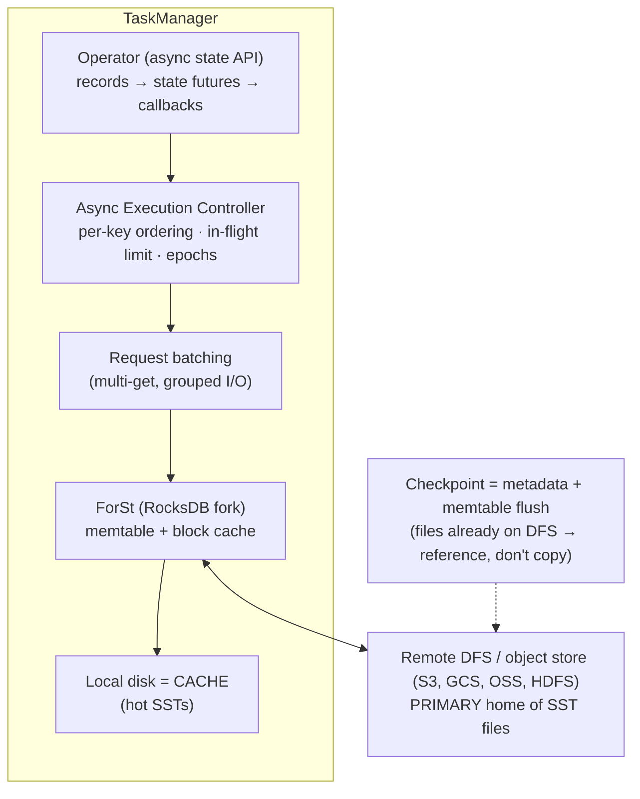

# 02 · RocksDB LSM Tuning vs. Flink 2.x ForSt Disaggregated State

> **Folder:** `04-Apache-Flink-Runtime-Checkpointing-and-State/` · **File 2 of 3**
> **Anchoring papers and sources:** O'Neil et al., *The Log-Structured Merge-Tree (LSM-Tree)* (Acta Informatica 1996) ·
> Dong et al., *Optimizing Space Amplification in RocksDB* (CIDR 2017) · Athanassoulis et al., *Designing Access Methods:
> The RUM Conjecture* (EDBT 2016) · Dayan, Athanassoulis & Idreos, *Monkey: Optimal Navigable Key-Value Store* (SIGMOD
> 2017) · Carbone et al., *State Management in Apache Flink* (PVLDB 2017) · Flink FLIP-423 to FLIP-428 (*Disaggregated
> State Storage and Management*, async state APIs, async execution model, ForSt) and the Flink 2.0 release
> announcement.
> **Prev:** [01 · Barriers and checkpoints](01-chandy-lamport-barriers-aligned-vs-unaligned-checkpoints.md) · **Next:**
> [03 · Credit-based flow control](03-credit-based-network-flow-control-and-buffer-debloating.md)

---

## 0. The thesis

Flink's classic large-state backend embeds **RocksDB**, an LSM tree, inside every TaskManager. State lives on **local
disk** and is reached through **JNI**, with memory carved out of Flink's managed budget. Durability comes from
checkpoints, not from a write-ahead log. Its performance is governed by LSM physics: **write, read, and space
amplification** trade off against each other (the RUM conjecture), and memory is the lever between them.

Flink 2.x adds **ForSt**, a RocksDB fork that treats **remote object storage as the primary home** for state files, with
local disk as a cache. Paired with an **asynchronous state execution model**, it hides remote latency by keeping
thousands of state requests in flight while preserving per-key order. That changes the economics of checkpoints,
recovery, and rescaling, and puts Flink on the same disaggregated path Dataflow's Windmill took (Folder 03).

---

## 1. First principles: LSM trees

### 1.1 Why an LSM for streaming state

Streaming state is **write-heavy and update-in-place**: counters, last-seen values, and windows updated on every event.
B-trees update pages in place (random writes). LSM trees **buffer writes in memory and flush sorted runs sequentially**,
converting random writes into sequential I/O at the cost of later **compaction**. The structure is:

```
 write ──► MemTable (skiplist, in memory) ──full──► Immutable MemTable ──flush──► L0 SST files (overlapping)
                                                                                     │ compaction
                                                                                     ▼
                                                                    L1 (non-overlapping, size S)
                                                                    L2 (size S·T)
                                                                    …
                                                                    Ln (size S·T^(n-1))   ← ~90% of data
 read ──► MemTable → Immutable MemTables → L0 files (all) → one file per level (fence pointers + Bloom filter)
```

**Flink disables RocksDB's WAL.** Durability comes from checkpoints, and on failure Flink restores from the last
checkpoint and replays, so a WAL would only add write amplification.

### 1.2 Amplification math (leveled compaction, size ratio $T$, $L$ levels)

| Amplification | Approximation | Default intuition (T = 10) |
|---------------|---------------|-----------------------------|
| **Write** $W$ | $\approx T \cdot L$ in the worst case (each byte rewritten ~T times per level); typically $\approx \frac{T}{2} \cdot L$ | 10–30× bytes written to disk per byte of user writes |
| **Read** (point lookup) | $\#L0 + L$ probes without filters; with Bloom filters at FP rate $p$, expected disk reads ≈ $1 + L \cdot p$ for keys that exist, and ≈ $L \cdot p$ for missing keys | Bloom filters turn ~5 probes into ~1 |
| **Space** $S$ | $\approx 1 + \frac{1}{T}$ (obsolete versions awaiting compaction) | ~1.1× |

**Universal (tiered) compaction** lowers write amplification (each byte is rewritten fewer times) and raises space
amplification (up to ~2× during big merges) and read amplification (more overlapping runs). **The RUM conjecture**: you
can optimize two of Read, Update, and Memory/space overheads at the expense of the third. Memory (block cache, Bloom
filters, memtables) is the currency that buys back reads and writes.

### 1.3 Bloom filter sizing per level

With $b$ bits per key, a level's FP rate is $p \approx 0.6185^{b}$: 10 bits per key gives about 1%. *Monkey* shows that
allocating **more bits to smaller (upper) levels and fewer to the huge bottom level** minimizes total lookup cost for a
fixed memory budget. RocksDB exposes related knobs (`optimize_filters_for_hits` skips bottom-level filters when lookups
almost always hit, saving ~90% of filter memory). For Flink, where most point reads *hit* existing keys (state for active
keys), skipping last-level filters is often a good memory trade ⚠ verify against your miss ratio.

---

## 2. How Flink uses RocksDB

### 2.1 Key layout and column families

Each registered state (descriptor name) gets its own **column family**. A keyed state entry is stored as:

```
 RocksDB key:   [ key-group (1–2 B) ][ serialized user key ][ serialized namespace (window / VoidNamespace) ]( [ map user-key ] )
 RocksDB value: [ serialized value ]  ( + 8-byte TTL timestamp if TTL is enabled )
```

- **The key-group prefix** makes each subtask's data a contiguous range, so rescaling can clip key-group ranges.
- **`MapState`** stores **one RocksDB entry per map entry** (the user map key appended). `get`/`put` touch one entry.
  Iteration is a prefix scan.
- **`ListState`** uses RocksDB's **merge operator** (append without read). But `get()` reads and merges the whole list,
  so big lists mean big reads.
- **`ValueState`** is a single entry. Every update writes the entire serialized value.
- **Timers** live in their own column family (with RocksDB as the timer service), ordered by timestamp (Folder 01,
  file 01 §6.4).

### 2.2 The per-access cost

Every state access is: **serialize the key (and namespace) → JNI call → RocksDB lookup (memtable, block cache, disk) →
copy bytes back across JNI → deserialize the value.** There's no object cache, so state is always (de)serialized. That's
why:

- RocksDB-backed jobs are often **CPU-bound on serialization**, not I/O-bound;
- efficient `TypeSerializer`s (POJO, Avro, primitives) matter, and Kryo fallback hurts badly;
- `ValueState<BigObject>` with a tiny change per event is the classic write-amplification anti-pattern: re-serialize and
  rewrite the whole object every time.

### 2.3 Memory: managed, bounded, and native

```
TaskManager process memory
 ├─ JVM heap: framework + task heap
 ├─ Off-heap: framework + task off-heap (direct)
 ├─ Network memory (network buffers; file 03)
 ├─ MANAGED MEMORY  ← RocksDB block cache + memtables (when state.backend.rocksdb.memory.managed = true)
 ├─ JVM metaspace
 └─ JVM overhead (thread stacks, code cache, native allocations)
```

| Option | Default | Meaning |
|--------|---------|---------|
| `taskmanager.memory.managed.fraction` | 0.4 | share of total Flink memory given to managed memory |
| `state.backend.rocksdb.memory.managed` | true | RocksDB uses a **shared** block cache and write-buffer manager **per slot**, sized from managed memory |
| `state.backend.rocksdb.memory.write-buffer-ratio` | 0.5 | share of that budget for memtables |
| `state.backend.rocksdb.memory.high-prio-pool-ratio` | 0.1 | block-cache share reserved for index and filter blocks |
| `state.backend.rocksdb.memory.fixed-per-slot` | — | a fixed size per slot, overriding the fraction |

**The native-memory trap.** RocksDB allocates outside the JVM heap. If memory isn't managed (or there are many column
families, iterators pinning blocks, or glibc arena fragmentation), process RSS can exceed the container limit, and the
container gets killed with **no Java OOM, no heap dump, and exit code 137**. Mitigations: keep managed memory on; use
**jemalloc** (Flink's Docker images use it by default ⚠ verify) or cap glibc arenas (`MALLOC_ARENA_MAX`); budget JVM
overhead; and watch RocksDB native metrics.

### 2.4 Tuning knobs that matter

| Knob | Effect | When to touch |
|------|--------|---------------|
| `state.backend.rocksdb.predefined-options` (`DEFAULT`, `FLASH_SSD_OPTIMIZED`, `SPINNING_DISK_OPTIMIZED(_HIGH_MEM)`) | bundles of sensible settings | start here: `FLASH_SSD_OPTIMIZED` on NVMe |
| `state.backend.rocksdb.thread.num` | background flush and compaction threads | compaction falls behind (pending compaction bytes grow, write stalls) |
| `state.backend.rocksdb.writebuffer.size` / `.count` / `.number-to-merge` | memtable size and count | flush frequency vs. memory (with managed memory, the budget dominates) |
| `state.backend.rocksdb.block.blocksize` | data block size (default 4 KB) | larger blocks: fewer index entries, better scans, worse point-read amplification |
| `state.backend.rocksdb.use-bloom-filter` (+ bits per key) | per-SST Bloom filters | point-lookup-heavy workloads (most keyed state) |
| `state.backend.rocksdb.compaction.style` | LEVEL / UNIVERSAL / FIFO | universal for write-heavy with spare disk; FIFO for pure TTL-like data |
| `state.backend.rocksdb.compaction.level.use-dynamic-size` | dynamic level sizing | reduces space amplification for growing state |
| `state.backend.rocksdb.timer-service.factory` | `ROCKSDB` (default) vs. `HEAP` | heap timers are faster but count against heap and are fully snapshotted |
| Native metrics `state.backend.rocksdb.metrics.*` | expose RocksDB internals | **turn on the key ones in production** (§6) |

### 2.5 Incremental checkpoints and rescaling with RocksDB

- **Checkpoint:** flush the memtable, take a RocksDB native checkpoint (hard links to immutable SSTs), and upload only
  SSTs not already referenced by a previous checkpoint. Compaction rewrites SSTs, so **compaction churn becomes
  checkpoint upload volume**.
- **Restore:** download the referenced SSTs and open the DB. Downloading **is** the restore time.
- **Rescale:** each new subtask takes a key-group range, downloads the SSTs overlapping it from the old subtasks, and
  clips them (delete-range or ingest) ⚠ verify the optimizations in your version. Rescaling cost ≈ state size moved,
  which is why rescaling large-state Flink jobs is slow, and why disaggregation helps (§4).

---

## 3. The asynchronous execution problem: Little's law

Suppose state lived remotely with read latency $R$ = 10 ms. A synchronous operator does one state access at a time per
task thread:

$$
\Theta_{\text{sync}} \le \frac{1}{R} = 100\ \text{state ops/s per thread}
$$

To sustain $\lambda$ = 100,000 state ops/s per subtask, Little's law requires

$$
N_{\text{in-flight}} = \lambda \cdot R = 10^5 \times 0.01 = 1{,}000 \ \text{concurrent requests}
$$

A synchronous `ValueState.value()` in `processElement` makes that impossible. That is the entire reason Flink 2.x pairs
remote state with an **asynchronous execution model**. Without it, disaggregated state would cost three orders of
magnitude of throughput. With it, throughput is bounded by remote bandwidth and request concurrency, not latency.

---

## 4. Flink 2.x: ForSt and disaggregated state

### 4.1 Architecture



Building blocks (FLIP-423 umbrella and children ⚠ verify the exact FLIP-to-feature mapping):

| Piece | Role |
|-------|------|
| **State API V2** (async) | state accessors return `StateFuture`s (`asyncValue()`, `asyncUpdate(...)`, and so on), so user code composes continuations instead of blocking |
| **Async Execution Controller (AEC)** | admits records, enforces **per-key FIFO ordering** (a record for key *k* waits while an earlier *k* record is in flight), caps in-flight records, drives callbacks |
| **Epoch mechanism** | watermarks and checkpoint barriers are **ordering fences**: in-flight records before a fence complete before the fence is processed, which preserves event-time and snapshot semantics |
| **Request batching** | groups state requests to amortize remote round trips |
| **ForSt** | an LSM whose files live on DFS, with a local file cache |
| **Fault tolerance and rescaling** | checkpoints reference existing remote files; restore and rescale avoid a full download (lazy, on-demand loading) |

### 4.2 What changes operationally

| Dimension | Embedded RocksDB | ForSt (disaggregated) |
|-----------|------------------|------------------------|
| Primary state location | local disk | **DFS** (local = cache) |
| State size limit per TM | local disk capacity | effectively DFS capacity (cache sized for the hot set) |
| Checkpoint | flush + upload new SSTs | flush + **reference** files already on DFS, so faster and lighter |
| Restore / rescale | download state (minutes to hours for TBs) | **fast**: metadata plus lazy fetch |
| State access latency | µs–ms (page cache / NVMe) | ms on cache miss, hidden by async execution |
| Programming model | synchronous state API | **async State API V2** for full benefit; sync access works with lower throughput |
| Cost profile | local NVMe instances, large disks | smaller nodes + object-store **requests** and bandwidth |
| Sweet spot | moderate state, latency-critical, stable parallelism | very large state, frequent rescaling, cloud elasticity, cheap recovery |

### 4.3 Semantics preserved, and the new failure surface

The AEC preserves **per-key order** (the order Flink always guaranteed for keyed state) but processes **different keys
out of order** relative to arrival. Code that relied on cross-key arrival order inside a subtask was already wrong, and
now it's visibly wrong.

The cache hit ratio becomes the dominant performance variable:

$$
\bar{R} = h \cdot R_{\text{local}} + (1 - h) \cdot R_{\text{remote}}, \qquad N_{\text{in-flight}} = \lambda \bar{R}
$$

Falling hit ratios (state growth, a key-distribution shift) inflate required concurrency and object-store request rates
(cost, plus provider per-prefix rate limits).

**Enabling it** (⚠ verify names for your 2.x version): set the backend type to `forst`, configure the primary (remote)
and cache (local) directories and the cache size, and enable async state in the job. DataStream offers a keyed-stream
switch for async state with State V2 descriptors. Flink SQL operators gained async state implementations progressively
(an option along the lines of `table.exec.async-state.enabled`).

---

## 5. Choosing a state backend

| Backend | State lives | Best for | Avoid when |
|---------|-------------|----------|------------|
| `HashMapStateBackend` (heap) | JVM heap objects | small or medium state, lowest latency, no serialization per access | state ≳ heap; GC pauses matter; huge full snapshots |
| `EmbeddedRocksDBStateBackend` | local disk + managed memory | large state (GBs to TBs per job) with stable parallelism; incremental checkpoints | frequent rescaling of TB-scale state; small local disks |
| **ForSt** (2.x) | DFS primary + local cache | very large state; elastic or cloud deployments; fast recovery and rescale | ultra-low-latency needs with poor cache locality; code that can't adopt async state |
| (Dataflow Windmill, for contrast) | remote service | fully managed; per-key commits | non-GCP or open deployments |

---

## 6. Observability: the RocksDB metrics that predict incidents

| Metric (`state.backend.rocksdb.metrics.*`) | Predicts |
|-------------------------------------------|----------|
| `estimate-num-keys`, `estimate-live-data-size`, `total-sst-files-size` | state growth (TTL not working; leak) |
| `block-cache-usage`, `block-cache-capacity`, block cache hit/miss counters | memory pressure; read amplification |
| `num-running-compactions`, `compaction-pending`, `estimate-pending-compaction-bytes` | compaction debt, so imminent write stalls |
| `actual-delayed-write-rate`, `is-write-stopped` | **write stalls in progress**, so backpressure from state writes |
| `num-immutable-mem-table`, `mem-table-flush-pending` | flush can't keep up |
| `num-entries-active-mem-table`, `cur-size-all-mem-tables` | memtable memory |

Combined with task metrics (busy time, backpressure; file 03), the diagnosis looks like this: busy operator + compaction
pending + delayed write rate > 0 means RocksDB is the bottleneck, not your code.

---

## 7. Production Java 21 code blueprints

### 7.1 Anti-patterns

```java
// (A) Whole-object rewrite per event: serialize and rewrite a 200 KB profile to change one counter.
private transient ValueState<UserProfile> profile;      // UserProfile holds a Map<String, Long> of 5,000 entries
public void processElement(Event e, Context ctx, Collector<Out> out) throws Exception {
  UserProfile p = profile.value();                       // JNI + deserialize 200 KB
  p.counters().merge(e.category(), 1L, Long::sum);
  profile.update(p);                                     // serialize + write 200 KB → LSM write amplification
}

// (B) ListState as a lookup table: get() materializes the entire list on every element.
for (Event old : recentEvents.get()) { if (old.id().equals(e.id())) return; }   // O(n) per element

// (C) Unbounded native memory: managed memory disabled with large per-state write buffers and many states.
// state.backend.rocksdb.memory.managed: false
// state.backend.rocksdb.writebuffer.size: 256mb   × 4 buffers × 30 column families × 8 slots → container OOM-kill

// (D) Overriding the block cache in a custom options factory while managed memory is on:
//     per-state private caches escape the managed budget.
tableConfig.setBlockCache(new LRUCache(512L << 20));
```

### 7.2 Production: state layouts that fit the LSM

```java
package dev.l7.flink.state;

import java.time.Duration;
import org.apache.flink.api.common.functions.OpenContext;
import org.apache.flink.api.common.state.MapState;
import org.apache.flink.api.common.state.MapStateDescriptor;
import org.apache.flink.api.common.state.StateTtlConfig;
import org.apache.flink.api.common.state.ValueState;
import org.apache.flink.api.common.state.ValueStateDescriptor;
import org.apache.flink.streaming.api.functions.KeyedProcessFunction;
import org.apache.flink.util.Collector;

/**
 * Per-user counters: a MapState entry per category (point read and write of ~16 bytes), not a ValueState<Map>
 * rewrite. Membership checks use MapState.contains (one lookup), not ListState scans. TTL cleans up during compaction.
 */
public final class LsmFriendlyProfile extends KeyedProcessFunction<String, LsmFriendlyProfile.Event, LsmFriendlyProfile.Update> {

  public record Event(String userId, String category, String eventId) {}

  public record Update(String userId, String category, long count) {}

  private transient MapState<String, Long> categoryCounts;    // one RocksDB entry per category
  private transient MapState<String, Boolean> recentEventIds; // dedup set: point lookups, TTL-expired
  private transient ValueState<Long> totalEvents;             // tiny value: cheap rewrite

  @Override
  public void open(OpenContext ctx) {
    StateTtlConfig countsTtl = StateTtlConfig.newBuilder(Duration.ofDays(30))
        .setUpdateType(StateTtlConfig.UpdateType.OnCreateAndWrite)
        .setStateVisibility(StateTtlConfig.StateVisibility.NeverReturnExpired)
        .cleanupInRocksdbCompactFilter(1_000)                  // refresh "now" every 1,000 entries during compaction
        .build();
    StateTtlConfig dedupTtl = StateTtlConfig.newBuilder(Duration.ofHours(1))
        .setUpdateType(StateTtlConfig.UpdateType.OnCreateAndWrite)
        .cleanupInRocksdbCompactFilter(1_000)
        .build();

    MapStateDescriptor<String, Long> countsDesc = new MapStateDescriptor<>("category-counts", String.class, Long.class);
    countsDesc.enableTimeToLive(countsTtl);
    MapStateDescriptor<String, Boolean> dedupDesc = new MapStateDescriptor<>("recent-event-ids", String.class, Boolean.class);
    dedupDesc.enableTimeToLive(dedupTtl);

    categoryCounts = getRuntimeContext().getMapState(countsDesc);
    recentEventIds = getRuntimeContext().getMapState(dedupDesc);
    totalEvents = getRuntimeContext().getState(new ValueStateDescriptor<>("total-events", Long.class));
  }

  @Override
  public void processElement(Event e, Context ctx, Collector<Update> out) throws Exception {
    if (recentEventIds.contains(e.eventId())) {                // single point lookup
      return;
    }
    recentEventIds.put(e.eventId(), Boolean.TRUE);
    Long prev = categoryCounts.get(e.category());              // single point lookup
    long next = (prev == null ? 0L : prev) + 1;
    categoryCounts.put(e.category(), next);                    // ~tens of bytes written
    totalEvents.update((totalEvents.value() == null ? 0L : totalEvents.value()) + 1);
    out.collect(new Update(e.userId(), e.category(), next));
  }
}
```

Adding TTL changes the stored format (an 8-byte timestamp per value), so **you can't turn TTL on or off for existing
state without a migration**. Decide at design time (Folder 05, file 03).

### 7.3 Production: a RocksDB options factory that respects managed memory

```java
package dev.l7.flink.state;

import java.util.Collection;
import org.apache.flink.configuration.ReadableConfig;
// Flink 1.x: org.apache.flink.contrib.streaming.state.* ; Flink 2.x: org.apache.flink.state.rocksdb.* (⚠ verify)
import org.apache.flink.contrib.streaming.state.ConfigurableRocksDBOptionsFactory;
import org.apache.flink.contrib.streaming.state.RocksDBOptionsFactory;
import org.rocksdb.BlockBasedTableConfig;
import org.rocksdb.BloomFilter;
import org.rocksdb.ColumnFamilyOptions;
import org.rocksdb.CompactionStyle;
import org.rocksdb.DBOptions;
import org.rocksdb.TableFormatConfig;

/**
 * Point-lookup-optimized column families on NVMe:
 *  - Bloom filters (10 bits/key ≈ 1% FP), with bottom-level filters skipped for hit-heavy access,
 *  - 16 KB blocks, index/filter blocks in the SHARED (managed) cache with high priority,
 *  - dynamic level sizing for growing state.
 * It never creates its own block cache: Flink injects the shared, managed cache when managed memory is on.
 */
public final class PointLookupOptionsFactory implements ConfigurableRocksDBOptionsFactory {

  private int bitsPerKey = 10;

  @Override
  public DBOptions createDBOptions(DBOptions current, Collection<AutoCloseable> handlesToClose) {
    return current
        .setMaxBackgroundJobs(4)            // flush + compaction parallelism (also settable via config)
        .setUseFsync(false);                // durability comes from Flink checkpoints, not RocksDB
  }

  @Override
  public ColumnFamilyOptions createColumnOptions(ColumnFamilyOptions current, Collection<AutoCloseable> handlesToClose) {
    TableFormatConfig existing = current.tableFormatConfig();
    BlockBasedTableConfig table = existing instanceof BlockBasedTableConfig b ? b : new BlockBasedTableConfig();
    BloomFilter bloom = new BloomFilter(bitsPerKey, false);
    handlesToClose.add(bloom);
    table.setFilterPolicy(bloom)
        .setBlockSize(16 * 1024)
        .setCacheIndexAndFilterBlocks(true)
        .setCacheIndexAndFilterBlocksWithHighPriority(true)
        .setPinL0FilterAndIndexBlocksInCache(true);
    return current
        .setTableFormatConfig(table)        // keeps the injected shared cache: we only modified the existing config
        .setCompactionStyle(CompactionStyle.LEVEL)
        .setLevelCompactionDynamicLevelBytes(true)
        .setOptimizeFiltersForHits(true);   // skip bottom-level filters: most keyed-state reads hit
  }

  @Override
  public RocksDBOptionsFactory configure(ReadableConfig config) {
    // Read custom keys from config if desired, e.g., bitsPerKey; keep defaults otherwise.
    return this;
  }
}
```

```yaml
state.backend.type: rocksdb
state.backend.rocksdb.options-factory: dev.l7.flink.state.PointLookupOptionsFactory
state.backend.rocksdb.predefined-options: FLASH_SSD_OPTIMIZED
state.backend.rocksdb.memory.managed: true
taskmanager.memory.managed.fraction: 0.4
state.backend.rocksdb.memory.write-buffer-ratio: 0.5
state.backend.rocksdb.memory.high-prio-pool-ratio: 0.1
state.backend.rocksdb.metrics.estimate-num-keys: true
state.backend.rocksdb.metrics.estimate-pending-compaction-bytes: true
state.backend.rocksdb.metrics.actual-delayed-write-rate: true
state.backend.rocksdb.metrics.is-write-stopped: true
state.backend.rocksdb.metrics.block-cache-usage: true
state.backend.rocksdb.metrics.num-running-compactions: true
```

### 7.4 Flink 2.x: async state with State API V2 (⚠ verify package and method names for your 2.x release)

```java
package dev.l7.flink.state;

import org.apache.flink.api.common.functions.OpenContext;
import org.apache.flink.api.common.state.v2.ValueState;
import org.apache.flink.api.common.state.v2.ValueStateDescriptor;
import org.apache.flink.api.common.typeinfo.BasicTypeInfo;
import org.apache.flink.streaming.api.functions.KeyedProcessFunction;
import org.apache.flink.util.Collector;

/**
 * Non-blocking state access: the operator returns immediately; the continuation runs when the remote read completes.
 * The Async Execution Controller guarantees that records for the SAME key run in arrival order.
 */
public final class AsyncRunningTotal extends KeyedProcessFunction<String, Long, Long> {

  private transient ValueState<Long> total;

  @Override
  public void open(OpenContext ctx) {
    total = getRuntimeContext().getState(new ValueStateDescriptor<>("total", BasicTypeInfo.LONG_TYPE_INFO));
  }

  @Override
  public void processElement(Long amount, Context ctx, Collector<Long> out) {
    total.asyncValue()
        .thenCompose(current -> {
          long next = (current == null ? 0L : current) + amount;
          return total.asyncUpdate(next).thenApply(ignored -> next);
        })
        .thenAccept(out::collect);              // emitted when the chain completes; per-key order preserved
  }
}
```

```java
// Wiring (2.x): opt the keyed stream into async state, run with the ForSt backend.
amounts.keyBy(Txn::accountId)
       .enableAsyncState()                       // ⚠ verify API name
       .process(new AsyncRunningTotal())
       .uid("async-running-total-v1");
```

```yaml
state.backend.type: forst                        # ⚠ verify the ForSt option names below
state.backend.forst.primary-dir: s3://bucket/flink/forst/job-a
state.backend.forst.cache.dir: /mnt/nvme/forst-cache
state.backend.forst.cache.size-based-limit: 200gb
```

---

## 8. Production failure modes and P99 debugging

| ID | Failure | Signature | Root cause | Fix |
|----|---------|-----------|------------|-----|
| R1 | **Container OOM-kill, no Java OOM** | exit 137; RSS > limit; no heap dump | unmanaged or fragmented native memory | managed memory on; jemalloc / `MALLOC_ARENA_MAX`; fewer column families; JVM overhead budget |
| R2 | **Write stalls** | `is-write-stopped` / delayed write rate > 0; backpressure on stateful operators; throughput sawtooth | compaction debt; L0 file count past slowdown/stop triggers | more background threads; larger L0 thresholds; faster disks; fewer writes (layouts) |
| R3 | **Serialization-bound CPU** | high busy time, low I/O; flame graphs dominated by serializers | big values; Kryo; whole-object rewrites | MapState layouts; POJO/Avro serializers; `pipeline.generic-types=false` |
| R4 | **ListState blow-ups** | latency grows with history length; large reads | `get()` reads the whole list | MapState or keyed sub-state; bounded lists with eviction |
| R5 | **State growth despite TTL** | `estimate-num-keys` grows; disk fills | compaction filter only runs when compaction touches files; cold bottom levels never compact | periodic compaction (where supported); smaller TTL granularity; check the TTL time characteristic |
| R6 | **Slow restore / rescale** | minutes to hours of downtime on recovery or rescale | full SST downloads of TB state | local recovery; ForSt; reduce state; plan rescale windows |
| R7 | **Checkpoint upload spikes** | async duration and bytes spike after compactions | compaction churn re-uploads | tune compaction (dynamic levels); universal compaction where space allows |
| R8 | **ForSt cache miss storms** (2.x) | latency up; object-store GET rate up; cost up | hot set > cache; access-pattern shift | bigger local cache; better key locality; batch requests; watch the hit ratio |
| R9 | **Async state misuse** (2.x) | wrong results across keys, or deadlocks in callbacks | assuming cross-key arrival order; blocking inside continuations | per-key reasoning only; never block in callbacks |

### Runbook · R2 (write stalls)

1. Correlate backpressure on a stateful operator with `actual-delayed-write-rate > 0` or `is-write-stopped`.
2. Check `estimate-pending-compaction-bytes` and `num-running-compactions`. Debt growing with compactions saturated means
   too few threads or too slow a disk.
3. Increase background jobs, use NVMe, and lower write volume (state layout, TTL). Consider universal compaction if disk
   space allows.
4. Verify that delayed write rate returns to 0 and backpressure clears.

---

## 9. FAANG L7 bar-raiser Q&A chains

### Q1 · "Why does Flink disable RocksDB's WAL, and what does that imply?"

**L5 textbook answer.** For performance: the WAL slows writes.

**Why L5 breaks.** Performance is the effect, not the reason. Without the *reason*, engineers don't understand why local
RocksDB state is disposable, or why recovery always means restore-and-replay.

**L7 principal defense.**

- **Durability is provided by checkpoints.** After a failure, Flink discards local state and restores the last
  checkpoint, then replays sources. A WAL would protect writes that Flink will throw away anyway.
- **Implications:**
  - local disks can be ephemeral (instance store NVMe);
  - restore time is dominated by state download (until local recovery or ForSt);
  - write amplification is LSM-only (no WAL doubling).

### Q2 · "Your RocksDB-backed job is slow. Is it I/O or CPU? How do you tell, and what do you change?"

**L5 textbook answer.** Add more memory to RocksDB, and use SSDs.

**Why L5 breaks.** Many RocksDB jobs are **CPU-bound on serialization and JNI**, not on I/O. More memory doesn't help, and
neither do SSDs.

**L7 principal defense.**

1. **Look:** busy time, flame graphs (serializers vs. RocksDB internals), RocksDB metrics (block cache hit rate, stalls,
   pending compaction).
2. **If CPU in serializers:** fix layouts (MapState over `ValueState<Map>`), use efficient serializers, kill Kryo, and
   shrink values.
3. **If block cache misses:** more managed memory, Bloom filters, block size, `optimizeFiltersForHits`.
4. **If write stalls:** compaction threads, disk speed, less write volume.
5. **Remember the per-access chain:** serialize → JNI → LSM → JNI → deserialize. Every lever targets one link.

### Q3 · "Explain read, write, and space amplification and how you'd trade them for a write-heavy counter workload."

**L5 textbook answer.** LSM trees are write-optimized, so they fit counters.

**Why L5 breaks.** Leveled compaction can still impose 10–30× write amplification, which shows up as compaction debt,
stalls, and SSD wear. That's not "write-optimized" for free.

**L7 principal defense.**

- **Leveled:** W ≈ T·L/2, S ≈ 1 + 1/T, and reads are 1 + L·p with Bloom filters.
- **Universal (tiered):** lower W, higher S (up to ~2×), more read probes.
- **For counters:**
  - **reduce writes upstream** (local pre-aggregation, Folder 05);
  - **MapState entries** (small writes);
  - **universal compaction** if disk headroom exists;
  - **Bloom filters** for read paths.
- **RUM:** memory buys back read and write costs. Size the block cache for the working set.

### Q4 · "Why does disaggregated state need an asynchronous execution model?"

**L5 textbook answer.** Remote storage is slow, so async calls are faster.

**Why L5 breaks.** "Faster" isn't the argument. Synchronous access is capped at 1/R operations per thread.

**L7 principal defense.**

- **Little's law:** at R = 10 ms, the synchronous ceiling is 100 ops/s per thread. 100k ops/s needs ~1,000 requests in
  flight.
- **The AEC provides concurrency while preserving per-key order:**
  - a per-key FIFO,
  - epochs as fences for watermarks and checkpoints,
  - batching of remote requests.
- **The result:** throughput is bound by bandwidth and cache hit ratio, not latency.
- **The cost:** a new programming model (State V2 futures), cross-key reordering, and object-store request economics.

### Q5 · "When would you pick ForSt over embedded RocksDB, and when not?"

**L5 textbook answer.** ForSt is newer and supports bigger state, so always ForSt on Flink 2.

**Why L5 breaks.** ForSt trades local-disk latency for remote-latency-plus-cache. For latency-critical jobs with poor
locality, or code that can't go async, it can be slower and cost more in object-store requests.

**L7 principal defense.**

- **Choose ForSt when:**
  - state ≫ local disk;
  - you need frequent rescaling or autoscaling;
  - fast recovery matters (cloud spot instances);
  - access has decent locality (hot set fits the cache).
- **Stay with RocksDB when:**
  - p99 latency budgets are single-digit ms with random access over huge cold state;
  - parallelism is stable;
  - code relies on synchronous patterns.
- **Measure:** cache hit ratio, request rates and costs, p99 latency, rescale time. Run a shadow job before migrating.

---

## 10. Invariants checklist

1. **State access is serialize → JNI → LSM → JNI → deserialize.** Design layouts for small point reads and writes.
2. **MapState for collections, small ValueStates, no big lists you `get()` per element.**
3. **Keep RocksDB memory managed.** Never give it private caches. Budget native memory and allocator behavior.
4. **Watch compaction debt and write stalls.** They're backpressure in disguise.
5. **Decide on TTL up front.** It changes the state format.
6. **Restore and rescale cost ≈ state downloaded** for embedded RocksDB. ForSt changes that, at remote-latency cost.
7. **Disaggregated state needs async execution** (Little's law). Measure cache hit ratio and object-store request
   economics.

---

## 11. References

- P. O'Neil, E. Cheng, D. Gawlick, E. O'Neil. *The Log-Structured Merge-Tree (LSM-Tree).* Acta Informatica 33(4), 1996.
- S. Dong, M. Callaghan, L. Galanis, D. Borthakur, T. Savor, M. Strum. *Optimizing Space Amplification in RocksDB.* CIDR
  2017.
- M. Athanassoulis, M. Kester, L. Maas, R. Stoica, S. Idreos, A. Ailamaki, M. Callaghan. *Designing Access Methods: The
  RUM Conjecture.* EDBT 2016.
- N. Dayan, M. Athanassoulis, S. Idreos. *Monkey: Optimal Navigable Key-Value Store.* SIGMOD 2017.
- P. Carbone et al. *State Management in Apache Flink.* PVLDB 10(12), 2017.
- Apache Flink FLIP-423 (disaggregated state, umbrella), FLIP-424 (async state APIs), FLIP-425 (async execution model),
  FLIP-426 (grouping remote state access), FLIP-427 (ForSt), FLIP-428 (fault tolerance and rescale) ⚠ verify the
  mapping; Flink docs *State Backends*, *Large State Tuning*, *Memory configuration*, *RocksDB native metrics*.
- RocksDB wiki: *Leveled Compaction*, *Universal Compaction*, *RocksDB Tuning Guide*, *Write Stalls*, *Memory usage in
  RocksDB*.
- Source: `apache/flink` `flink-state-backends/flink-statebackend-rocksdb` (and the ForSt backend module in 2.x);
  `ververica/frocksdb`; ForSt repository ⚠ verify the location.

**Next →** [03 · Credit-based network flow control and buffer debloating](03-credit-based-network-flow-control-and-buffer-debloating.md)
