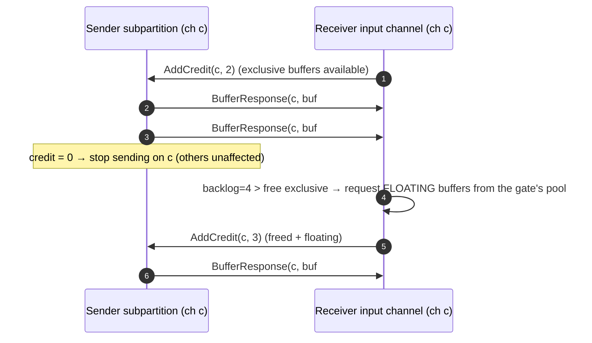
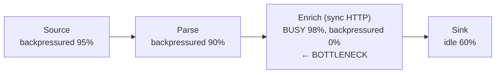

# 03 · Credit-Based Network Flow Control and Buffer Debloating

> **Folder:** `04-Apache-Flink-Runtime-Checkpointing-and-State/` · **File 3 of 3**
> **Anchoring sources:** H. T. Kung, T. Blackwell & A. Chapman, *Credit-Based Flow Control for ATM Networks* (SIGCOMM
> 1994) · J. D. C. Little, *A Proof for the Queuing Formula L = λW* (1961) · Flink blog *A Deep-Dive into Flink's Network
> Stack* and *Flink Network Stack Vol. 2: Monitoring, Metrics, and that Backpressure Thing* (2019) · Flink FLIP-183
> (*Dynamic buffer size adjustment*), FLIP-227 (*overdraft buffers*) · Flink docs *Network memory tuning*, *Monitoring
> back pressure*.
> **Prev:** [02 · RocksDB vs. ForSt](02-rocksdb-lsm-tuning-vs-flink-2-forst-disaggregated-state.md) · **Next folder:**
> `05-Distributed-Shuffle-Skew-and-Join-Mechanics/`

---

## 0. The thesis

Flink moves records between tasks over a small number of **multiplexed TCP connections**. If it relied on TCP's own flow
control, one slow logical channel would fill the shared socket and **block every other channel on that connection**
(head-of-line blocking), checkpoint barriers included. **Credit-based flow control** fixes this: a receiver grants
explicit per-channel credits, and a sender transmits a buffer only when it holds a credit. TCP never fills, and
backpressure propagates *per channel*, precisely.

The remaining problem is **how much data sits in flight**. By Little's law, in-flight bytes divided by throughput is added
latency, and it's also the queue a checkpoint barrier must traverse. **Buffer debloating** sizes in-flight data to a
*time* target (about 1 s of throughput), which bounds both latency and checkpoint alignment under backpressure.

---

## 1. First principles

### 1.1 Head-of-line blocking on a multiplexed connection

```
 TM-A (senders)                            TM-B (receivers)
 ch1 (to slow task X) ──┐                 ┌──► task X: slow, stops reading
 ch2 (to task Y)  ──────┼── ONE TCP ──────┼──► task Y: healthy
 ch3 (to task Z)  ──────┘   connection    └──► task Z: healthy

 Without credits: ch1 data keeps arriving → TM-B can't hand it to X → socket receive buffer fills →
 TCP window → 0 → ch2/ch3 data (and BARRIERS) stall too. One slow consumer blocks the whole connection.
```

### 1.2 Credit-based flow control (Kung et al. 1994, adopted by Flink 1.5)

Each receiver channel advertises **credits**, the number of buffers it can accept right now. Senders send a buffer only
when they hold a credit for that channel, and the receiver re-grants credits as it frees buffers:

$$
\text{data in flight on channel } c \;\le\; \text{credits}_c \times S_{\text{buffer}}
$$

So **the receiver always has space for everything in flight**, and TCP never blocks. A slow channel simply stops
receiving credits. Its sender's output buffers fill, the sender's task blocks on buffer requests (backpressure), and
other channels on the same connection are unaffected.



**Backlog piggybacking.** Each data message carries the sender's queue length for that channel, so the receiver knows how
many **floating** buffers to request from its gate's shared pool. Busy channels get more buffers and idle channels keep
only their exclusive minimum.

---

## 2. The network stack

```
 Sender task                                                       Receiver task
 ┌────────────────────────────────────────┐                        ┌───────────────────────────────────────────┐
 │ RecordWriter → serializer writes into  │                        │ InputGate                                 │
 │ BufferBuilder (MemorySegment, 32 KB)   │                        │  ├─ RemoteInputChannel × C (credits)      │
 │ ResultPartition → subpartition per     │   Netty (TCP, one      │  │    exclusive buffers: 2 per channel    │
 │ downstream channel (queues)            │── connection per TM ──►│  ├─ floating buffers: 8 per gate (shared) │
 │ LocalBufferPool ← NetworkBufferPool    │   pair, multiplexed)   │  └─ LocalInputChannel (same TM: by ref)   │
 │ flush: buffer full | buffer-timeout    │                        │ deserializer → operator                   │
 └────────────────────────────────────────┘                        └───────────────────────────────────────────┘
```

| Component | Role | Key config (⚠ verify keys and defaults per version) |
|-----------|------|------------------------------------------------------|
| `MemorySegment` | fixed-size (default 32 KB) off-heap buffer | `taskmanager.memory.segment-size` |
| `NetworkBufferPool` | per-TM pool of all network segments | `taskmanager.memory.network.fraction` (0.1), `.min`, `.max` |
| `LocalBufferPool` | per-task (gate or partition) view on the TM pool | derived |
| Exclusive buffers | guaranteed per input channel | `taskmanager.network.memory.buffers-per-channel` (2) |
| Floating buffers | shared per input gate, assigned by backlog | `taskmanager.network.memory.floating-buffers-per-gate` (8) |
| Overdraft buffers | let a record spanning buffers finish under backpressure (FLIP-227) | `taskmanager.network.memory.max-overdraft-buffers-per-gate` |
| Buffer timeout | flush partially filled buffers after this interval | `execution.buffer-timeout` (100 ms); 0 = flush every record; −1 = only when full |
| Local channels | same-TM exchange without serialization to the network | automatic |
| TCP connections | per TM pair (configurable count) | `taskmanager.network.max-num-tcp-connections` |

**Records span buffers.** The serializer writes length-prefixed records into segments, and a large record continues
across several segments. When the pool is exhausted mid-record, the task would block holding a half-written record.
Overdraft buffers let it finish the record and then block cleanly.

---

## 3. The math of in-flight data

### 3.1 How much is in flight

Per input gate with $C$ remote channels:

$$
B_{\text{gate}} \approx \big(C \cdot e + f\big) \cdot S, \qquad e = \text{exclusive per channel},\ f = \text{floating per gate},\ S = \text{segment size}
$$

At $C$ = 1,000, $e$ = 2, $f$ = 8, and $S$ = 32 KB, that's $(2000 + 8) \times 32\,\mathrm{KB} \approx 64$ MB per gate,
plus output-side subpartition queues upstream.

### 3.2 Latency added by buffering (Little's law)

$$
L_{\text{added}} = \frac{B_{\text{in flight}}}{\Theta}
$$

| Throughput on the path | 64 MB in flight | 6.4 MB in flight |
|------------------------|-----------------|------------------|
| 640 MB/s (healthy) | 0.1 s | 0.01 s |
| 64 MB/s (moderate pressure) | 1 s | 0.1 s |
| 6.4 MB/s (heavy backpressure) | **10 s per hop** | 1 s |

The same queue is what an **aligned checkpoint barrier** must wait behind (file 01 §3.1), and it's what an **unaligned
checkpoint** must persist as channel state (file 01 §4.3). **In-flight bytes are latency, alignment time, and checkpoint
size, all at once.**

### 3.3 How much network memory you need

Roughly, for a TM with $s$ slots, each running tasks with all-to-all exchanges of parallelism $p$:

$$
M_{\text{net}} \approx s \cdot \sum_{\text{gates}} (p \cdot e + f) \cdot S \;+\; s \cdot \sum_{\text{partitions}} (\text{subpartitions} + \text{extra}) \cdot S
$$

At $p$ = 1,000, $s$ = 4, and one input plus one output exchange per task: $4 \times 2008 \times 32\,\mathrm{KB} \approx
257$ MB on the input side alone. Too little network memory fails at deploy time:

> `IOException: Insufficient number of network buffers: required X, but only Y available. …
> increase 'taskmanager.memory.network.fraction', '.min', '.max'`

**Very high all-to-all parallelism is quadratic in channels.** At 4,000 × 4,000 every gate has 4,000 channels. Reduce
exchange width (pre-aggregation, `rescale` instead of `rebalance` where semantics allow, fewer shuffle stages), or the
memory and the per-channel CPU overhead dominate.

### 3.4 Buffer timeout: the latency/throughput dial

| `execution.buffer-timeout` | Behavior | Use |
|----------------------------|----------|-----|
| 100 ms (default) | flush partially filled buffers at least every 100 ms | general purpose |
| 1–10 ms | low latency, more small network messages | latency-critical paths (set per operator) |
| 0 | flush after **every record** | almost never: CPU and syscalls per record, tiny packets |
| −1 | flush only when full | max throughput; unbounded latency on trickle traffic |

Set it **per operator** on the latency-critical path rather than globally.

---

## 4. Backpressure: detection and root cause

### 4.1 Metrics (Flink 1.13+)

| Metric (per subtask) | Meaning |
|----------------------|---------|
| `backPressuredTimeMsPerSecond` | time blocked waiting for output buffers (downstream is slow) |
| `busyTimeMsPerSecond` | time actually processing |
| `idleTimeMsPerSecond` | time waiting for input |
| `buffers.outPoolUsage` | output pool fullness (high = can't send) |
| `buffers.inPoolUsage`, `inputExclusiveBuffersUsage`, `inputFloatingBuffersUsage` | input-side fullness (high = can't consume fast enough) |

The three time metrics sum to about 1,000 ms/s. The UI colors vertices by backpressure and busy time, and the REST
endpoint `/jobs/{job}/vertices/{vertex}/backpressure` reports per-subtask levels.

### 4.2 The root-cause rule

> **The bottleneck is the first operator, walking downstream along backpressured operators, that is *busy* (high
> `busyTimeMsPerSecond`) and *not* backpressured.**



Then classify the bottleneck:

- **Uniformly busy across subtasks:** a capacity problem. Scale the operator, optimize the code (flame graph), or make
  I/O async (Folder 07, file 03).
- **One or a few subtasks busy:** **data skew**, a hot key (Folder 05). Scaling doesn't help.
- **Busy in state access:** RocksDB stalls or serialization (file 02).
- **The sink is busy:** an external system limit. Batch writes, raise sink parallelism, apply backpressure-friendly
  retries.

### 4.3 What backpressure is *not*

- **A source reporting "backpressured"** is a victim, not a cause.
- **High `inPoolUsage` at a task** means that task consumes slowly, so it's the bottleneck or downstream of one. Confirm
  with busy time.
- **Kafka consumer lag growing** is the *symptom* at the edge. Find the busy operator.

---

## 5. Buffer debloating (FLIP-183)

### 5.1 Mechanism

Instead of a fixed in-flight volume (buffer count × 32 KB), each input gate periodically measures its **throughput** and
resizes the buffers it announces:

$$
S_{\text{buffer}} = \mathrm{clamp}\!\left( \frac{\Theta_{\text{measured}} \cdot T_{\text{target}}}{N_{\text{buffers in use}}},\; S_{\min},\; S_{\text{segment}} \right)
\quad\Rightarrow\quad B_{\text{in flight}} \approx \Theta \cdot T_{\text{target}}
$$

| Option (⚠ verify) | Default | Meaning |
|-------------------|---------|---------|
| `taskmanager.network.memory.buffer-debloat.enabled` | false | turn it on |
| `taskmanager.network.memory.buffer-debloat.target` | 1 s | in-flight data ≈ this much time of throughput |
| `taskmanager.network.memory.buffer-debloat.period` | 200 ms | recomputation interval |
| `taskmanager.network.memory.buffer-debloat.samples` | 20 | smoothing window |
| `taskmanager.network.memory.buffer-debloat.threshold-percentages` | 25 | minimum change before resizing (anti-flapping) |
| `taskmanager.memory.min-segment-size` | 256 B | floor for debloated buffers |

### 5.2 Effect under backpressure

With throughput falling to 6.4 MB/s and a 1 s target, in-flight data shrinks from 64 MB to about 6.4 MB per gate:

- added latency drops from 10 s to about 1 s per hop;
- aligned barrier travel shrinks by the same factor;
- unaligned channel state shrinks by the same factor.

Debloating is the natural companion to unaligned checkpoints and alignment timeouts (file 01 §4.4).

### 5.3 Limits

- **Throughput estimation noise:** bursty or skewed channels make the estimate lag, and the anti-flap threshold trades
  responsiveness for stability.
- **Small buffers with large records:** when a buffer is smaller than a record, records span many buffers, which raises
  per-buffer overhead. Overdraft helps avoid deadlock-like stalls.
- **Multiple inputs and unions:** per-gate throughput doesn't capture cross-input imbalance perfectly.
- **It doesn't fix the bottleneck.** It makes the system *responsive while backpressured*. You still have to remove the
  cause.

---

## 6. How other engines handle backpressure

| Engine | Mechanism | Consequence |
|--------|-----------|-------------|
| **Flink** | credit-based flow control per channel; bounded in-flight; debloating | precise, fast backpressure; barriers coupled to in-flight data |
| **Dataflow streaming** | no channel-level credits. Work is pulled from Windmill/Streaming Engine queues per key; downstream slowness shows up as growing backlog and system lag at stage boundaries | backpressure is a **queue in the backend**; sources keep reading until autoscaling or throttling limits apply |
| **Kafka Streams** | pull-based from Kafka partitions; no network push | backpressure is natural (don't poll) but cross-sub-topology flow goes through repartition topics (durable queues) |
| **Spark Structured Streaming** | micro-batch: each trigger processes a bounded batch (`maxOffsetsPerTrigger`, `maxFilesPerTrigger`) | backpressure = batch duration > trigger interval, so batches queue |
| **Beam on Flink** | Flink credits underneath; bundles must finish before barriers | bundle size adds to barrier delay |

---

## 7. Hardware sympathy

- **Off-heap segments.** Network buffers are direct `MemorySegment`s, so Netty writes them to the socket without an
  extra heap copy (serialization into the segment is the main copy).
- **Copies on the path:** record → serializer → segment (copy 1) → kernel socket buffer (copy 2) → NIC (DMA), then the
  reverse on the receiver. Local channels pass segment references with no network.
- **Segment size:** larger segments mean fewer messages and better throughput, but more memory per channel and more
  latency at low rates. Debloating dynamically shrinks the *used* size, not the allocated segment.
- **Channel count is the hidden quadratic:** per-channel buffers, per-channel bookkeeping, and per-channel
  watermark/status handling (Folder 01, file 01 §6.2).
- **Cross-AZ traffic** for all-to-all exchanges is billed per GB in clouds (Folder 06, file 03).

---

## 8. Production Java 21 code blueprints

### 8.1 Anti-patterns

```java
// (A) Global "low latency": flush after every record everywhere → CPU and syscalls per record, tiny TCP packets.
env.setBufferTimeout(0);

// (B) Blocking I/O in a map: the operator becomes the bottleneck, and backpressure spreads to the sources.
stream.map(e -> httpClient.send(request(e), BodyHandlers.ofString()).body())   // 20 ms per record per subtask
      .setParallelism(32);                                                       // max ≈ 32 × 50 = 1,600 rec/s

// (C) Widest-possible exchanges by habit: rebalance at 4,000 parallelism → 4,000 channels per gate, quadratic buffers.
stream.rebalance().map(new Cheap()).setParallelism(4000);
```

### 8.2 Production: latency where it matters, async I/O, narrow exchanges

```java
package dev.l7.flink.network;

import java.time.Duration;
import java.util.concurrent.TimeUnit;
import org.apache.flink.streaming.api.datastream.AsyncDataStream;
import org.apache.flink.streaming.api.datastream.DataStream;
import org.apache.flink.streaming.api.environment.StreamExecutionEnvironment;

public final class FlowControlAwareTopology {

  public static void build(StreamExecutionEnvironment env, DataStream<Event> events) {
    env.setBufferTimeout(100);                                   // throughput-friendly default for the whole job

    DataStream<Event> parsed = events
        .map(new ParseFn()).name("parse");                       // chained with the source: no network hop

    // Async I/O instead of blocking calls: concurrency = capacity per subtask (Little's law sizing, Folder 07 file 03).
    DataStream<Enriched> enriched = AsyncDataStream
        .unorderedWait(parsed, new EnrichAsyncFn(), 2, TimeUnit.SECONDS, 200)
        .name("enrich-async")
        .setParallelism(64);

    // The latency-critical alert path flushes quickly; the analytics path keeps the default.
    enriched
        .filter(Enriched::isSuspicious).name("suspicious")
        .setBufferTimeout(5)                                     // per-operator: only this path pays for small flushes
        .sinkTo(new AlertSink()).name("alerts");

    // rescale() instead of rebalance() when the semantics allow it: each upstream subtask talks to a SUBSET of
    // downstream subtasks (pointwise), so far fewer channels and buffers than all-to-all.
    enriched
        .rescale()
        .map(new ToAnalyticsRow()).name("to-analytics")
        .setParallelism(128)
        .sinkTo(new AnalyticsSink()).name("analytics");
  }
}
```

`ParseFn`, `EnrichAsyncFn`, `AlertSink`, `ToAnalyticsRow`, and `AnalyticsSink` are ordinary user classes. Folder 07,
file 03 has a complete `RichAsyncFunction` with timeouts and retries.

### 8.3 Configuration

```yaml
# Network memory sized for the widest exchange (see §3.3)
taskmanager.memory.network.fraction: 0.15
taskmanager.memory.network.min: 256mb
taskmanager.memory.network.max: 2gb
taskmanager.network.memory.buffers-per-channel: 2
taskmanager.network.memory.floating-buffers-per-gate: 8

# Keep in-flight data ≈ 1 s of throughput: faster barriers, smaller unaligned channel state, bounded latency
taskmanager.network.memory.buffer-debloat.enabled: true
taskmanager.network.memory.buffer-debloat.target: 1 s

# Checkpointing companions (file 01)
execution.checkpointing.unaligned.enabled: true
execution.checkpointing.aligned-checkpoint-timeout: 30 s
```

### 8.4 Runbook automation: find the bottleneck via REST

```bash
#!/usr/bin/env bash
# Usage: FLINK=http://jobmanager:8081 JOB=<job-id> ./find-bottleneck.sh
# Prints vertices with max busy and max backpressured ratios. The bottleneck is the first busy, non-backpressured
# vertex downstream of backpressured ones.
set -euo pipefail
curl -s "$FLINK/jobs/$JOB" | jq -r '.vertices[] | "\(.id)\t\(.name)"' | while IFS=$'\t' read -r V NAME; do
  M=$(curl -s "$FLINK/jobs/$JOB/vertices/$V/subtasks/metrics?get=busyTimeMsPerSecond,backPressuredTimeMsPerSecond&agg=max,avg")
  BUSY_MAX=$(jq -r '.[] | select(.id=="busyTimeMsPerSecond") | .max' <<<"$M")
  BUSY_AVG=$(jq -r '.[] | select(.id=="busyTimeMsPerSecond") | .avg' <<<"$M")
  BP_MAX=$(jq -r '.[] | select(.id=="backPressuredTimeMsPerSecond") | .max' <<<"$M")
  printf "%-60s busy(max/avg)=%6.0f/%6.0f  backpressured(max)=%6.0f\n" "$NAME" "$BUSY_MAX" "$BUSY_AVG" "$BP_MAX"
done
# Interpretation:
#   busy max ≫ busy avg on the bottleneck vertex → SKEW (hot key): scaling won't help (Folder 05)
#   busy max ≈ busy avg ≈ 1000                → CAPACITY: scale, optimize, or go async
```

---

## 9. Production failure modes and P99 debugging

| ID | Failure | Signature | Root cause | Fix |
|----|---------|-----------|------------|-----|
| N1 | **Insufficient network buffers** | job fails at deploy: "Insufficient number of network buffers" | very wide exchanges; too little network memory | raise network memory; narrow exchanges; reduce parallelism of wide stages |
| N2 | **Misdiagnosed backpressure** | team scales the sources or the Kafka partitions; nothing improves | treating victims as causes | §4.2 rule: first busy, non-backpressured operator |
| N3 | **Skewed bottleneck** | one subtask busy at 100%, the others idle; scaling doesn't help | hot key | key-space fixes (Folder 05) |
| N4 | **Latency spikes under load** | e2e latency grows to seconds with no failures | in-flight bytes ÷ throughput (Little) | buffer debloating; fix the bottleneck; per-operator buffer timeouts |
| N5 | **Checkpoint timeouts** | start delay high | barriers stuck behind in-flight data | debloating; alignment timeout; unaligned (file 01) |
| N6 | **CPU burn from tiny flushes** | high sys CPU; many small packets | `buffer-timeout: 0` globally | per-operator low timeouts only where needed |
| N7 | **Direct memory OOM** | `OutOfMemoryError: Direct buffer memory` | Netty/framework off-heap under-budgeted; huge records | `taskmanager.memory.framework.off-heap.size`; cap record size |
| N8 | **Debloating oscillation** | buffer sizes flap; throughput sawtooth | bursty traffic; threshold too low | raise the threshold percentage and samples; a longer period |
| N9 | **Sink-induced backpressure** | sink busy; external rate limits | synchronous per-record writes | batching; async sinks; parallelism; idempotent retries with backoff |

---

## 10. FAANG L7 bar-raiser Q&A chains

### Q1 · "Why does Flink need credit-based flow control if TCP already has flow control?"

**L5 textbook answer.** TCP flow control isn't fine-grained enough.

**Why L5 breaks.** "Not fine-grained" misses the failure mode: **head-of-line blocking** on multiplexed connections. One
slow channel fills the socket and stalls unrelated channels, and the checkpoint barriers on them.

**L7 principal defense.**

- **Many logical channels share one TCP connection per TM pair.** TCP sees one stream, so one stalled consumer zeroes the
  window for all of them.
- **Credits** (receiver-granted, per channel) guarantee the receiver can always accept in-flight data, so TCP never
  blocks and a slow channel just stops getting credits.
- **Backlog piggybacking** allocates floating buffers where queues are long.
- **The result:** precise, per-channel backpressure, and barriers on healthy channels keep moving.

### Q2 · "Your job's latency jumps from 200 ms to 15 s under load, with no errors. Explain and fix."

**L5 textbook answer.** The cluster is overloaded. Add resources.

**Why L5 breaks.** Added latency equals in-flight bytes ÷ throughput (Little's law). When the bottleneck slows, the same
buffered bytes take far longer to drain. Without finding the bottleneck, added resources go to the wrong operator.

**L7 principal defense.**

1. **Find the bottleneck** with the busy/backpressured rule (§4.2), and classify it as capacity or skew.
2. **Bound in-flight data with buffer debloating** (≈ 1 s of throughput), so latency under pressure is bounded and
   checkpoints keep working.
3. **Fix the bottleneck:** async I/O, scaling, skew mitigation, sink batching.
4. **Use per-operator buffer timeouts** for latency-critical branches, not a global zero.

### Q3 · "How does buffer debloating help checkpoints?"

**L5 textbook answer.** Smaller buffers make checkpoints smaller.

**Why L5 breaks.** That conflates aligned and unaligned effects, and misses the time-based target.

**L7 principal defense.**

- **Debloating targets in-flight bytes ≈ throughput × T (1 s).**
- **Aligned checkpoints:** barrier travel time ≈ in-flight ÷ throughput ≈ T per hop, bounded even under backpressure.
- **Unaligned checkpoints:** channel state ≈ in-flight bytes, so it shrinks proportionally.
- **Combine** with the alignment timeout: aligned when healthy, unaligned beyond 30 s, and small either way.
- **Caveats:** estimation noise, large records, multi-input gates.

### Q4 · "Network buffer errors at 4,000 parallelism. What's going on structurally?"

**L5 textbook answer.** Increase network memory.

**Why L5 breaks.** Network memory for all-to-all exchanges grows with *channels* (≈ p per gate × gates per TM), which is
quadratic in parallelism across the job. Raising memory just postpones the failure and wastes RAM, and per-channel CPU
overhead grows too.

**L7 principal defense.**

1. **Compute it:** gates × (p × exclusive + floating) × 32 KB per TM (§3.3).
2. **Narrow the exchanges:**
   - `rescale` (pointwise) where order and partitioning semantics allow it;
   - fewer shuffle stages (fuse logic);
   - pre-aggregate before wide shuffles;
   - lower parallelism for cheap stages.
3. **Debloating doesn't reduce *allocated* memory requirements.** It reduces in-flight usage.
4. **Raise network memory** only after the topology is right.

### Q5 · "Compare backpressure in Flink and in Dataflow streaming."

**L5 textbook answer.** Both have backpressure handled automatically.

**Why L5 breaks.** The mechanisms differ, so the symptoms and fixes differ.

**L7 principal defense.**

| | Flink | Dataflow streaming |
|---|---|---|
| Mechanism | push with per-channel credits; bounded in-flight buffers; backpressure reaches sources within buffer-drain time | pull work items from durable backend queues per key range; a slow stage accumulates backlog |
| Checkpoint coupling | barriers ride the data path, so backpressure delays checkpoints | no global checkpoint, so backpressure doesn't delay commits |
| Where to look | busy/backpressured metrics | per-stage system lag and backlog |
| Fix | busy operator | slow stage (often a hot key) |

---

## 11. Invariants checklist

1. **Credits prevent head-of-line blocking.** Backpressure is per channel and precise.
2. **In-flight bytes ÷ throughput = added latency = barrier wait = unaligned channel-state size.**
3. **Enable buffer debloating for jobs that experience backpressure.** Target ≈ 1 s.
4. **The bottleneck is the first busy, non-backpressured operator.** Busy max ≫ avg means skew.
5. **Use per-operator buffer timeouts for latency-critical paths.** Never set zero globally.
6. **Wide all-to-all exchanges cost quadratic buffers.** Narrow topology before adding memory.
7. **Never block on I/O in operators.** Use async I/O, sized by Little's law.

---

## 12. References

- H. T. Kung, T. Blackwell, A. Chapman. *Credit-Based Flow Control for ATM Networks.* SIGCOMM 1994.
- J. D. C. Little. *A Proof for the Queuing Formula L = λW.* Operations Research 9(3), 1961.
- N. Kruber. *A Deep-Dive into Flink's Network Stack* and *Flink Network Stack Vol. 2: Monitoring, Metrics, and that
  Backpressure Thing.* Apache Flink blog, 2019.
- Apache Flink: FLIP-183 (dynamic buffer size adjustment / buffer debloating), FLIP-227 (overdraft buffers); docs
  *Network memory tuning guide*, *Monitoring back pressure*, *Memory configuration*.
- Apache Flink source: `flink-runtime/.../io/network/` (`partition/ResultPartition`, `partition/consumer/RemoteInputChannel`,
  `buffer/NetworkBufferPool`, `netty/CreditBasedPartitionRequestClientHandler`), `.../throughput/BufferDebloater`.

---

**End of Folder 04.** Next: `05-Distributed-Shuffle-Skew-and-Join-Mechanics/`.
