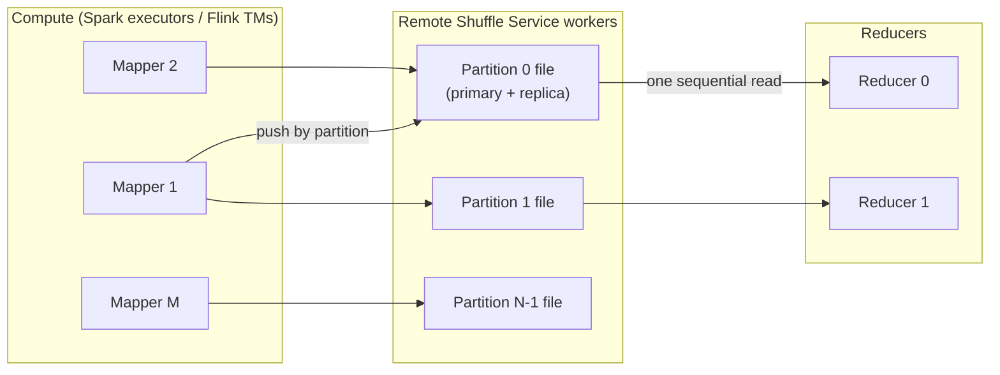

# 01 · Push vs. Pull Shuffle, Sort-Merge, and Remote Shuffle Services

> **Folder:** `05-Distributed-Shuffle-Skew-and-Join-Mechanics/` · **File 1 of 3**
> **Anchoring papers:** Dean & Ghemawat, *MapReduce* (OSDI 2004) · Shen et al., *Magnet: Push-based Shuffle Service for
> Large-scale Data Processing* (PVLDB 2020) · Zhang et al., *Riffle: Optimized Shuffle Service for Large-Scale Data
> Analytics* (EuroSys 2018) · Graefe, *Implementing Sorting in Database Systems* (ACM CSUR 2006) · Knuth, *TAOCP Vol. 3*
> (external sorting) · Apache Celeborn and Apache Uniffle design docs · Flink FLIP-31 (pluggable shuffle service), FLIP-148
> (sort-merge blocking shuffle), FLIP-235 (hybrid shuffle).
> **Prev folder:** [04 · Credit-based flow control](../04-Apache-Flink-Runtime-Checkpointing-and-State/03-credit-based-network-flow-control-and-buffer-debloating.md)
> · **Next:** [02 · Skew: salting, fan-out, broadcast joins](02-mitigating-data-skew-salting-fanout-and-broadcast-joins.md)

---

## 0. The thesis

A shuffle is an **all-to-all exchange** of $D$ bytes from $M$ producers to $N$ consumers. Every design choice answers four
questions:

1. **Who moves the data?** Push (producers send) or pull (consumers fetch).
2. **Where does it rest?** Nowhere (pipelined), producer-local disk, or a remote service.
3. **How is it grouped?** Hash or sort.
4. **What happens on failure?** Recompute, replicate, or durable store.

The physics that decides the answer is the **$M \times N$ segment explosion** (small random I/O) plus **failure
recomputation cost**. Pull with local files (MapReduce, Spark) is simple but suffers both at scale. Push-merge services
(Magnet, Celeborn, Uniffle, Dataflow Shuffle) aggregate per partition and decouple shuffle data from compute lifetimes.
Streaming engines (Flink pipelined, Windmill) shuffle per record and trade materialization for backpressure and
checkpoint coupling.

---

## 1. First principles

### 1.1 The segment explosion

$$
\#\text{segments} = M \cdot N, \qquad \bar{s} = \frac{D}{M N}, \qquad \text{reads per reducer} = M
$$

| $D$ | $M = N$ | $\bar{s}$ | Reads per reducer | HDD seek-bound time per reducer (10 ms/seek) |
|-----|---------|-----------|-------------------|-----------------------------------------------|
| 1 TB | 1,000 | 1 MB | 1,000 | 10 s |
| 10 TB | 10,000 | 100 KB | 10,000 | 100 s |
| 100 TB | 30,000 | ~110 KB | 30,000 | 300 s, and IOPS across the cluster saturate |

On SSDs, seeks are cheaper, but **IOPS and per-request overhead** (RPC, connection setup, metadata lookups) still
dominate at 100 KB segments. On networked disks, per-request latency is worse. The fix in every mature system is the same:
**turn $M$ small reads per reducer into a few large sequential reads** by merging segments per partition *before*
reducers read them.

### 1.2 Incast

When $N$ reducers fetch from $M$ mappers at the same moment, many senders converge on one receiver's NIC. Switch buffers
overflow, packets drop, TCP goes into timeout and retransmission, and throughput collapses (**TCP incast**). Throttling
in-flight fetches (`maxSizeInFlight`-style limits), randomized fetch order, and push-based aggregation all mitigate it.

### 1.3 External sorting cost

To sort $D$ bytes with memory $W$ and merge fan-in $F$:

$$
\text{runs} = \left\lceil \frac{D}{W} \right\rceil, \qquad \text{merge passes} = \left\lceil \log_F \text{runs} \right\rceil, \qquad \text{I/O} \approx 2D \cdot (1 + \text{passes})
$$

With $W$ = 1 GB, $D$ = 1 TB, and $F$ = 100: 1,000 runs, 2 merge passes, about 6 TB of I/O. Large memory (fewer runs) and
high fan-in (fewer passes) both matter, which is why sort buffers and merge factors are first-class tuning knobs.

### 1.4 The design space

| Design | Data rests | Grouping | Failure handling | Representatives |
|--------|-----------|----------|------------------|-----------------|
| **Pipelined push** | in network buffers only | per-record routing (hash) | global rollback (checkpoints) | Flink streaming |
| **Pull, producer-local** | mapper disks (one file + index per mapper) | sort by partition | recompute lost mappers | MapReduce, Spark sort shuffle |
| **Pull + node-level merge** | merged per node | sort | recompute | Riffle |
| **Push-merge (best effort)** | merged per partition on remote shuffle nodes, plus original blocks | sort/append | fall back to unmerged blocks; recompute | Spark push-based shuffle (Magnet) |
| **Remote shuffle service (RSS)** | remote workers, per-partition files, replicated | append per partition (+ sort if needed) | replicas; no recomputation | Apache Celeborn, Apache Uniffle, Uber RSS, Dataflow Shuffle |
| **Durable log** | message broker | partition by key | broker replication | Kafka Streams repartition topics |
| **Backend state service** | streaming backend | per key | per-key commits | Dataflow Windmill (Folder 03) |

---

## 2. Pull shuffle: MapReduce and Spark

### 2.1 Mechanics

```
 Map task i:  records ──► sort/partition buffer ──spill──► sorted runs ──merge──► ONE data file + ONE index file
                                                                                   [p0 | p1 | p2 | … | pN-1]
 Reduce task j: for each map i: FETCH segment (i, j) via index ──► merge-sort fetched segments ──► reduce(key, values)
```

Spark's sort-based shuffle writers ⚠ verify details per version:

| Writer | When | Mechanism |
|--------|------|-----------|
| `BypassMergeSortShuffleWriter` | few partitions (≤ `spark.shuffle.sort.bypassMergeThreshold`, default 200), no map-side combine | one file per partition, concatenated at the end (open-file cost ∝ partitions) |
| `UnsafeShuffleWriter` (Tungsten) | serializer supports relocation, no map-side aggregation, < ~16M partitions | sorts **packed 64-bit record pointers by partition id** in off-heap memory; spills; fast merge with zero-copy `transferTo` when compression and encryption allow |
| `SortShuffleWriter` | general case (map-side combine) | `ExternalSorter` with aggregation |

**Failure semantics.** If an executor holding map outputs dies, reducers hit a `FetchFailedException`, and the scheduler
**resubmits the map stage** for the lost outputs. Cascading fetch failures under node churn (spot instances) are the
classic Spark large-job instability. The **External Shuffle Service** (ESS) decouples serving shuffle files from executor
lifetime (needed for dynamic allocation), but the files still live on the node's disk.

### 2.2 Where pull breaks

- **Small segments** (§1.1): IOPS-bound reducers.
- **Node loss means recomputation:** expensive for wide, deep DAGs.
- **Disk-bound nodes:** shuffle files compete with spills and caches.
- **Elasticity:** you can't remove nodes that still serve shuffle data.

---

## 3. Push-based shuffle: Magnet (Spark)

Magnet (LinkedIn, PVLDB 2020), integrated into Spark 3.2+:

1. Mappers write their normal shuffle files **and** asynchronously **push** blocks to remote **shuffle merger** services
   (ESS instances chosen per partition).
2. Mergers **append** blocks for the same partition into one merged file per partition (best effort: late or failed
   pushes are skipped).
3. Reducers read **merged files** (large sequential reads), plus fall back to fetching the original unmerged blocks for
   anything not merged.

| Property | Effect |
|----------|--------|
| Small random reads become large sequential reads | big I/O efficiency gains at scale |
| Best effort | correctness never depends on the push path (originals remain) |
| Doubles writes (local + pushed) | extra network and disk |
| Locality | reducers can be scheduled near merged data |

Config sketch ⚠ verify: `spark.shuffle.push.enabled=true`, `spark.shuffle.service.enabled=true`, plus merger
selection and size limits.

---

## 4. Remote shuffle services: Celeborn, Uniffle, and Dataflow Shuffle

### 4.1 The RSS model



| Feature | Celeborn (pattern) | Why it matters |
|---------|--------------------|----------------|
| **Push by partition** | mappers push records or blocks for partition *p* to the worker(s) owning *p* | per-partition aggregation without a merge step |
| **Partition splitting** | a partition file that grows too large is split across workers | skewed partitions don't overload one worker |
| **Replication** | two replicas per partition (configurable) | worker loss doesn't force mapper recomputation |
| **Memory buffering** | worker buffers in memory, then flushes to disk | sequential writes; tune off-heap memory |
| **Engine support** | Spark, Flink (batch), MapReduce | one shuffle tier for many engines |
| **Decoupled lifecycle** | compute can scale to zero while shuffle data survives | elastic and spot-friendly compute |

Uniffle and Uber's RSS follow the same push-to-remote principle with different storage tiers (memory, local disk, HDFS)
and protocols ⚠ verify per project. **Dataflow Shuffle** (Folder 03, file 02) is the managed equivalent for Dataflow
batch.

### 4.2 Trade-offs

| Benefit | Cost |
|---------|------|
| No $M \times N$ small reads | an extra network hop (mapper → RSS → reducer); data crosses the network twice |
| No recomputation on compute loss | RSS cluster capacity planning (memory, disk, network); replication doubles writes |
| Elastic compute, spot instances | a new critical service: RSS outages stall all jobs |
| Skew handling via partition splits | operational complexity (versions, quotas, multi-tenancy isolation) |

**When an RSS pays off:** large shuffles (≥ TBs), high parallelism, spot or elastic compute, Kubernetes deployments
without node-local disks, and multi-tenant clusters. **When it doesn't:** small jobs where local SSD shuffle fits in page
cache, or when network bandwidth (not IOPS) is already the bottleneck.

---

## 5. Shuffle in Flink

| Mode | Mechanism | Fault tolerance | Use |
|------|-----------|-----------------|-----|
| **Pipelined** (streaming) | records serialized into network buffers and pushed with credits (Folder 04, file 03) | checkpoint rollback | all streaming jobs |
| **Blocking: hash** | one file per subpartition | region failover; recompute from blocking results | small parallelism (legacy) |
| **Blocking: sort-merge** (FLIP-148) | per-task sort buffer, spill, one data file + index per task | region failover | **high-parallelism batch** (avoids per-subpartition file explosion) |
| **Hybrid** (FLIP-235) | consumers may read while producers still write; spills to disk when consumers lag | region failover | batch with better resource utilization (no strict stage barriers) |
| **Remote / pluggable** (FLIP-31) | `shuffle-service-factory.class` plugs in external shuffle (e.g., Celeborn's Flink integration) | provided by the service | elastic batch on Kubernetes |

Flink's batch sorter works on **binary data in `MemorySegment`s with normalized key prefixes**. Comparisons are mostly
byte-wise on fixed-length prefixes, falling back to full deserialization only on prefix ties. That's cache-friendly and
avoids object churn, the same idea as Spark's Tungsten pointer-prefix sort.

---

## 6. Streaming shuffles compared

| System | Streaming shuffle | Durability | Backpressure | Cost driver |
|--------|-------------------|------------|--------------|-------------|
| Flink | pipelined network buffers | none (checkpoints elsewhere) | credits | network, buffer memory |
| Dataflow | Windmill/Streaming Engine commit per key | durable in the backend | backlog queues | Streaming Engine units/bytes |
| Kafka Streams | **repartition topics** through brokers | replicated (RF) and retained | consumer pull | broker storage × RF, network × RF, retention |
| Spark Structured Streaming | micro-batch shuffle (per batch) | per-batch files / state store | batch duration | per-batch scheduling overhead |

Kafka Streams' repartition topics are the most expensive shuffle per byte: every repartitioned byte is written to a broker
with replication factor 3 (×3 network and disk) and retained. Topology design (`selectKey` placement, co-partitioning
inputs up front) is a cost lever.

---

## 7. Hardware sympathy

| Phase | Resource | Lever |
|-------|----------|-------|
| Map-side serialization and sort | CPU, memory bandwidth | binary sort with key prefixes; efficient serializers |
| Spill | local disk write bandwidth | bigger sort buffers (fewer spills); fast NVMe |
| Compression | CPU vs. network/disk | LZ4 (fast) vs. Zstd (ratio); compress when network or disk binds |
| Transfer | NIC, switch buffers | throttled in-flight fetches; push-merge; avoid incast |
| Merge | disk read bandwidth, fan-in | high fan-in; zero-copy `transferTo` for byte-range concatenation |
| Reducer read | sequential vs. random | merged partition files |

**Zero-copy merge:** when map outputs are concatenations of per-partition byte ranges and no re-serialization is needed,
`FileChannel.transferTo` moves bytes kernel-to-kernel (sendfile) without user-space copies. Compression or encryption
streams that can't concatenate blocks disable it.

---

## 8. Production Java 21 code blueprints

### 8.1 Teaching implementation: external sort-merge (the core of every sort-based shuffle)

```java
package dev.l7.shuffle;

import java.io.BufferedInputStream;
import java.io.BufferedOutputStream;
import java.io.DataInputStream;
import java.io.DataOutputStream;
import java.io.EOFException;
import java.io.IOException;
import java.io.UncheckedIOException;
import java.nio.file.Files;
import java.nio.file.Path;
import java.util.ArrayList;
import java.util.Comparator;
import java.util.Iterator;
import java.util.List;
import java.util.NoSuchElementException;
import java.util.PriorityQueue;
import java.util.function.Consumer;

/**
 * Sort arbitrarily large input with bounded memory: buffer up to `maxInMemory` records, sort, spill a run;
 * then k-way merge all runs with a min-heap. I/O ≈ 2D(1 + passes); here a single merge pass (fan-in = #runs).
 */
public final class ExternalSortMerge<T> {

  public interface Serde<T> {
    void write(DataOutputStream out, T value) throws IOException;

    T read(DataInputStream in) throws IOException;   // throws EOFException at end of run
  }

  private final Comparator<T> order;
  private final Serde<T> serde;
  private final int maxInMemory;
  private final Path spillDir;

  public ExternalSortMerge(Comparator<T> order, Serde<T> serde, int maxInMemory, Path spillDir) {
    this.order = order;
    this.serde = serde;
    this.maxInMemory = maxInMemory;
    this.spillDir = spillDir;
  }

  public void sort(Iterator<T> input, Consumer<T> sink) throws IOException {
    List<Path> runs = new ArrayList<>();
    List<T> buffer = new ArrayList<>(maxInMemory);
    while (input.hasNext()) {
      buffer.add(input.next());
      if (buffer.size() == maxInMemory) {
        runs.add(spill(buffer));
        buffer.clear();
      }
    }
    if (runs.isEmpty()) {                       // fits in memory: no I/O at all
      buffer.sort(order);
      buffer.forEach(sink);
      return;
    }
    if (!buffer.isEmpty()) {
      runs.add(spill(buffer));
    }
    merge(runs, sink);
  }

  private Path spill(List<T> buffer) throws IOException {
    buffer.sort(order);                         // in-memory sort of one run
    Path run = Files.createTempFile(spillDir, "run-", ".bin");
    try (DataOutputStream out = new DataOutputStream(new BufferedOutputStream(Files.newOutputStream(run), 1 << 16))) {
      for (T t : buffer) {
        serde.write(out, t);
      }
    }
    return run;
  }

  private void merge(List<Path> runs, Consumer<T> sink) throws IOException {
    record Head<T>(T value, RunReader<T> reader) {}
    PriorityQueue<Head<T>> heap = new PriorityQueue<>(runs.size(), (a, b) -> order.compare(a.value(), b.value()));
    List<RunReader<T>> readers = new ArrayList<>();
    try {
      for (Path run : runs) {
        RunReader<T> r = new RunReader<>(run, serde);
        readers.add(r);
        if (r.hasNext()) {
          heap.add(new Head<>(r.next(), r));
        }
      }
      while (!heap.isEmpty()) {                 // O(log k) per record
        Head<T> h = heap.poll();
        sink.accept(h.value());
        if (h.reader().hasNext()) {
          heap.add(new Head<>(h.reader().next(), h.reader()));
        }
      }
    } finally {
      for (RunReader<T> r : readers) {
        r.close();
      }
      for (Path run : runs) {
        Files.deleteIfExists(run);
      }
    }
  }

  private static final class RunReader<T> implements Iterator<T>, AutoCloseable {
    private final DataInputStream in;
    private final Serde<T> serde;
    private T next;

    RunReader(Path run, Serde<T> serde) throws IOException {
      this.in = new DataInputStream(new BufferedInputStream(Files.newInputStream(run), 1 << 16));
      this.serde = serde;
      advance();
    }

    private void advance() {
      try {
        next = serde.read(in);
      } catch (EOFException eof) {
        next = null;
      } catch (IOException e) {
        throw new UncheckedIOException(e);
      }
    }

    @Override
    public boolean hasNext() {
      return next != null;
    }

    @Override
    public T next() {
      if (next == null) {
        throw new NoSuchElementException();
      }
      T current = next;
      advance();
      return current;
    }

    @Override
    public void close() throws IOException {
      in.close();
    }
  }
}
```

What a production sorter adds on top:

- **Binary records** in pooled memory pages instead of objects, which avoids GC churn.
- **Normalized key prefixes** sorted with cache-friendly comparisons.
- **Multi-pass merges** with bounded fan-in, because open file handles and buffers cost memory.
- **Partition-id-major ordering**, so the output is one file per task with an index of partition byte ranges.

### 8.2 Engine configurations (⚠ verify keys per version)

```properties
# Spark: push-based shuffle (Magnet) on a cluster with the external shuffle service
spark.shuffle.service.enabled=true
spark.shuffle.push.enabled=true
spark.reducer.maxSizeInFlight=96m          # throttle concurrent fetch bytes per reducer (incast control)
spark.shuffle.compress=true
spark.io.compression.codec=lz4             # zstd when network/disk bound, lz4 when CPU bound

# Spark: Apache Celeborn as remote shuffle (illustrative)
spark.shuffle.manager=org.apache.spark.shuffle.celeborn.SparkShuffleManager
spark.celeborn.master.endpoints=celeborn-master-0:9097,celeborn-master-1:9097
spark.celeborn.client.push.replicate.enabled=true
```

```yaml
# Flink batch: sort-merge blocking shuffle for high parallelism; hybrid shuffle for overlap
execution.runtime-mode: BATCH
execution.batch-shuffle-mode: ALL_EXCHANGES_BLOCKING      # or ALL_EXCHANGES_HYBRID_FULL / _SELECTIVE
taskmanager.network.sort-shuffle.min-parallelism: 1       # use sort-merge shuffle at all parallelisms
taskmanager.network.blocking-shuffle.compression.enabled: true
# Pluggable remote shuffle (e.g., Celeborn's Flink integration):
# shuffle-service-factory.class: org.apache.celeborn.plugin.flink.RemoteShuffleServiceFactory
```

### 8.3 Beam/Dataflow: shrink the shuffle before tuning it

```java
// The cheapest shuffle byte is the one you never send (Folder 02, file 01; Folder 03, file 02):
events
    .apply("Project", Select.fieldNames("merchantId", "amountCents"))         // drop wide payloads before the GBK
    .apply("ByMerchant", Group.<Row>byFieldNames("merchantId")
        .aggregateField("amountCents", Sum.ofLongs(), "revenueCents"));     // lifted partial sums cross the shuffle
```

---

## 9. Production failure modes and P99 debugging

| ID | Failure | Signature | Root cause | Fix |
|----|---------|-----------|------------|-----|
| X1 | **Fetch-failure cascades** (Spark) | `FetchFailedException`, repeated stage retries, job takes far longer than normal | executor or node loss deletes map outputs; spot churn | ESS; RSS (Celeborn/Uniffle) with replication; decommissioning with shuffle migration |
| X2 | **IOPS-bound reducers** | reducers spend most time in fetch wait; disk util high, throughput low | $M \times N$ tiny segments | push-merge or RSS; fewer, larger partitions; coalesce small partitions (AQE) |
| X3 | **Incast collapse** | network retransmits; fetch timeouts; throughput falls as parallelism rises | synchronized all-to-all fetches | throttle in-flight fetch bytes; randomize fetch order; push-based designs |
| X4 | **Shuffle disk full** | "No space left on device" during shuffle | spills + map outputs on small local disks | bigger or faster disks; RSS; less shuffle volume |
| X5 | **Skewed partition** | one reducer processes 100× the median; long tail | hot keys or bad partitioning | key-space fixes (file 02); RSS partition splitting; AQE skew handling |
| X6 | **RSS worker overload** | push latency spikes; backpressure on mappers; worker OOM | under-provisioned RSS memory, disk, or network; tenant hogging | capacity planning; per-tenant quotas; partition splitting |
| X7 | **Compression CPU bottleneck** | mappers CPU-bound in codec | Zstd at high level on CPU-bound jobs | LZ4; lower levels; compress only large blocks |
| X8 | **Repartition-topic costs** (Kafka Streams) | broker disk and network ×RF; retention costs | unnecessary `selectKey` / re-keying | co-partition inputs upstream; repartition once; shorter retention for repartition topics |

---

## 10. FAANG L7 bar-raiser Q&A chains

### Q1 · "Push vs. pull shuffle: which is better?"

**L5 textbook answer.** Push is faster because data moves proactively. Pull is simpler.

**Why L5 breaks at petabyte scale.** Neither is "faster" in general. What matters is the **$M \times N$ segment problem**
and **failure recomputation**. Pull from local files at 10k × 10k means 100M segments of ~100 KB, so reducers are
IOPS-bound, and node loss recomputes map stages. Push without merging just moves the problem.

**L7 principal defense.**

1. **Frame the physics:** segments = M·N, size = D/(M·N); incast; recompute-on-loss.
2. **Pull + local files:** simple, good for small and medium shuffles, fragile at scale and under churn.
3. **Push-merge** (Magnet, best effort) turns reads into sequential per-partition reads, and correctness falls back to
   the originals.
4. **RSS** (Celeborn, Uniffle, Dataflow Shuffle) adds per-partition aggregation, replication, and decoupling from compute
   lifetimes, which enables elasticity and spot instances. The cost is an extra hop and an RSS cluster.
5. **Streaming** is pipelined push with credits (Flink), with no materialization, coupled to checkpoints.
6. **Choose by shuffle size, churn, elasticity needs, and operational appetite.**

### Q2 · "Your 50 TB Spark join keeps failing with fetch failures on spot instances. Fix it."

**L5 textbook answer.** Increase retries, or switch to on-demand instances.

**Why L5 breaks.** Retries recompute map stages over and over as spot nodes keep disappearing. On-demand fixes it by paying
2–3× for compute.

**L7 principal defense.**

- **Decouple shuffle data from compute:** use an RSS with replication (Celeborn) or a managed shuffle (Dataflow Shuffle),
  so node loss loses no shuffle data.
- **Reduce shuffle volume:**
  - broadcast the small side if it fits (file 02);
  - project columns before the join;
  - pre-aggregate where possible.
- **Handle skew** with AQE skew-join splitting or salting, so no single reducer dominates.
- **Spot strategy:** keep a mixed fleet, use graceful decommissioning with shuffle migration where supported, and make
  sure the job can resume (checkpointed intermediate outputs for very long pipelines).

### Q3 · "Explain why Flink uses sort-merge blocking shuffle for high-parallelism batch."

**L5 textbook answer.** Sorting is more efficient.

**Why L5 breaks.** Hash blocking shuffle writes **one file per subpartition per task**. At parallelism 10,000, each task
writes 10,000 files, so the cluster has 10⁸ files. That exhausts file handles and inodes and produces random I/O.

**L7 principal defense.**

- **Sort-merge** writes **one data file + one index per task**, records sorted by subpartition, so the file count is
  $O(M)$, not $O(MN)$.
- **Reads** are byte ranges per subpartition, sequential within the range.
- **Binary sort** on normalized key prefixes in `MemorySegment`s (cache-friendly, no objects).
- **Hybrid shuffle** further overlaps producer and consumer execution, spilling only when consumers lag.
- **For elastic Kubernetes batch,** plug in a remote shuffle service via FLIP-31.

### Q4 · "Kafka Streams app costs exploded after adding a `groupBy`. Why?"

**L5 textbook answer.** Grouping is expensive computationally.

**Why L5 breaks.** The CPU is fine. The cost is **storage and network ×RF**. Re-keying creates an internal repartition
topic. Every record is written to brokers with replication factor 3, read back, and retained per topic config. A
streaming shuffle through a durable log is the most expensive shuffle per byte.

**L7 principal defense.**

1. **Co-partition upstream** by the needed key at the producer, so there's no repartition topic.
2. **Repartition once,** not per operator. Reuse `KStream`s keyed correctly.
3. **Tune repartition topics:** shorter retention (data is consumed promptly), compression, appropriate partition counts.
4. **Consider the engine:** if the topology needs many shuffles, Flink's pipelined network shuffle avoids broker
   round trips (at the cost of checkpoint coupling).

### Q5 · "Design the shuffle tier for a multi-tenant Kubernetes data platform running Spark and Flink batch."

**L5 textbook answer.** Use local disks on each node with the external shuffle service.

**Why L5 breaks.** Kubernetes nodes are elastic and often have small or ephemeral disks. Local shuffle ties data to pod
lifetimes, so autoscaling down or preemption causes recomputation. Tenants compete for node disks unpredictably.

**L7 principal defense.**

- **A shared RSS cluster** (Celeborn or Uniffle) with replication, per-tenant quotas, and partition splitting for skew.
  It's engine-agnostic (Spark plugin, Flink FLIP-31 factory).
- **Compute scales to zero and runs on spot,** because shuffle data survives in the RSS.
- **SLOs and monitoring** for the RSS (push latency, disk and network utilization), because it's now critical
  infrastructure. Run multi-AZ and plan cross-AZ network costs (Folder 06, file 03).
- **Shuffle-volume governance:** projection and compression defaults, AQE coalescing, skew detection.

---

## 11. Invariants checklist

1. **Shuffle cost = bytes + segments (M·N) + failure recomputation.** Optimize all three.
2. **Merge per partition before reducers read** (push-merge or RSS) at scale.
3. **Decouple shuffle data from compute lifetimes** for elasticity and spot capacity.
4. **Sort-based designs keep file counts at O(M).** Hash-per-subpartition designs explode at high parallelism.
5. **Throttle fetch concurrency** to avoid incast.
6. **The cheapest shuffle byte is the one you never send:** project, combine, broadcast.
7. **Streaming shuffles are per-record pushes.** Their costs are backpressure, checkpoint coupling, or broker
   replication (Kafka Streams).

---

## 12. References

- J. Dean, S. Ghemawat. *MapReduce: Simplified Data Processing on Large Clusters.* OSDI 2004.
- M. Shen, Y. Zhou, C. Singh. *Magnet: Push-based Shuffle Service for Large-scale Data Processing.* PVLDB 13(12), 2020.
- H. Zhang, B. Cho, E. Seyfe, A. Ching, M. J. Freedman. *Riffle: Optimized Shuffle Service for Large-Scale Data
  Analytics.* EuroSys 2018.
- G. Graefe. *Implementing Sorting in Database Systems.* ACM Computing Surveys 38(3), 2006.
- Apache Celeborn and Apache Uniffle project documentation (architecture, replication, partition splitting).
- Apache Spark: *Tuning: shuffle*, `UnsafeShuffleWriter`, `ExternalSorter`, push-based shuffle docs.
- Apache Flink: FLIP-31 (pluggable shuffle service), FLIP-148 (sort-merge blocking shuffle), FLIP-235 (hybrid shuffle);
  *Batch shuffle* docs.

**Next →** [02 · Mitigating data skew: salting, fan-out, and broadcast joins](02-mitigating-data-skew-salting-fanout-and-broadcast-joins.md)
