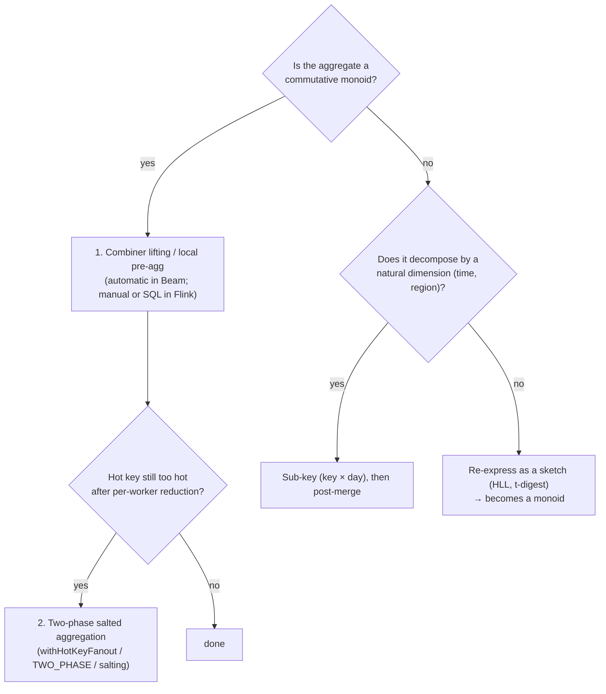

# 02 · Mitigating Data Skew: Salting, Fan-Out, and Broadcast Joins

> **Folder:** `05-Distributed-Shuffle-Skew-and-Join-Mechanics/` · **File 2 of 3**
> **Anchoring papers and sources:** Zipf / power-law workload literature; DeWitt et al., *Practical Skew Handling in
> Parallel Joins* (VLDB 1992) · Kwon et al., *SkewTune: Mitigating Skew in MapReduce Applications* (SIGMOD 2012) ·
> Nasir et al., *The Power of Both Choices: Practical Load Balancing for Distributed Stream Processing Engines* (ICDE
> 2015) · Cormode & Muthukrishnan, *Count-Min Sketch* (J. Algorithms 2005) · Spark AQE docs · Flink SQL performance-tuning
> docs (MiniBatch, local-global, split distinct) · Beam `Combine.PerKey#withHotKeyFanout`.
> **Prev:** [01 · Shuffle designs](01-push-vs-pull-shuffle-sort-merge-and-remote-shuffle-services.md) · **Next:**
> [03 · Temporal and interval joins, state TTL](03-temporal-joins-interval-joins-and-state-ttl-compaction-filters.md)

---

## 0. The thesis

Hash partitioning distributes **keys** evenly, not **work**. Real key distributions follow power laws, so one "celebrity"
key can carry a large share of the data. Every engine serializes a key onto one worker (GBK semantics, keyed state), so
the hot key's worker becomes the job's ceiling. Adding workers doesn't help. The fixes all **change the key space**, and
each requires a specific algebraic property:

| Fix | Requires | Cost |
|-----|----------|------|
| Combiner lifting / local pre-aggregation | commutative monoid | memory, extra CPU, latency (buffering) |
| Two-phase salted aggregation (fan-out) | commutative monoid | an extra shuffle stage; n× partials for hot keys |
| Broadcast join | small side fits in memory per task | network = small × p; memory × p |
| Salted (replicated) join | join semantics (cross product per key) | replicate the small side's hot keys n× |
| Runtime skew splitting (Spark AQE) | join semantics | engine support |
| Sub-keying by a natural dimension | computation decomposes (time, region) | a post-merge if a global result is needed |

---

## 1. First principles: the math of skew

### 1.1 Zipf and the hot-key share

With $N$ distinct keys and Zipf exponent $s$, the rank-$r$ key's share is

$$
f(r) = \frac{r^{-s}}{H_{N,s}}, \qquad H_{N,s} = \sum_{i=1}^{N} i^{-s}
$$

For $s = 1$ and $N = 10^6$: $H \approx \ln N + 0.577 \approx 14.4$, so **the top key carries ~6.9%** of all records, and
the top 10 carry ~20%.

### 1.2 Load imbalance under hash partitioning

With $p$ parallel workers, the expected load is $1/p$ of the data, but the worker owning the top key carries at least
$f(1)$:

$$
\text{imbalance} = \frac{\max \text{load}}{\text{mean load}} \;\ge\; f(1)\cdot p
$$

| $p$ | Imbalance at $f(1) = 6.9\%$ |
|-----|------------------------------|
| 10 | ~1× (absorbed) |
| 100 | 6.9× |
| 1,000 | **69×** |
| 10,000 | 690× |

**Skew gets worse as you scale out.** A job that's fine at 50 workers can have a 69× straggler at 1,000. That's the
cruelest property of skew, and the reason "add workers" fails.

### 1.3 Choosing the fan-out factor

Salting a hot key into $n$ sub-keys spreads its load over $n$ workers. To bring a key with share $f$ under $\varepsilon$ ×
the mean load:

$$
\frac{f}{n} \le \frac{\varepsilon}{p} \quad\Rightarrow\quad n \ge \frac{f \cdot p}{\varepsilon}
$$

For $f$ = 6.9%, $p$ = 1,000, and $\varepsilon$ = 2: $n \ge 35$. Salting *every* key by 35 multiplies phase-2 records
35× for nothing, so salt **only hot keys** (adaptive), with $n$ proportional to each key's share.

### 1.4 Detecting hot keys

| Method | Memory | Latency | Notes |
|--------|--------|---------|-------|
| Exact counts per key (batch pre-pass) | O(distinct keys) | one extra pass | cheap with combiner lifting |
| Sampling (1%) plus top-k | small | one pass | misses moderately hot keys at low rates |
| **Count-Min Sketch + heap** (heavy hitters) | $O(\frac{1}{\epsilon}\log\frac{1}{\delta})$ | streaming | overestimates only. Great for "is this key hot?" |
| Space-Saving / Misra-Gries | O(k) | streaming | deterministic top-k guarantees |
| Engine telemetry | — | reactive | Dataflow "hot key detected" logs; Flink busy-time max ≫ avg (Folder 04, file 03) |

---

## 2. Aggregation skew: lifting, local-global, and salting

### 2.1 Where each technique applies



### 2.2 Two-phase salted aggregation

$$
\underbrace{(k, v) \mapsto ((k, \sigma), v)}_{\sigma \in [0, n_k)} \;\xrightarrow{\text{GBK + combine}}\; ((k, \sigma), a_\sigma) \;\mapsto\; (k, a_\sigma) \;\xrightarrow{\text{GBK + merge}}\; (k, \textstyle\bigoplus_\sigma a_\sigma)
$$

- **Phase 1:** the hot key is spread across $n_k$ sub-keys and workers. Each produces a partial accumulator.
- **Phase 2:** at most $n_k$ partials per hot key. The merge is cheap.
- **Correctness** requires ⊕ to be associative and commutative (any partition of values is valid).
- **Salt choice:** random salts balance load best. Deterministic salts (hash of a record field) give replay-stable
  partitions, which matters on runners without committed outputs (Folder 03, file 03 §2.1).

**Beam's built-in:** `Combine.perKey(fn).withHotKeyFanout(n)` or `.withHotKeyFanout(key -> n_k)`. It inserts the
intermediate random sharding for keys with fan-out > 1, and composes with combiner lifting.

### 2.3 Flink: local-global aggregation

Flink DataStream has **no automatic combiner lifting** (Folder 02, file 01 §6). The equivalent is a **local
pre-aggregation operator before `keyBy`**:

- buffer partial aggregates per key in the (non-keyed) operator;
- flush on size or time;
- **snapshot the buffer in operator state**, so buffered partials survive failures. They're consistent with the
  checkpoint because anything emitted before the barrier is reflected downstream, and anything buffered is in this
  operator's snapshot.

**Flink SQL does this for you:**

- `table.exec.mini-batch.enabled` buffers records per batch;
- `table.optimizer.agg-phase-strategy: TWO_PHASE` does local then global aggregation;
- for **`COUNT(DISTINCT x)`** skew, `table.optimizer.distinct-agg.split.enabled` rewrites into a two-level aggregation
  bucketed by `hash(x) % bucket-num`, which spreads hot group keys.

---

## 3. Join skew

### 3.1 Join strategies and their skew behavior

| Strategy | Network cost | Memory | Skew behavior |
|----------|--------------|--------|---------------|
| **Shuffle hash / sort-merge join** | $\lvert L\rvert + \lvert S\rvert$ | per partition | **hot key → one reducer gets all its L and S rows** |
| **Broadcast hash join** | $\lvert S\rvert \cdot p$ | $\lvert S\rvert$ per task | **immune to L-side key skew** (L is never shuffled) |
| **Salted join** | $\lvert L\rvert + \lvert S\rvert + (n-1)\lvert S_{\text{hot}}\rvert$ | per partition | hot key spread over n reducers |
| **Runtime skew split** (Spark AQE) | ≈ salted, decided at runtime | per sub-partition | splits oversized partitions and replicates the matching side |

**When broadcast wins:**

$$
\lvert S\rvert \cdot p < \lvert L\rvert + \lvert S\rvert \quad\text{and}\quad \lvert S\rvert \le M_{\text{task}}
$$

With $\lvert L\rvert$ = 10 TB and $p$ = 1,000, broadcast is network-cheaper for $\lvert S\rvert$ < ~10 GB, but per-task
memory usually caps it lower (hundreds of MB to a few GB). Spark's default auto-broadcast threshold is small (10 MB), and
AQE can convert to broadcast at runtime when the actual size is small.

### 3.2 Why join skew is splittable when GBK skew isn't

A join's output for key $k$ is $L_k \times S_k$. **Any partition of $L_k$ into parts $L_k^{(1)}, \dots, L_k^{(n)}$ gives
the same output** as long as each part is joined with *all* of $S_k$:

$$
L_k \times S_k = \biguplus_{i=1}^{n} \big(L_k^{(i)} \times S_k\big)
$$

That's why salting (random salt on L, replicate S to all salts) and AQE's skew split are *semantically safe* for joins,
while a generic GBK consumer can't be split without your consent (Folder 03, file 02 Q6).

### 3.3 Streaming joins and broadcast state

- **Beam side inputs** (`PCollectionView`) are Beam's broadcast. Windowed side inputs map main-input windows to side-input
  windows.
- **Flink broadcast state** (`BroadcastStream` + `(Keyed)BroadcastProcessFunction`) is a replicated, checkpointed map on
  every parallel instance, updated by a control stream.
- **Lookup joins** (Flink SQL `FOR SYSTEM_TIME AS OF` processing-time lookup; Beam Enrichment-style RPC) leave the
  dimension external, with caching (file 03).

---

## 4. Beam side inputs: materialization and the asList OOM

### 4.1 How side inputs reach your `DoFn`

| View | Semantics | Physical access (Runner v2 / Dataflow) | Memory risk |
|------|-----------|----------------------------------------|-------------|
| `View.asSingleton()` | one value per window | read once per window | the value's size |
| `View.asIterable()` | all values | **whole iterable streamed** via the State API (paged), cached | iterating fully per element; copying into memory |
| `View.asList()` | random-access list | indexed access may be supported, but code usually iterates or copies | **`new ArrayList<>(list)` per element or bundle = OOM** |
| `View.asMap()` | unique key → value | **per-key lookups** (`MultimapSideInput` state requests); Dataflow batch uses indexed (ISM-style) files ⚠ verify | only the looked-up keys cross the boundary |
| `View.asMultimap()` | key → iterable of values | per-key lookups | per-key iterable size |

**The anti-pattern:** a 5 GB dimension as `asList`, scanned linearly per element (O(n) per element) or copied into a
`HashMap` in every `DoFn` instance. Instances ≈ stages × threads (Folder 02, file 02 §3.2), so 300 threads × 5 GB is an
instant OOM. **The fix:** `asMap`/`asMultimap` for point lookups, so the runner serves only the requested keys and caches
them. For truly large dimensions, use an external lookup with a cache, or a real shuffle join.

### 4.2 Streaming side inputs

- **Windowed side inputs** block main-input processing for a window until that side-input window is ready, which can
  stall when the side input lags.
- **"Slowly updating side input":** `PeriodicImpulse` → read the dimension → `Window.into(GlobalWindows)` with a repeated
  trigger → `View.asMap()`/`asSingleton()` (often with `Latest`). Main elements see the latest refreshed version.
  Updates are eventually visible, not synchronized with event time.
- **Cost:** every refresh re-materializes the view. Keep refreshes coarse and views small.

---

## 5. Hardware sympathy

| Technique | CPU | Memory | Network |
|-----------|-----|--------|---------|
| Lifting / local pre-agg | +hashing, +merge | +buffer (bounded) | **−** (fewer records) |
| Salting | +1 shuffle stage | — | +phase-2 records (≤ n per hot key) |
| Broadcast join | +hash table build per task | **|S| × p total** | |S| × p (no L shuffle) |
| Broadcast state (Flink) | per-update fan-out | **|S| × p**, on heap | control-stream fan-out |
| Side input `asMap` | per-key lookup RPC (cached) | cache budget | only accessed keys |

Flink **broadcast state is kept in memory (heap) on every parallel instance, not in RocksDB**, and every instance
includes it in checkpoints ⚠ verify per version. A 2 GB rule set at parallelism 500 is 1 TB of heap cluster-wide, plus
checkpoint volume. Keep broadcast state small (compiled rules, compact dimensions), or use lookup joins.

---

## 6. Production Java 21 code blueprints

### 6.1 Anti-patterns

```java
// (A) Hot key straight into a GroupByKey with a non-combining consumer.
events.apply(WithKeys.of(Event::merchantId)).apply(GroupByKey.create()).apply(ParDo.of(new SumInLoopFn()));

// (B) Huge side input as a list, scanned and copied per element.
PCollectionView<List<Merchant>> merchants = merchantPc.apply(View.asList());   // 5 GB
orders.apply(ParDo.of(new DoFn<Order, Enriched>() {
  @ProcessElement public void process(ProcessContext c) {
    Map<String, Merchant> byId = new HashMap<>();                       // rebuilt per element: O(n) and OOM
    for (Merchant m : c.sideInput(merchants)) byId.put(m.id(), m);
    c.output(enrich(c.element(), byId.get(c.element().merchantId())));
  }
}).withSideInputs(merchants));

// (C) Flink: salting every key by 64 "to be safe": 64× phase-2 records for 99.99% of keys that were never hot.
stream.map(e -> Tuple2.of(e.key() + "#" + ThreadLocalRandom.current().nextInt(64), e.value()))...
```

### 6.2 Beam: adaptive two-phase aggregation (hot keys detected from the data)

```java
package dev.l7.skew;

import java.util.HashSet;
import java.util.List;
import java.util.Set;
import java.util.concurrent.ThreadLocalRandom;
import org.apache.beam.sdk.transforms.Combine;
import org.apache.beam.sdk.transforms.Count;
import org.apache.beam.sdk.transforms.DoFn;
import org.apache.beam.sdk.transforms.Filter;
import org.apache.beam.sdk.transforms.Keys;
import org.apache.beam.sdk.transforms.MapElements;
import org.apache.beam.sdk.transforms.PTransform;
import org.apache.beam.sdk.transforms.ParDo;
import org.apache.beam.sdk.transforms.Sum;
import org.apache.beam.sdk.transforms.View;
import org.apache.beam.sdk.values.KV;
import org.apache.beam.sdk.values.PCollection;
import org.apache.beam.sdk.values.PCollectionView;
import org.apache.beam.sdk.values.TypeDescriptors;

/**
 * Batch: sum per key where a few keys are extremely hot.
 * Pass 1 finds hot keys (lifted counts are cheap). Pass 2 salts ONLY hot keys into `fanout` sub-keys.
 * Pass 3 merges the ≤ fanout partials per hot key. Cold keys go through with salt 0, so no extra records.
 */
public final class AdaptiveSaltedSum extends PTransform<PCollection<KV<String, Long>>, PCollection<KV<String, Long>>> {

  private final long hotThreshold;   // e.g., > 0.5% of records, from §1.3 sizing
  private final int fanout;          // n ≥ f·p/ε

  public AdaptiveSaltedSum(long hotThreshold, int fanout) {
    this.hotThreshold = hotThreshold;
    this.fanout = fanout;
  }

  @Override
  public PCollection<KV<String, Long>> expand(PCollection<KV<String, Long>> input) {
    final long threshold = hotThreshold;
    PCollectionView<List<String>> hotKeys = input
        .apply("Keys", Keys.create())
        .apply("CountPerKey", Count.perElement())                         // lifted: cheap even for hot keys
        .apply("OnlyHot", Filter.by((KV<String, Long> kv) -> kv.getValue() > threshold))
        .apply("HotKeyNames", Keys.create())
        .apply("AsView", View.asList());                                  // tiny: tens to hundreds of keys

    return input
        .apply("SaltHot", ParDo.of(new SaltFn(fanout, hotKeys)).withSideInputs(hotKeys))
        .apply("PartialSum", Sum.longsPerKey())                           // phase 1 over (key#salt)
        .apply("Unsalt", MapElements
            .into(TypeDescriptors.kvs(TypeDescriptors.strings(), TypeDescriptors.longs()))
            .via(kv -> KV.of(kv.getKey().substring(0, kv.getKey().lastIndexOf('#')), kv.getValue())))
        .apply("FinalSum", Sum.longsPerKey());                            // phase 2: ≤ fanout partials per hot key
  }

  static final class SaltFn extends DoFn<KV<String, Long>, KV<String, Long>> {
    private final int fanout;
    private final PCollectionView<List<String>> hotKeysView;
    private transient Set<String> hot;                                    // built once per instance (global window, batch)

    SaltFn(int fanout, PCollectionView<List<String>> hotKeysView) {
      this.fanout = fanout;
      this.hotKeysView = hotKeysView;
    }

    @StartBundle
    public void startBundle() {
      hot = null;                                                         // re-read lazily (cached by the runner)
    }

    @ProcessElement
    public void process(ProcessContext c) {
      if (hot == null) {
        hot = new HashSet<>(c.sideInput(hotKeysView));
      }
      KV<String, Long> kv = c.element();
      int salt = hot.contains(kv.getKey()) ? ThreadLocalRandom.current().nextInt(fanout) : 0;
      c.output(KV.of(kv.getKey() + "#" + salt, kv.getValue()));
    }
  }
}
```

For combinable aggregates, the one-line alternative is
`Combine.perKey(Sum.ofLongs()).withHotKeyFanout(k -> hot.contains(k) ? 64 : 1)` (Folder 03, file 02 §8.2). The explicit
version above shows the mechanics and extends to aggregates outside `Combine`.

### 6.3 Beam: point-lookup broadcast join and salted shuffle join

```java
package dev.l7.skew;

import java.util.Map;
import java.util.Set;
import java.util.concurrent.ThreadLocalRandom;
import org.apache.beam.sdk.transforms.DoFn;
import org.apache.beam.sdk.transforms.ParDo;
import org.apache.beam.sdk.transforms.View;
import org.apache.beam.sdk.transforms.join.CoGbkResult;
import org.apache.beam.sdk.transforms.join.CoGroupByKey;
import org.apache.beam.sdk.transforms.join.KeyedPCollectionTuple;
import org.apache.beam.sdk.values.KV;
import org.apache.beam.sdk.values.PCollection;
import org.apache.beam.sdk.values.PCollectionView;
import org.apache.beam.sdk.values.TupleTag;

public final class SkewAwareJoins {

  public record Order(String orderId, String merchantId, long amountCents) implements java.io.Serializable {}

  public record Merchant(String merchantId, String country) implements java.io.Serializable {}

  public record Enriched(String orderId, String merchantId, String country, long amountCents)
      implements java.io.Serializable {}

  /** Broadcast join for a SMALL dimension: asMap → per-key lookups served (and cached) by the runner. */
  public static PCollection<Enriched> broadcastJoin(PCollection<Order> orders, PCollection<KV<String, Merchant>> merchants) {
    PCollectionView<Map<String, Merchant>> byId = merchants.apply("MerchantsAsMap", View.asMap());
    return orders.apply("LookupMerchant", ParDo.of(new DoFn<Order, Enriched>() {
      @ProcessElement
      public void process(ProcessContext c) {
        Order o = c.element();
        Merchant m = c.sideInput(byId).get(o.merchantId());   // point lookup: no full materialization
        c.output(new Enriched(o.orderId(), o.merchantId(), m == null ? "UNKNOWN" : m.country(), o.amountCents()));
      }
    }).withSideInputs(byId));
  }

  /**
   * Salted shuffle join for a LARGE dimension with known hot keys:
   *  - big side: hot keys get a random salt in [0, n); cold keys get salt 0,
   *  - small side: hot keys are REPLICATED to all n salts; cold keys get salt 0.
   * Every (L-part, S) pairing for a hot key is preserved: L_k × S_k = ⊎_i (L_k^(i) × S_k).
   */
  public static PCollection<Enriched> saltedJoin(PCollection<KV<String, Order>> ordersByMerchant,
                                                 PCollection<KV<String, Merchant>> merchants,
                                                 Set<String> hotMerchants, int n) {
    TupleTag<Order> ordersTag = new TupleTag<>() {};
    TupleTag<Merchant> merchantsTag = new TupleTag<>() {};

    PCollection<KV<String, Order>> saltedOrders = ordersByMerchant.apply("SaltOrders", ParDo.of(
        new DoFn<KV<String, Order>, KV<String, Order>>() {
          @ProcessElement
          public void process(@Element KV<String, Order> kv, OutputReceiver<KV<String, Order>> out) {
            int salt = hotMerchants.contains(kv.getKey()) ? ThreadLocalRandom.current().nextInt(n) : 0;
            out.output(KV.of(kv.getKey() + "#" + salt, kv.getValue()));
          }
        }));

    PCollection<KV<String, Merchant>> replicatedMerchants = merchants.apply("ReplicateHot", ParDo.of(
        new DoFn<KV<String, Merchant>, KV<String, Merchant>>() {
          @ProcessElement
          public void process(@Element KV<String, Merchant> kv, OutputReceiver<KV<String, Merchant>> out) {
            int copies = hotMerchants.contains(kv.getKey()) ? n : 1;
            for (int salt = 0; salt < copies; salt++) {
              out.output(KV.of(kv.getKey() + "#" + salt, kv.getValue()));
            }
          }
        }));

    return KeyedPCollectionTuple.of(ordersTag, saltedOrders)
        .and(merchantsTag, replicatedMerchants)
        .apply("CoGroup", CoGroupByKey.create())
        .apply("Join", ParDo.of(new DoFn<KV<String, CoGbkResult>, Enriched>() {
          @ProcessElement
          public void process(@Element KV<String, CoGbkResult> kv, OutputReceiver<Enriched> out) {
            Merchant m = kv.getValue().getOnly(merchantsTag, null);   // ≤ 1 merchant per salted key
            for (Order o : kv.getValue().getAll(ordersTag)) {         // streamed, never materialized
              out.output(new Enriched(o.orderId(), o.merchantId(), m == null ? "UNKNOWN" : m.country(), o.amountCents()));
            }
          }
        }));
  }
}
```

`hotMerchants` must be a serializable `Set` (e.g., `Set.copyOf(...)`). For data-driven hot sets, pass them as a side
input as in §6.2.

### 6.4 Flink: checkpoint-safe local pre-aggregation before `keyBy`

```java
package dev.l7.skew;

import java.util.ArrayList;
import java.util.HashMap;
import java.util.List;
import java.util.Map;
import org.apache.flink.api.common.functions.RichFlatMapFunction;
import org.apache.flink.api.common.state.ListState;
import org.apache.flink.api.common.state.ListStateDescriptor;
import org.apache.flink.api.common.typeinfo.TypeHint;
import org.apache.flink.api.common.typeinfo.TypeInformation;
import org.apache.flink.api.java.tuple.Tuple2;
import org.apache.flink.runtime.state.FunctionInitializationContext;
import org.apache.flink.runtime.state.FunctionSnapshotContext;
import org.apache.flink.streaming.api.checkpoint.CheckpointedFunction;
import org.apache.flink.util.Collector;

/**
 * Local (map-side) partial sums per key, flushed by size or age. The buffer is OPERATOR state, so after a failure
 * the restored partials are exactly those not yet emitted before the checkpoint barrier: no loss, no double count.
 * Downstream: keyBy(f0).sum(1) sees ≤ (#subtasks × flushes) records per hot key instead of every raw record.
 */
public final class LocalPreAggregator extends RichFlatMapFunction<Tuple2<String, Long>, Tuple2<String, Long>>
    implements CheckpointedFunction {

  private final int maxKeys;
  private final long maxDelayMs;

  private transient Map<String, Long> partials;
  private transient long lastFlushMs;
  private transient ListState<Tuple2<String, Long>> snapshot;

  public LocalPreAggregator(int maxKeys, long maxDelayMs) {
    this.maxKeys = maxKeys;
    this.maxDelayMs = maxDelayMs;
  }

  @Override
  public void flatMap(Tuple2<String, Long> in, Collector<Tuple2<String, Long>> out) {
    partials.merge(in.f0, in.f1, Long::sum);
    long now = System.currentTimeMillis();
    if (partials.size() >= maxKeys || now - lastFlushMs >= maxDelayMs) {
      for (Map.Entry<String, Long> e : partials.entrySet()) {
        out.collect(Tuple2.of(e.getKey(), e.getValue()));
      }
      partials.clear();
      lastFlushMs = now;
    }
    // Latency bound applies only while records arrive. For idle-time flushing, implement a custom operator with a
    // ProcessingTimeService, or accept that the next record or checkpoint carries the partials.
  }

  @Override
  public void snapshotState(FunctionSnapshotContext ctx) throws Exception {
    List<Tuple2<String, Long>> entries = new ArrayList<>(partials.size());
    partials.forEach((k, v) -> entries.add(Tuple2.of(k, v)));
    snapshot.update(entries);                             // consistent with the barrier: un-emitted partials only
  }

  @Override
  public void initializeState(FunctionInitializationContext ctx) throws Exception {
    snapshot = ctx.getOperatorStateStore().getListState(new ListStateDescriptor<>(
        "local-partials", TypeInformation.of(new TypeHint<Tuple2<String, Long>>() {})));
    partials = new HashMap<>();
    lastFlushMs = System.currentTimeMillis();
    if (ctx.isRestored()) {
      for (Tuple2<String, Long> t : snapshot.get()) {     // even-split redistribution on rescale is fine:
        partials.merge(t.f0, t.f1, Long::sum);            // partials are additive, so any subtask can emit them
      }
    }
  }
}
```

```java
events.map(e -> Tuple2.of(e.merchantId(), e.amountCents())).returns(Types.TUPLE(Types.STRING, Types.LONG))
      .flatMap(new LocalPreAggregator(10_000, 1_000)).uid("local-preagg-v1")   // chained with the source: no shuffle
      .keyBy(t -> t.f0)
      .sum(1).uid("global-sum-v1");
```

### 6.5 Flink: broadcast rules and SQL skew settings

```java
MapStateDescriptor<String, Rule> RULES = new MapStateDescriptor<>("rules", String.class, Rule.class);
BroadcastStream<Rule> rules = ruleStream.broadcast(RULES);    // the rule source should mark itself idle (Folder 01, file 02)

events.keyBy(Event::accountId)
    .connect(rules)
    .process(new KeyedBroadcastProcessFunction<String, Event, Rule, Alert>() {
      @Override
      public void processElement(Event e, ReadOnlyContext ctx, Collector<Alert> out) throws Exception {
        for (Map.Entry<String, Rule> r : ctx.getBroadcastState(RULES).immutableEntries()) {
          if (r.getValue().matches(e)) {
            out.collect(new Alert(e.accountId(), r.getKey()));
          }
        }
      }

      @Override
      public void processBroadcastElement(Rule r, Context ctx, Collector<Alert> out) throws Exception {
        ctx.getBroadcastState(RULES).put(r.id(), r);           // replicated to EVERY parallel instance (heap)
      }
    }).uid("rules-eval-v1");
```

```yaml
# Flink SQL: automatic local-global aggregation and distinct-aggregate splitting
table.exec.mini-batch.enabled: true
table.exec.mini-batch.allow-latency: 2 s
table.exec.mini-batch.size: 5000
table.optimizer.agg-phase-strategy: TWO_PHASE
table.optimizer.distinct-agg.split.enabled: true
table.optimizer.distinct-agg.split.bucket-num: 1024
```

```properties
# Spark AQE: runtime skew-join splitting and broadcast conversion (⚠ verify defaults per version)
spark.sql.adaptive.enabled=true
spark.sql.adaptive.skewJoin.enabled=true
spark.sql.adaptive.skewJoin.skewedPartitionFactor=5
spark.sql.adaptive.skewJoin.skewedPartitionThresholdInBytes=256MB
spark.sql.autoBroadcastJoinThreshold=64MB
```

---

## 7. Production failure modes and P99 debugging

| ID | Failure | Signature | Root cause | Fix |
|----|---------|-----------|------------|-----|
| K1 | **Hot-key straggler** | busy max ≫ avg (Flink); "hot key detected" (Dataflow); long tail (batch) | power-law keys | lifting → salting → sub-keying (§2.1) |
| K2 | **Sentinel keys** | the "hot" key is `null`, `""`, `"unknown"`, `0` | data quality | fix upstream; route sentinels to a separate path |
| K3 | **Skew grows with scale** | fine at 100 workers, a 50× straggler at 1,000 | imbalance ≥ f·p (§1.2) | adaptive salting sized by n ≥ f·p/ε |
| K4 | **Over-salting** | phase-2 records ≫ expected; cost up | salting all keys | salt only hot keys, n proportional to share |
| K5 | **Side input OOM** | worker OOM in enrichment steps | `asList`/`asIterable` materialized per instance | `asMap`/`asMultimap`; external lookup; shuffle join |
| K6 | **Broadcast state bloat** (Flink) | TM heap pressure; big checkpoints | large broadcast state × parallelism | compact rules; lookup join; RocksDB-backed keyed alternative |
| K7 | **Broadcast join memory blow-up** (Spark) | executor OOM in broadcast exchange | stale stats → broadcasting a big table | AQE runtime sizing; explicit hints only with known sizes |
| K8 | **Salted join explosion** | small side replicated too much | replicating all keys or a huge n | replicate only hot keys; bound n |
| K9 | **Lost partials on failure** | totals slightly low after a restart | local pre-aggregation buffer not checkpointed | operator state for the buffer (§6.4) |

### Runbook · K1

1. **Confirm skew vs. capacity:** max vs. average busy time per subtask (Flink), stage straggler insights (Dataflow),
   task-duration skew (Spark UI).
2. **Identify the keys:** sample `Count.perKey` / `GROUP BY key ORDER BY count DESC LIMIT 20` over 1%, or Dataflow
   hot-key logging (mind PII).
3. **Classify:** sentinel (fix data), combinable (lift/salt), join (broadcast, salted join, AQE), decomposable (sub-key).
4. **Size the fan-out** with n ≥ f·p/ε, apply it only to hot keys, and re-measure busy max/avg.

---

## 8. FAANG L7 bar-raiser Q&A chains

### Q1 · "A Black Friday sale makes one merchant 15% of all events. Your per-merchant aggregation lags. Fix it live."

**L5 textbook answer.** Scale up the cluster.

**Why L5 breaks at petabyte scale.** Imbalance ≥ f·p = 0.15 × 500 = 75×. The merchant's subtask is capped at single-worker
throughput regardless of cluster size, and scaling up only increases p, which makes the imbalance worse.

**L7 principal defense.**

1. **Lift or pre-aggregate first** (Beam lifting is automatic; Flink local-global or MiniBatch TWO_PHASE). Each worker
   reduces the merchant's records before the shuffle.
2. **If it's still hot:** fan-out salting for *that* merchant with n ≥ 0.15 × 500 / 2 ≈ 38, via
   `withHotKeyFanout(k -> hot(k) ? 40 : 1)` or SQL two-phase.
3. **Make hot-key detection continuous:** a heavy-hitter sketch with a dynamic hot set as a slowly updating side input
   or broadcast state.
4. **Verify:** the busy-time max/avg ratio drops to under 2×, and lag drains.

### Q2 · "When do you broadcast a join, and when not?"

**L5 textbook answer.** When the smaller table is small enough, under the broadcast threshold.

**Why L5 breaks.** "Small enough" is two constraints, not one, and engineers miss memory × parallelism and stale
statistics, which leads to OOMs from broadcasting a table that grew.

**L7 principal defense.**

- **Network:** broadcast iff |S|·p < |L| + |S|.
- **Memory:** |S| per task must fit, and **cluster-wide memory = |S|·p**.
- **Skew immunity:** broadcast never shuffles L, which makes it the best answer to L-side hot keys.
- **Guardrails:** runtime size checks (AQE), size alerts on dimension growth, and fallback to salted or AQE skew joins.
- **Streaming:** Beam `asMap` side inputs (per-key lookups), Flink broadcast state (heap × p) or lookup joins with caches.

### Q3 · "Why is join skew splittable at runtime while GBK skew isn't?"

**L5 textbook answer.** Joins are special in Spark.

**Why L5 breaks.** It's mathematics, not engine magic.

**L7 principal defense.** $L_k \times S_k = \biguplus_i (L_k^{(i)} \times S_k)$: partition one side arbitrarily, provided
each part meets the full other side. A generic GBK consumer receives *all* values of $k$ in one call and may depend on
seeing them together (sorting, medians), so the engine can't split without changing semantics. GBK skew is splittable
only when you assert an algebra (a monoid, so lifting or salting) or a decomposition (sub-keys).

### Q4 · "A Beam enrichment step OOMs with a 4 GB side input. Diagnose."

**L5 textbook answer.** Use bigger workers.

**Why L5 breaks.** With ~300 DoFn instances per worker, any per-instance materialization multiplies memory, and a bigger
worker adds threads, which adds instances.

**L7 principal defense.**

1. **Look for `View.asList`/`asIterable` copied into maps** in user code, per element or per bundle.
2. **Switch to `View.asMap`/`asMultimap`.** Lookups are served per key through the State API and cached by the runner.
3. **If the dimension is truly large or changes often:** an external KV with a process-wide cache (Folder 07, file 02),
   or a shuffle join with salting for hot keys.
4. **Streaming refresh:** the slowly updating side input pattern, with coarse refreshes.

### Q5 · "Design `COUNT(DISTINCT user)` per country at 2M events/s, where one country has 40% of the traffic."

**L5 textbook answer.** Group by country and keep a set of users per country.

**Why L5 breaks at petabyte scale.** A per-country set is holistic (O(distinct users) state) and lives on one worker for
the 40% country. That means memory blow-up and a hot key.

**L7 principal defense.**

1. **Exact but split:** a two-level aggregation bucketed by `hash(user) % B`. Level 1 is
   `COUNT(DISTINCT user)` per (country, bucket), and level 2 sums the bucket counts per country. That's what Flink SQL's
   `distinct-agg.split` does automatically.
2. **Approximate:** HLL per country, a commutative monoid (lifting and salting work), with KB-sized state.
3. **Choose** based on accuracy needs (HLL ~1–2% error) versus the cost of exact state.

---

## 9. Invariants checklist

1. **Hash partitioning balances keys, not work.** Imbalance ≥ f·p, and it grows with scale.
2. **Lift first, then salt only hot keys,** sized by n ≥ f·p/ε.
3. **Salting requires a commutative monoid.** Otherwise sub-key or re-express as a sketch.
4. **Join skew is splittable** ($L_k \times S_k$ decomposes). Use broadcast, salted joins, or AQE.
5. **Broadcast costs |S|·p** in memory and network. Watch dimension growth.
6. **Beam side inputs: `asMap` for lookups, never per-instance materialization of big lists.**
7. **Checkpoint local pre-aggregation buffers.**

---

## 10. References

- D. J. DeWitt, J. F. Naughton, D. A. Schneider, S. Seshadri. *Practical Skew Handling in Parallel Joins.* VLDB 1992.
- Y. Kwon, M. Balazinska, B. Howe, J. Rolia. *SkewTune: Mitigating Skew in MapReduce Applications.* SIGMOD 2012.
- M. A. U. Nasir, G. De Francisci Morales, D. García-Soriano, N. Kourtellis, M. Serafini. *The Power of Both Choices:
  Practical Load Balancing for Distributed Stream Processing Engines.* ICDE 2015.
- G. Cormode, S. Muthukrishnan. *An Improved Data Stream Summary: The Count-Min Sketch and its Applications.* J.
  Algorithms 55(1), 2005. A. Metwally, D. Agrawal, A. El Abbadi. *Efficient Computation of Frequent and Top-k Elements in
  Data Streams* (Space-Saving), ICDT 2005.
- Apache Beam: `Combine.PerKey#withHotKeyFanout`, `View` (asMap/asMultimap/asList), *Side input patterns*.
- Apache Flink: *Broadcast State Pattern*; SQL *Performance Tuning* (MiniBatch, local-global, split distinct).
- Apache Spark: *Adaptive Query Execution* (skew join, broadcast conversion).

**Next →** [03 · Temporal joins, interval joins, and state TTL compaction filters](03-temporal-joins-interval-joins-and-state-ttl-compaction-filters.md)
