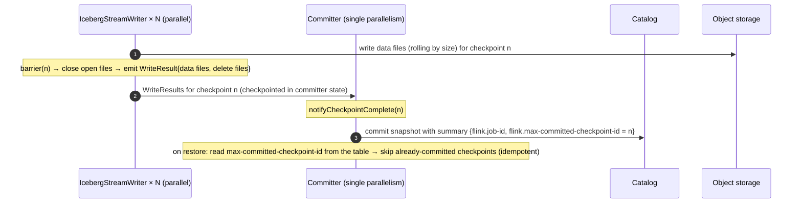

# 01 · Streaming into Iceberg and BigQuery, and Small-File Compaction

> **Folder:** `06-Lakehouse-Sinks-Backpressure-and-FinOps/` · **File 1 of 3**
> **Anchoring sources:** Apache Iceberg table spec (v2 and v3) and docs (*Reliability*, *Maintenance*, *Flink
> integration*) · Armbrust et al., *Delta Lake: High-Performance ACID Table Storage over Cloud Object Stores* (PVLDB 2020)
> · Armbrust et al., *Lakehouse* (CIDR 2021) · BigQuery docs (*Storage Write API*, *partitioned and clustered tables*,
> *BigQuery tables for Apache Iceberg*) · Apache Beam Managed I/O (Iceberg).
> **Prev folder:** [05 · Temporal joins and TTL](../05-Distributed-Shuffle-Skew-and-Join-Mechanics/03-temporal-joins-interval-joins-and-state-ttl-compaction-filters.md)
> · **Next:** [02 · End-to-end exactly-once](02-end-to-end-exactly-once-two-phase-commit-and-idempotency.md)

---

## 0. The thesis

A lakehouse table is **immutable files plus a metadata tree with an atomically swapped root pointer**. Streaming into it
creates a tension:

- **Freshness** wants frequent commits.
- **Every commit creates files and metadata.** Too many small files destroy query performance, inflate metadata, and burn
  object-store request budgets.

Exactly-once is the easy part, because commits are atomic and can be made idempotent by checkpoint ID. The engineering is:

- **distribution** (who writes which partition),
- **commit cadence** (freshness vs. file size),
- **delete-file accumulation** (upserts),
- **continuous maintenance**: compaction, snapshot expiry, manifest rewrites, orphan cleanup.

BigQuery's managed storage removes the file problem but adds its own quotas and CDC-staleness trade-offs.

---

## 1. First principles: Iceberg's metadata tree

```
 Catalog (REST / Hive / Glue / Nessie / JDBC)
   └── current-metadata-pointer ──► metadata.json  (schemas, partition specs, sort orders, properties, snapshot log)
                                        └── snapshot S_n ──► manifest list (Avro)
                                                               ├── manifest A (Avro): data files + per-file partition values,
                                                               │                      column stats (min/max/null counts)
                                                               └── manifest B: delete files (position / equality deletes)
                                                                       └── data files (Parquet/ORC/Avro) on object storage
```

**A commit is optimistic concurrency.** The writer reads the current metadata, writes new manifests and a new
`metadata.json`, then **compare-and-swaps** the catalog pointer. If another commit won the race, it re-validates against
the new base (are my assumptions still valid?) and retries. Appends rarely conflict. Rewrites and deletes can.

**Snapshot isolation for readers.** Readers pin a snapshot, plan from its manifests (pruning by partition and column
stats), and never see partial commits.

**Format versions** ⚠ verify the v3 details for your engines:

| Version | Adds |
|---------|------|
| v1 | analytic tables, append and overwrite |
| v2 | **row-level deletes**: position deletes (file + row position) and **equality deletes** (delete rows matching key values), sequence numbers |
| v3 | deletion vectors (compact bitmap position deletes), row lineage, new types (variant, nanosecond timestamps), and more |

---

## 2. How streaming writes work (Flink)



- **Exactly-once:** data files are written before the barrier, and the snapshot is committed only after the checkpoint
  completes. On restore, the committer checks the table's snapshot summary for the last committed checkpoint ID and
  **doesn't re-commit** it. That's checkpoint-aligned 2PC with idempotent commit (file 02).
- **Freshness = checkpoint interval.** Readers see data only at commit.
- **Upserts** (`write.upsert.enabled`, equality field columns = PK): each upsert writes an **equality delete** for the key
  plus the new row. Reads must apply the deletes, so read cost grows until compaction folds them in.
- The newer **Sink V2-based `IcebergSink`** adds pre- and post-commit topology hooks, which makes in-pipeline maintenance
  (small-file compaction after commits) possible ⚠ verify availability and API in your Iceberg version.

---

## 3. The small-file problem, quantified

### 3.1 Files produced

$$
F_{\text{day}} \approx \underbrace{w_p}_{\text{writers per active partition}} \cdot \underbrace{P_{\text{active}}}_{\text{partitions touched per commit}} \cdot \underbrace{\frac{86400}{T_{\text{commit}}}}_{\text{commits/day}}
\qquad
\bar{s}_{\text{file}} \approx \frac{D_{\text{day}}}{F_{\text{day}}}
$$

| Setup (1 TB/day, hourly partitions, 1-min commits) | $w_p$ | $P_{\text{active}}$ | Files/day | Avg file |
|----------------------------------------------------|-------|---------------------|-----------|----------|
| No distribution, 100 writers, all write every partition | 100 | ~2 | ~288,000 | **~3.5 MB** |
| `distribution-mode = hash` by partition | ~1 | ~2 | ~2,900 | **~350 MB** |
| hash + 5-min commits | ~1 | ~2 | ~580 | ~1.7 GB (cap with target file size, then roll) |

### 3.2 Why small files hurt

| Cost | Mechanism |
|------|-----------|
| **Query planning** | the planner reads manifests listing every file; millions of entries make planning slow |
| **Per-file open overhead** | each Parquet file means an open, a footer read, and column-chunk seeks: tens of ms on object storage |
| **Compression and encoding** | small row groups compress worse and give weaker statistics |
| **Object-store requests** | PUTs on write, GETs on read, both billed per request (Folder 06, file 03) |
| **Metadata growth** | each commit adds a `metadata.json`, a manifest list, and manifests; old snapshots retain old manifests |
| **Delete-file amplification** | equality deletes must be checked against every data file they might affect |

**The freshness trade, in one line:**

$$
\bar{s}_{\text{file}} \approx \frac{\Theta_{\text{partition}}}{w_p} \cdot T_{\text{commit}}
$$

To get 256 MB files at 1 MB/s per partition with one writer per partition, you need ~4-minute commits. Faster commits
**require** compaction to restore file sizes later.

---

## 4. Mitigations

### 4.1 At write time

| Lever | Effect | Cost |
|-------|--------|------|
| **`write.distribution-mode = hash`** (shuffle by partition key before the writers) | ~1 writer per partition, so files ÷ writers | a shuffle; skew if partitions are hot (then `range` with statistics, or bucket partitioning) |
| **Commit interval** (Flink checkpoint, Beam triggering frequency) | larger files, fewer snapshots | freshness |
| **`write.target-file-size-bytes`** | rolls files at a target size | — |
| **Partition design** | don't over-partition (hourly × country × device = tiny files); use hidden transforms (`days(ts)`, `bucket(n, id)`) | query pruning trade-offs |
| **Sort order** (`write.sort-order` / `WRITE ORDERED BY`) | better min/max stats, so pruning | sort cost at write |
| **Fewer writers** (sink parallelism) | fewer files | write throughput |

### 4.2 Continuous maintenance

| Procedure | What it does | Cadence |
|-----------|--------------|---------|
| `rewrite_data_files` (bin-pack, sort, z-order) | merges small files; folds delete files into data files | hourly to daily per hot partition |
| `rewrite_position_delete_files` | compacts position delete files | with data rewrites |
| `rewrite_manifests` | consolidates many small manifests, which speeds planning | daily |
| `expire_snapshots` | removes old snapshots and unreferenced files (time travel retention) | daily |
| `remove_orphan_files` | deletes files not referenced by any snapshot (failed writes) | weekly, with a safety margin |
| Metadata cleanup (`write.metadata.delete-after-commit.enabled`, `previous-versions-max`) | caps old `metadata.json` files | always on |

**Compaction vs. streaming commit conflicts.** Appends don't invalidate a rewrite. But an upsert stream writing
**equality deletes** concurrently with a rewrite of the files those deletes target can fail validation, or apply deletes
incorrectly if sequence numbers are mishandled.

- Use `use-starting-sequence-number = true` (rewritten files keep the starting snapshot's sequence number, so newer
  equality deletes still apply).
- Enable partial progress (commit compaction in groups).
- Schedule compaction on **cold partitions** (closed hours or days), not the one being written.

---

## 5. BigQuery as the streaming sink

| Concern | Iceberg | BigQuery native |
|---------|---------|-----------------|
| Small files | your problem (compaction) | managed by BigQuery storage |
| Exactly-once ingestion | checkpoint-aligned commits | Storage Write API committed streams with offsets (Folder 03, file 03) |
| Upserts | equality deletes + compaction | CDC upserts (`_CHANGE_TYPE`) with `max_staleness` (background apply) |
| Freshness | commit interval | seconds (Storage Write API) |
| Partition pruning | hidden partitioning + stats | partitioned (time or integer range) + clustered tables |
| Openness | multi-engine (Spark, Flink, Trino, …) | BigQuery-centric (plus BigQuery tables for Apache Iceberg / BigLake for open formats ⚠ verify features) |
| Cost model | storage + compute engines + requests | storage + ingestion + query (on-demand or reservations) |

BigQuery streaming design rules:

- **Partition by event date** (not ingestion time) when queries filter on event time. Late data lands in old partitions
  correctly.
- **Cluster by high-selectivity filter columns.**
- **Use CDC upserts for state tables** and set `max_staleness` to what readers tolerate. Smaller staleness means more
  background merge work and query-time merging.
- **Mind quotas:** the Storage Write API's concurrent connections and throughput (Folder 03, file 03 §4.3). DML for
  streaming is the anti-pattern.

---

## 6. Hardware sympathy

| Phase | Physics |
|-------|---------|
| Writer buffering | Parquet writers buffer a row group in memory per open file. Open files = partitions touched × writers, and each costs MBs, so **many open partitions per writer means OOM** |
| Upload | multipart uploads per file; small files are request-bound |
| Commit | catalog round trips plus metadata writes; contention when many jobs commit to one table |
| Reads | per-file opens and footer reads; column pruning; row-group stats; delete-file application |
| Compaction | read and rewrite bytes (CPU for decode and encode); schedule against capacity |

**Open file handles per writer** are the hidden memory cost of high-cardinality partitioning:

$$
M_{\text{writer}} \approx P_{\text{open}} \times S_{\text{row group buffer}}
$$

At 1,000 open partitions × 8 MB buffers, that's 8 GB per writer. Hash distribution fixes it too, because each writer sees
fewer partitions.

---

## 7. Production Java 21 code blueprints

### 7.1 Anti-patterns

```java
// (A) 200 writers, no distribution, 30 s checkpoints, hourly × country × device partitioning:
// every writer writes every partition every commit → millions of KB-sized files per day.
FlinkSink.forRowData(rows).tableLoader(loader).writeParallelism(200).append();

// (B) Upserts with no compaction: equality deletes pile up; reads slow down every day until queries time out.

// (C) remove_orphan_files with olderThan = now: deletes files of IN-FLIGHT commits (written but not yet committed).
```

### 7.2 Flink: hash-distributed Iceberg sink (append and upsert)

```java
package dev.l7.lakehouse;

import java.util.List;
import org.apache.flink.streaming.api.datastream.DataStream;
import org.apache.flink.table.data.RowData;
import org.apache.iceberg.DistributionMode;
import org.apache.iceberg.catalog.TableIdentifier;
import org.apache.iceberg.flink.CatalogLoader;
import org.apache.iceberg.flink.TableLoader;
import org.apache.iceberg.flink.sink.FlinkSink;

public final class IcebergSinks {

  /** Append-only facts: one writer per partition (hash), file size governed by checkpoint interval + target size. */
  public static void appendFacts(DataStream<RowData> rows, CatalogLoader catalog) {
    FlinkSink.forRowData(rows)
        .tableLoader(TableLoader.fromCatalog(catalog, TableIdentifier.of("analytics", "click_events")))
        .distributionMode(DistributionMode.HASH)     // shuffle by partition key before writing
        .writeParallelism(32)                        // ≈ active partitions × desired writers per partition
        .uidPrefix("iceberg-click-events-v1")        // stable operator ids for savepoints
        .append();
  }

  /** Current-state table: upserts by primary key (format v2 equality deletes). Needs compaction (§7.4). */
  public static void upsertOrders(DataStream<RowData> rows, CatalogLoader catalog) {
    FlinkSink.forRowData(rows)
        .tableLoader(TableLoader.fromCatalog(catalog, TableIdentifier.of("ops", "orders_current")))
        .equalityFieldColumns(List.of("order_id"))
        .upsert(true)
        .distributionMode(DistributionMode.HASH)     // co-locates a key's upserts on one writer
        .writeParallelism(16)
        .uidPrefix("iceberg-orders-current-v1")
        .append();
  }
}
```

`FlinkSink` is the long-standing builder. Newer Iceberg releases add a Sink V2 `IcebergSink` with maintenance hooks.
Prefer it once it's stable for your version ⚠ verify.

### 7.3 Flink SQL: catalog and table properties

```sql
CREATE CATALOG lake WITH (
  'type' = 'iceberg',
  'catalog-type' = 'rest',
  'uri' = 'https://catalog.internal/api',
  'warehouse' = 's3://lake-warehouse/'
);

-- Flink DDL supports identity partitions; define hidden transforms (days(ts), bucket(16, id)) via Spark/Java API.
CREATE TABLE lake.ops.orders_current (
  order_id     STRING,
  status       STRING,
  amount_cents BIGINT,
  updated_at   TIMESTAMP(6),
  dt           STRING,
  PRIMARY KEY (order_id) NOT ENFORCED
) PARTITIONED BY (dt) WITH (
  'format-version' = '2',
  'write.upsert.enabled' = 'true',
  'write.distribution-mode' = 'hash',
  'write.target-file-size-bytes' = '536870912',
  'write.metadata.delete-after-commit.enabled' = 'true',
  'write.metadata.previous-versions-max' = '50',
  'commit.manifest-merge.enabled' = 'true'
);
```

### 7.4 Maintenance job (Spark actions): compaction, snapshot expiry, manifests, orphans

```java
package dev.l7.lakehouse;

import java.util.concurrent.TimeUnit;
import org.apache.iceberg.Table;
import org.apache.iceberg.expressions.Expressions;
import org.apache.iceberg.spark.actions.SparkActions;

/** Run per table on a schedule (e.g., hourly for hot tables). Targets COLD partitions to avoid conflicts. */
public final class IcebergMaintenance {

  public static void run(Table table, String coldPartitionPredicateDt) {
    long now = System.currentTimeMillis();

    // 1) Compact small files and fold delete files in partitions no longer being written.
    SparkActions.get().rewriteDataFiles(table)
        .filter(Expressions.lessThan("dt", coldPartitionPredicateDt))
        .binPack()
        .option("target-file-size-bytes", String.valueOf(512L << 20))
        .option("min-input-files", "5")
        .option("delete-file-threshold", "1")                 // rewrite files with ≥ 1 delete file attached
        .option("partial-progress.enabled", "true")           // commit in groups; fewer conflicts
        .option("use-starting-sequence-number", "true")       // concurrent equality deletes still apply correctly
        .execute();

    // 2) Compact position delete files.
    SparkActions.get().rewritePositionDeletes(table)
        .filter(Expressions.lessThan("dt", coldPartitionPredicateDt))
        .execute();

    // 3) Consolidate manifests for faster planning.
    SparkActions.get().rewriteManifests(table).execute();

    // 4) Expire old snapshots (time-travel retention policy) and their unreferenced files.
    SparkActions.get().expireSnapshots(table)
        .expireOlderThan(now - TimeUnit.DAYS.toMillis(3))
        .retainLast(100)
        .execute();

    // 5) Orphans: ONLY with a margin far larger than the longest possible in-flight commit (never "now").
    SparkActions.get().deleteOrphanFiles(table)
        .olderThan(now - TimeUnit.DAYS.toMillis(3))
        .execute();
  }
}
```

Method names follow Iceberg's Spark actions API ⚠ verify against your Iceberg version (e.g., `rewritePositionDeletes`).
SQL equivalents are `CALL catalog.system.rewrite_data_files(...)`, `rewrite_manifests`, `expire_snapshots`, and
`remove_orphan_files`.

### 7.5 Beam: Iceberg via Managed I/O, and BigQuery (⚠ verify config keys per Beam version)

```java
// Beam Managed Iceberg sink (streaming): commits every triggering interval; tune it like a checkpoint interval.
rows.apply("WriteIceberg", Managed.write(Managed.ICEBERG).withConfig(Map.of(
    "table", "analytics.click_events",
    "catalog_name", "lake",
    "catalog_properties", Map.of("type", "rest", "uri", "https://catalog.internal/api", "warehouse", "s3://lake-warehouse/"),
    "triggering_frequency_seconds", 300)));        // 5-min commits → fewer, larger files

// BigQuery: Storage Write API exactly-once for facts (Folder 03, file 03 §8.2), date-partitioned + clustered table.
```

---

## 8. Production failure modes and P99 debugging

| ID | Failure | Signature | Root cause | Fix |
|----|---------|-----------|------------|-----|
| L1 | **Small-file explosion** | files/day ≫ plan; queries slow; planning takes minutes | no distribution; short commits; over-partitioning | hash distribution; longer commits; partition redesign; compaction |
| L2 | **Metadata bloat** | large manifest lists; slow planning; many `metadata.json` | many commits; no expiry or manifest rewrites | expire snapshots; rewrite manifests; metadata cleanup properties |
| L3 | **Delete-file read amplification** | upsert table reads slow down steadily | equality deletes accumulating | regular `rewrite_data_files` with a delete threshold; bucket partitioning by PK |
| L4 | **Commit conflicts** | compaction or commit failures; retries; stale tables | concurrent rewrites vs. delete-writing streams | compact cold partitions; partial progress; starting sequence numbers |
| L5 | **Stale tables from checkpoint failures** | no new snapshots; data freshness SLO broken | commits gated on checkpoints (Folder 04, file 01) | fix the checkpoint health; alert on snapshot age |
| L6 | **Writer OOM** | TaskManager heap OOM in writers | too many open partitions per writer (row-group buffers) | hash distribution; fewer partitions; a smaller row-group size |
| L7 | **Orphan cleanup deleted live files** | `FileNotFoundException` on reads after maintenance | `olderThan` too recent | a large margin (days); never run with "now" |
| L8 | **Catalog contention** | commit latency spikes; CAS retries | many writers or jobs committing to one table | fewer committers; batch commits; partition by table or job |
| L9 | **BigQuery Storage Write quota errors** | `RESOURCE_EXHAUSTED` | too many streams or connections | auto-sharding; fewer streams; consolidate (Folder 03, file 03) |

### Runbook · L1

1. Measure files per partition per day and the average file size (Iceberg `files` and `partitions` metadata tables:
   `SELECT partition, count(*), avg(file_size_in_bytes) FROM db.t.files GROUP BY partition`).
2. If writers per partition > 1, enable hash distribution. If commit interval × partition throughput is under 128 MB,
   lengthen commits or accept them and compact.
3. Schedule `rewrite_data_files` on closed partitions. Verify that average file size rises above ~256 MB.

---

## 9. FAANG L7 bar-raiser Q&A chains

### Q1 · "Stream 1 TB/day of clickstream into Iceberg with 1-minute freshness. Design the write path."

**L5 textbook answer.** Use the Flink Iceberg sink with a 1-minute checkpoint interval.

**Why L5 breaks at petabyte scale.** Without distribution, every writer writes every partition every minute: hundreds of
thousands of tiny files per day, slow planning, high request costs, and query timeouts within weeks.

**L7 principal defense.**

1. **Hash distribution** by partition, so ~1 writer per active partition.
2. **Compute file size:** at 1-minute commits, ~1 TB / (2 partitions × 1,440) ≈ 350 MB files. Fine.
3. **Partition coarsely** (hidden `days(ts)` or `hours(ts)`, plus `bucket` if needed). Avoid high-cardinality identity
   partitions.
4. **Continuous maintenance:** compaction of closed partitions, manifest rewrites, snapshot expiry, and orphan cleanup
   with margins.
5. **Exactly-once via checkpoint-aligned commits** and the max-committed-checkpoint-ID check.
6. **SLO alerts** on snapshot age (freshness) and files per partition.

### Q2 · "Upserts into Iceberg get slower to query every day. Why, and what do you do?"

**L5 textbook answer.** The table is growing. Add query resources.

**Why L5 breaks.** Growth isn't the cause. **Equality delete files** accumulate. Each read must apply deletes against data
files, so cost grows with the number of delete files, not with live data.

**L7 principal defense.**

- **Compact regularly:** `rewrite_data_files` with a delete-file threshold, which folds deletes into rewritten data
  files, plus position-delete compaction.
- **Bucket-partition by the primary key,** so deletes affect fewer files.
- **Use `use-starting-sequence-number`** and target cold partitions to avoid commit conflicts with the upsert stream.
- **Consider v3 deletion vectors** where engines support them ⚠ verify, or a merge-on-read vs. copy-on-write policy per
  table.

### Q3 · "Why is exactly-once into Iceberg comparatively easy, and what's still hard?"

**L5 textbook answer.** Iceberg has ACID transactions.

**Why L5 breaks.** ACID commits alone don't prevent **double commits after a restore**. The hard parts are file sizes,
deletes, maintenance, and concurrency.

**L7 principal defense.**

- **Easy part:**
  - files are written before the barrier;
  - the commit happens after checkpoint completion (2PC);
  - **idempotency comes from the snapshot summary** (`flink.max-committed-checkpoint-id`), so restores skip committed
    checkpoints.
- **Hard parts:**
  - the small-file trade with freshness;
  - equality-delete amplification;
  - compaction vs. streaming conflicts (sequence numbers);
  - metadata and snapshot growth;
  - orphan cleanup safety;
  - catalog contention.

### Q4 · "Iceberg or BigQuery for a real-time analytics sink?"

**L5 textbook answer.** BigQuery if you're on GCP, Iceberg otherwise.

**Why L5 breaks.** Platform affinity is one input. The decision is about openness, freshness, upsert semantics, cost
model, and operational ownership.

**L7 principal defense.**

| | BigQuery | Iceberg |
|---|---|---|
| Storage and compaction | managed | multi-engine, open format |
| Exactly-once ingestion | seconds of freshness | checkpoint-interval freshness |
| Upserts | CDC with staleness | equality deletes + compaction |
| Operations | lowest burden; vendor coupling | **you** own maintenance and catalog availability |
| Costs | ingestion + query models | object storage + requests + compute engines |

Hybrid options exist (BigQuery tables for Apache Iceberg / BigLake), so choose per table class.

---

## 10. Invariants checklist

1. **A commit is a CAS on the metadata pointer.** Make it idempotent by checkpoint ID.
2. **File size ≈ partition throughput ÷ writers per partition × commit interval.** Distribute by partition.
3. **Fast commits require compaction.** Budget maintenance as part of the pipeline.
4. **Upserts accumulate delete files.** Compact with delete thresholds; bucket by PK.
5. **Expire snapshots, rewrite manifests, remove orphans with large margins.**
6. **Alert on snapshot age and files per partition,** not just job health.
7. **For BigQuery,** use the Storage Write API, partition by event date, cluster wisely, and set CDC staleness
   deliberately.

---

## 11. References

- Apache Iceberg: *Table Spec* (v2, v3), *Reliability*, *Maintenance*, *Flink Writes*, *Spark Procedures and Actions*.
- M. Armbrust et al. *Delta Lake: High-Performance ACID Table Storage over Cloud Object Stores.* PVLDB 13(12), 2020.
- M. Armbrust, A. Ghodsi, R. Xin, M. Zaharia. *Lakehouse: A New Generation of Open Platforms that Unify Data Warehousing
  and Advanced Analytics.* CIDR 2021.
- Google Cloud BigQuery: *Storage Write API*, *Partitioned tables*, *Clustered tables*, *Change data capture*, *BigQuery
  tables for Apache Iceberg*.
- Apache Beam: *Managed I/O* (Iceberg). Apache Flink: Iceberg connector docs.

**Next →** [02 · End-to-end exactly-once: two-phase commit and idempotency](02-end-to-end-exactly-once-two-phase-commit-and-idempotency.md)
