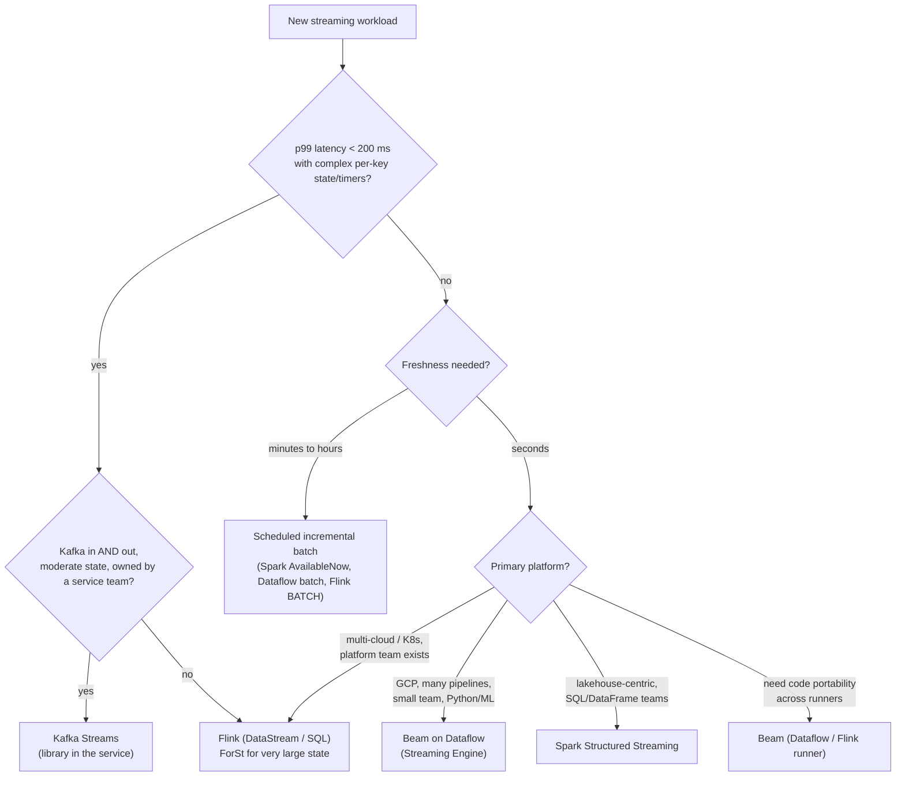
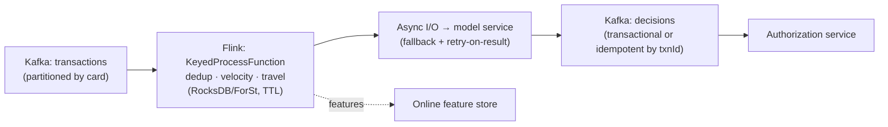
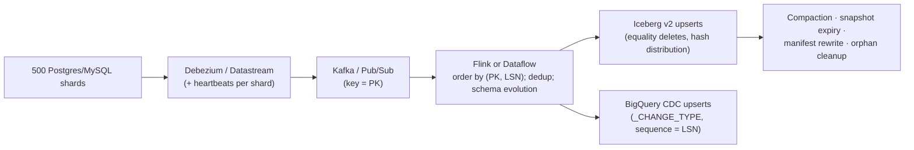
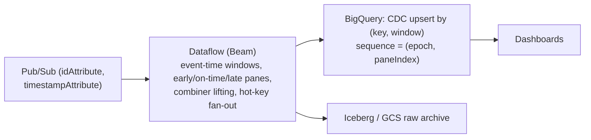
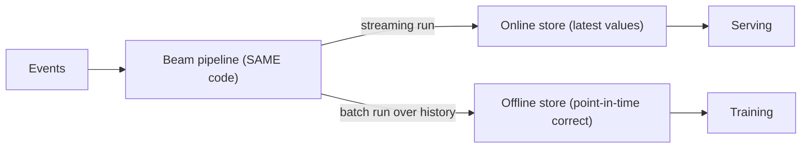
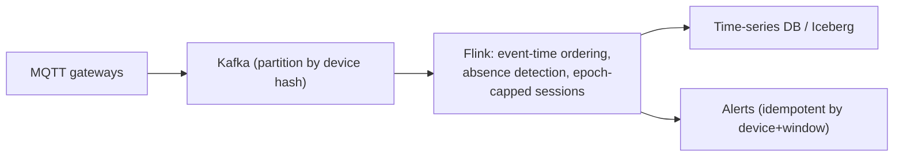

# 01 · Architecture Decision Matrix: Beam/Dataflow vs. Flink vs. Spark Structured Streaming vs. Kafka Streams

> **Folder:** `08-FAANG-L7-Architecture-Playbook-and-Bar-Raiser-QA/` · **File 1 of 3**
> **Synthesizes:** Folders 01–07. Every claim links back to the file that derives it.
> **Next:** [02 · 25 bar-raiser scenario Q&A chains](02-25-faang-l7-bar-raiser-scenario-qna-chains.md)

---

## 0. The thesis

Engines don't differ in *what* they can compute. All four can express windowed, stateful, exactly-once pipelines. They
differ in **where they put the hard costs**:

| Engine | Where the hard costs live |
|--------|---------------------------|
| **Dataflow (Beam)** | per-key commits in a managed backend: low ops, per-commit exactly-once, but ~100 ms-plus per stage and GCP coupling |
| **Flink** | pipelined execution with local or disaggregated state and barrier snapshots: millisecond latency and rich state, but checkpoint coupling and real operational ownership |
| **Spark Structured Streaming** | micro-batches over a batch engine: simplicity and the batch ecosystem, but a micro-batch latency floor |
| **Kafka Streams** | a library inside your service, Kafka as both shuffle and state changelog: no cluster to run, but Kafka-bound topologies and repartition-topic costs |

The L7 decision is a **requirements-to-cost mapping**, written down as an ADR, not a preference.

---

## 1. Requirement axes

| Axis | Question | Why it discriminates |
|------|----------|----------------------|
| **Latency (p99 end to end)** | ms, sub-second, seconds, minutes? | pipelined (Flink, Kafka Streams) < per-commit (Dataflow) < micro-batch (Spark) |
| **Correctness semantics** | event-time windows, late data, retractions, exactly-once *effects*? | depth of the time model; sink guarantees (Folders 01, 06) |
| **State size and shape** | GB? TB? keys × retention? | local RocksDB vs. disaggregated (ForSt, Windmill) vs. changelog topics (Folder 04, file 02) |
| **Throughput and elasticity** | steady or spiky? autoscaling needs? | rescaling cost depends on state location |
| **Exactly-once output visibility** | per record, per checkpoint, per micro-batch? | 2PC vs. idempotent commits (Folder 06, file 02) |
| **Sources and sinks** | Kafka-only? Pub/Sub, BigQuery, Iceberg, CDC? | connector maturity |
| **Ops model** | managed service vs. platform team | the people cost dominates small fleets (Folder 06, file 03) |
| **Languages and portability** | Java only? Python ML? multi-cloud? | Beam's portability; Flink and Spark SQL; Kafka Streams is JVM-only |
| **SQL-first users** | analysts authoring pipelines? | Flink SQL (changelog semantics), Spark SQL, Beam SQL (limited) |
| **Batch + streaming unification** | same code for backfills and live? | Beam (one model), Flink (BATCH mode), Spark (one engine) |

---

## 2. Engine profiles

### 2.1 Beam on Google Cloud Dataflow

| Aspect | Profile |
|--------|---------|
| Model | Dataflow Model: What/Where/When/How; full event-time windows, triggers, accumulation; no retractions (Folder 01) |
| Execution | fused stages; Runner v2 with the Fn API (any SDK language); per-key atomic commits in Streaming Engine (Folders 02, 03) |
| State | remote (Windmill), with worker caches; per-key and per-commit bounds (Folder 03, file 01) |
| Exactly-once | internal: native (record-ID dedup + commits); sinks: idempotent, offset-based (BigQuery Storage Write API), Kafka EOS (Folder 03, file 03) |
| Latency | ~hundreds of ms to seconds (commit per stage, sink triggering) |
| Elasticity | strong: autoscaling without state moves; FlexRS for batch; dynamic work rebalancing |
| Ops | lowest (managed) |
| Portability | Beam code runs on Flink, Spark, and Prism runners (with feature gaps) |
| Sweet spot | GCP-native analytics and ETL, many pipelines, small teams, batch+streaming with one model, Python ML pipelines |
| Anti-sweet spot | single-digit-ms latency; non-GCP deployments; very chatty stateful logic where per-commit latency dominates |

### 2.2 Apache Flink (1.20 LTS, 2.x)

| Aspect | Profile |
|--------|---------|
| Model | DataStream (full control: timers, state, async I/O), Table/SQL (changelog semantics, retractions) |
| Execution | pipelined, credit-based flow control (Folder 04, file 03) |
| State | heap / embedded RocksDB / **ForSt (2.x, disaggregated)** (Folder 04, file 02) |
| Exactly-once | barrier snapshots + 2PC sinks (Kafka transactions, Iceberg commits) (Folders 04, 06) |
| Latency | **ms**; transactional output visibility = checkpoint interval |
| Elasticity | operator autoscaler; rescaling cost = state movement (much reduced with ForSt) |
| Ops | high (self-managed) to medium (managed offerings) |
| Sweet spot | low-latency stateful apps (fraud, CEP, alerting), complex event-time logic, very large state, open deployments |
| Anti-sweet spot | small teams without platform support; simple ETL a managed service would run cheaper |

### 2.3 Spark Structured Streaming

| Aspect | Profile |
|--------|---------|
| Model | DataFrame/SQL over unbounded tables; watermarks; output modes (append/update/complete) |
| Execution | micro-batches (plus vendor-specific low-latency modes ⚠ verify) |
| State | state store per partition (RocksDB provider for large state) |
| Exactly-once | idempotent sinks + checkpointed offsets; transactional table formats (Delta, Iceberg) |
| Latency | seconds-scale typical |
| Elasticity | cluster-level; `Trigger.AvailableNow` for cheap scheduled incremental runs |
| Ops | medium (managed platforms help) |
| Sweet spot | lakehouse-centric orgs, SQL and DataFrame teams, minute-level freshness, unified batch ETL |
| Anti-sweet spot | sub-second latency; complex per-key timers and custom state machines |

### 2.4 Kafka Streams

| Aspect | Profile |
|--------|---------|
| Model | KStream/KTable DSL + Processor API; stream time + grace; windowed aggregations; KTable upserts |
| Execution | **a library** inside application instances; tasks per input partition |
| State | local RocksDB per task + **changelog topics** for durability; standby replicas |
| Exactly-once | Kafka transactions (EOS v2) across consume-process-produce |
| Latency | ms |
| Elasticity | add or remove app instances; state restoration from changelogs can be slow for big state |
| Ops | no separate cluster, but state restore, repartition-topic costs, and RocksDB memory are your problem (Folder 07, file 03 §3.6) |
| Sweet spot | Kafka-in, Kafka-out microservices with moderate state, embedded in services owned by product teams |
| Anti-sweet spot | non-Kafka sources and sinks; huge state; many shuffles (repartition topics ×RF) (Folder 05, file 01 Q4) |

---

## 3. The weighted decision matrix

Scores 1–5 (5 = best fit for the axis), assuming *typical* deployments. They're indicative, so calibrate to your context.

| Axis | Dataflow (Beam) | Flink | Spark SS | Kafka Streams |
|------|-----------------|-------|----------|---------------|
| p99 latency (lower is better) | 3 | **5** | 2 | **5** |
| Event-time and lateness semantics | **5** | **5** | 3 | 3 |
| Retractions / changelog SQL | 2 | **5** (SQL) | 3 | 3 (KTable) |
| Large-state handling | 4 | **5** (ForSt) | 3 | 2 |
| Exactly-once *effects* (sink ecosystem) | 4 | **5** | 4 | 4 (Kafka only) |
| Elasticity / rescaling | **5** | 3 → 4 (2.x) | 4 | 3 |
| Ops burden (lower is better) | **5** | 2 | 3 | 4 |
| Batch + streaming unification | **5** | 4 | **5** | 1 |
| Language reach (Python, Go, …) | **5** | 3 (PyFlink) | 4 (PySpark) | 1 |
| Non-Kafka connectors | 4 | **5** | **5** | 1 |
| Portability / lock-in risk | 4 (Beam portable) | **5** | 4 | 4 |

**Weighted score:**

$$
S_e = \sum_a w_a \cdot s_{e,a}, \qquad \sum_a w_a = 1
$$

Weights come from the workload. A fraud system weights latency and state. An analytics platform weights ops, unification,
and connectors. **Report the sensitivity:** if a small change in weights flips the decision, it's a close call, so decide
on second-order factors (team skills, existing platform).

---

## 4. Decision tree



---

## 5. Reference architectures

### 5.1 Real-time card fraud (p99 < 200 ms)



Key decisions:

- event-time features with event-time cleanup timers (replay-deterministic);
- async I/O capacity = λ × W;
- fallback decisions instead of job failure;
- decision visibility: transactional (checkpoint cadence) vs. idempotent-by-txnId (milliseconds).

Folder 07, file 03.

### 5.2 CDC from OLTP to the lakehouse (exact current state + history)



Key decisions:

- version = source LSN/GTID (never wall clock, Folder 01, file 01 F7);
- per-shard heartbeats for watermarks;
- upsert sinks with a sequence guard;
- continuous Iceberg maintenance;
- schema registry with transitive compatibility.

Folders 05, 06, 07.

### 5.3 Clickstream analytics with seconds-level dashboards



Key decisions:

- accumulating panes with versioned upserts (Folder 01, file 03 §9.2);
- `withHotKeyFanout` for celebrity pages;
- the Storage Write API for exactly-once facts;
- at-least-once mode if every sink is an upsert.

### 5.4 Real-time ML features with training/serving consistency



Key decisions:

- **one codebase for batch and streaming** (Beam's semantic unification, Folder 01, file 01 §5) to avoid
  training/serving skew;
- sliced sliding windows (Folder 01, file 03 §9.6);
- event-time point-in-time joins for training sets.

### 5.5 IoT telemetry for 50M devices



Key decisions:

- device clocks are untrusted, so clamp at the source (Folder 01, file 01 §2.4);
- absence detection needs processing-time timers (a cost proportional to active keys, so re-arm sparingly);
- partitions per producer domain to contain bad clocks.

---

## 6. When not to stream

| Signal | Better choice |
|--------|---------------|
| Freshness SLO ≥ 1 hour | scheduled incremental batch (`AvailableNow`, Dataflow batch on new files, Flink BATCH) |
| Queries are ad hoc over recent data | a streaming database or a real-time OLAP store fed by simple ingestion |
| Transformations are simple stateless enrichment into a warehouse | managed ingestion (e.g., the Pub/Sub → BigQuery subscription) without a processing engine ⚠ verify feature fit |
| The team can't staff on-call for stateful streaming | managed service, or batch |

The cheapest streaming pipeline is the one you didn't need to build.

---

## 7. Migration paths

| From → To | Path | Watch-outs |
|-----------|------|------------|
| **Lambda → Kappa** | make the streaming path deterministic (event time, no processing-time logic); replay the log for backfills; reconcile against batch until parity | replay determinism (Folder 01, file 01 Q1), lateness policies, sink idempotency |
| **Spark DStreams → Structured Streaming** | DataFrame rewrite; watermarks; state store | state migration is a rewrite |
| **Kafka Streams → Flink** | when state, shuffles, or non-Kafka I/O outgrow the library | changelog state doesn't port; rebuild state by replay |
| **Dataflow ↔ Flink** | Beam on the Flink runner (portable code), or a native rewrite for performance | feature matrix gaps (SDF, state types); operational model changes |
| **Flink 1.20 → 2.x** | API removals (`SourceFunction`/`SinkFunction`, `Time`), config key renames, optional ForSt + async state | savepoint compatibility across major versions ⚠ verify; connector versions |

---

## 8. The ADR template (copy into your design doc)

```text
Title: Streaming engine for <workload>
Context: sources/sinks, volumes (avg/peak events/s, bytes/event), state (keys × retention × bytes),
         latency SLO (p99), freshness SLO, correctness (event time? late data horizon? exactly-once effects?),
         team (skills, on-call), platform constraints (cloud, K8s, compliance).
Options considered: Dataflow (Beam) | Flink | Spark SS | Kafka Streams | batch.
Evaluation: weighted matrix (§3) with sensitivity; TCO per option incl. people (Folder 06, file 03);
            failure modes per option (watermarks, checkpoints, hot keys, sinks).
Decision: <engine>, because <top 3 requirements → mechanisms>.
Consequences: what gets harder (e.g., checkpoint-coupled freshness), what we must build (DLQ, upserts, maintenance),
              exit strategy (Beam portability, open formats).
Validation plan: shadow run, replay determinism test, load test at 2× peak, recovery game day, cost per M events.
```

---

## 9. FAANG L7 bar-raiser Q&A chains

### Q1 · "Pick an engine for a company-wide streaming platform."

**L5 textbook answer.** Flink. It's the most powerful and the industry standard.

**Why L5 breaks.** "Most powerful" ignores who will run it, which workloads dominate (often ETL and analytics, not
millisecond CEP), and the people-cost crossover. Platforms die of operational burden, not missing features.

**L7 principal defense.**

1. **Segment the workloads** by latency, state, and freshness.
2. **Score them with weights per segment** (§3), and compute TCO including people (Folder 06, file 03).
3. **Likely outcome is a tiered platform:**
   - a managed engine (Dataflow, or managed Flink or Spark) for ETL and analytics;
   - Flink for low-latency stateful products;
   - batch for hourly SLOs.
4. **Unify governance** (labels, cost SLOs, DLQ standards, schema registry), not necessarily the engine.
5. **Keep exits open:** Beam portability and open table formats.

### Q2 · "Why not Kafka Streams for everything Kafka-related?"

**L5 textbook answer.** It's simplest: no cluster.

**Why L5 breaks at petabyte scale.**

- Every re-key creates a repartition topic, multiplying broker storage and network by RF.
- Large state restores from changelogs slowly (an hour-plus rebalance pain).
- Non-Kafka sinks need custom exactly-once handling.
- RocksDB memory is per store unless engineered (Folder 07, file 03 §3.6).

**L7 principal defense.** Kafka Streams is excellent for **service-embedded**, Kafka-in-Kafka-out logic with moderate
state and few shuffles. Choose Flink when topologies need many shuffles, large state, event-time sophistication beyond
stream time plus grace, or non-Kafka I/O.

### Q3 · "Dataflow or Flink for fraud scoring with a 150 ms p99?"

**L5 textbook answer.** Dataflow, because it's managed.

**Why L5 breaks.** Per-stage commit latency (~100s of ms with several stages) plus sink triggering can exceed the budget.
Flink's pipelined execution keeps per-hop latency in milliseconds.

**L7 principal defense.** Flink, with async I/O, keyed state, and idempotent decisions by txnId for millisecond
visibility, or transactional output if checkpoint-cadence visibility is acceptable. Dataflow fits the *analytics* side
(feature aggregation over minutes) feeding an online store.

---

## 10. Invariants checklist

1. **Choose by requirements → mechanisms → costs.** Write the ADR.
2. **Latency floors:** pipelined < per-commit < micro-batch.
3. **State location decides elasticity:** local (rescale moves state) vs. remote (cheap rescale, cache-sensitive).
4. **Exactly-once effects come from sinks.** Pick engines whose sink ecosystem matches your targets.
5. **Count people cost.** Managed wins small fleets; self-managed wins a few huge steady pipelines with a platform team.
6. **Don't stream what batch can serve.**

**Next →** [02 · 25 FAANG L7 bar-raiser scenario Q&A chains](02-25-faang-l7-bar-raiser-scenario-qna-chains.md)
